# 《软件工程（双语）》UNIT-06 软件测试：构件级与集成级（课件）

原件的每一页，下面附识别出的文字。

### UNIT 6

原文：

UNIT 6

软件测试：构件级 & 集成级

Software Testing Component Level & Integration Level

王传栋

软件工程

实践者的研究方法

Software Engineering A PRACTITIONER'S APPROACH

工具质热

### “Component Level” Testing

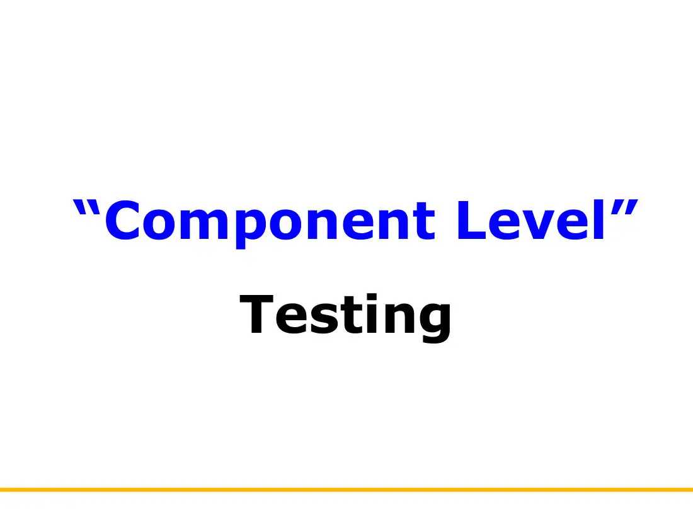

原文：

“Component Level” Testing

### Strategic Approach to Testing

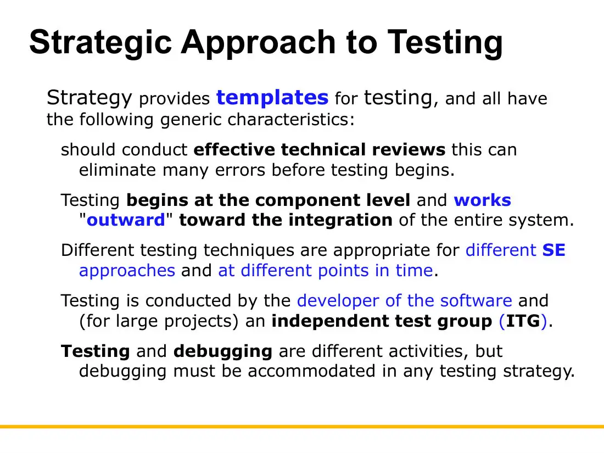

原文：

Strategic Approach to Testing

Strategy provides templates for testing, and all have the following generic characteristics:

should conduct effective technical reviews this can eliminate many errors before testing begins.

Testing begins at the component level and works "outward" toward the integration of the entire system.

Different testing techniques are appropriate for different SE approaches and at different points in time.

Testing is conducted by the developer of the software and (for large projects) an independent test group (ITG).

Testing and debugging are different activities, but debugging must be accommodated in any testing strategy.

### Verification and Validation

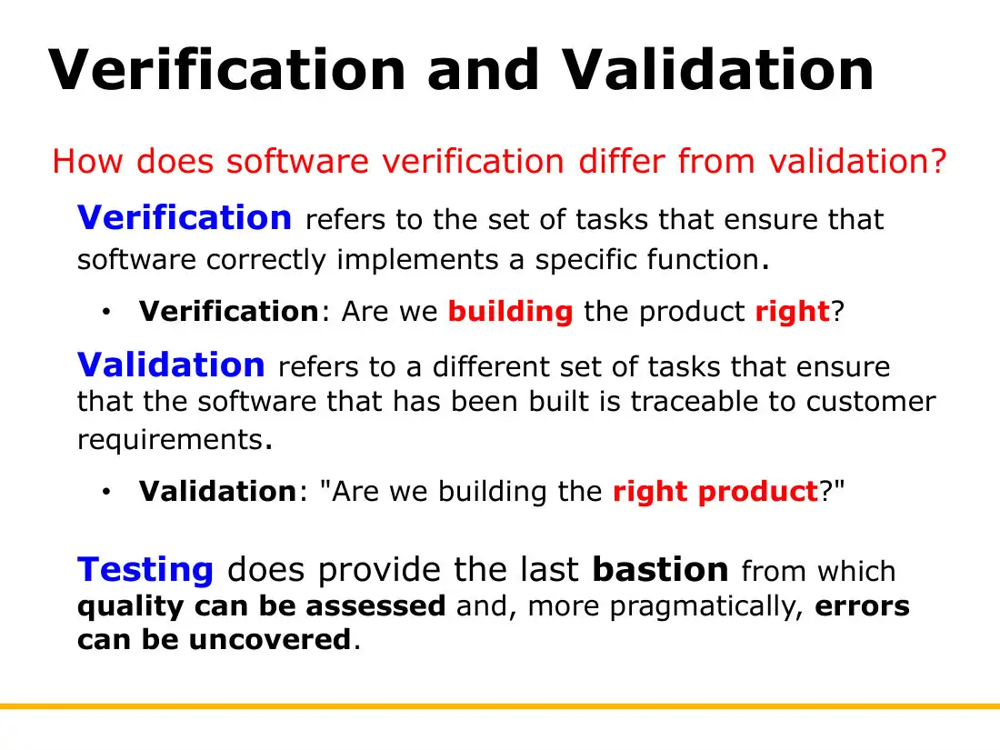

原文：

Verification and Validation

How does software verification differ from validation?

Verification refers to the set of tasks that ensure that software correctly implements a specific function.

• Verification: Are we building the product right?

Validation refers to a different set of tasks that ensure that the software that has been built is traceable to customer requirements.

• Validation: "Are we building the right product?"

Testing does provide the last bastion from which quality can be assessed and, more pragmatically, errors can be uncovered.

### Organizing for Testing

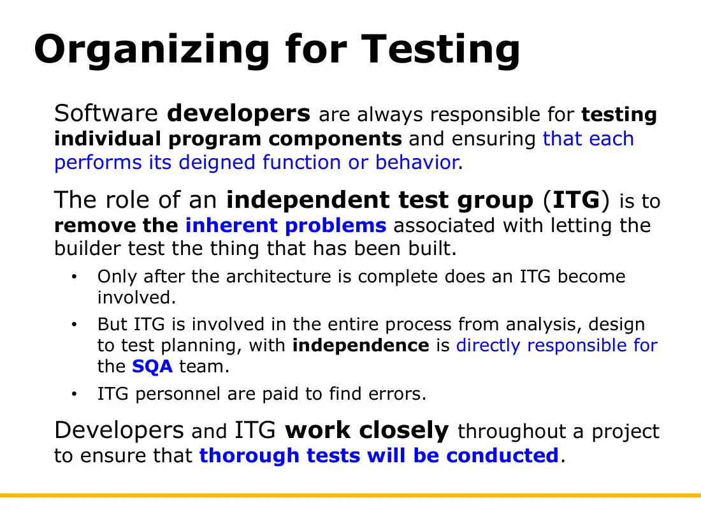

原文：

Organizing for Testing

Software developers are always responsible for testing individual program components and ensuring that each performs its deigned function or behavior.

The role of an independent test group (ITG) is to remove the inherent problems associated with letting the builder test the thing that has been built.

• Only after the architecture is complete does an ITG become involved.

But ITG is involved in the entire process from analysis, design to test planning, with independence is directly responsible for the SQA team.

• ITG personnel are paid to find errors.

Developers and ITG work closely throughout a project to ensure that thorough tests will be conducted.

### Organizing for Testing

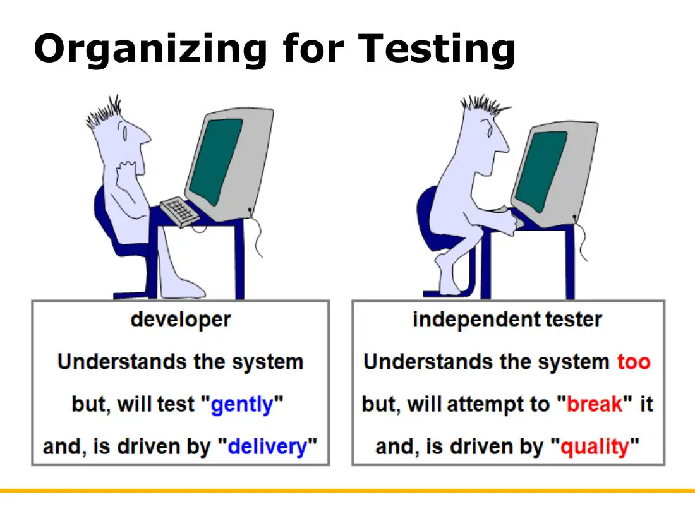

原文：

Organizing for Testing

developer Understands the system but, will test "gently" and, is driven by "delivery"

independent tester Understands the system too but, will attempt to "break" it and, is driven by "quality"

### Strategy & Steps

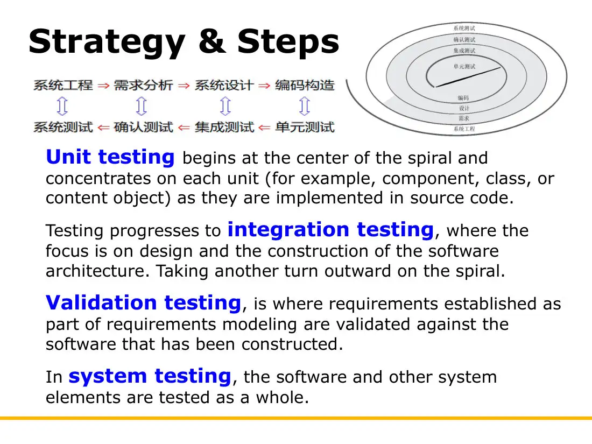

原文：

Strategy & Steps

系统工程 ⇒ 需求分析 ⇒ 系统设计 ⇒ 编码构造 系统测试⇐确认测试⇐集成测试⇐单元测试

Unit testing begins at the center of the spiral and concentrates on each unit (for example, component, class, or content object) as they are implemented in source code.

Testing progresses to integration testing, where the focus is on design and the construction of the software architecture. Taking another turn outward on the spiral.

Validation testing, is where requirements established as part of requirements modeling are validated against the software that has been constructed.

In system testing, the software and other system elements are tested as a whole.

### Strategy & Steps

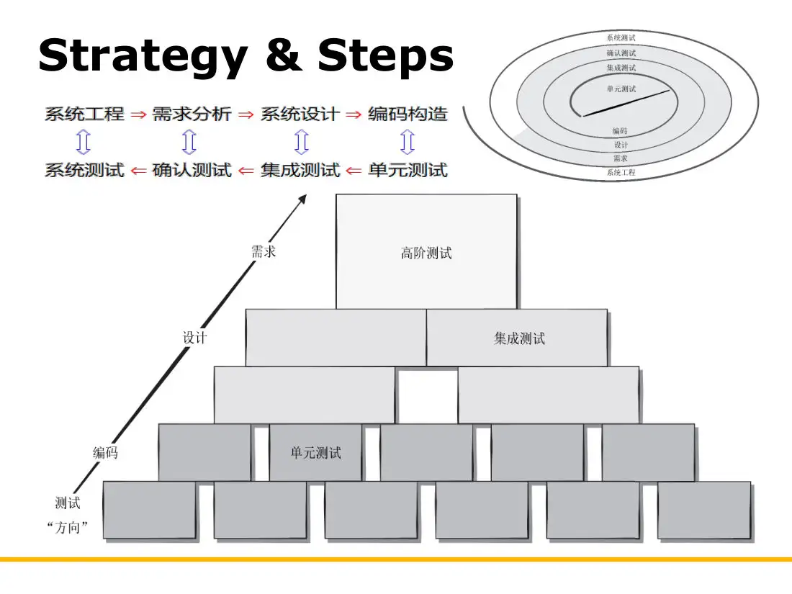

原文：

Strategy & Steps

系统工程⇒需求分析⇒系统设计⇒编码构造

系统测试⇐确认测试⇐集成测试⇐单元测试

### Criteria for “Done”

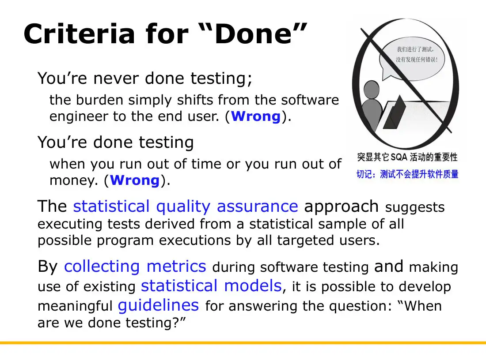

原文：

Criteria for “Done”

You’re never done testing; the burden simply shifts from the software engineer to the end user. (Wrong).

You’re done testing

when you run out of time or you run out of money. (Wrong).

The statistical quality assurance approach suggests executing tests derived from a statistical sample of all possible program executions by all targeted users.

By collecting metrics during software testing and making use of existing statistical models, it is possible to develop meaningful guidelines for answering the question: “When are we done testing?”

### Test Planning

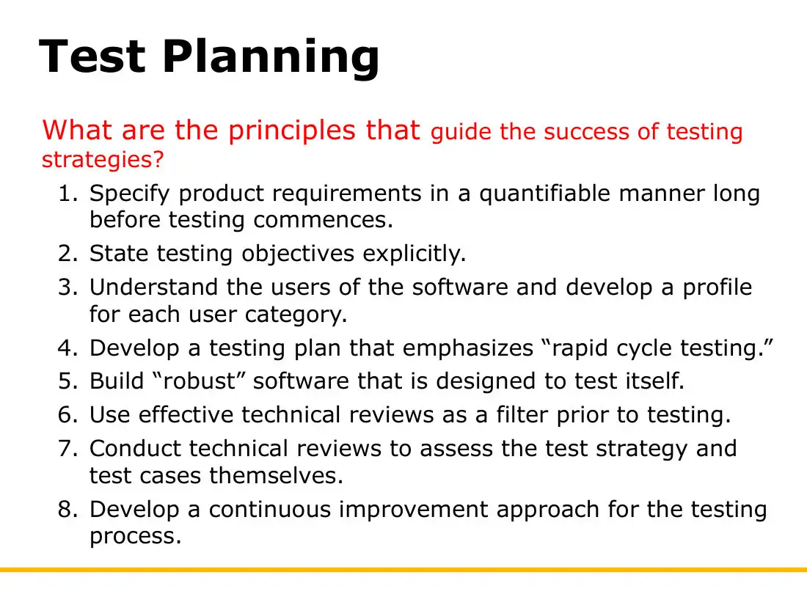

原文：

Test Planning

What are the principles that guide the success of testing strategies?

1. Specify product requirements in a quantifiable manner long before testing commences.

2. State testing objectives explicitly.

3. Understand the users of the software and develop a profile for each user category.

4. Develop a testing plan that emphasizes “rapid cycle testing.”

5. Build “robust” software that is designed to test itself.

6. Use effective technical reviews as a filter prior to testing.

7. Conduct technical reviews to assess the test strategy and test cases themselves.

8. Develop a continuous improvement approach for the testing process.

### Test Recordkeeping

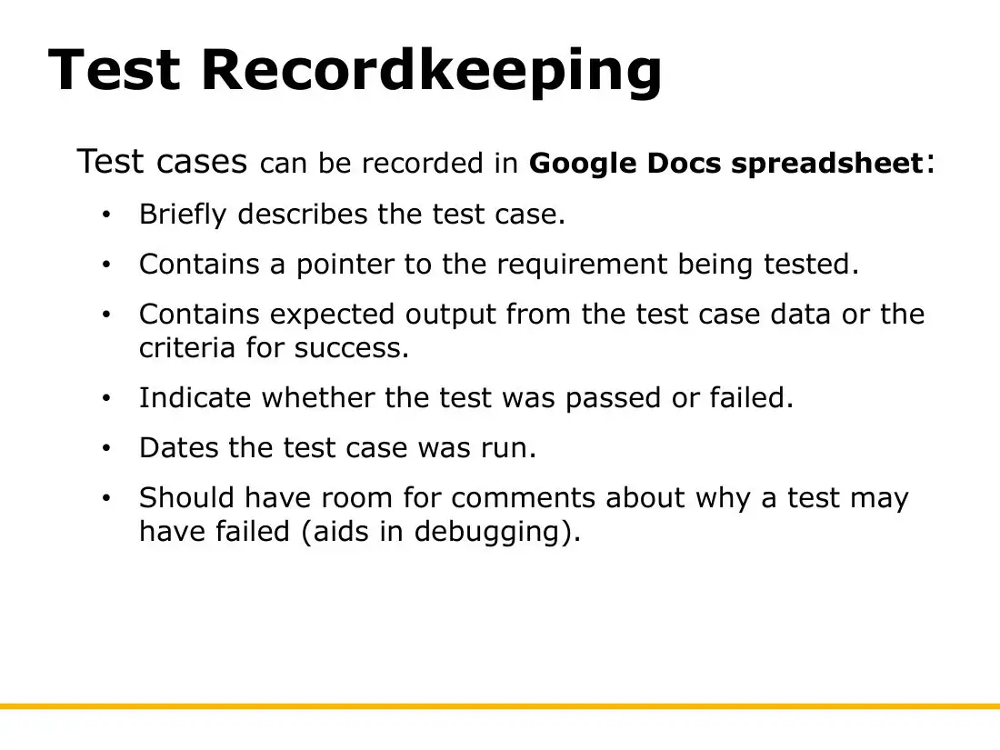

原文：

Test Recordkeeping

Test cases can be recorded in Google Docs spreadsheet:

• Briefly describes the test case.

• Contains a pointer to the requirement being tested.

• Contains expected output from the test case data or the criteria for success.

• Indicate whether the test was passed or failed.

• Dates the test case was run.

• Should have room for comments about why a test may have failed (aids in debugging).

### Role of Scaffolding

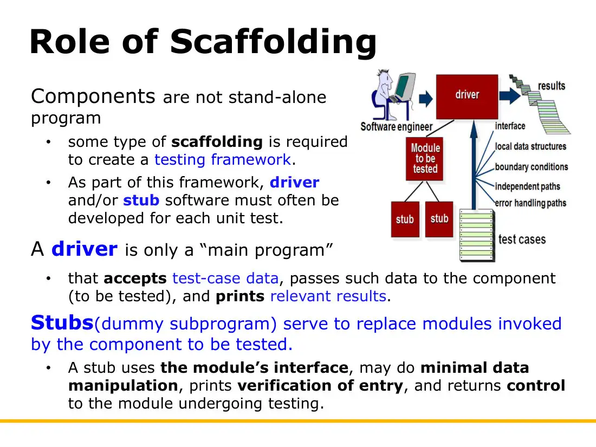

原文：

Role of Scaffolding

Components are not stand-alone program

some type of scaffolding is required to create a testing framework.

• As part of this framework, driver and/or stub software must often be developed for each unit test.

A driver is only a “main program”

that accepts test-case data, passes such data to the component (to be tested), and prints relevant results.

Stubs(dummy subprogram) serve to replace modules invoked by the component to be tested.

A stub uses the module’s interface, may do minimal data manipulation, prints verification of entry, and returns control to the module undergoing testing.

### Cost Effective Testing

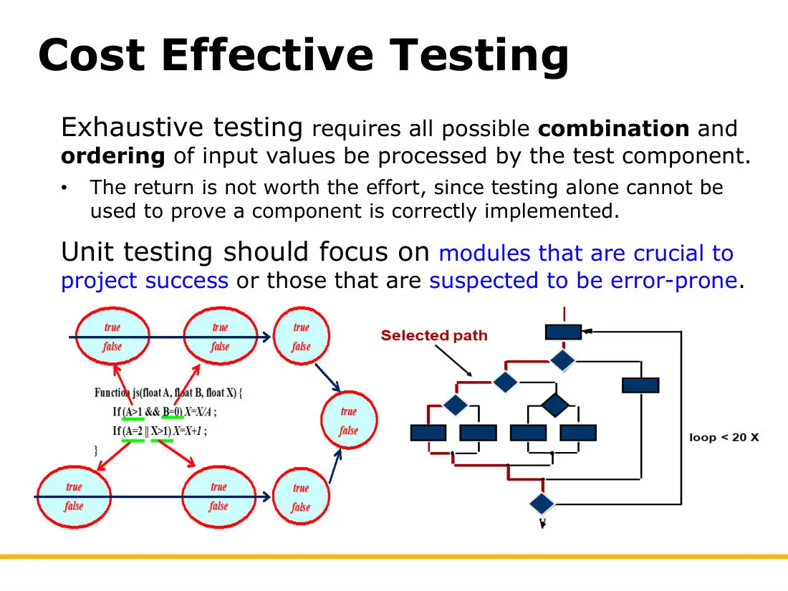

原文：

Cost Effective Testing

Exhaustive testing requires all possible combination and ordering of input values be processed by the test component.

• The return is not worth the effort, since testing alone cannot be used to prove a component is correctly implemented.

Unit testing should focus on modules that are crucial to project success or those that are suspected to be error-prone.

### Test Case Design

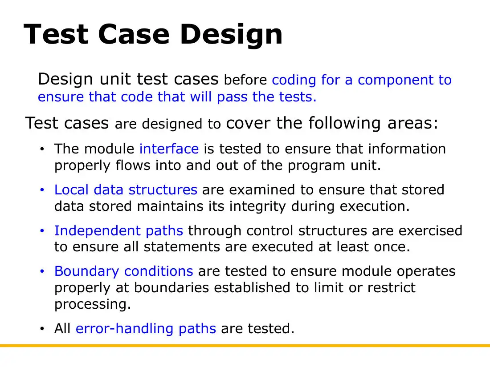

原文：

Test Case Design

Design unit test cases before coding for a component to ensure that code that will pass the tests.

Test cases are designed to cover the following areas:

• The module interface is tested to ensure that information properly flows into and out of the program unit.

Local data structures are examined to ensure that stored data stored maintains its integrity during execution.

• Independent paths through control structures are exercised to ensure all statements are executed at least once.

• Boundary conditions are tested to ensure module operates properly at boundaries established to limit or restrict processing.

• All error-handling paths are tested.

### Requirements & Test Case Design

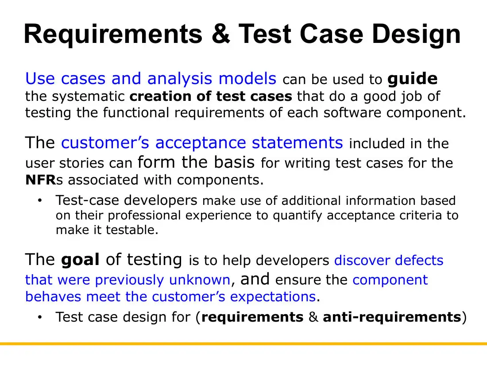

原文：

Requirements & Test Case Design

Use cases and analysis models can be used to guide the systematic creation of test cases that do a good job of testing the functional requirements of each software component.

The customer’s acceptance statements included in the user stories can form the basis for writing test cases for the NFRs associated with components.

• Test-case developers make use of additional information based on their professional experience to quantify acceptance criteria to make it testable.

The goal of testing is to help developers discover defects that were previously unknown, and ensure the component behaves meet the customer’s expectations.

• Test case design for (requirements & anti-requirements)

### Traceability

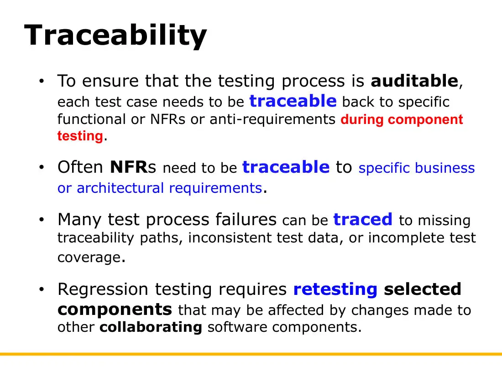

原文：

Traceability

To ensure that the testing process is auditable, each test case needs to be traceable back to specific functional or NFRs or anti-requirements during component testing.

• Often NFRs need to be traceable to specific business or architectural requirements.

• Many test process failures can be traced to missing traceability paths, inconsistent test data, or incomplete test coverage.

Regression testing requires retesting selected components that may be affected by changes made to other collaborating software components.

### testing: black-box & white-box

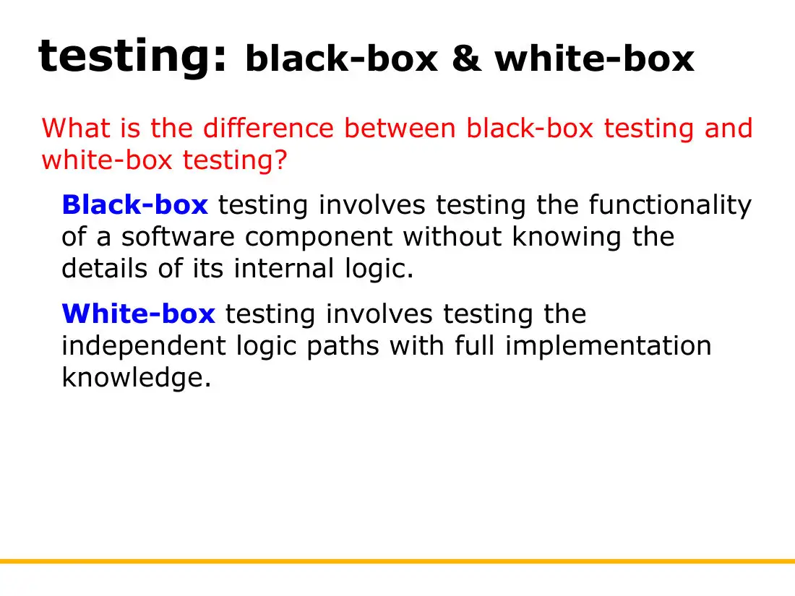

原文：

testing: black-box & white-box

What is the difference between black-box testing and white-box testing?

Black-box testing involves testing the functionality of a software component without knowing the details of its internal logic.

White-box testing involves testing the independent logic paths with full implementation knowledge.

### White Box Testing

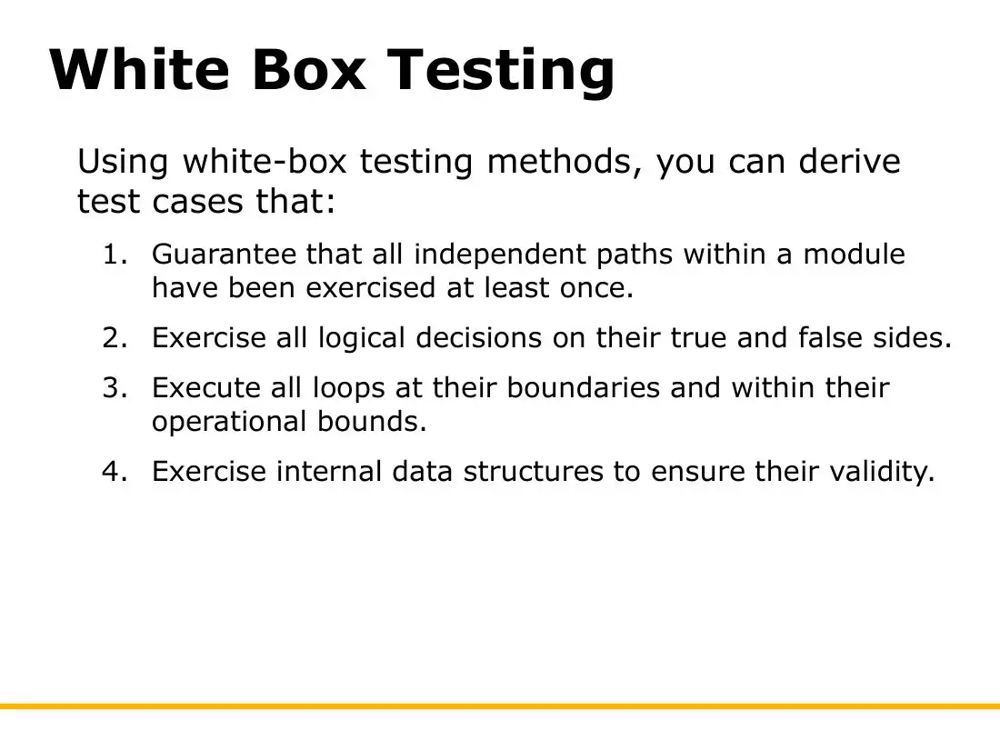

原文：

White Box Testing

Using white-box testing methods, you can derive test cases that:

1. Guarantee that all independent paths within a module have been exercised at least once.

2. Exercise all logical decisions on their true and false sides.

3. Execute all loops at their boundaries and within their operational bounds.

4. Exercise internal data structures to ensure their validity.

### Basis Path Testing

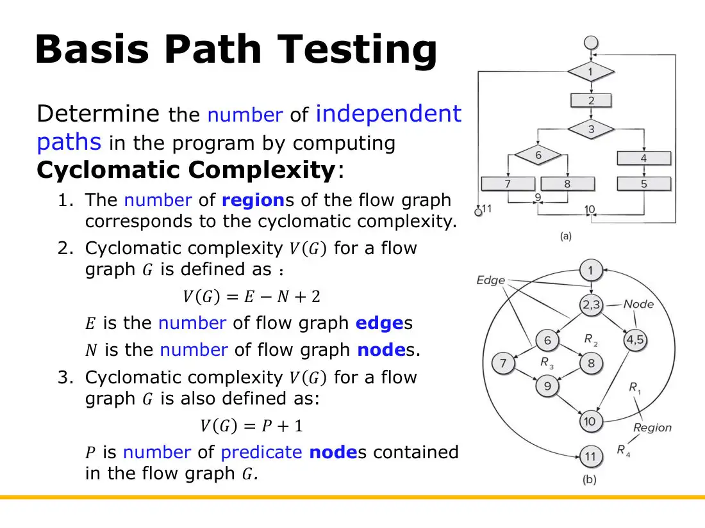

原文：

Basis Path Testing

Determine the number of independent paths in the program by computing Cyclomatic Complexity:

1. The number of regions of the flow graph corresponds to the cyclomatic complexity.

2. Cyclomatic complexity � � for a flow graph � is defined as ：

$$
V (G) = E - N + 2
$$

� is the number of flow graph edges � is the number of flow graph nodes.

3. Cyclomatic complexity � � for a flow graph � is also defined as:

$$
V (G) = P + 1
$$

� is number of predicate nodes contained in the flow graph �.

### example

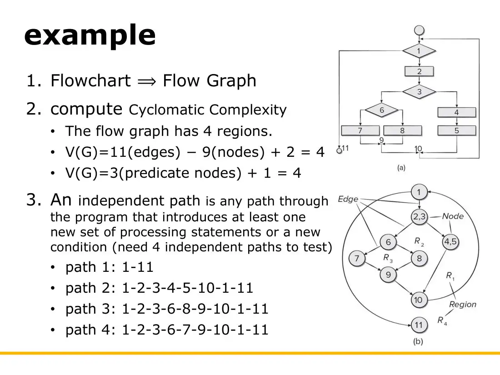

原文：

example

1. Flowchart ⟹ Flow Graph

2. compute Cyclomatic Complexity

• The flow graph has 4 regions.

• V(G)=11(edges) − 9(nodes) + 2 = 4

• V(G)=3(predicate nodes) + 1 = 4

3. An independent path is any path through the program that introduces at least one new set of processing statements or a new condition (need 4 independent paths to test)

• path 1: 1-11

• path 2: 1-2-3-4-5-10-1-11

• path 3: 1-2-3-6-8-9-10-1-11

• path 4: 1-2-3-6-7-9-10-1-11

### Control Structure Testing

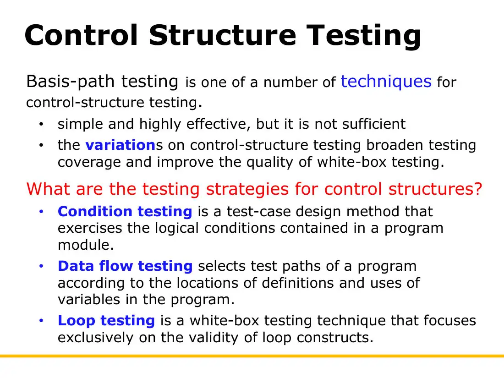

原文：

Control Structure Testing

Basis-path testing is one of a number of techniques for control-structure testing.

• simple and highly effective, but it is not sufficient

• the variations on control-structure testing broaden testing coverage and improve the quality of white-box testing.

What are the testing strategies for control structures?

Condition testing is a test-case design method that exercises the logical conditions contained in a program module.

Data flow testing selects test paths of a program according to the locations of definitions and uses of variables in the program.

Loop testing is a white-box testing technique that focuses exclusively on the validity of loop constructs.

### Loop Testing

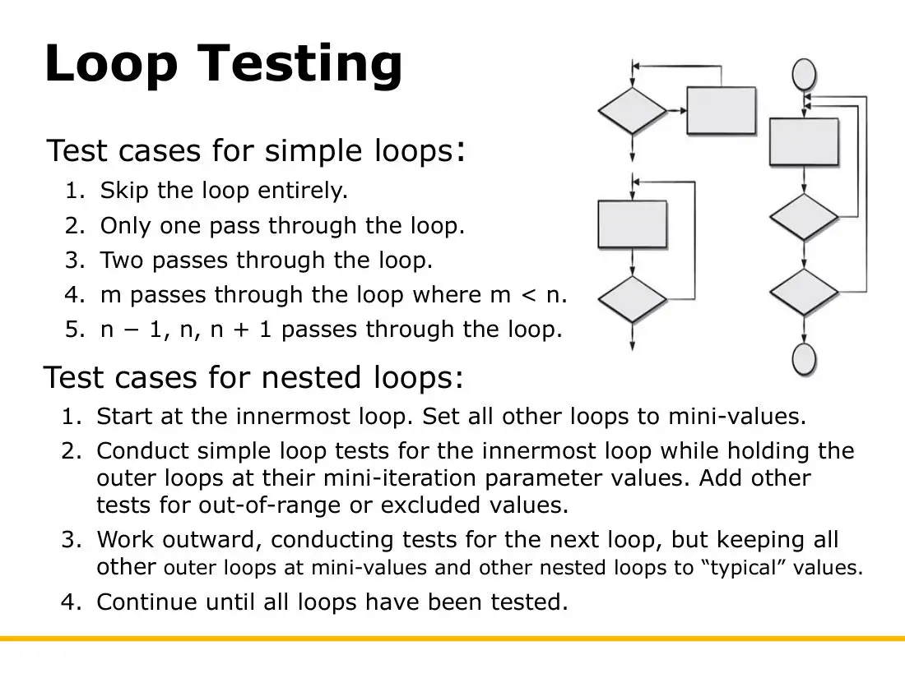

原文：

Loop Testing

Test cases for simple loops:

1. Skip the loop entirely.

2. Only one pass through the loop.

3. Two passes through the loop.

4. m passes through the loop where m < n.

5. $\mathsf { n } - 1 , \mathsf { n } , \mathsf { n } + 1$ passes through the loop.

Test cases for nested loops:

1. Start at the innermost loop. Set all other loops to mini-values.

2. Conduct simple loop tests for the innermost loop while holding the outer loops at their mini-iteration parameter values. Add other tests for out-of-range or excluded values.

3. Work outward, conducting tests for the next loop, but keeping all other outer loops at mini-values and other nested loops to “typical” values.

4. Continue until all loops have been tested.

### Black Box Testing

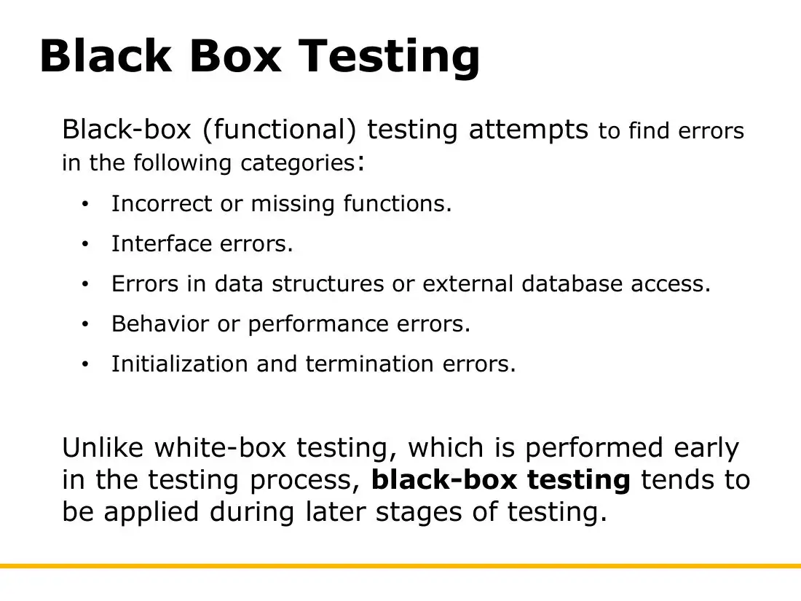

原文：

Black Box Testing

Black-box (functional) testing attempts to find errors in the following categories:

• Incorrect or missing functions.

• Interface errors.

• Errors in data structures or external database access.

• Behavior or performance errors.

• Initialization and termination errors.

Unlike white-box testing, which is performed early in the testing process, black-box testing tends to be applied during later stages of testing.

### Black Box Testing

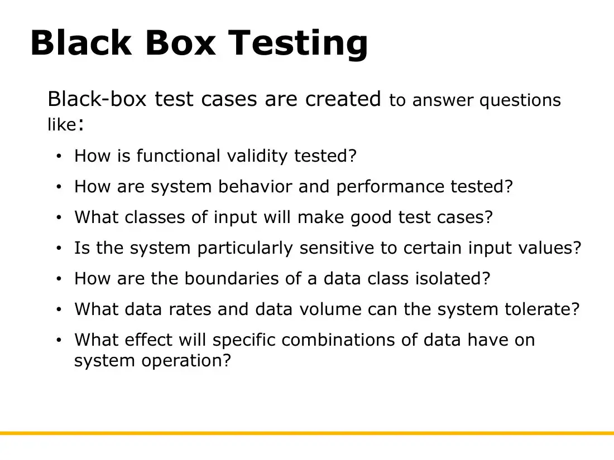

原文：

Black Box Testing

Black-box test cases are created to answer questions like:

• How is functional validity tested?

• How are system behavior and performance tested?

• What classes of input will make good test cases?

• Is the system particularly sensitive to certain input values?

• How are the boundaries of a data class isolated?

• What data rates and data volume can the system tolerate?

• What effect will specific combinations of data have on system operation?

### black-box: Interface Testing

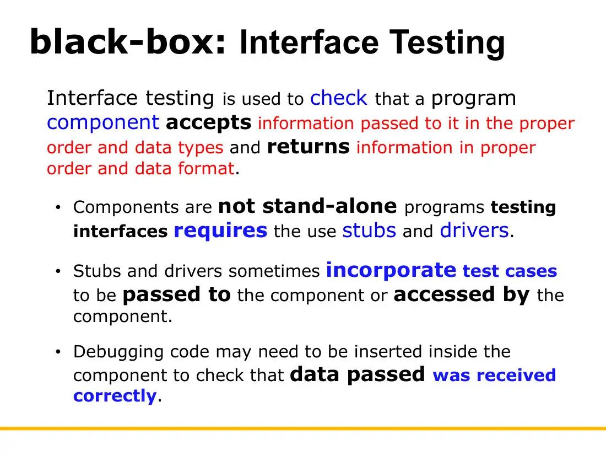

原文：

black-box: Interface Testing

Interface testing is used to check that a program component accepts information passed to it in the proper order and data types and returns information in proper order and data format.

Components are not stand-alone programs testing interfaces requires the use stubs and drivers.

• Stubs and drivers sometimes incorporate test cases to be passed to the component or accessed by the component.

• Debugging code may need to be inserted inside the component to check that data passed was received correctly.

### black-box: Equivalence Partitioning

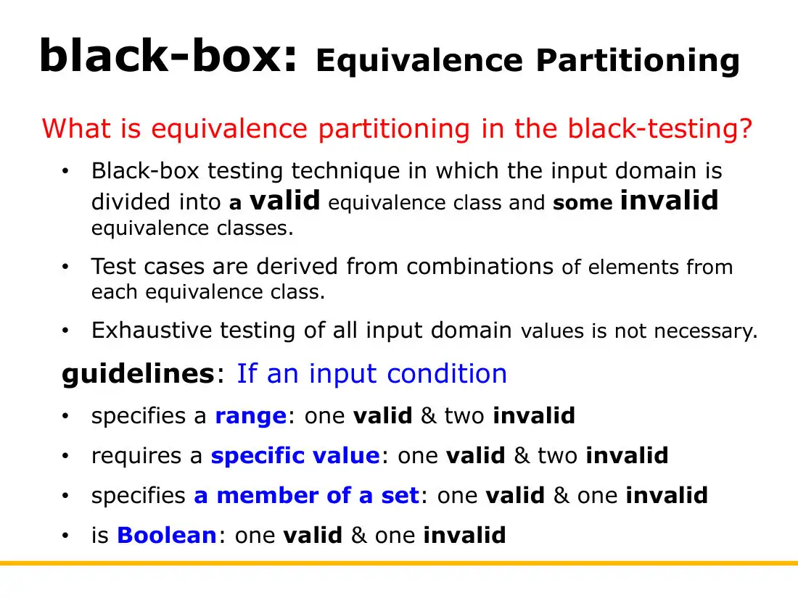

原文：

black-box: Equivalence Partitioning

What is equivalence partitioning in the black-testing?

Black-box testing technique in which the input domain is divided into a valid equivalence class and some invalid equivalence classes.

• Test cases are derived from combinations of elements from each equivalence class.

• Exhaustive testing of all input domain values is not necessary.

guidelines: If an input condition

• specifies a range: one valid & two invalid

• requires a specific value: one valid & two invalid

• specifies a member of a set: one valid & one invalid

• is Boolean: one valid & one invalid

### black-box: Boundary Value Analysis

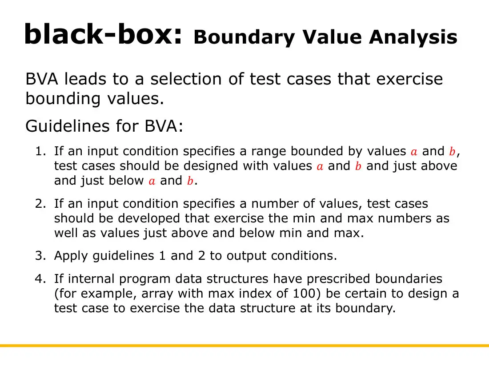

原文：

black-box: Boundary Value Analysis

BVA leads to a selection of test cases that exercise bounding values.

Guidelines for BVA:

1. If an input condition specifies a range bounded by values � and �, test cases should be designed with values � and � and just above and just below � and �.

2. If an input condition specifies a number of values, test cases should be developed that exercise the min and max numbers as well as values just above and below min and max.

3. Apply guidelines 1 and 2 to output conditions.

4. If internal program data structures have prescribed boundaries (for example, array with max index of 100) be certain to design a test case to exercise the data structure at its boundary.

### OO Testing

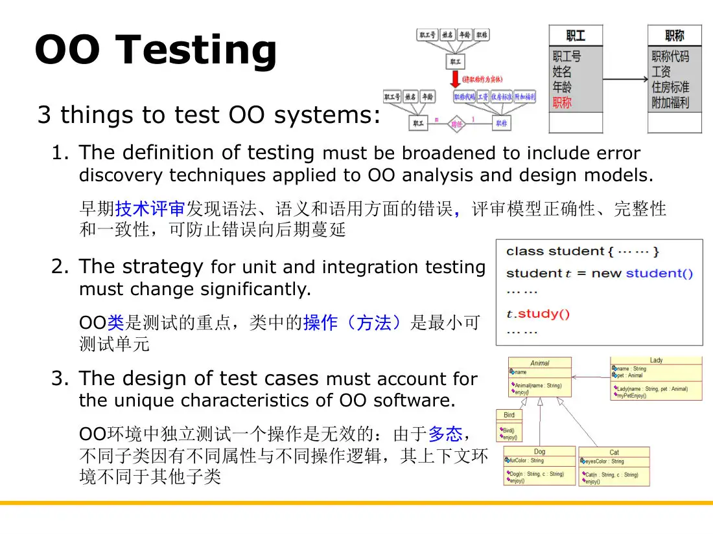

原文：

OO Testing

3 things to test OO systems:

1. The definition of testing must be broadened to include error discovery techniques applied to OO analysis and design models.

早期技术评审发现语法、语义和语用方面的错误，评审模型正确性、完整性和一致性，可防止错误向后期蔓延

2. The strategy for unit and integration testing must change significantly.

OO类是测试的重点，类中的操作（方法）是最小可测试单元

3. The design of test cases must account for the unique characteristics of OO software.

OO环境中独立测试一个操作是无效的：由于多态，不同子类因有不同属性与不同操作逻辑，其上下文环境不同于其他子类

### 示例：销售积分结账系统

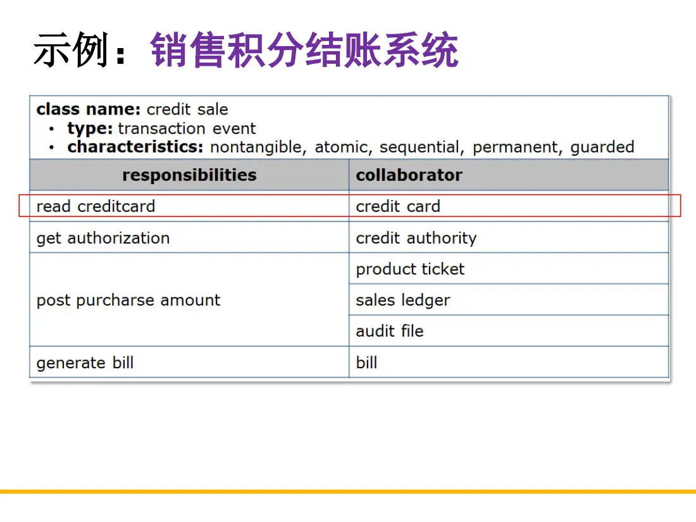

原文：

示例：销售积分结账系统

class name: credit sale

• type: transaction event

• characteristics: nontangible, atomic, sequential, permanent, guarded

<table><tr><td>responsibilities</td><td>collaborator</td></tr><tr><td>read creditcard</td><td>credit card</td></tr><tr><td>get authorization</td><td>credit authority</td></tr><tr><td rowspan="3">post purchase amount</td><td>product ticket</td></tr><tr><td>sales ledger</td></tr><tr><td>audit file</td></tr><tr><td>generate bill</td><td>bill</td></tr></table>

### 示例：销售积分结账系统

原文：

示例：销售积分结账系统

类 CreditSale

• 职责：读信用卡，委托给协作者 CreditCard

评审：查看 CreditCard 是否完成职责，是否有读卡操作 ？可能存在的问题：

• CreditCard 类，收到 CreditSale 类的请求 purchase\_amount，不知道购物金额是多少

• 读信用卡号和取得授权，业务场景中经常一起发生，合并为：验证信用请求（validate\_credit\_request）职责

### OOT: class testing

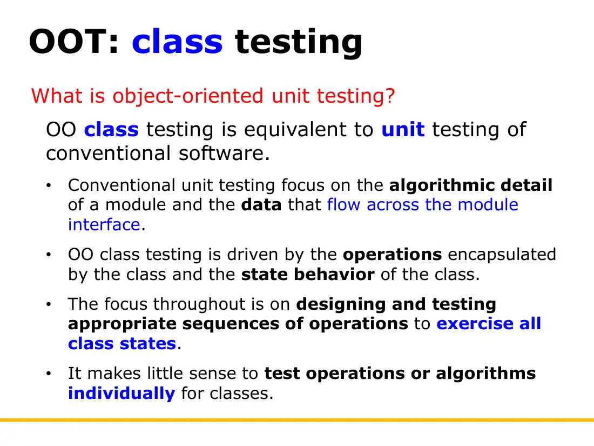

原文：

OOT: class testing

What is object-oriented unit testing?

OO class testing is equivalent to unit testing of conventional software.

Conventional unit testing focus on the algorithmic detail of a module and the data that flow across the module interface.

OO class testing is driven by the operations encapsulated by the class and the state behavior of the class.

The focus throughout is on designing and testing appropriate sequences of operations to exercise all class states.

• It makes little sense to test operations or algorithms individually for classes.

### example

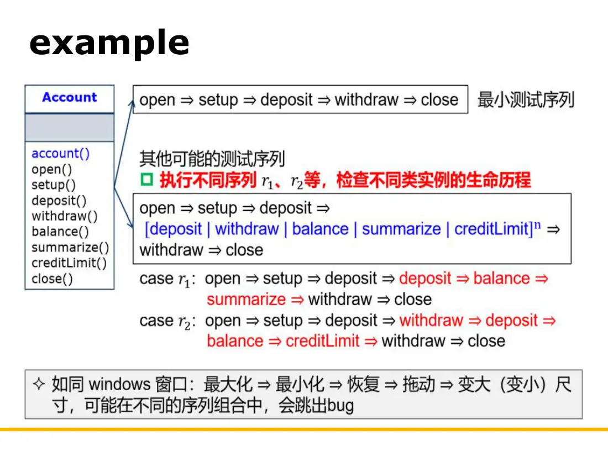

原文：

example

### OOT: behavior testing

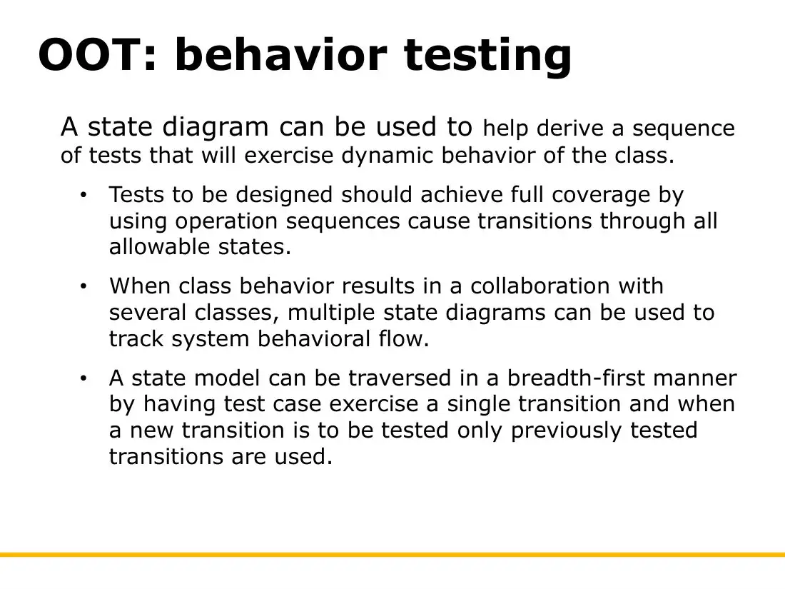

原文：

OOT: behavior testing

A state diagram can be used to help derive a sequence of tests that will exercise dynamic behavior of the class.

Tests to be designed should achieve full coverage by using operation sequences cause transitions through all allowable states.

When class behavior results in a collaboration with several classes, multiple state diagrams can be used to track system behavioral flow.

A state model can be traversed in a breadth-first manner by having test case exercise a single transition and when a new transition is to be tested only previously tested transitions are used.

### example

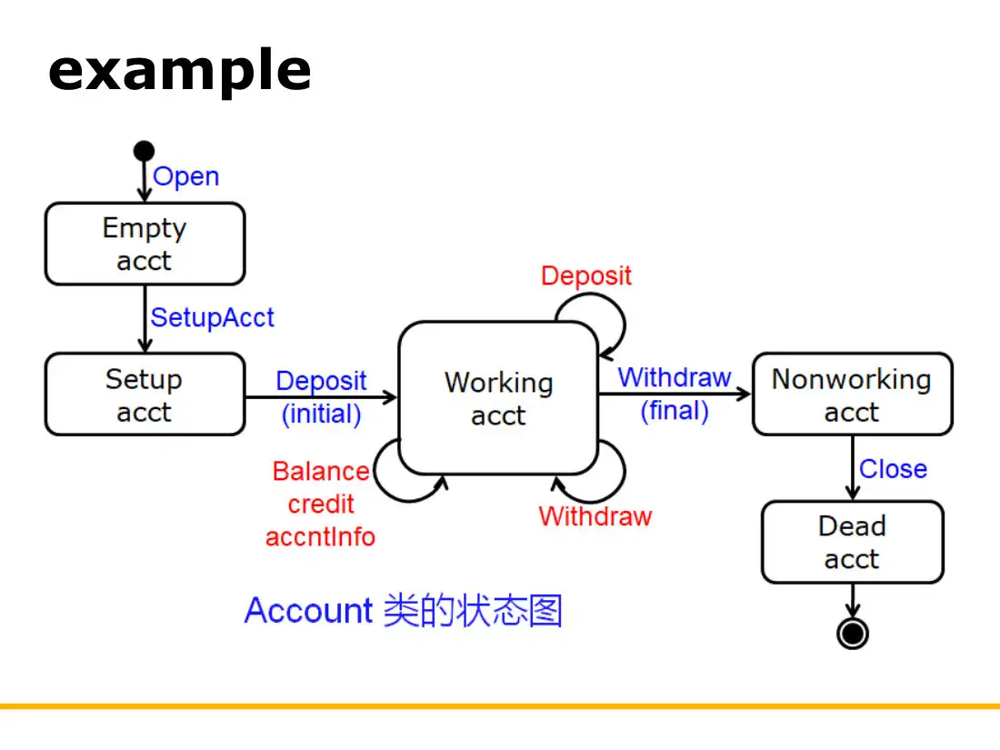

原文：

example

### example

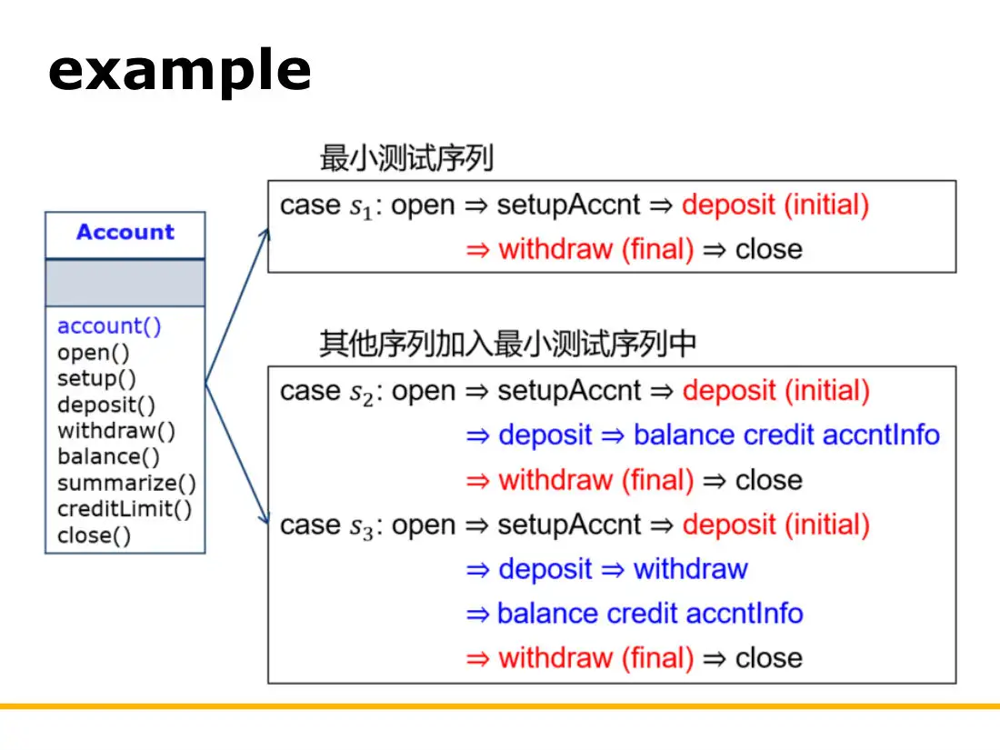

原文：

example

Account

account() open() setup() deposit() withdraw() balance() summarize() creditLimit() close()

最小测试序列

其他序列加入最小测试序列中

### “Integration Level” Testing

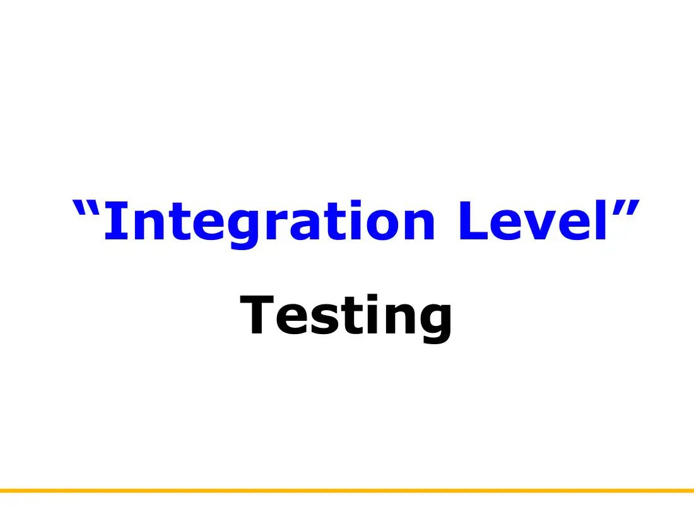

原文：

“Integration Level” Testing

### Software Testing Fundamentals

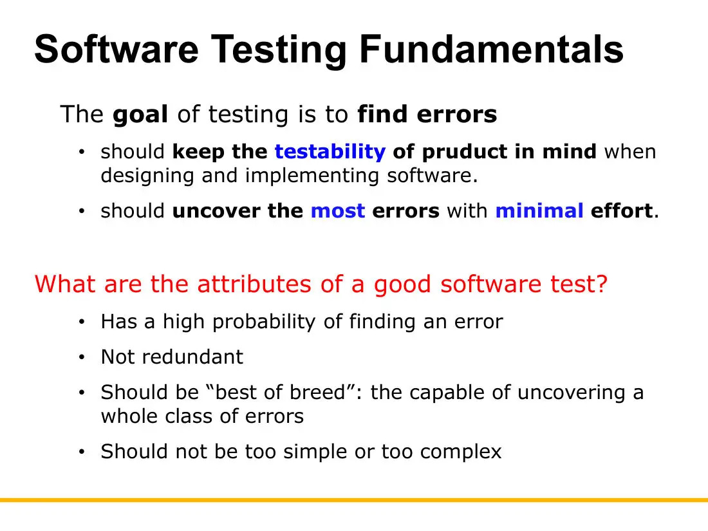

原文：

Software Testing Fundamentals

The goal of testing is to find errors

• should keep the testability of pruduct in mind when designing and implementing software.

• should uncover the most errors with minimal effort.

What are the attributes of a good software test?

• Has a high probability of finding an error

• Not redundant

• Should be “best of breed”: the capable of uncovering a whole class of errors

• Should not be too simple or too complex

### Approaches to Testing

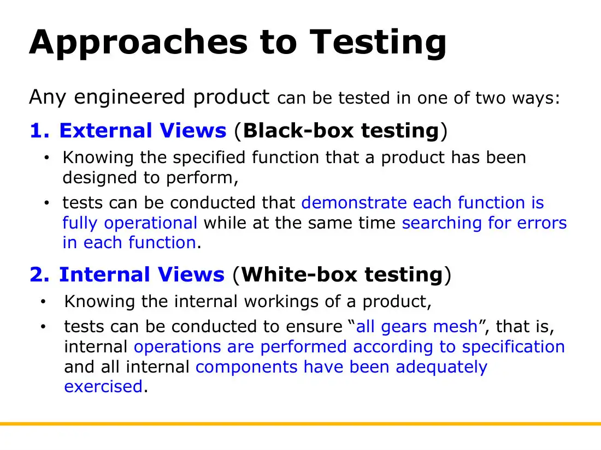

原文：

Approaches to Testing

Any engineered product can be tested in one of two ways:

1. External Views (Black-box testing)

• Knowing the specified function that a product has been designed to perform,

• tests can be conducted that demonstrate each function is fully operational while at the same time searching for errors in each function.

2. Internal Views (White-box testing)

• Knowing the internal workings of a product,

tests can be conducted to ensure “all gears mesh”, that is, internal operations are performed according to specification and all internal components have been adequately exercised.

### Integration Testing

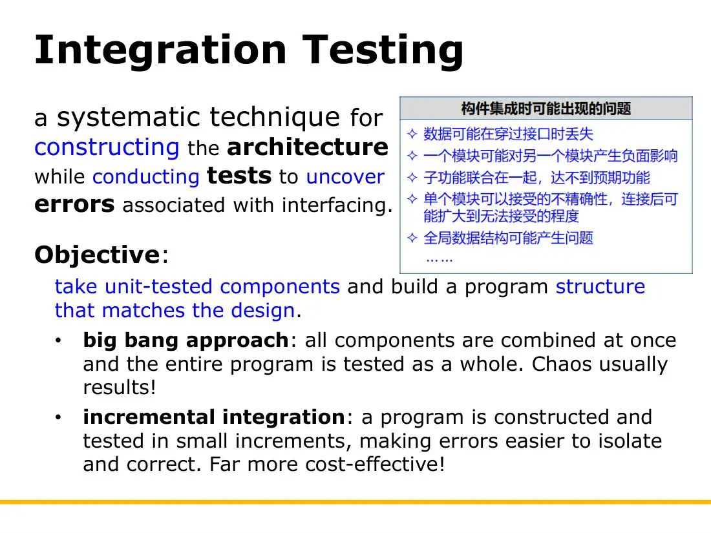

原文：

Integration Testing

a systematic technique for constructing the architecture while conducting tests to uncover errors associated with interfacing.

构件集成时可能出现的问题

数据可能在穿过接口时丢失

一个模块可能对另一个模块产生负面影响

子功能联合在一起，达不到预期功能

单个模块可以接受的不精确性，连接后可能扩大到无法接受的程度

全局数据结构可能产生问题

Objective:

take unit-tested components and build a program structure that matches the design.

big bang approach: all components are combined at once and the entire program is tested as a whole. Chaos usually results!

incremental integration: a program is constructed and tested in small increments, making errors easier to isolate and correct. Far more cost-effective!

### Top-Down Integration

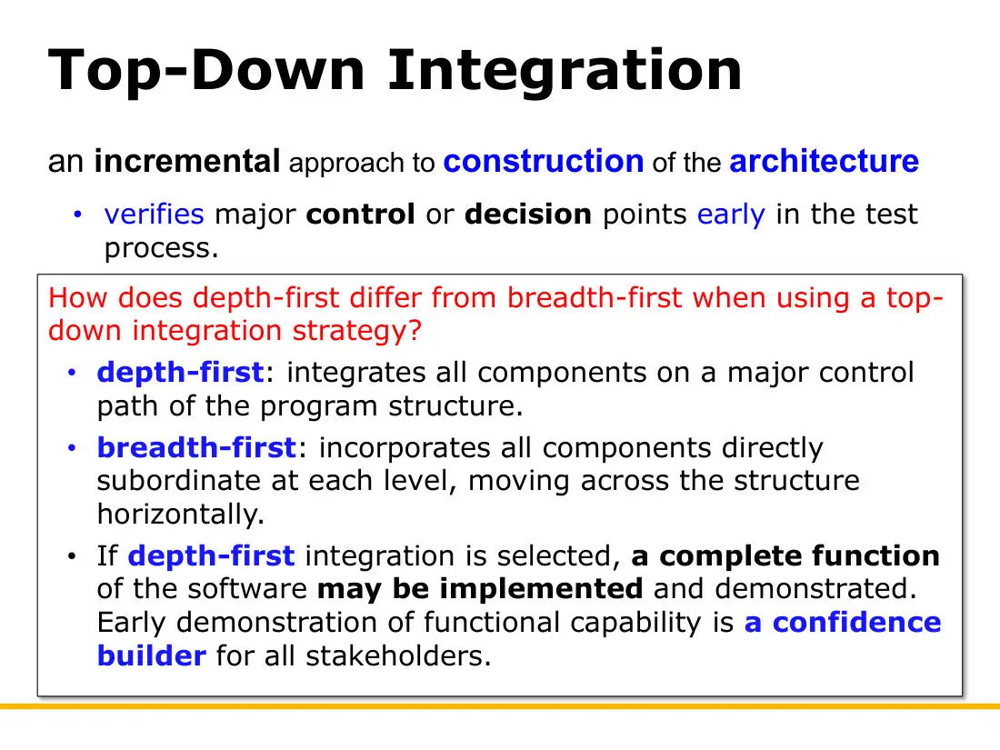

原文：

Top-Down Integration

an incremental approach to construction of the architecture

verifies major control or decision points early in the test process.

1. Main control module is used as a test driver, and stubs are How does depth-first differ from breadth-first when using a top-substituted for its all direcdown integration strategy?

. Select depth-first or breadth-first approach, subordinate stubs• depth-first: integrates all components on a major control path of the program structure.

Tests are conducted as each breadth-first: incorporates all components directly component is integrated. On subordinate at each level, moving across the structure horizontally.

real component.• If depth-first integration is selected, a complete function of the software may be implemented and demonstrated. conducted to ensure that new Early demonstration of functional capability is a confidence rrors have not been introducedbuilder for all stakeholders.

### Bottom-Up Integration Testing

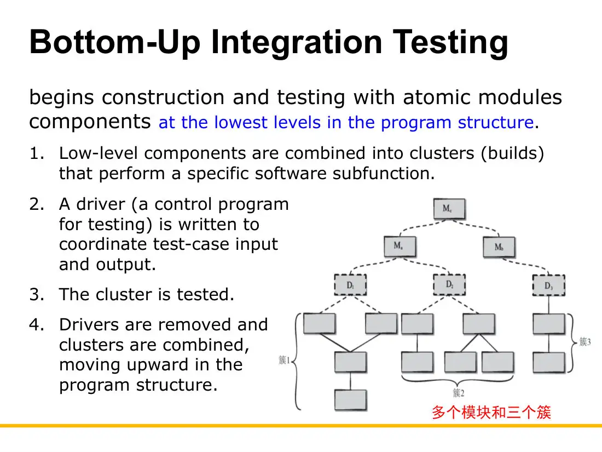

原文：

Bottom-Up Integration Testing

begins construction and testing with atomic modules components at the lowest levels in the program structure.

1. Low-level components are combined into clusters (builds) that perform a specific software subfunction.

2. A driver (a control program for testing) is written to coordinate test-case input and output.

3. The cluster is tested.

4. Drivers are removed and clusters are combined, moving upward in the program structure.

### Continuous integration

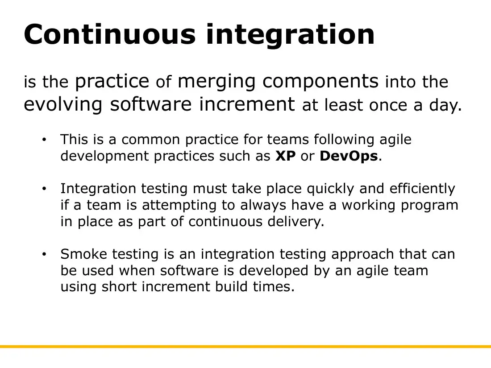

原文：

Continuous integration

is the practice of merging components into the evolving software increment at least once a day.

This is a common practice for teams following agile development practices such as XP or DevOps.

Integration testing must take place quickly and efficiently if a team is attempting to always have a working program in place as part of continuous delivery.

Smoke testing is an integration testing approach that can be used when software is developed by an agile team using short increment build times.

### Smoke Testing Integration

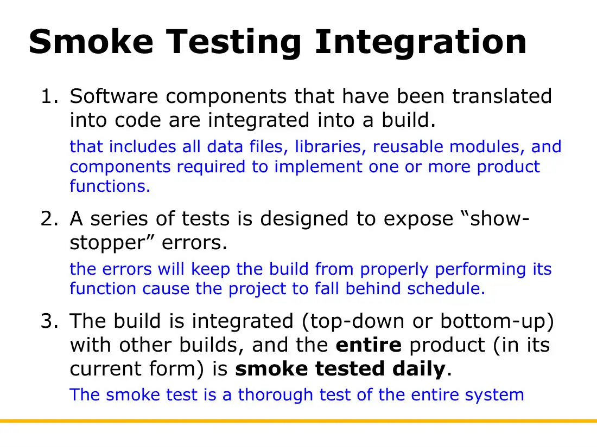

原文：

Smoke Testing Integration

1. Software components that have been translated into code are integrated into a build. that includes all data files, libraries, reusable modules, and components required to implement one or more product functions.

2. A series of tests is designed to expose “showstopper” errors. the errors will keep the build from properly performing its function cause the project to fall behind schedule.

3. The build is integrated (top-down or bottom-up) with other builds, and the entire product (in its current form) is smoke tested daily. The smoke test is a thorough test of the entire system

### Smoke Testing Advantages

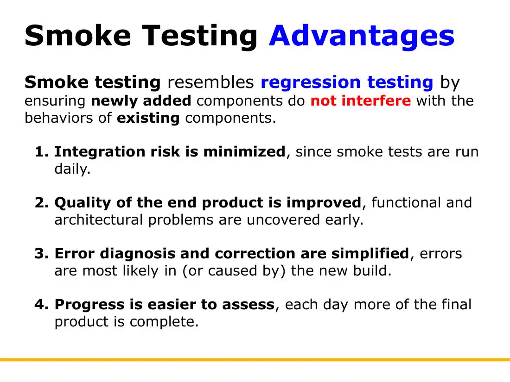

原文：

Smoke Testing Advantages

Smoke testing resembles regression testing by ensuring newly added components do not interfere with the behaviors of existing components.

1. Integration risk is minimized, since smoke tests are run daily.

2. Quality of the end product is improved, functional and architectural problems are uncovered early.

3. Error diagnosis and correction are simplified, errors are most likely in (or caused by) the new build.

4. Progress is easier to assess, each day more of the final product is complete.

### Integration Testing Work Products

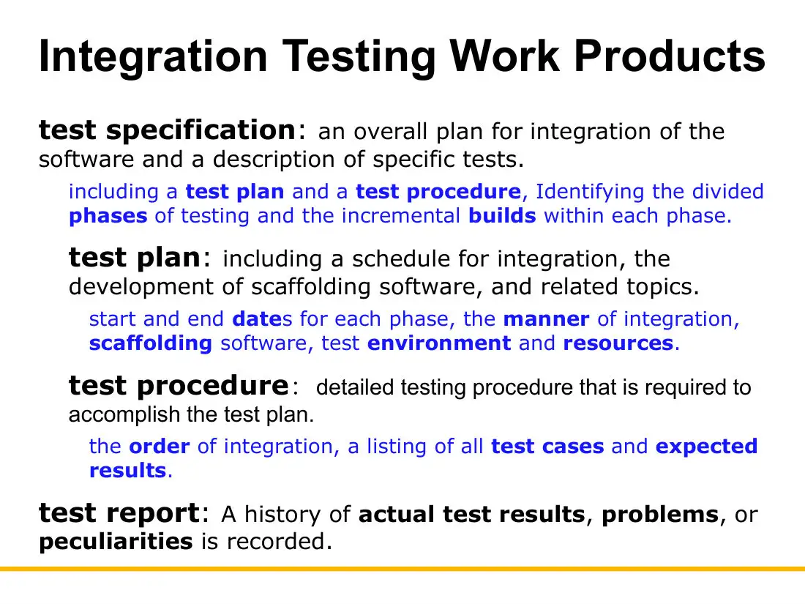

原文：

Integration Testing Work Products

test specification: an overall plan for integration of the software and a description of specific tests.

including a test plan and a test procedure, Identifying the divided phases of testing and the incremental builds within each phase.

test plan: including a schedule for integration, the development of scaffolding software, and related topics.

start and end dates for each phase, the manner of integration, scaffolding software, test environment and resources.

test procedure: detailed testing procedure that is required to accomplish the test plan.

the order of integration, a listing of all test cases and expected results.

test report: A history of actual test results, problems, or peculiarities is recorded.

### Regression Testing

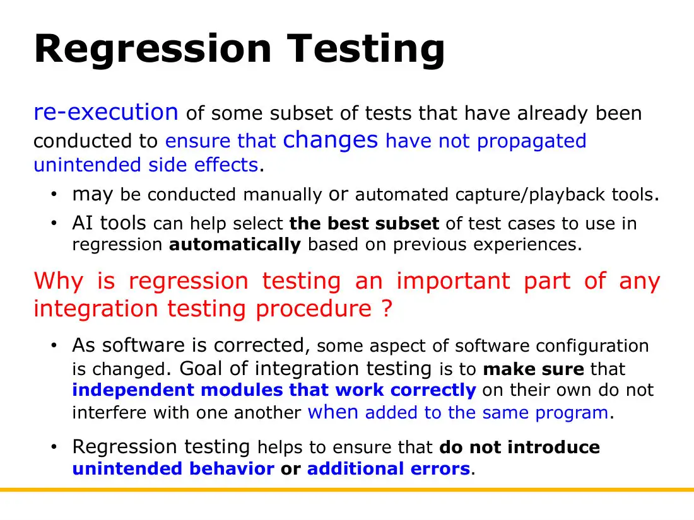

原文：

Regression Testing

re-execution of some subset of tests that have already been conducted to ensure that changes have not propagated unintended side effects.

• may be conducted manually or automated capture/playback tools.

• AI tools can help select the best subset of test cases to use in regression automatically based on previous experiences.

Why is regression testing an important part of any integration testing procedure ?

• As software is corrected, some aspect of software configuration is changed. Goal of integration testing is to make sure that independent modules that work correctly on their own do not interfere with one another when added to the same program.

• Regression testing helps to ensure that do not introduce unintended behavior or additional errors.

### OO Integration Testing

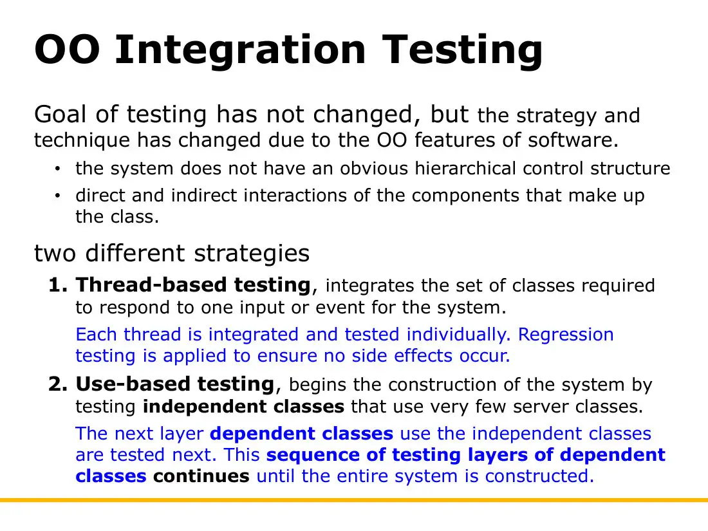

原文：

OO Integration Testing

Goal of testing has not changed, but the strategy and technique has changed due to the OO features of software.

• the system does not have an obvious hierarchical control structure

• direct and indirect interactions of the components that make up the class.

two different strategies

1. Thread-based testing, integrates the set of classes required to respond to one input or event for the system.

Each thread is integrated and tested individually. Regression testing is applied to ensure no side effects occur.

2. Use-based testing, begins the construction of the system by testing independent classes that use very few server classes.

The next layer dependent classes use the independent classes are tested next. This sequence of testing layers of dependent classes continues until the entire system is constructed.

### Fault-Based Test Case Design

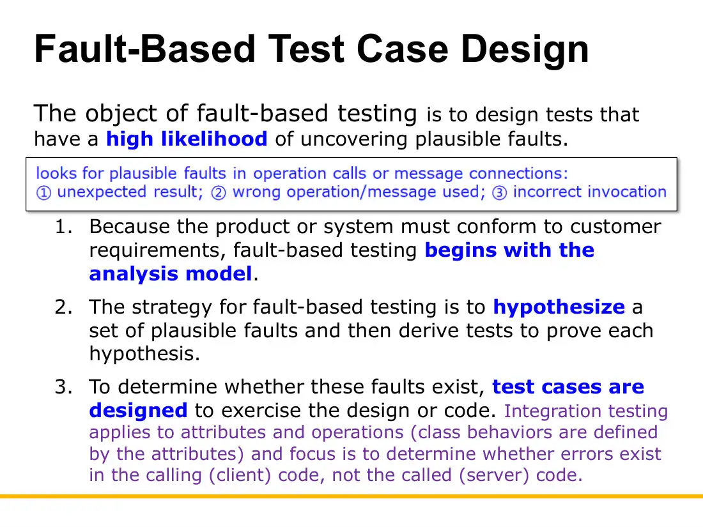

原文：

Fault-Based Test Case Design

The object of fault-based testing is to design tests that have a high likelihood of uncovering plausible faults.

looks for plausible faults in operation calls or message connections: ① unexpected result; ② wrong operation/message used; ③ incorrect invocation

1. Because the product or system must conform to customer requirements, fault-based testing begins with the analysis model.

2. The strategy for fault-based testing is to hypothesize a set of plausible faults and then derive tests to prove each hypothesis.

3. To determine whether these faults exist, test cases are designed to exercise the design or code. Integration testing applies to attributes and operations (class behaviors are defined by the attributes) and focus is to determine whether errors exist in the calling (client) code, not the called (server) code.

### 示例：银行应用

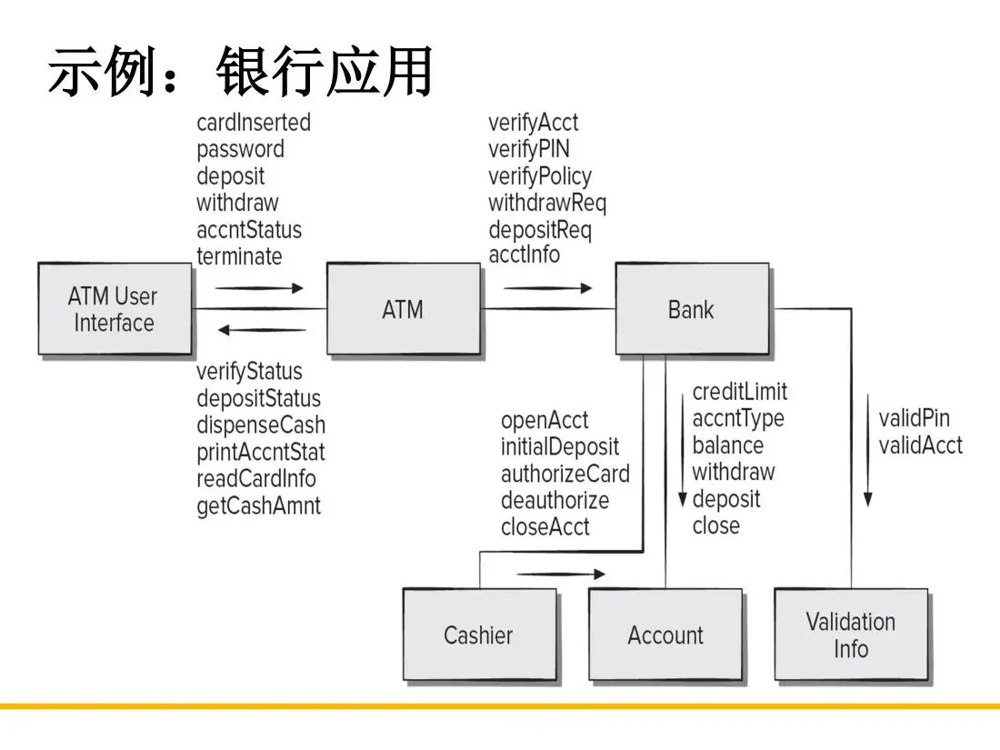

原文：

示例：银行应用

### 示例：银行应用

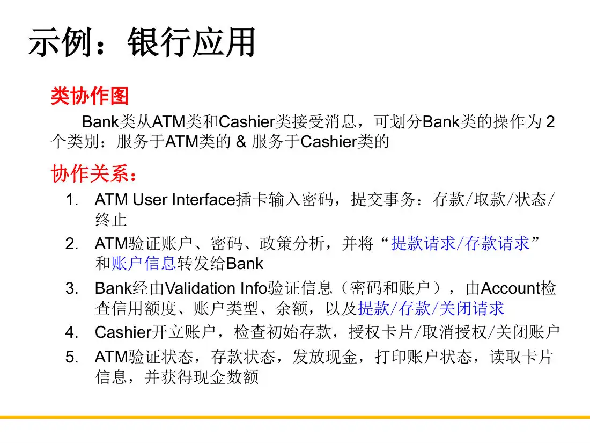

原文：

示例：银行应用

类协作图

Bank类从ATM类和Cashier类接受消息，可划分Bank类的操作为 2个类别：服务于ATM类的 & 服务于Cashier类的

协作关系：

1. ATM User Interface插卡输入密码，提交事务：存款/取款/状态/ 终止

2. ATM验证账户、密码、政策分析，并将“提款请求/存款请求”和账户信息转发给Bank

3. Bank经由Validation Info验证信息（密码和账户），由Account检查信用额度、账户类型、余额，以及提款/存款/关闭请求

4. Cashier开立账户，检查初始存款，授权卡片/取消授权/关闭账户

5. ATM验证状态，存款状态，发放现金，打印账户状态，读取卡片信息，并获得现金数额

### 示例：银行应用

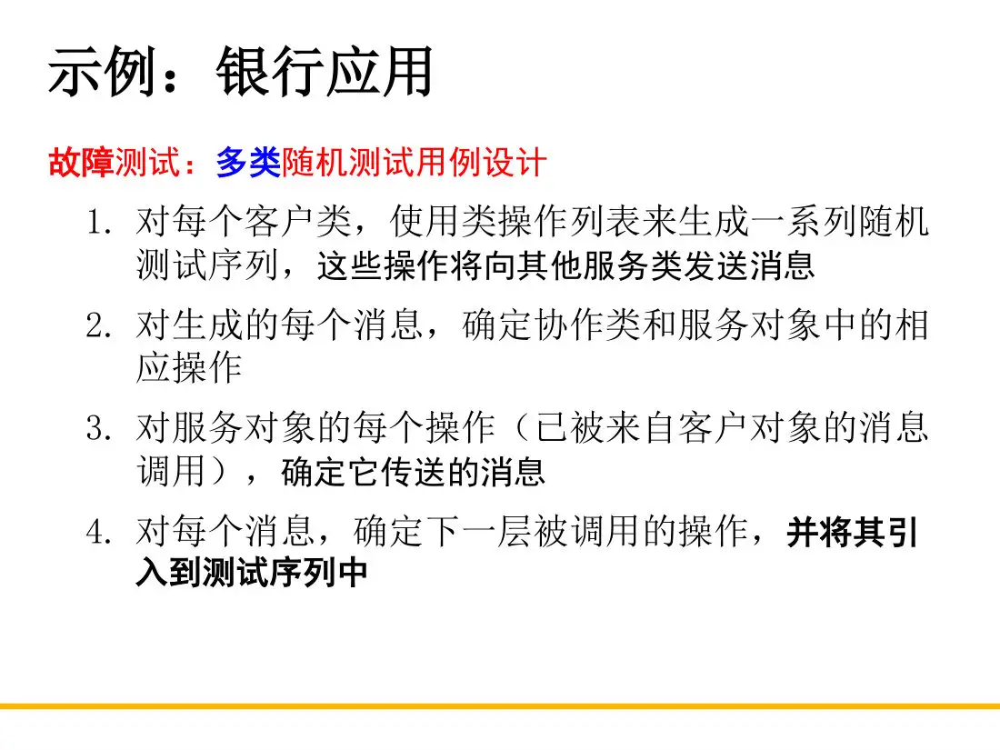

原文：

示例：银行应用

故障测试：多类随机测试用例设计

1. 对每个客户类，使用类操作列表来生成一系列随机测试序列，这些操作将向其他服务类发送消息

2. 对生成的每个消息，确定协作类和服务对象中的相应操作

3. 对服务对象的每个操作（已被来自客户对象的消息调用），确定它传送的消息

4. 对每个消息，确定下一层被调用的操作，并将其引入到测试序列中

### 示例：银行应用

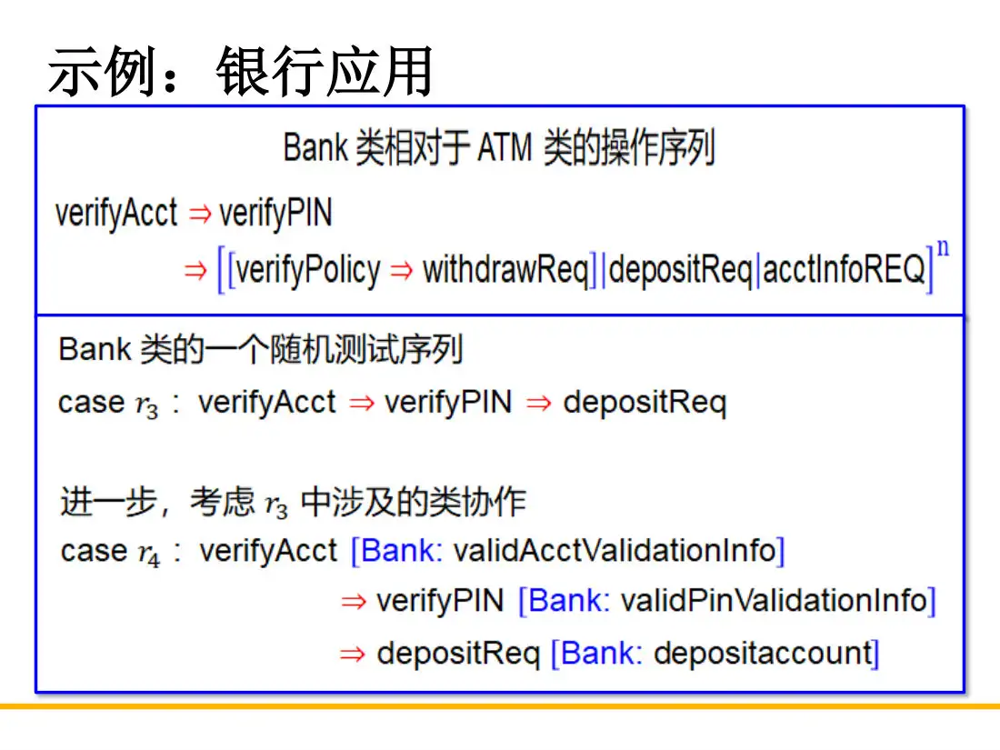

原文：

示例：银行应用

### Scenario-Based Test Case Design

原文：

Scenario-Based Test Case Design

What is scenario-based testing?

Use-cases capture the tasks that the user has to perform.

• the tasks and their variants, are used to construct the test-cases.

Scenario-based testing uncovers errors that occur when any actor interacts with the software. focus on user behavior, not product behavior: incorrect specifications

Scenario-based testing tends to exercise multiple subsystems in a single test. focus on interaction errors between subsystems

Test-case design becomes more complicated as integration of OO system occurs since this is when testing of collaborations between classes must begin.

Generally it is better to spend more time reviewing the use cases as they are created than spending more time on testing.

### Validation Testing

原文：

Validation Testing

focus on uncovering errors at the requirements level — on user visible actions and user-recognizable output from system.

• Validation testing begins at the culmination of integration testing, the software is completely assembled as a package and errors have been corrected.

Each user story has user-visible attributes, and customer’s acceptance criteria which forms the basis for the test cases used in validation-testing.

• A deficiency list is created when a deviation from a specification is uncovered and their resolution is negotiated with all stakeholders.

configuration review (audit) is an important element of the validation process that ensures the complete system was built properly.

### Validation & Acceptance

原文：

Validation & Acceptance

What are the key differences between validation testing goals and acceptance testing goals ?

• In validation testing, the test team seeks to ensure that each software function or performance characteristic conforms to its specification.

• In acceptance testing, the test team needs to ensure that the software works correctly for the intended user in his or her normal work environment.

acceptance testing: Alpha/Beta testing, focus on customer usage

• � 测试（受控）：由代表性最终用户，在开发者现场进行，开发者在后面观看，记录使用中的错误和问题

• � 测试（客户验收）：按合同交付软件时，用户场所进行，开发者不在场（不受控），用户记录问题并提交

### 系统测试：关注于系统集成

原文：

系统测试：关注于系统集成

1. 恢复测试：强制软件发生故障，验证其恢复能力

2. 安全测试：验证保护机制是否能保护系统不受非法入侵

3. 压力测试：以非正常数量、频率或容量的方式，破坏系

统

试图发现有效输入类中，引发系统不稳定或错误的小部分数据组合 在平均每秒出现1～2次中断时，设计每秒10次中断用例 将输人数据量提高一个数量级，确定输入功能如何反应 执行需要最大内存或其他资源的用例 设计实际运行可能惨败的用例 创建可能会过多查找磁盘驻留数据的用例

4. 性能测试：与压力测试结合，测试集成环境的软件性能

5. 部署测试：配置测试多平台 OS 环境下的软件安装运行

### 第 57 页

原文：

<table><tr><td colspan="2">测试模式</td></tr><tr><td colspan="2">可以采用与设计模式同样的方式进行描述示例:</td></tr><tr><td colspan="2">模式名称:场景测试</td></tr><tr><td colspan="2">摘要:一旦执行了单元测试与集成测试,就需要确定软件是否能以让用户满意的方式执行</td></tr><tr><td colspan="2">场景测试:一种从用户角度测试软件的技术</td></tr><tr><td colspan="2">测试失败,表明软件不能满足用户的可见需求</td></tr></table>

### Homework after class

原文：

Homework after class

1. How does software verification differ from validation?

2. What is the difference between black-box testing and white-box testing?

3. What are the testing strategies for control structures?

4. What is equivalence partitioning in the black-testing?

5. What is object-oriented unit testing?

6. What are the attributes of a good software test?

7. How does depth-first differ from breadth-first when using a top-down integration strategy?

8. Why is regression testing an important part of any integration testing procedure ?

9. What are the key differences between validation testing goals and acceptance testing goals?

10. What is scenario-based testing?
