# 《软件工程（双语）》Unit 08 软件测试策略（课件）

原件的每一页，下面附识别出的文字。

### UNIT 08

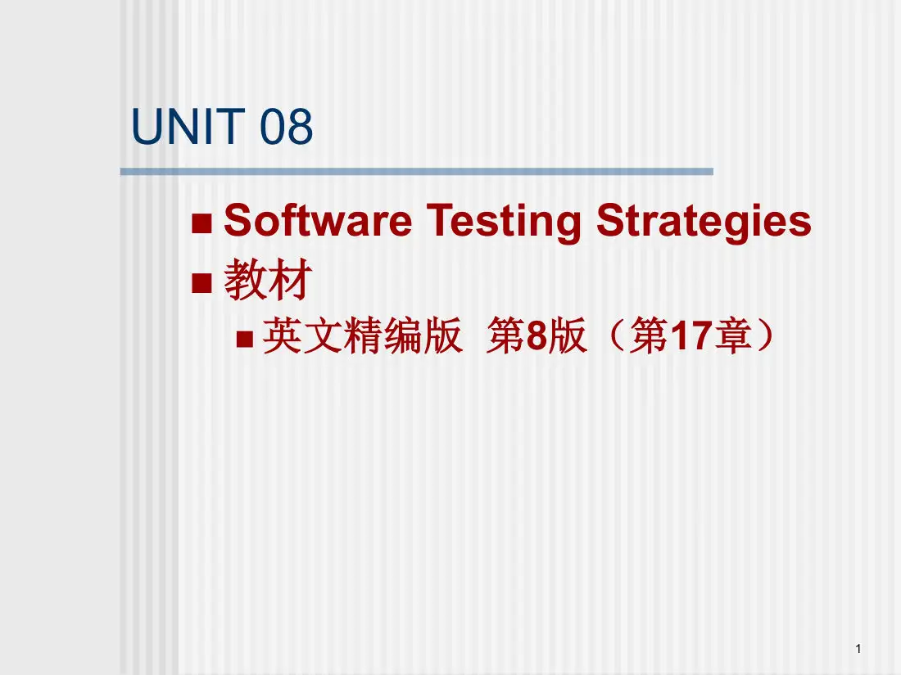

原文：

UNIT 08

◼ Software Testing Strategies

教材

英文精编版 第8版（第17章）

1

### Contents & Requirements

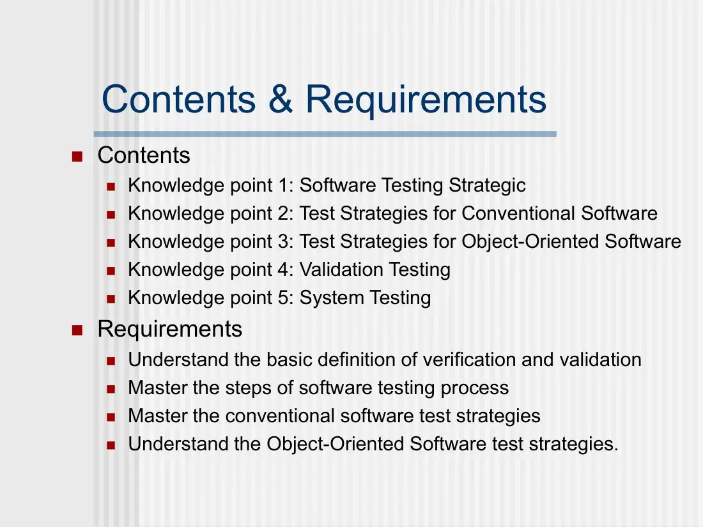

原文：

Contents & Requirements

◼ Contents

◼ Knowledge point 1: Software Testing Strategic

◼ Knowledge point 2: Test Strategies for Conventional Software

◼ Knowledge point 3: Test Strategies for Object-Oriented Software

◼ Knowledge point 4: Validation Testing

◼ Knowledge point 5: System Testing

◼ Requirements

◼ Understand the basic definition of verification and validation

◼ Master the steps of software testing process

◼ Master the conventional software test strategies

◼ Understand the Object-Oriented Software test strategies.

### Software Testing

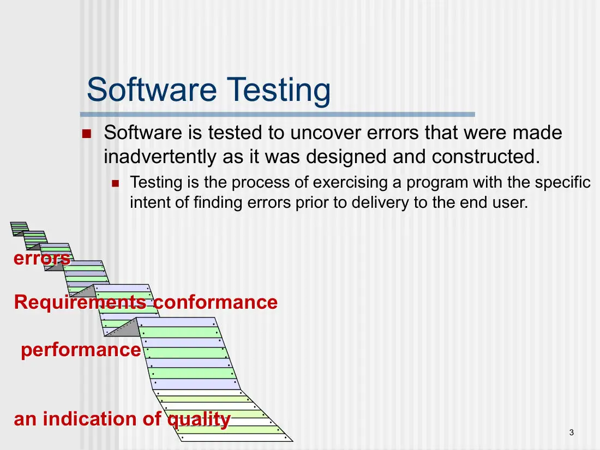

原文：

Software Testing

◼ Software is tested to uncover errors that were made inadvertently as it was designed and constructed.

◼ Testing is the process of exercising a program with the specific intent of finding errors prior to delivery to the end user.

3

### Strategic Approach

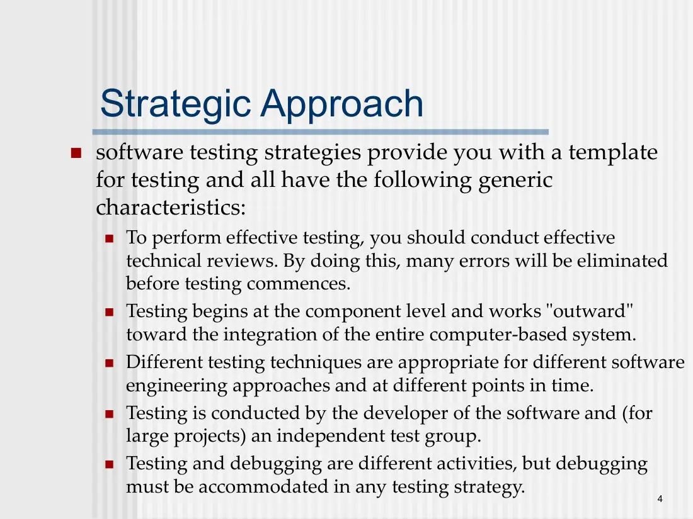

原文：

Strategic Approach

software testing strategies provide you with a template for testing and all have the following generic characteristics:

To perform effective testing, you should conduct effective technical reviews. By doing this, many errors will be eliminated before testing commences.

◼ Testing begins at the component level and works "outward" toward the integration of the entire computer-based system.

Different testing techniques are appropriate for different software engineering approaches and at different points in time.

Testing is conducted by the developer of the software and (for large projects) an independent test group.

Testing and debugging are different activities, but debugging must be accommodated in any testing strategy.

4

### Who Tests the Software?

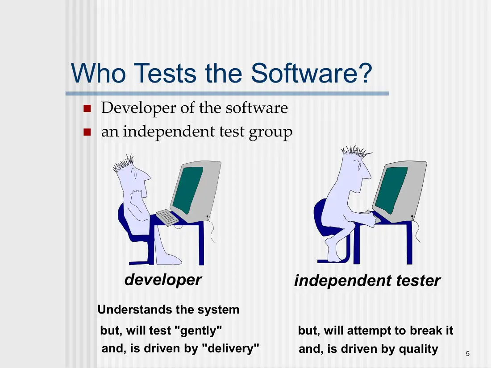

原文：

Who Tests the Software?

◼ Developer of the software

◼ an independent test group

but, will test "gently" and, is driven by "delivery"

but, will attempt to break it and, is driven by quality

5

### V & V

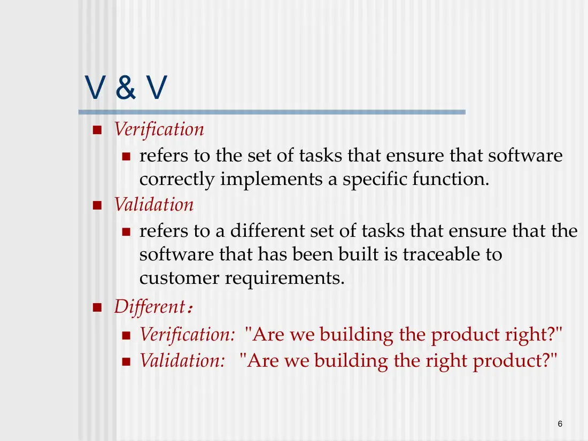

原文：

V & V

Verification

◼ refers to the set of tasks that ensure that software correctly implements a specific function.

◼ Validation

refers to a different set of tasks that ensure that the software that has been built is traceable to customer requirements.

Different ：

Verification: "Are we building the product right?"

Validation: "Are we building the right product?"

6

### Testing Strategy

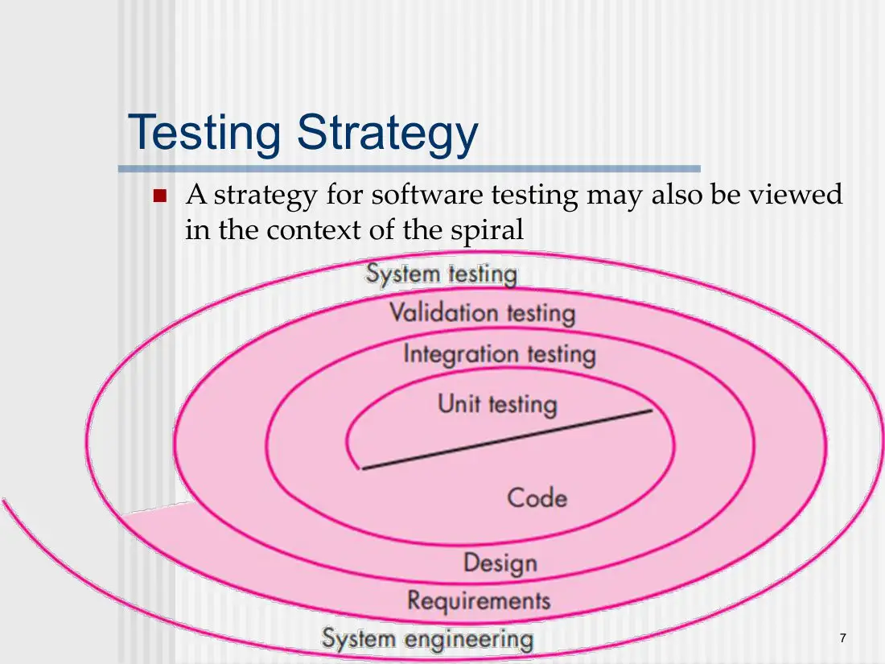

原文：

Testing Strategy

A strategy for software testing may also be viewed in the context of the spiral

7

### 测试策略 传统与OO

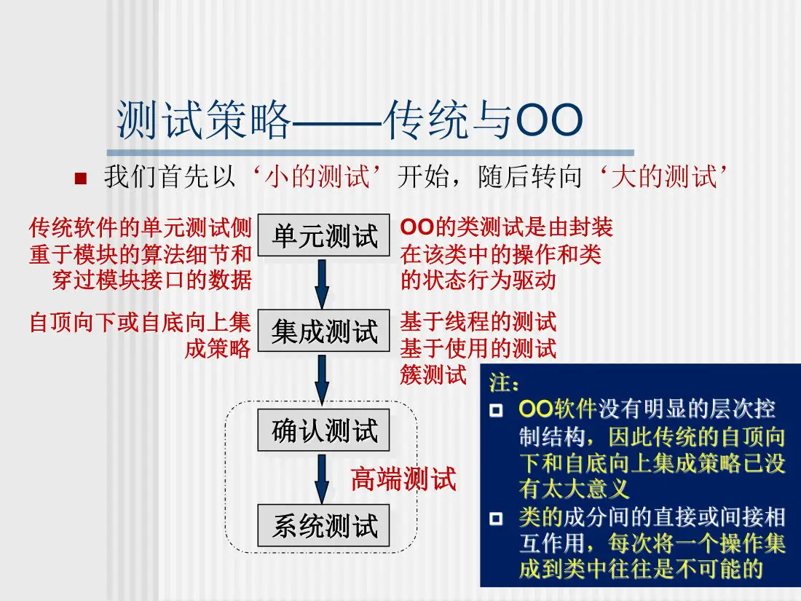

原文：

测试策略 传统与OO

◼ 我们首先以‘小的测试’开始，随后转向‘大的测试

传统软件的单元测试侧重于模块的算法细节和穿过模块接口的数据

自顶向下或自底向上集成策略单元测试

集成测试

确认测试

系统测试

OO的类测试是由封装

在该类中的操作和类的状态行为驱动

基于线程的测试基于使用的测试

簇测试

注：

高端测试

 OO软件没有明显的层次控制结构，因此传统的自顶向下和自底向上集成策略已没有太大意义

 类的成分间的直接或间接相互作用，每次将一个操作集成到类中往往是不可能的

### 测试步骤

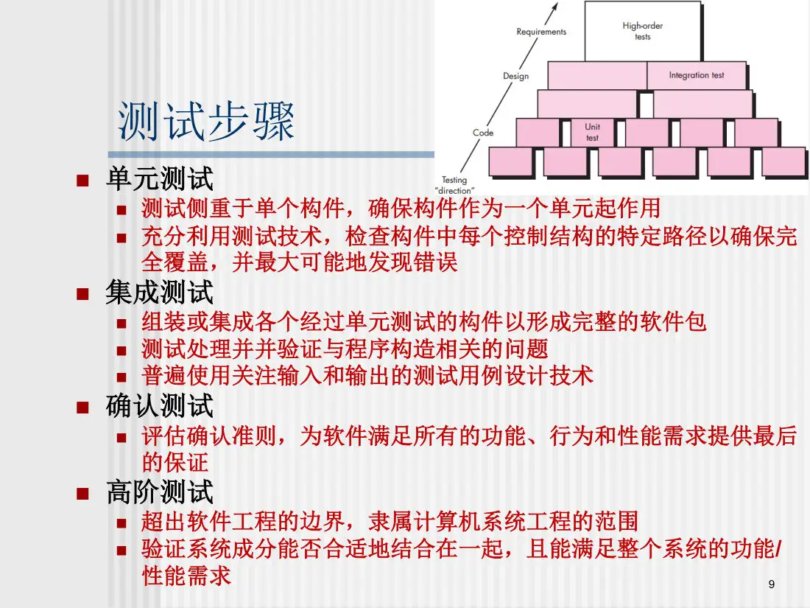

原文：

测试步骤

◼ 单元测试

测试侧重于单个构件，确保构件作为一个单元起作用

充分利用测试技术，检查构件中每个控制结构的特定路径以确保完全覆盖，并最大可能地发现错误

◼ 集成测试

组装或集成各个经过单元测试的构件以形成完整的软件包

测试处理并并验证与程序构造相关的问题

普遍使用关注输入和输出的测试用例设计技术

◼ 确认测试

评估确认准则，为软件满足所有的功能、行为和性能需求提供最后的保证

◼ 高阶测试

◼ 超出软件工程的边界，隶属计算机系统工程的范围

验证系统成分能否合适地结合在一起，且能满足整个系统的功能 性能需求 9

### Strategic Issues

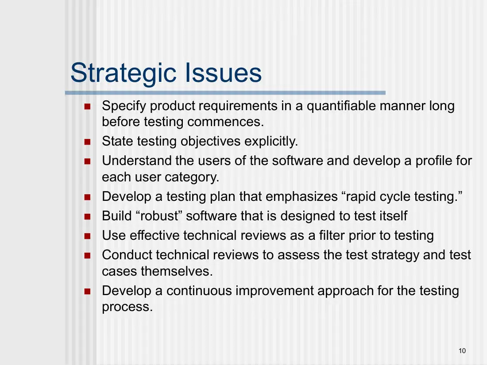

原文：

Strategic Issues

Specify product requirements in a quantifiable manner long before testing commences.

◼ State testing objectives explicitly.

Understand the users of the software and develop a profile for each user category.

◼ Develop a testing plan that emphasizes “rapid cycle testing.”

◼ Build “robust” software that is designed to test itself

◼ Use effective technical reviews as a filter prior to testing

Conduct technical reviews to assess the test strategy and test cases themselves.

Develop a continuous improvement approach for the testing process.

10

### Unit Testing

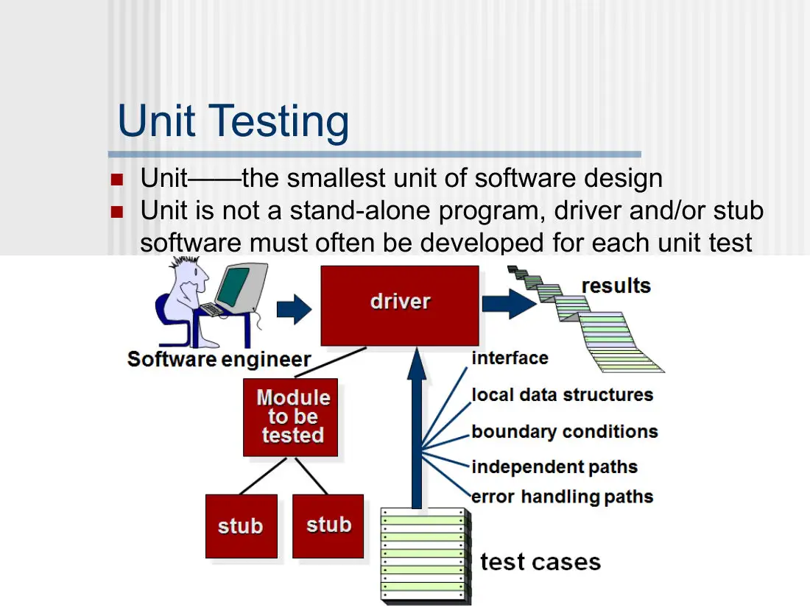

原文：

Unit Testing

◼ Unit—— the smallest unit of software design

◼ Unit is not a stand-alone program, driver and/or stub software must often be developed for each unit test

driver

Module to be tested

local data structures

boundary conditions

-independent paths error handling paths

test cases

### 单元测试— 时机

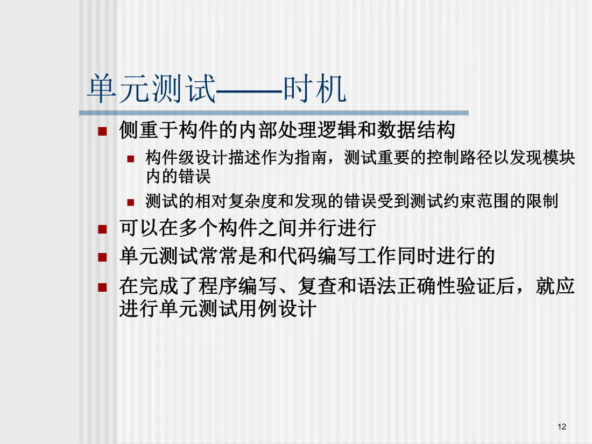

原文：

单元测试— 时机

◼ 侧重于构件的内部处理逻辑和数据结构

构件级设计描述作为指南，测试重要的控制路径以发现模块内的错误

◼ 测试的相对复杂度和发现的错误受到测试约束范围的限制

◼ 可以在多个构件之间并行进行

◼ 单元测试常常是和代码编写工作同时进行的

在完成了程序编写、复查和语法正确性验证后，就应进行单元测试用例设计

12

### 单元测试内容— 模块接口

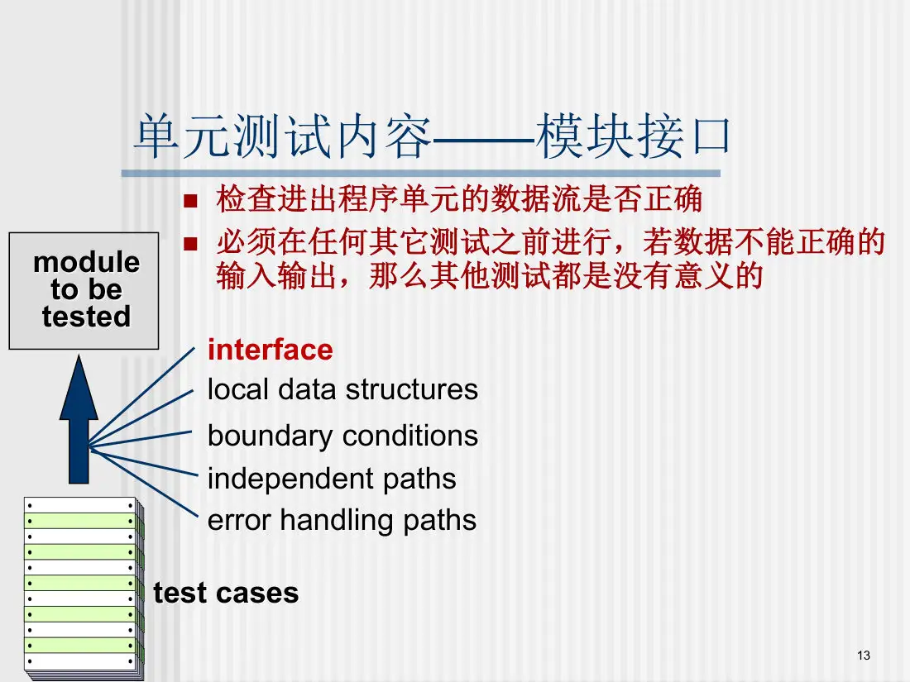

原文：

单元测试内容— 模块接口

检查进出程序单元的数据流是否正确

module to be tested

必须在任何其它测试之前进行，若数据不能正确的输入输出，那么其他测试都是没有意义的

interface

local data structures

boundary conditions

independent paths

error handling paths

test cases

13

### 单元测试内容——局部数据结构

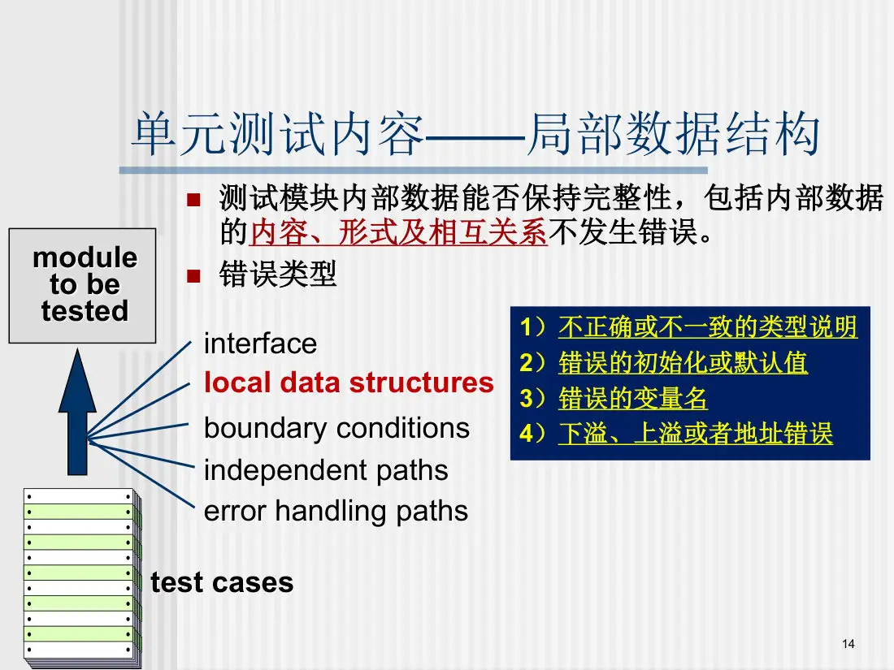

原文：

单元测试内容——局部数据结构

◼ 测试模块内部数据能否保持完整性，包括内部数据的内容、形式及相互关系不发生错误。

moduleto betested◼ 错误类型

interface

local data structures

boundary conditions

independent paths

error handling paths

test cases

1）不正确或不一致的类型说明

2）错误的初始化或默认值

3）错误的变量名

4）下溢、上溢或者地址错误

14

### 单元测试内容— 独立路径测试

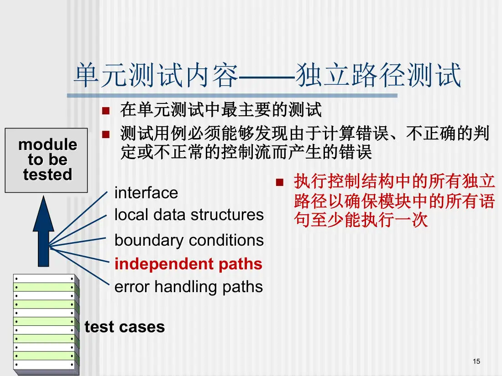

原文：

单元测试内容— 独立路径测试

◼ 在单元测试中最主要的测试

module to be tested

测试用例必须能够发现由于计算错误、不正确的判定或不正常的控制流而产生的错误

interface local data structures boundary conditions independent paths error handling paths

test cases

执行控制结构中的所有独立路径以确保模块中的所有语句至少能执行一次

15

### 单元测试内容— 出错处理

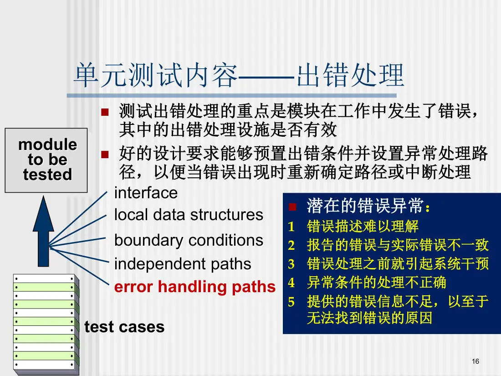

原文：

单元测试内容— 出错处理

测试出错处理的重点是模块在工作中发生了错误，其中的出错处理设施是否有效

module to be tested

◼ 好的设计要求能够预置出错条件并设置异常处理路径，以便当错误出现时重新确定路径或中断处理

interface

local data structures

boundary conditions

independent paths

error handling paths

test cases

潜在的错误异常：

1 错误描述难以理解

2 报告的错误与实际错误不一致

3 错误处理之前就引起系统干预

4 异常条件的处理不正确

5 提供的错误信息不足，以至于无法找到错误的原因

16

### 单元测试内容— 边界条件

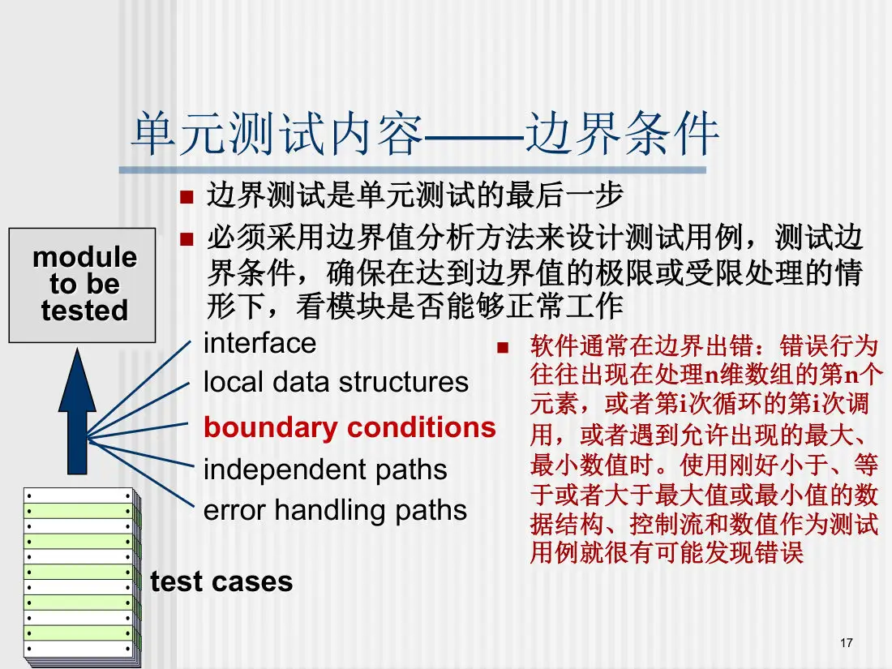

原文：

单元测试内容— 边界条件

◼ 边界测试是单元测试的最后一步

module to be tested

必须采用边界值分析方法来设计测试用例，测试边界条件，确保在达到边界值的极限或受限处理的情形下，看模块是否能够正常工作

interface

local data structures

boundary conditions independent paths error handling paths

test cases

软件通常在边界出错：错误行为往往出现在处理n维数组的第n个元素，或者第i次循环的第i次调用，或者遇到允许出现的最大、最小数值时。使用刚好小于、等于或者大于最大值或最小值的数据结构、控制流和数值作为测试用例就很有可能发现错误

17

### Integration Testing

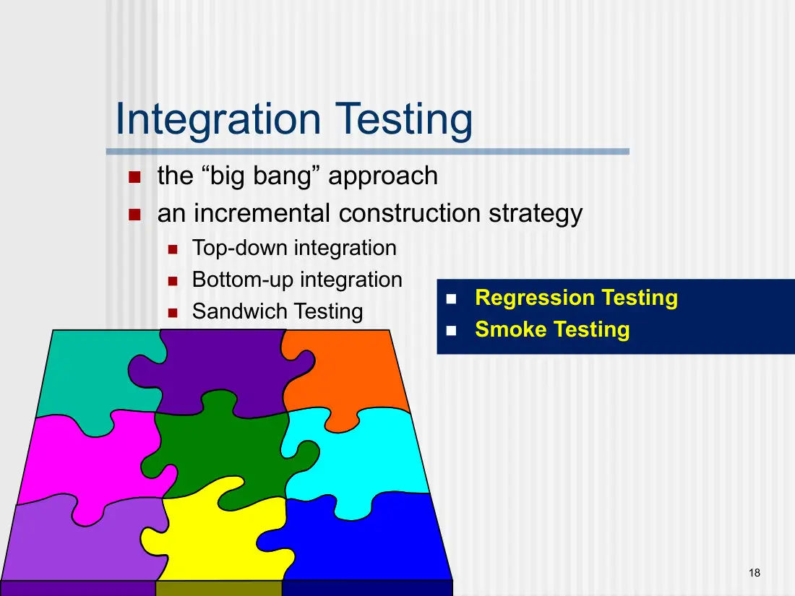

原文：

Integration Testing

◼ the “big bang” approach

◼ an incremental construction strategy

◼ Top-down integration

◼ Bottom-up integration

◼ Sandwich Testing

◼ Regression Testing

◼ Smoke Testing

18

### 自顶向下集成

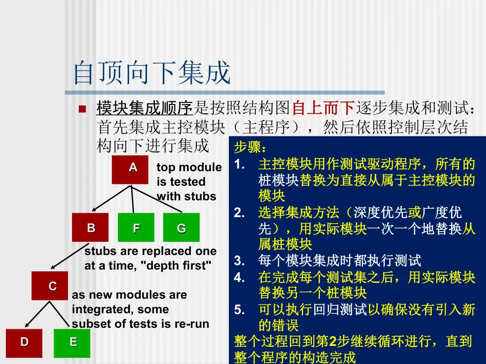

原文：

自顶向下集成

模块集成顺序是按照结构图自上而下逐步集成和测试：首先集成主控模块（主程序），然后依照控制层次结构向下进行集成 步骤：

stubs are replaced one at a time, "depth first"

as new modules areintegrated, somesubset of tests is re-run主控模块用作测试驱动程序，所有的桩模块替换为直接从属于主控模块的模块

2. 选择集成方法（深度优先或广度优先），用实际模块一次一个地替换从属桩模块

3. 每个模块集成时都执行测试

4. 在完成每个测试集之后，用实际模块替换另一个桩模块

5. 可以执行回归测试以确保没有引入新的错误

整个过程回到第2步继续循环进行，直到整个程序的构造完成

### 自底向上集成

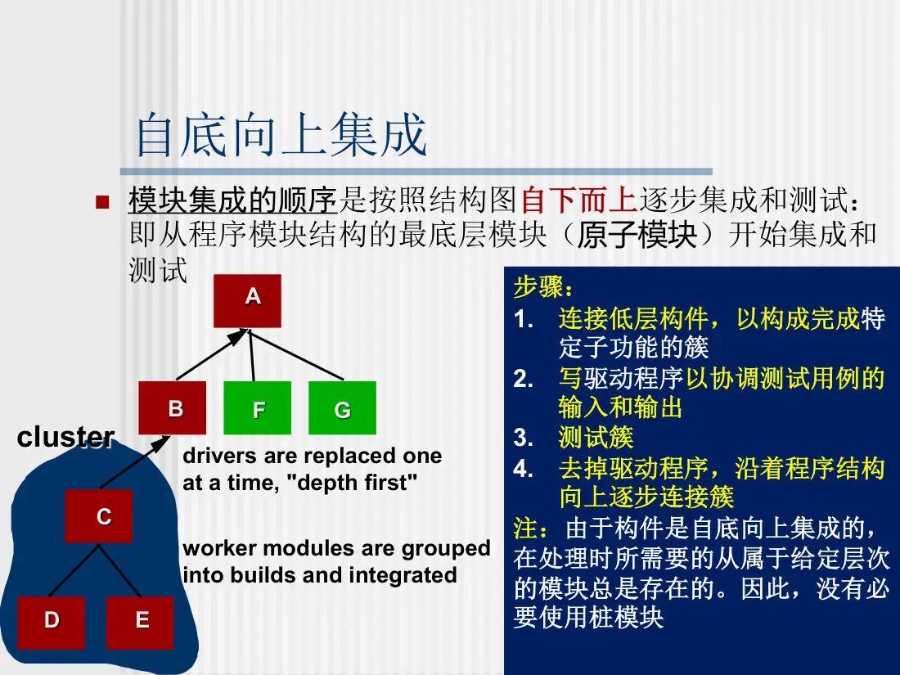

原文：

自底向上集成

◼ 模块集成的顺序是按照结构图自下而上逐步集成和测试：即从程序模块结构的最底层模块（原子模块）开始集成和

cluster

drivers are replaced one at a time, "depth first"

worker modules are grouped into builds and integrated

步骤：

1. 连接低层构件，以构成完成特定子功能的簇

2. 写驱动程序以协调测试用例的输入和输出

3. 测试簇

4. 去掉驱动程序，沿着程序结构向上逐步连接簇

注：由于构件是自底向上集成的，在处理时所需要的从属于给定层次的模块总是存在的。因此，没有必要使用桩模块

### 三明治测试：混合增量式

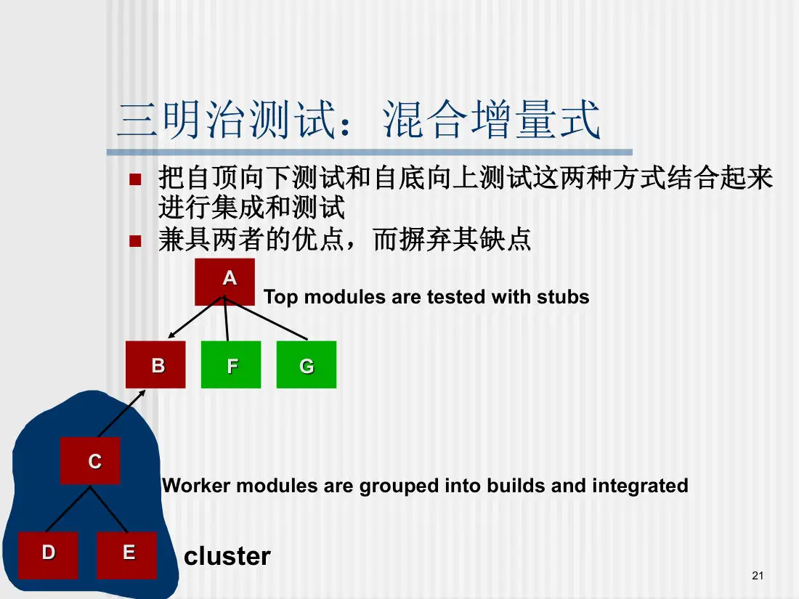

原文：

三明治测试：混合增量式

把自顶向下测试和自底向上测试这两种方式结合起来进行集成和测试

◼ 兼具两者的优点，而摒弃其缺点

Top modules are tested with stubs

cluster

Worker modules are grouped into builds and integrated

21

### 回归测试

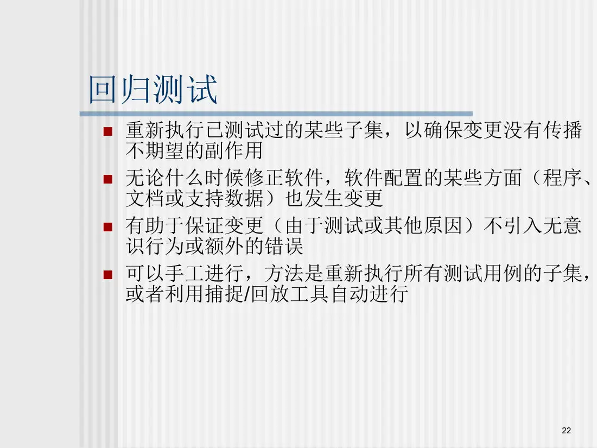

原文：

回归测试

重新执行已测试过的某些子集，以确保变更没有传播不期望的副作用

◼ 无论什么时候修正软件，软件配置的某些方面（程序、文档或支持数据）也发生变更

◼ 有助于保证变更（由于测试或其他原因）不引入无意识行为或额外的错误

◼ 可以手工进行，方法是重新执行所有测试用例的子集，或者利用捕捉/回放工具自动进行

22

### 冒烟测试

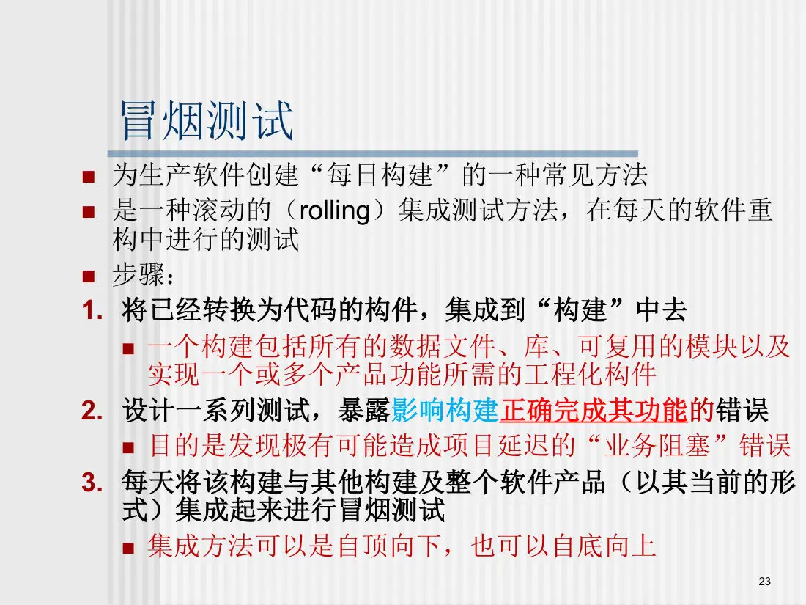

原文：

冒烟测试

◼ 为生产软件创建“每日构建”的一种常见方法

是一种滚动的（rolling）集成测试方法，在每天的软件重构中进行的测试

◼ 步骤：

1. 将已经转换为代码的构件，集成到“构建”中去

个构建包括所有的数据文件、库、可复用的模块以及实现一个或多个产品功能所需的工程化构件

2. 设计一系列测试，暴露影响构建正确完成其功能的错误

◼ 目的是发现极有可能造成项目延迟的“业务阻塞”错误

3. 每天将该构建与其他构建及整个软件产品（以其当前的形式）集成起来进行冒烟测试

集成方法可以是自顶向下，也可以自底向上

23

### Object-Oriented Testing

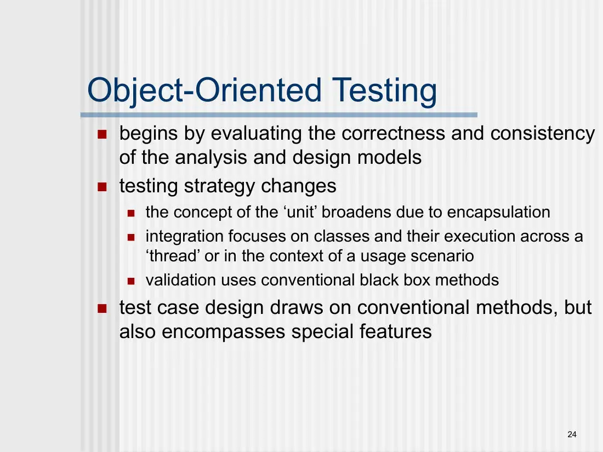

原文：

Object-Oriented Testing

◼ begins by evaluating the correctness and consistency of the analysis and design models

◼ testing strategy changes

◼ the concept of the ‘unit’ broadens due to encapsulation

integration focuses on classes and their execution across a ‘thread’ or in the context of a usage scenario

◼ validation uses conventional black box methods

◼ test case design draws on conventional methods, but also encompasses special features

24

### Broadening the View of “Testing”

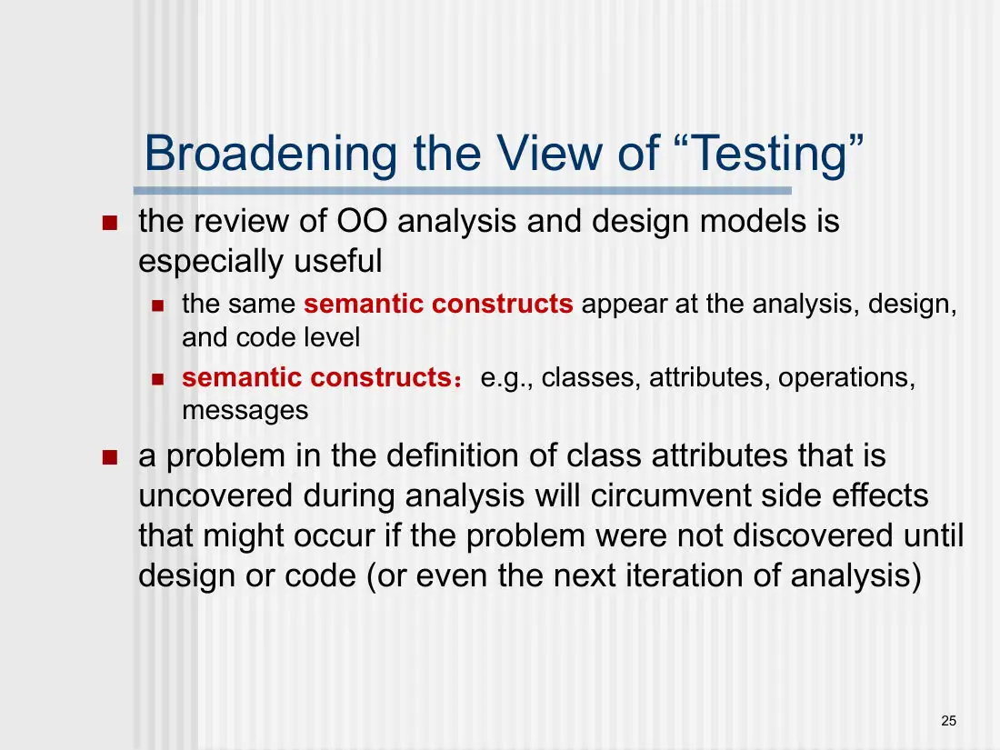

原文：

Broadening the View of “Testing”

the review of OO analysis and design models is especially useful

the same semantic constructs appear at the analysis, design, and code level

semantic constructs：e.g., classes, attributes, operations, messages

a problem in the definition of class attributes that is uncovered during analysis will circumvent side effects that might occur if the problem were not discovered until design or code (or even the next iteration of analysis)

25

### Testing the CRC Model

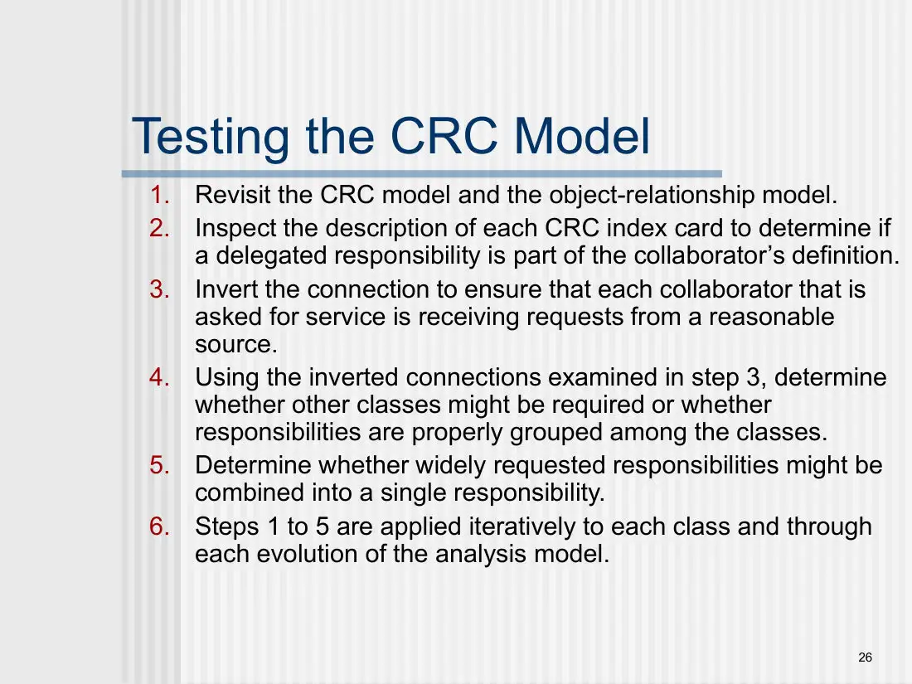

原文：

Testing the CRC Model

1. Revisit the CRC model and the object-relationship model.

2. Inspect the description of each CRC index card to determine if a delegated responsibility is part of the collaborator’s definition.

3. Invert the connection to ensure that each collaborator that is asked for service is receiving requests from a reasonable source.

Using the inverted connections examined in step 3, determine whether other classes might be required or whether responsibilities are properly grouped among the classes.

5. Determine whether widely requested responsibilities might be combined into a single responsibility.

6. Steps 1 to 5 are applied iteratively to each class and through each evolution of the analysis model.

26

### OO Testing Strategy

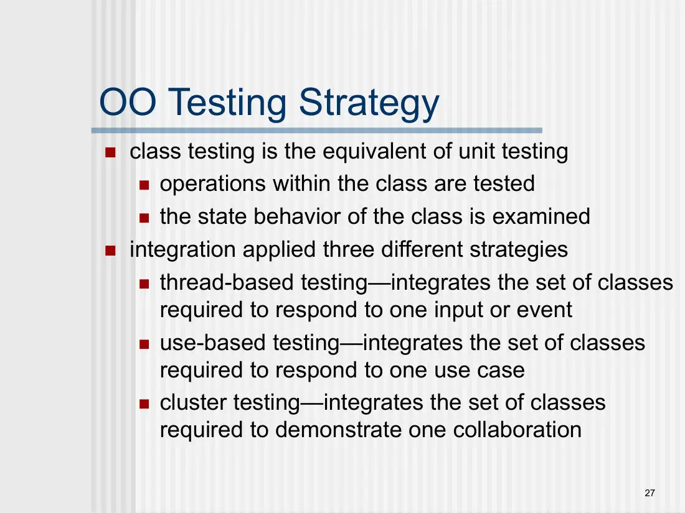

原文：

OO Testing Strategy

◼ class testing is the equivalent of unit testing

◼ operations within the class are tested

◼ the state behavior of the class is examined

◼ integration applied three different strategies

thread-based testing—integrates the set of classes required to respond to one input or event

use-based testing—integrates the set of classes required to respond to one use case

◼ cluster testing—integrates the set of classes required to demonstrate one collaboration

27

### High Order Testing

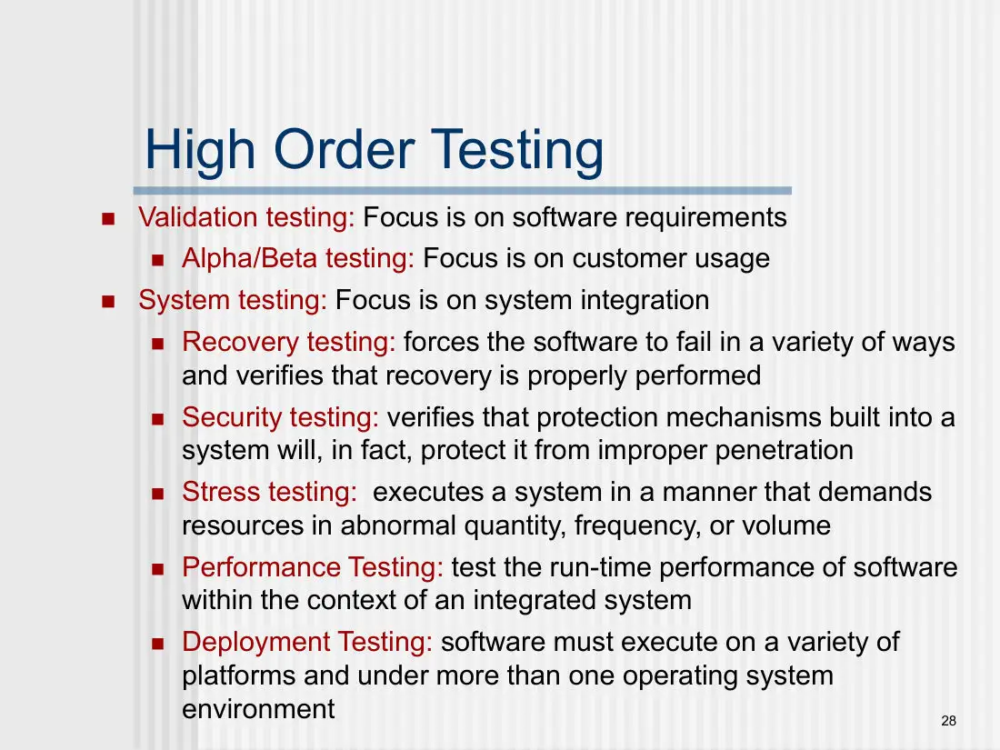

原文：

High Order Testing

◼ Validation testing: Focus is on software requirements

◼ Alpha/Beta testing: Focus is on customer usage

◼ System testing: Focus is on system integration

Recovery testing: forces the software to fail in a variety of ways and verifies that recovery is properly performed

Security testing: verifies that protection mechanisms built into a system will, in fact, protect it from improper penetration

Stress testing: executes a system in a manner that demands resources in abnormal quantity, frequency, or volume

Performance Testing: test the run-time performance of software within the context of an integrated system

Deployment Testing: software must execute on a variety of platforms and under more than one operating system environment

28

### 确认测试— 软件合格性测试

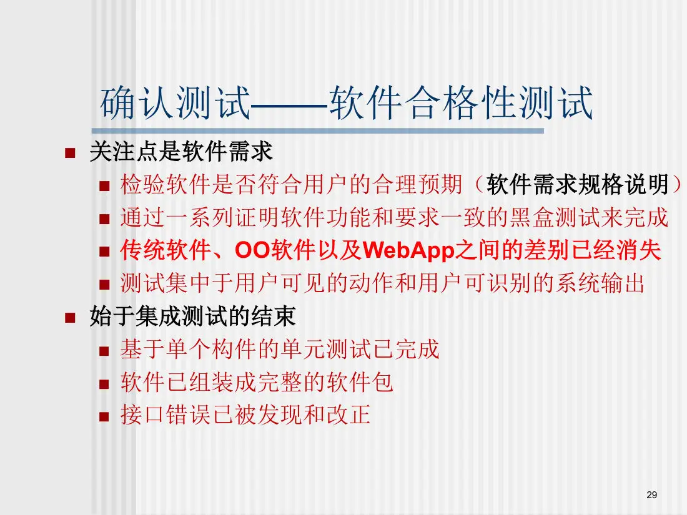

原文：

确认测试— 软件合格性测试

◼ 关注点是软件需求

◼ 检验软件是否符合用户的合理预期（软件需求规格说明）

◼ 通过一系列证明软件功能和要求一致的黑盒测试来完成

◼ 传统软件、OO软件以及WebApp之间的差别已经消失

测试集中于用户可见的动作和用户可识别的系统输出

◼ 始于集成测试的结束

基于单个构件的单元测试已完成

软件已组装成完整的软件包

接口错误已被发现和改正

29

### 确认测试— 软件合格性测试

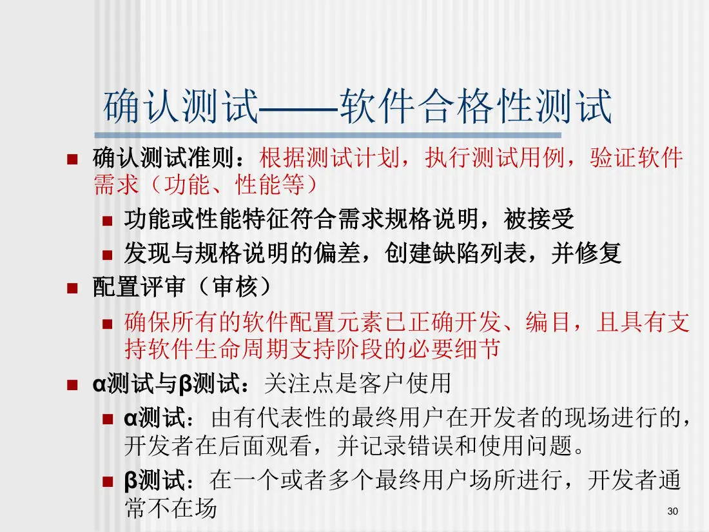

原文：

确认测试— 软件合格性测试

确认测试准则：根据测试计划，执行测试用例，验证软件需求（功能、性能等）

◼ 功能或性能特征符合需求规格说明，被接受

◼ 发现与规格说明的偏差，创建缺陷列表，并修复

◼ 配置评审（审核）

确保所有的软件配置元素已正确开发、编目，且具有支持软件生命周期支持阶段的必要细节

◼ α测试与β测试：关注点是客户使用

◼ α测试：由有代表性的最终用户在开发者的现场进行的，开发者在后面观看，并记录错误和使用问题。

◼ β测试：在一个或者多个最终用户场所进行，开发者通常不在场 30

### 系统测试

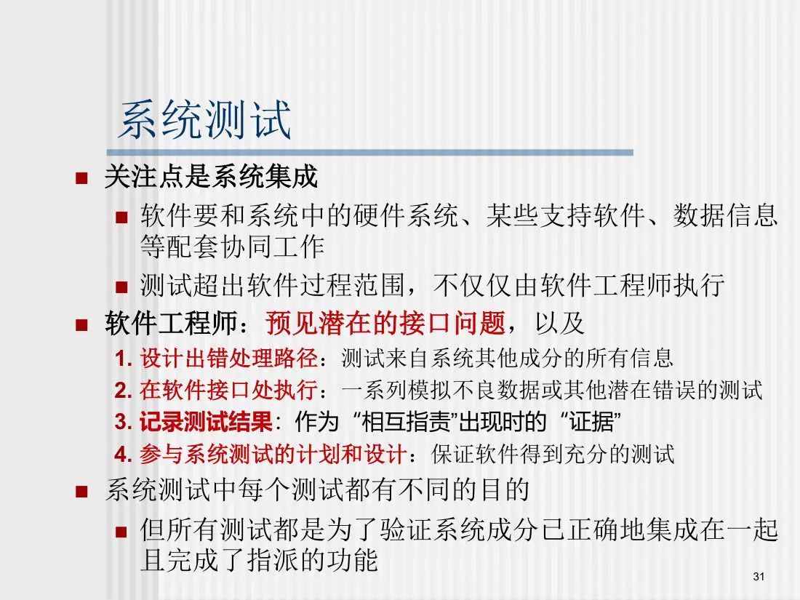

原文：

系统测试

◼ 关注点是系统集成

软件要和系统中的硬件系统、某些支持软件、数据信息等配套协同工作

◼ 测试超出软件过程范围，不仅仅由软件工程师执行

◼ 软件工程师：预见潜在的接口问题，以及

1. 设计出错处理路径：测试来自系统其他成分的所有信息

2. 在软件接口处执行：一系列模拟不良数据或其他潜在错误的测试

3. 记录测试结果：作为“相互指责”出现时的“证据”

4. 参与系统测试的计划和设计：保证软件得到充分的测试

◼ 系统测试中每个测试都有不同的目的

◼ 但所有测试都是为了验证系统成分已正确地集成在一起且完成了指派的功能

31

### 系统测试

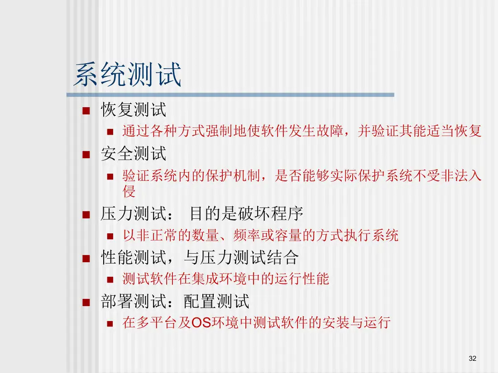

原文：

系统测试

\- 恢复测试
  - 通过各种方式强制地使软件发生故障，并验证其能适当恢复
- 安全测试
  - 验证系统内的保护机制，是否能够实际保护系统不受非法入侵
- 压力测试：目的是破坏程序
  - 以非正常的数量、频率或容量的方式执行系统
- 性能测试，与压力测试结合
  - 测试软件在集成环境中的运行性能
- 部署测试：配置测试
  - 在多平台及OS环境中测试软件的安装与运行

32

### Debugging: A Diagnostic Process

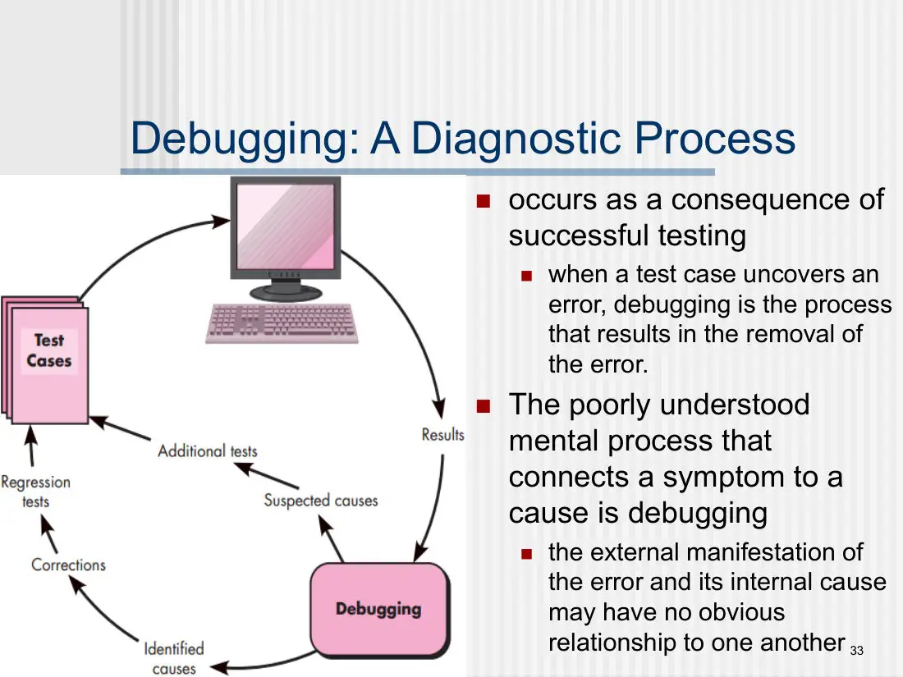

原文：

Debugging: A Diagnostic Process

occurs as a consequence of successful testing

when a test case uncovers an error, debugging is the process that results in the removal of the error.

The poorly understood mental process that connects a symptom to a cause is debugging

the external manifestation of the error and its internal cause may have no obvious relationship to one another

### 调试技术与调试结果

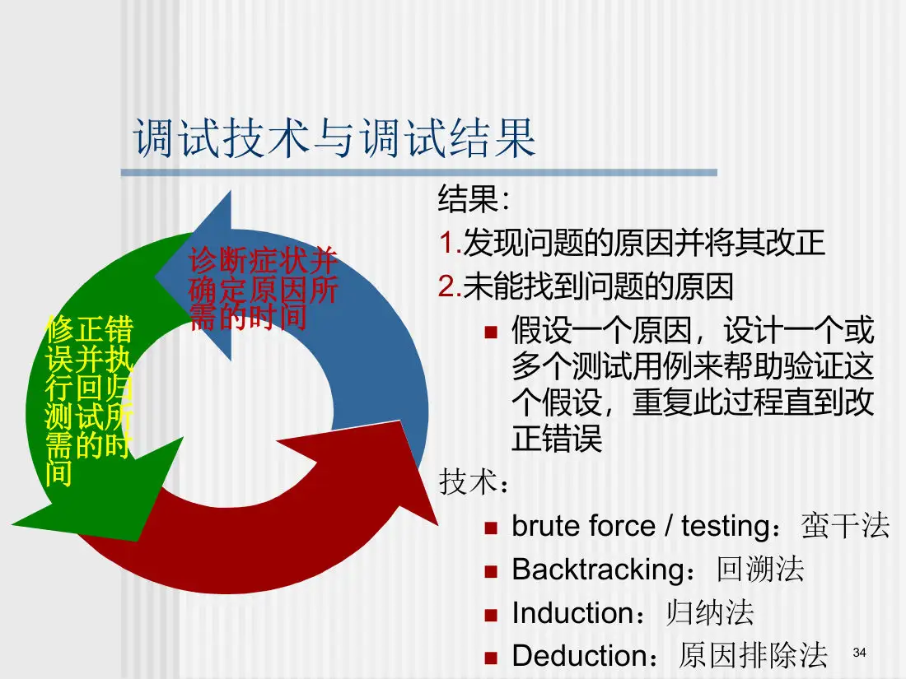

原文：

调试技术与调试结果

间 修正错 误并执行回归测试所需的时诊断症状并确定原因所需的时间

结果：

1.发现问题的原因并将其改正

2.未能找到问题的原因

假设一个原因，设计一个或多个测试用例来帮助验证这个假设，重复此过程直到改正错误

技术：

◼ brute force / testing：蛮干法

◼ Backtracking：回溯法

◼ Induction：归纳法

◼ Deduction：原因排除法

34

### 错误类型与危害

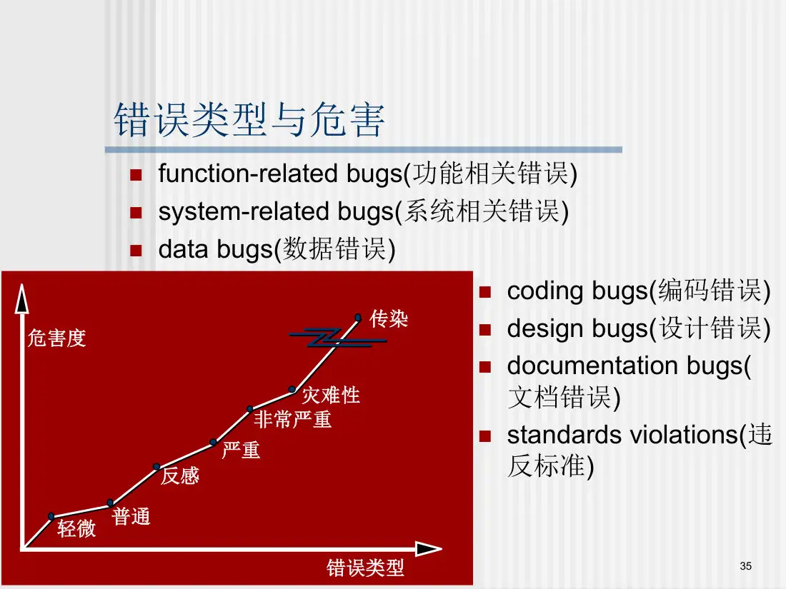

原文：

错误类型与危害

◼ function-related bugs(功能相关错误)

◼ system-related bugs(系统相关错误)

◼ data bugs(数据错误)

◼ coding bugs(编码错误)

◼ design bugs(设计错误)

documentation bugs( 文档错误)

standards violations(违反标准)

错误类型

V

35

### 纠正错误

原文：

纠正错误

修改一个错误可能会引入其他错误，不当的修改造成的危害会超过带来的益处，在修改之前，软件工程师应该问一下三个问题：

这个错误的原因在程序的另一部分也产生过吗？

在多数情况下，程序的错误是由错误的逻辑模式引起的，这种逻辑模式可能会在别的地方出现。

进行修改可能引发的“下一个错误”是什么？

在改正错误之前，应该仔细考虑源代码（最好包括设计）以评估逻辑与数据结构之间的耦合。

为避免这个错误，我们首先应当做什么呢？

◼ 这个问题是建立统计软件质量保证方法的第一步。

若我们不仅修改了过程，还修改了产品，则不仅可以排除现在的程序错误，还可以避免程序今后可能出现的错误。

36
