# 《软件工程（双语）》Unit 2 软件过程（课件）

原件的每一页，下面附识别出的文字。

### UNIT 2

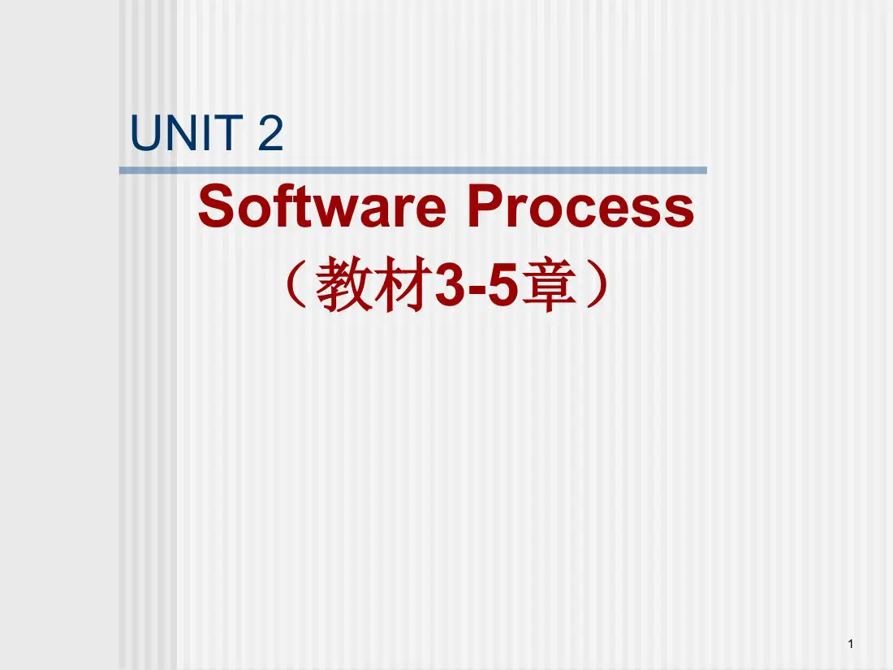

原文：

UNIT 2

Software Process（教材3-5章）

1

### Contents & Requirements

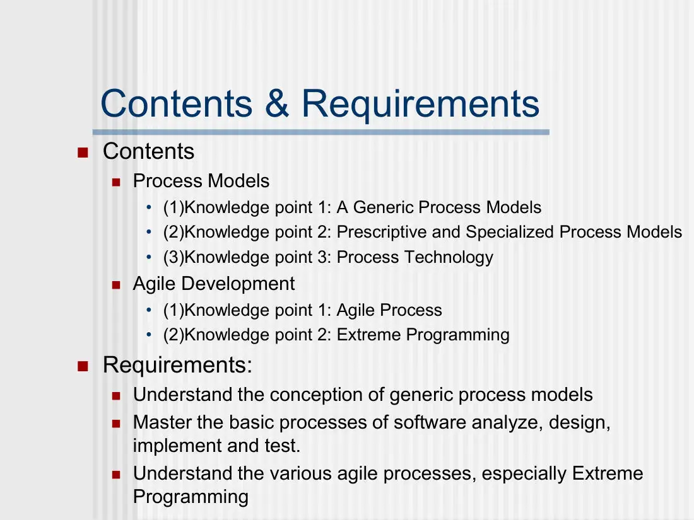

原文：

Contents & Requirements

◼ Contents

◼ Process Models

• (1)Knowledge point 1: A Generic Process Models

• (2)Knowledge point 2: Prescriptive and Specialized Process Models

• (3)Knowledge point 3: Process Technology

◼ Agile Development

• (1)Knowledge point 1: Agile Process

• (2)Knowledge point 2: Extreme Programming

◼ Requirements:

◼ Understand the conception of generic process models

Master the basic processes of software analyze, design, implement and test.

Understand the various agile processes, especially Extreme Programming

### Software Process (P31)

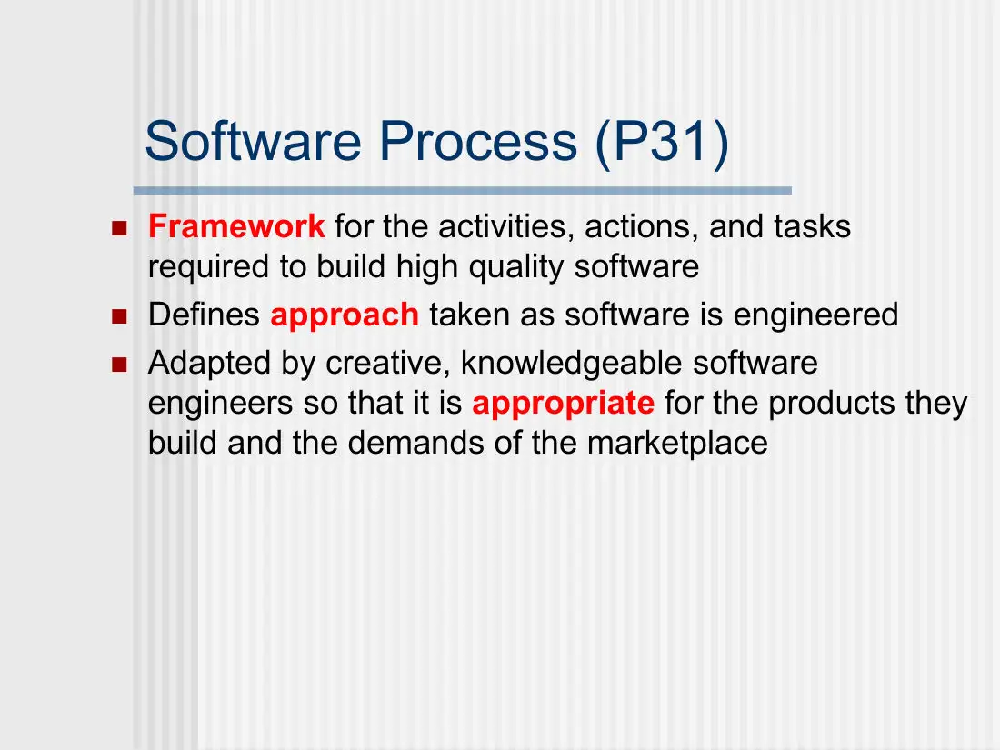

原文：

Software Process (P31)

Framework for the activities, actions, and tasks required to build high quality software

◼ Defines approach taken as software is engineered

Adapted by creative, knowledgeable software engineers so that it is appropriate for the products they build and the demands of the marketplace

### A Generic Process Model (P31)

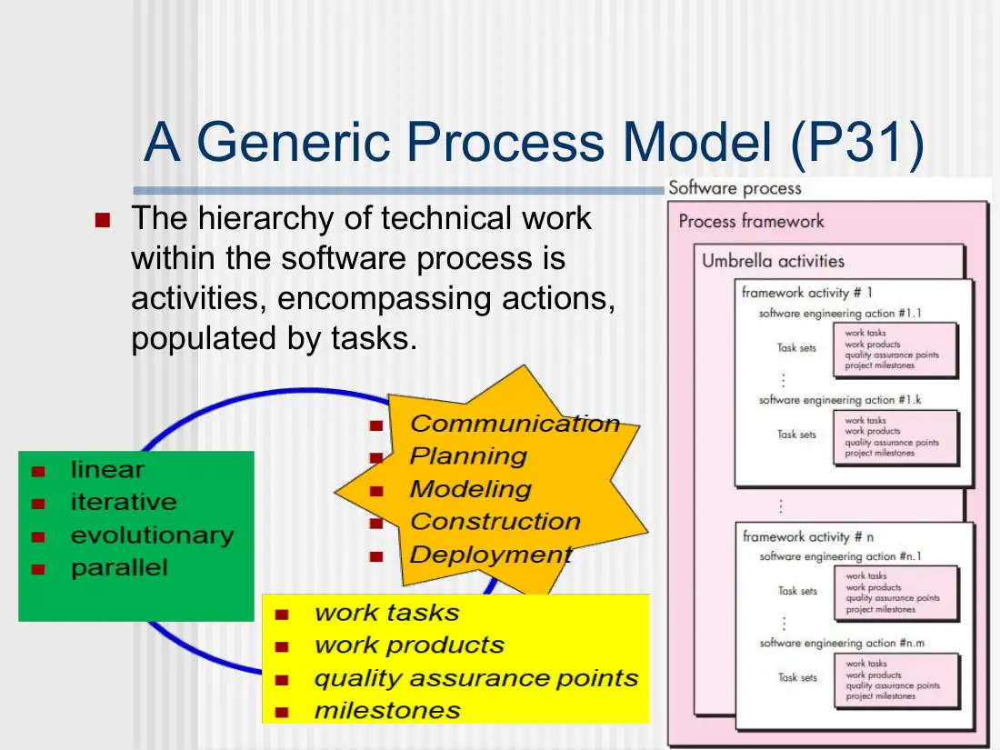

原文：

A Generic Process Model (P31)

The hierarchy of technical work within the software process is activities, encompassing actions, populated by tasks.

### Defining a Framework Activity (P32)

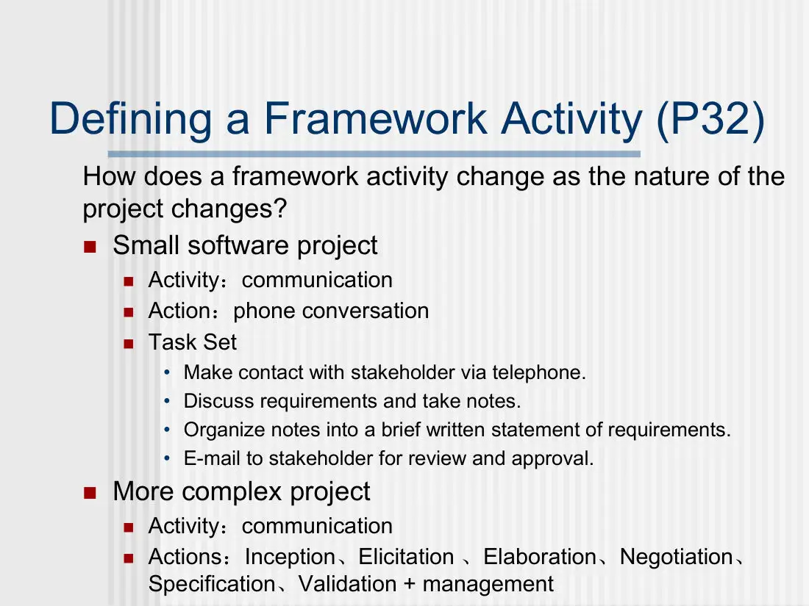

原文：

Defining a Framework Activity (P32)

How does a framework activity change as the nature of the project changes?

◼ Small software project

◼ Activity：communication

◼ Action：phone conversation

◼ Task Set

• Make contact with stakeholder via telephone.

• Discuss requirements and take notes.

• Organize notes into a brief written statement of requirements.

• E-mail to stakeholder for review and approval.

◼ More complex project

◼ Activity：communication

Actions：Inception、Elicitation 、Elaboration、Negotiation、Specification、Validation + management

### Identifying a Task Set (P34)

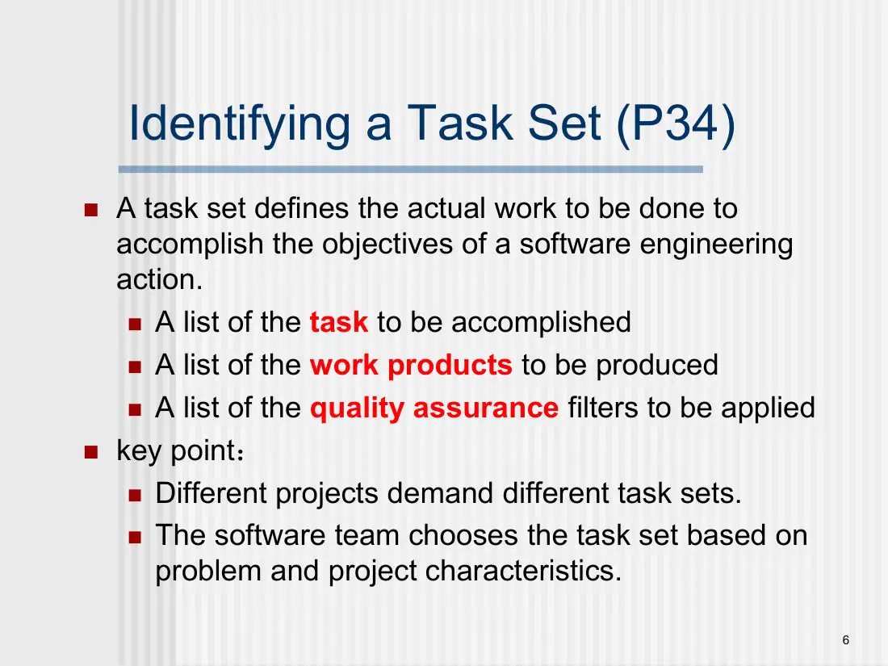

原文：

Identifying a Task Set (P34)

A task set defines the actual work to be done to accomplish the objectives of a software engineering action.

◼ A list of the task to be accomplished

◼ A list of the work products to be produced

◼ A list of the quality assurance filters to be applied

◼ key point：

◼ Different projects demand different task sets.

The software team chooses the task set based on problem and project characteristics.

6

### 信息栏任务集

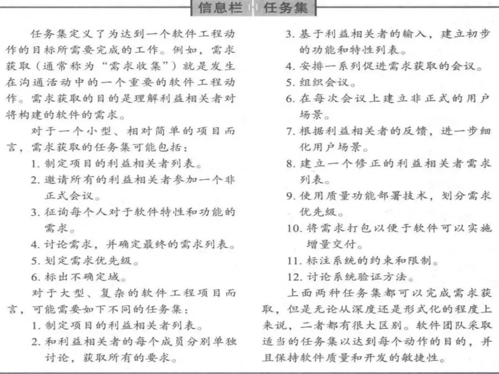

原文：

信息栏任务集

任务集定义了为达到一个软件工程动作的目标所需要完成的工作。例如，需求获取(通常称为“需求收集”)就是发生在沟通活动中的一个重要的软件工程动作。需求获取的目的是理解利益相关者对将构建的软件的需求。

言，需求获取的任务集可能包括：

1. 制定项目的利益相关者列表。

2. 邀请所有的利益相关者参加一个非

3. 征询每个人对于软件特性和功能的

4. 讨论需求，并确定最终的需求列表。

5. 划定需求优先级。

6. 标出不确定域。

对于大型、复杂的软件工程项目而言，可能需要如下不同的任务集：

1. 制定项目的利益相关者列表。

2. 和利益相关者的每个成员分别单独讨论，获取所有的要求。

3. 基于利益相关者的输入，建立初步的功能和特性列表。

4. 安排一系列促进需求获取的会议。

6. 在每次会议上建立非正式的用户

7.根据利益相关者的反馈，进一步细化用户场景。

8.建立一个修正的利益相关者需求

9. 使用质量功能部署技术，划分需求

10.将需求打包以便于软件可以实施增量交付。

11. 标注系统的约束和限制。

12. 讨论系统验证方法。

上面两种任务集都可以完成需求获取，但是无论从深度还是形式化的程度上来说，二者都有很大区别。软件团队采取适当的任务集以达到每个动作的目的，并且保持软件质量和开发的敏捷性。

### Process Patterns (P35)

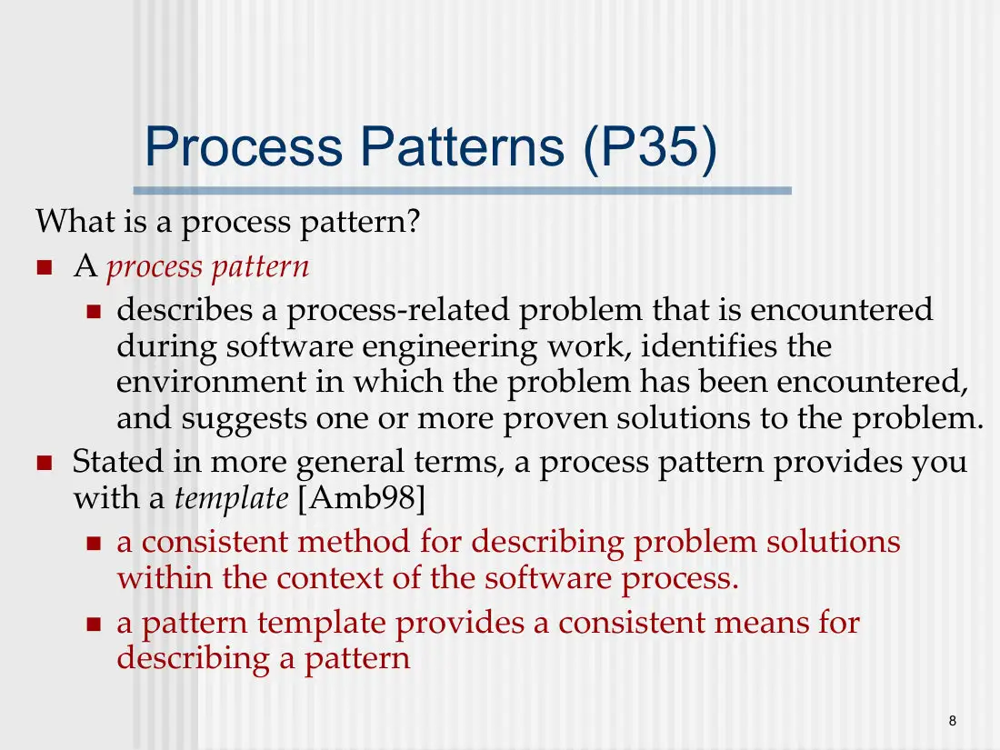

原文：

Process Patterns (P35)

What is a process pattern?

◼ A process pattern

◼ describes a process-related problem that is encountered during software engineering work, identifies the environment in which the problem has been encountered, and suggests one or more proven solutions to the problem.

Stated in more general terms, a process pattern provides you with a template [Amb98]

a consistent method for describing problem solutions within the context of the software process.

a pattern template provides a consistent means for describing a pattern

8

### 过程模式的模板

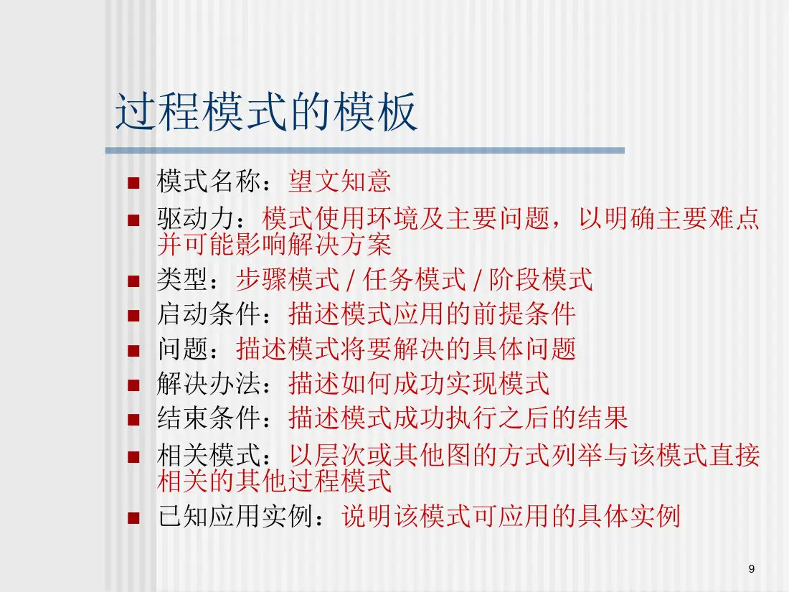

原文：

过程模式的模板

模式名称：望文知意

驱动力：模式使用环境及主要问题，以明确主要难点并可能影响解决方案

◼ 类型：步骤模式 / 任务模式 / 阶段模式

启动条件：描述模式应用的前提条件

问题：描述模式将要解决的具体问题

解决办法：描述如何成功实现模式

结束条件：描述模式成功执行之后的结果

相关模式：以层次或其他图的方式列举与该模式直接相关的其他过程模式

◼ 已知应用实例：说明该模式可应用的具体实例

9

### 过程模式的类型

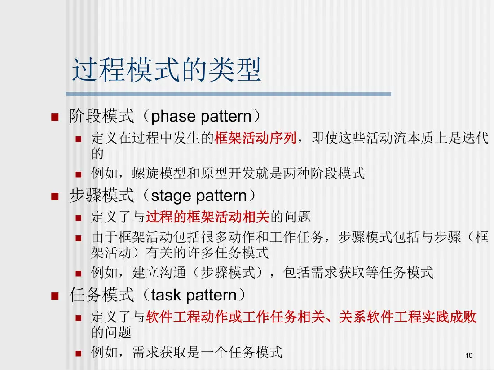

原文：

过程模式的类型

◼ 阶段模式（phase pattern）

定义在过程中发生的框架活动序列，即使这些活动流本质上是迭代的

◼ 例如，螺旋模型和原型开发就是两种阶段模式

◼ 步骤模式（stage pattern）

定义了与过程的框架活动相关的问题

由于框架活动包括很多动作和工作任务，步骤模式包括与步骤（框架活动）有关的许多任务模式

◼ 例如，建立沟通（步骤模式），包括需求获取等任务模式

◼ 任务模式（task pattern）

定义了与软件工程动作或工作任务相关、关系软件工程实践成败的问题

◼ 例如，需求获取是一个任务模式

10

### 信息栏过程模式实例

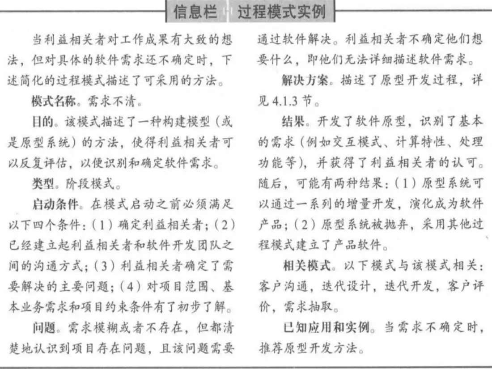

原文：

信息栏过程模式实例

当利益相关者对工作成果有大致的想法，但对具体的软件需求还不确定时，下述简化的过程模式描述了可采用的方法。

模式名称。需求不清。

目的。该模式描述了一种构建模型（或是原型系统）的方法，使得利益相关者可以反复评估，以便识别和确定软件需求。

类型。阶段模式。

启动条件。在模式启动之前必须满足以下四个条件：(1)确定利益相关者；(2)已经建立起利益相关者和软件开发团队之间的沟通方式；(3)利益相关者确定了需要解决的主要问题；(4)对项目范围、基本业务需求和项目约束条件有了初步了解。

问题。需求模糊或者不存在，但都清楚地认识到项目存在问题，且该问题需要通过软件解决。利益相关者不确定他们想要什么，即他们无法详细描述软件需求。

解决方案。描述了原型开发过程，详

结果。开发了软件原型，识别了基本的需求（例如交互模式、计算特性、处理功能等)，并获得了利益相关者的认可。随后，可能有两种结果：(1)原型系统可以通过一系列的增量开发，演化成为软件产品；(2）原型系统被抛弃，采用其他过程模式建立了产品软件。

相关模式。以下模式与该模式相关：客户沟通，迭代设计，迭代开发，客户评价，需求抽取。

已知应用和实例。当需求不确定时，推荐原型开发方法。

### 过程模式：需求不清的解决方案

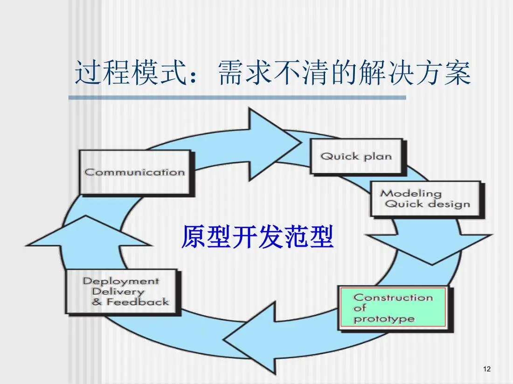

原文：

过程模式：需求不清的解决方案

12

### Prescriptive Models (P39)

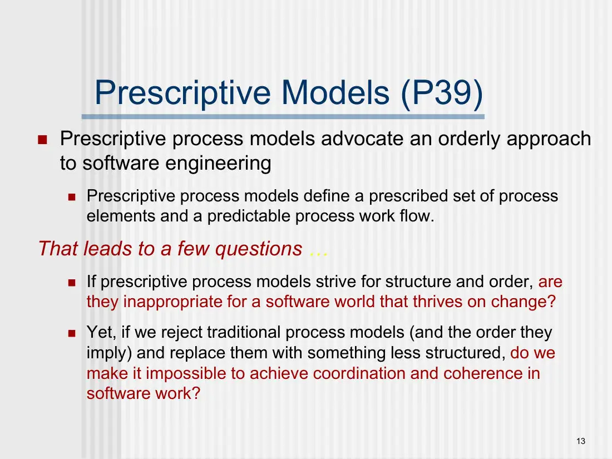

原文：

Prescriptive Models (P39)

◼ Prescriptive process models advocate an orderly approach to software engineering

Prescriptive process models define a prescribed set of process elements and a predictable process work flow.

That leads to a few questions

If prescriptive process models strive for structure and order, are they inappropriate for a software world that thrives on change?

Yet, if we reject traditional process models (and the order they imply) and replace them with something less structured, do we make it impossible to achieve coordination and coherence in software work?

13

### The Waterfall Model (P40)

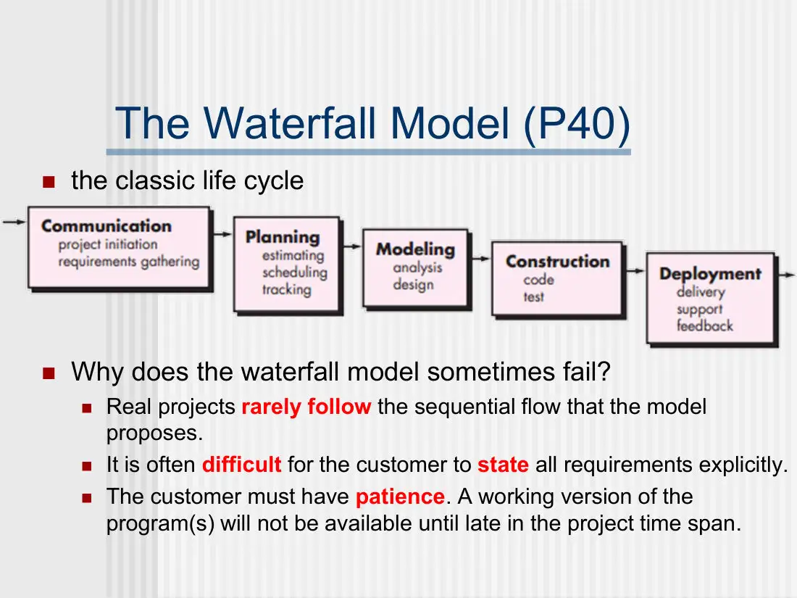

原文：

The Waterfall Model (P40)

◼ the classic life cycle

Communication project initiatior requirements gathering

Planning estimating scheduling tracking

Modeling design

Construction

Deployment delivery feedback

◼ Why does the waterfall model sometimes fail?

Real projects rarely follow the sequential flow that the model proposes.

◼ It is often difficult for the customer to state all requirements explicitly.

◼ The customer must have patience. A working version of the program(s) will not be available until late in the project time span.

### The V-Model (P41)

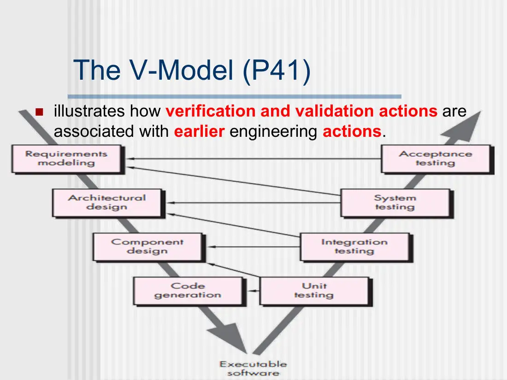

原文：

The V-Model (P41)

illustrates how verification and validation actions are associated with earlier engineering actions.

### The Incremental Model (P42)

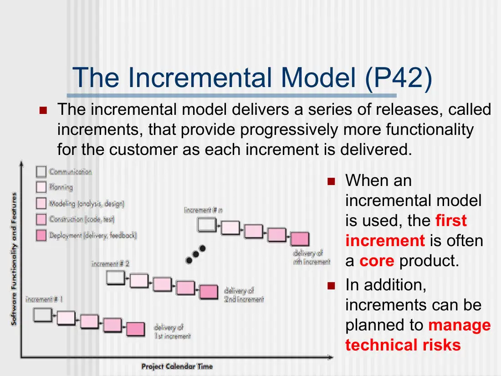

原文：

The Incremental Model (P42)

The incremental model delivers a series of releases, called increments, that provide progressively more functionality for the customer as each increment is delivered.

When an incremental model is used, the first increment is often ent a core product.

In addition, increments can be planned to manage technical risks

Software Functionality and Features

### Evolutionary Models (P44)

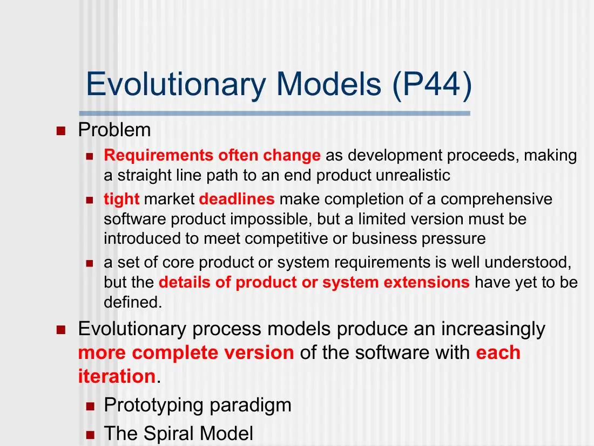

原文：

Evolutionary Models (P44)

◼ Problem

Requirements often change as development proceeds, making a straight line path to an end product unrealistic

tight market deadlines make completion of a comprehensive software product impossible, but a limited version must be introduced to meet competitive or business pressure

a set of core product or system requirements is well understood, but the details of product or system extensions have yet to be defined.

Evolutionary process models produce an increasingly more complete version of the software with each iteration.

◼ Prototyping paradigm

◼ The Spiral Model

### Prototyping paradigm (P44)

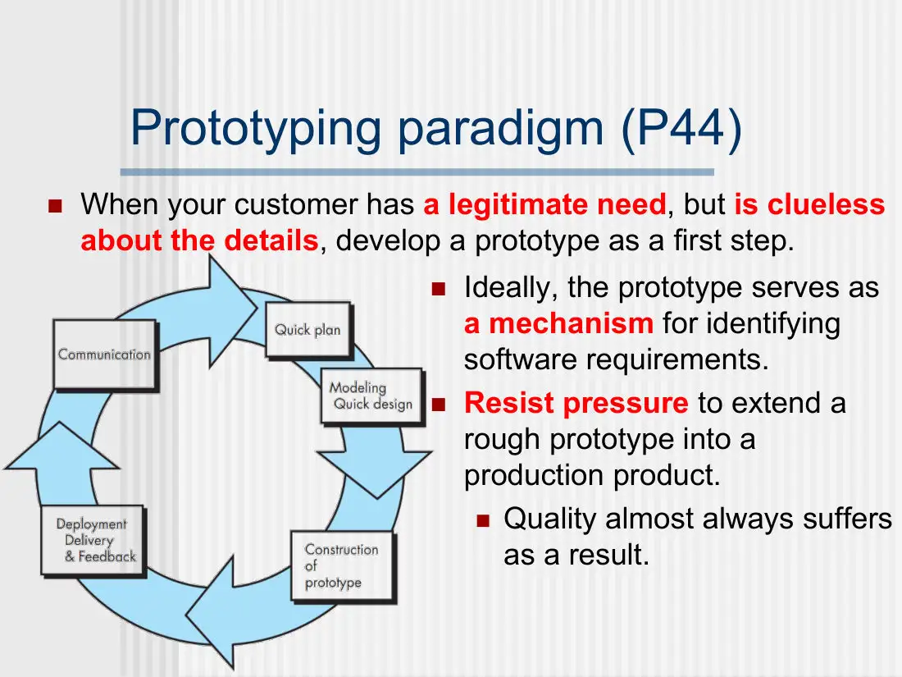

原文：

Prototyping paradigm (P44)

When your customer has a legitimate need, but is clueless about the details, develop a prototype as a first step.

Ideally, the prototype serves as a mechanism for identifying software requirements.

Resist pressure to extend a rough prototype into a production product.

Quality almost always suffers as a result.

### 原型问题

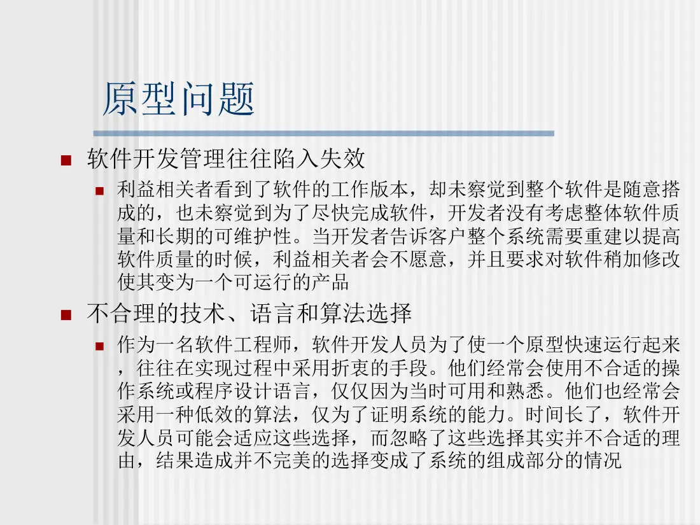

原文：

原型问题

◼ 软件开发管理往往陷入失效

◼ 利益相关者看到了软件的工作版本，却未察觉到整个软件是随意搭成的，也未察觉到为了尽快完成软件，开发者没有考虑整体软件质量和长期的可维护性。当开发者告诉客户整个系统需要重建以提高软件质量的时候，利益相关者会不愿意，并且要求对软件稍加修改使其变为一个可运行的产品

◼ 不合理的技术、语言和算法选择

◼ 作为一名软件工程师，软件开发人员为了使一个原型快速运行起来，往往在实现过程中采用折衷的手段。他们经常会使用不合适的操作系统或程序设计语言，仅仅因为当时可用和熟悉。他们也经常会采用一种低效的算法，仅为了证明系统的能力。时间长了，软件开发人员可能会适应这些选择，而忽略了这些选择其实并不合适的理由，结果造成并不完美的选择变成了系统的组成部分的情况

### The Spiral Model (P46)

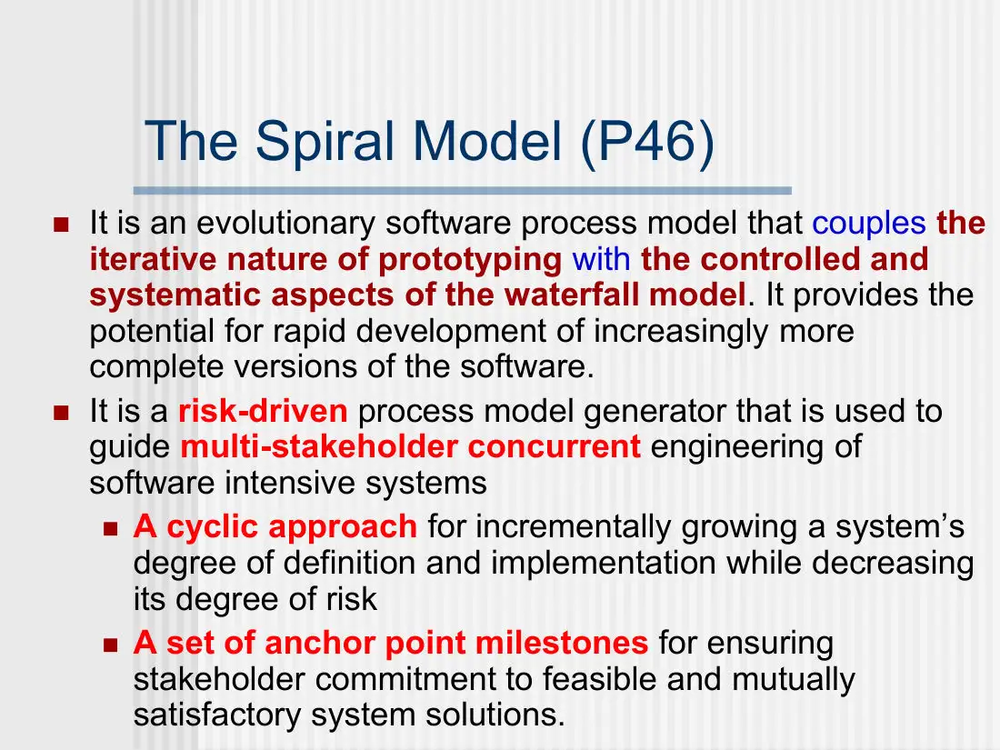

原文：

The Spiral Model (P46)

It is an evolutionary software process model that couples the iterative nature of prototyping with the controlled and systematic aspects of the waterfall model. It provides the potential for rapid development of increasingly more complete versions of the software.

It is a risk-driven process model generator that is used to guide multi-stakeholder concurrent engineering of software intensive systems

A cyclic approach for incrementally growing a system’s degree of definition and implementation while decreasing its degree of risk

A set of anchor point milestones for ensuring stakeholder commitment to feasible and mutually satisfactory system solutions.

### 螺旋模型

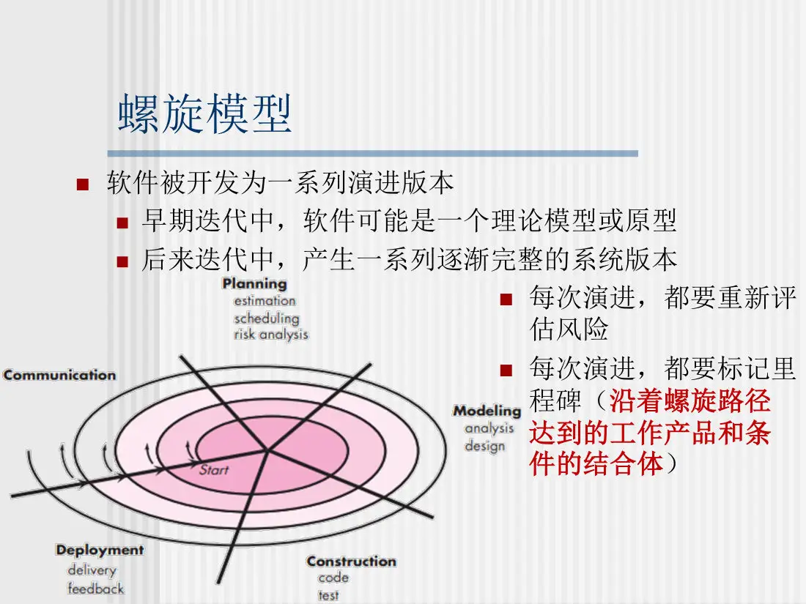

原文：

螺旋模型

◼ 软件被开发为一系列演进版本

◼ 早期迭代中，软件可能是一个理论模型或原型

◼ 后来迭代中，产生一系列逐渐完整的系统版本

每次演进，都要重新评 估风险

每次演进，都要标记里Modeling 程碑（沿着螺旋路径analysis 达到的工作产品和条design件的结合体）

### 螺旋模型

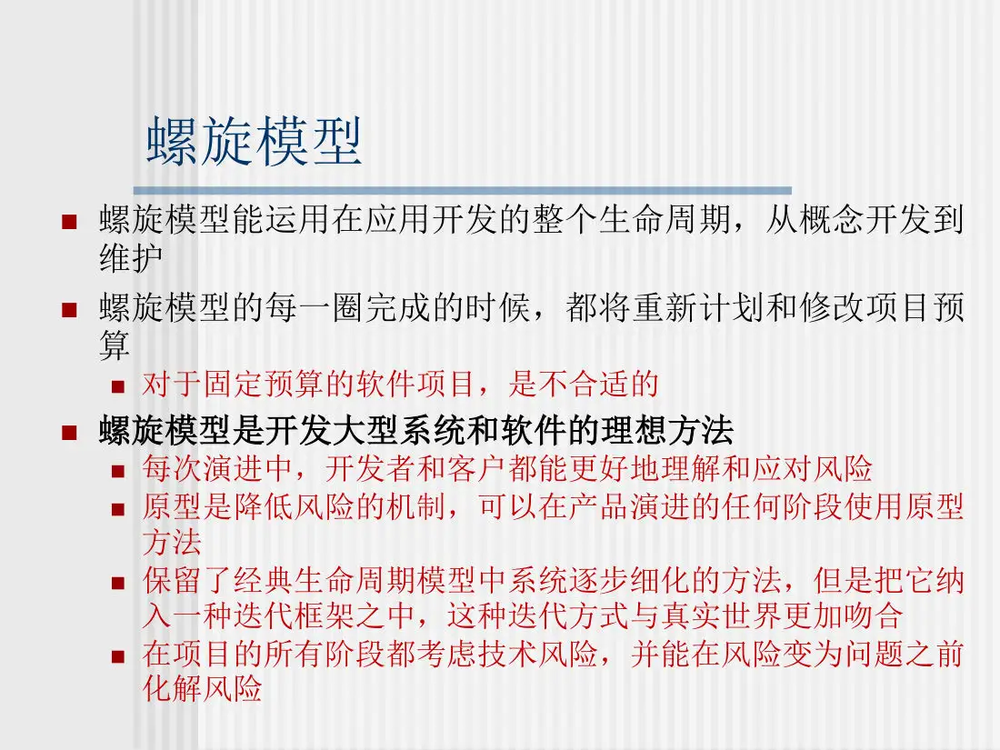

原文：

螺旋模型

螺旋模型能运用在应用开发的整个生命周期，从概念开发到维护

螺旋模型的每一圈完成的时候，都将重新计划和修改项目预算

◼ 对于固定预算的软件项目，是不合适的

◼ 螺旋模型是开发大型系统和软件的理想方法

◼ 每次演进中，开发者和客户都能更好地理解和应对风险

原型是降低风险的机制，可以在产品演进的任何阶段使用原型方法

保留了经典生命周期模型中系统逐步细化的方法，但是把它纳入一种迭代框架之中，这种迭代方式与真实世界更加吻合

在项目的所有阶段都考虑技术风险，并能在风险变为问题之前化解风险

### Concurrent Models (P48)or task or task

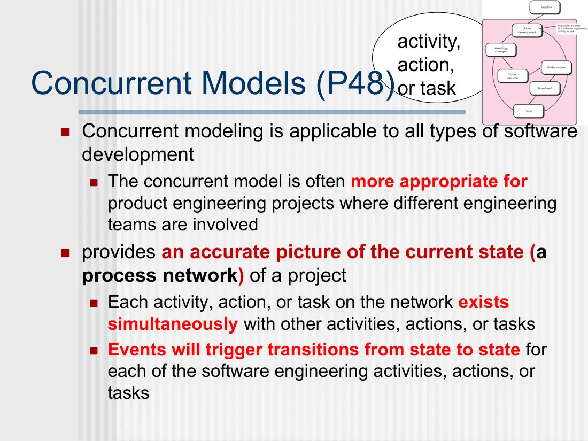

原文：

Concurrent Models (P48)or task or task

activity, action,

◼ Concurrent modeling is applicable to all types of software development

The concurrent model is often more appropriate for product engineering projects where different engineering teams are involved

provides an accurate picture of the current state (a process network) of a project

Each activity, action, or task on the network exists simultaneously with other activities, actions, or tasks

Events will trigger transitions from state to state for each of the software engineering activities, actions, or tasks

### 协同模型

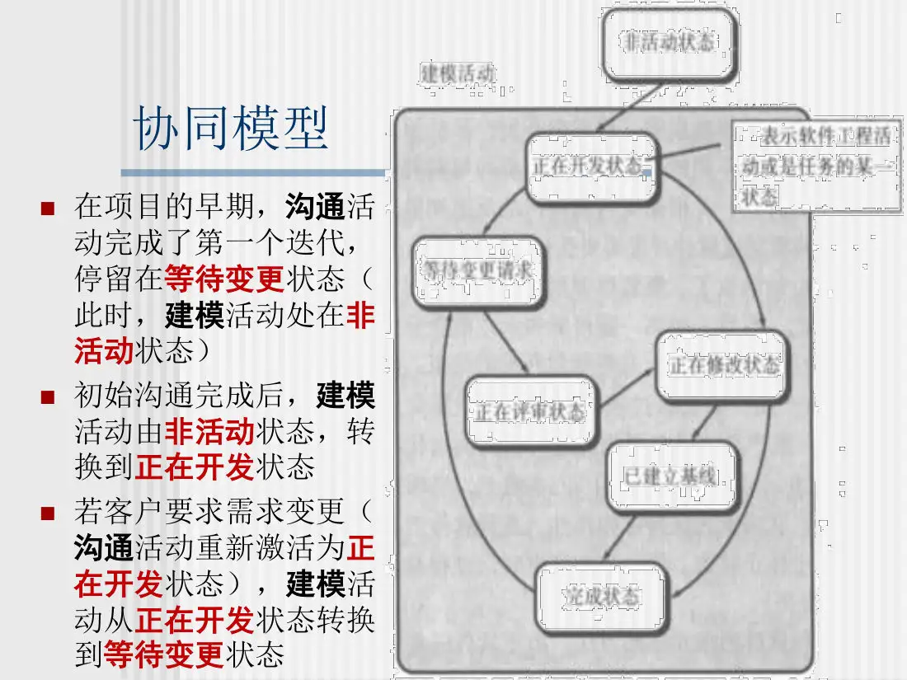

原文：

协同模型

在项目的早期，沟通活动完成了第一个迭代，停留在等待变更状态（此时，建模活动处在非活动状态）

初始沟通完成后，建模活动由非活动状态，转换到正在开发状态

若客户要求需求变更（沟通活动重新激活为正在开发状态），建模活动从正在开发状态转换到等待变更状态

### 协同模型

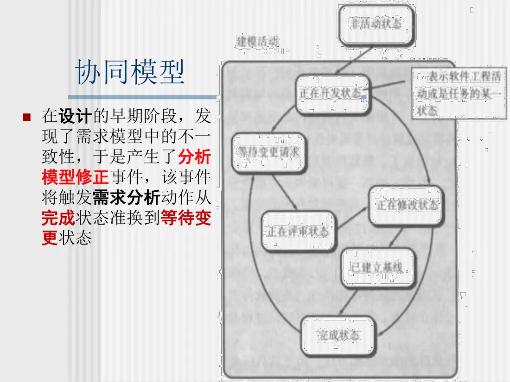

原文：

协同模型

在设计的早期阶段，发现了需求模型中的不一致性，于是产生了分析模型修正事件，该事件将触发需求分析动作从完成状态准换到等待变更状态

### Specialized Process Models (P51)

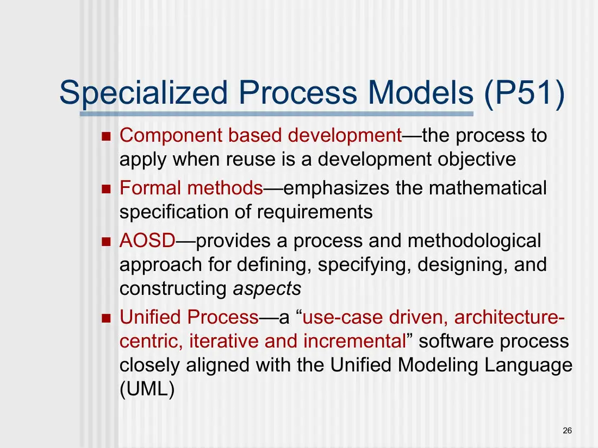

原文：

Specialized Process Models (P51)

◼ Component based development—the process to apply when reuse is a development objective

Formal methods—emphasizes the mathematical specification of requirements

◼ AOSD—provides a process and methodological approach for defining, specifying, designing, and constructing aspects

Unified Process—a “use-case driven, architecturecentric, iterative and incremental” software process closely aligned with the Unified Modeling Language (UML)

26

### 专用过程模型

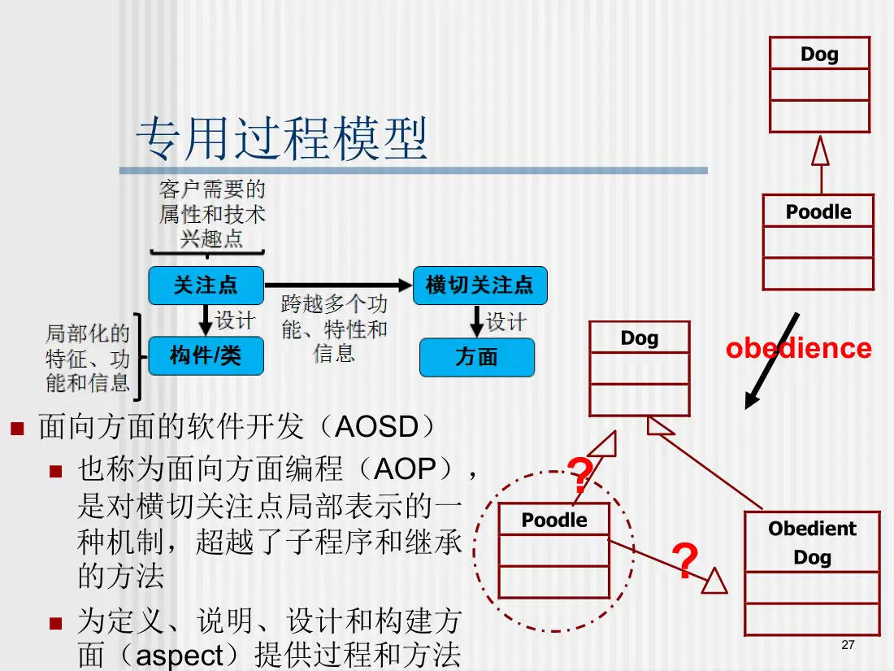

原文：

专用过程模型

客户需要的属性和技术兴趣点

局部化的特征、功能和信息关注点

设计

跨越多个功能、特性和信息

构件/类

横切关注点

设计

方面

Dog

◼ 面向方面的软件开发（AOSD）

为定义、说明、设计和构建方面（aspect）提供过程和方法也称为面向方面编程（AOP）是对横切关注点局部表示的种机制，超越了子程序和继承的方法

obedience

Poodle

Obedient Dog

27

### 统一过程(UP)

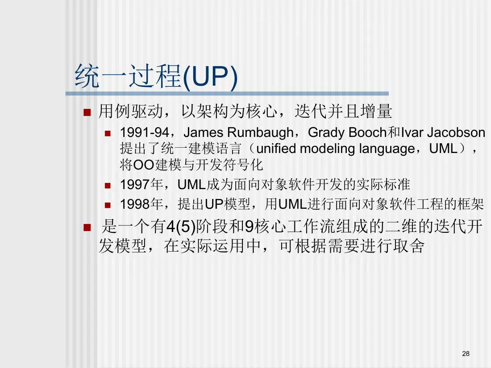

原文：

统一过程(UP)

◼ 用例驱动，以架构为核心，迭代并且增量

1991-94，James Rumbaugh，Grady Booch和Ivar Jacobson提出了统一建模语言（unified modeling language，UML），将OO建模与开发符号化

◼ 1997年，UML成为面向对象软件开发的实际标准

◼ 1998年，提出UP模型，用UML进行面向对象软件工程的框架

◼ 是一个有4(5)阶段和9核心工作流组成的二维的迭代开发模型，在实际运用中，可根据需要进行取舍

28

### 统一过程(UP)

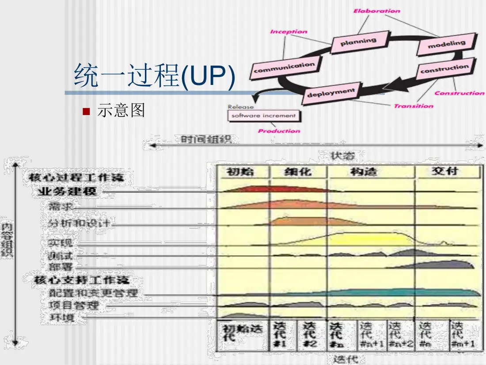

原文：

<table><tr><td></td><td>初始</td><td colspan="2">细化</td><td colspan="2">构造</td><td colspan="2">交付</td><td></td></tr><tr><td>核心过程工作流</td><td></td><td colspan="2"></td><td colspan="2"></td><td colspan="2"></td><td></td></tr><tr><td>业务建模</td><td></td><td colspan="2"></td><td colspan="2"></td><td colspan="2"></td><td></td></tr><tr><td>需求</td><td></td><td colspan="2"></td><td colspan="2"></td><td colspan="2"></td><td></td></tr><tr><td>分析和设计</td><td></td><td colspan="2"></td><td colspan="2"></td><td colspan="2"></td><td></td></tr><tr><td>实现</td><td></td><td colspan="2"></td><td colspan="2"></td><td colspan="2"></td><td></td></tr><tr><td>测试</td><td></td><td colspan="2"></td><td colspan="2"></td><td colspan="2"></td><td></td></tr><tr><td>部署</td><td></td><td colspan="2"></td><td colspan="2"></td><td colspan="2"></td><td></td></tr><tr><td>核心支持工作流</td><td></td><td colspan="2"></td><td colspan="2"></td><td colspan="2"></td><td></td></tr><tr><td>配置和变更管理</td><td></td><td colspan="2"></td><td colspan="2"></td><td colspan="2"></td><td></td></tr><tr><td>项目管理</td><td></td><td colspan="2"></td><td colspan="2"></td><td colspan="2"></td><td></td></tr><tr><td>环境</td><td></td><td colspan="2"></td><td colspan="2"></td><td colspan="2"></td><td></td></tr><tr><td></td><td>初始迭代</td><td>迭代#1</td><td>迭代#2</td><td>迭代#n</td><td>迭代#n+1</td><td>迭代#n+2</td><td>迭代#n</td><td>迭代#m+1</td></tr></table>

统一过程(UP)

◼ 示意图

### 统一过程(UP)

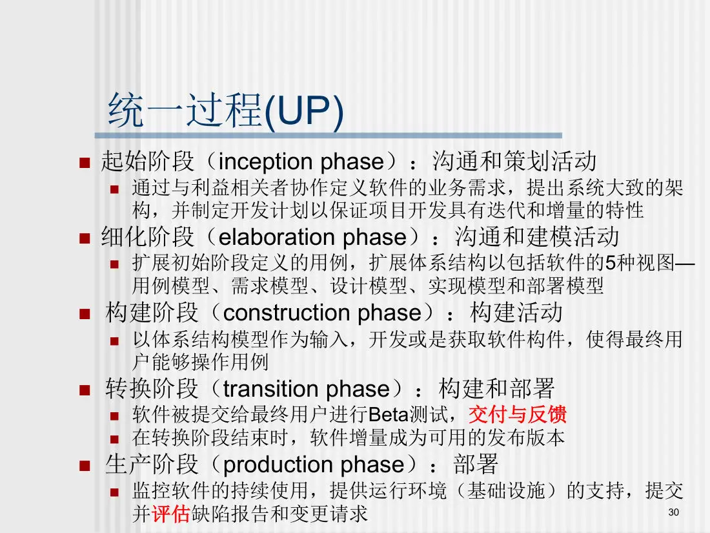

原文：

统一过程(UP)

◼ 起始阶段（inception phase）：沟通和策划活动

通过与利益相关者协作定义软件的业务需求，提出系统大致的架构，并制定开发计划以保证项目开发具有迭代和增量的特性

◼ 细化阶段（elaboration phase）：沟通和建模活动

扩展初始阶段定义的用例，扩展体系结构以包括软件的5种视图用例模型、需求模型、设计模型、实现模型和部署模型

◼ 构建阶段（construction phase）：构建活动

以体系结构模型作为输入，开发或是获取软件构件，使得最终用户能够操作用例

◼ 转换阶段（transition phase）：构建和部署

◼ 软件被提交给最终用户进行Beta测试，交付与反馈

◼ 在转换阶段结束时，软件增量成为可用的发布版本

◼ 生产阶段（production phase）：部署

监控软件的持续使用，提供运行环境（基础设施）的支持，提交并评估缺陷报告和变更请求 30

### 第 31 页

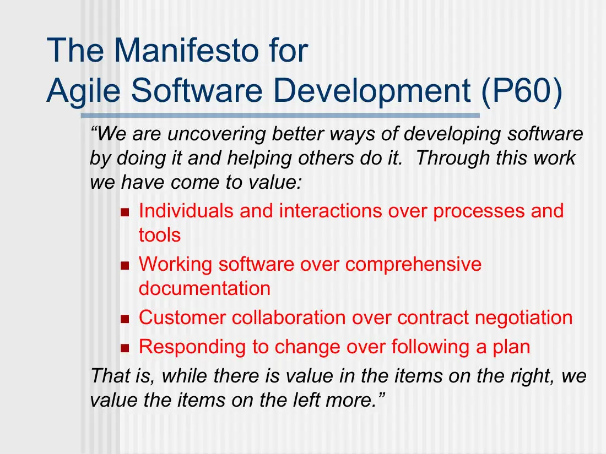

原文：

The Manifesto for Agile Software Development (P60)

“We are uncovering better ways of developing software by doing it and helping others do it. Through this work we have come to value:

Individuals and interactions over processes and tools

Working software over comprehensive documentation

Customer collaboration over contract negotiation

◼ Responding to change over following a plan

That is, while there is value in the items on the right, we value the items on the left more.”

### 敏捷思想的由来

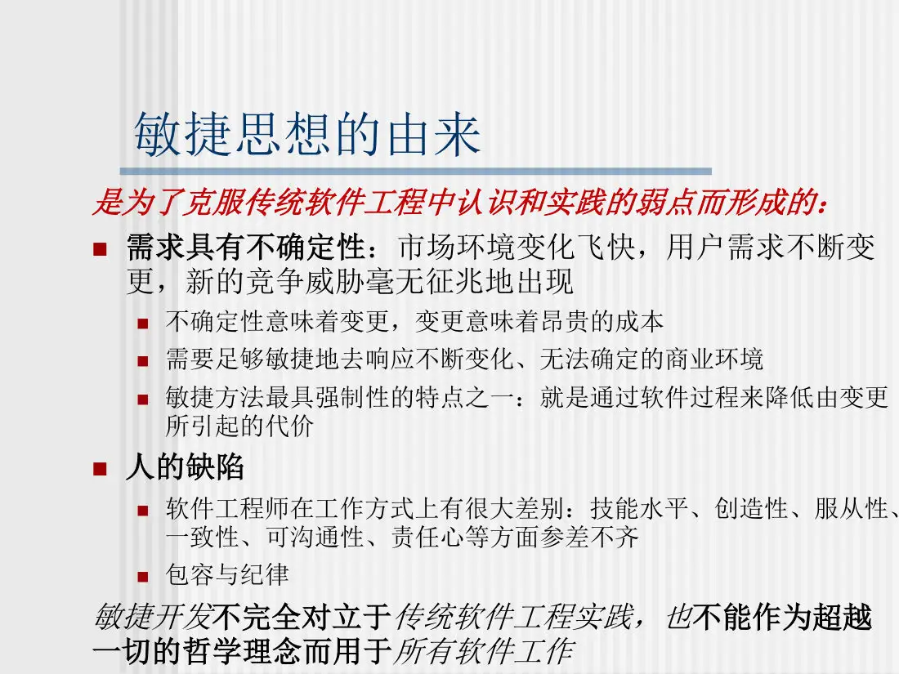

原文：

敏捷思想的由来

是为了克服传统软件工程中认识和实践的弱点而形成的：

◼ 需求具有不确定性：市场环境变化飞快，用户需求不断变更，新的竞争威胁毫无征兆地出现

◼ 不确定性意味着变更，变更意味着昂贵的成本

◼ 需要足够敏捷地去响应不断变化、无法确定的商业环境

敏捷方法最具强制性的特点之一：就是通过软件过程来降低由变更所引起的代价

◼ 人的缺陷

软件工程师在工作方式上有很大差别：技能水平、创造性、服从性、致性、可沟通性、责任心等方面参差不齐

◼ 包容与纪律

不完全对立于 不能作为超越一切的哲学理念而用于所有软件工作

### What is “Agility”? P(62)

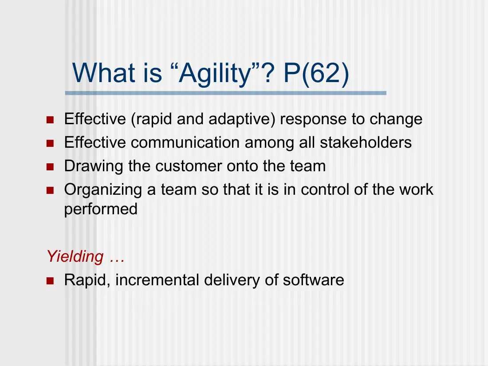

原文：

What is “Agility”? P(62)

◼ Effective (rapid and adaptive) response to change

◼ Effective communication among all stakeholders

◼ Drawing the customer onto the team

Organizing a team so that it is in control of the work performed

Yielding …

◼ Rapid, incremental delivery of software

### Agility and the Cost of Change P(63)

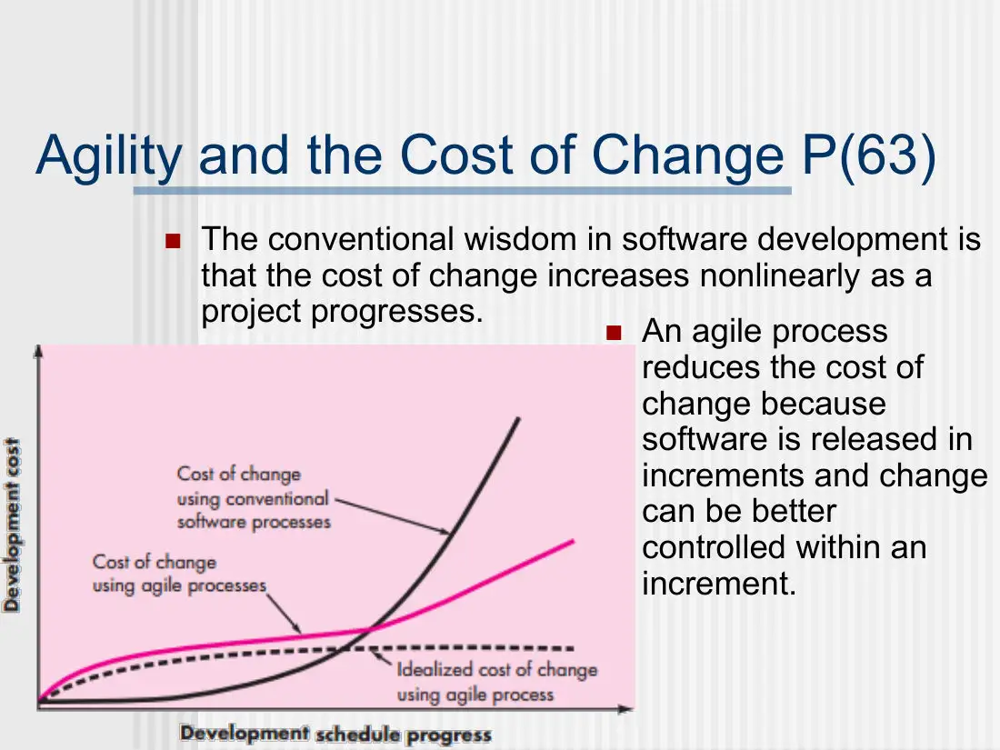

原文：

Agility and the Cost of Change P(63)

The conventional wisdom in software development is that the cost of change increases nonlinearly as a project progresses. An agile process An agile process

reduces the cost of change because software is released in increments and change can be better controlled within an increment.

Development cost

### An Agile Process

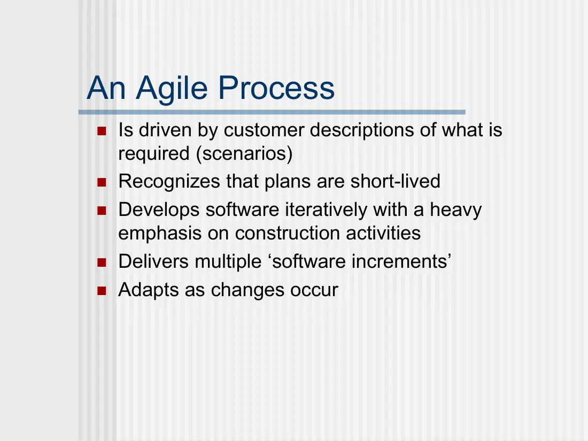

原文：

An Agile Process

Is driven by customer descriptions of what is required (scenarios)

◼ Recognizes that plans are short-lived

Develops software iteratively with a heavy emphasis on construction activities

◼ Delivers multiple ‘software increments’

◼ Adapts as changes occur

### 敏捷原则

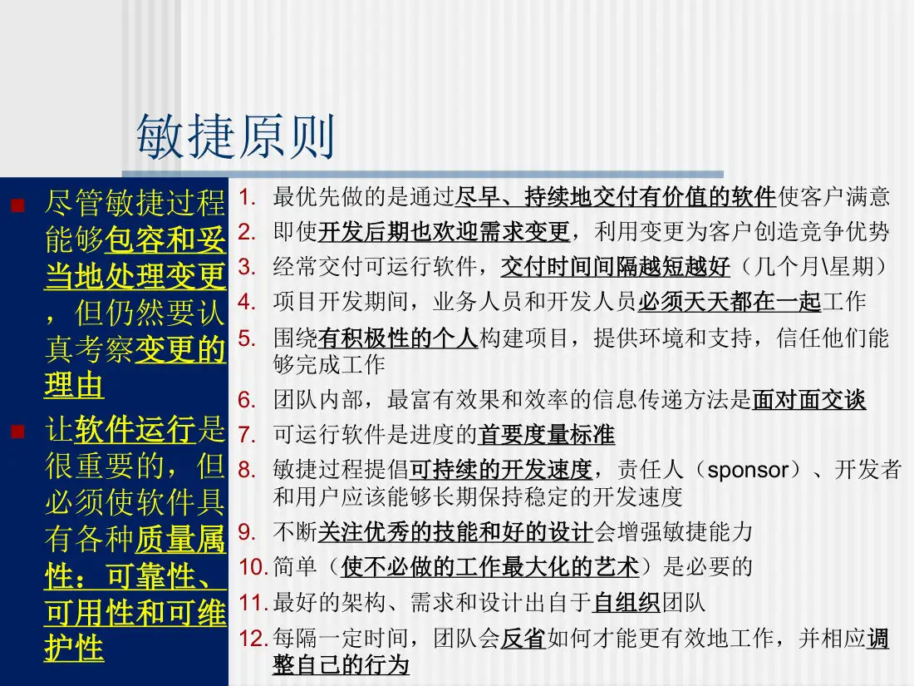

原文：

敏捷原则

尽管敏捷过程能够包容和妥当地处理变更，但仍然要认真考察变更的理由

让软件运行是很重要的，但必须使软件具有各种质量属性：可靠性、可用性和可维护性

1. 最优先做的是通过尽早、持续地交付有价值的软件使客户满意

2. 即使开发后期也欢迎需求变更，利用变更为客户创造竞争优势

3. 经常交付可运行软件，交付时间间隔越短越好（几个月\星期）

4. 项目开发期间，业务人员和开发人员必须天天都在一起工作

5. 围绕有积极性的个人构建项目，提供环境和支持，信任他们能够完成工作

6. 团队内部，最富有效果和效率的信息传递方法是面对面交谈

7. 可运行软件是进度的首要度量标准

8. 敏捷过程提倡可持续的开发速度，责任人（sponsor）、开发者和用户应该能够长期保持稳定的开发速度

9. 不断关注优秀的技能和好的设计会增强敏捷能力

10.简单（使不必做的工作最大化的艺术）是必要的

11.最好的架构、需求和设计出自于自组织团队

12.每隔一定时间，团队会反省如何才能更有效地工作，并相应调整自己的行为

### Other Agile Process Models P(71)

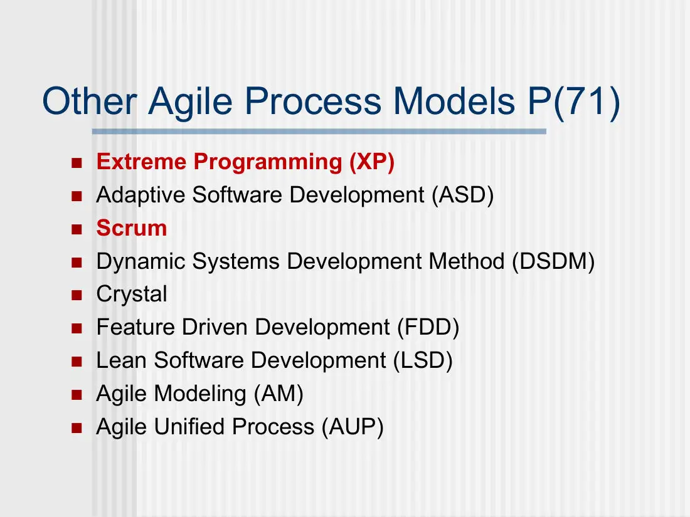

原文：

Other Agile Process Models P(71)

Extreme Programming (XP)

◼ Adaptive Software Development (ASD)

◼ Scrum

◼ Dynamic Systems Development Method (DSDM)

◼ Crystal

◼ Feature Driven Development (FDD)

◼ Lean Software Development (LSD)

◼ Agile Modeling (AM)

◼ Agile Unified Process (AUP)

### Extreme Programming (XP) P(66)

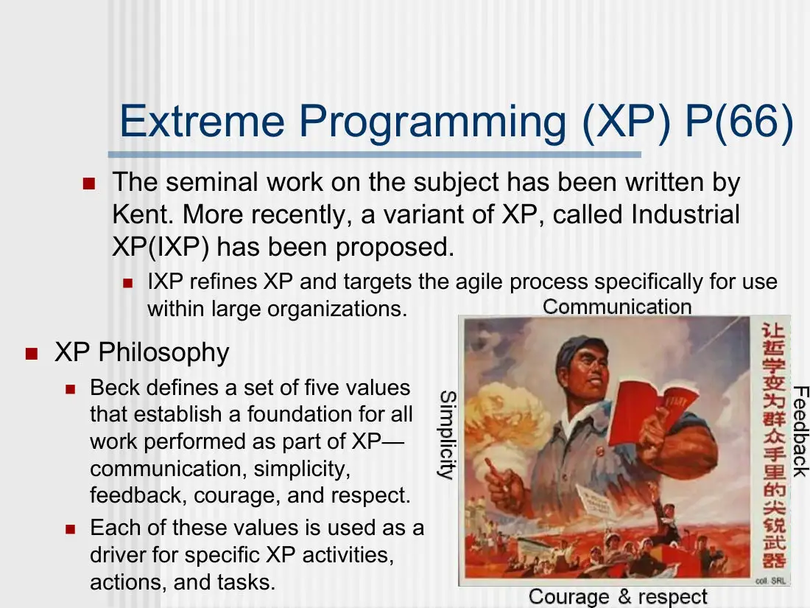

原文：

Extreme Programming (XP) P(66)

◼ The seminal work on the subject has been written by Kent. More recently, a variant of XP, called Industrial XP(IXP) has been proposed.

IXP refines XP and targets the agile process specifically for use within large organizations. Communication

◼ XP Philosophy

Beck defines a set of five values that establish a foundation for all work performed as part of XP— communication, simplicity, feedback, courage, and respect.

Each of these values is used as a driver for specific XP activities, actions, and tasks.

### XP Process P(66)

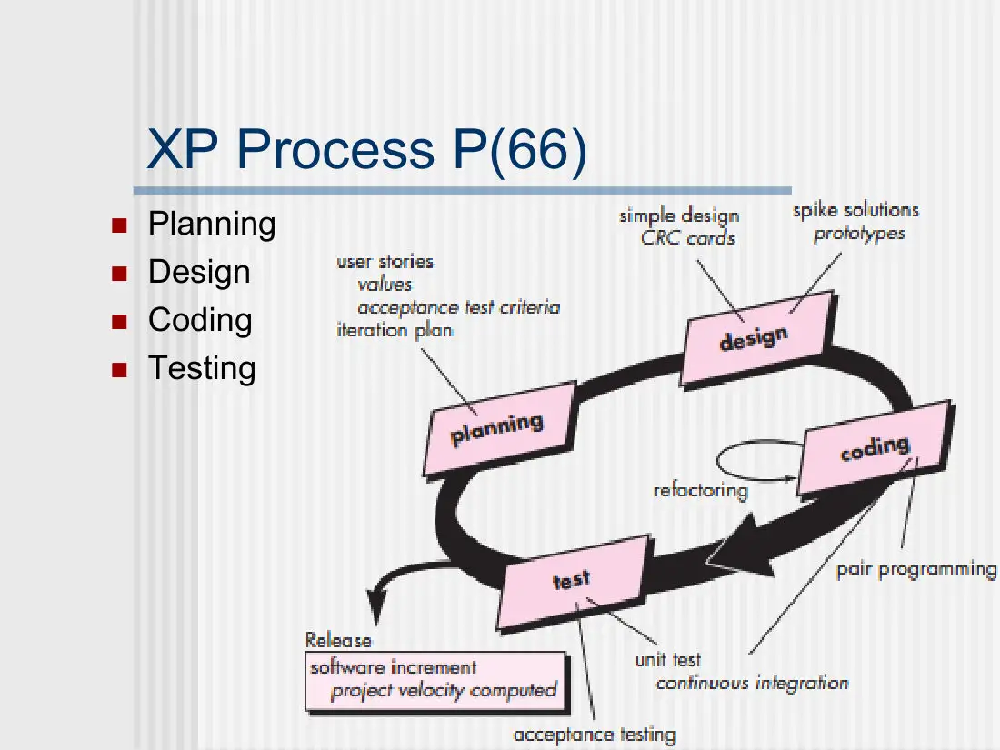

原文：

XP Process P(66)

◼ Planning

◼ Design

◼ Coding

◼ Testing

user stories

values

### XP Planning P(66)

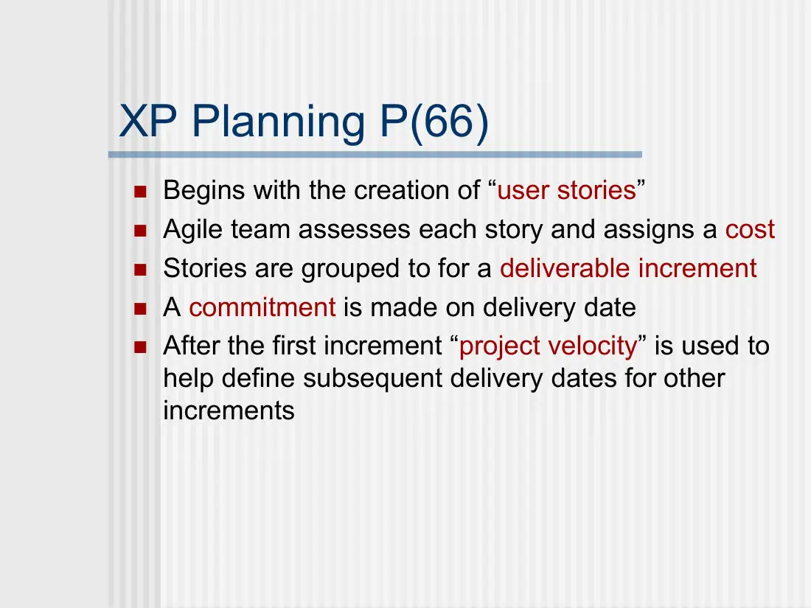

原文：

XP Planning P(66)

◼ Begins with the creation of “user stories”

◼ Agile team assesses each story and assigns a cost

◼ Stories are grouped to for a deliverable increment

◼ A commitment is made on delivery date

After the first increment “project velocity” is used to help define subsequent delivery dates for other increments

### XP Design P(67)

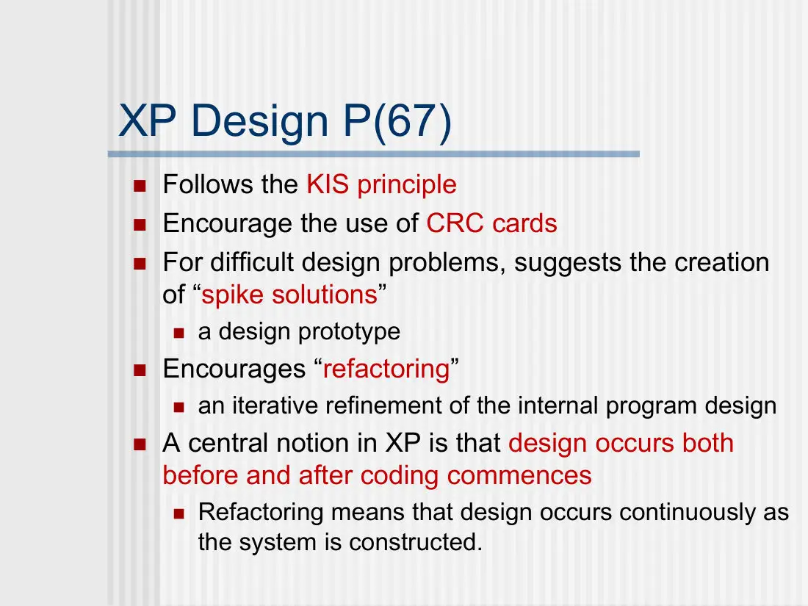

原文：

XP Design P(67)

◼ Follows the KIS principle

◼ Encourage the use of CRC cards

For difficult design problems, suggests the creation of “spike solutions”

◼ a design prototype

Encourages “refactoring”

◼ an iterative refinement of the internal program design

A central notion in XP is that design occurs both before and after coding commences

◼ Refactoring means that design occurs continuously as the system is constructed.

### XP Coding P(68)

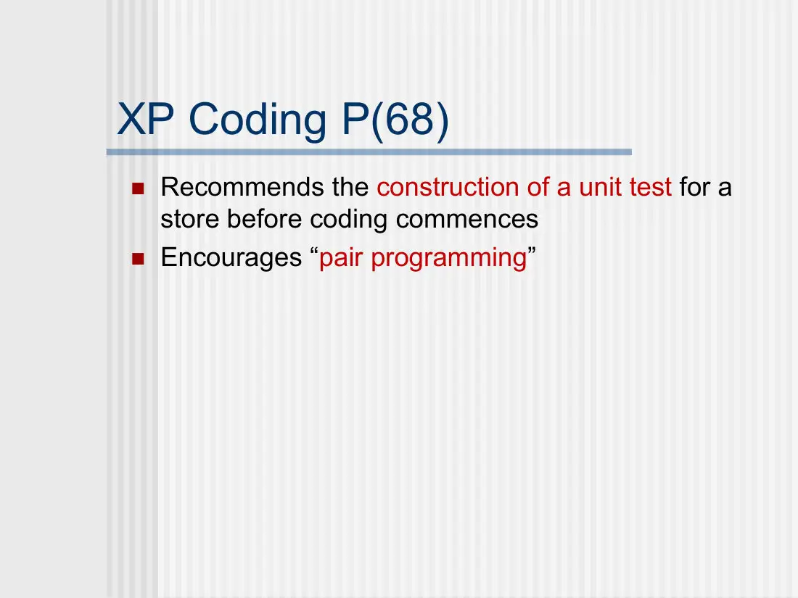

原文：

XP Coding P(68)

Recommends the construction of a unit test for a store before coding commences

Encourages “pair programming”

### XP Testing P(69)

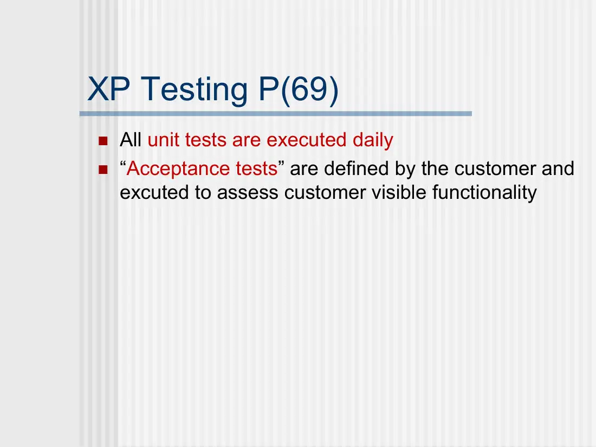

原文：

XP Testing P(69)

◼ All unit tests are executed daily

“Acceptance tests” are defined by the customer and excuted to assess customer visible functionality

### Scrum P(72)

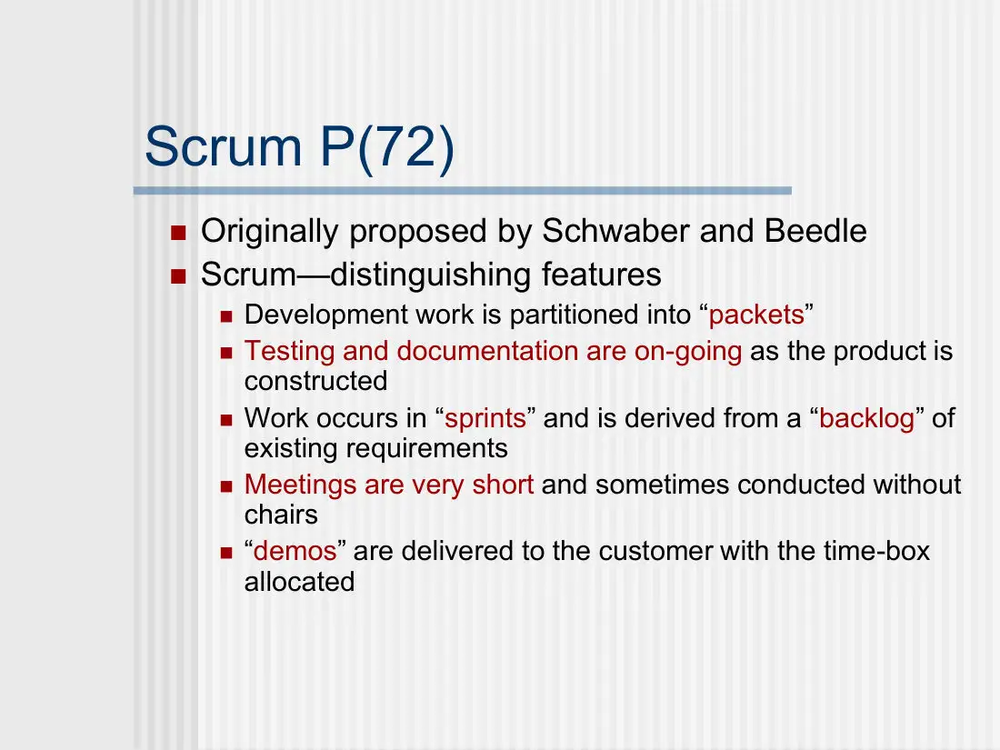

原文：

Scrum P(72)

◼ Originally proposed by Schwaber and Beedle

◼ Scrum—distinguishing features

◼ Development work is partitioned into “packets”

Testing and documentation are on-going as the product is constructed

Work occurs in “sprints” and is derived from a “backlog” of existing requirements

Meetings are very short and sometimes conducted without chairs

“demos” are delivered to the customer with the time-box allocated

### 关键的Scrum工件

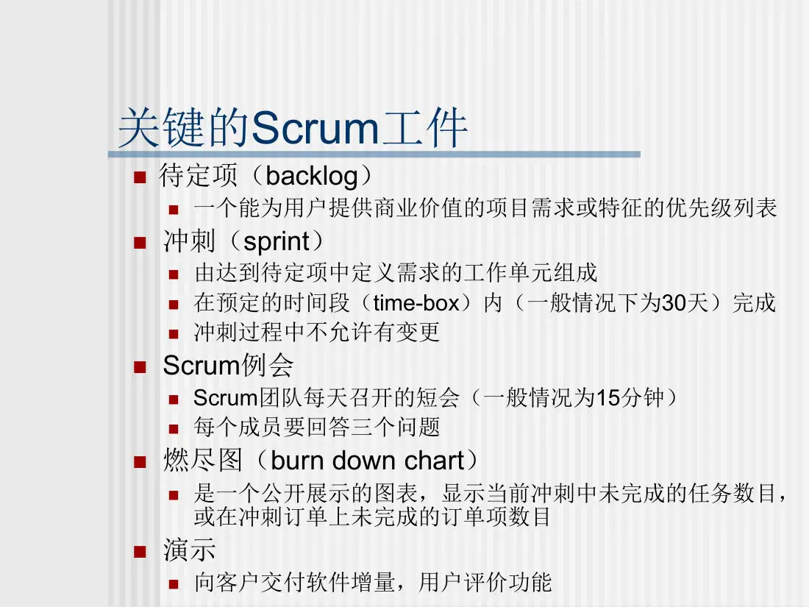

原文：

关键的Scrum工件

◼ 待定项（backlog）

◼ 一个能为用户提供商业价值的项目需求或特征的优先级列表

◼ 冲刺（sprint）

◼ 由达到待定项中定义需求的工作单元组成

◼ 在预定的时间段（time-box）内（一般情况下为30天）完成

◼ 冲刺过程中不允许有变更

◼ Scrum例会

◼ Scrum团队每天召开的短会（一般情况为15分钟）

◼ 每个成员要回答三个问题

◼ 燃尽图（burn down chart）

是一个公开展示的图表，显示当前冲刺中未完成的任务数目，或在冲刺订单上未完成的订单项数目

◼ 演示

◼ 向客户交付软件增量，用户评价功能

### Scrum架构

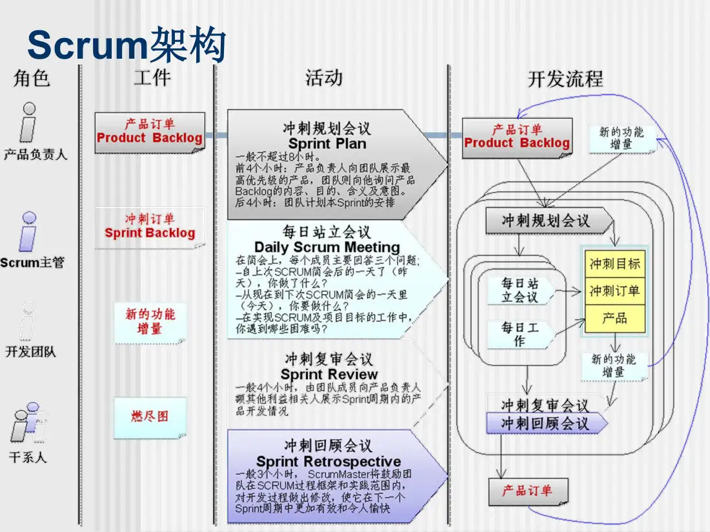

原文：

Scrum架构

### Scrum过程流

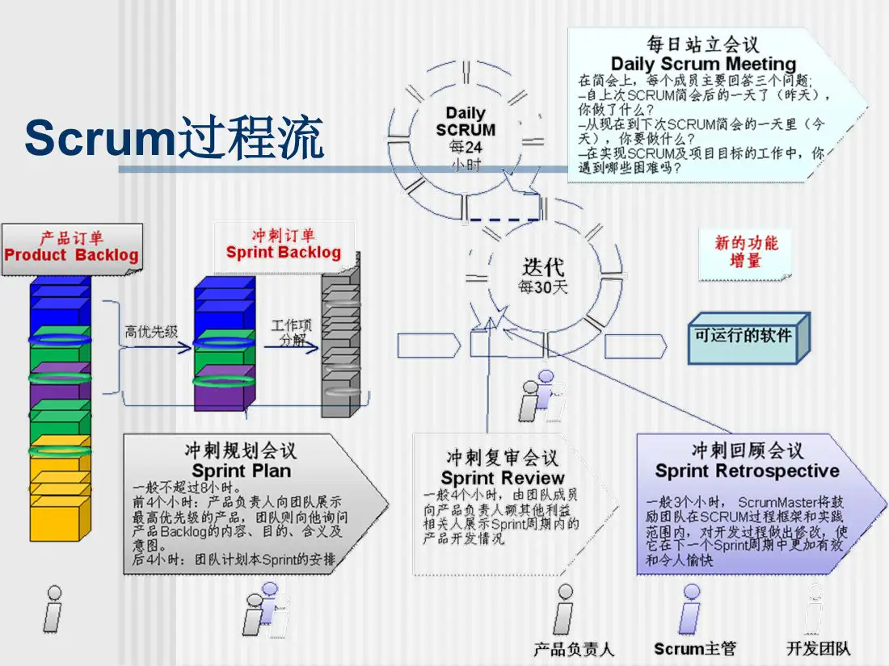

原文：

Scrum过程流
