# 《软件工程（双语）》Unit 3 补充：需求理解的噩梦（课件）

原件的每一页，下面附识别出的文字。

### UNIT 3—补充

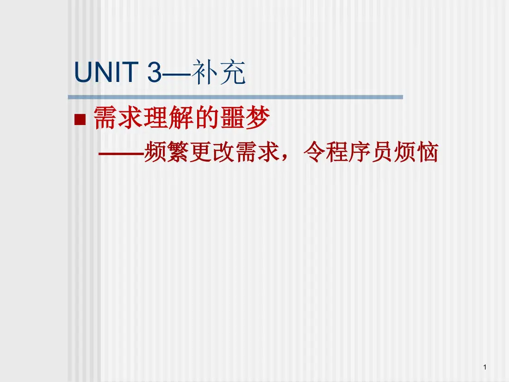

原文：

UNIT 3—补充

需求理解的噩梦

频繁更改需求，令程序员烦恼

1

### 原始需求

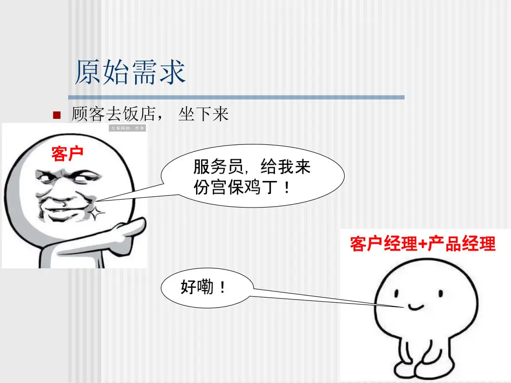

原文：

原始需求

◼ 顾客去饭店， 坐下来

客户

服务员， 给我来份宫保鸡丁！

好嘞！

客户经理+产品经理

### 中途需求变更

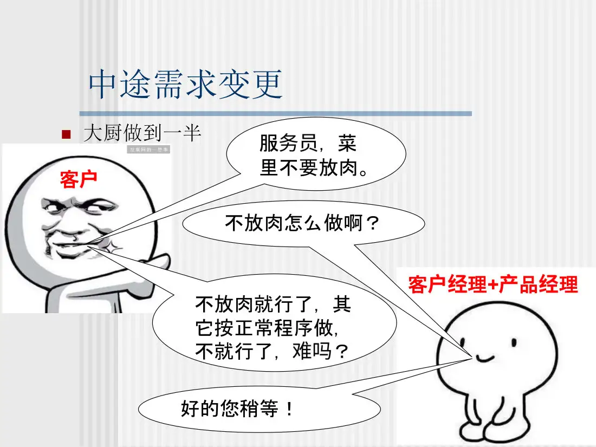

原文：

中途需求变更

◼ 大厨做到一半

客户

服务员， 菜里不要放肉。

不放肉怎么做啊？

不放肉就行了， 其它按正常程序做，不就行了， 难吗？

好的您稍等！

客户经理+产品经理

### 改动太大， 部分重构

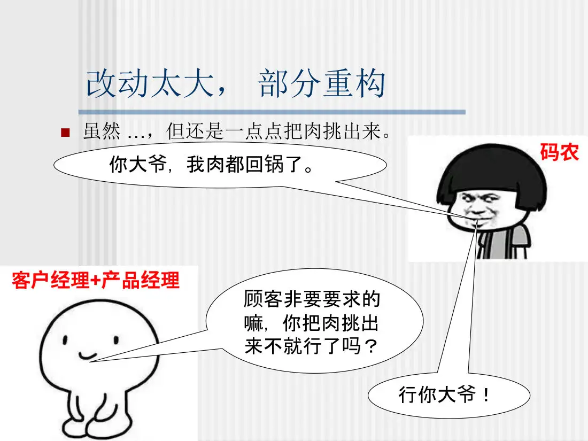

原文：

改动太大， 部分重构

◼ 虽然 …，但还是一点点把肉挑出来。

你大爷， 我肉都回锅了。

码农

客户经理+产品经理顾客非要要求的嘛， 你把肉挑出来不就行了吗？

行你大爷！

### 低估改动成本

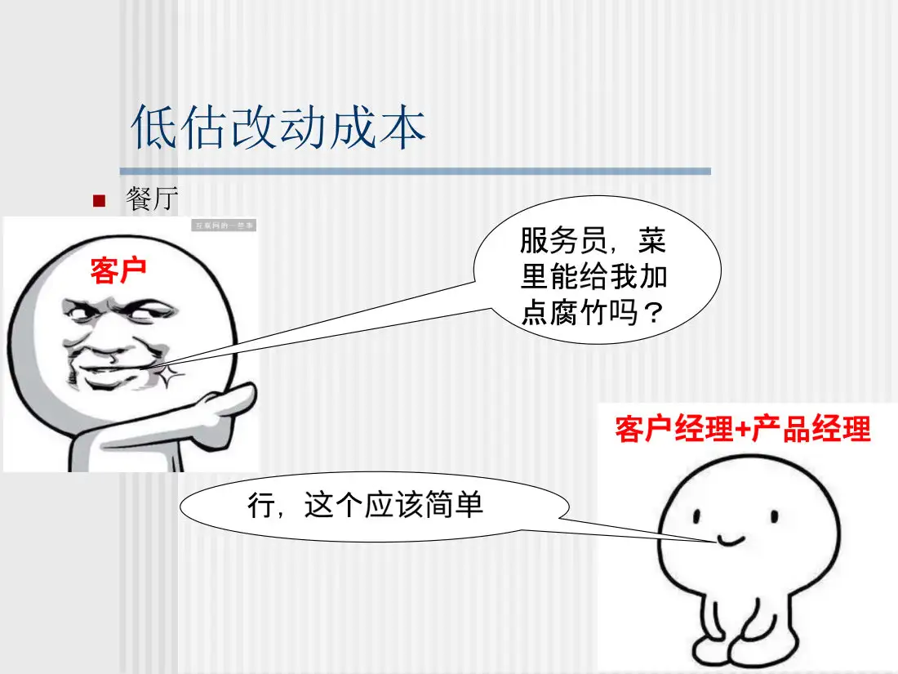

原文：

低估改动成本

◼ 餐厅

客户

服务员， 菜里能给我加点腐竹吗？

行， 这个应该简单

客户经理+产品经理

### 新需求引入了新研发成本

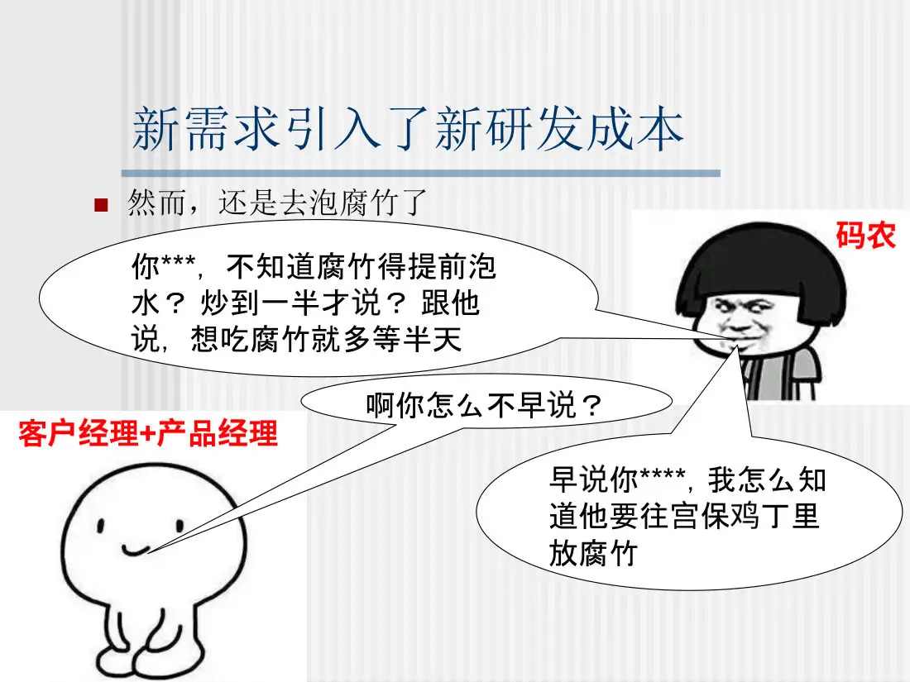

原文：

新需求引入了新研发成本

◼ 然而，还是去泡腐竹了

你\*\*\*， 不知道腐竹得提前泡水？ 炒到一半才说？ 跟他说， 想吃腐竹就多等半天

客户经理+产品经理

啊你怎么不早说？

早说你\*\*\*\*，我怎么知道他要往宫保鸡丁里放腐竹

### 某一功能点摇摆不定

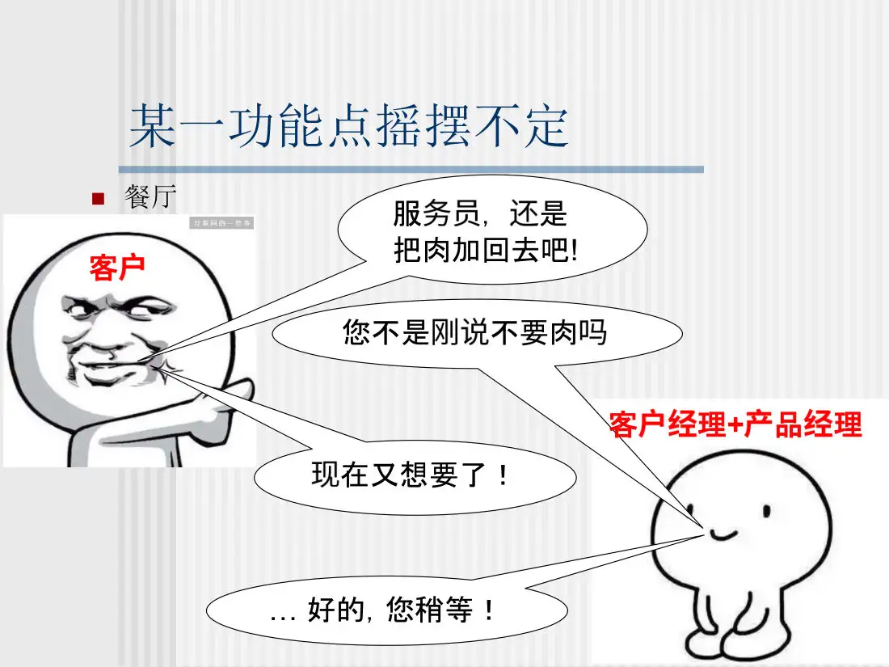

原文：

某一功能点摇摆不定

◼ 餐厅

客户

服务员， 还是把肉加回去吧!

您不是刚说不要肉吗

好的，您稍等！

客户经理+产品经理

### 甲方是大爷

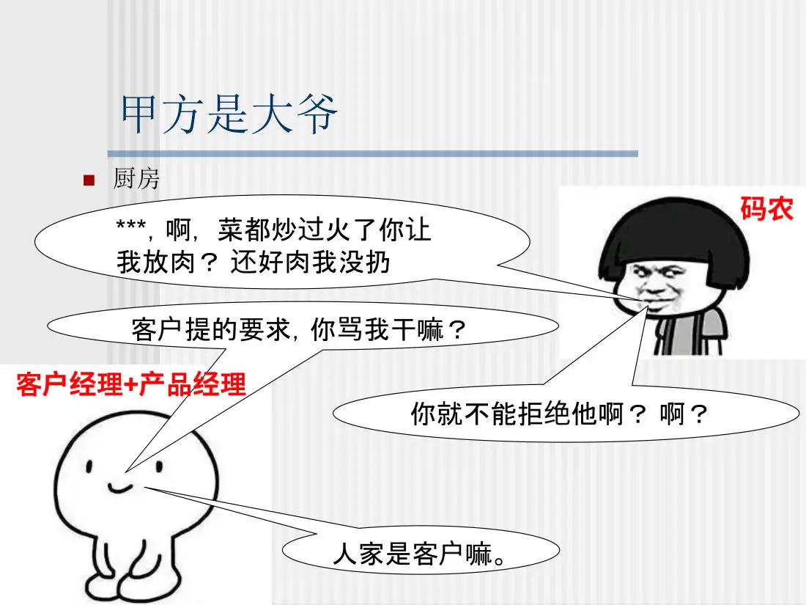

原文：

甲方是大爷

◼ 厨房

\*\*\*，啊， 菜都炒过火了你让我放肉？ 还好肉我没扔

码农

客户提的要求，你骂我干嘛？

客户经理+产品经理

你就不能拒绝他啊？ 啊？

人家是客户嘛。

### 改动开始导致工期延误

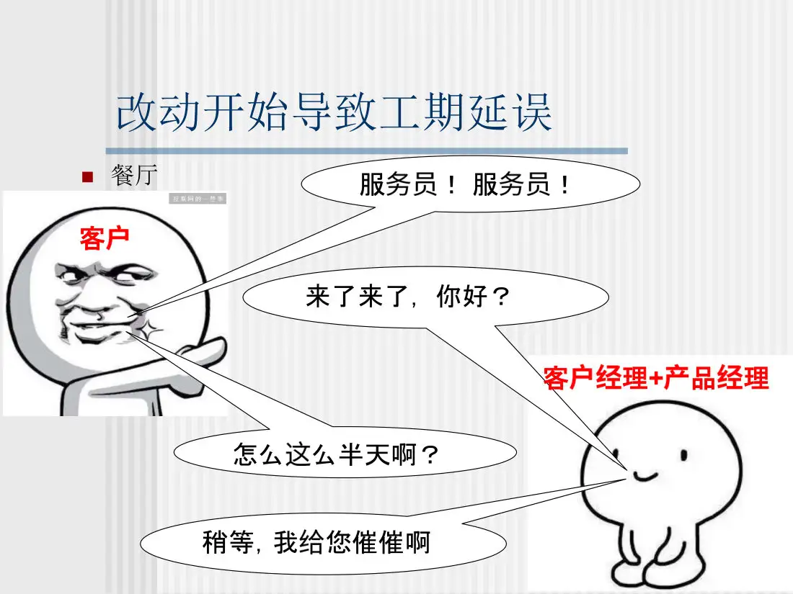

原文：

改动开始导致工期延误

◼ 餐厅

服务员！ 服务员！

客户

来了来了， 你好？

怎么这么半天啊？

稍等，我给您催催啊

客户经理+产品经理

### 开发者请求重新排期

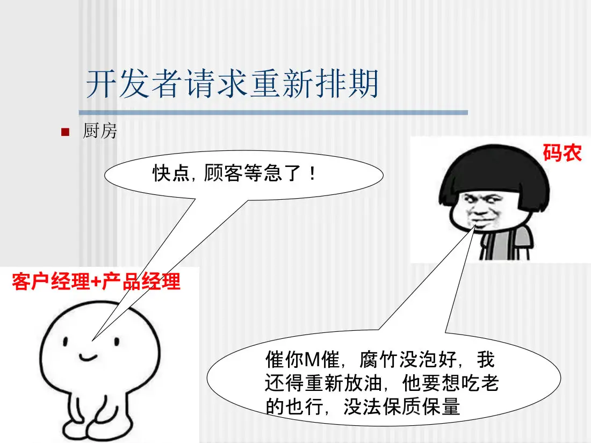

原文：

开发者请求重新排期

◼ 厨房

快点，顾客等急了！

码农

客户经理+产品经理

催你M催， 腐竹没泡好， 我还得重新放油， 他要想吃老的也行， 没法保质保量

### 甲方催活

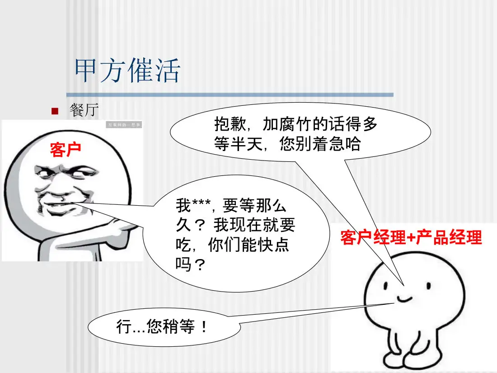

原文：

甲方催活

◼ 餐厅

客户

抱歉， 加腐竹的话得多等半天， 您别着急哈

我\*\*\*，要等那么久？ 我现在就要吃， 你们能快点吗？

行...您稍等！

客户经理+产品经理

### 开发者开始和中间人pk

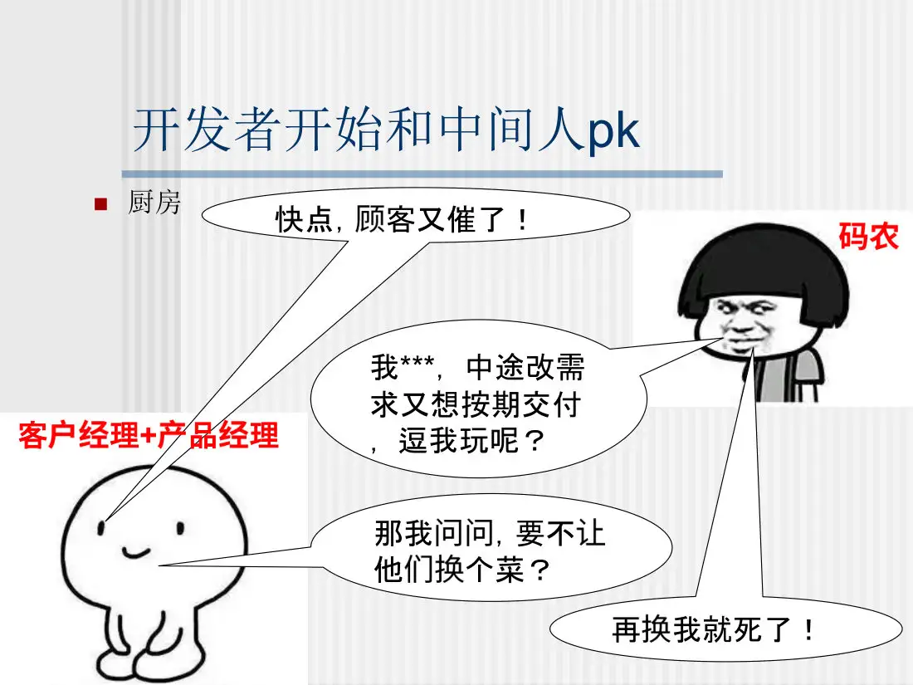

原文：

开发者开始和中间人pk

◼ 厨房

快点，顾客又催了！

客户经理+产品经理

那我问问，要不让他们换个菜？

再换我就死了！

### 奋力研发…

原文：

奋力研发…

### 因工期过长再次改动需求

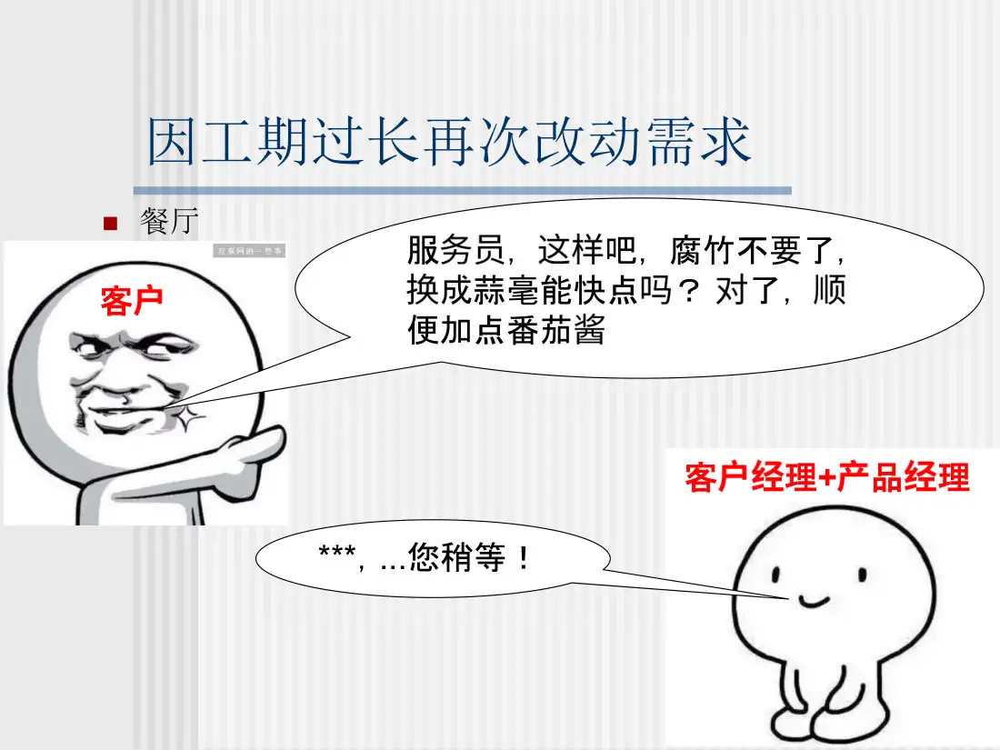

原文：

因工期过长再次改动需求

◼ 餐厅

客户

服务员， 这样吧， 腐竹不要了，换成蒜毫能快点吗？ 对了， 顺便加点番茄酱

\*\*\*，...您稍等！

客户经理+产品经理

### 频繁改动开始导致大量冗余

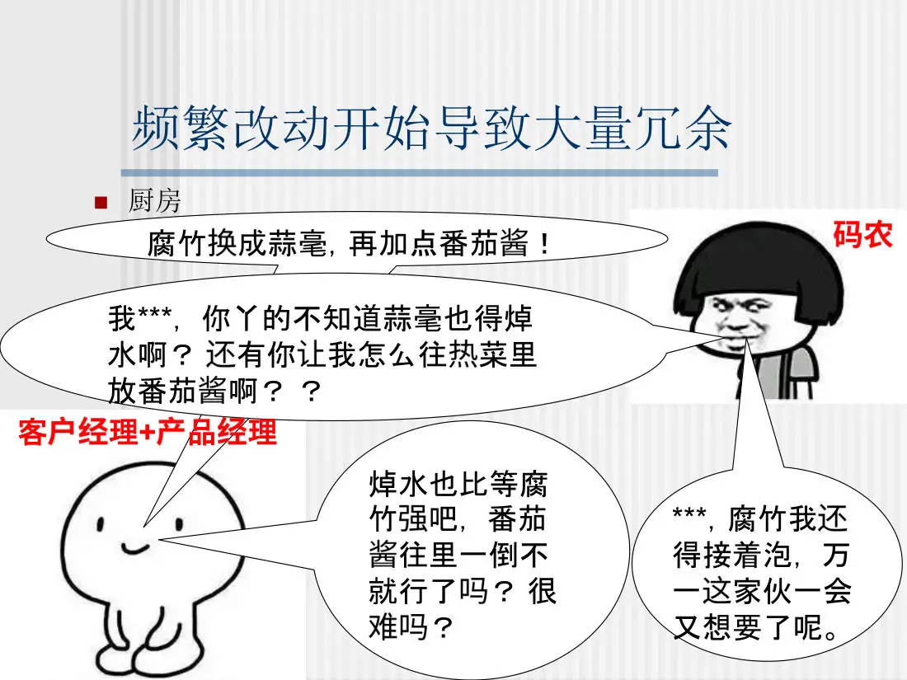

原文：

频繁改动开始导致大量冗余

◼ 厨房

腐竹换成蒜毫，再加点番茄酱！

我\*\*\*， 你丫的不知道蒜毫也得焯水啊？ 还有你让我怎么往热菜里放番茄酱啊？ ？

客户经理+产品经理

焯水也比等腐竹强吧， 番茄酱往里一倒不就行了吗？ 很难吗？

\*\*\*，腐竹我还得接着泡， 万一这家伙一会又想要了呢。

### 奇葩需求

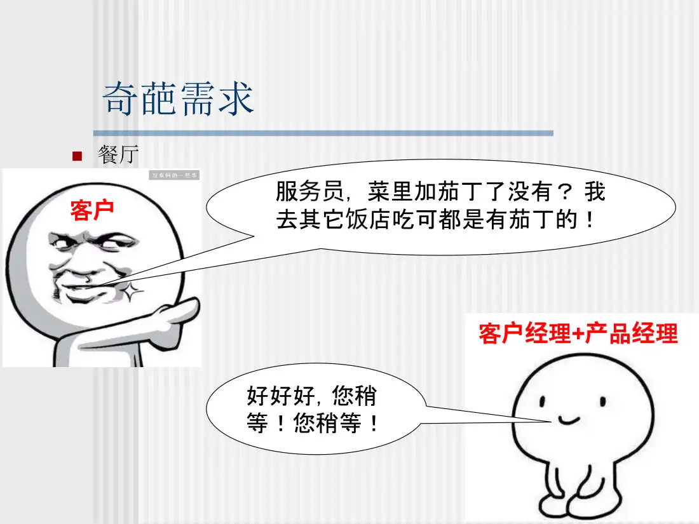

原文：

奇葩需求

◼ 餐厅

客户

服务员， 菜里加茄丁了没有？ 我去其它饭店吃可都是有茄丁的！

好好好，您稍 等！您稍等！

客户经理+产品经理

### 奇葩你也得做

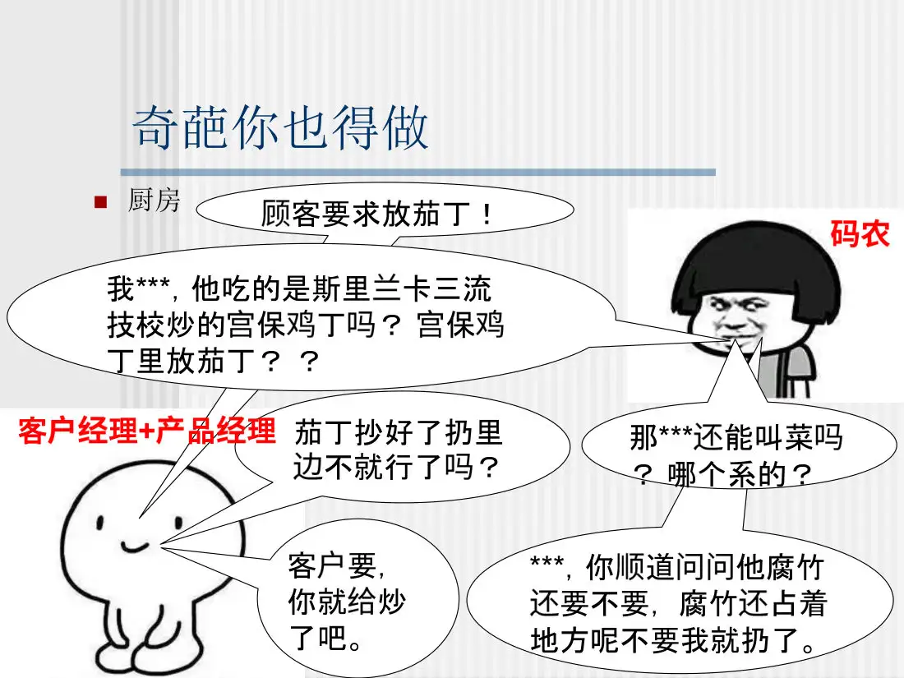

原文：

奇葩你也得做

◼ 厨房

顾客要求放茄丁！

我\*\*\*，他吃的是斯里兰卡三流技校炒的宫保鸡丁吗？ 宫保鸡丁里放茄丁？ ？

客户经理+产品经理茄丁抄好了扔里边不就行了吗？

客户要，你就给炒了吧。

码农

那\*\*\*还能叫菜吗？ 哪个系的？

\*\*\*，你顺道问问他腐竹还要不要， 腐竹还占着地方呢不要我就扔了。

### 黑暗前的最后黎明

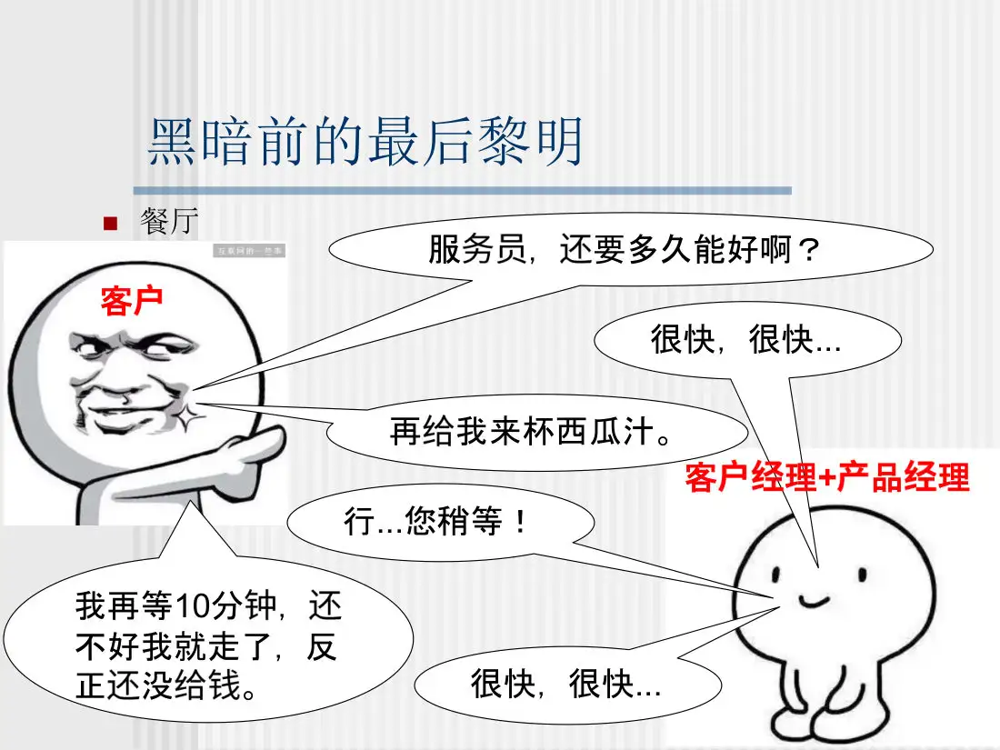

原文：

黑暗前的最后黎明

餐厅

服务员， 还要多久能好啊？

很快， 很快...

客户经理+产品经理

我再等10分钟， 还不好我就走了， 反正还没给钱。

很快， 很快...

### 大决战，…，10分钟后

原文：

大决战，…，10分钟后

◼ 餐厅

客户

咦， 我上次吃的不是这个味啊？

我杀你的心都有了...

### 产品是孩子，开发是妈妈，产品经理是爸爸，测试是医生

原文：

产品是孩子，开发是妈妈，产品经理是爸爸，测试是医生

--Cathy
