# 《软件工程（双语）》Unit 4 需求建模（课件）

原件的每一页，下面附识别出的文字。

### UNIT 4

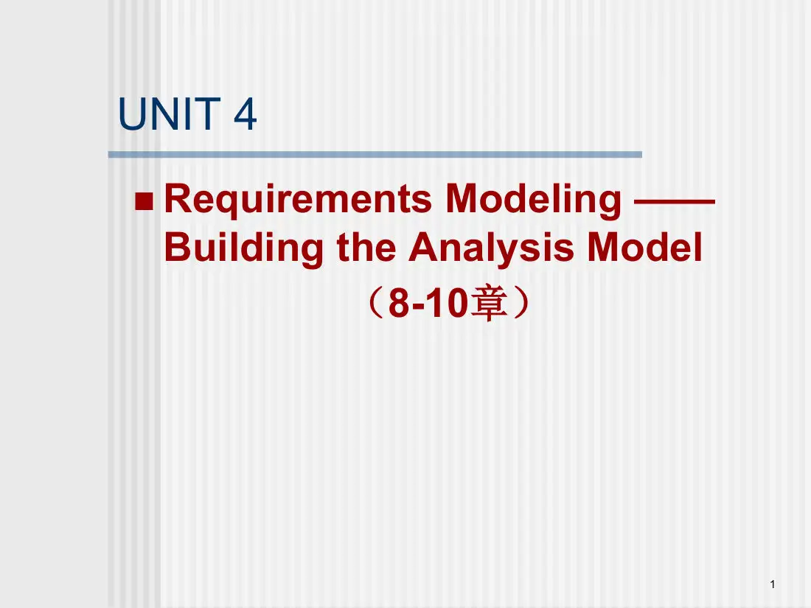

原文：

UNIT 4

Requirements ModelingBuilding the Analysis Model（8-10章）

1

### Contents & Requirements

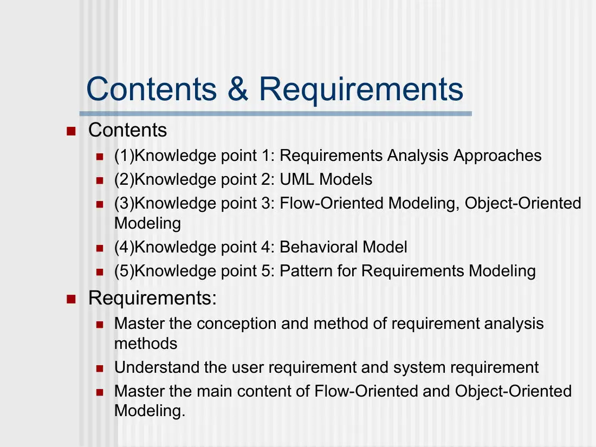

原文：

Contents & Requirements

◼ Contents

◼ (1)Knowledge point 1: Requirements Analysis Approaches

◼ (2)Knowledge point 2: UML Models

(3)Knowledge point 3: Flow-Oriented Modeling, Object-Oriented Modeling

◼ (4)Knowledge point 4: Behavioral Model

◼ (5)Knowledge point 5: Pattern for Requirements Modeling

◼ Requirements:

Master the conception and method of requirement analysis methods

◼ Understand the user requirement and system requirement

Master the main content of Flow-Oriented and Object-Oriented Modeling.

### Requirements Analysis (P129)

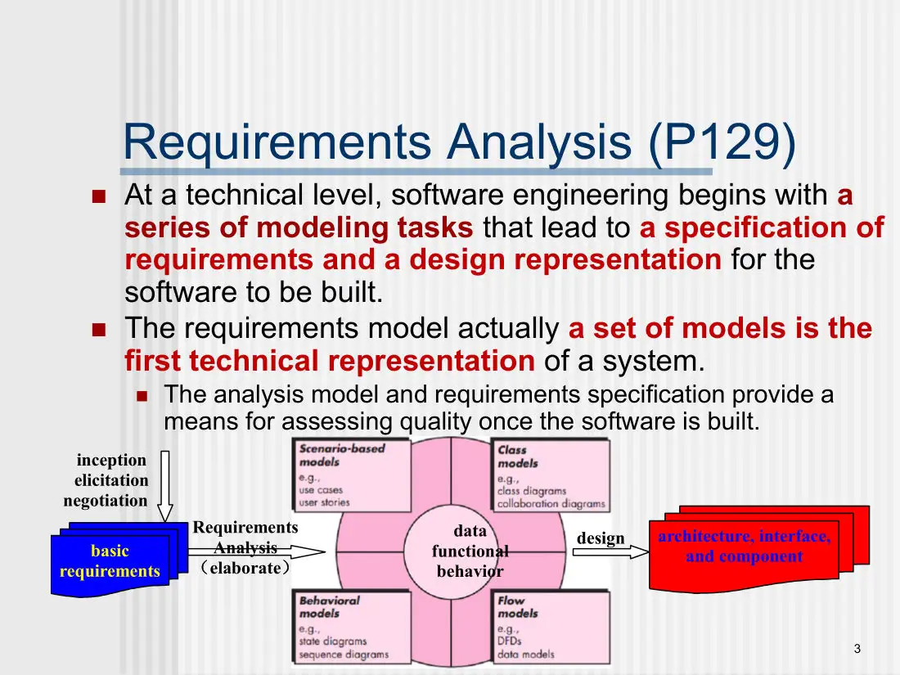

原文：

Requirements Analysis (P129)

At a technical level, software engineering begins with a series of modeling tasks that lead to a specification of requirements and a design representation for the software to be built.

The requirements model actually a set of models is the first technical representation of a system.

The analysis model and requirements specification provide a means for assessing quality once the software is built.

3

### Overall Objectives and Philosophy (P130)

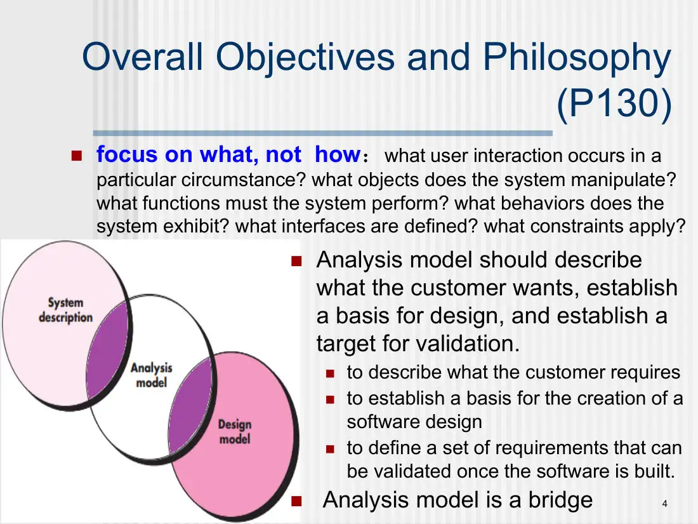

原文：

Overall Objectives and Philosophy (P130)

◼ focus on what, not how：what user interaction occurs in a particular circumstance? what objects does the system manipulate? what functions must the system perform? what behaviors does the system exhibit? what interfaces are defined? what constraints apply?

Analysis model should describe what the customer wants, establish a basis for design, and establish a target for validation.

◼ to describe what the customer requires

to establish a basis for the creation of a software design

to define a set of requirements that can be validated once the software is built.

Analysis model is a bridge

4

### Rules of Thumb (P131)

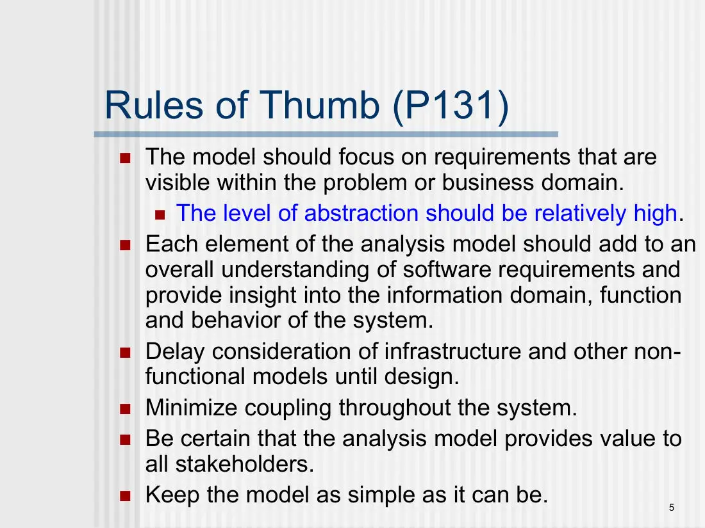

原文：

Rules of Thumb (P131)

◼ The model should focus on requirements that are visible within the problem or business domain.

◼ The level of abstraction should be relatively high.

Each element of the analysis model should add to an overall understanding of software requirements and provide insight into the information domain, function and behavior of the system.

Delay consideration of infrastructure and other nonfunctional models until design.

◼ Minimize coupling throughout the system.

Be certain that the analysis model provides value to all stakeholders.

◼ Keep the model as simple as it can be.

5

### Modeling Approaches (P133)

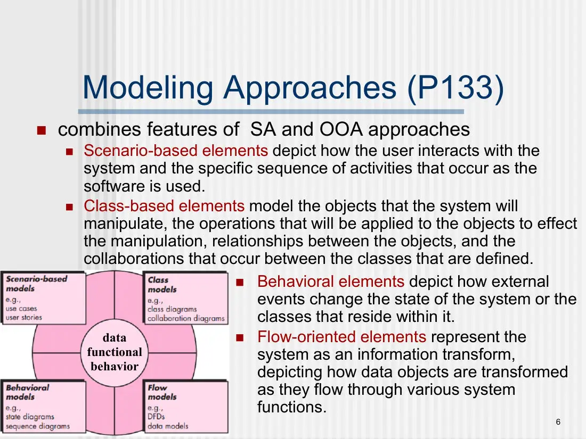

原文：

Modeling Approaches (P133)

◼ combines features of SA and OOA approaches

Scenario-based elements depict how the user interacts with the system and the specific sequence of activities that occur as the software is used.

Class-based elements model the objects that the system will manipulate, the operations that will be applied to the objects to effect the manipulation, relationships between the objects, and the collaborations that occur between the classes that are defined.

Behavioral elements depict how external events change the state of the system or the classes that reside within it.

Flow-oriented elements represent the system as an information transform, depicting how data objects are transformed as they flow through various system functions.

6

### 两种方法学

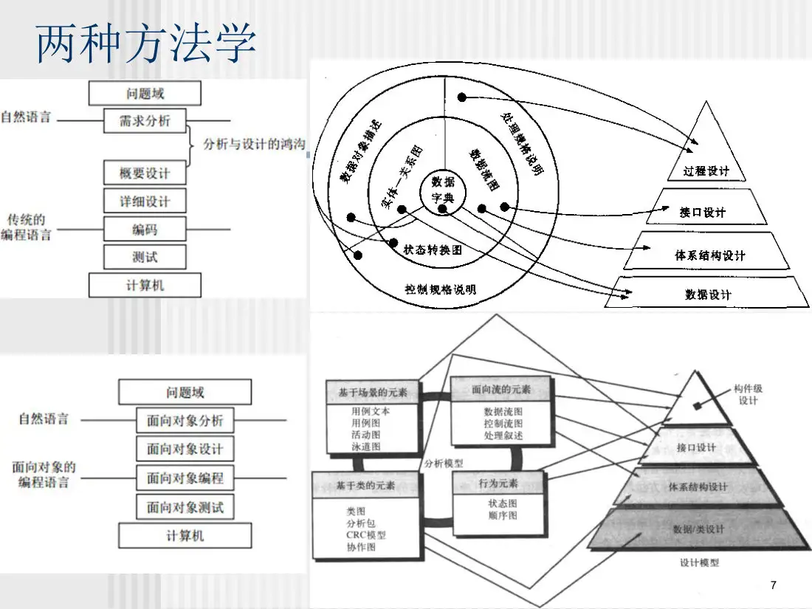

原文：

两种方法学

### Scenario-Based Modeling (P135)

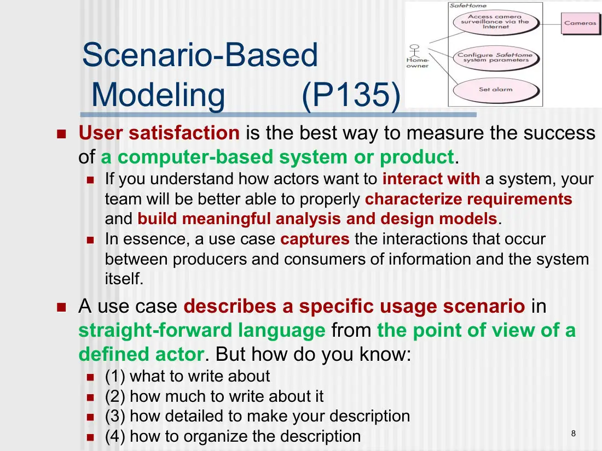

原文：

Scenario-Based Modeling (P135)

User satisfaction is the best way to measure the success of a computer-based system or product.

If you understand how actors want to interact with a system, your team will be better able to properly characterize requirements and build meaningful analysis and design models.

In essence, a use case captures the interactions that occur between producers and consumers of information and the system itself.

A use case describes a specific usage scenario in straight-forward language from the point of view of a defined actor. But how do you know:

◼ (1) what to write about

◼ (2) how much to write about it

◼ (3) how detailed to make your description

◼ (4) how to organize the description

8

### Creating a Preliminary Use Case (P135)

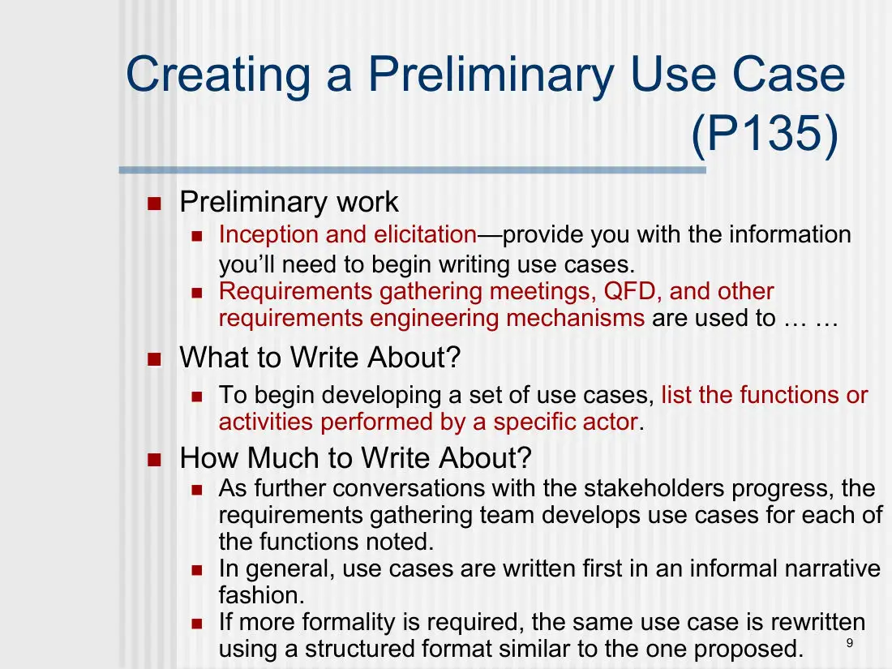

原文：

Creating a Preliminary Use Case (P135)

◼ Preliminary work

Inception and elicitation—provide you with the information you’ll need to begin writing use cases.

Requirements gathering meetings, QFD, and other requirements engineering mechanisms are used to

◼ What to Write About?

To begin developing a set of use cases, list the functions or activities performed by a specific actor.

◼ How Much to Write About?

As further conversations with the stakeholders progress, the requirements gathering team develops use cases for each of the functions noted.

In general, use cases are written first in an informal narrative fashion.

If more formality is required, the same use case is rewritten using a structured format similar to the one proposed. 9

### 新建初始用例——示例

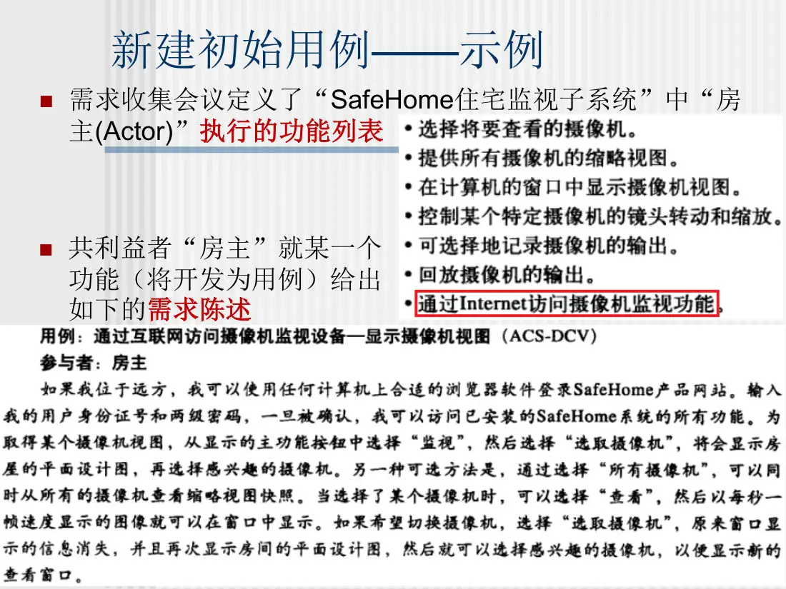

原文：

新建初始用例——示例

需求收集会议定义了“SafeHome住宅监视子系统”中“房主(Actor)”执行的功能列表

共利益者“房主”就某一个功能（将开发为用例）给出如下的需求陈述

·提供所有摄像机的缩略视图。

· 在计算机的窗口中显示摄像机视图。

·控制某个特定摄像机的镜头转动和缩放。

·可选择地记录摄像机的输出。

·回放摄像机的输出。

通过Internet访问摄像机监视功能

用例：通过互联网访问摄像机监视设备一显示摄像机视图（ACS-DCV）

参与者：房主

如果我位于远方，我可以使用任何计算机上合适的浏览器软件登录SafeHome产品网站。输入我的用户身份证号和两级密码，一旦被确认，我可以访问已安装的SafeHome系统的所有功能。为取得某个摄像机视图，从显示的主功能按钮中选择“监视”，然后选择“选取摄像机”，将会显示房屋的平面设计图，再选择感兴趣的摄像机。另一种可选方法是，通过选择“所有摄像机”，可以同时从所有的摄像机查看缩略视图快照。当选择了某个摄像机时，可以选择“查看”，然后以每秒一帧速度显示的图像就可以在窗口中显示。如果希望切换摄像机，选择“选取摄像机”，原来窗口显示的信息消失，并且再次显示房间的平面设计图，然后就可以选择感兴趣的摄像机，以便显示新的查看窗口。

### 新建初始用例— 示例

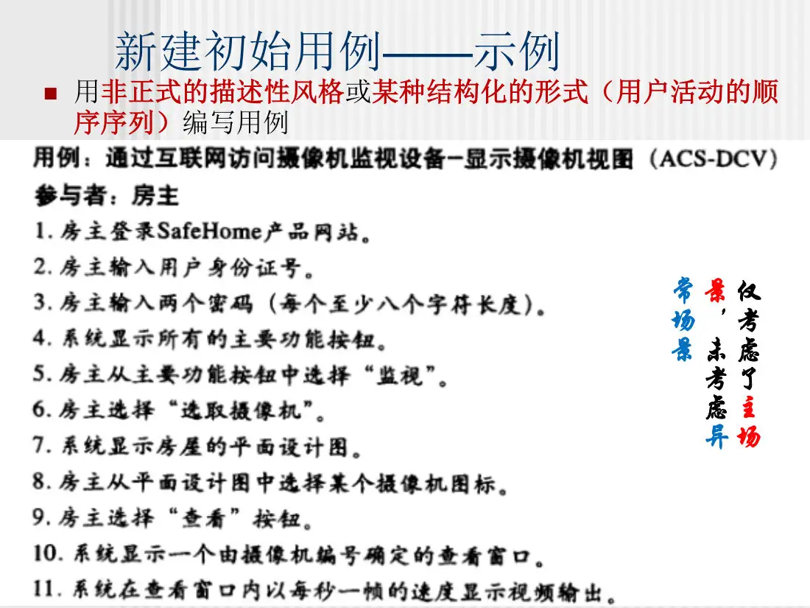

原文：

新建初始用例— 示例

用非正式的描述性风格或某种结构化的形式（用户活动的顺序序列）编写用例

用例：通过互联网访问摄像机监视设备-显示摄像机视图（ACS-DCV）

参与者：房主

1. 房主登录SafeHome产品网站。

2. 房主输入用户身份证号。

3. 房主输入两个密码（每个至少八个字符长度）。

4. 系统显示所有的主要功能按钮。

5. 房主从主要功能按钮中选择“监视”。

6. 房主选择“选取摄像机”。

7. 系统显示房屋的平面设计图。

8. 房主从平面设计图中选择某个摄像机图标。

9. 房主选择“查看”按钮。

10. 系统显示一个由摄像机编号确定的查看窗口。

仅

考

虑

了

主

场景

，

未

考

虑

异常

场

景

11. 系统在查看窗口内以每秒一帧的速度显示视频输出。

### Refining a Preliminary Use Case (P138)

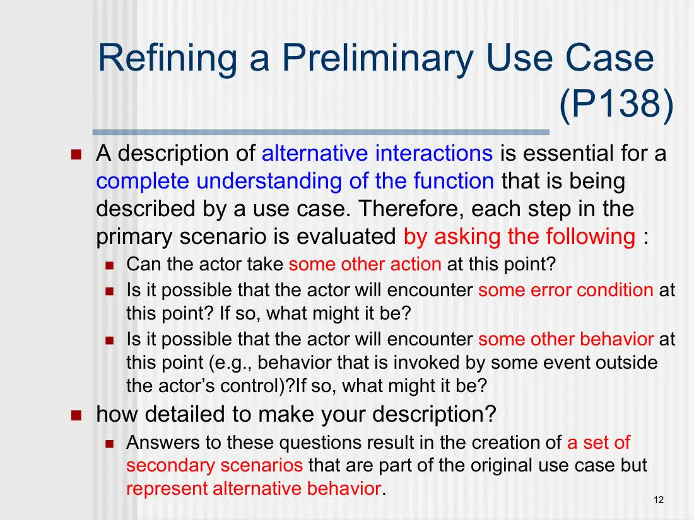

原文：

Refining a Preliminary Use Case (P138)

A description of alternative interactions is essential for a complete understanding of the function that is being described by a use case. Therefore, each step in the primary scenario is evaluated by asking the following

◼ Can the actor take some other action at this point?

◼ Is it possible that the actor will encounter some error condition at this point? If so, what might it be?

Is it possible that the actor will encounter some other behavior at this point (e.g., behavior that is invoked by some event outside the actor’s control)?If so, what might it be?

◼ how detailed to make your description?

Answers to these questions result in the creation of a set of secondary scenarios that are part of the original use case but represent alternative behavior.

12

### 细化初始用例——示例

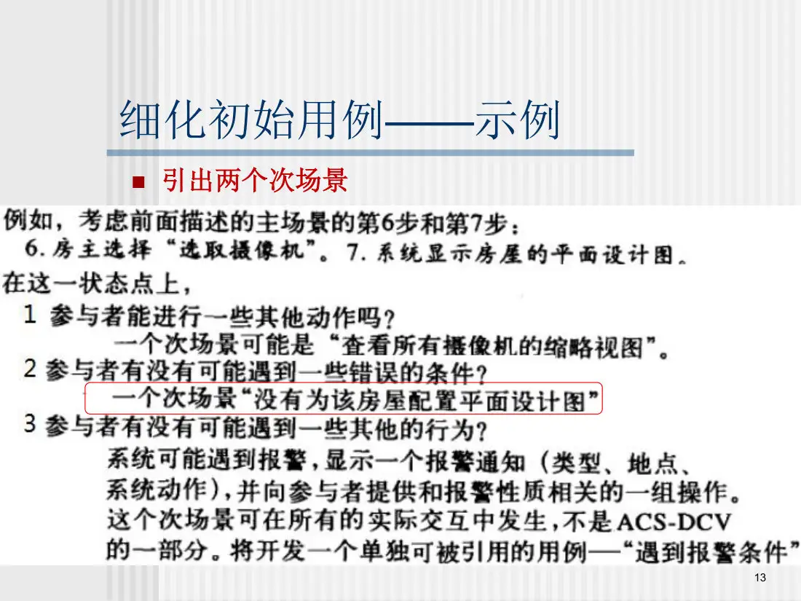

原文：

细化初始用例——示例

引出两个次场景

例如，考虑前面描述的主场景的第6步和第7步：

6. 房主选择“选取摄像机”。7. 系统显示房屋的平面设计图。在这一状态点上，

1参与者能进行一些其他动作吗？

一个次场景可能是“查看所有摄像机的缩略视图”。

2参与者有没有可能遇到一些错误的条件？

一个次场景“没有为该房屋配置平面设计图”

3参与者有没有可能遇到一些其他的行为？

系统可能遇到报警，显示一个报警通知（类型、地点、

系统动作)，并向参与者提供和报警性质相关的一组操作。

这个次场景可在所有的实际交互中发生，不是ACS-DCV

的一部分。将开发一个单独可被引用的用例—“遇到报警条件”

13

### x.秋()

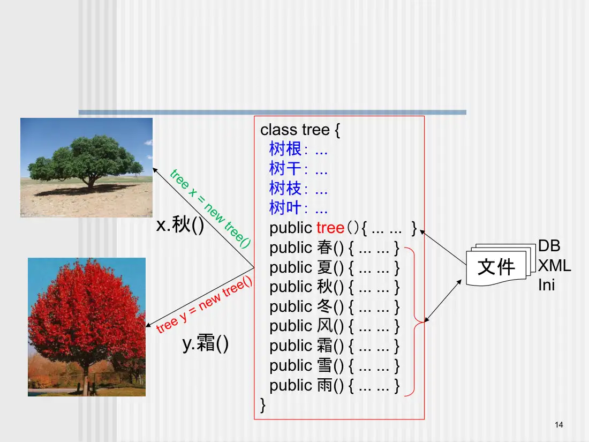

原文：

x.秋()

y.霜()

class tree {树根： ...树干： ...树枝： ...树叶：public tree（）{ ...public 春() { ... }public 夏() { . }public 秋() { . }public 冬() }public 风() { . }public 霜() { }public 雪() { }public 雨() }}

文件

DB XML Ini

14

### Writing a Formal Use Case (P139)

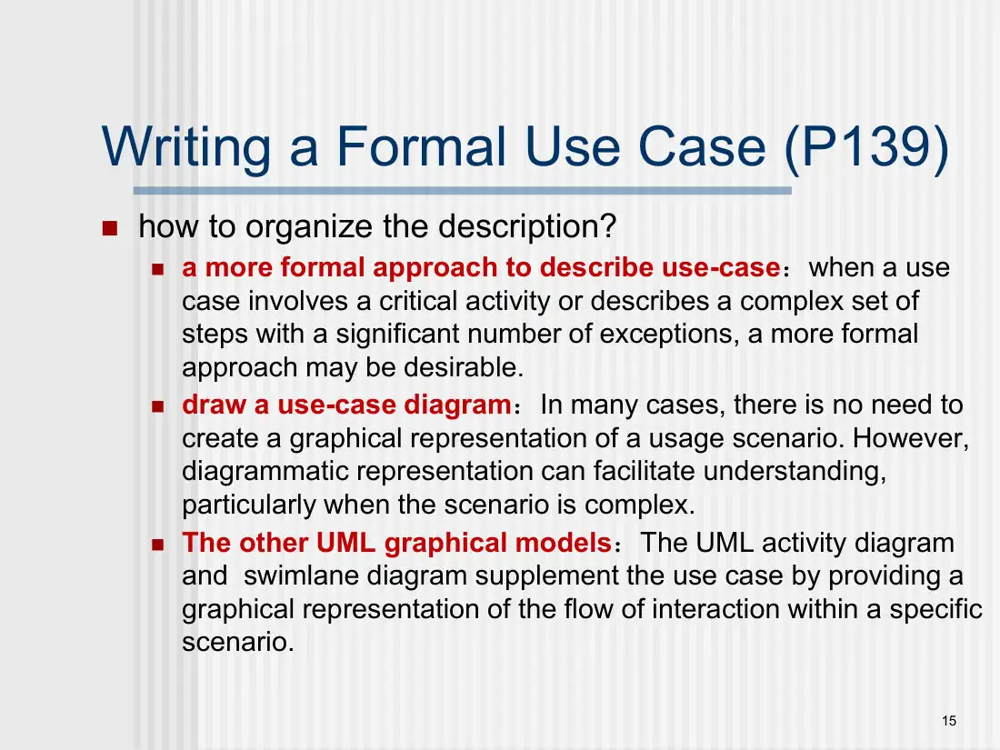

原文：

Writing a Formal Use Case (P139)

◼ how to organize the description?

a more formal approach to describe use-case：when a use case involves a critical activity or describes a complex set of steps with a significant number of exceptions, a more formal approach may be desirable.

draw a use-case diagram：In many cases, there is no need to create a graphical representation of a usage scenario. However, diagrammatic representation can facilitate understanding, particularly when the scenario is complex.

The other UML graphical models：The UML activity diagram and swimlane diagram supplement the use case by providing a graphical representation of the flow of interaction within a specific scenario.

15

### 编写正规的用例——示例

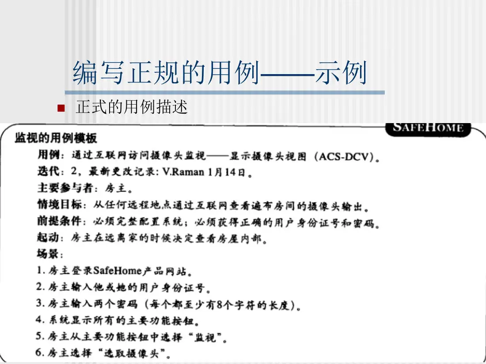

原文：

编写正规的用例——示例

◼ 正式的用例描述

监视的用例模板

SAFEHOME

用例：通过互联网访问摄像头监视——显示摄像头视图（ACS-DCV）。

迭代：2，最新更改记录：V.Raman1月14日。

主要参与者：房主。

情境目标：从任何远程地点通过互联网查看遍布房间的摄像头输出。

前提条件：必须完整配置系统；必须获得正确的用户身份证号和密码。

起动：房主在远离家的时候决定查看房屋内部。

场景：

1. 房主登录SafeHome产品网站。

2. 房主输入他或她的用户身份证号。

3. 房主输入两个密码(每个都至少有8个字符的长度)。

4. 系统显示所有的主要功能按钮。

5. 房主从主要功能按钮中选择“监视”。

6. 房主选择“选取摄像头”。

### 编写正规的用例— 示例

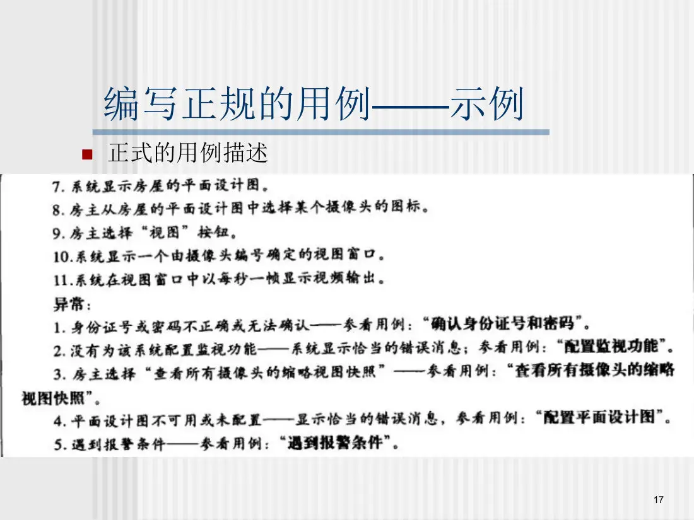

原文：

编写正规的用例— 示例

◼ 正式的用例描述

7. 系统显示房屋的平面设计图。

8.房主从房屋的平面设计图中选择某个摄像头的图标。

9. 房主选择“视图”按钮。

10.系统显示一个由摄像头编号确定的视图窗口。

11.系统在视图窗口中以每秒一帧显示视频输出。

异常：

1. 身份证号或密码不正确或无法确认——参看用例：“确认身份证号和密码”。

2. 没有为该系统配置监视功能——系统显示恰当的错误消息；参看用例：“配置监视功能”。

3. 房主选择“查看所有摄像头的缩略视图快照”——参看用例：“查看所有摄像头的缩略视图快照”。

4.平面设计图不可用或未配置———显示恰当的错误消息，参看用例：“配置平面设计图”。

5. 遇到报警条件——参看用例：“遇到报警条件”。

17

### 编写正规的用例— 示例

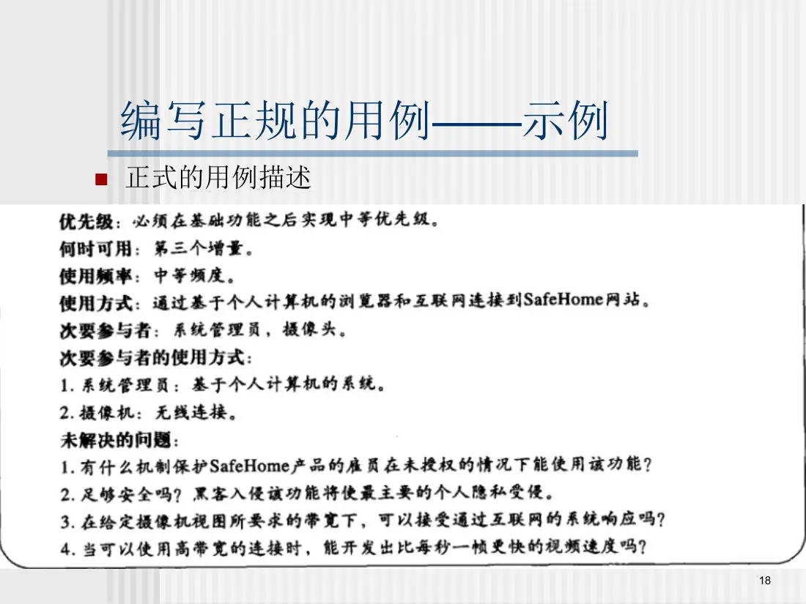

原文：

编写正规的用例— 示例

◼ 正式的用例描述

优先级：必须在基础功能之后实现中等优先级。

何时可用：第三个增量。

使用频率：中等频度。

使用方式：通过基于个人计算机的浏览器和互联网连接到SafeHome网站。

次要参与者：系统管理员，摄像头。

次要参与者的使用方式：

1. 系统管理员：基于个人计算机的系统。

2. 摄像机：无线连接。

未解决的问题：

1. 有什么机制保护SafeHome产品的雇员在未授权的情况下能使用该功能？

2. 足够安全吗？黑客入侵该功能将使最主要的个人隐私受侵。

3. 在给定摄像机视图所要求的带宽下，可以接受通过互联网的系统响应吗？

4. 当可以使用高带宽的连接时，能开发出比每秒一帧更快的视频速度吗？

18

### 第 19 页

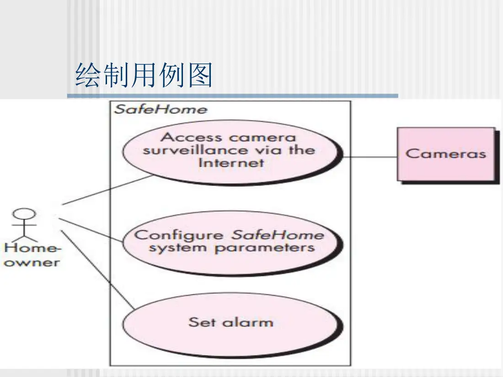

### 用活动图做用例 补充 (P141)

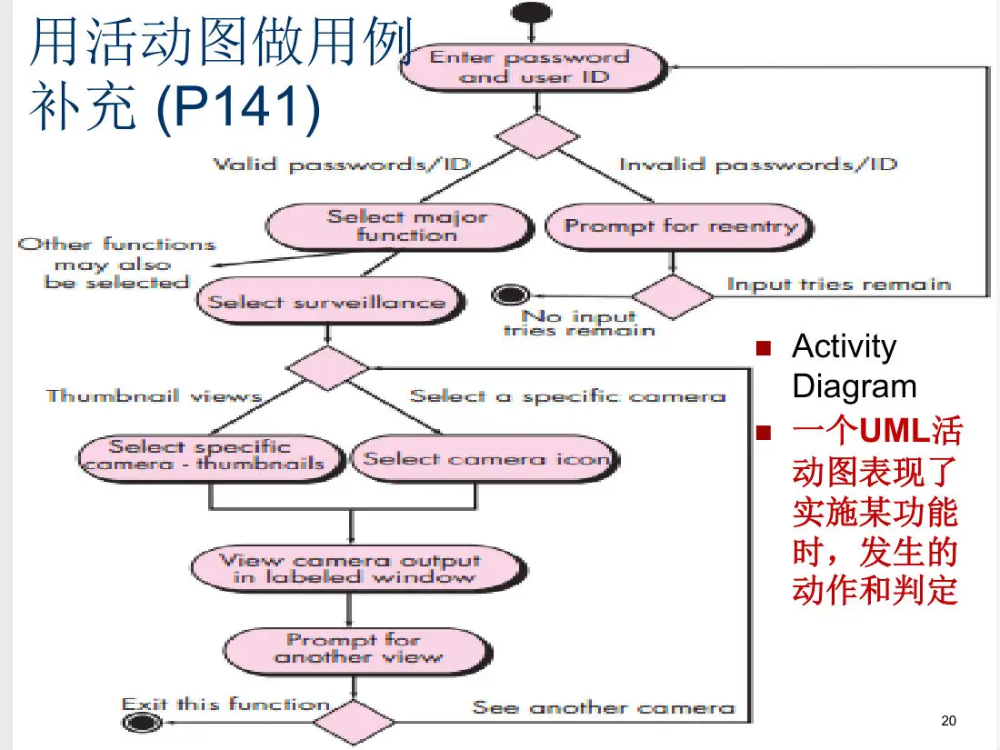

原文：

用活动图做用例 补充 (P141)

一个UML活动图表现了实施某功能时，发生的动作和判定

20

### 第 21 页

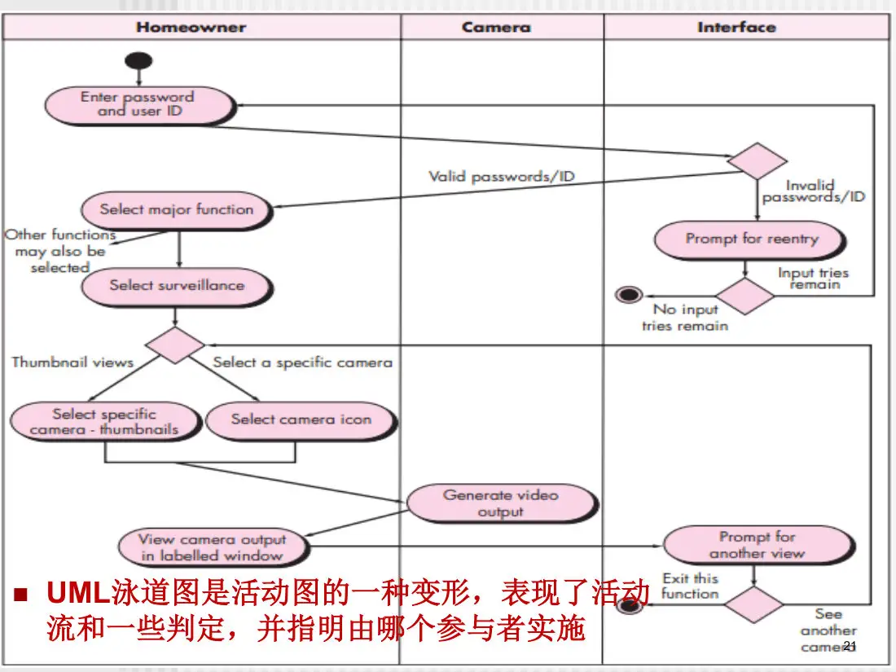

### Scenario-Based Modeling

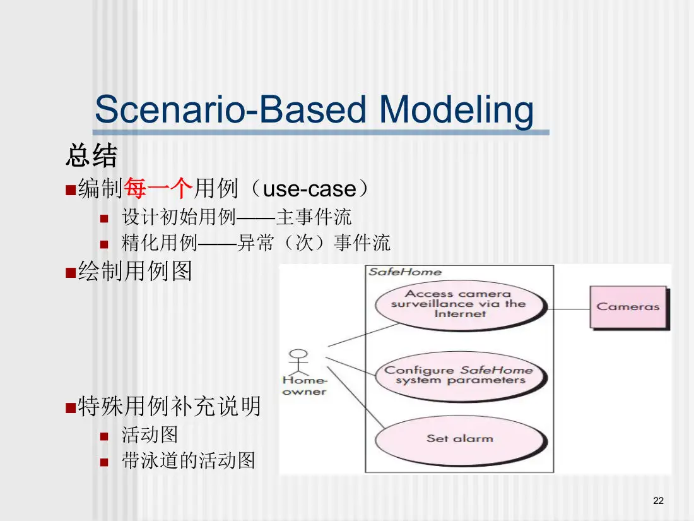

原文：

Scenario-Based Modeling

总结

◼编制每一个用例（use-case）

◼ 设计初始用例——主事件流

◼ 精化用例——异常（次）事件流

◼绘制用例图

◼特殊用例补充说明

◼ 活动图

◼ 带泳道的活动图

22

### Data Modeling

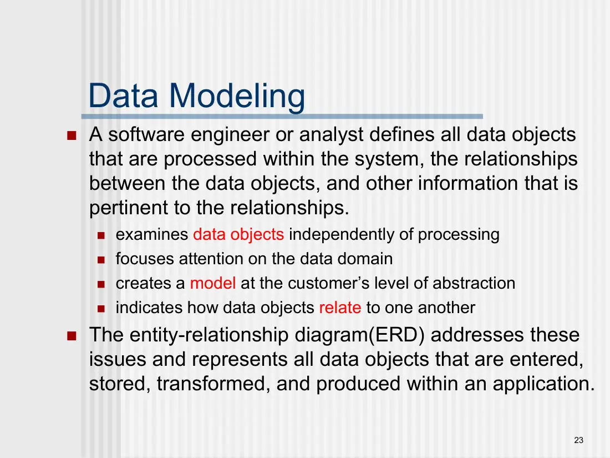

原文：

Data Modeling

A software engineer or analyst defines all data objects that are processed within the system, the relationships between the data objects, and other information that is pertinent to the relationships.

◼ examines data objects independently of processing

◼ focuses attention on the data domain

◼ creates a model at the customer’s level of abstraction

◼ indicates how data objects relate to one another

The entity-relationship diagram(ERD) addresses these issues and represents all data objects that are entered, stored, transformed, and produced within an application.

23

### Data Object and Attributes

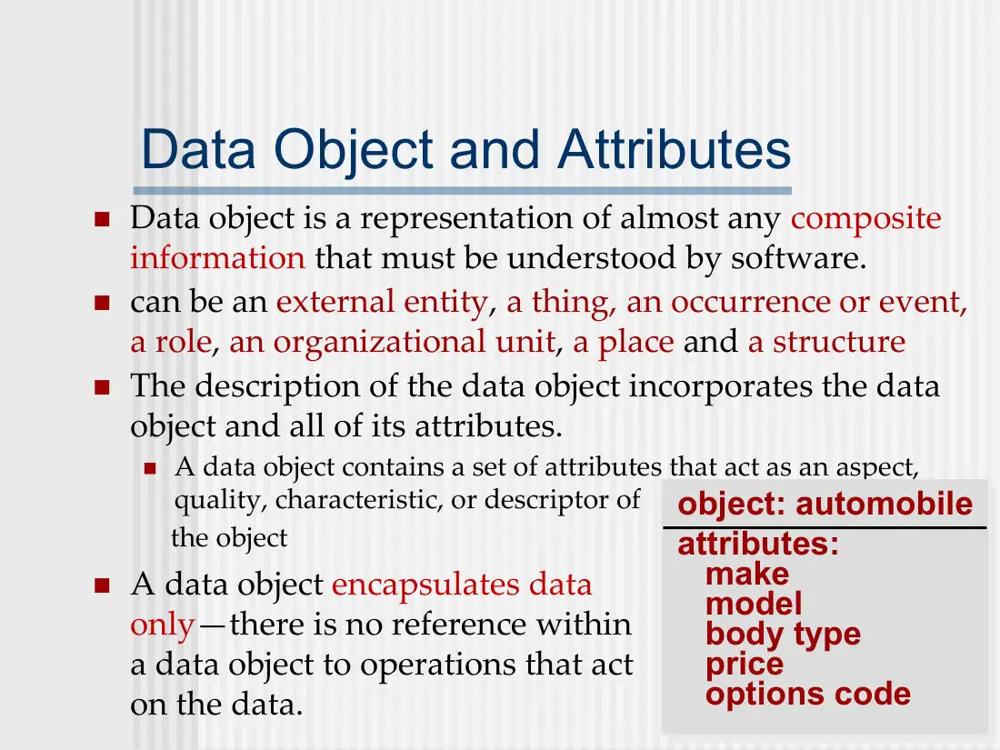

原文：

Data Object and Attributes

Data object is a representation of almost any composite information that must be understood by software.

can be an external entity, a thing, an occurrence or event, a role, an organizational unit, a place and a structure

◼ The description of the data object incorporates the data object and all of its attributes.

◼ A data object contains a set of attributes that act as an aspect,

A data object encapsulates data only—there is no reference within a data object to operations that act on the data.

object: automobile attributes: make model body type price options code

### Relationship and Building an ERD

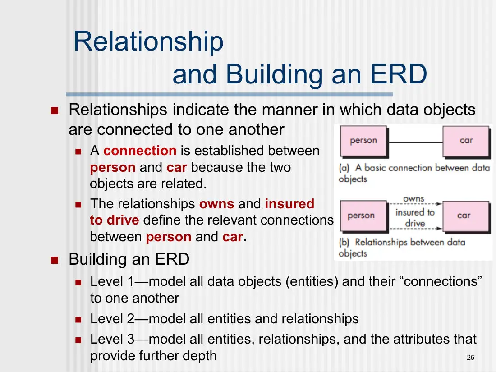

原文：

Relationship and Building an ERD

◼ Relationships indicate the manner in which data objects

are connected to one another

A connection is established between person and car because the two objects are related.

The relationships owns and insured to drive define the relevant connections between person and car.

(a) A basic connection between data objects

◼ Building an ERD

Level 1—model all data objects (entities) and their “connections” to one another

◼ Level 2—model all entities and relationships

Level 3—model all entities, relationships, and the attributes that provide further depth 25

### 第 26 页

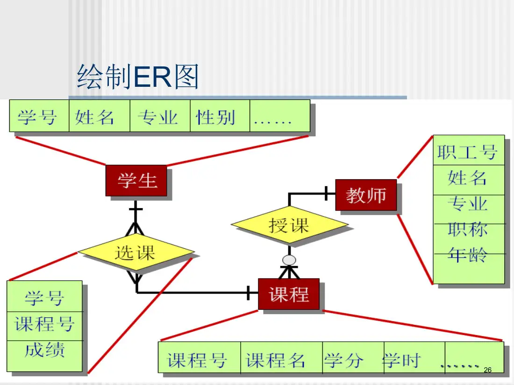

### 绘制ER图

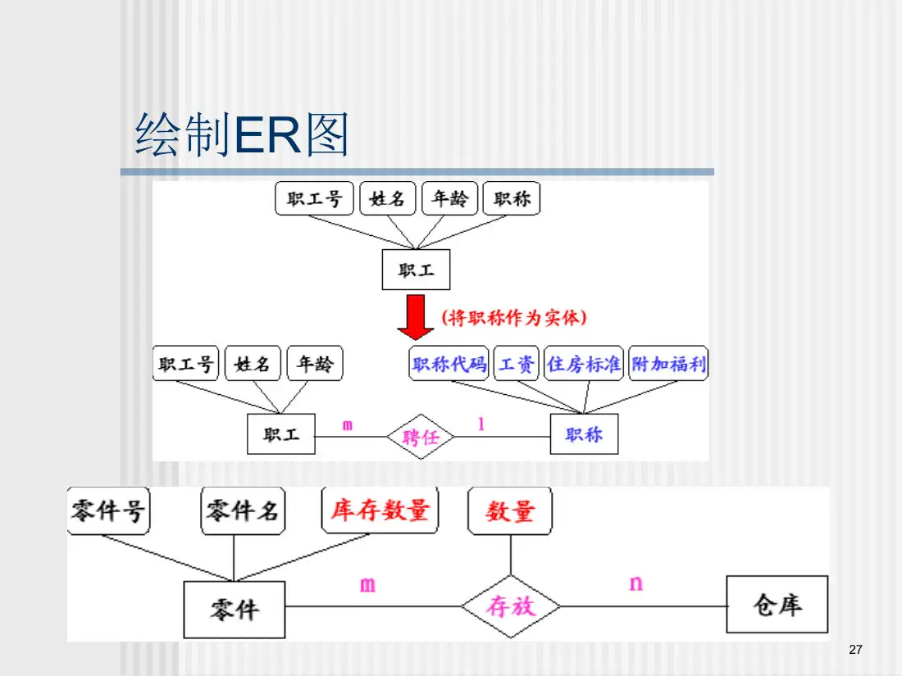

原文：

绘制ER图

27

### Class-Based Modeling (P146)

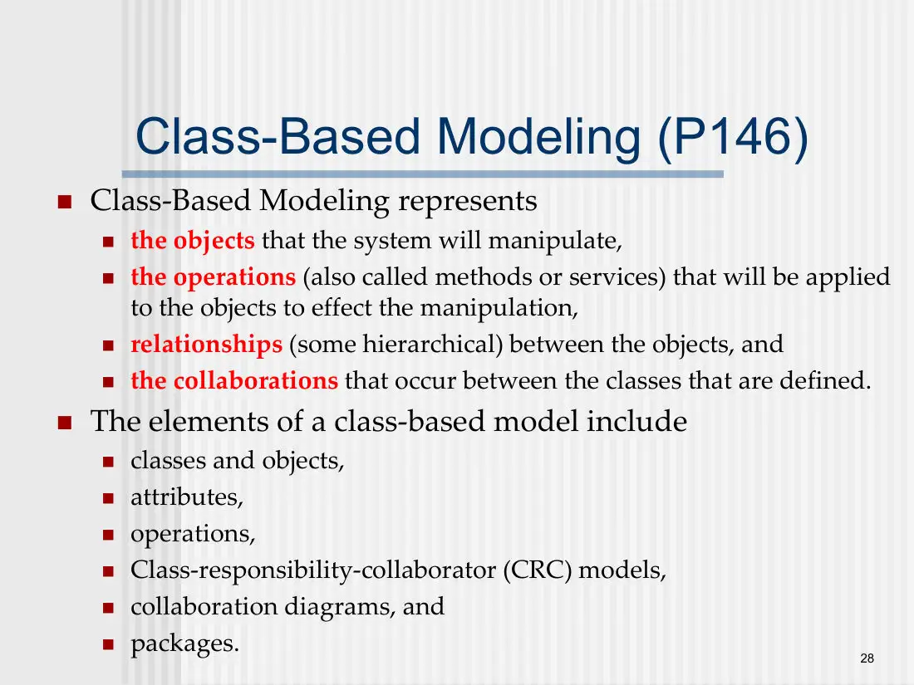

原文：

Class-Based Modeling (P146)

◼ Class-Based Modeling represents

◼ the objects that the system will manipulate,

◼ the operations (also called methods or services) that will be applied to the objects to effect the manipulation,

relationships (some hierarchical) between the objects, and

◼ the collaborations that occur between the classes that are defined.

◼ The elements of a class-based model include

◼ classes and objects,

◼ attributes,

◼ operations,

◼ Class-responsibility-collaborator (CRC) models,

◼ collaboration diagrams, and

◼ packages.

28

### Identifying Analysis Classes (P147)

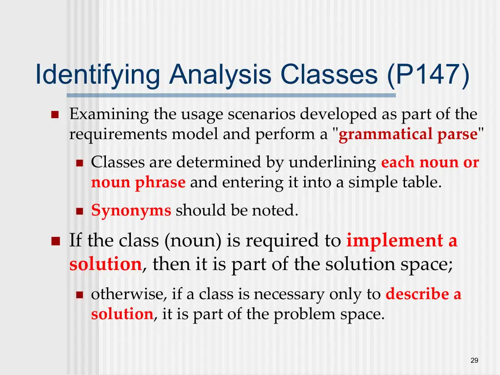

原文：

Identifying Analysis Classes (P147)

Examining the usage scenarios developed as part of the requirements model and perform a "grammatical parse"

Classes are determined by underlining each noun or noun phrase and entering it into a simple table.

◼ Synonyms should be noted.

If the class (noun) is required to implement a solution, then it is part of the solution space;

otherwise, if a class is necessary only to describe a solution, it is part of the problem space.

29

### 识别分析类— 示例

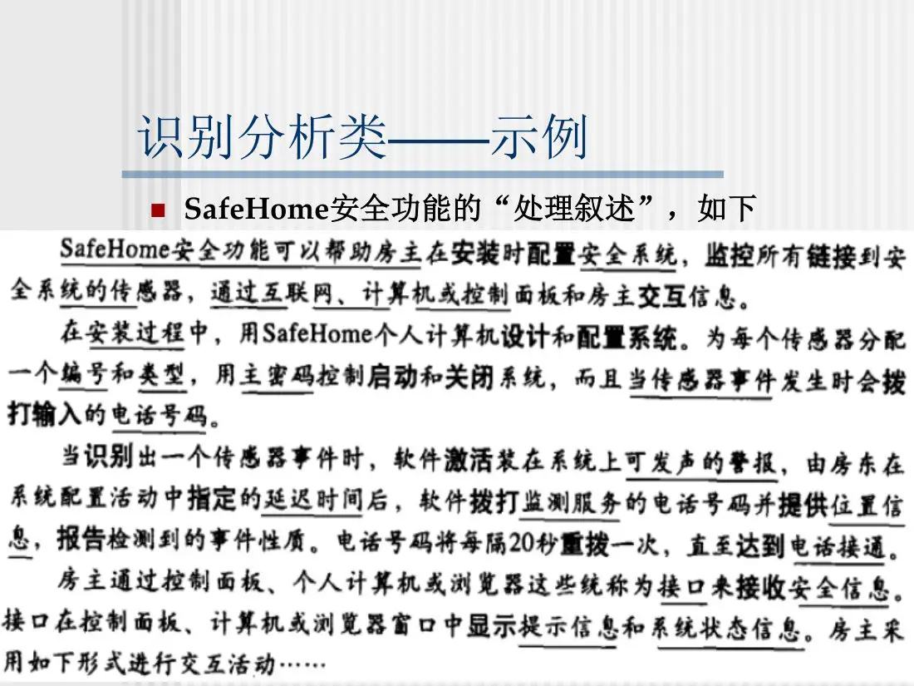

原文：

识别分析类— 示例

◼ SafeHome安全功能的“处理叙述”，如下

SafeHome安全功能可以帮助房主在安装时配置安全系统，监控所有链接到安全系统的传感器，通过互联网、计算机或控制面板和房主交互信息。

在安装过程中，用SafeHome个人计算机设计和配置系统。为每个传感器分配一个编号和类型，用主密码控制启动和关闭系统，而且当传感器事件发生时会拨打输入的电话号码。

当识别出一个传感器事件时，软件激活装在系统上可发声的警报，由房东在系统配置活动中指定的延迟时间后，软件拨打监测服务的电话号码并提供位置信息，报告检测到的事件性质。电话号码将每隔20秒重拨一次，直至达到电话接通。

房主通过控制面板、个人计算机或浏览器这些统称为接口来接收安全信息。接口在控制面板、计算机或浏览器窗口中显示提示信息和系统状态信息。房主采用如下形式进行交互活动……

### 识别分析类— 示例

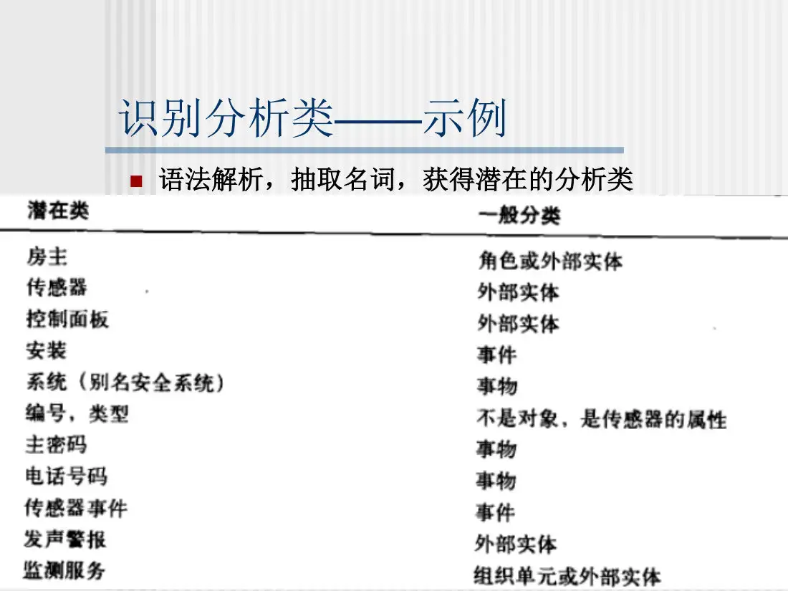

原文：

识别分析类— 示例

◼ 语法解析，抽取名词，获得潜在的分析类

<table><tr><td>潜在类</td><td>一般分类</td></tr><tr><td>房主</td><td>角色或外部实体</td></tr><tr><td>传感器</td><td>外部实体</td></tr><tr><td>控制面板</td><td>外部实体</td></tr><tr><td>安装</td><td>事件</td></tr><tr><td>系统(别名安全系统)</td><td>事物</td></tr><tr><td>编号,类型</td><td>不是对象,是传感器的属性</td></tr><tr><td>主密码</td><td>事物</td></tr><tr><td>电话号码</td><td>事物</td></tr><tr><td>传感器事件</td><td>事件</td></tr><tr><td>发声警报</td><td>外部实体</td></tr><tr><td>监测服务</td><td>组织单元或外部实体</td></tr></table>

### 识别分析类— 示例

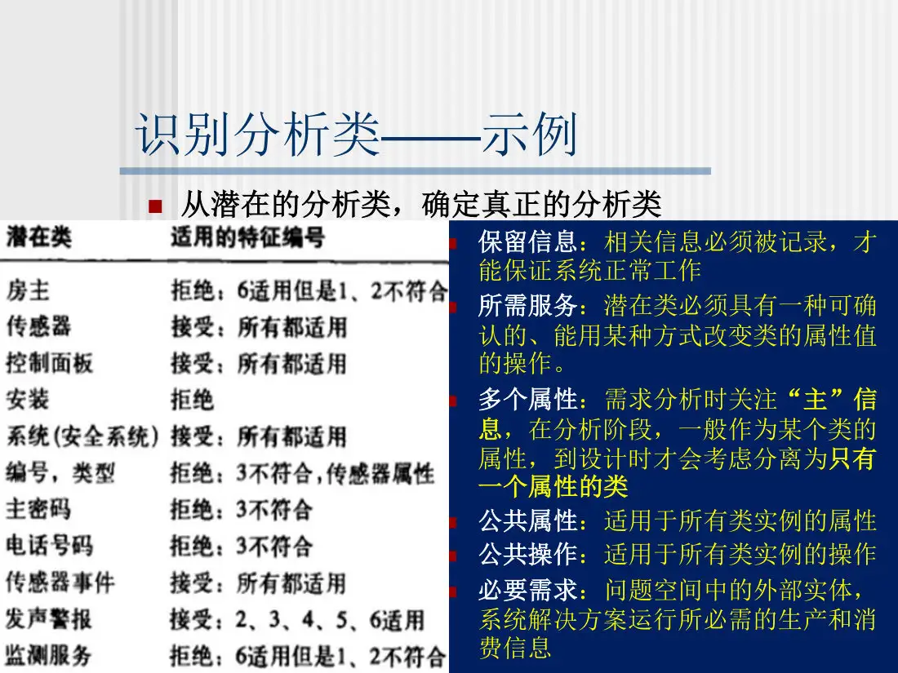

原文：

识别分析类— 示例

◼ 从潜在的分析类，确定真正的分析类

<table><tr><td>潜在类</td><td>适用的特征编号</td></tr><tr><td>房主</td><td>拒绝:6适用但是1、2不符合</td></tr><tr><td>传感器</td><td>接受:所有都适用</td></tr><tr><td>控制面板</td><td>接受:所有都适用</td></tr><tr><td>安装</td><td>拒绝</td></tr><tr><td>系统(安全系统)</td><td>接受:所有都适用</td></tr><tr><td>编号,类型</td><td>拒绝:3不符合,传感器属性</td></tr><tr><td>主密码</td><td>拒绝:3不符合</td></tr><tr><td>电话号码</td><td>拒绝:3不符合</td></tr><tr><td>传感器事件</td><td>接受:所有都适用</td></tr><tr><td>发声警报</td><td>接受:2、3、4、5、6适用</td></tr><tr><td>监测服务</td><td>拒绝:6适用但是1、2不符合</td></tr></table>

保留信息：相关信息必须被记录，才能保证系统正常工作

所需服务：潜在类必须具有一种可确认的、能用某种方式改变类的属性值的操作。

多个属性：需求分析时关注“主”信息，在分析阶段，一般作为某个类的属性，到设计时才会考虑分离为只有一个属性的类

公共属性：适用于所有类实例的属性

公共操作：适用于所有类实例的操作

必要需求：问题空间中的外部实体，系统解决方案运行所必需的生产和消费信息

### 2. operations that perform a computation

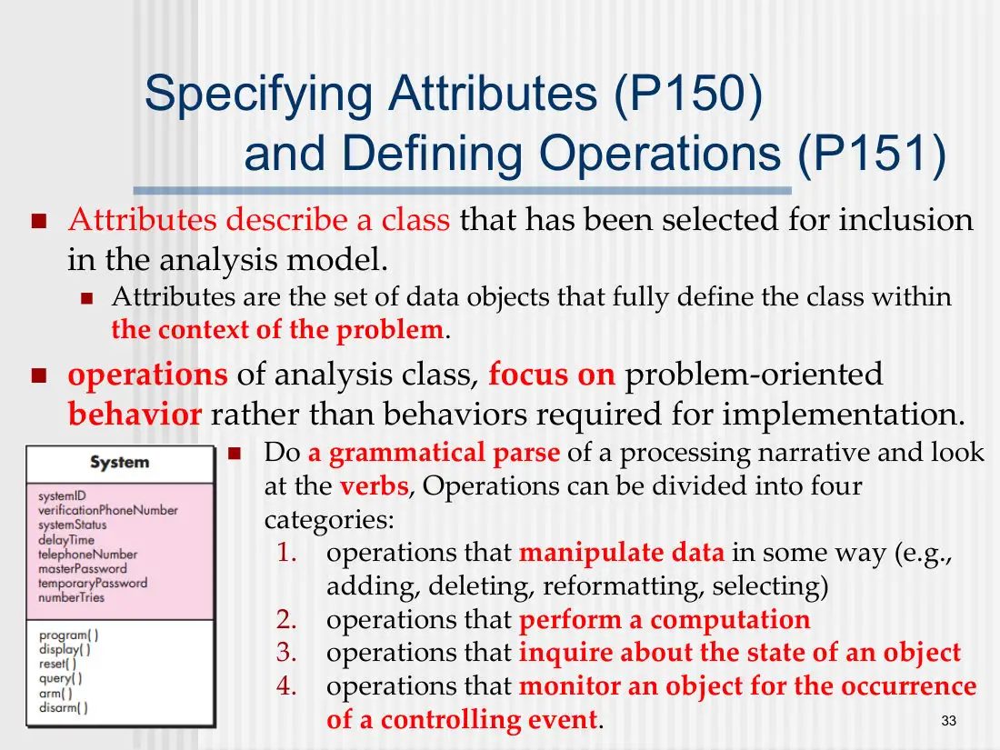

原文：

Specifying Attributes (P150) and Defining Operations (P151)

Attributes describe a class that has been selected for inclusion in the analysis model.

Attributes are the set of data objects that fully define the class within the context of the problem.

operations of analysis class, focus on problem-oriented behavior rather than behaviors required for implementation.

Do a grammatical parse of a processing narrative and look at the verbs, Operations can be divided into four categories:

<table><tr><td>System</td></tr><tr><td>systemIDverificationPhoneNumbersystemStatusdelayTimetelephoneNumbermasterPasswordtemporaryPasswordnumberTries</td></tr><tr><td>program( )display( )reset( )query( )arm( )disarm( )</td></tr></table>

1. operations that manipulate data in some way (e.g., adding, deleting, reformatting, selecting)

2. operations that perform a computation

3. operations that inquire about the state of an object

4. operations that monitor an object for the occurrence of a controlling event. 33

### 描述属性和定义操作— —示例

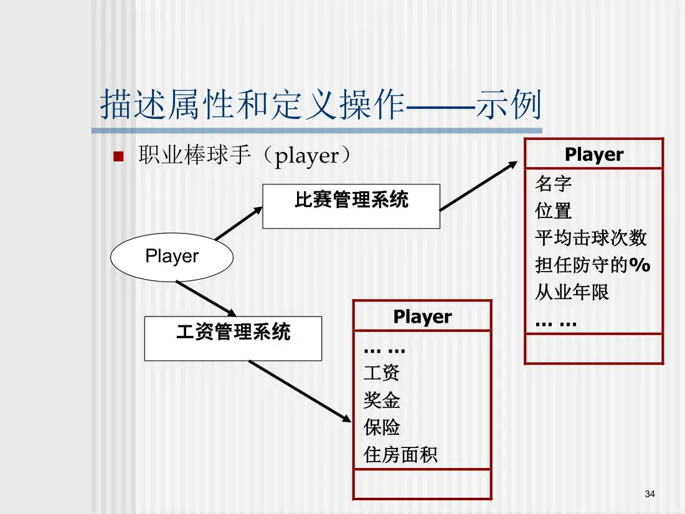

原文：

描述属性和定义操作— —示例

34

### 描述属性和定义操作 ——示例

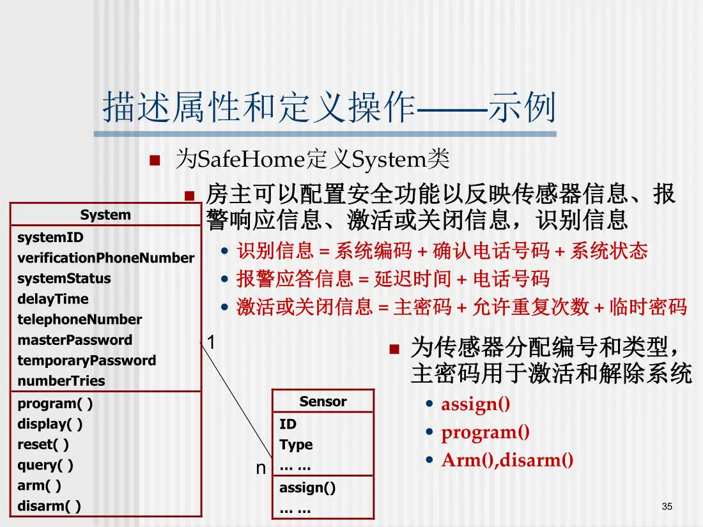

原文：

描述属性和定义操作 ——示例

◼ 为SafeHome定义System类

System

systemID

房主可以配置安全功能以反映传感器信息、报警响应信息、激活或关闭信息，识别信息

verificationPhoneNumber

systemStatus

delayTime

识别信息= 系统编码 + 确认电话号码+ 系统状态

telephoneNumber

masterPassword

temporaryPassword

激活或关闭信息= 主密码+ 允许重复次数+ 临时密码

• 报警应答信息= 延迟时间+ 电话号码

numberTries

为传感器分配编号和类型，主密码用于激活和解除系统

program()

display( )

reset()

query()

• assign()

arm( )

disarm()

Sensor

ID

Type

program()

n

…… assign()

• Arm(),disarm()

35

### 描述属性和定义操作—示例

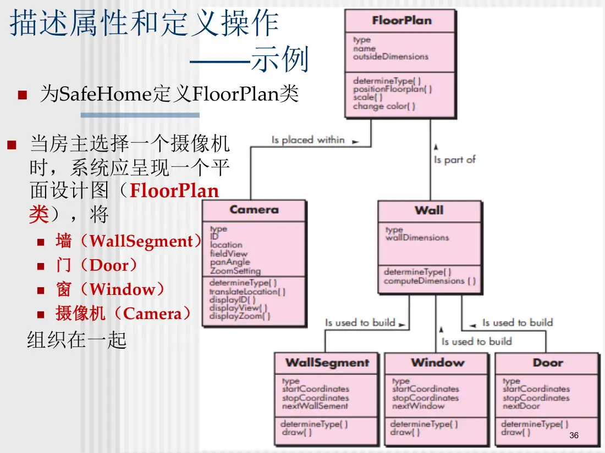

原文：

描述属性和定义操作—示例

◼ 为SafeHome定义FloorPlan类

当房主选择一个摄像机时，系统应呈现一个平面设计图（FloorPlan

◼ 墙（WallSegment）

◼ 门（Door）

◼ 窗（Window）

◼ 摄像机（Camera）

组织在一起

### class name

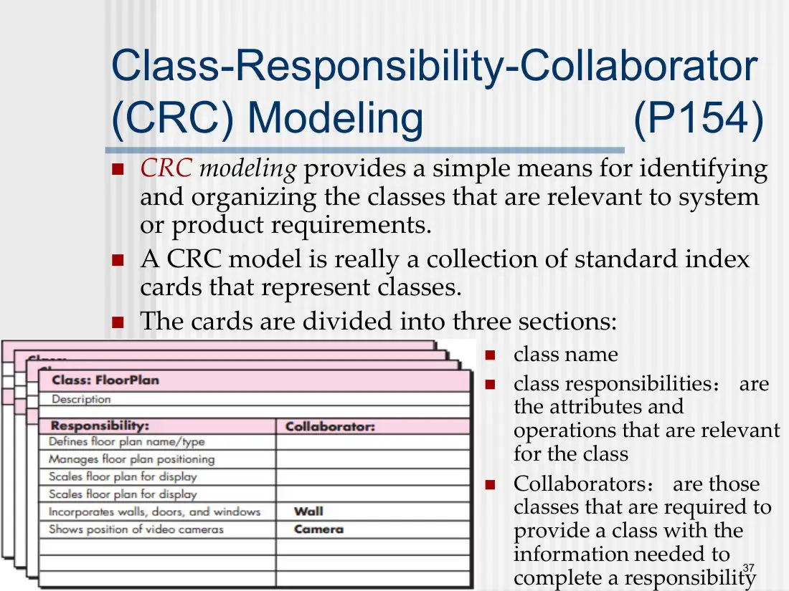

原文：

Class-Responsibility-Collaborator (CRC) Modeling (P154)

CRC modeling provides a simple means for identifying and organizing the classes that are relevant to system or product requirements.

A CRC model is really a collection of standard index cards that represent classes.

◼ The cards are divided into three sections:

<table><tr><td colspan="2">Class: FloorPlan</td></tr><tr><td colspan="2">Description</td></tr><tr><td colspan="2"></td></tr><tr><td>Responsibility:</td><td>Collaborator:</td></tr><tr><td>Defines floor plan name/type</td><td></td></tr><tr><td>Manages floor plan positioning</td><td></td></tr><tr><td>Scales floor plan for display</td><td></td></tr><tr><td>Scales floor plan for display</td><td></td></tr><tr><td>Incorporates walls, doors, and windows</td><td>Wall</td></tr><tr><td>Shows position of video cameras</td><td>Camera</td></tr><tr><td></td><td></td></tr><tr><td></td><td></td></tr><tr><td></td><td></td></tr></table>

class name

class responsibilities： are the attributes and operations that are relevant for the class

Collaborators： are those classes that are required to provide a class with the information needed to 37complete a responsibility

### CRC建模— 分析类的类型

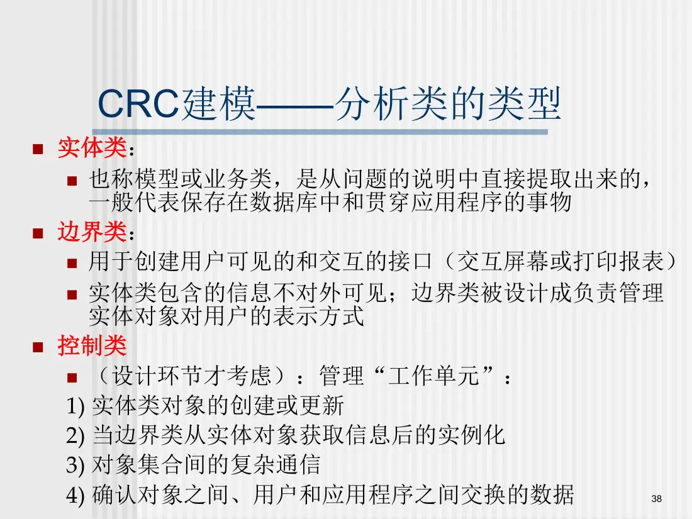

原文：

CRC建模— 分析类的类型

◼ 实体类：

◼ 也称模型或业务类，是从问题的说明中直接提取出来的，一般代表保存在数据库中和贯穿应用程序的事物

边界类：

◼ 用于创建用户可见的和交互的接口（交互屏幕或打印报表）

◼ 实体类包含的信息不对外可见；边界类被设计成负责管理实体对象对用户的表示方式

◼ 控制类

◼ （设计环节才考虑）：管理“工作单元”：

1) 实体类对象的创建或更新

2) 当边界类从实体对象获取信息后的实例化

3) 对象集合间的复杂通信

4) 确认对象之间、用户和应用程序之间交换的数据

38

### CRC建模— 分析类与设计类

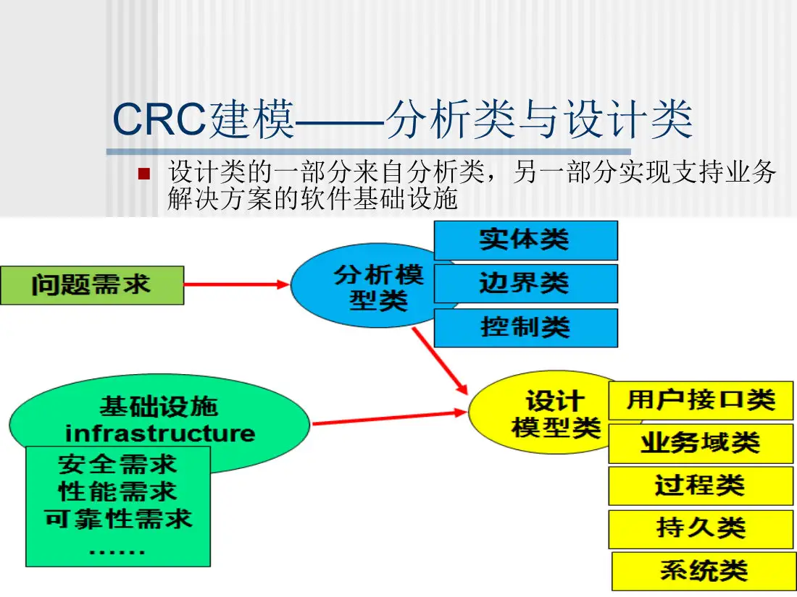

原文：

CRC建模— 分析类与设计类

设计类的一部分来自分析类，另一部分实现支持业务解决方案的软件基础设施

问题需求分析模型类实体类

边界类

控制类

基础设施infrastructure

安全需求性能需求可靠性需求设计模型类用户接口类

业务域类

过程类

持久类

系统类

### CRC建模— 职责

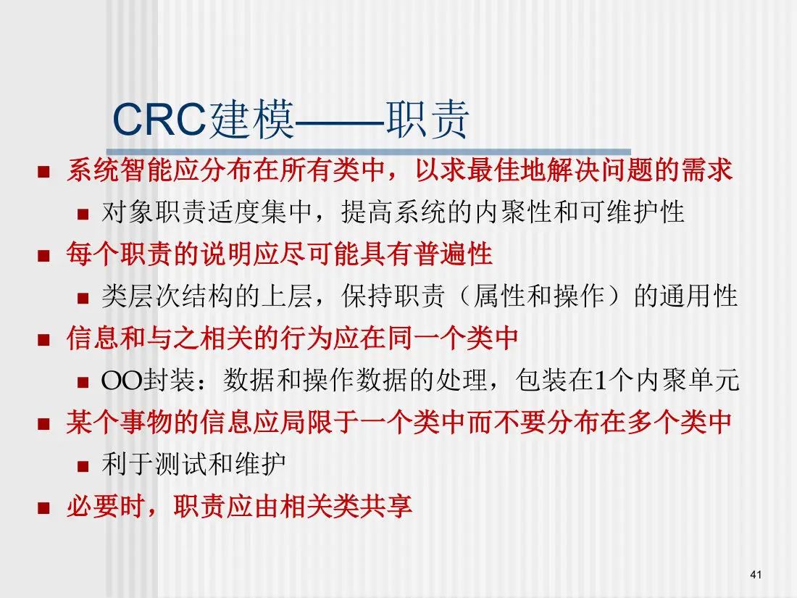

原文：

CRC建模— 职责

◼ 系统智能应分布在所有类中，以求最佳地解决问题的需求

◼ 对象职责适度集中，提高系统的内聚性和可维护性

◼ 每个职责的说明应尽可能具有普遍性

◼ 类层次结构的上层，保持职责（属性和操作）的通用性

◼ 信息和与之相关的行为应在同一个类中

◼ OO封装：数据和操作数据的处理，包装在1个内聚单元

◼ 某个事物的信息应局限于一个类中而不要分布在多个类中◼ 利于测试和维护

◼ 必要时，职责应由相关类共享

41

### CRC建模— 协作

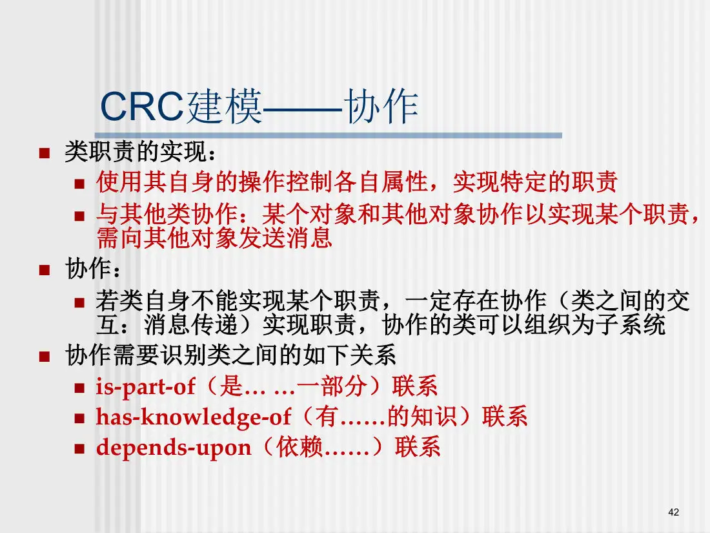

原文：

CRC建模— 协作

◼ 类职责的实现：

◼ 使用其自身的操作控制各自属性，实现特定的职责

与其他类协作：某个对象和其他对象协作以实现某个职责，需向其他对象发送消息

◼ 协作：

◼ 若类自身不能实现某个职责，一定存在协作（类之间的交互：消息传递）实现职责，协作的类可以组织为子系统

◼ 协作需要识别类之间的如下关系

◼ is-part-of（是… …一部分）联系

◼ has-knowledge-of（有……的知识）联系

◼ depends-upon（依赖……）联系

42

### CRC建模— —协作类之间的关系

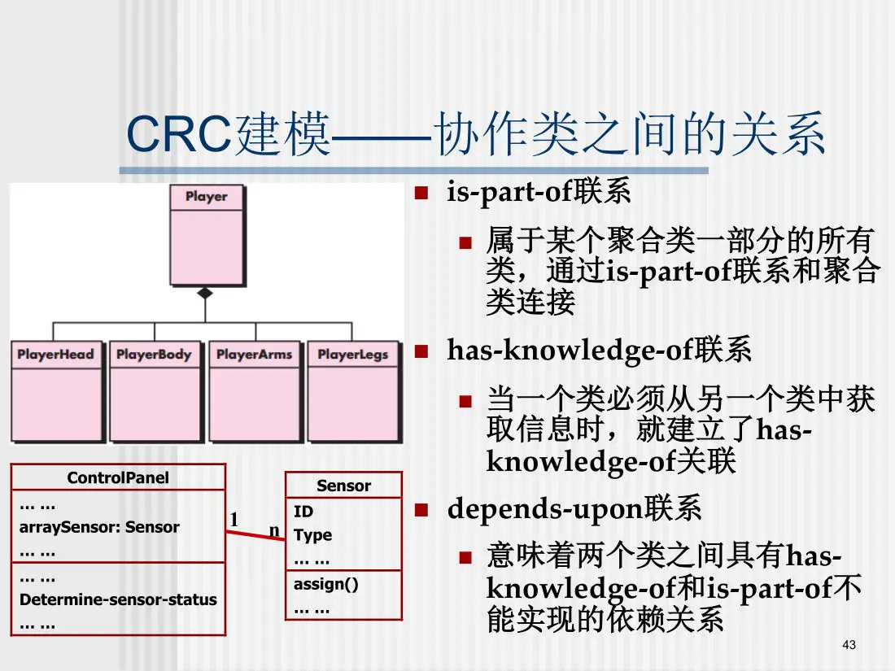

原文：

CRC建模— —协作类之间的关系

is-part-of联系

属于某个聚合类一部分的所有类，通过is-part-of联系和聚合类连接

has-knowledge-of联系

当一个类必须从另一个类中获取信息时，就建立了has-knowledge-of关联

depends-upon联系

意味着两个类之间具有has-knowledge-of和is-part-of不能实现的依赖关系

43

### CRC建模— 评审

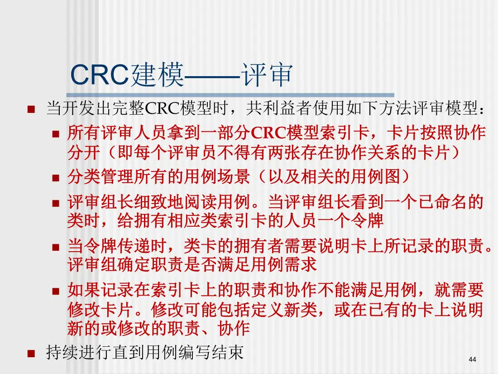

原文：

CRC建模— 评审

◼ 当开发出完整CRC模型时，共利益者使用如下方法评审模型：

所有评审人员拿到一部分CRC模型索引卡，卡片按照协作分开（即每个评审员不得有两张存在协作关系的卡片）

◼ 分类管理所有的用例场景（以及相关的用例图）

评审组长细致地阅读用例。当评审组长看到一个已命名的类时，给拥有相应类索引卡的人员一个令牌

当令牌传递时，类卡的拥有者需要说明卡上所记录的职责。评审组确定职责是否满足用例需求

如果记录在索引卡上的职责和协作不能满足用例，就需要修改卡片。修改可能包括定义新类，或在已有的卡上说明新的或修改的职责、协作

◼ 持续进行直到用例编写结束

44

### Associations and Dependencies (P160)

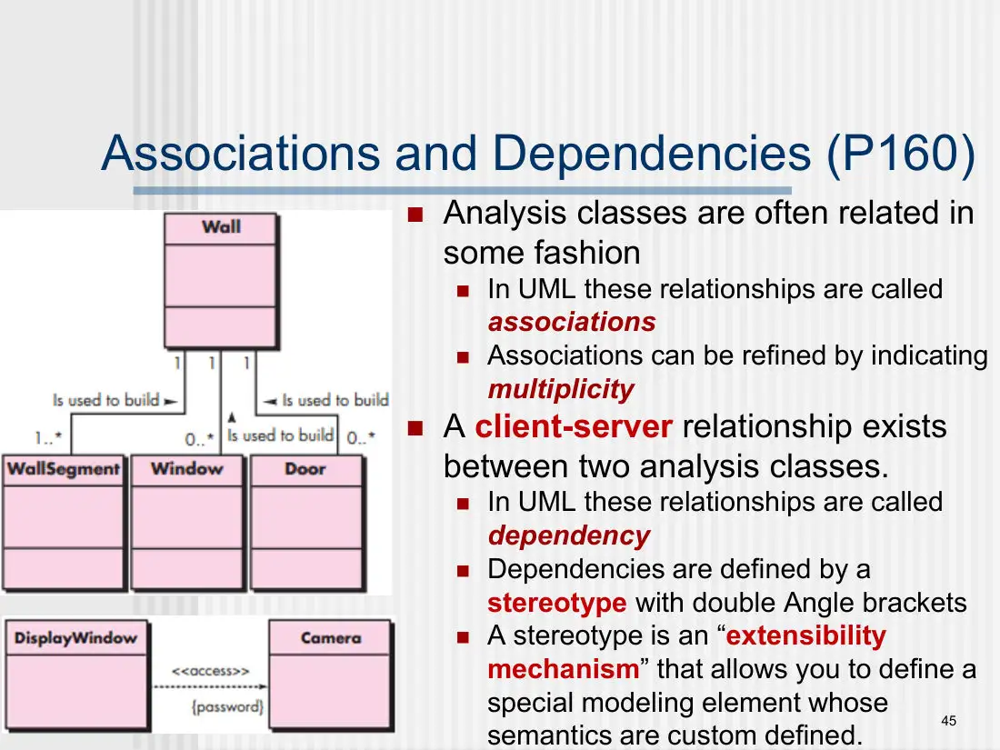

原文：

Associations and Dependencies (P160)

Analysis classes are often related in some fashion

In UML these relationships are called associations

Associations can be refined by indicating multiplicity

A client-server relationship exists between two analysis classes.

In UML these relationships are called dependency

Dependencies are defined by a stereotype with double Angle brackets

A stereotype is an “extensibility mechanism” that allows you to define a special modeling element whose 45 semantics are custom defined.

### Analysis Packages (P161)

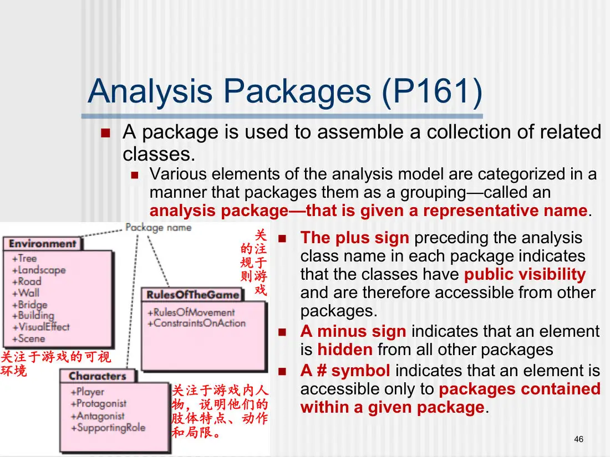

原文：

Analysis Packages (P161)

A package is used to assemble a collection of related classes.

Various elements of the analysis model are categorized in a manner that packages them as a grouping—called an analysis package—that is given a representative name.

关注于游戏内人物，说明他们的肢体特点、动作和局限。

The plus sign preceding the analysis class name in each package indicates that the classes have public visibility and are therefore accessible from other packages.

A minus sign indicates that an element is hidden from all other packages

A # symbol indicates that an element is accessible only to packages contained within a given package.

46

### Behavioral Modeling (P165)

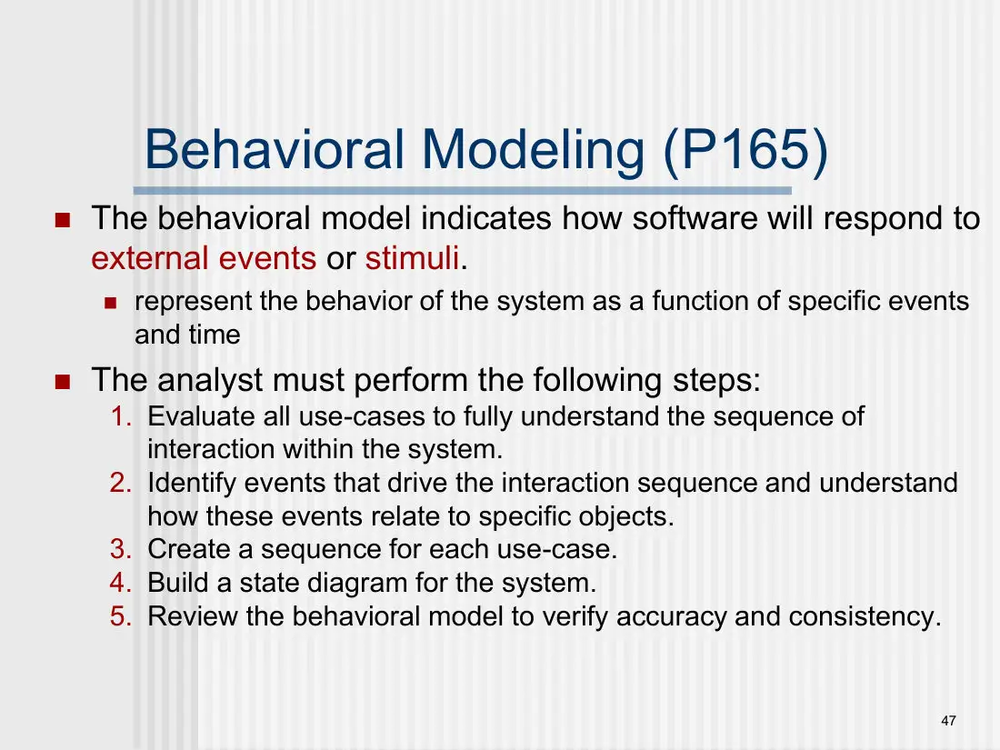

原文：

Behavioral Modeling (P165)

◼ The behavioral model indicates how software will respond to external events or stimuli.

represent the behavior of the system as a function of specific events and time

◼ The analyst must perform the following steps:

1. Evaluate all use-cases to fully understand the sequence of interaction within the system.

2. Identify events that drive the interaction sequence and understand how these events relate to specific objects.

3. Create a sequence for each use-case.

4. Build a state diagram for the system.

5. Review the behavioral model to verify accuracy and consistency.

47

### 48

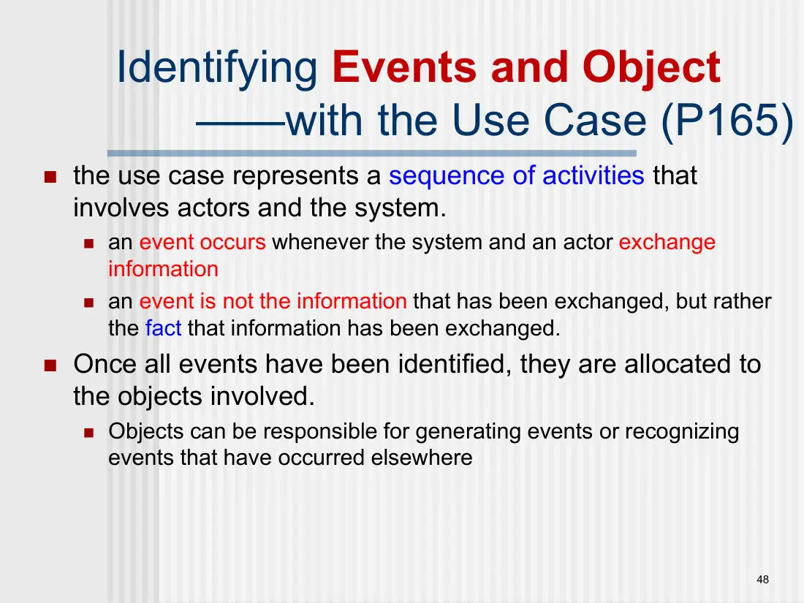

原文：

Identifying Events and Object with the Use Case (P165)

◼ the use case represents a sequence of activities that involves actors and the system.

an event occurs whenever the system and an actor exchange information

◼ an event is not the information that has been exchanged, but rather the fact that information has been exchanged.

◼ Once all events have been identified, they are allocated to the objects involved.

◼ Objects can be responsible for generating events or recognizing events that have occurred elsewhere

48

### 识别用例事件和对象——示例

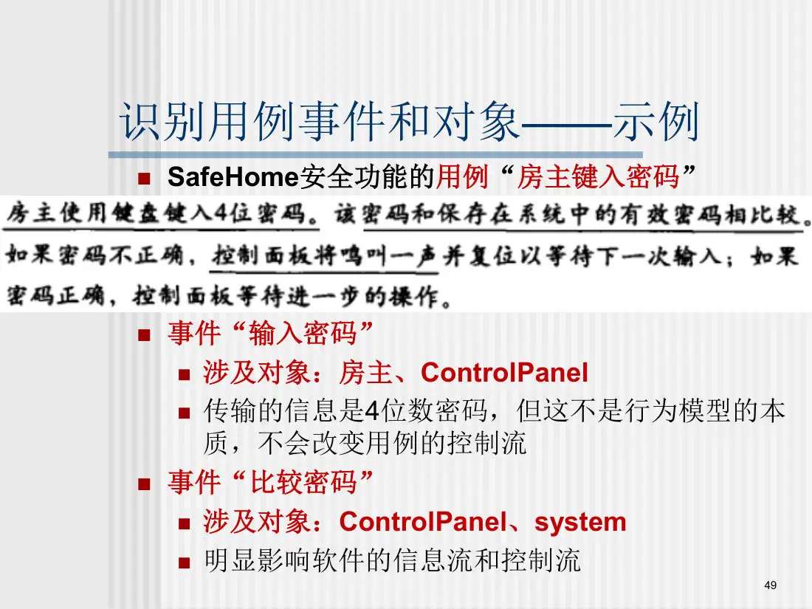

原文：

识别用例事件和对象——示例

◼ SafeHome安全功能的用例“房主键入密码”

房主使用键盘键入4位密码。该密码和保存在系统中的有效密码相比较。

如果密码不正确，控制面板将鸣叫一声并复位以等待下一次输入；如果密码正确，控制面板等待进一步的操作。

◼ 事件“输入密码”

◼ 涉及对象：房主、ControlPanel

传输的信息是4位数密码，但这不是行为模型的本质，不会改变用例的控制流

事件“比较密码”

◼ 涉及对象：ControlPanel、system

◼ 明显影响软件的信息流和控制流

49

### State Representations (P166)

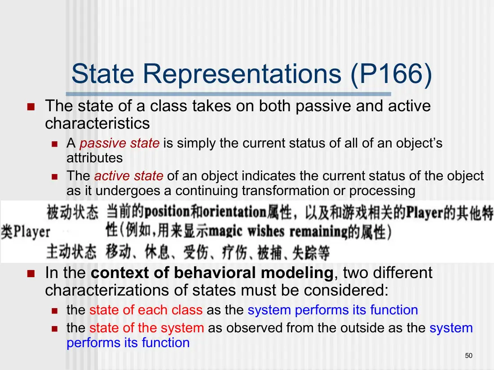

原文：

State Representations (P166)

◼ The state of a class takes on both passive and active characteristics

A passive state is simply the current status of all of an object’s attributes

The active state of an object indicates the current status of the object as it undergoes a continuing transformation or processing

被动状态当前的position和orientation属性，以及和游戏相关的Player的其他特类Player 性(例如，用来显示magic wishes remaining的属性)

主动状态移动、休息、受伤、疗伤、被捕、失踪等

◼ In the context of behavioral modeling, two different characterizations of states must be considered:

the state of each class as the system performs its function

the state of the system as observed from the outside as the system performs its function

50

### 状态图— 示例

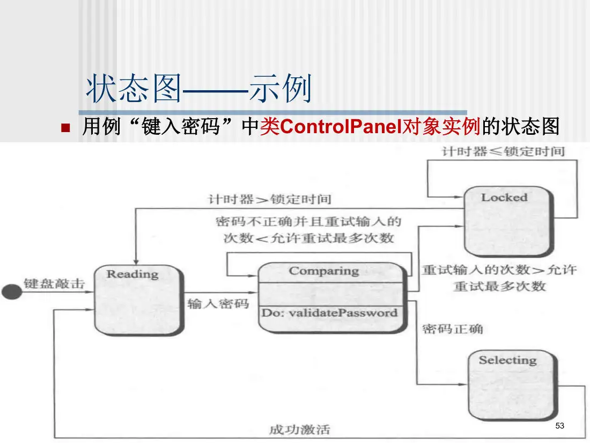

原文：

状态图— 示例

◼ 用例“键入密码”中类ControlPanel对象实例的状态图

### 顺序图— 示例

原文：

顺序图— 示例

◼ SafeHome安全功能的顺序图（部分）

### Flow-Oriented Modeling

原文：

Flow-Oriented Modeling

◼ An input-process-output view of a system

Represents how data objects are transformed at they move through the system

◼ A hierarchical fashion

the first data flow model (a level 0 DFD or context diagram) represents the system as a whole.

subsequent data flow diagrams refine the context diagram providing increasing detail with each subsequent level.

Enable to develop models of the information domain and functional domain

input

computer based system output

55

### DFD建模符号

原文：

DFD建模符号

◼ 外部实体（external entity）

◼ A producer or consumer of data

Data must always originate somewhere and must always be sent to something （role of user, device or computer-based system）

◼ 处理（process）

◼ A data transformer (changes input to output)

Data must always be processed in some way to achieve system function compute taxes, determine area, format report, display graph

数据流（data flow）

Data flows through a system, re beginning as input and transformed into output.

数据存储（data store）

◼ Data is often stored for later use

### DFD的指导原则

原文：

DFD的指导原则

◼ 第0层的DFD把软件或系统描述成一个泡泡

◼ 仔细标记主要的输入和输出

通过把选定的处理、数据对象和数据存储分离为下一层表示而开始精化过程

◼ 使用有意义的名称标记所有的箭头和泡泡

当从一个层次转到另一个层次时要保持信息流连续性

当精化每一层DFD时，必须维护信息流的连续性，这意味着在某一层的输入和输出必须和精化后的输入和输出相同

一次精化一个泡泡

57

### Create a Data Flow Modeling

原文：

Create a Data Flow Modeling

◼ create a level 0 DFD

58

### 库存管理系统

原文：

库存管理系统

◼ 某工厂采购部门每天要开出定货清单，清单中包括订购部件的部件号、部件名、规格、说明、订购量、当前价格、主要供应商和辅助供应商。

◼ 部件入库或出库称为业务，系统终端把业务报告给定货系统。

当某种部件的库存量少于库存量临界值以下时，仓库管理员就应该及时通知定货系统开出定货清单，交由采购员采

◼ 1）提取DFD四个成分

◼ 2）画出高层DFD

<table><tr><td>外部项</td><td>处理</td><td>数据流</td><td>数据存储</td></tr><tr><td>管理员</td><td>处理库存业务</td><td>库存数据</td><td>库存数据</td></tr><tr><td>采购员</td><td>产生定货清单</td><td>定货清单</td><td>定货数据</td></tr></table>

59

### 3）细化， 描绘主要功能

原文：

3）细化， 描绘主要功能

4）细化， 分解关键处理

### 创建数据流模型——示例

原文：

创建数据流模型——示例

◼ SafeHome的第0层DFD

61

### 创建数据流模型— —示例

原文：

创建数据流模型— —示例

◼ 开发第1层DFD

◼ SafeHome“安全功能”的处理叙述

SafeHome安全功能可以帮助房主在安装时配置安全系统，监控所有链接到安全系统的传感器，通过互联网、计算机或控制面板和房主交互信息。

在安装过程中，用SafeHome个人计算机设计和配置系统。为每个传感器分配一个编号和类型，用主密码控制启动和关闭系统，而且当传感器事件发生时会拨打输入的电话号码。

当识别出一个传感器事件时，软件激活装在系统上可发声的警报，由房东在系统配置活动中指定的延迟时间后，软件拨打监测服务的电话号码并提供位置信息，报告检测到的事件性质。电话号码将每隔20秒重拨一次，直至达到电话接通。

房主通过控制面板、个人计算机或浏览器这些统称为接口来接收安全信息。接口在控制面板、计算机或浏览器窗口中显示提示信息和系统状态信息。房主采用如下形式进行交互活动……

### 创建数据流模型— —示例

原文：

创建数据流模型— —示例

◼ 开发第1层DFD

◼ expand data flow mode: grammatical parse

63

### 创建数据流模型— —示例

原文：

创建数据流模型— —示例

◼ 持续进行DFD求精

◼ 直到每个泡泡都执行了某个单一的功能

### PSPEC and CSPEC

原文：

PSPEC and CSPEC

process

PSPEC建模了处理(process)的内部工作机制

PSPEC

以某种“小规格说明”的形式，描述了最终层次的DFD中的处理，为后期的构件设计提供指南

叙事性文本

处理算法的程序设计语言 (PDL)

数学方程

DFD

遵循模板的表格

UML 活动图

CSPEC描述了系统行为(behavior)

处理激活(activate)了行为的结果

CSPEC

状态图 (行为的序列说明)

状态转换表

口 决策表

组合

□激活表

### PSPEC— 示例

原文：

PSPEC— 示例

◼ SafeHome安全功能中的“处理密码”功能的叙事性文本描述

PSPEC是指在DFD的最低求精层的每个转换都是一个“小型规格说明”。

PSPEC：处理密码（控制面板上）。在SafeHome安全功能中“处理密码”变换完成控制面板上的密码确认。“处理密码”从“与用户交互”功能接收4位密码，将该密码首先和存储在系统中的主密码进行比较，如果与主密码匹配，则向“显示消息和状态”功能传送有效信息<valid id message = true>。如

果与主密码不匹配，则把4位密码与次密码表比较（这些密码可能会授予房子的客人和（或）在房主不在家时需要进入房子的工人)。如果密码和表中的某项匹配，将向“显示消息和状态”功能传送有效信息<valid id message = true>；如果不匹配，则向“显示消息和状态”功能传送无效信息<valid id message = false>。

67

### CSPEC— 示例

原文：

CSPEC— 示例

SafeHome第1层DFD的状态图，描述了在这个层次上，如何响应事件使得系统在这4个状态之间来回移动，如图示：

### DFD与软件设计

原文：

DFD与软件设计

◼ DFD映射为软件体系结构图

analysis model

design model

70

### 域分析与分析模式需求建模中的模式(P169)

原文：

域分析与分析模式需求建模中的模式(P169)

◼ Software patterns are a mechanism for capturing domain

knowledge in a way that allows it to be reapplied wh

a new problem is encountered wledge can be a

within the same application domain

◼ the domain knowledge captured by a pattern can be applied by analogy to a completely different 消息，诸如使用模式的动机和驱动力，讨论模式的优缺点，参考在实践应 The original author of

requirements engineering work is being conducted. 分析模式是一种面向领域的解决方案，可能整合了一个类、 一个功能或一个行为。

当在相关领域需求建模时，会复用分析模式，通过参考模式名整合到需求模型中。

### 分析模式— 示例

原文：

分析模式— 示例

◼ 控制与监控“实时摄像机”与“临近传感器”

用例：监控反向运动

当汽车安装了反向装置后，控制软件就能将后向摄像机的视频输入仪表盘显示器，控制软件在仪表盘显示器上叠加各种距离线和方向线。以便车辆向后运动时驾驶员能保持方向。控制软件还能监控临近传感器，以判断在车后方10英尺内是否有物体存在。如果临近传感器检测到某个物体在车后方�英尺内就会让车自动停止，其中�取值由车辆的速度决定。

74

### 分析模式— 描述模板

原文：

分析模式— 描述模板

模板
■ 模式名
■ 目的
■ 动机
■ 约束
■ 适用性
■ 结构体
■ 行为
■ 参与者
■ 协作
■ 结果

75

### 示例—Actuator-Sensor分析模式

原文：

示例—Actuator-Sensor分析模式

◼ 模式名：

◼ 执行器-传感器

◼ 目的：

◼ 详细说明在嵌入式系统中的各种传感器和执行器

◼ 动机：

嵌入系统中各种传感器和执行器都直接或间接连接到一个控制单元

◼ 虽然各种传感器和执行器看上去不同，但其行为是相似的

创建分析模式，显示如何为一个系统指定传感器和执行器，包括属性和操作

执行器-传感器模式中，被动式传感器使用“拉机制” (对消息的显示要求)，主动传感器使用“推机制” (消息广播) 77

### 示例—Actuator-Sensor分析模式

原文：

示例—Actuator-Sensor分析模式

◼ 约束：

每个被动传感器必须通过某种方法读取传感器的输入和表示传感器值的属性

◼ 每个主动传感器必须能在其值发生变更时广播更新消息

每个主动传感器应该能发送一个生命刻度，即在特定时间帧中发布状态信息，以便检测出错误动作

◼ 每个执行者必须有某种方法调用由ComputingComponent计算构件决定的适当应答

◼ 每个传感器和执行器应有实施检测其自身操作状态的功能

每个传感器和执行器能测试接受值或发送值的有效性，并且当值超出指定边界时能设定其操作状态

78

### 示例—Actuator-Sensor分析模式

原文：

示例—Actuator-Sensor分析模式

◼ 适用性：

◼ 对有多个传感器和执行器的任何系统都是非常有用的

◼ 结构体：

◼ 执行器-传感器模式UML类图如图所示

✓ 执行器、被动传感器和主动传感器是抽象类，模式中有四种不同的传感器和执行器

✓ 常见类型为Boolean、Integer和Real等基本数据类型

复杂类是不能用值简单表示的，如雷达设备

✓ 设备继承或重写来自抽象类的接口

### 示例—Actuator-Sensor分析模式

原文：

示例—Actuator-Sensor分析模式

◼ 行为：

◼ 执行器-传感器模式的UML顺序图如图所示

当读取或设置一个值时，ControlPaneI需要一个传感器(被动传感器)和个执行器(摇摄控制器)进行以诊断为目的核查操作状态

为Set Physical Value和Get Physical Value的消息不是对象间的信息，相反它们描述了系统物理设备和相关软件对应项之间的交互活动

在图的下部即在水平线以下，PositionSensor报告操作状态为零。接着ComputingComponent (表示为ControlPanel)发送位置传感器失败的错误代码给FaultHandler错误处理程序，它将决定这些错误如何影响系统，并需要采取什么措施。从传感器获得的数据经过计算得到执行器所需的应答

模式拓展到SafeHome系统中，用以控制安全摄像机的调整(例如摇摄、聚焦)。

80

### 分析模式— 示例

原文：

分析模式— 示例
<table><tr><td>FauntHandler</td><td>PositionSenso</td><td>ControlPanel</td><td>PanControl Actuator</td><td>Senor InputDevice PositionSensor</td><td>Actuator OutputDevice PanControl</td></tr><tr><td rowspan="2" colspan="2">(PositionSensor.OpState = 1)</td><td>获得操作状态</td><td>获得物理值</td><td></td><td></td></tr><tr><td>获得值</td><td>获得操作状态</td><td>设定值</td><td>设定物理值</td></tr><tr><td colspan="2">(PositionSensor.OpState = 0)</td><td>获得操作状态</td><td>存储错误</td><td></td><td></td></tr></table>

### 分析模式— 示例

原文：

分析模式— 示例

参与者。模式描述的这节内容“详细列举了包括在需求模式中的类或对象”[Kon02]，并◼ “Actuator-Sensor”分析

• PassiveSensor abstract:定义被动传感器接口

·PassiveBooleanSensor：定义被动布尔型传感器·PassiveIntegerSensor：定义被动整型传感器

• PassiveRealSensor：定义被动实型传感器

• ActiveSensor abstract:定义主动传感器接口

• ActiveBooleanSensor：定义主动布尔型传感器·ActiveIntegerSensor：定义主动整型传感器

• ActiveRealSensor：定义主动实型传感器

• Actuator abstract:定义执行器接口

• BooleanActuator：定义布尔型执行器·IntegerActuator：定义整型执行器

• RealActuator：定义实型执行器

·ComputingComponent：控制器的中心部分，它从传感器得到数据并为执行器计算所需的应答。

•ActiveComplexSensor：主动复合型传感器具备抽象类ActiveSensor的基本功能，但还需要指定额外更详细的方法和属性。

• PassiveComplexSensor：被动复合型传感器具备抽象类PassiveSensor的基本功能，但还需要指定额外更详细的方法和属性。

· ComplexActuator：复合型执行器具备抽象类Actuator的基本功能，但还需要指定额外更详细的方法和属性。

### 分析模式— 示例

原文：

分析模式— 示例

◼ “Actuator-Sensor”分析模式

·当ComputingComponent需要更新PassiveSensor的值时，它询问传感器，通过发送适当的消息请求传值。

· ActiveSensor无需查询。这些对象和类启动向计算机单元中传送传感器的值，使用适当方法设定在ComputingComponent中的值。对象和类在指定的时间帧发送至少一次生命刻度，以便用系统的时钟时间更新它们的时间戳。

·当ComputingComponent需要设定执行器的值时，给执行器发送值。

·ComputingComponent能使用适当的方法查询和设定传感器和执行器的操作状态。如果发现操作状态为零，就发送错误给FaultHandler错误处理程序，这个类包含处理错误消息的方法，比如启动更详细的恢复机制或者一个备份设备。如果不可恢复，系统只能使用传感器最后的已知值或者默认值。

·ActiveSensor提供增加或消除地址的方法或者组件的地址范围的方法，一旦值发生变化组件就能获得消息。

结果

1. 传感器和执行器类有一个通用接口。

2. 只能通过消息访问类的属性，并且类决定是否接受这个消息。例如，如果设定执行器的值超过其最大值，执行器类就不可能接受消息，或者使用默认的最大值。

3. 降低系统潜在的复杂度是因为传感器和执行器有统一的接口。

83
