# 《软件工程（双语）》Unit 5 设计概念（课件）

原件的每一页，下面附识别出的文字。

### UNIT 5

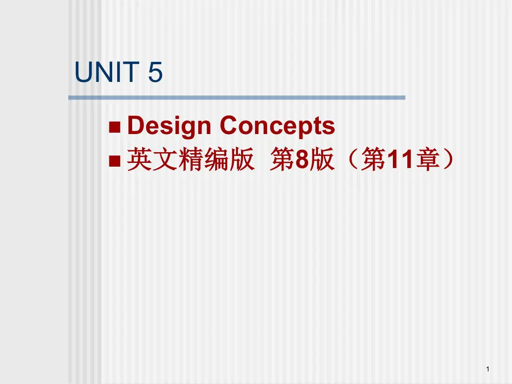

原文：

UNIT 5

Design Concepts

英文精编版 第8版（第11章）

1

### Contents & Requirements

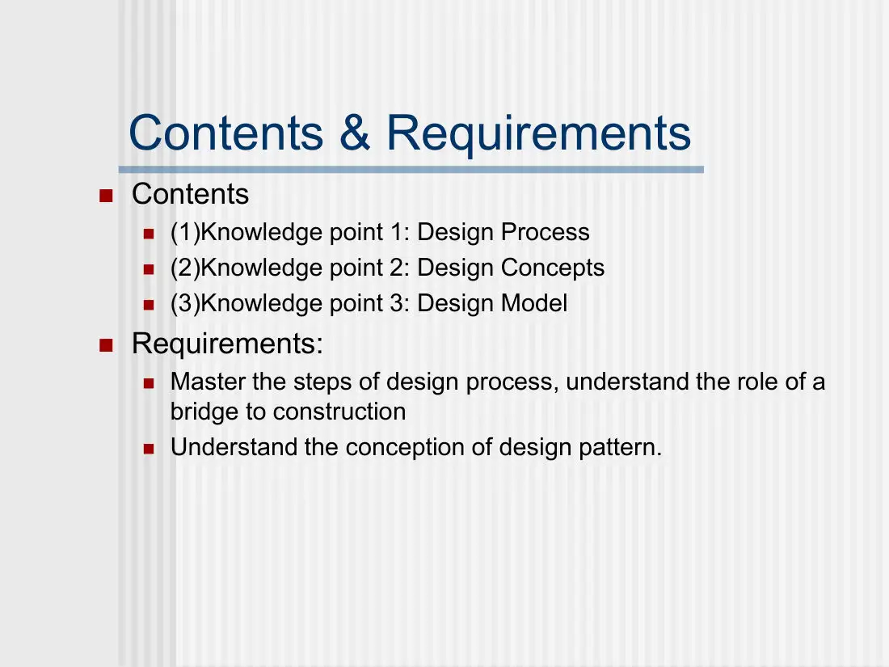

原文：

Contents & Requirements

◼ Contents

◼ (1)Knowledge point 1: Design Process

◼ (2)Knowledge point 2: Design Concepts

◼ (3)Knowledge point 3: Design Model

◼ Requirements:

Master the steps of design process, understand the role of a bridge to construction

◼ Understand the conception of design pattern.

### Design (P177)

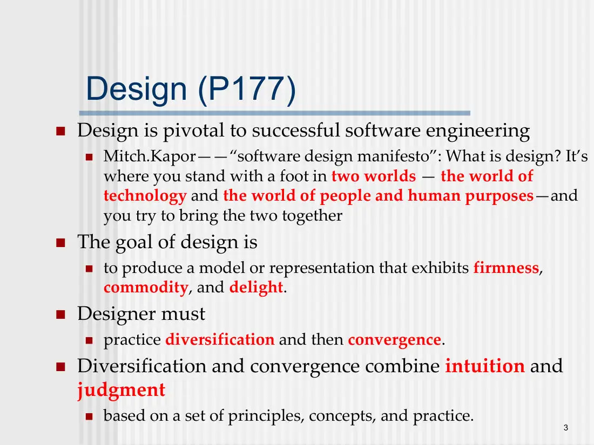

原文：

Design (P177)

◼ Design is pivotal to successful software engineering

Mitch.Kapor——“software design manifesto”: What is design? It’s where you stand with a foot in two worlds — the world of technology and the world of people and human purposes—and you try to bring the two together

◼ The goal of design is

to produce a model or representation that exhibits firmness, commodity, and delight.

◼ Designer must

◼ practice diversification and then convergence.

Diversification and convergence combine intuition and judgment

◼ based on a set of principles, concepts, and practice.

3

### Design Steps (P178)

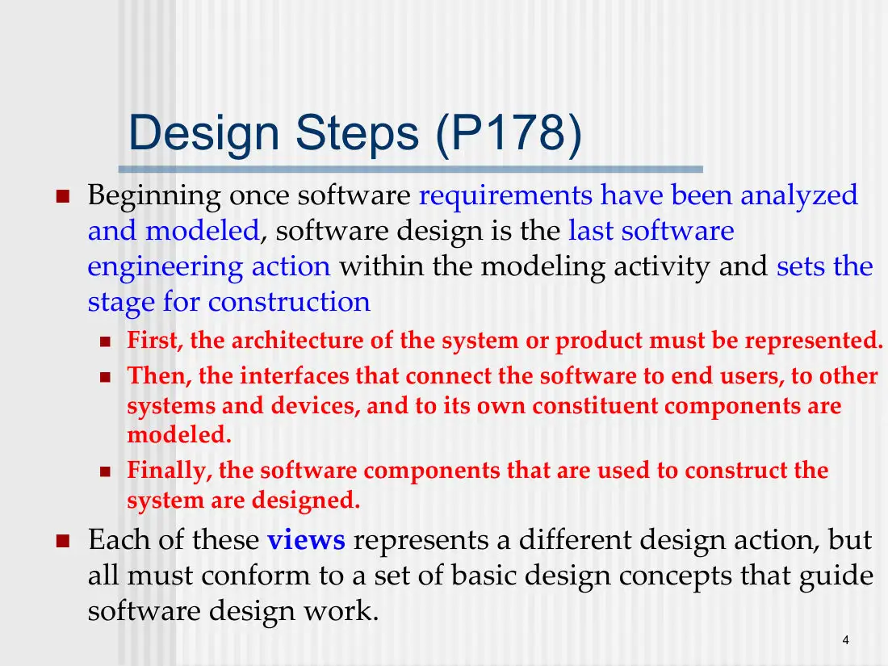

原文：

Design Steps (P178)

Beginning once software requirements have been analyzed and modeled, software design is the last software engineering action within the modeling activity and sets the stage for construction

First, the architecture of the system or product must be represented.

Then, the interfaces that connect the software to end users, to other systems and devices, and to its own constituent components are modeled.

Finally, the software components that are used to construct the system are designed.

Each of these views represents a different design action, but all must conform to a set of basic design concepts that guide software design work.

4

### 设计任务

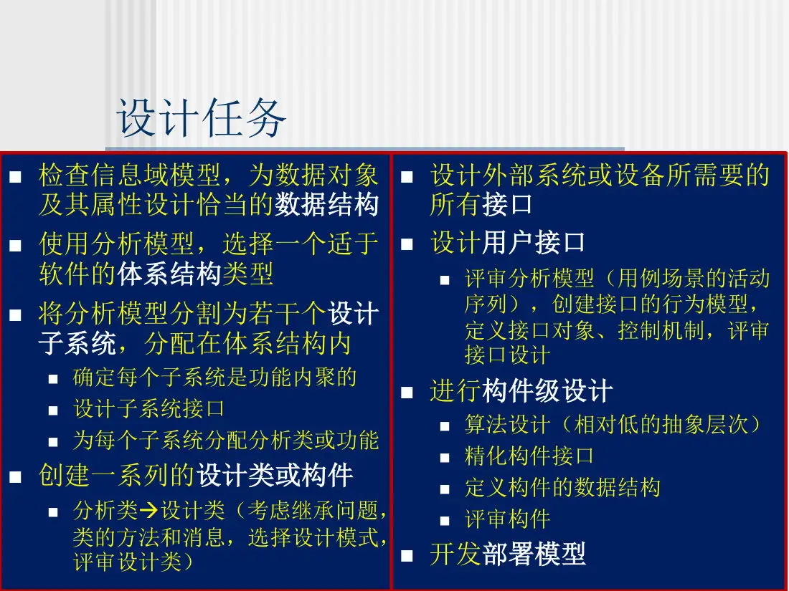

原文：

设计任务

检查信息域模型，为数据对象及其属性设计恰当的数据结构

使用分析模型，选择一个适于软件的体系结构类型

将分析模型分割为若干个设计子系统，分配在体系结构内

确定每个子系统是功能内聚的

◼ 设计子系统接口

为每个子系统分配分析类或功能

创建一系列的设计类或构件

分析类→设计类（考虑继承问题，类的方法和消息，选择设计模式，评审设计类）

设计外部系统或设备所需要的所有接口

设计用户接口

评审分析模型（用例场景的活动序列），创建接口的行为模型，定义接口对象、控制机制，评审接口设计

进行构件级设计

算法设计（相对低的抽象层次）

◼ 精化构件接口

◼ 定义构件的数据结构

◼ 评审构件

开发部署模型

### Design in Engineering (P179)

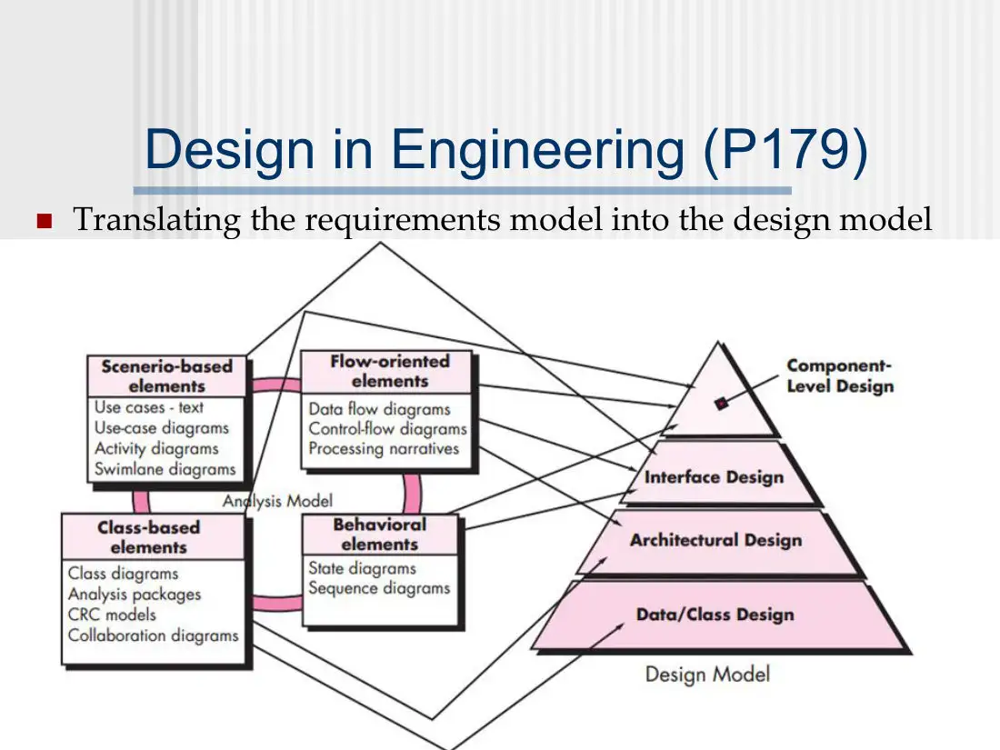

原文：

Design in Engineering (P179)

◼ Translating the requirements model into the design model

### 软件工程中的设计 (P179)

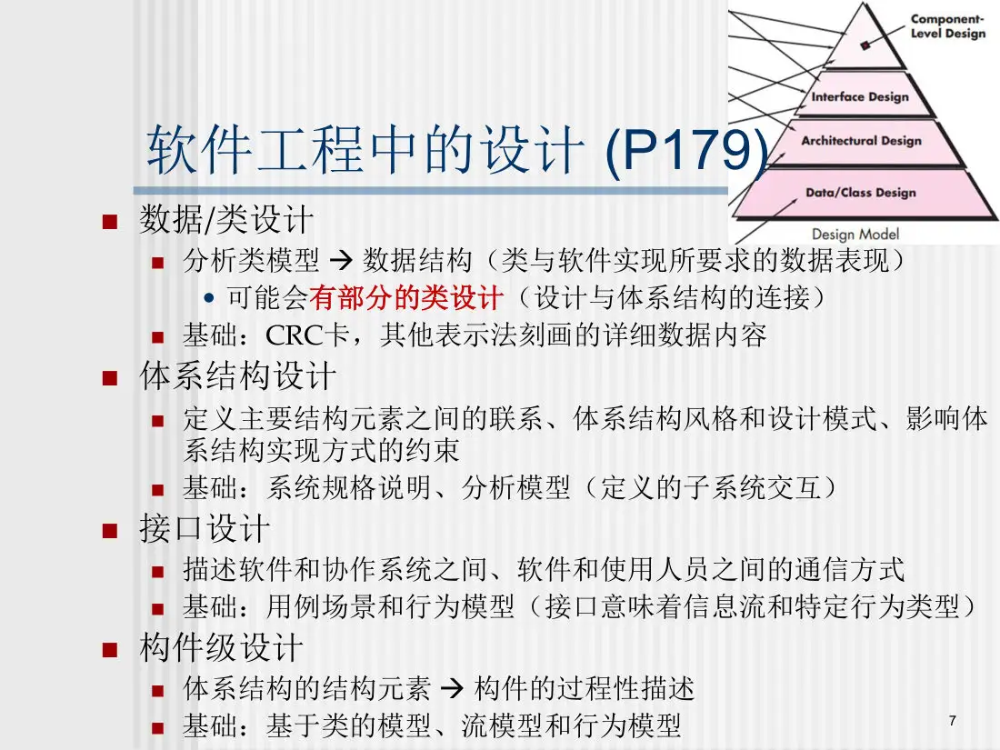

原文：

软件工程中的设计 (P179)

◼ 数据/类设计

◼ 分析类模型 → 数据结构（类与软件实现所要求的数据表现）

• 可能会有部分的类设计（设计与体系结构的连接）

◼ 基础：CRC卡，其他表示法刻画的详细数据内容

◼ 体系结构设计

定义主要结构元素之间的联系、体系结构风格和设计模式、影响体系结构实现方式的约束

◼ 基础：系统规格说明、分析模型（定义的子系统交互）

◼ 接口设计

◼ 描述软件和协作系统之间、软件和使用人员之间的通信方式

◼ 基础：用例场景和行为模型（接口意味着信息流和特定行为类型）

◼ 构件级设计

◼ 体系结构的结构元素→构件的过程性描述

◼ 基础：基于类的模型、流模型和行为模型

7

### 指导良好设计演化的3个特征 (P181)

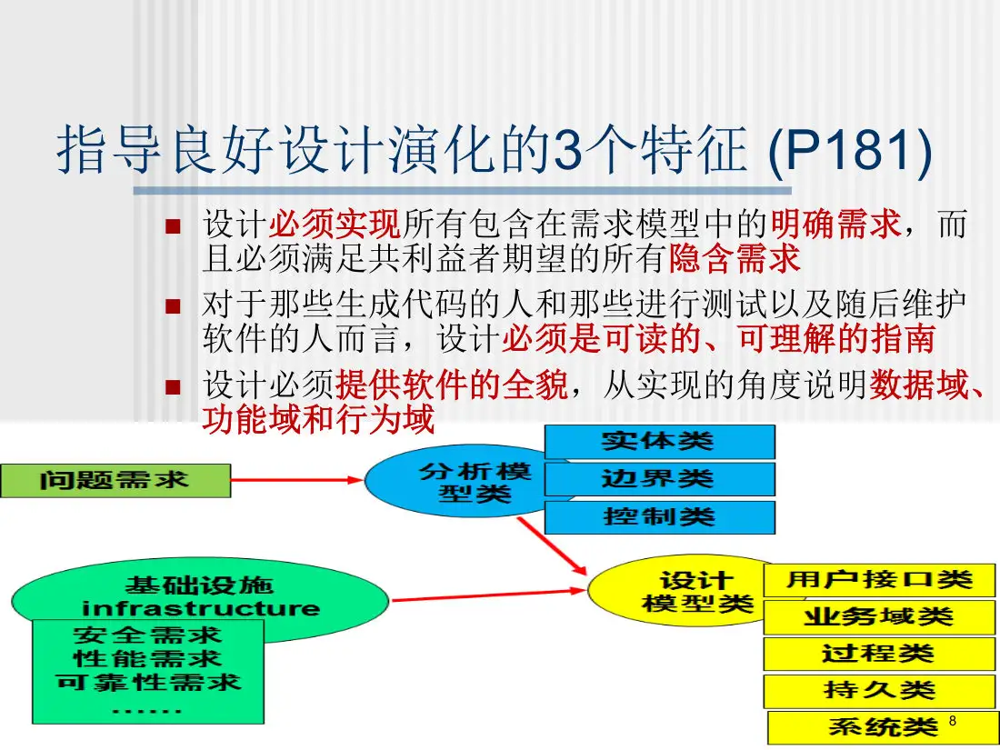

原文：

指导良好设计演化的3个特征 (P181)

◼ 设计必须实现所有包含在需求模型中的明确需求，而且必须满足共利益者期望的所有隐含需求

◼ 对于那些生成代码的人和那些进行测试以及随后维护软件的人而言，设计必须是可读的、可理解的指南

设计必须提供软件的全貌，从实现的角度说明数据域、功能域和行为域

### 良好设计的特征 (P181)

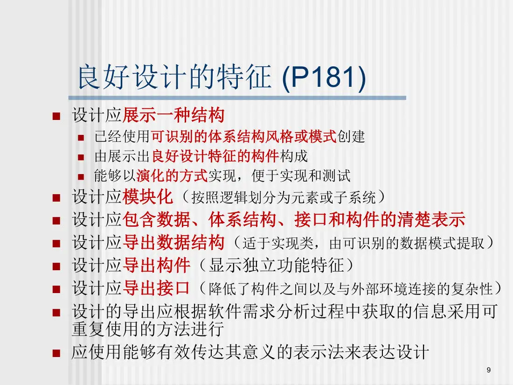

原文：

良好设计的特征 (P181)

◼ 设计应展示一种结构

◼ 已经使用可识别的体系结构风格或模式创建

◼ 由展示出良好设计特征的构件构成

◼ 能够以演化的方式实现，便于实现和测试

◼ 设计应模块化（按照逻辑划分为元素或子系统）

◼ 设计应包含数据、体系结构、接口和构件的清楚表示

◼ 设计应导出数据结构（适于实现类，由可识别的数据模式提取）

◼ 设计应导出构件（显示独立功能特征）

◼ 设计应导出接口（降低了构件之间以及与外部环境连接的复杂性）

设计的导出应根据软件需求分析过程中获取的信息采用可重复使用的方法进行

◼ 应使用能够有效传达其意义的表示法来表达设计

9

### Design and Quality (P183)

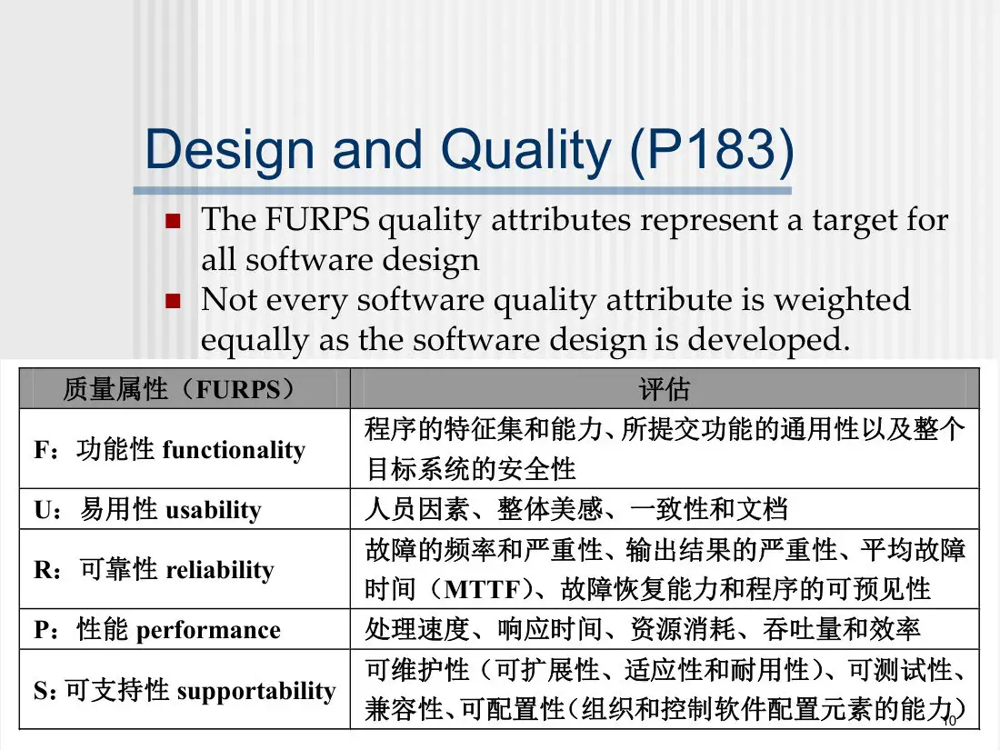

原文：

Design and Quality (P183)

The FURPS quality attributes represent a target for all software design

◼ Not every software quality attribute is weighted equally as the software design is developed.

<table><tr><td>质量属性(FURPS)</td><td>评估</td></tr><tr><td>F:功能性 functionality</td><td>程序的特征集和能力、所提交功能的通用性以及整个目标系统的安全性</td></tr><tr><td>U:易用性 usability</td><td>人员因素、整体美感、一致性和文档</td></tr><tr><td>R:可靠性 reliability</td><td>故障的频率和严重性、输出结果的严重性、平均故障时间(MTTF)、故障恢复能力和程序的可预见性</td></tr><tr><td>P:性能 performance</td><td>处理速度、响应时间、资源消耗、吞吐量和效率</td></tr><tr><td>S:可支持性 supportability</td><td>可维护性(可扩展性、适应性和耐用性)、可测试性、兼容性、可配置性(组织和控制软件配置元素的能力)</td></tr></table>

### Fundamental Concepts

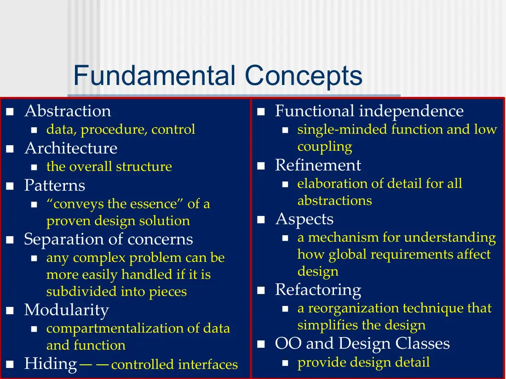

原文：

Fundamental Concepts

Abstraction ◼ data, procedure, control

Architecture the overall structure

Patterns ◼ “conveys the essence” of a proven design solution

Separation of concerns any complex problem can be more easily handled if it is subdivided into pieces

Modularity ◼ compartmentalization of data and function

◼ Hiding——controlled interfaces

Functional independence single-minded function and low coupling

Refinement elaboration of detail for all abstractions

Aspects a mechanism for understanding how global requirements affect design

Refactoring a reorganization technique that simplifies the design

◼ OO and Design Classes ◼ provide design detail

### Abstraction (P185)

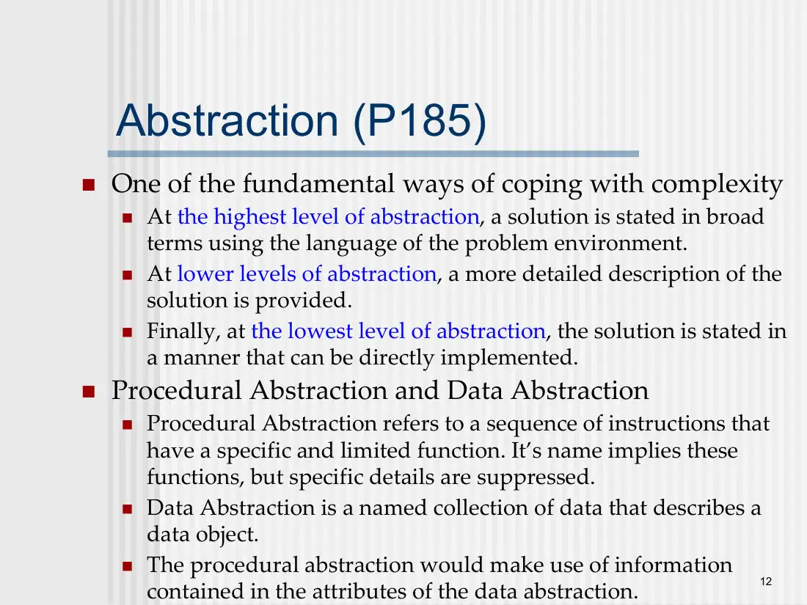

原文：

Abstraction (P185)

◼ One of the fundamental ways of coping with complexity

At the highest level of abstraction, a solution is stated in broad terms using the language of the problem environment.

At lower levels of abstraction, a more detailed description of the solution is provided.

Finally, at the lowest level of abstraction, the solution is stated in a manner that can be directly implemented.

◼ Procedural Abstraction and Data Abstraction

Procedural Abstraction refers to a sequence of instructions that have a specific and limited function. It’s name implies these functions, but specific details are suppressed.

Data Abstraction is a named collection of data that describes a data object.

The procedural abstraction would make use of information contained in the attributes of the data abstraction.

12

### 过程抽象

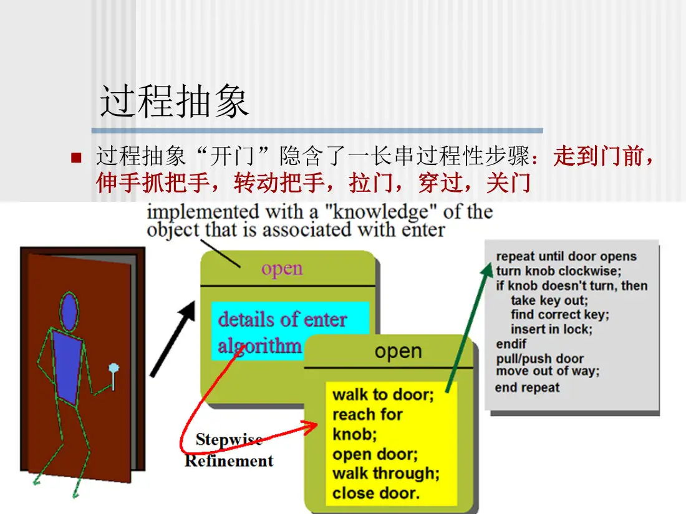

原文：

过程抽象

过程抽象“开门”隐含了一长串过程性步骤：走到门前，伸手抓把手，转动把手，拉门，穿过，关门

### implemented as a data structure

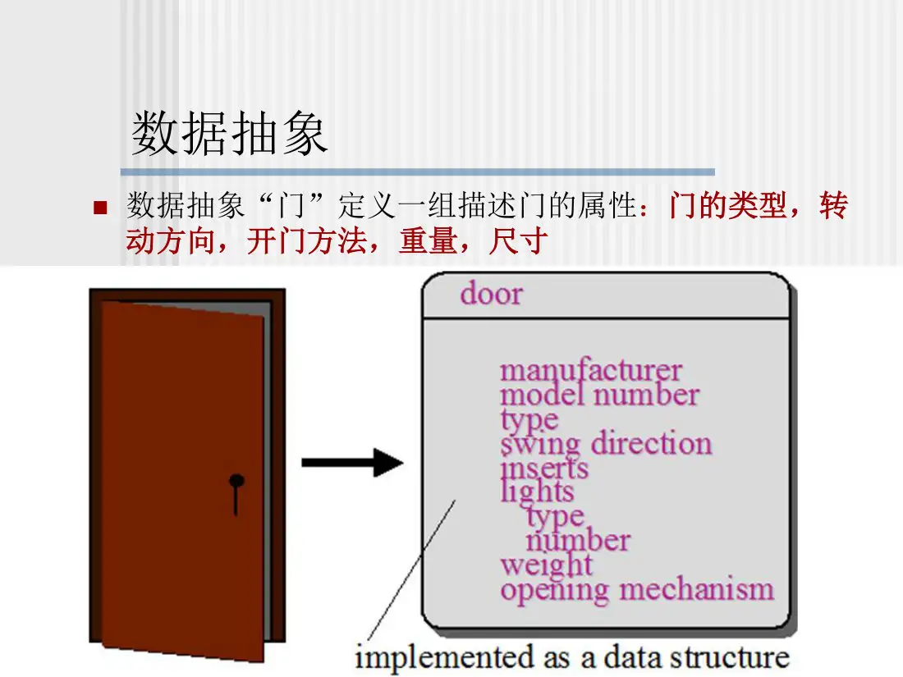

原文：

implemented as a data structure

数据抽象

数据抽象“门”定义一组描述门的属性：门的类型，转动方向，开门方法，重量，尺寸

### Architecture (P185)

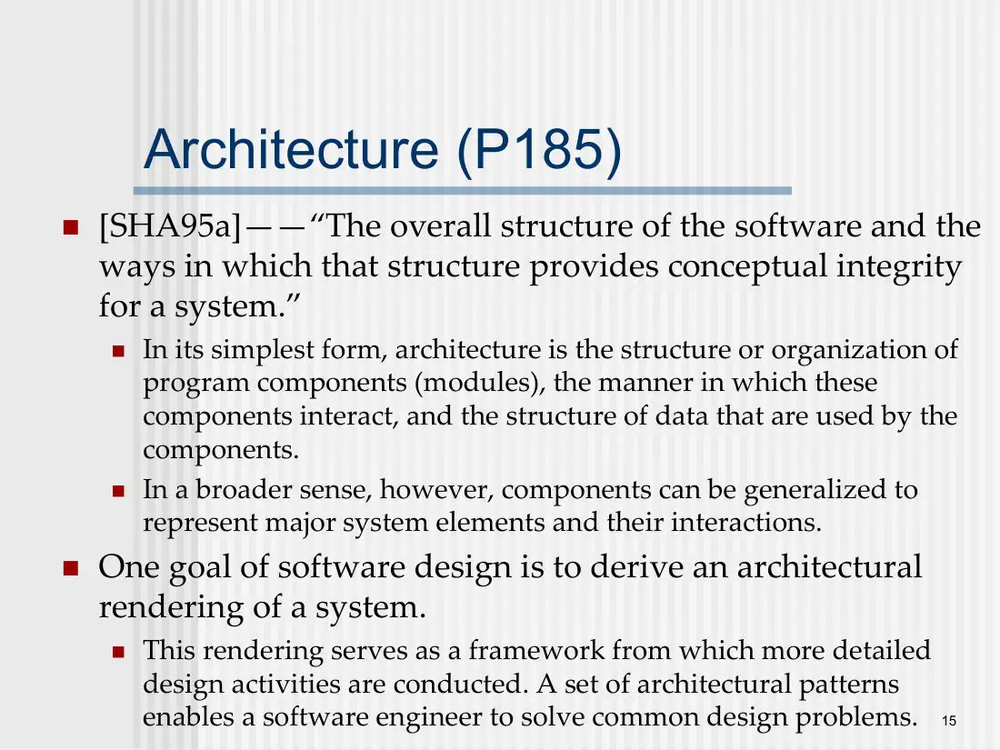

原文：

Architecture (P185)

[SHA95a]——“The overall structure of the software and the ways in which that structure provides conceptual integrity for a system.”

In its simplest form, architecture is the structure or organization of program components (modules), the manner in which these components interact, and the structure of data that are used by the components.

In a broader sense, however, components can be generalized to represent major system elements and their interactions.

◼ One goal of software design is to derive an architectural rendering of a system.

This rendering serves as a framework from which more detailed design activities are conducted. A set of architectural patterns enables a software engineer to solve common design problems. 15

### 体系结构的属性

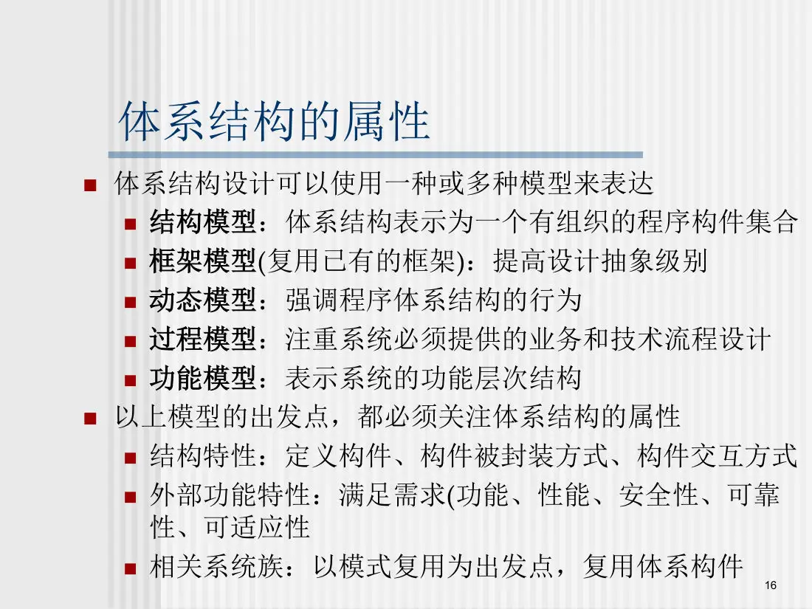

原文：

体系结构的属性

◼ 体系结构设计可以使用一种或多种模型来表达

◼ 结构模型：体系结构表示为一个有组织的程序构件集合

◼ 框架模型(复用已有的框架)：提高设计抽象级别

◼ 动态模型：强调程序体系结构的行为

◼ 过程模型：注重系统必须提供的业务和技术流程设计

◼ 功能模型：表示系统的功能层次结构

◼ 以上模型的出发点，都必须关注体系结构的属性

◼ 结构特性：定义构件、构件被封装方式、构件交互方式

外部功能特性：满足需求(功能、性能、安全性、可靠性、可适应性

◼ 相关系统族：以模式复用为出发点，复用体系构件

16

### Patterns (P186)

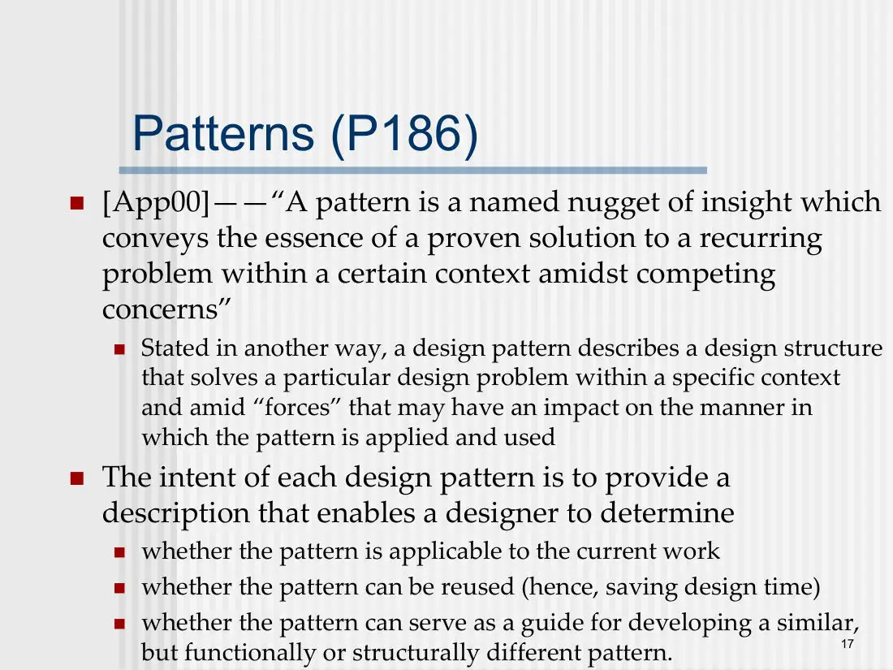

原文：

Patterns (P186)

[App00]——“A pattern is a named nugget of insight which conveys the essence of a proven solution to a recurring problem within a certain context amidst competing concerns”

Stated in another way, a design pattern describes a design structure that solves a particular design problem within a specific context and amid “forces” that may have an impact on the manner in which the pattern is applied and used

The intent of each design pattern is to provide a description that enables a designer to determine

◼ whether the pattern is applicable to the current work

◼ whether the pattern can be reused (hence, saving design time)

◼ whether the pattern can serve as a guide for developing a similar, but functionally or structurally different pattern. 17

### ■ Pattern name

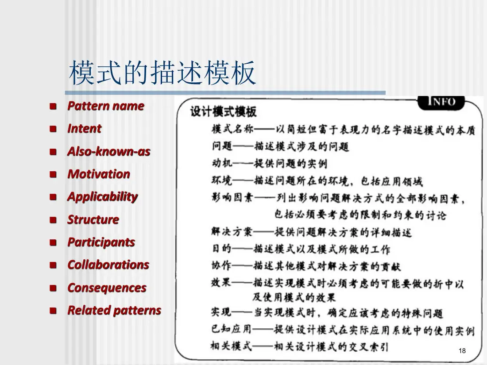

原文：

■ Pattern name
■ Intent
■ Also-known-as
■ Motivation
■ Applicability
■ Structure
■ Participants
■ Collaborations
■ Consequences
■ Related patterns

模式的描述模板

设计模式模板

INFO

模式名称—以简短但富于表现力的名字描述模式的本质问题——描述模式涉及的问题

动机———提供问题的实例

环境——描述问题所在的环境，包括应用领域

影响因素——列出影响问题解决方式的全部影响因素，包括必须要考虑的限制和约柬的讨论

解决方案——提供问题解决方案的详细描述

目的——描述模式以及模式所做的工作

协作——描述其他模式对解决方案的贡献

效果——描述实现模式时必须考虑的可能要做的折中以及使用模式的效果

实现——当实现模式时，确定应该考虑的特殊问题

已知应用——提供设计模式在实际应用系统中的使用实例

相关模式——相关设计模式的交叉索引

18

### Separation of Concerns (P187)

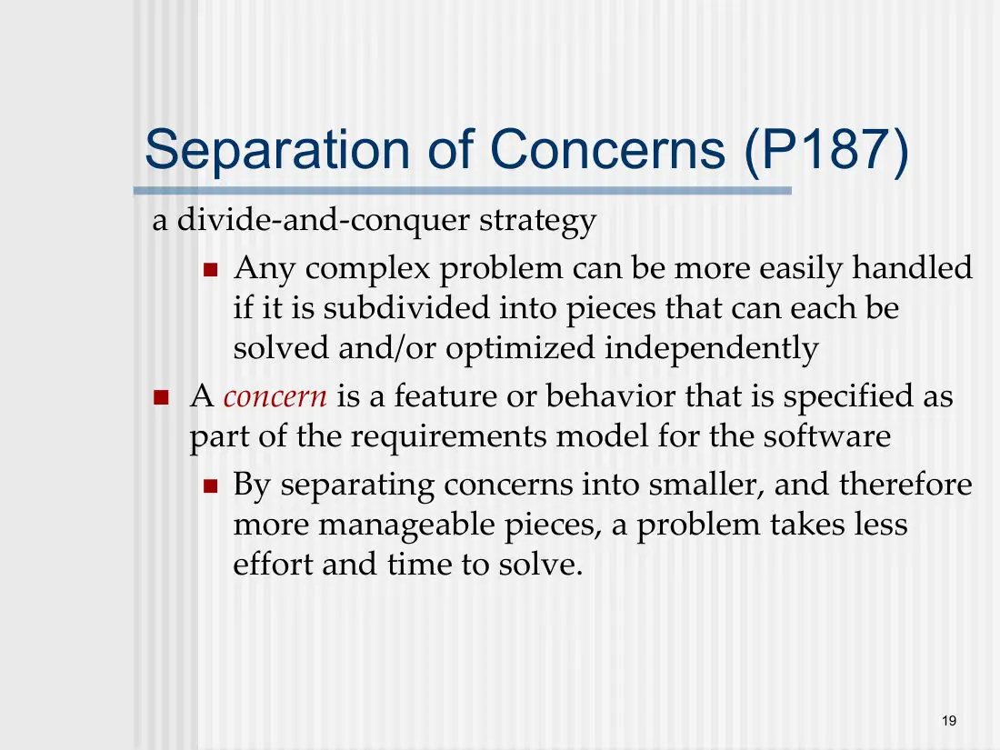

原文：

Separation of Concerns (P187)

a divide-and-conquer strategy

Any complex problem can be more easily handled if it is subdivided into pieces that can each be solved and/or optimized independently

◼ A concern is a feature or behavior that is specified as part of the requirements model for the software

By separating concerns into smaller, and therefore more manageable pieces, a problem takes less effort and time to solve.

19

### Modularity (P187)

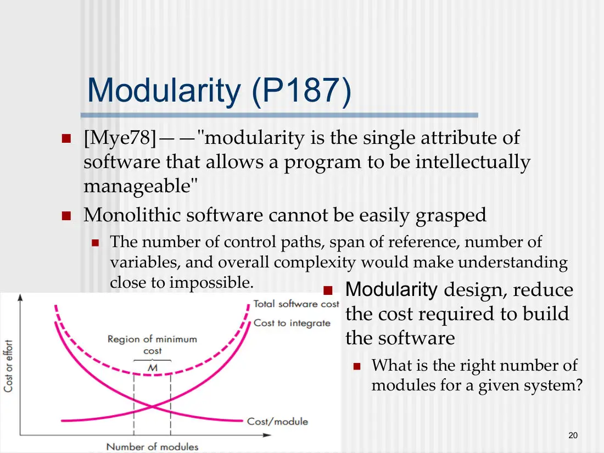

原文：

Modularity (P187)

[Mye78]——"modularity is the single attribute of software that allows a program to be intellectually manageable"

◼ Monolithic software cannot be easily grasped

The number of control paths, span of reference, number of variables, and overall complexity would make understanding close to impossible. Modularity design. reduce Modularity design, reduce

the cost required to build the software

What is the right number of modules for a given system?

Number of modules

20

### Information Hiding (P188)

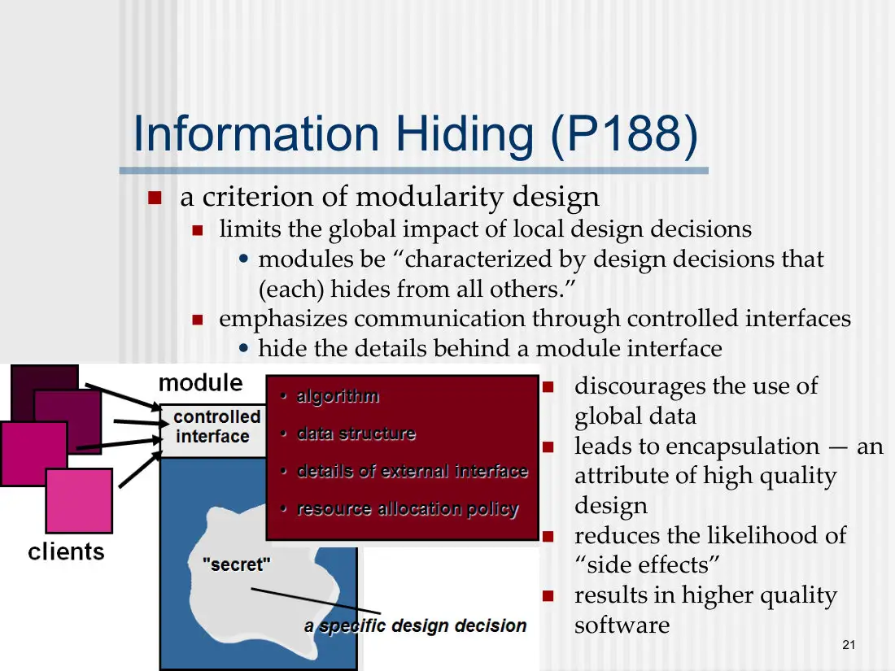

原文：

Information Hiding (P188)

◼ a criterion of modularity design

limits the global impact of local design decisions modules be “characterized by design decisions that (each) hides from all others.”

emphasizes communication through controlled interfaces hide the details behind a module interface

• algorithm

• data structure

• details of external interface

• resource allocation policy discourages the use of global data

leads to encapsulation — an attribute of high quality design

reduces the likelihood of “side effects”

results in higher quality software

21

### Functional Independence (P189)

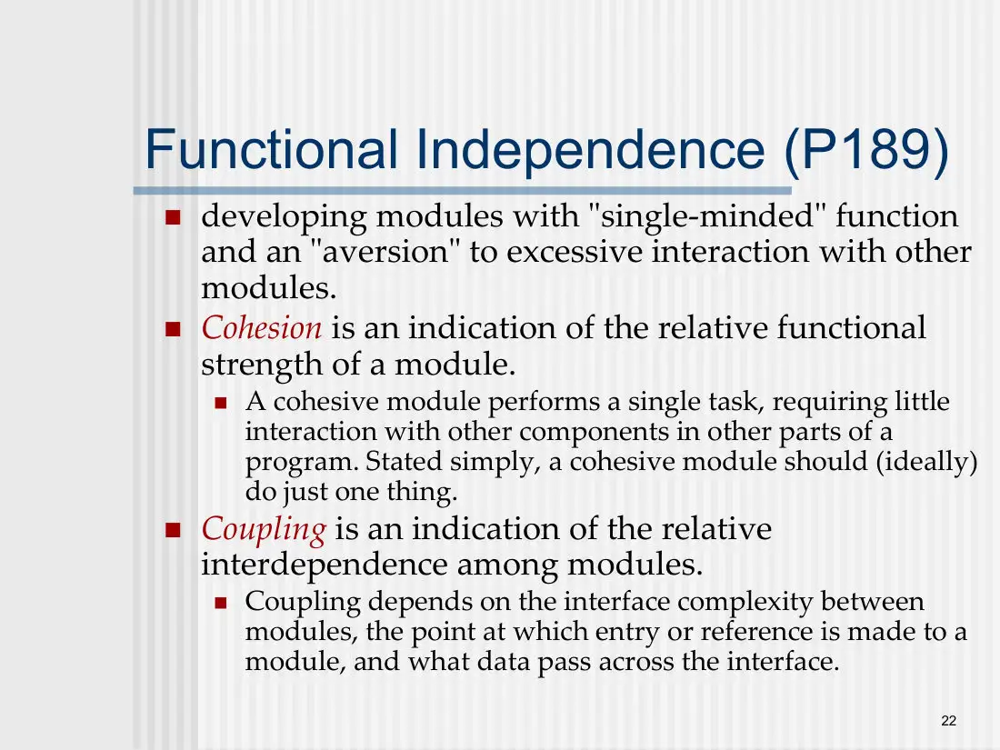

原文：

Functional Independence (P189)

developing modules with "single-minded" function and an "aversion" to excessive interaction with other modules.

Cohesion is an indication of the relative functional strength of a module.

A cohesive module performs a single task, requiring little interaction with other components in other parts of a program. Stated simply, a cohesive module should (ideally) do just one thing.

Coupling is an indication of the relative interdependence among modules.

Coupling depends on the interface complexity between modules, the point at which entry or reference is made to a module, and what data pass across the interface.

22

### Refinement (P190)

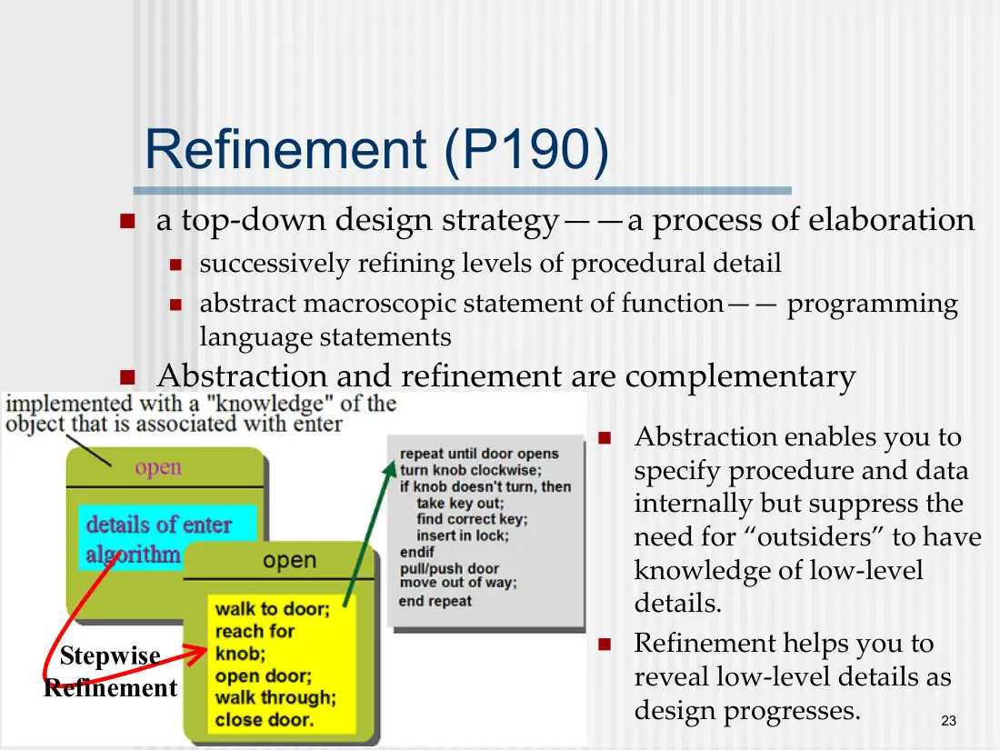

原文：

Refinement (P190)

◼ a top-down design strategy——a process of elaboration

◼ successively refining levels of procedural detail

abstract macroscopic statement of function—— programming language statements

◼ Abstraction and refinement are complementary

repeat until door opens turn knob clockwise; if knob doesn't turn, then take key out; find correct key; insert in lock; endif pull/push door move out of way; end repeat

Abstraction enables you to specify procedure and data internally but suppress the need for “outsiders” to have knowledge of low-level details.

Refinement helps you to reveal low-level details as design progresses. 23

### Aspects (P190)

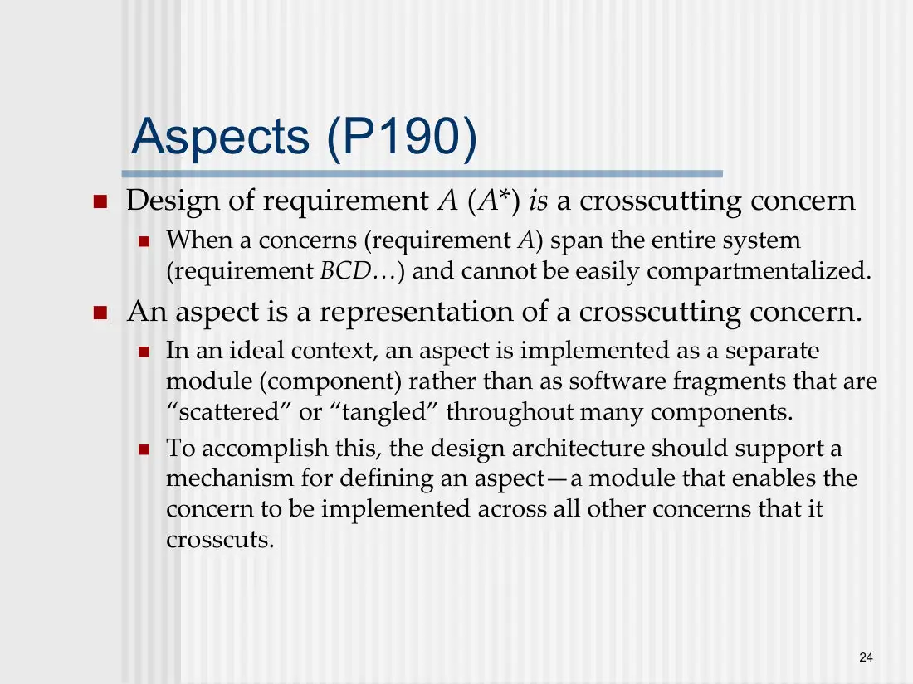

原文：

Aspects (P190)

◼ Design of requirement $A \left( A ^ { * } \right)$ is a crosscutting concern

When a concerns (requirement A) span the entire system (requirement BCD…) and cannot be easily compartmentalized.

◼ An aspect is a representation of a crosscutting concern.

In an ideal context, an aspect is implemented as a separate module (component) rather than as software fragments that are “scattered” or “tangled” throughout many components.

To accomplish this, the design architecture should support a mechanism for defining an aspect—a module that enables the concern to be implemented across all other concerns that it crosscuts.

24

### 方面— 示例

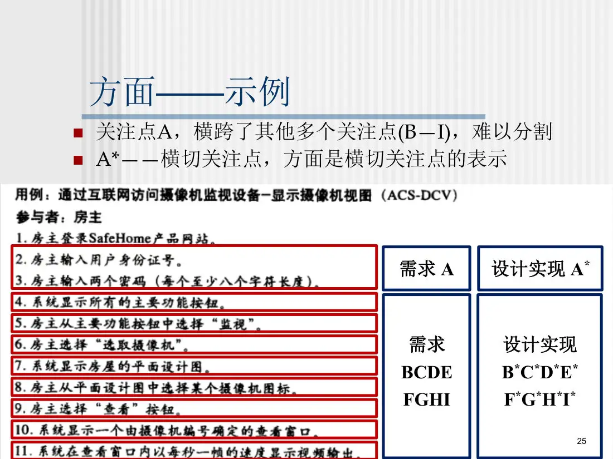

原文：

方面— 示例

◼ 关注点A，横跨了其他多个关注点(B—I)，难以分割

◼ A\*——横切关注点，方面是横切关注点的表示

用例：通过互联网访问摄像机监视设备-显示摄像机视图（ACS-DCV）

参与者：房主

1. 房主登录SafeHome产品网站

5. 房主从主要功能按钮中选择“监视”。

10. 系统显示一个由摄像机编号确定的查看窗口。

11. 系统在查看窗口内以每秒一帧的速度显示视频输出。

25

### Refactoring (P191)

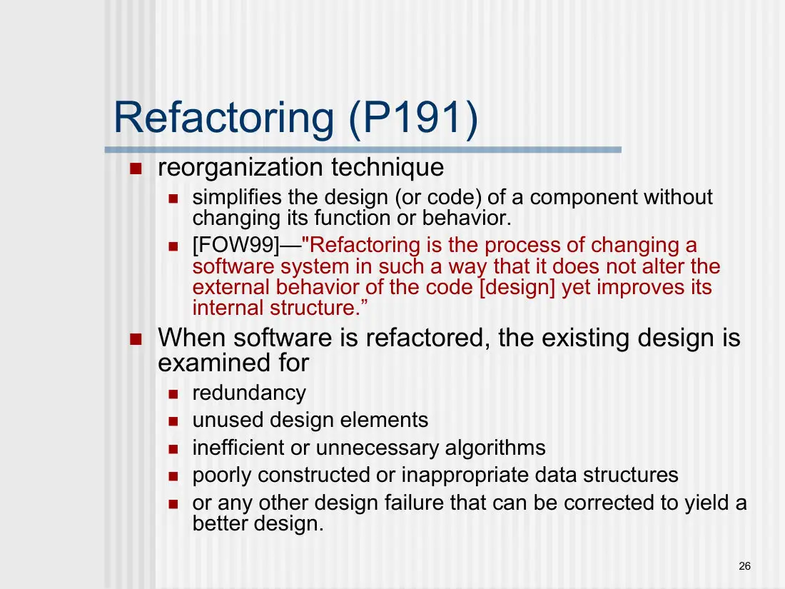

原文：

Refactoring (P191)

◼ reorganization technique

simplifies the design (or code) of a component without changing its function or behavior.

[FOW99]—"Refactoring is the process of changing a software system in such a way that it does not alter the external behavior of the code [design] yet improves its internal structure.”

When software is refactored, the existing design is examined for

◼ redundancy

◼ unused design elements

◼ inefficient or unnecessary algorithms

◼ poorly constructed or inappropriate data structures

or any other design failure that can be corrected to yield a better design.

26

### OO and Design Classes (P191-193)

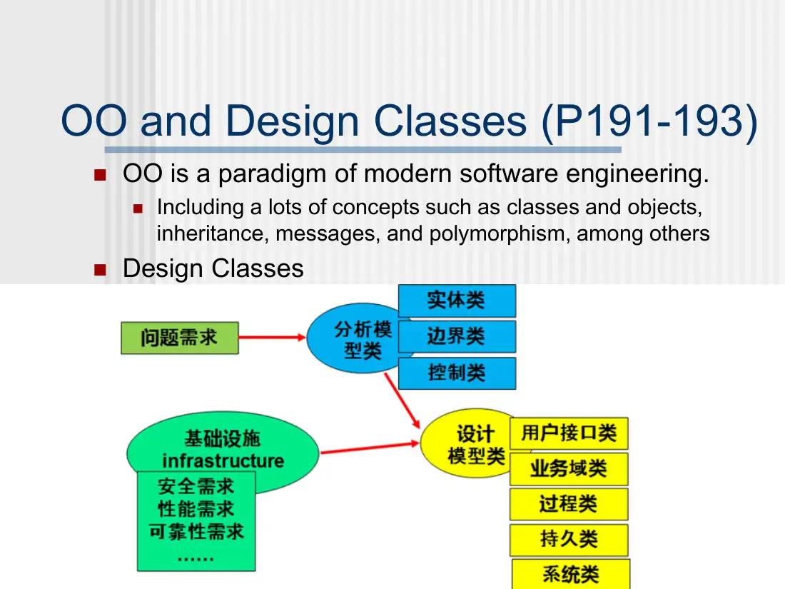

原文：

OO and Design Classes (P191-193)

◼ OO is a paradigm of modern software engineering.

◼ Including a lots of concepts such as classes and objects, inheritance, messages, and polymorphism, among others

◼ Design Classes

### 设计类

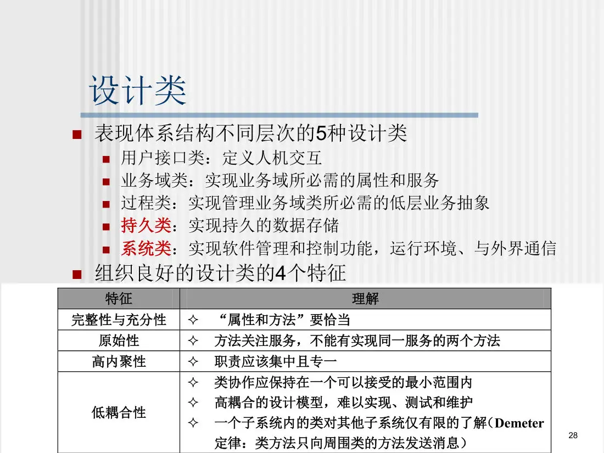

原文：

设计类

◼ 表现体系结构不同层次的5种设计类

◼ 用户接口类：定义人机交互

◼ 业务域类：实现业务域所必需的属性和服务

◼ 过程类：实现管理业务域类所必需的低层业务抽象

◼ 持久类：实现持久的数据存储

◼ 系统类：实现软件管理和控制功能，运行环境、与外界通信

◼ 组织良好的设计类的4个特征

<table><tr><td>特征</td><td>理解</td></tr><tr><td>完整性与充分性</td><td>✧ “属性和方法”要恰当</td></tr><tr><td>原始性</td><td>✧ 方法关注服务,不能有实现同一服务的两个方法</td></tr><tr><td>高内聚性</td><td>✧ 职责应该集中且专一</td></tr><tr><td>低耦合性</td><td>✧ 类协作应保持在一个可以接受的最小范围内✧ 高耦合的设计模型,难以实现、测试和维护✧ 一个子系统内的类对其他子系统仅有限的了解(Demeter定律:类方法只向周围类的方法发送消息)</td></tr></table>

28

### Dependency Inversion(P194)

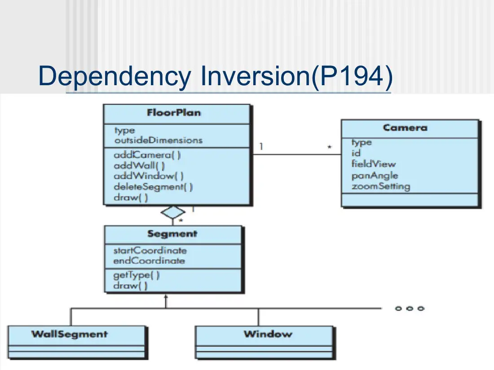

原文：

Dependency Inversion(P194)

### Fundamental Concepts

原文：

Fundamental Concepts

Abstraction ◼ data, procedure, control

Architecture the overall structure

Patterns ◼ “conveys the essence” of a proven design solution

Separation of concerns any complex problem can be more easily handled if it is subdivided into pieces

Modularity ◼ compartmentalization of data and function

◼ Hiding——controlled interfaces

Functional independence single-minded function and low coupling

Refinement elaboration of detail for all abstractions

Aspects a mechanism for understanding how global requirements affect design

Refactoring a reorganization technique that simplifies the design

◼ OO and Design Classes ◼ provide design detail

### The Design Model (P196)

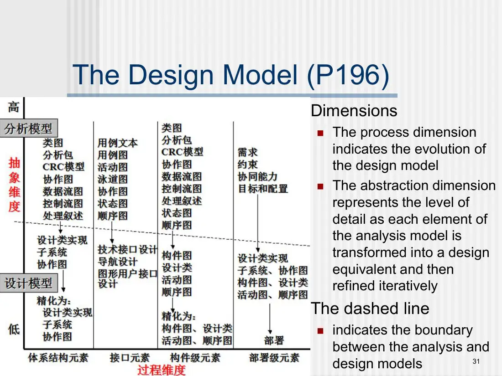

原文：

The Design Model (P196)

Dimensions

The process dimension indicates the evolution of the design model

The abstraction dimension represents the level of detail as each element of the analysis model is transformed into a design equivalent and then refined iteratively

The dashed line

indicates the boundary between the analysis and design models 31

### 模型— 数据设计元素

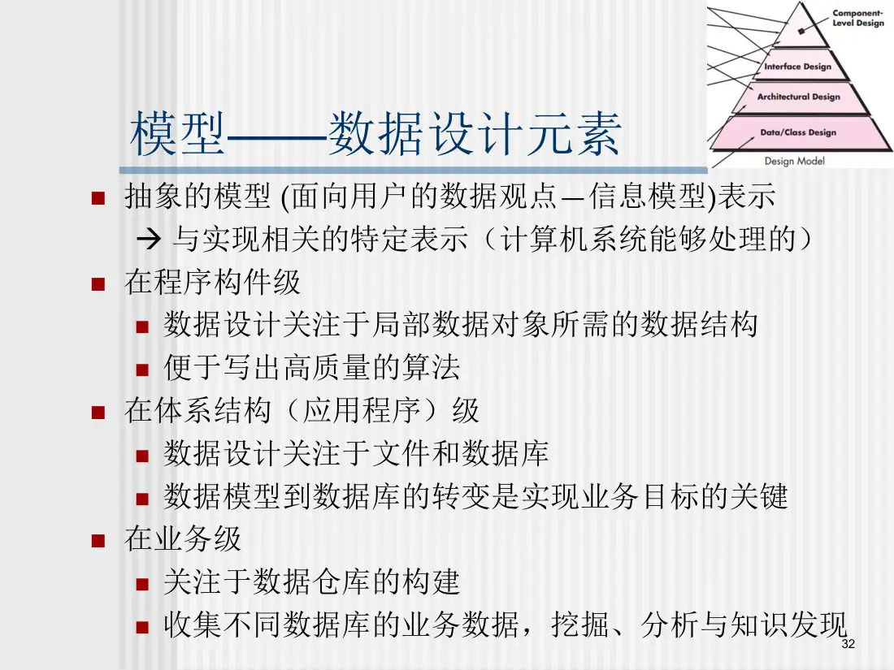

原文：

模型— 数据设计元素

抽象的模型 (面向用户的数据观点—信息模型)表示→与实现相关的特定表示（计算机系统能够处理的）

◼ 在程序构件级

◼ 数据设计关注于局部数据对象所需的数据结构

◼ 便于写出高质量的算法

◼ 在体系结构（应用程序）级

◼ 数据设计关注于文件和数据库

◼ 数据模型到数据库的转变是实现业务目标的关键

◼ 在业务级

◼ 关注于数据仓库的构建

◼ 收集不同数据库的业务数据，挖掘、分析与知识发现

32

### 模型— 体系结构设计元素

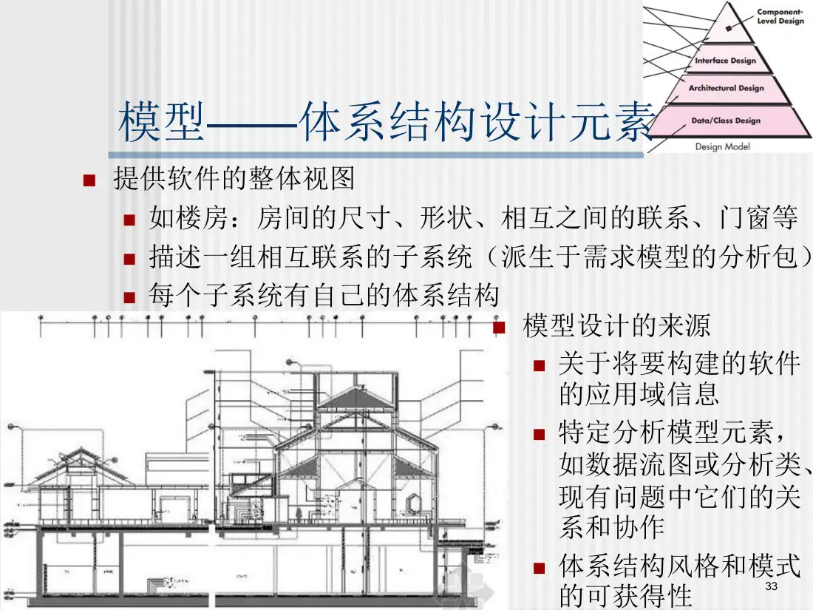

原文：

模型— 体系结构设计元素

◼ 提供软件的整体视图

◼ 如楼房：房间的尺寸、形状、相互之间的联系、门窗等

◼ 描述一组相互联系的子系统（派生于需求模型的分析包）

◼ 每个子系统有自己的体系结构

模型设计的来源

关于将要构建的软件的应用域信息

特定分析模型元素，如数据流图或分析类、现有问题中它们的关系和协作

体系结构风格和模式的可获得性 33

### 模型— 接口设计元素

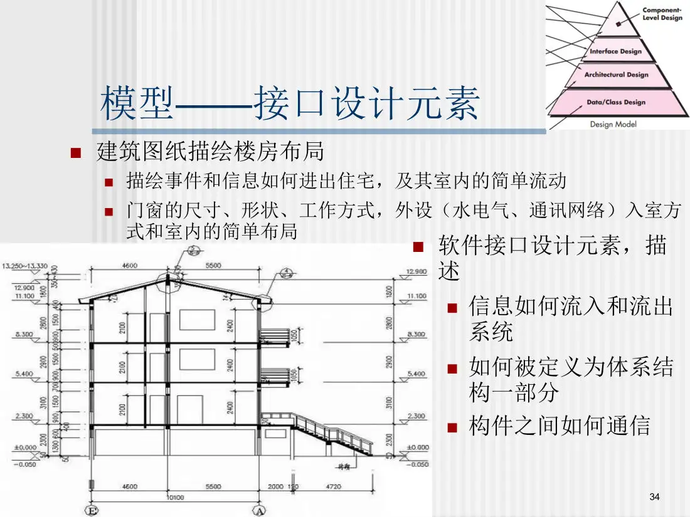

原文：

模型— 接口设计元素

◼ 建筑图纸描绘楼房布局

◼ 描绘事件和信息如何进出住宅，及其室内的简单流动

门窗的尺寸、形状、工作方式，外设（水电气、通讯网络）入室方式和室内的简单布局 软件培口设计元表

软件接口设计元素，描述

信息如何流入和流出系统

如何被定义为体系结构一部分

◼ 构件之间如何通信

34

### 模型— 接口设计元素

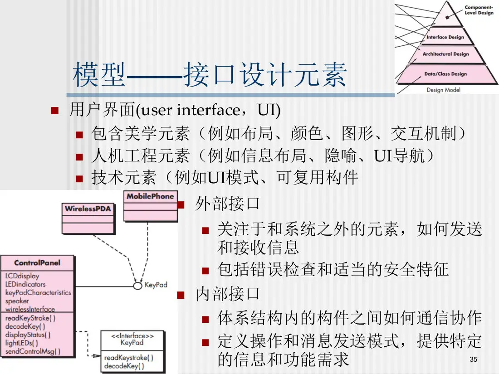

原文：

模型— 接口设计元素

◼ 用户界面(user interface，UI)

◼ 包含美学元素（例如布局、颜色、图形、交互机制）

◼ 人机工程元素（例如信息布局、隐喻、UI导航）

◼ 技术元素（例如UI模式、可复用构件

外部接口

关注于和系统之外的元素，如何发送和接收信息

◼ 包括错误检查和适当的安全特征

内部接口

◼ 体系结构内的构件之间如何通信协作

定义操作和消息发送模式，提供特定的信息和功能需求 35

### 模型— 接口设计示例

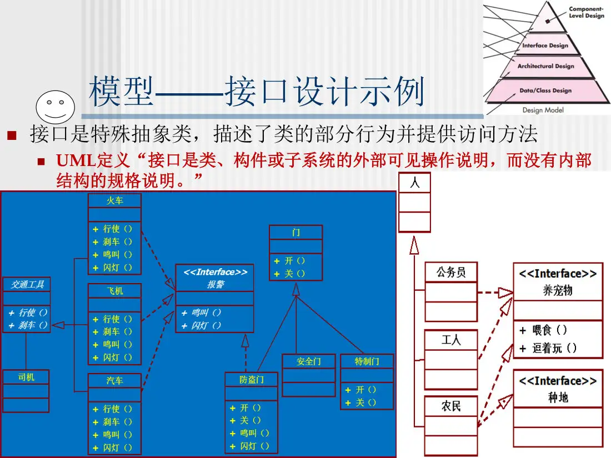

原文：

模型— 接口设计示例

◼ 接口是特殊抽象类，描述了类的部分行为并提供访问方法

UML定义“接口是类、构件或子系统的外部可见操作说明，而没有内部

### 模型— 构件级设计元素

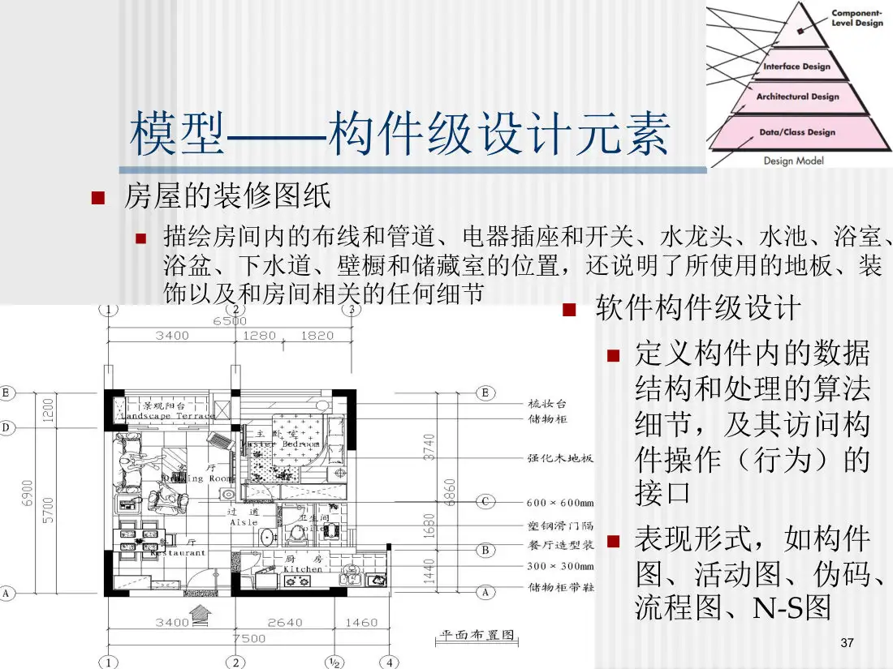

原文：

模型— 构件级设计元素

◼ 房屋的装修图纸

描绘房间内的布线和管道、电器插座和开关、水龙头、水池、浴室、浴盆、下水道、壁橱和储藏室的位置，还说明了所使用的地板、装饰以及和房间相关的任何细节 软件构件级设计

◼ 软件构件级设计

定义构件内的数据结构和处理的算法细节，及其访问构件操作（行为）的接口

表现形式，如构件图、活动图、伪码、流程图、N-S图

37

### 模型— 部署级设计元素

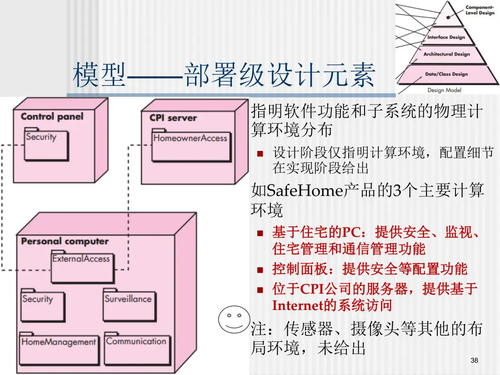

原文：

模型— 部署级设计元素

指明软件功能和子系统的物理计算环境分布

设计阶段仅指明计算环境，配置细节在实现阶段给出

如SafeHome产品的3个主要计算环境

基于住宅的PC：提供安全、监视、住宅管理和通信管理功能

控制面板：提供安全等配置功能

位于CPI公司的服务器，提供基于Internet的系统访问

注：传感器、摄像头等其他的布局环境，未给出

38
