# 《软件工程（双语）》Unit 7 构件级设计（课件）

原件的每一页，下面附识别出的文字。

### ■ Component-Level Design

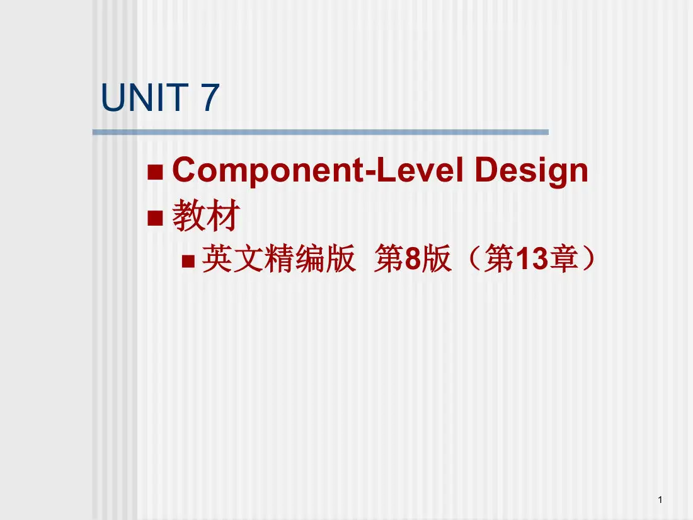

原文：

■ Component-Level Design
■ 教材
■ 英文精编版 第8版（第13章）

UNIT 7

1

### Contents & Requirements

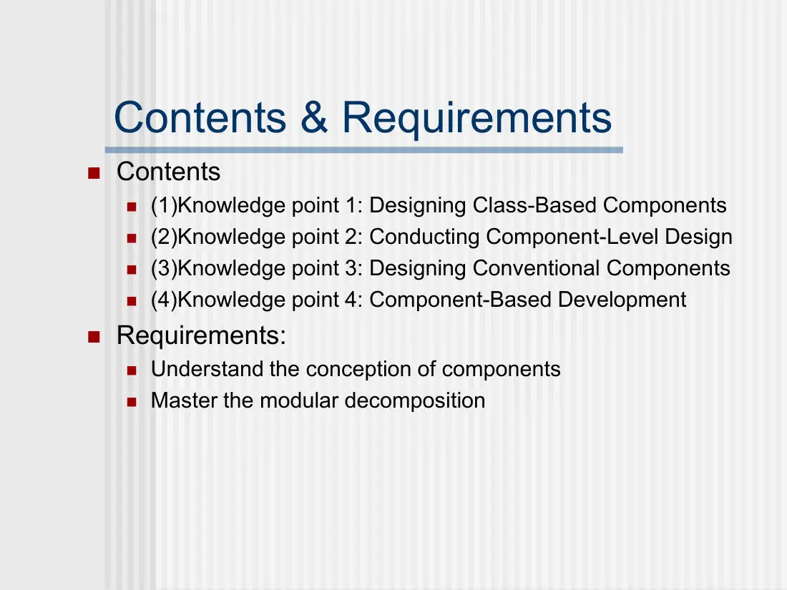

原文：

Contents & Requirements

◼ Contents

◼ (1)Knowledge point 1: Designing Class-Based Components

◼ (2)Knowledge point 2: Conducting Component-Level Design

◼ (3)Knowledge point 3: Designing Conventional Components

◼ (4)Knowledge point 4: Component-Based Development

◼ Requirements:

◼ Understand the conception of components

◼ Master the modular decomposition

### Component-Level Design

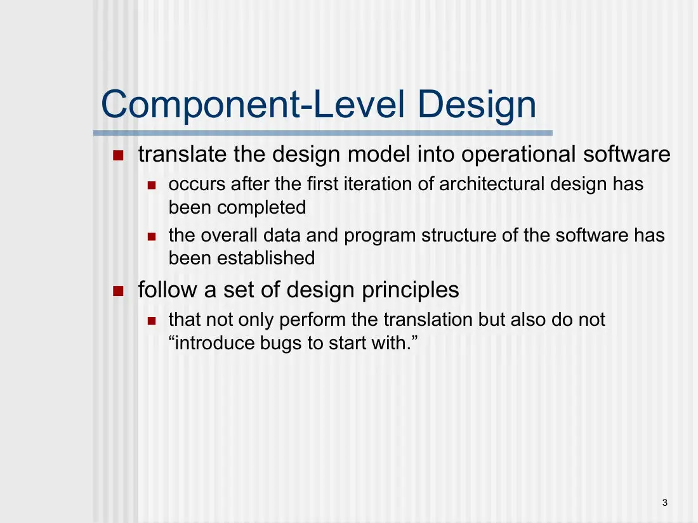

原文：

Component-Level Design

◼ translate the design model into operational software

occurs after the first iteration of architectural design has been completed

the overall data and program structure of the software has been established

◼ follow a set of design principles

that not only perform the translation but also do not “introduce bugs to start with.”

3

### What is a Component?(P237)

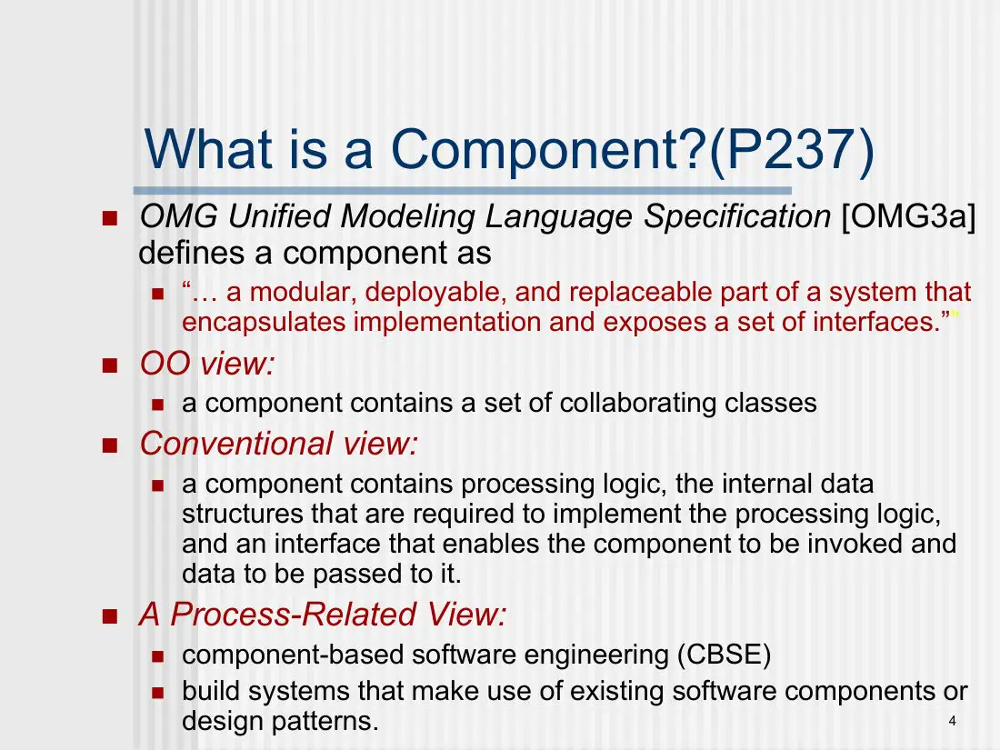

原文：

What is a Component?(P237)

◼ OMG Unified Modeling Language Specification [OMG3a] defines a component as

“… a modular, deployable, and replaceable part of a system that encapsulates implementation and exposes a set of interfaces.””

◼ OO view:

◼ a component contains a set of collaborating classes

Conventional view:

a component contains processing logic, the internal data structures that are required to implement the processing logic, and an interface that enables the component to be invoked and data to be passed to it.

◼ A Process-Related View:

◼ component-based software engineering (CBSE)

build systems that make use of existing software components or design patterns. 4

### 构件— 示例

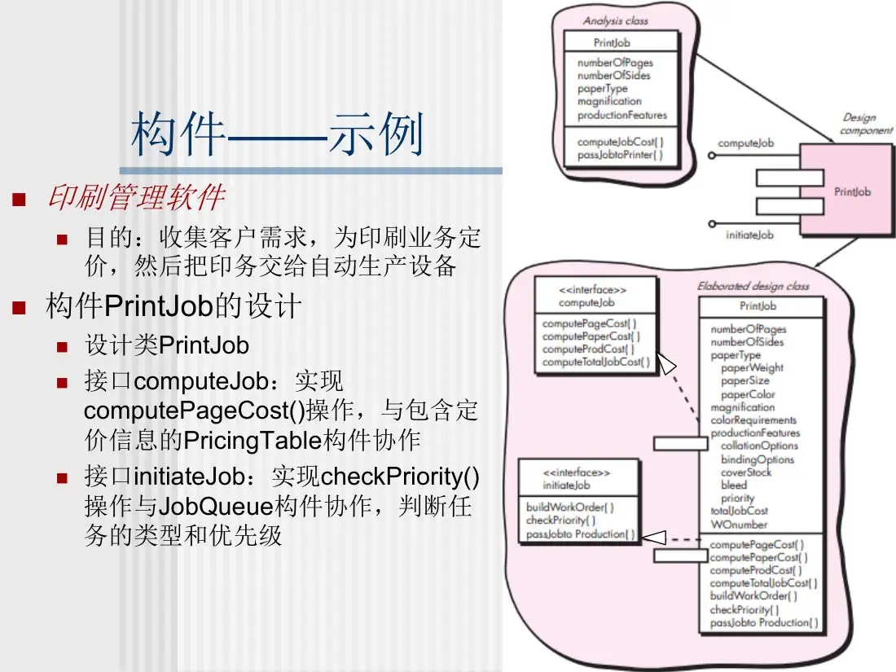

原文：

构件— 示例

印刷管理软件

目的：收集客户需求，为印刷业务定价，然后把印务交给自动生产设备

◼ 构件PrintJob的设计

◼ 设计类PrintJob

接口computeJob：实现computePageCost()操作，与包含定价信息的PricingTable构件协作

接口initiateJob：实现checkPriority() 操作与JobQueue构件协作，判断任 务的类型和优先级

### 构件— 示例

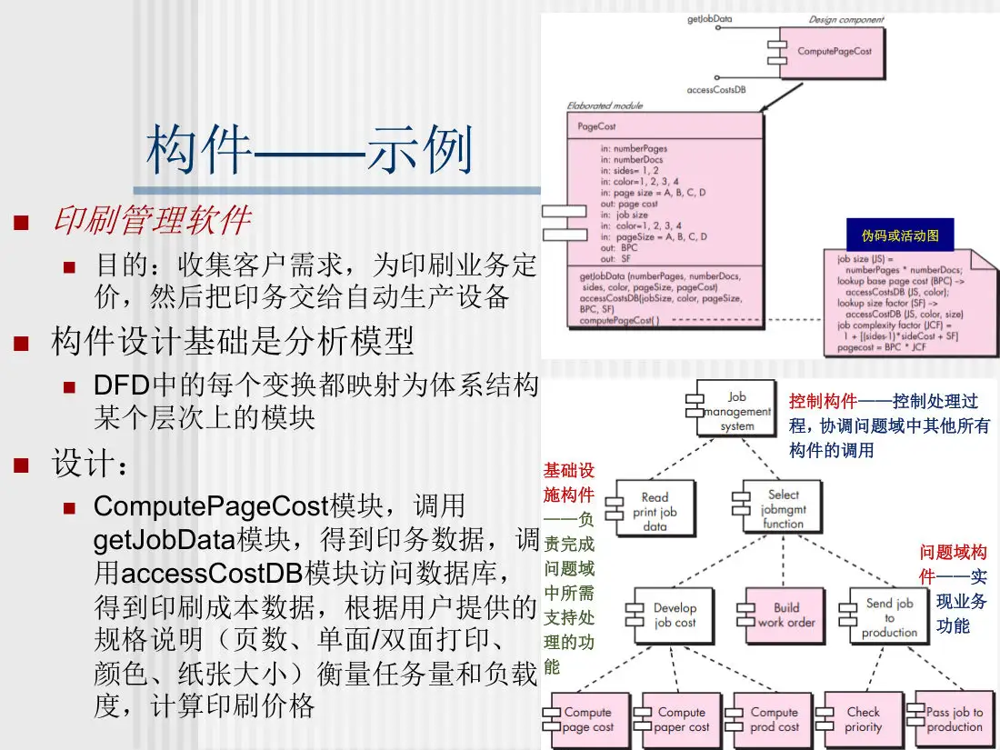

原文：

构件— 示例

印刷管理软件

目的：收集客户需求，为印刷业务定价，然后把印务交给自动生产设备

◼ 构件设计基础是分析模型

DFD中的每个变换都映射为体系结构某个层次上的模块

◼ 设计：

ComputePageCost模块，调用getJobData模块，得到印务数据，调用accessCostDB模块访问数据库，得到印刷成本数据，根据用户提供的规格说明（页数、单面/双面打印、颜色、纸张大小）衡量任务量和负载度，计算印刷价格

### Basic Design Principles in OO (P243)

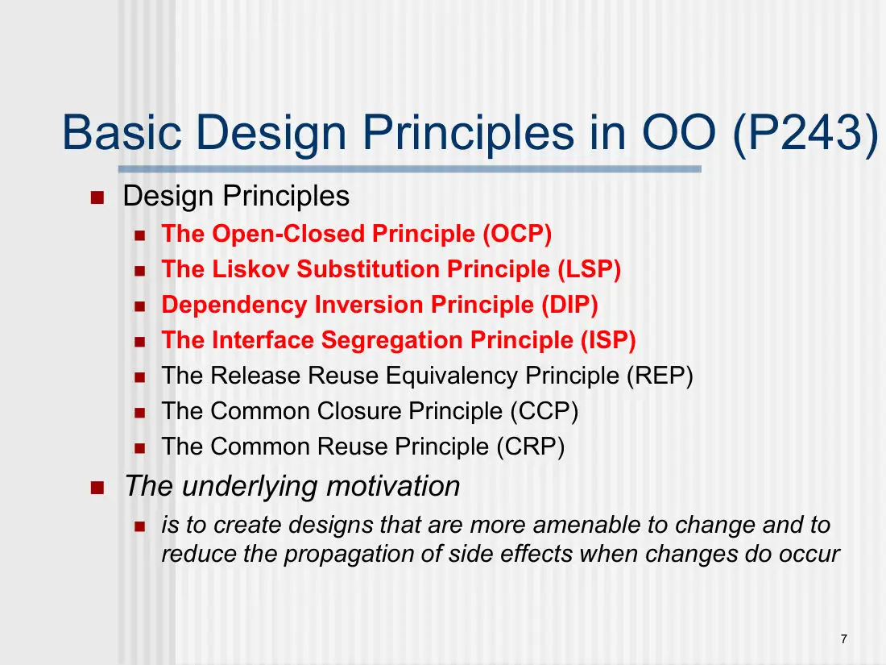

原文：

Basic Design Principles in OO (P243)

◼ Design Principles

The Open-Closed Principle (OCP)

◼ The Liskov Substitution Principle (LSP)

◼ Dependency Inversion Principle (DIP)

◼ The Interface Segregation Principle (ISP)

◼ The Release Reuse Equivalency Principle (REP)

◼ The Common Closure Principle (CCP)

◼ The Common Reuse Principle (CRP)

◼ The underlying motivation

is to create designs that are more amenable to change and to reduce the propagation of side effects when changes do occur

7

### OCP: The Open-Closed Principle

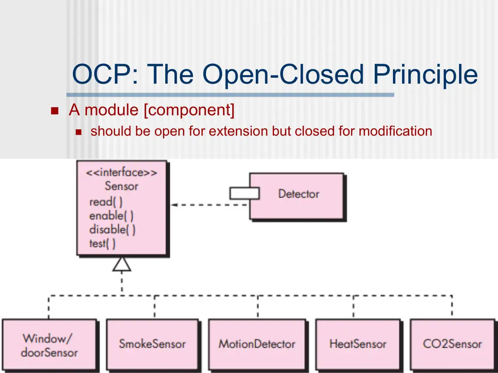

原文：

OCP: The Open-Closed Principle

◼ A module [component]

should be open for extension but closed for modification

### 多态的发生有3个条件：

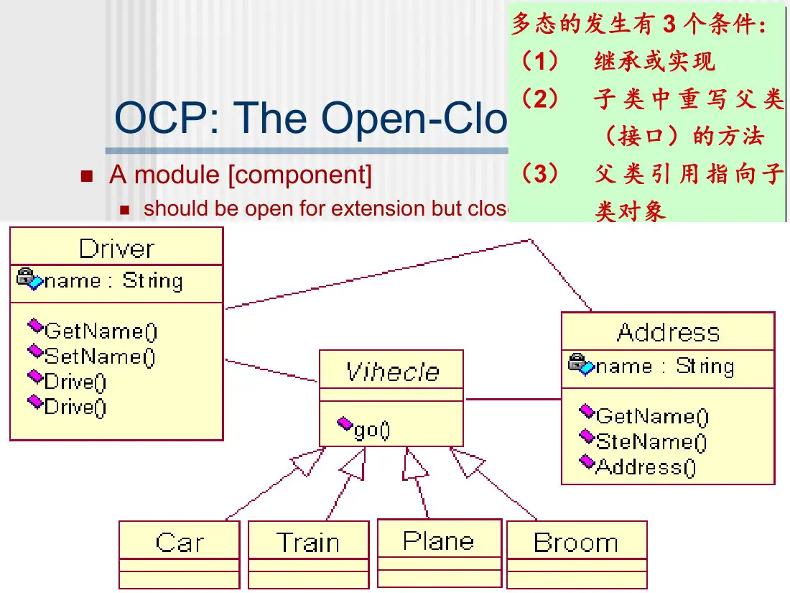

原文：

多态的发生有3个条件：

(1) 继承或实现

OCP: The Open-Clo

◼ A module [component]

should be open for extension but clos(2) 子类中重写父类（接口）的方法

(3) 父类引用指向子 odificatio

### OCP: 开关原则——示例

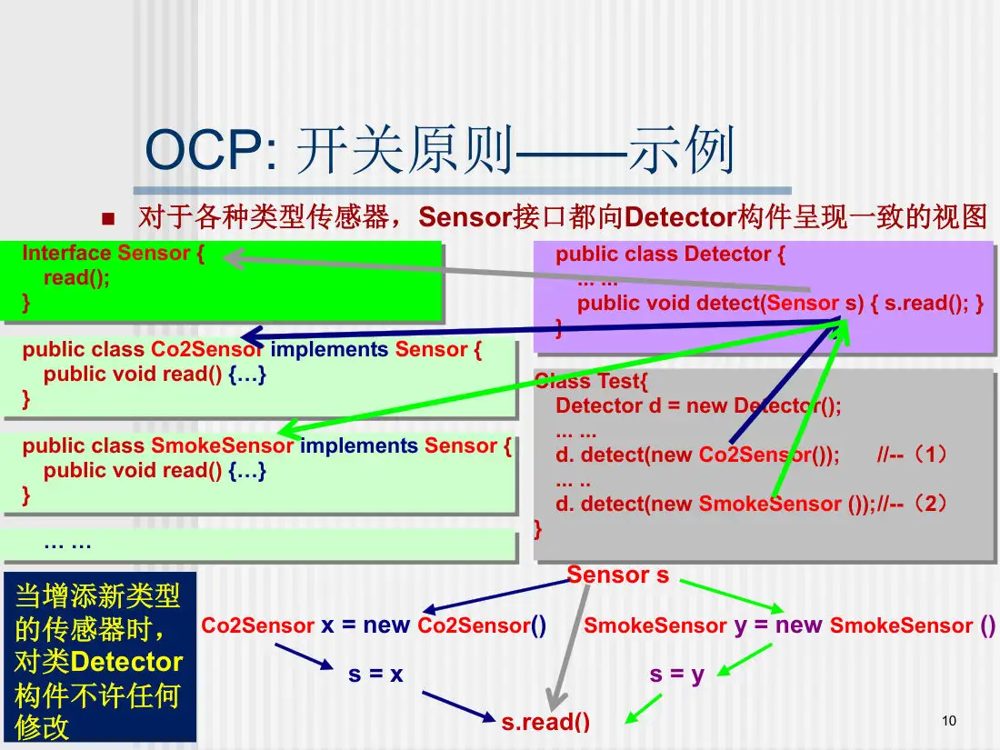

原文：

OCP: 开关原则——示例

10

### LSP: The Liskov Substitution Principle

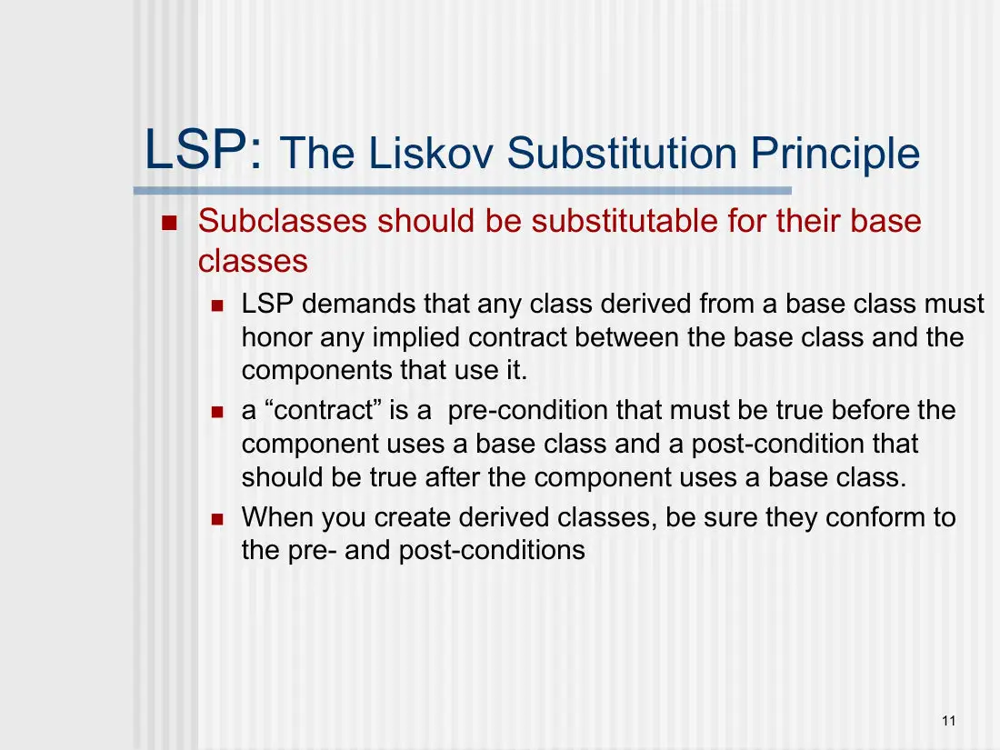

原文：

LSP: The Liskov Substitution Principle

Subclasses should be substitutable for their base classes

LSP demands that any class derived from a base class must honor any implied contract between the base class and the components that use it.

◼ a “contract” is a pre-condition that must be true before the component uses a base class and a post-condition that should be true after the component uses a base class.

◼ When you create derived classes, be sure they conform to the pre- and post-conditions

11

### LSP: Liskov替换原则——示例

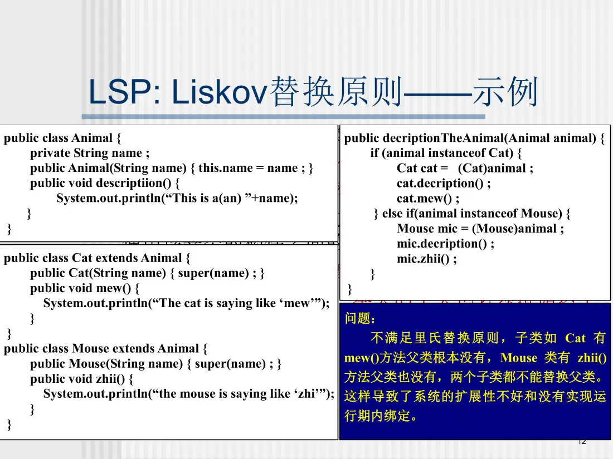

原文：

LSP: Liskov替换原则——示例

问题：

不满足里氏替换原则，子类如Cat有mew()方法父类根本没有，Mouse 类有 zhii()方法父类也没有，两个子类都不能替换父类。这样导致了系统的扩展性不好和没有实现运行期内绑定。

12

### LSP: Liskov替换原则 —示例

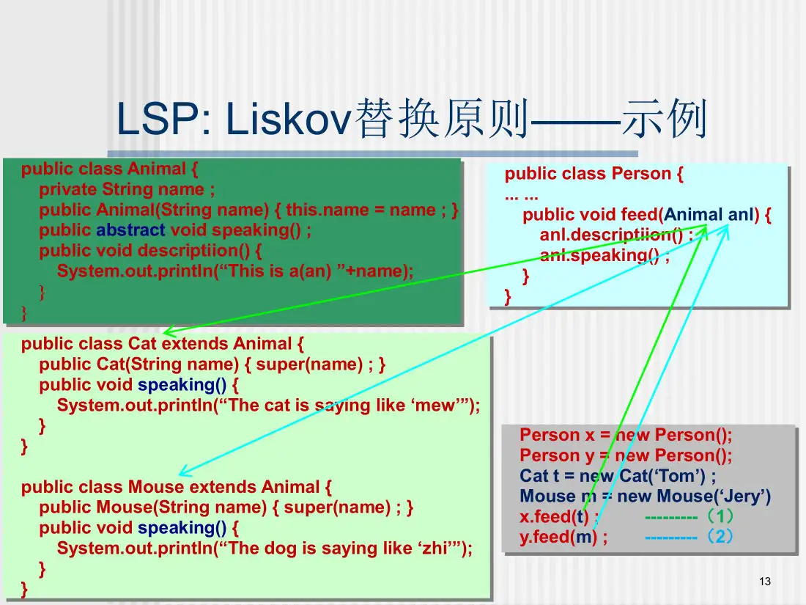

原文：

LSP: Liskov替换原则 —示例

### DIP: Dependency Inversion Principle

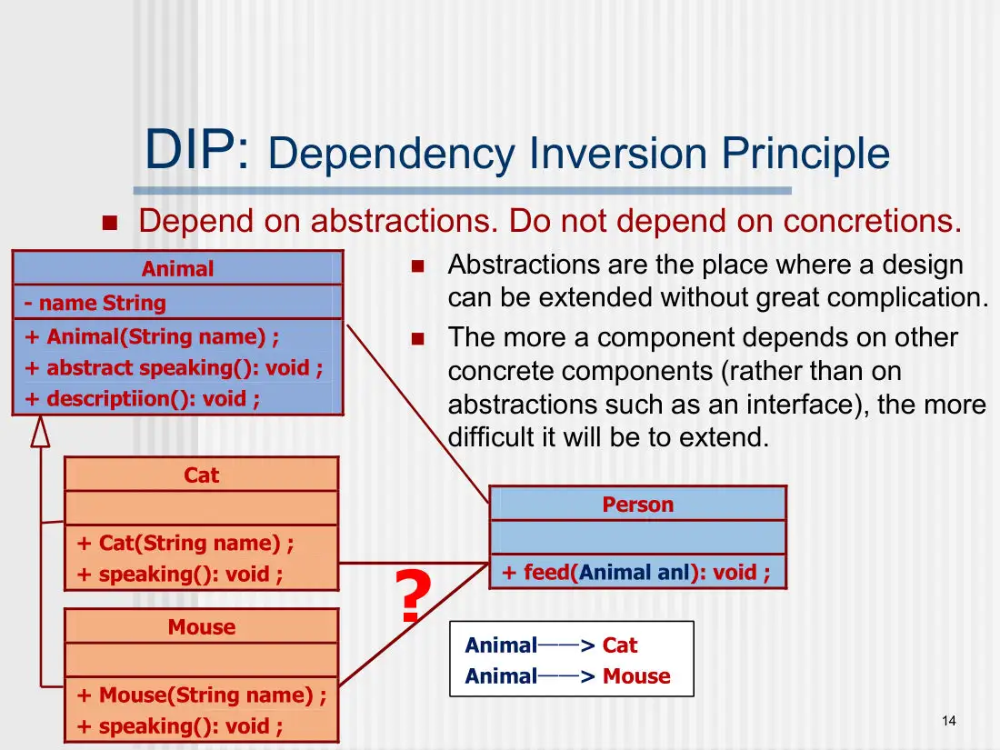

原文：

DIP: Dependency Inversion Principle

Depend on abstractions. Do not depend on concretions.

\+ Animal(String name) ;

\+ abstract speaking(): void ;

\+ descriptiion(): void ;

Abstractions are the place where a design can be extended without great complication.

The more a component depends on other concrete components (rather than on abstractions such as an interface), the more difficult it will be to extend.

Animal——> CatAnimal——> Mouse

14

### exercise

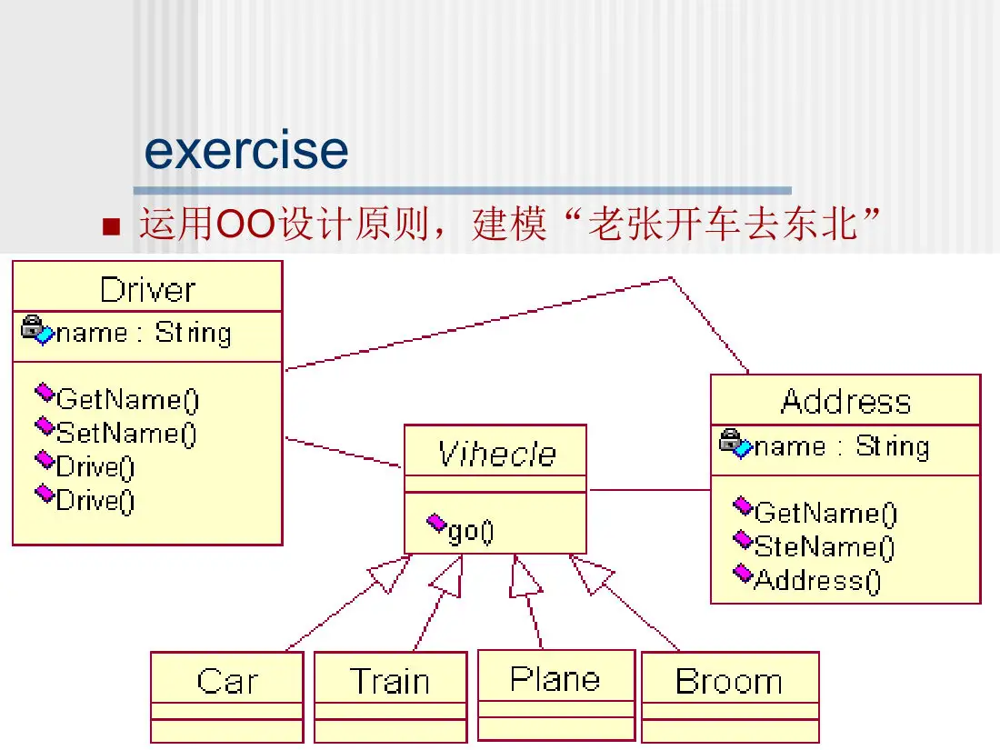

原文：

exercise

运用OO设计原则，建模“老张开车去东北”

### ISP: The Interface Segregation Principle

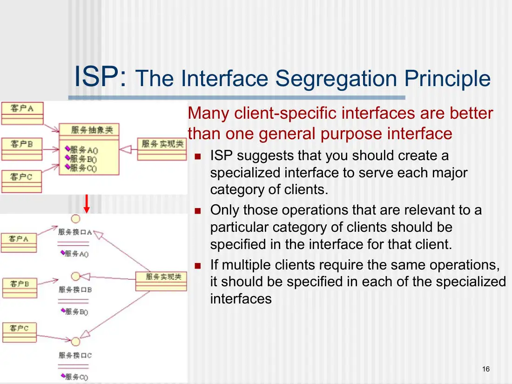

原文：

ISP: The Interface Segregation Principle

Many client-specific interfaces are better than one general purpose interface

ISP suggests that you should create a specialized interface to serve each major category of clients.

Only those operations that are relevant to a particular category of clients should be specified in the interface for that client.

If multiple clients require the same operations, it should be specified in each of the specialized interfaces

16

### 17

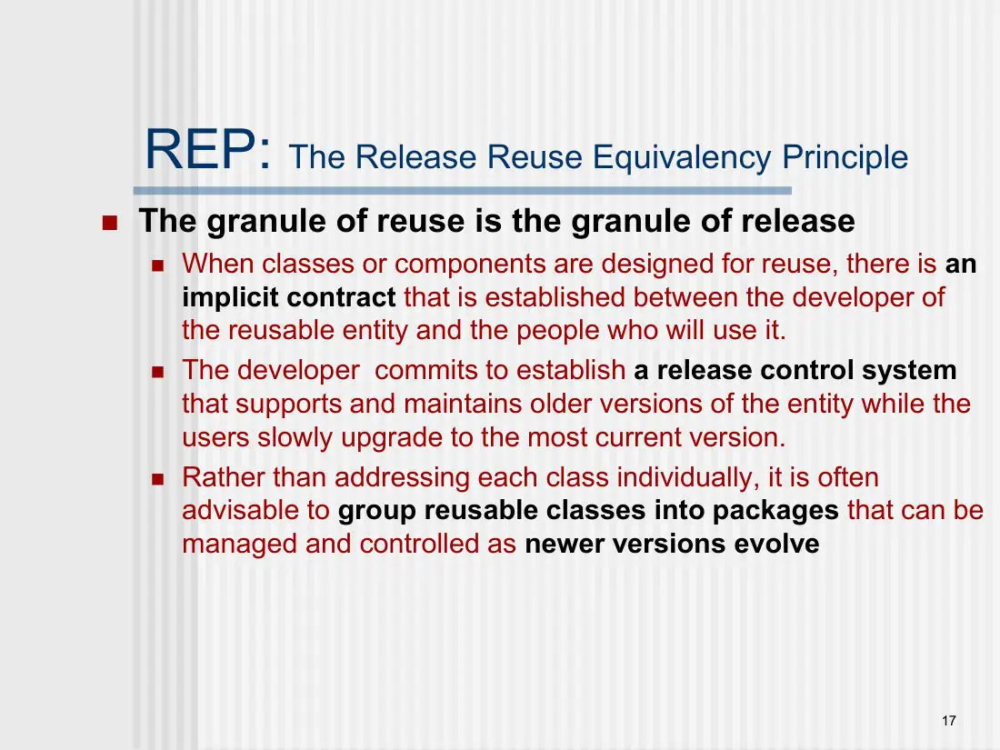

原文：

REP: The Release Reuse Equivalency Principle

◼ The granule of reuse is the granule of release

When classes or components are designed for reuse, there is an implicit contract that is established between the developer of the reusable entity and the people who will use it.

The developer commits to establish a release control system that supports and maintains older versions of the entity while the users slowly upgrade to the most current version.

Rather than addressing each class individually, it is often advisable to group reusable classes into packages that can be managed and controlled as newer versions evolve

17

### CCP: The Common Closure Principle

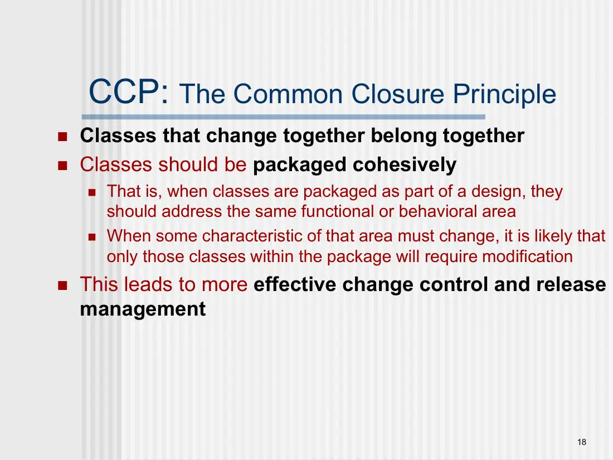

原文：

CCP: The Common Closure Principle

◼ Classes that change together belong together

◼ Classes should be packaged cohesively

That is, when classes are packaged as part of a design, they should address the same functional or behavioral area

When some characteristic of that area must change, it is likely that only those classes within the package will require modification

This leads to more effective change control and release management

18

### CRP: The Common Reuse Principle

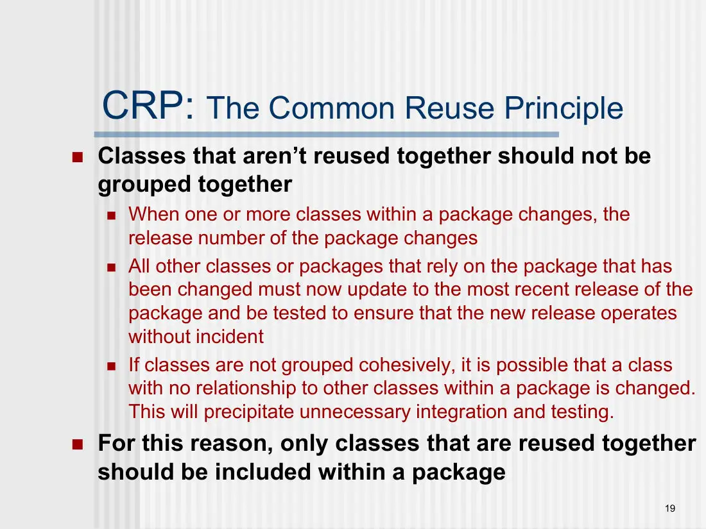

原文：

CRP: The Common Reuse Principle

◼ Classes that aren’t reused together should not be grouped together

When one or more classes within a package changes, the release number of the package changes

All other classes or packages that rely on the package that has been changed must now update to the most recent release of the package and be tested to ensure that the new release operates without incident

If classes are not grouped cohesively, it is possible that a class with no relationship to other classes within a package is changed. This will precipitate unnecessary integration and testing.

◼ For this reason, only classes that are reused together should be included within a package

19

### Design Guidelines (P246)

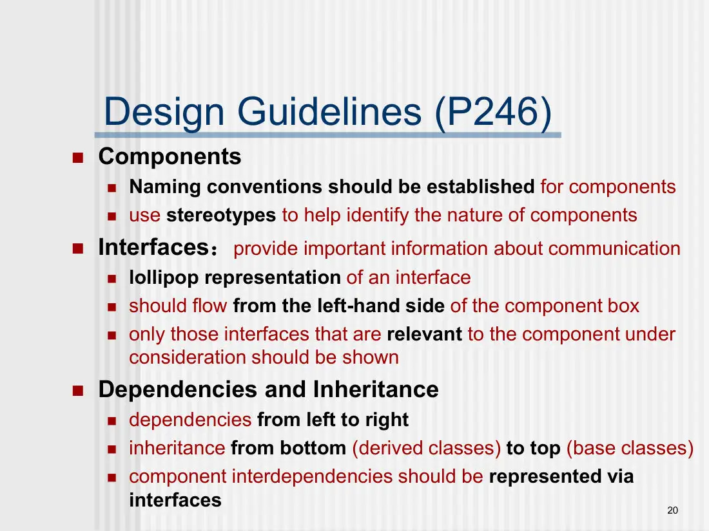

原文：

Design Guidelines (P246)

◼ Components

◼ Naming conventions should be established for components

◼ use stereotypes to help identify the nature of components

◼ Interfaces：provide important information about communication

◼ lollipop representation of an interface

◼ should flow from the left-hand side of the component box

only those interfaces that are relevant to the component under consideration should be shown

◼ Dependencies and Inheritance

◼ dependencies from left to right

inheritance from bottom (derived classes) to top (base classes)

component interdependencies should be represented via interfaces

20

### Cohesion (P247)

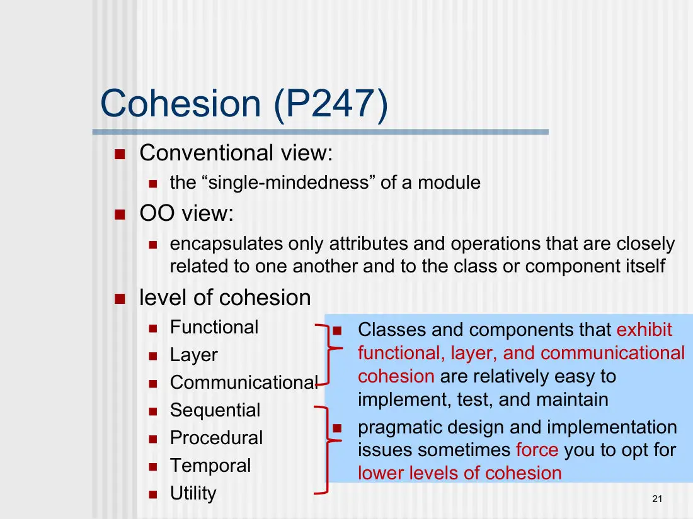

原文：

Cohesion (P247)

◼ Conventional view:

◼ the “single-mindedness” of a module

◼ OO view:

◼ encapsulates only attributes and operations that are closely related to one another and to the class or component itself

◼ level of cohesion

◼ Functional

◼ Layer

◼ Communicational

◼ Sequential

◼ Procedural

◼ Temporal

◼ Utility

Classes and components that exhibit functional, layer, and communicational cohesion are relatively easy to implement, test, and maintain

pragmatic design and implementation issues sometimes force you to opt for lower levels of cohesion

21

### Cohesion

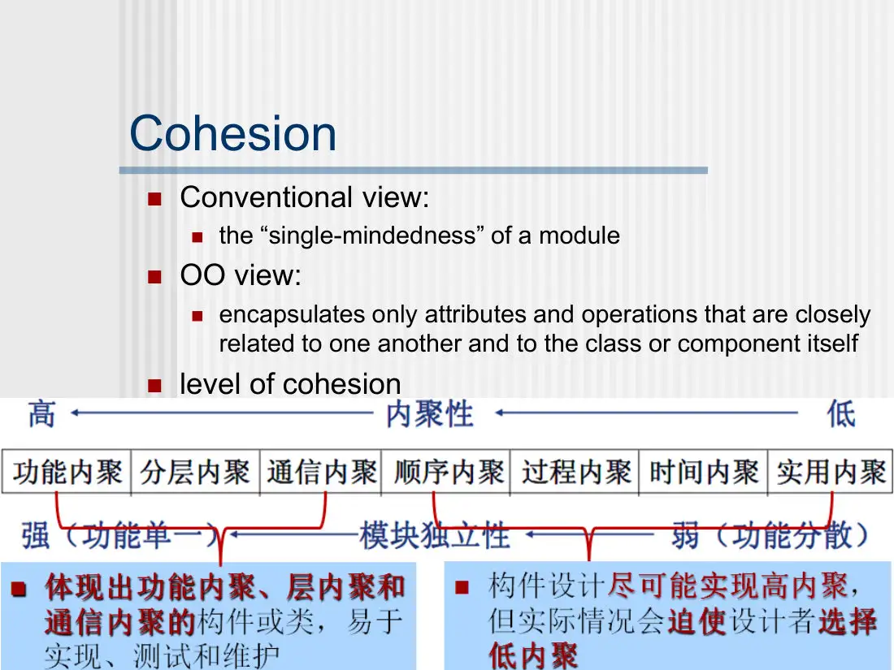

原文：

Cohesion

◼ Conventional view:

◼ the “single-mindedness” of a module

◼ OO view:

◼ encapsulates only attributes and operations that are closely related to one another and to the class or component itself

◼ level of cohesion

体现出功能内聚、层内聚和通信内聚的构件或类，易于实现、测试和维护

sues sometimes force you to opt fo wer levels of cohesion 低内聚

### 功能内聚（Functional Cohesion）

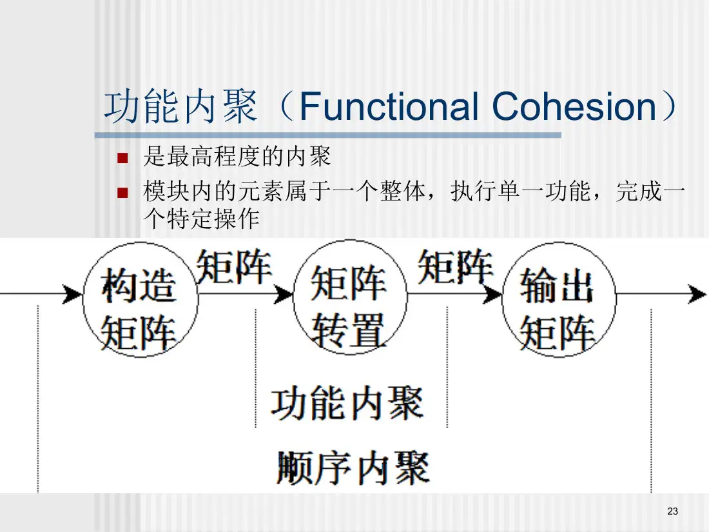

原文：

功能内聚（Functional Cohesion）

◼ 是最高程度的内聚

模块内的元素属于一个整体，执行单一功能，完成个特定操作

23

### 分层内聚（ Layer Cohesion ）

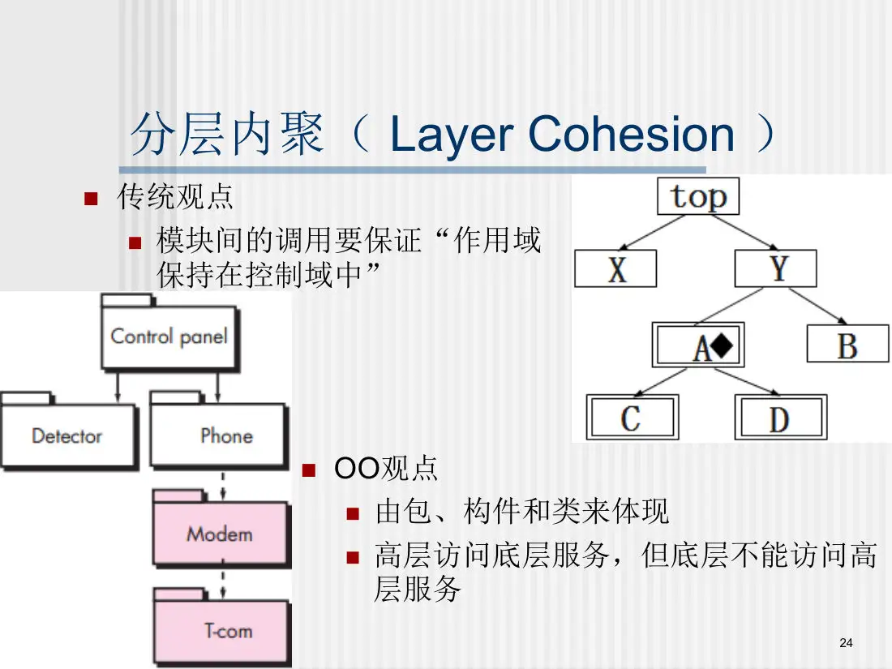

原文：

分层内聚（ Layer Cohesion ）

◼ 传统观点

模块间的调用要保证“作用域保持在控制域中”

OO观点

◼ 由包、构件和类来体现

高层访问底层服务，但底层不能访问高层服务

24

### 通信内聚（Communicational Cohesion）

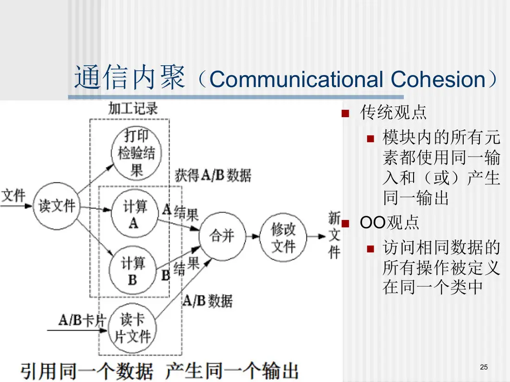

原文：

通信内聚（Communicational Cohesion）

◼ 传统观点

模块内的所有元素都使用同一输入和（或）产生同一输出

OO观点

访问相同数据的所有操作被定义在同一个类中

25

### 顺序内聚

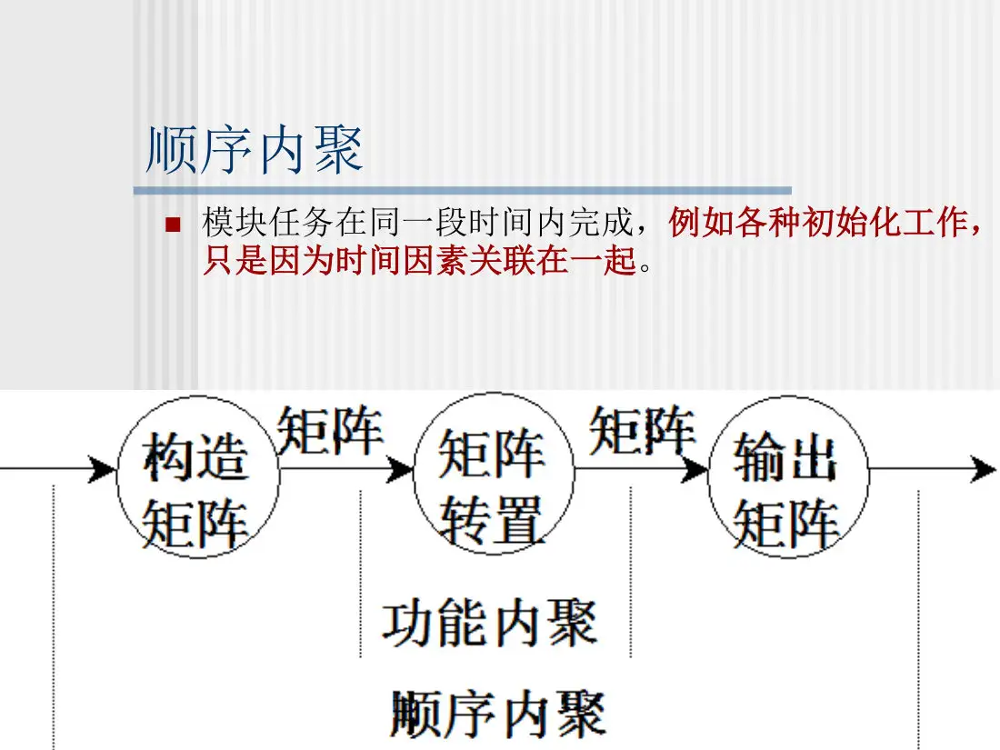

原文：

顺序内聚

模块任务在同一段时间内完成，例如各种初始化工作，只是因为时间因素关联在一起。

### 过程内聚

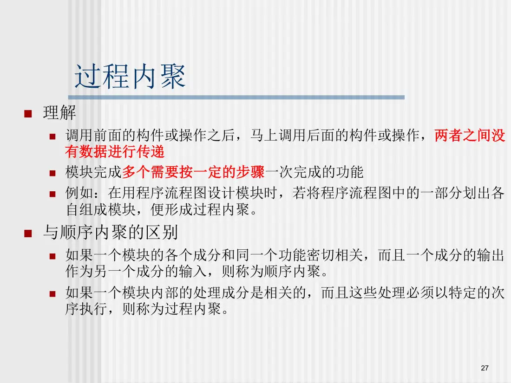

原文：

过程内聚

◼ 理解

调用前面的构件或操作之后，马上调用后面的构件或操作，两者之间没有数据进行传递

◼ 模块完成多个需要按一定的步骤一次完成的功能

例如：在用程序流程图设计模块时，若将程序流程图中的一部分划出各自组成模块，便形成过程内聚。

◼ 与顺序内聚的区别

如果一个模块的各个成分和同一个功能密切相关，而且一个成分的输出作为另一个成分的输入，则称为顺序内聚。

如果一个模块内部的处理成分是相关的，而且这些处理必须以特定的次序执行，则称为过程内聚。

27

### 时间内聚

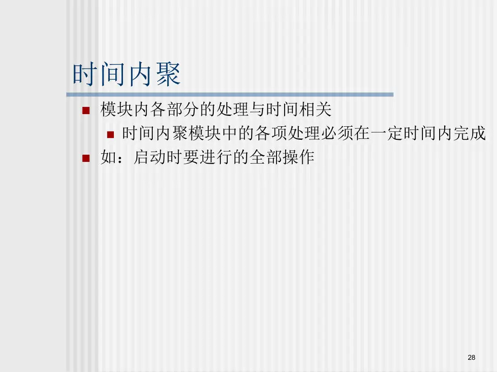

原文：

时间内聚

◼ 模块内各部分的处理与时间相关

◼ 时间内聚模块中的各项处理必须在一定时间内完成

◼ 如：启动时要进行的全部操作

28

### 实用内聚

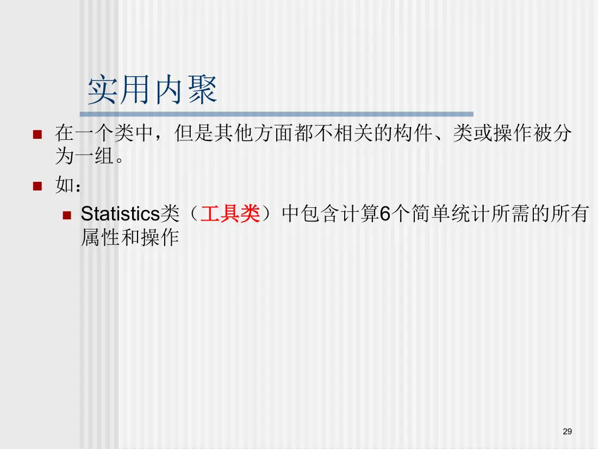

原文：

实用内聚

在一个类中，但是其他方面都不相关的构件、类或操作被分为一组。

◼ 如：

Statistics类（工具类）中包含计算6个简单统计所需的所有属性和操作

29

### Coupling (P249)

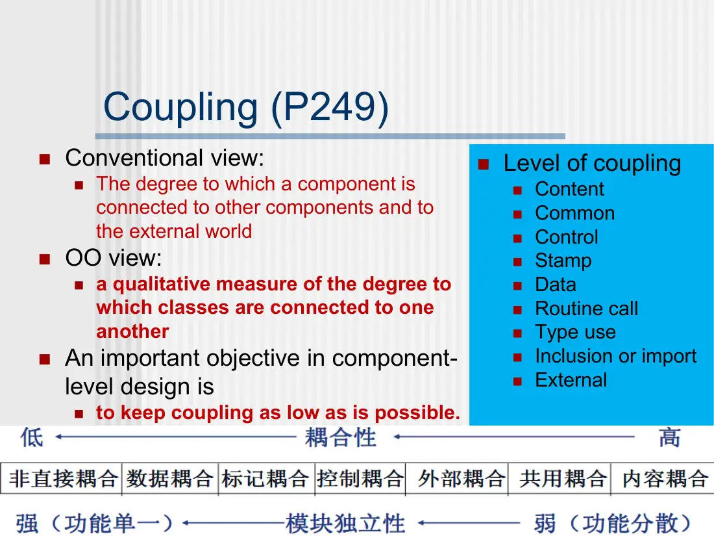

原文：

Coupling (P249)

◼ Conventional view:

The degree to which a component is connected to other components and to the external world

◼ OO view:

a qualitative measure of the degree to which classes are connected to one another

An important objective in componentlevel design is

◼ to keep coupling as low as is possible.

低

耦合性

◼ Level of coupling

◼ Content

◼ Common

◼ Control

◼ Stamp

◼ Data

◼ Routine call

◼ Type use

◼ Inclusion or import

◼ External

高

模块独立性

弱（功能分散）

### 内容耦合（Content Coupling）

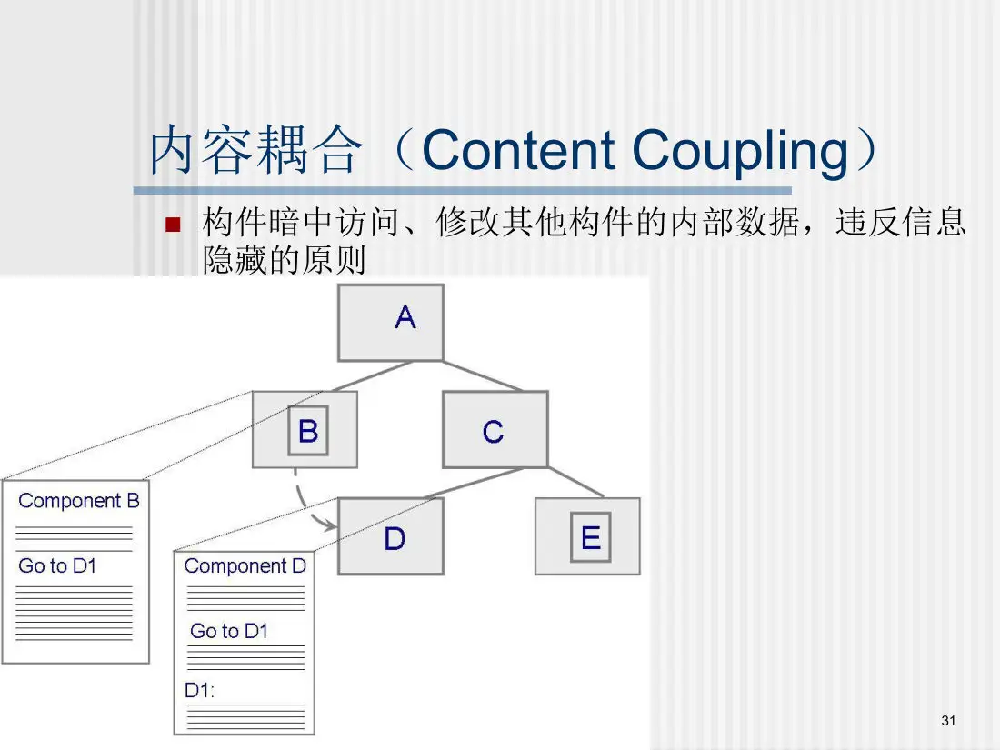

原文：

内容耦合（Content Coupling）

构件暗中访问、修改其他构件的内部数据，违反信息隐藏的原则

31

### 共用耦合（Common Coupling）

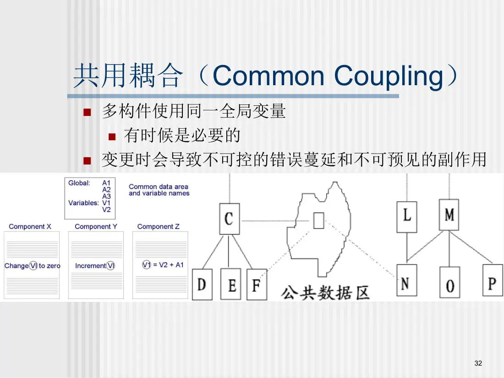

原文：

共用耦合（Common Coupling）

◼ 多构件使用同一全局变量

◼ 有时候是必要的

◼ 变更时会导致不可控的错误蔓延和不可预见的副作用

32

### 控制耦合（Control Coupling）

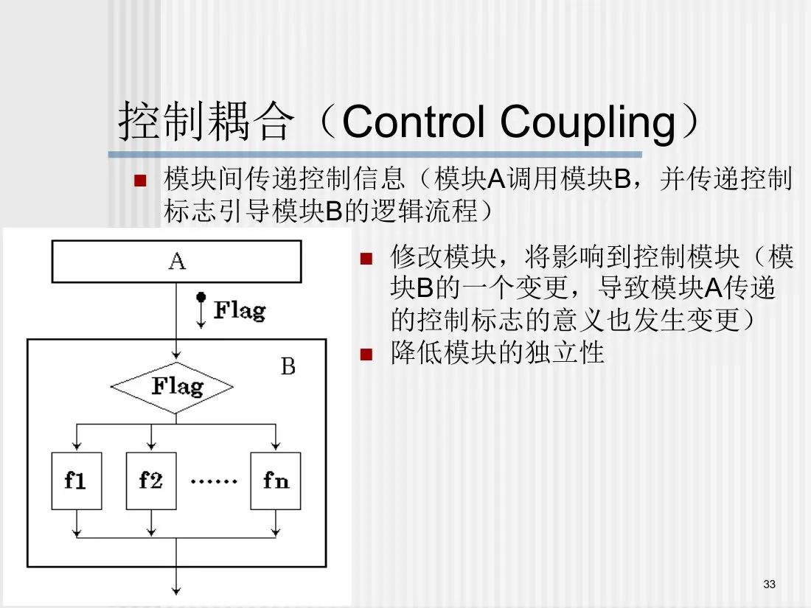

原文：

控制耦合（Control Coupling）

模块间传递控制信息（模块A调用模块B，并传递控制标志引导模块B的逻辑流程）

修改模块，将影响到控制模块（模块B的一个变更，导致模块A传递的控制标志的意义也发生变更）

◼ 降低模块的独立性

33

### 标记耦合（Stamp Coupling）

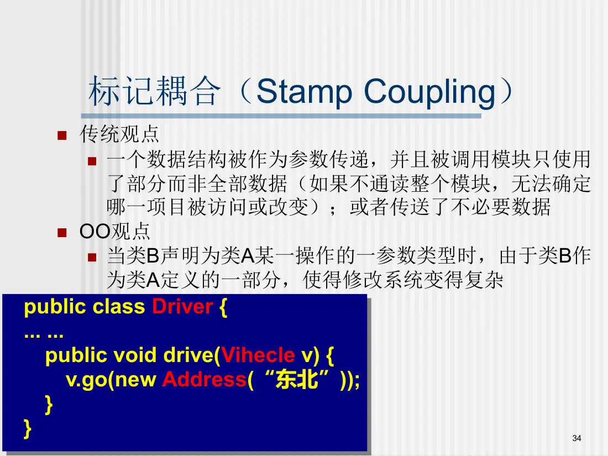

原文：

标记耦合（Stamp Coupling）

◼ 传统观点

◼ 一个数据结构被作为参数传递，并且被调用模块只使用了部分而非全部数据（如果不通读整个模块，无法确定哪一项目被访问或改变）；或者传送了不必要数据

◼ OO观点

◼ 当类B声明为类A某一操作的一参数类型时，由于类B作为类A定义的一部分，使得修改系统变得复杂

public class Driver {

public void drive(Vihecle v) { v.go(new Address(“东北"));

34

### 数据耦合（Data Coupling）

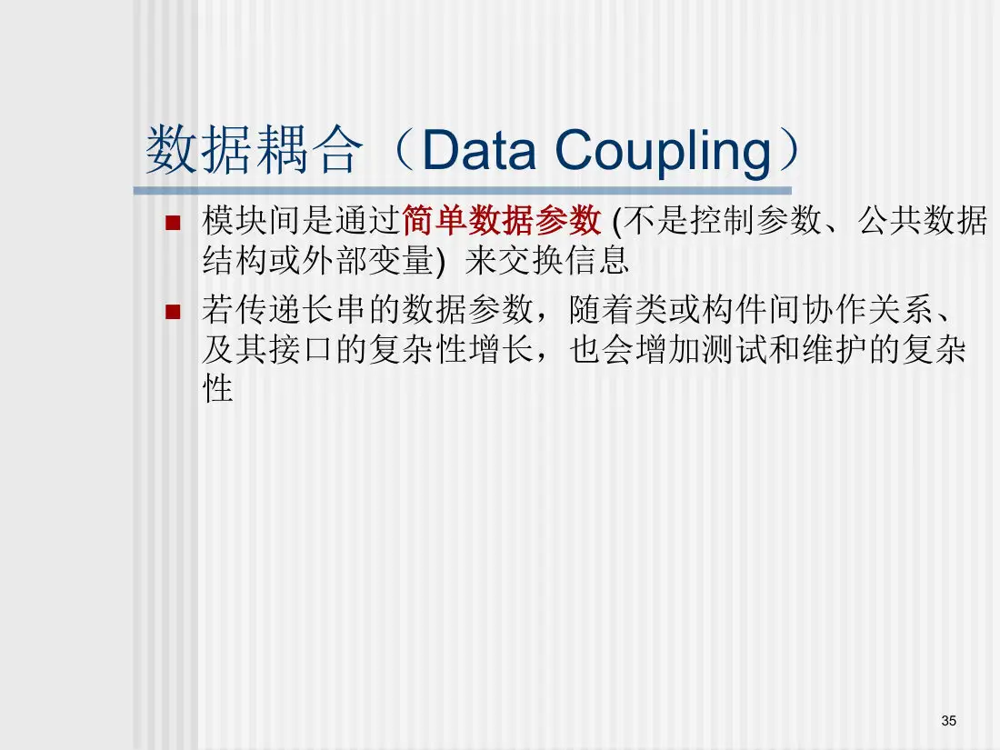

原文：

数据耦合（Data Coupling）

模块间是通过简单数据参数 (不是控制参数、公共数据结构或外部变量) 来交换信息

若传递长串的数据参数，随着类或构件间协作关系、及其接口的复杂性增长，也会增加测试和维护的复杂性

35

### 例程调用耦合（Routine call Coupling）

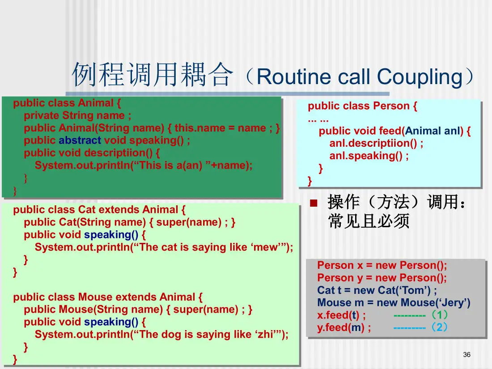

原文：

例程调用耦合（Routine call Coupling）

### 类型使用耦合（Type use Coupling）

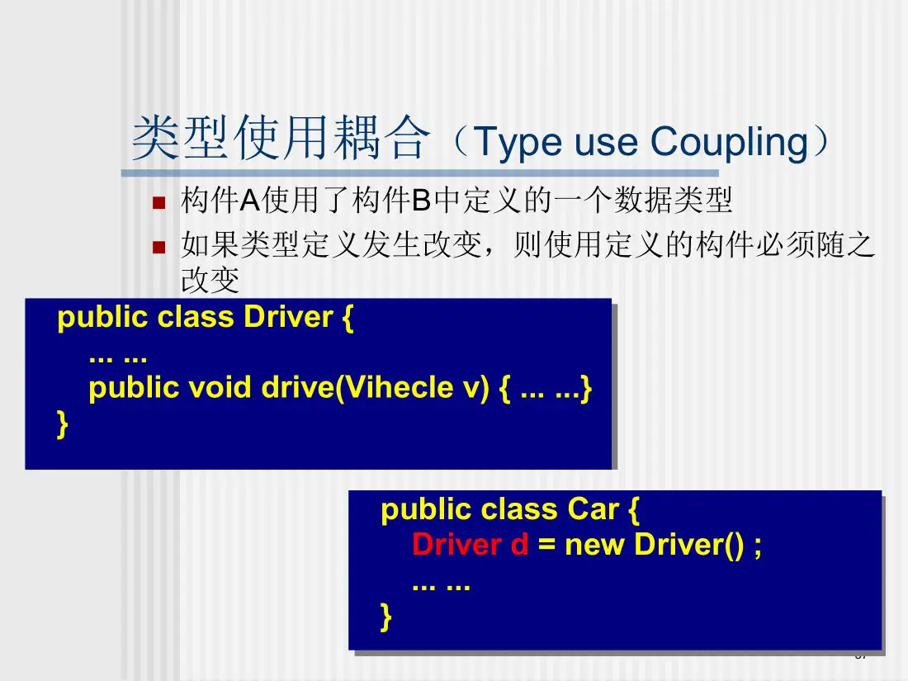

原文：

类型使用耦合（Type use Coupling）

◼ 构件A使用了构件B中定义的一个数据类型

如果类型定义发生改变，则使用定义的构件必须随之改变

public class Driver {

public void drive(Vihecle v) { ... ..}

public class Car { Driver d = new Driver() ;

37

### 包含或导入耦合（Inclusion or import Coupling）

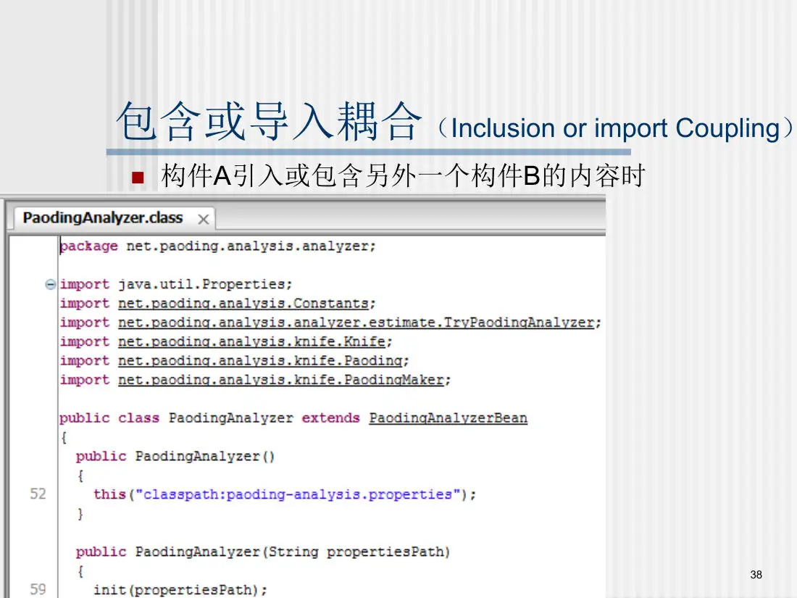

原文：

包含或导入耦合（Inclusion or import Coupling）

◼ 构件A引入或包含另外一个构件B的内容时

38

### 外部耦合（External Coupling）

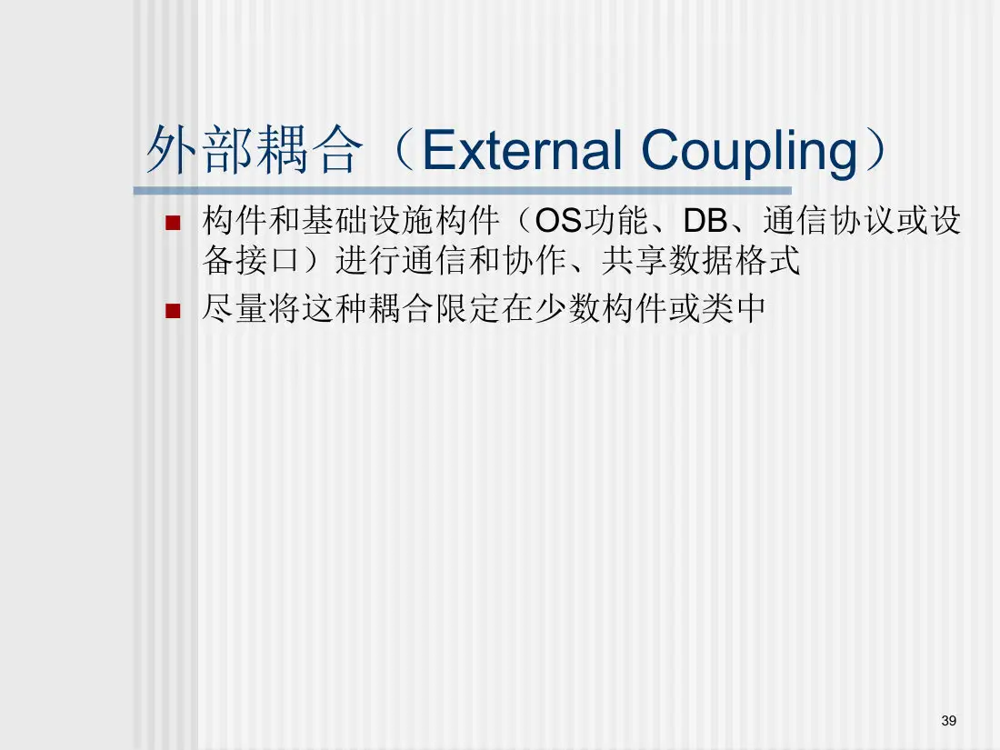

原文：

外部耦合（External Coupling）

构件和基础设施构件（OS功能、DB、通信协议或设备接口）进行通信和协作、共享数据格式

◼ 尽量将这种耦合限定在少数构件或类中

39

### Conducting Component-Level Design (P250)

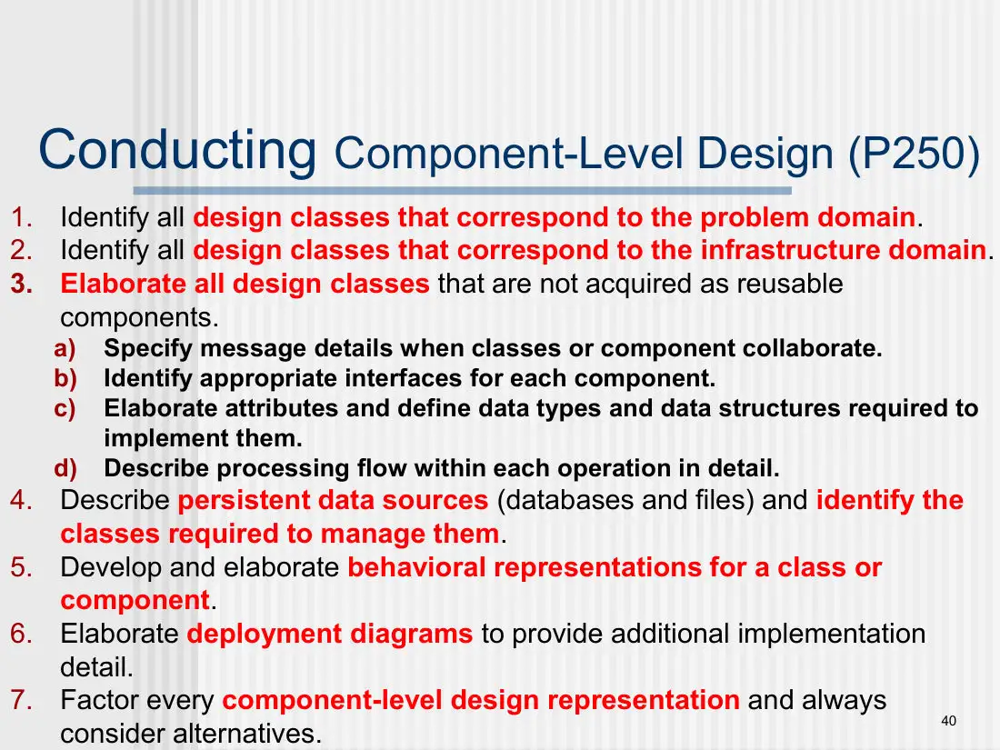

原文：

Conducting Component-Level Design (P250)

1. Identify all design classes that correspond to the problem domain.

2. Identify all design classes that correspond to the infrastructure domain.

3. Elaborate all design classes that are not acquired as reusable components.

a) Specify message details when classes or component collaborate.

b) Identify appropriate interfaces for each component.

c) Elaborate attributes and define data types and data structures required to implement them.

d) Describe processing flow within each operation in detail.

4. Describe persistent data sources (databases and files) and identify the classes required to manage them.

5. Develop and elaborate behavioral representations for a class or component.

6. Elaborate deployment diagrams to provide additional implementation detail.

7. Factor every component-level design representation and always consider alternatives.

40

### 实施构件级设计

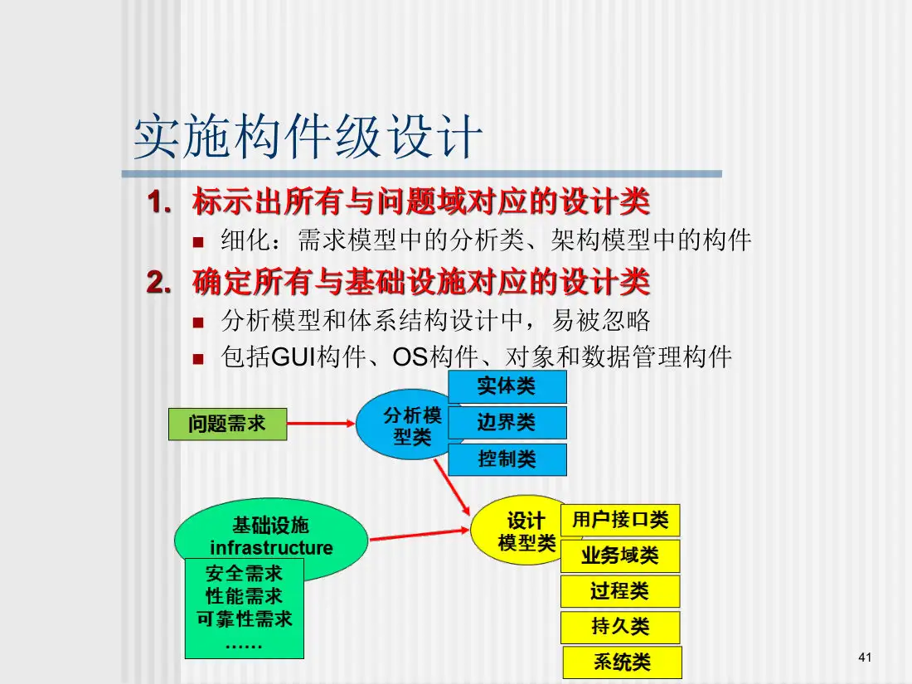

原文：

实施构件级设计

1. 标示出所有与问题域对应的设计类

◼ 细化：需求模型中的分析类、架构模型中的构件

2. 确定所有与基础设施对应的设计类

◼ 分析模型和体系结构设计中，易被忽略

◼ 包括GUI构件、OS构件、对象和数据管理构件

41

### 实施构件级设计

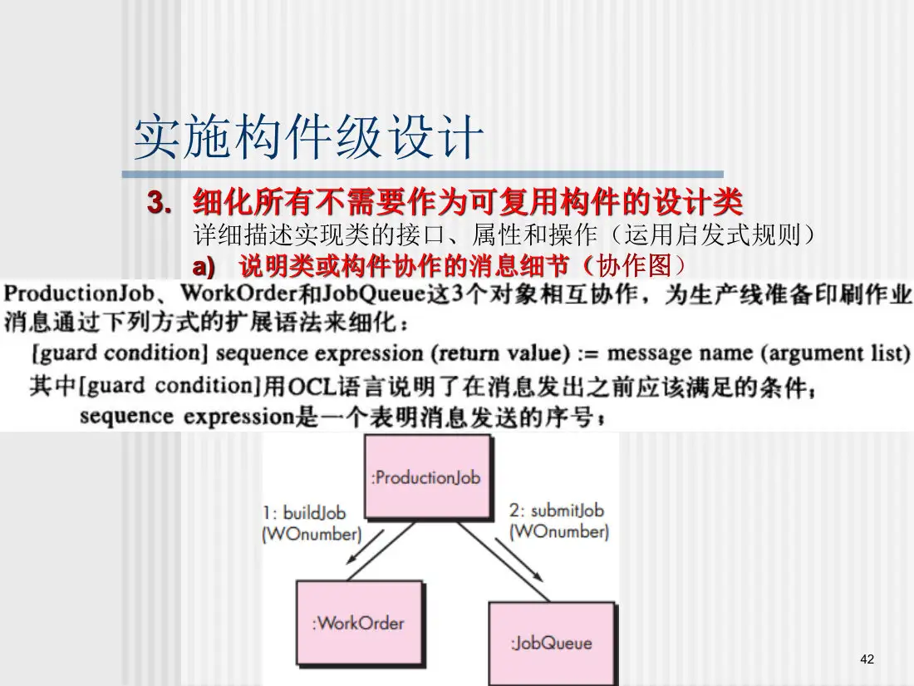

原文：

实施构件级设计

3. 细化所有不需要作为可复用构件的设计类

详细描述实现类的接口、属性和操作（运用启发式规则）

a) 说明类或构件协作的消息细节（协作图）

ProductionJob、WorkOrder和JobQueue这3个对象相互协作，为生产线准备印刷作业c) 细化属性，并且

d) 详细描述每个操作中的处理流（伪码或活动图）

其中[guardcondition]用OCL语言说明了在消息发出之前应该满足的条件；

sequence expression是一个表明消息发送的序号；

42

### 实施构件级设计

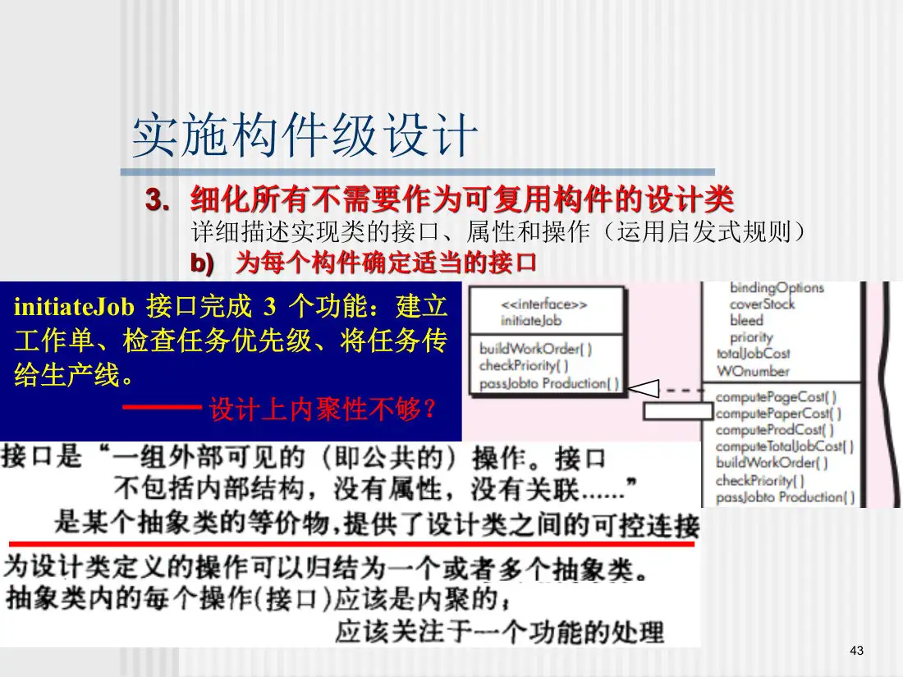

原文：

实施构件级设计

3. 细化所有不需要作为可复用构件的设计类

详细描述实现类的接口、属性和操作（运用启发式规则）

b) 为每个构件确定适当的接口

initiateJob 接口完成 3 个功能：建立工作单、检查任务优先级、将任务传给生产线。

设计上内聚性不够？

接口是“一组外部可见的（即公共的）操作。接口不包括内部结构，没有属性，没有关联....”是某个抽象类的等价物，提供了设计类之间的可控连接

为设计类定义的操作可以归结为一个或者多个抽象类。抽象类内的每个操作(接口)应该是内聚的；应该关注于一个功能的处理

43

### 实施构件级设计

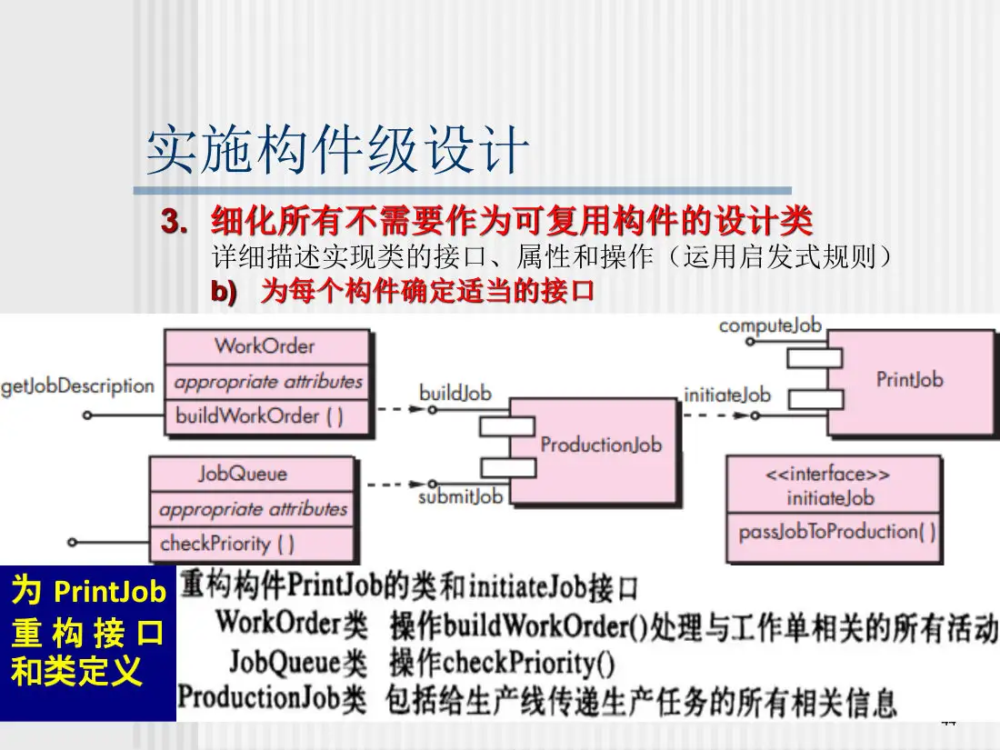

原文：

实施构件级设计

3. 细化所有不需要作为可复用构件的设计类

详细描述实现类的接口、属性和操作（运用启发式规则）

b) 为每个构件确定适当的接口

重构构件PrintJob的类和initiateJob接口

为 PrintJob重构接口和类定义

WorkOrder类操作buildWorkOrder()处理与工作单相关的所有活动JobQueue类操作checkPriority()

ProductionJob类包括给生产线传递生产任务的所有相关信息

### 实施构件级设计

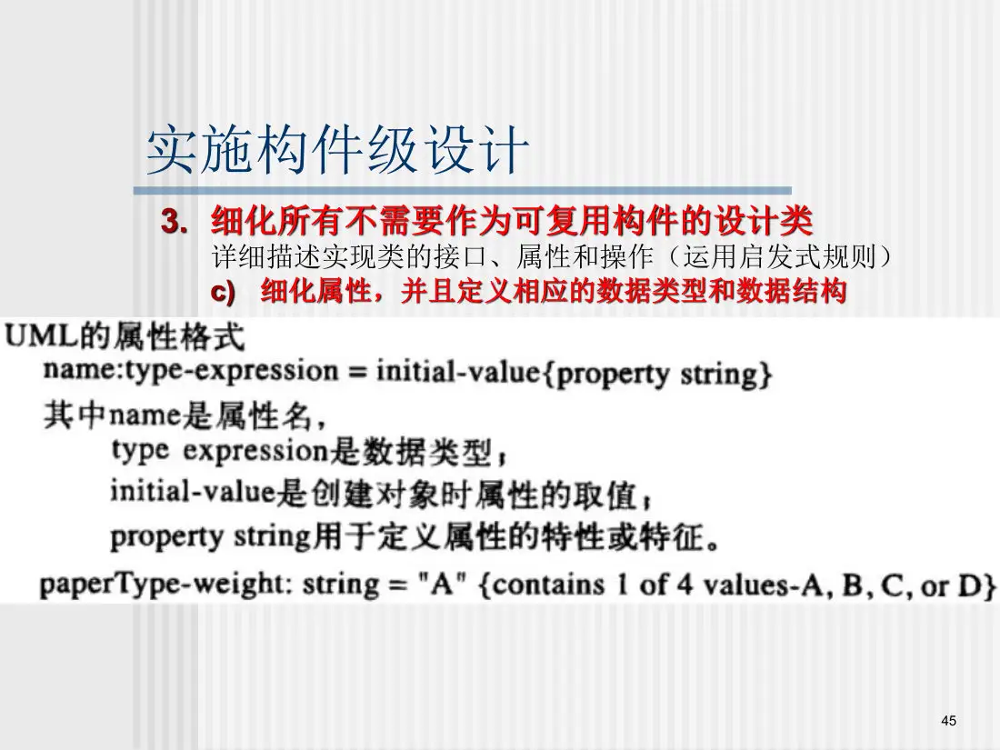

原文：

实施构件级设计

细化所有不需要作为可复用构件的设计类详细描述实现类的接口、属性和操作（运用启发式规则）c) 细化属性，并且定义相应的数据类型和数据结构

45

### 实施构件级设计

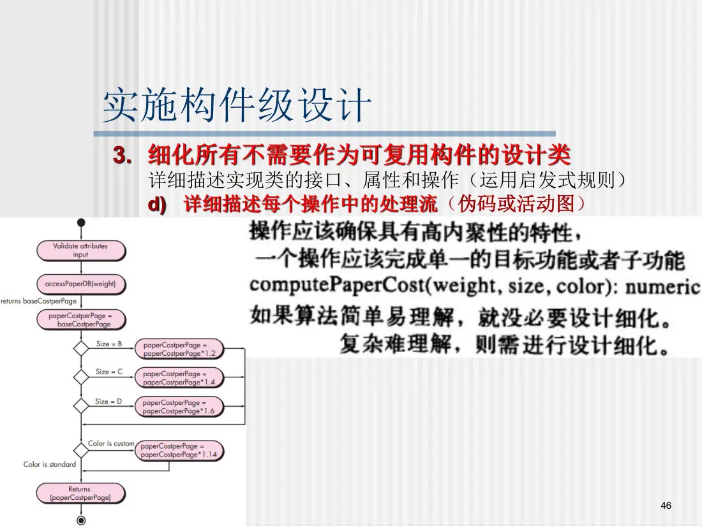

原文：

实施构件级设计

3. 细化所有不需要作为可复用构件的设计类详细描述实现类的接口、属性和操作（运用启发式规则）d) 详细描述每个操作中的处理流（伪码或活动图）

操作应该确保具有高内聚性的特性，一个操作应该完成单一的目标功能或者子功能computePaperCost(weight, size, color): numeric如果算法简单易理解，就没必要设计细化。复杂难理解，则需进行设计细化。

46

### 实施构件级设计

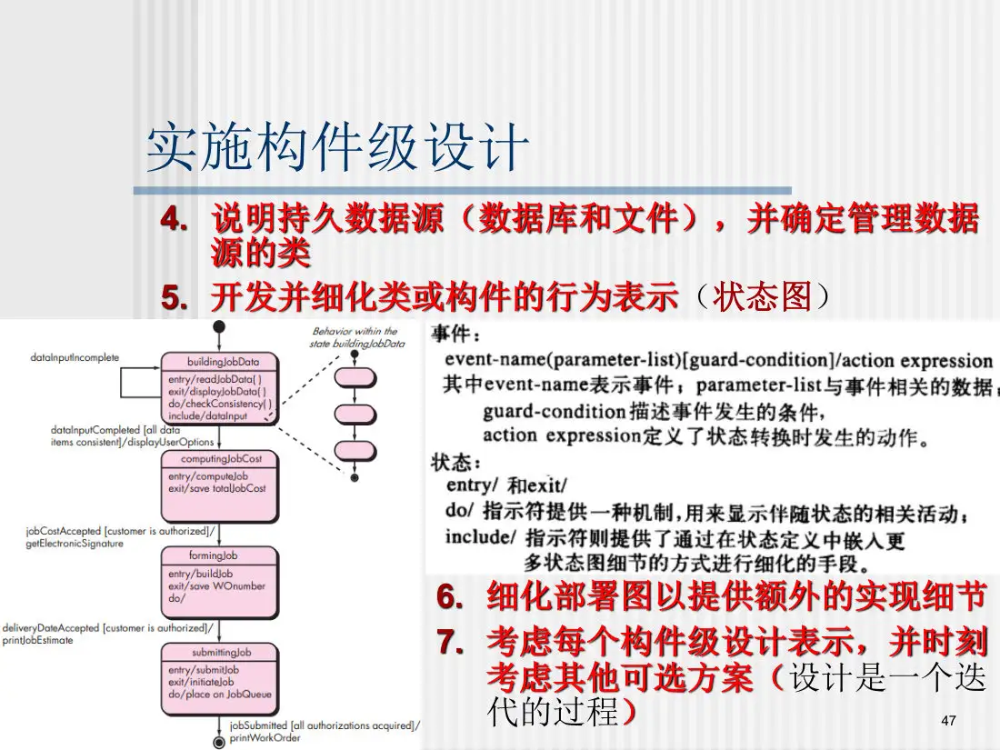

原文：

实施构件级设计

说明持久数据源（数据库和文件），并确定管理数据源的类

5. 开发并细化类或构件的行为表示（状态图）

event-name(parameter-list)[guard-condition]/action expression其中event-name表示事件；parameter-list与事件相关的数据：guard-condition描述事件发生的条件，action expression定义了状态转换时发生的动作。

状态：entry/和exit/do/指示符提供一种机制，用来显示伴随状态的相关活动；include/指示符则提供了通过在状态定义中嵌入更多状态图细节的方式进行细化的手段。

6. 细化部署图以提供额外的实现细节

考虑每个构件级设计表示，并时刻考虑其他可选方案（设计是一个迭代的过程） 47
