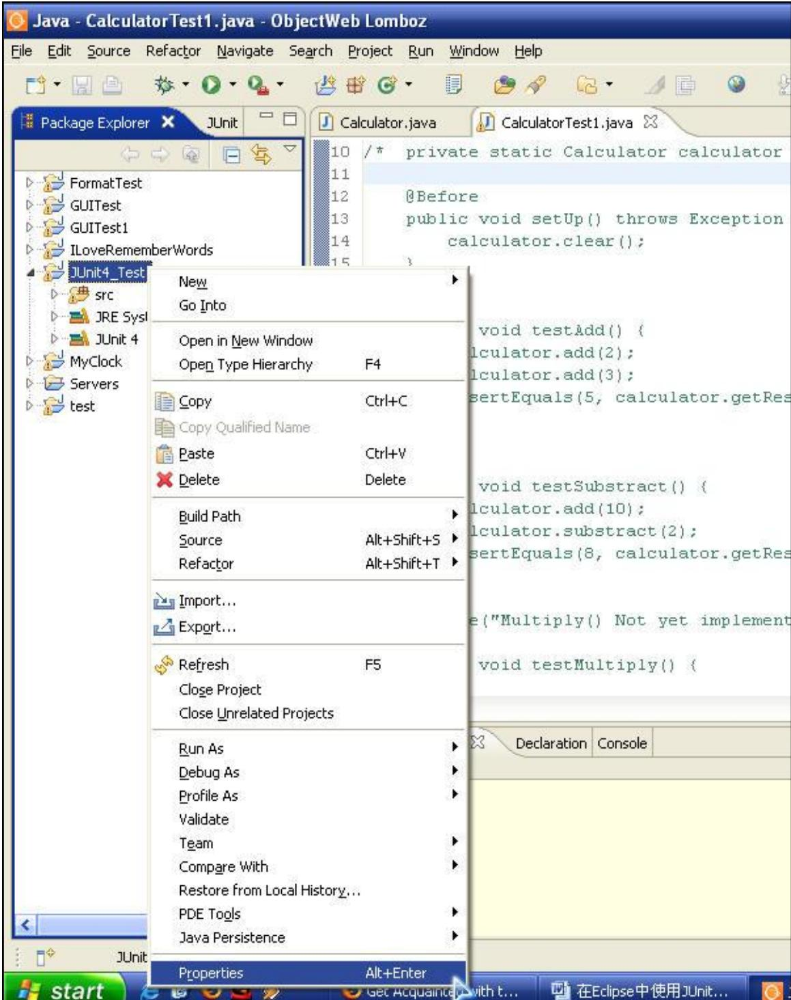
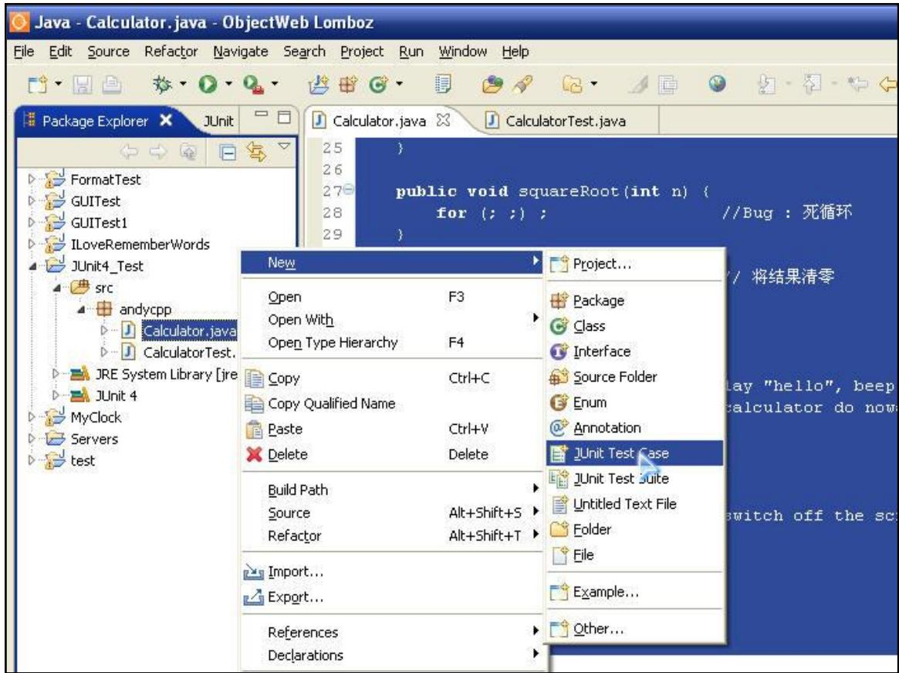
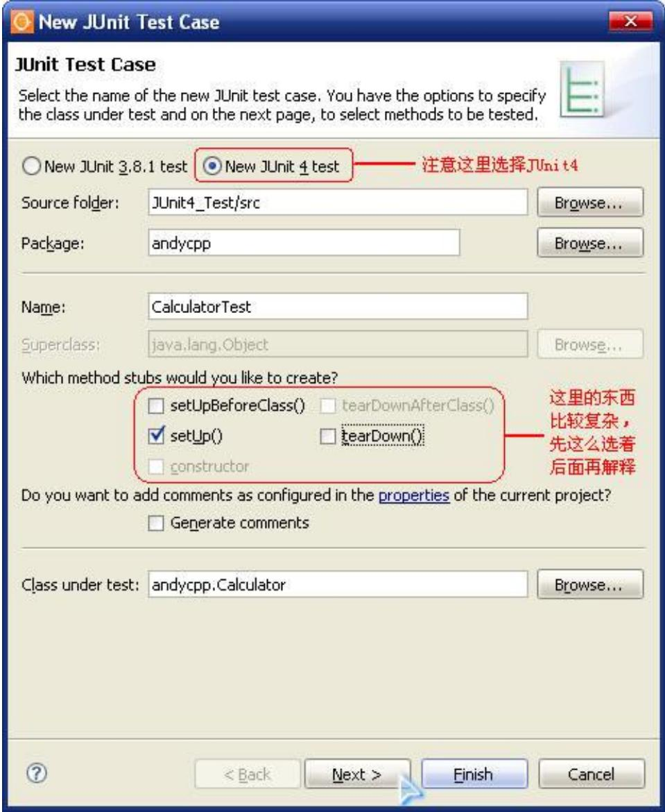
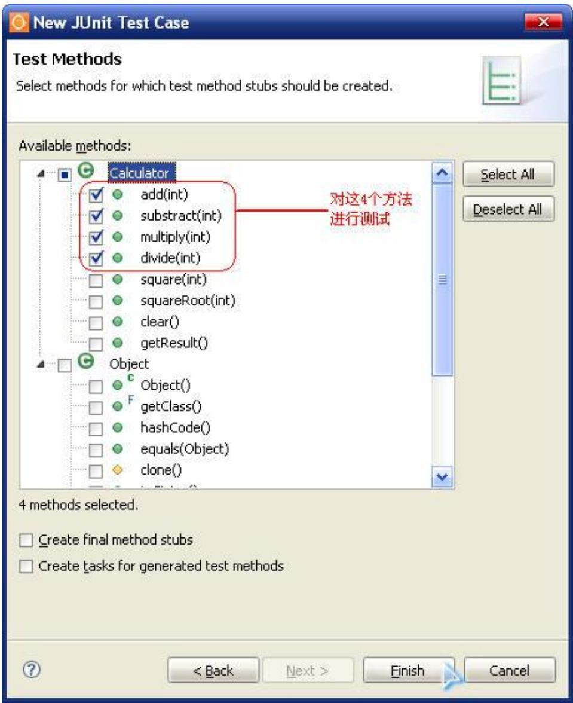
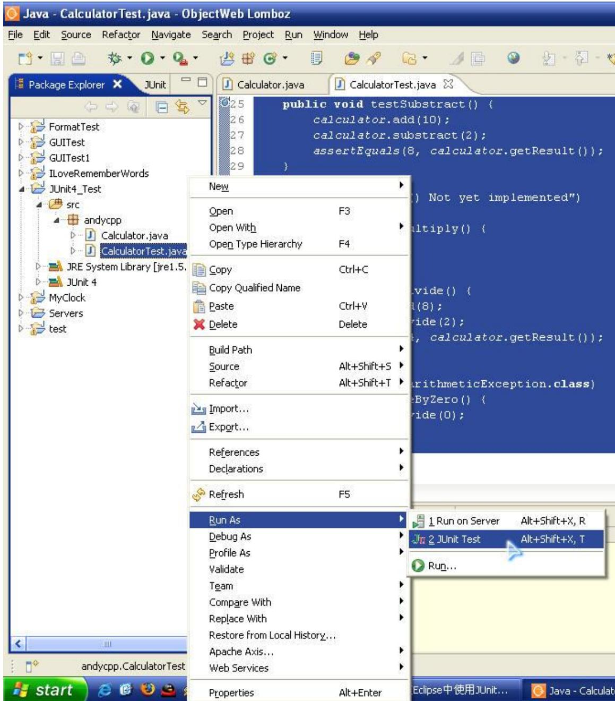
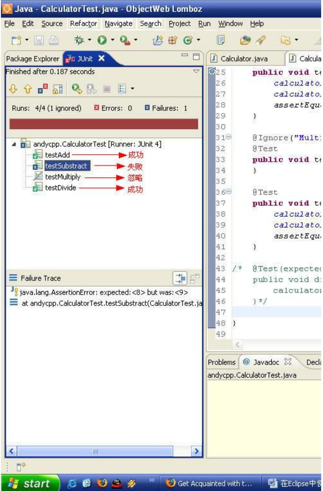

# 《软件工程（双语）》在Eclipse中使用JUnit4教程（实验参考资料）

原件经识别和整理；“参考解答”是我们补的。

本资料整理自《软件工程（双语）》实验参考资料，主要涵盖JUnit4框架概述、Annotation注解详解以及在Eclipse中进行单元测试的初级、中级和高级操作指南。

## JUnit4 概述

### 简介

jUnit4 是 JUnit 框架有史以来的最大改进，其主要目标便是利用 Java5 的 Annotation 特性简化测试用例的编写。

先简单解释一下什么是 Annotation，这个单词一般是翻译成元数据。元数据是什么？元数据就是描述数据的数据。也就是说，这个东西在 Java 里面可以用来和 `public`、`static` 等关键字一样来修饰类名、方法名、变量名。修饰的作用描述这个数据是做什么用的，差不多和 `public` 描述这个数据是公有的一样。想具体了解可以看 Core Java2。废话不多说了，直接进入正题。

从上面的例子可以看到在 JUnit 4 中还引入了一些其他的元数据，下面一一介绍：

#### @Before

使用了该元数据的方法在每个测试方法执行之前都要执行一次。

#### @After

使用了该元数据的方法在每个测试方法执行之后要执行一次。

注意：`@Before` 和 `@After` 标示的方法只能各有一个。这个相当于取代了 JUnit 以前版本中的 `setUp` 和 `tearDown` 方法，当然你还可以继续叫这个名字，不过 JUnit 不会霸道的要求你这么做了。

#### @Test(expected = *.class)

在 JUnit 4.0 之前，对错误的测试，我们只能通过 `fail` 来产生一个错误，并在 `try` 块里面 `assertTrue(true)` 来测试。现在，通过 `@Test` 元数据中的 `expected` 属性。`expected` 属性的值是一个异常的类型。

#### @Test(timeout=xxx)

该元数据传入了一个时间（毫秒）给测试方法，如果测试方法在制定的时间之内没有运行完，则测试也失败。

#### @Ignore

该元数据标记的测试方法在测试中会被忽略。当测试的方法还没有实现，或者测试的方法已经过时，或者在某种条件下才能测试该方法（比如需要一个数据库联接，而在本地测试的时候，数据库并没有连接），那么使用该标签来标示这个方法。同时，你可以为该标签传递一个 String 的参数，来表明为什么会忽略这个测试方法。比如：`@Ignore("该方法还没有实现")`，在执行的时候，仅会报告该方法没有实现，而不会运行测试方法。

## 在 Eclipse 中使用 JUnit4 进行单元测试（初级篇）

我们在编写大型程序的时候，需要写成千上万个方法或函数，这些函数的功能可能很强大，但我们在程序中只用到该函数的一小部分功能，并且经过调试可以确定，这一小部分功能是正确的。但是，我们同时应该确保每一个函数都完全正确，因为如果我们今后如果对程序进行扩展，用到了某个函数的其他功能，而这个功能有 bug 的话，那绝对是一件非常郁闷的事情。所以说，每编写完一个函数之后，都应该对这个函数的方方面面进行测试，这样的测试我们称之为单元测试。传统的编程方式，进行单元测试是一件很麻烦的事情，你要重新写另外一个程序，在该程序中调用你需要测试的方法，并且仔细观察运行结果，看看是否有错。正因为如此麻烦，所以程序员们编写单元测试的热情不是很高。于是有一个牛人推出了单元测试包，大大简化了进行单元测试所要做的工作，这就是 JUnit4。本文简要介绍一下在 Eclipse3.2 中使用 JUnit4 进行单元测试的方法。

首先，我们来一个傻瓜式速成教程，不要问为什么，Follow Me，先来体验一下单元测试的快感！

### 步骤一：新建项目与类

首先新建一个项目叫 `JUnit_Test`，我们编写一个 `Calculator` 类，这是一个能够简单实现加减乘除、平方、开方的计算器类，然后对这些功能进行单元测试。这个类并不是很完美，我们故意保留了一些 Bug 用于演示，这些 Bug 在注释中都有说明。该类代码如下：

```java
package andycpp;

public class Calculator {
    private double result = 0;

    public void add(double n) {
        result = result + n;
    }

    public void substract(double n) {
        result = result - n;
    }

    public void multiply(double n) {
        // Not yet implemented
    }

    public void divide(double n) {
        result = result / n;
    }

    public void square() {
        result = result * result;
    }

    public void squareRoot() {
        for (; !close(result * result, 1); ) {
            result = (result + 1 / result) / 2;
        }
    }

    private boolean close(double d1, double d2) {
        return Math.abs(d1 - d2) < 0.0001;
    }

    public double getResult() {
        return result;
    }
    
    public void clear() {
        result = 0;
    }
}
```

### 步骤二：引入 JUnit4 单元测试包

将 JUnit4 单元测试包引入这个项目：在该项目上点右键，点“属性”，如图：



在弹出的属性窗口中，首先在左边选择“Java Build Path”，然后到右上选择“Libraries”标签，之后在最右边点击“Add Library…”按钮，如下图所示：

然后在新弹出的对话框中选择 **JUnit** 并点击确定，如上图所示，JUnit 软件包就被包含进我们这个项目了。

### 步骤三：生成 JUnit 测试框架

在 Eclipse 的 Package Explorer 中用右键点击该类弹出菜单，选择“New → JUnit Test Case”。如下图所示：





点击“下一步”后，系统会自动列出你这个类中包含的方法，选择你要进行测试的方法。此例中，我们仅对“加、减、乘、除”四个方法进行测试。如下图所示：



4 methods selected.

之后系统会自动生成一个新类 `CalculatorTest`，里面包含一些空的测试用例。你只需要将这些测试用例稍作修改即可使用。完整的 `CalculatorTest` 代码如下：

```java
package andycpp;

import static org.junit.Assert.*;
import org.junit.Before;
import org.junit.Ignore;
import org.junit.Test;

public class CalculatorTest {
    private static Calculator calculator = new Calculator();

    @Before
    public void setUp() throws Exception {
        calculator.clear();
    }

    @Test
    public void testAdd() {
        calculator.add(2);
        calculator.add(3);
        assertEquals(5, calculator.getResult());
    }

    @Test
    public void testSubstract() {
        calculator.add(10);
        calculator.substract(2);
        assertEquals(8, calculator.getResult());
    }

    @Ignore("Multiply() Not yet implemented")
    @Test
    public void testMultiply() {
        calculator.multiply(2);
        assertEquals(0, calculator.getResult()); // Placeholder
    }
    
    // 注意：原代码片段可能存在排版混乱，此处根据上下文逻辑修正
    // 原文片段：
    // public void testAdd() ...{ calculator.add(2); calculator.add(3); 
    // public void testSubstract() ...{ calculator.add(10); calculator.substract(2); 
    // @Ignore("Multiply() Not yet implemented") assertEquals(4, calculator.getResult());
    // 上述原文存在严重语法错误，以下为基于JUnit规范的重构示例代码
    
    @Test
    public void testDivide() {
        calculator.add(10);
        calculator.divide(2);
        assertEquals(5, calculator.getResult());
    }
}
```

*(注：原文提供的代码片段存在严重的语法缺失和结构混乱，如方法体缺失大括号、语句错位等。以上代码为根据JUnit4规范和上下文意图修复后的标准代码。)*

### 步骤四：运行测试代码

按照上述代码修改完毕后，我们在 `CalculatorTest` 类上点右键，选择 **Run As → JUnit Test** 来运行我们的测试，如下图所示：



运行结果如下：



进度条是红颜色表示发现错误，具体的测试结果在进度条上面有表示“共进行了 4 个测试，其中 1 个测试被忽略，一个测试失败”。

至此，我们已经完整体验了在 Eclipse 中使用 JUnit 的方法。在接下来的文章中，我会详细解释测试代码中的每一个细节！

## 在 Eclipse 中使用 JUnit4 进行单元测试（中级篇）

我们继续对初级篇中的例子进行分析。初级篇中我们使用 Eclipse 自动生成了一个测试框架，在这篇文章中，我们来仔细分析一下这个测试框架中的每一个细节，知其然更要知其所以然，才能更加熟练地应用 JUnit4。

### 一、包含必要的 Package

在测试类中用到了 JUnit4 框架，自然要把相应的 Package 包含进来。最主要的 Package 就是 `org.junit.*`。把它包含进来之后，绝大部分功能就有了。还有一句话也非常重要 `import static org.junit.Assert.*;`，我们在测试的时候使用的一系列 `assertEquals` 方法就来自这个包。大家注意一下，这是一个静态包含（static），是 JDK5 中新增添的一个功能。也就是说，`assertEquals` 是 `Assert` 类中的一系列的静态方法，一般的使用方式是 `Assert.assertEquals()`，但是使用了静态包含后，前面的类名就可以省略了，使用起来更加的方便。

### 二、测试类的声明

大家注意到，我们的测试类是一个独立的类，没有任何父类。测试类的名字也可以任意命名，没有任何局限性。所以我们不能通过类的声明来判断它是不是一个测试类，它与普通类的区别在于它内部的方法的声明，我们接着会讲到。

### 三、创建一个待测试的对象

你要测试哪个类，那么你首先就要创建一个该类的对象。正如上一篇文章中的代码：

```java
private static Calculator calculator = new Calculator();
```

为了测试 `Calculator` 类，我们必须创建一个 `calculator` 对象。

### 四、测试方法的声明

在测试类中，并不是每一个方法都是用于测试的，你必须使用 `@Test` 标注来明确表明哪些是测试方法。“标注”也是 JDK5 的一个新特性，用在此处非常恰当。我们可以看到，在某些方法的前有 `@Before`、`@Test`、`@Ignore` 等字样，这些就是标注，以一个“@”作为开头。这些标注都是自定义的，熟练掌握这些标注的含义非常重要。

### 五、编写一个简单的测试方法

首先，你要在方法的前面使用 `@Test` 标注，以表明这是一个测试方法。对于方法的声明也有如下要求：名字可以随便取，没有任何限制，但是返回值必须为 `void`，而且不能有任何参数。如果违反这些规定，会在运行时抛出一个异常。至于方法内该写些什么，那就要看你需要测试些什么了。比如：

```java
@Test
public void testAdd() {
    calculator.add(2);
    calculator.add(3);
    assertEquals(5, calculator.getResult());
}
```

我们想测试一下“加法”功能是否正确，就在测试方法中调用几次 `add` 函数，初始值为 0，先加 2，再加 3，我们期待的结果应该是 5。如果最终实际结果也是 5，则说明 `add` 方法是正确的，反之说明它是错的。`assertEquals(5, calculator.getResult());` 就是来判断期待结果和实际结果是否相等，第一个参数填写期待结果，第二个参数填写实际结果，也就是通过计算得到的结果。这样写好之后，JUnit 会自动进行测试并把测试结果反馈给用户。

### 六、忽略测试某些尚未完成的方法

如果你在写程序前做了很好的规划，那么哪些方法是什么功能都应该实现定下来。因此，即使该方法尚未完成，他的具体功能也是确定的，这也就意味着你可以为他编写测试用例。但是，如果你已经把该方法的测试用例写完，但该方法尚未完成，那么测试的时候一定是 **失败**。这种失败和真正的失败是有区别的，因此 JUnit 提供了一种方法来区别他们，那就是在这种测试函数的前面加上 `@Ignore` 标注，这个标注的含义就是“某些方法尚未完成，暂不参与此次测试”。这样的话测试结果就会提示你有几个测试被忽略，而不是失败。一旦你完成了相应函数，只需要把 `@Ignore` 标注删去，就可以进行正常的测试。

### 七、Fixture（暂且翻译为“固定代码段”）

`@Before` 和 `@After` 的含义就是在某些阶段必然被调用的代码。比如我们上面的测试，由于只声明了一个 `calculator` 对象，他的初始值是 0，但是测试完加法操作后，他的值就不是 0 了；接下来测试减法操作，就必然要考虑上次加法操作的结果。这绝对是一个很糟糕的设计！我们非常希望每一个测试都是独立的，相互之间没有任何耦合度。因此，我们就很有必要在执行每一个测试之前，对 `Calculator` 对象进行一个“复原”操作，以消除其他测试造成的影响。因此，“在任何一个测试执行之前必须执行的代码”就是一个 Fixture，我们用 `@Before` 来标注它，如前面例子所示：

```java
@Before
public void setUp() throws Exception {
    calculator.clear();
}
```

这里不再需要 `@Test` 标注，因为这不是一个 test，而是一个 Fixture。同理，如果“在任何测试执行之后需要进行的收尾工作”也是一个 Fixture，使用 `@After` 来标注。由于本例比较简单，没有用到此功能。

## 在 Eclipse 中使用 JUnit4 进行单元测试（高级篇）

### 一、高级 Fixture

上一篇文章中我们介绍了两个 Fixture 标注，分别是 `@Before` 和 `@After`，我们来看看他们是否适合完成如下功能：有一个类是负责对大文件（超过 500 兆）进行读写，他的每一个方法都是对文件进行操作。换句话说，在调用每一个方法之前，我们都要打开一个大文件并读入文件内容，这绝对是一个非常耗费时间的操作。如果我们使用 `@Before` 和 `@After`，那么每次测试都要读取一次文件，效率及其低下。这里我们所希望的是在所有测试一开始读一次文件，所有测试结束之后释放文件，而不是每次测试都读文件。JUnit 的作者显然也考虑到了这个问题，它给出了 `@BeforeClass` 和 `@AfterClass` 两个 Fixture 来帮我们实现这个功能。从名字上就可以看出，用这两个 Fixture 标注的函数，只在测试用例初始化时执行 `@BeforeClass` 方法，当所有测试执行完毕之后，执行 `@AfterClass` 进行收尾工作。在这里要注意一下，每个测试类只能有一个方法被标注为 `@BeforeClass` 或 `@AfterClass`，并且该方法必须是 Public 和 Static 的。

### 二、限时测试

还记得我在初级篇中给出的例子吗，那个求平方根的函数有 Bug，是个死循环：

```java
public void squareRoot() {
    for (; !close(result * result, 1); ) {
        result = (result + 1 / result) / 2;
    }
}
```

如果测试的时候遇到死循环，你的脸上绝对不会露出笑容。因此，对于那些逻辑很复杂，循环嵌套比较深的程序，很有可能出现死循环，因此一定要采取一些预防措施。限时测试是一个很好的解决方案。我们给这些测试函数设定一个执行时间，超过了这个时间，他们就会被系统强行终止，并且系统还会向你汇报该函数结束的原因是因为超时，这样你就可以发现这些 Bug 了。要实现这一功能，只需要给 `@Test` 标注加一个参数即可，代码如下：

```java
@Test(timeout = 1000)
public void testSquareRoot() {
    calculator.squareRoot();
    // ...
}
```

`Timeout` 参数表明了你要设定的时间，单位为毫秒，因此 1000 就代表 1 秒。

### 三、测试异常

JAVA 中的异常处理也是一个重点，因此你经常会编写一些需要抛出异常的函数。那么，如果你觉得一个函数应该抛出异常，但是它没抛出，这算不算 Bug 呢？这当然是 Bug，并且 JUnit 也考虑到了这一点，来帮助我们找到这种 Bug。例如，我们写的计算器类有除法功能，如果除数是一个 0，那么必然要抛出“除 0 异常”。因此，我们很有必要对这些进行测试。代码如下：

```java
@Test(expected = ArithmeticException.class)
public void testDivideByZero() {
    calculator.divide(0);
}

## 五、参数化测试

你可能遇到过这样的函数，它的参数有许多特殊值，或者说它的参数分为很多个区域。比如，一个对考试分数进行评价的函数，返回值分别为优秀、良好、一般、及格、不及格，因此你在编写测试的时候，至少要写 5 个测试，把这 5 种情况都包含了，这确实是一件很麻烦的事情。我们还使用先前的例子，测试一下“计算一个数的平方”这个函数，暂且分三类：正数、0、负数。测试代码如下：

为了简化类似的测试，JUnit 提出了参数化测试的概念，只写一个测试函数，把这若干种情况作为参数传递进去，一次性地完成测试。代码如下：

下面我们对上述代码进行分析。首先，你要为这种测试专门生成一个新的类，而不能与其他测试共用同一个类，此例中我们定义了一个 SquareTest 类。然后，你要为这个类指定一个 Runner，而不能使用默认的 Runner 了，因为特殊的功能要用特殊的 Runner 嘛。@RunWith(Parameterized.class) 这条语句就是为这个类指定了一个 ParameterizedRunner。第二步，定义一个待测试的类，并且定义两个变量，一个用于存放参数，一个用于存放期待的结果。接下来，定义测试数据的集合，也就是上述的方法，该方法可以任意命名，但是必须使用 @Parameters 标注进行修饰。这个方法的框架就不予解释了，大家只需要注意其中的数据，是一个二维数组，数据两两一组，每组中的这两个数据，一个是参数，一个是你预期的结果。比如我们的第一组 {2, 4}，2 就是参数，4 就是预期的结果。这两个数据的顺序无所谓，谁前谁后都可以。之后是构造函数，其功能就是对先前定义的两个参数进行初始化。在这里你可要注意一下参数的顺序了，要和上面的数据集合的顺序保持一致。如果前面的顺序是 {参数，期待的结果}，那么你构造函数的顺序也要是“构造函数(参数，期待的结果)”，反之亦然。最后就是写一个简单的测试例了，和前面介绍过的写法完全一样，在此就不多说。

## 六、打包测试

通过前面的介绍我们可以感觉到，在一个项目中，只写一个测试类是不可能的，我们会写出很多很多个测试类。可是这些测试类必须一个一个地执行，也是比较麻烦的事情。鉴于此，JUnit 为我们提供了打包测试的功能，将所有需要运行的测试类集中起来，一次性地运行完毕，大大地方便了我们的测试工作。具体代码如下：

大家可以看到，这个功能也需要使用一个特殊的 Runner，因此我们需要向 @RunWith 标注传递一个参数 Suite.class。同时，我们还需要另外一个标注 @Suite.SuiteClasses，来表明这个类是一个打包测试类。我们把需要打包的类作为参数传递给该标注就可以了。有了这两个标注之后，就已经完整地表达了所有的含义，因此下面的类已经无关紧要，随便起一个类名，内容全部为空既可。
