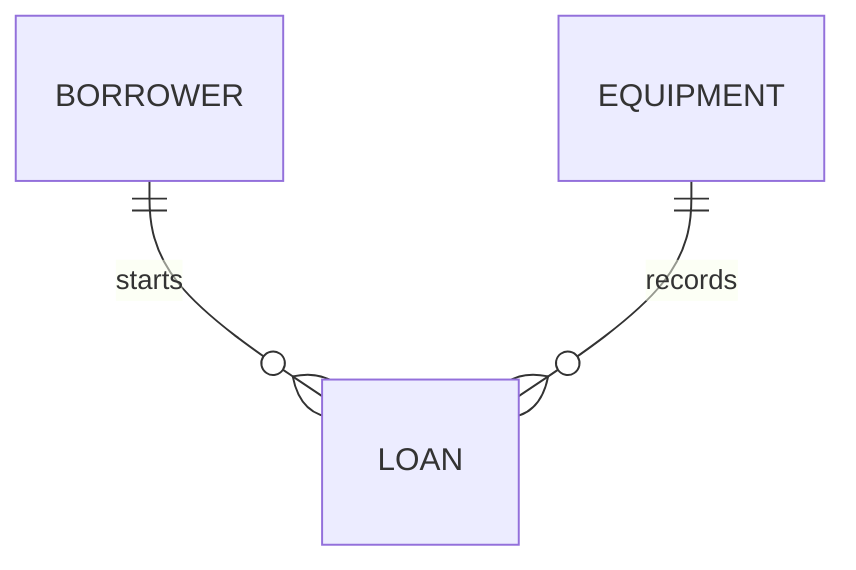
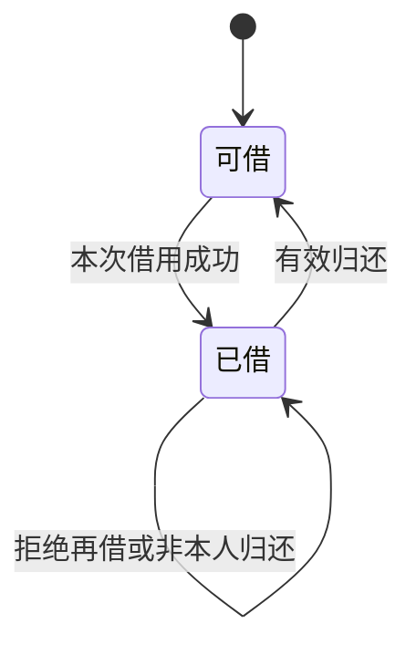

# 软件工程（双语）复习：可行性、需求、设计与面向对象建模

这份旧复习提纲覆盖前五章，第三至第五章特别强调用模型解释系统。以下以独立的器材借用案例贯通各章，原件和教材图编号保留作检索线索；不把这份提纲当作现行考试范围。

## 软件产品与可行性：先问值不值得做

软件交付的不只是代码，还包括数据、文档和运行维护所需的服务。软件不会像零件那样因摩擦而磨损，但依赖变化、业务规则更新、难以维护的设计会逐渐使它不再好用。规模扩大后，零散的个人技巧不足以解决成本超支、延期、质量差和维护困难：方法给出怎样做，工具减少重复工作，过程协调谁做、何时做、怎样验收，三者不能互相替代。这也把技术、开发工具与组织管理串了起来。系统软件、支撑软件与应用软件按主要职责分类，不等同于生命周期的策划、开发与运行维护三个时期。参见[软件危机](../../../topics/软件工程/软件危机.md)、[软件的本质](../../../topics/软件工程/软件的本质与定义.md)。

假设实验室希望从纸质登记改成器材借用系统。原件列出的五类可行性可变成五个需要证据的问题：

| 视角 | 器材借用项目的核查问题 |
|---|---|
| 技术 | 能否接入校园身份并保证同一件器材不会在并发下被借出两次？ |
| 经济 | 节约的时间和减少错账的收益，是否值得覆盖开发、迁移、培训、设备及长期维护成本？ |
| 社会 | 保存借用人身份的范围和时长是否得当，制度、用户信任与授权条件是否具备？ |
| 开发方案 | 现有工具改造、采购或自建，哪一种能在预算、工期和风险内交付？ |
| 运行 | 管理员是否能接手，断网、扫码失败和数据恢复时是否有可执行的流程？ |

> [!TIP]
> ==能写出来，不等于能长期运行==。如果项目做得成但值班人员处理不了异常，主要缺口是运行可行性；如果身份系统暂时没有可接入的接口，先核实技术可行性。

## 需求与数据流：规定系统对外保证什么

需求难点不是把口头要求抄下来，而是把动态、互相冲突、有时还不完整的说法变成各方都能理解并检验的约定。先定边界、识别干系人，获取需求，再分析冲突并写清约束，最后用例子和测试验证。例如“借用要快”还不能验收；可拆成业务条件与性能指标。**业务约束**可以明确为：“任一器材同时最多有一条未归还记录；失败的借出不会改动已生效记录。”是否需要 2 秒内确认则应和使用者另外约定，不能替他们决定。

结构化分析从数据域和功能域出发，自顶向下分解。数据流图（DFD）回答数据从何处来、被什么加工、读写哪里、流到何处，不描述每一步发生的精确时刻或程序调用顺序。数据字典补充数据流的字段含义，加工说明补充规则、输入输出条件。面向对象分析则会从角色的用例与领域对象入手；两种模型着眼点不同，可以围绕同一需求互相校对。

若把“受理借用”进一步分成核查规则、提交记录、生成回执，子图整体仍应有父图约定的外部输入与输出，不能在细化时凭空增加新的外部数据来源。原件第 5-10 图是宾馆案例的数据流图，可用同一方法区分加工、住客和客房数据及记录更新，不应把其中的线当作时序图消息。参见[需求分析方法](../../../topics/软件工程/需求分析方法学.md)、[面向流的建模](../../../topics/软件工程/面向流的建模DFD.md)。

## 总体与详细设计：用关系图检查边界

总体设计决定子系统、模块、层次及主要接口，详细设计再决定内部数据结构、算法和异常路径。高内聚是同一模块内部职责围绕一个目标，低耦合要求模块不依赖彼此隐藏状态。模块并非越小越好：过大的模块可能揉进多个职责，过细则会使一次业务改动跨太多接口。选择详细设计工具时，要求表达明确、能体现结构、方便局部修改并保持可读性。

原件第 4-5 图的指标必须按边数和层级分别算。独立例子中，入口在第 1 层，按钮处理后分发到同层的核查、借用、回执三个模块（第 2 层），第 3 层放规则与记录两个组件。入口直接依赖三个模块，扇出为 3；若核查和借用都依赖规则组件，规则组件扇入为 2。按根为第 1 层计，深度为 3，宽度按同层最大模块数计也为 3；两者这里相等只是巧合。扇入高可以表示复用，也会扩大修改的影响；单靠扇入或扇出不能判断质量。参见[内聚](../../../topics/软件工程/内聚.md)、[耦合](../../../topics/软件工程/耦合.md)。

原件第 4-12 图是班级、学生、课程、教师的 E-R 模型，重点之一是：成绩属于学生与课程的一次选课关系，而不是只属于某个学生或某门课程。用新的器材模型复核这条原则：借出时间与归还时间属于某次借用记录，既不是用户固有属性，也不是器材固有属性。

每条借用记录只指向一个人和一件器材，而同一件器材在历史上可有多次借用。E-R 的一对多不代表**同一时刻**可以有多条有效记录；“最多一条未归还”是额外的一致性约束。只有读取记录并作检查，不足以阻止两条请求同时通过；检查与写入应由同一个原子操作完成，例如用事务及适合的数据约束。参见[数据建模与 ERD](../../../topics/软件工程/数据建模与ERD.md)。

界面设计要和需求同步：了解普通借用人与管理员的任务和熟练度，再选择界面的交互方式及信息密度。普通用户看到“已借出”之前，应确认提交已实际成功；失败后要告诉用户可以怎样处理，而不是显示与实际状态不一致的成功提示。用易用性、灵活性与可靠性一起验收。页面适合操作场景，主任务简单，撤销或重试行为可控，文字、图标和颜色不要互相矛盾。

## 面向对象与 UML：换一个问题，就换一张图

对象有标识、属性与服务；两件同型号的器材即使描述相同，仍由各自标识区分。类是共同属性和行为的抽象。继承可分单重与多重，不是每种语言都支持相同组合。通过共有的接口请求服务时，可能按对象的实际类型选择实现，这一动态绑定机制支持多态；它不等于用父类的名字背出子类的全部方法。

UML 的阅读可按基本构造块、连接与使用规则、通用机制理解。用例问“哪个外部角色想从系统获得什么结果”，不规定内部实现。原件第 5-5 图用三个角色和用例关系区分使用与扩展：一个用例必需的公共行为，与有条件才增加的行为不是一回事。后续保险承办案例（图 5-14）和图书馆读者、馆员、系统管理员案例（图 5-16）展示的是职责和系统边界，不是按画图顺序执行各个动作。提纲另列图 5-18，但 DOCX 未附该图；此处不推断其画法或内容。参见[用例开发](../../../topics/软件工程/用例开发.md)、[UML 类图与类关系](../../../topics/软件工程/UML类图与类关系.md)。

例如，同一器材有两人争用时，用例说两人都能请求借出，E-R 图说每人以前可有多条记录，状态图才规定第一人成功后第二人必须等待归还：

| 独立案例的验收情境 | 应观察到的结果 |
|---|---|
| 甲先借一件可借器材 | 成功，留下甲的有效记录 |
| 未归还时乙又试借 | 失败，甲的有效记录原样保留 |
| 乙试图归还甲所借器材 | 拒绝，不产生新的归还事件 |
| 甲归还，乙随后借出 | 原记录留在历史中，乙成为唯一当前借用人 |

> [!IMPORTANT]
> ==模型看似都正确，组合后的约束仍需测试==。从需求里的“最多一条有效借用”出发，核对数据关系、状态迁移、界面提示及可观察结果；它比只检查“每张图都画出来了”更能发现设计缺口。

原件第六章只有课程预告，未给出可复核的知识点。本导读不据此推定该章细节。
