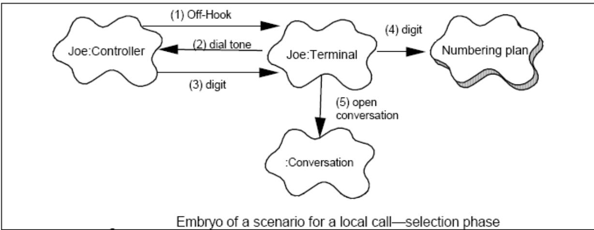
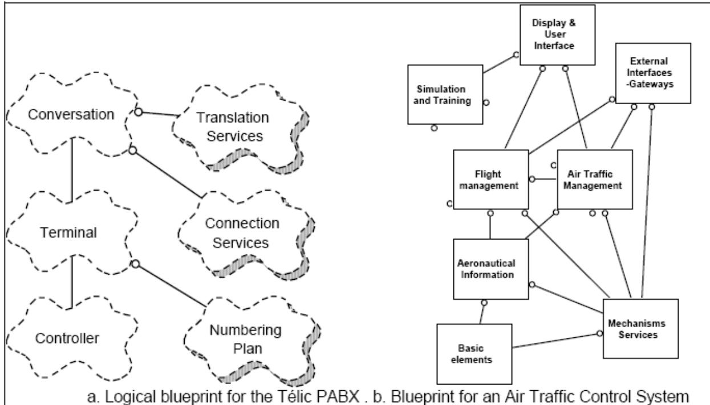
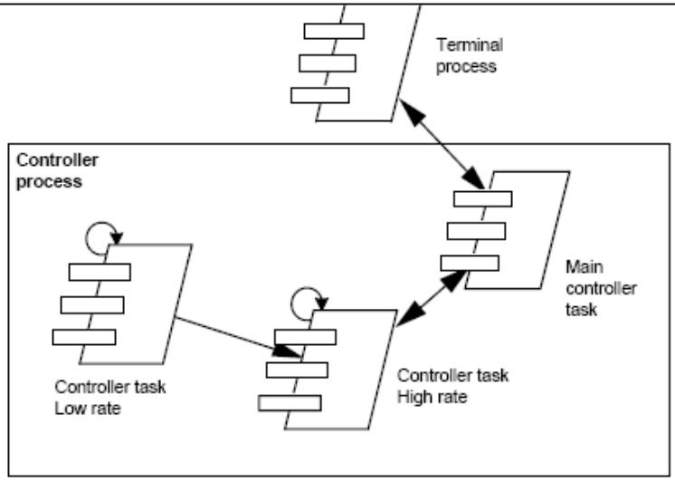
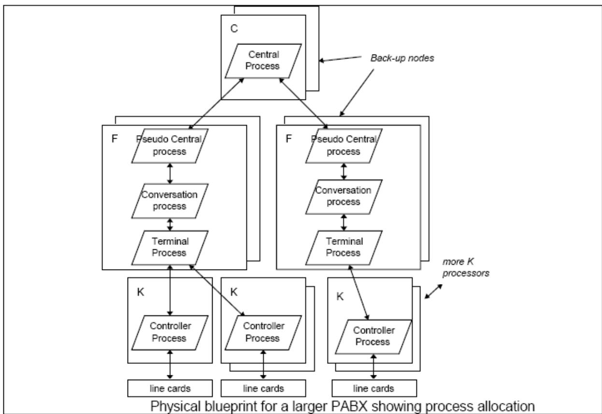
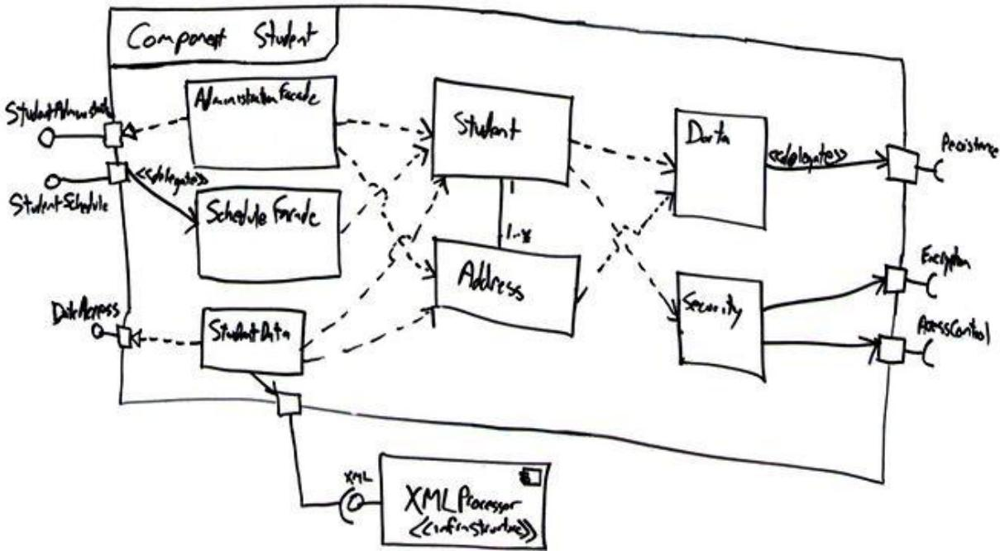
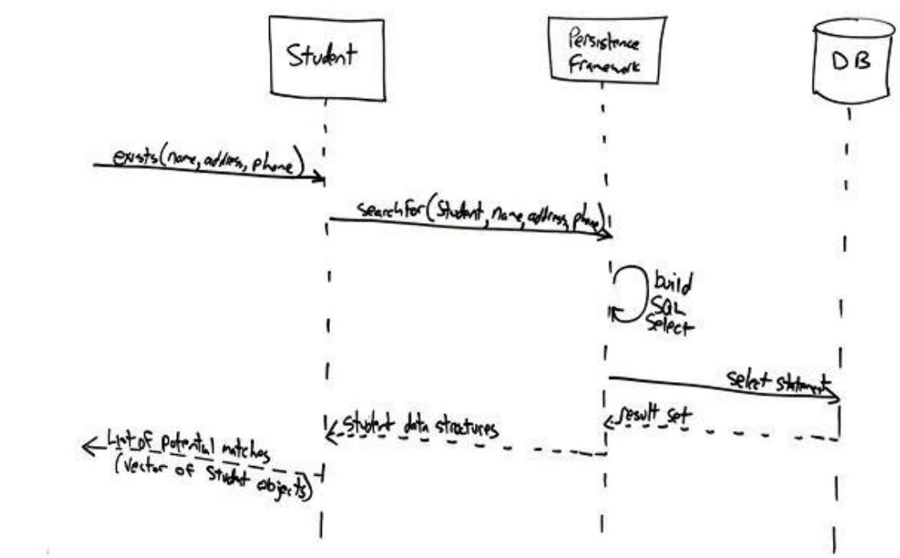

# 《软件工程（双语）》实验-02 软件设计说明书模板

原件经识别和整理；“参考解答”是我们补的。

## 1. 引言

### 1.1 目的

提供一份简要摘要，说明本文件的目的、范围和用途。

Provide a brief summary indicating the purpose, scope and use of this document.

### 1.2 范围

在此处描述设计的边界，说明包含哪些功能和排除哪些功能，此语句是根据业务功能给出的。

Describe the boundaries of the design here. State what functionality is included and what is excluded. This statement is given in terms of business functions.

### 1.3 定义与缩写

本节包括此处的术语与缩写词。

This section includes terms, acronyms and abbreviations herein.

### 1.4 参考文献

本文件引用了以下参考文献：

[SRS] 请参阅文件的最新批准版本，将 SRS 标题放在此处，请为 SRS 标题提供到包含此 SRS 的库的超链接。

[RTM] 请参阅该文件的最新批准版本。RTM 可以用来跟踪与组件相关的所有需求，将 RTM 标题放在此处，请为 RTM 标题提供到包含此 RTM 的库的超链接。

（可选）请注意此处的任何参考资料或相关材料。（其他一些技术文档，如您上面提到的 IETF、RFC……）

The following references are cited in this document:

[SRS] Please refer to the latest approved version of the document. Put SRS title here. Please provide the hyperlink to the library containing this SRS for the SRS title.

[RTM] Please refer to the latest approved version of the document. RTM can be used to trace all requirements related to the component. Put RTM title here. Please provide the hyperlink to the library containing this RTM for the RTM title.

(Optional) – Note any references or related materials here. (Some other technical documents like: IETF, RFC… that you mentioned above.)

## 2. 体系结构设计

### 2.1 注意事项

在本节中，考虑高级设计选项。考虑将您的设计推向特定方向的非功能（产品或技术）需求。

In this section, consider high-level design options. Consider non-functional (product or technology) requirements which push your design in a specific direction.

#### 2.1.1 设计选项

在高层，描述设计方向和基本原理。此外，描述考虑的替代方法以及未选择这些方法的理由。

At a high-level, describe the design direction and rationale. Also, describe alternative approaches considered and rationale for them not being chosen.

#### 2.1.2 假设

记录指导设计或可能影响设计的假设、悬而未决的问题和关注点。

在设计完成之前，应解决悬而未决的问题。如果假设无效或发生变化，则必须重新审查设计，以确保在必要时进行设计变更。

Document the assumptions, open issues, concerns that guide the design or have the possibility of affecting the design.

Open issues should be addressed before the design is completed. If assumptions are invalidated or change, the design must be revisited to ensure design changes are made as necessary.

#### 2.1.3 约束条件

指出影响设计的限制，即对设计施加的限制，以某种方式迫使设计决策。同样，这是由非功能性需求驱动的，如实时性、内存、可靠性、可扩展性等。

Indicate the constraints that affect the design, i.e. restrictions imposed on the design that force the design decisions a certain way. Once again, this is driven by non-functional requirements, such as real-time, memory, reliability, scalability etc.

### 2.2 系统级期望行为

这相当于 4+1 模型中的场景视图。

在最高级别上，描述需求将如何在系统级别上显示。如果设计涉及消息传递或类似行为，那么一个基本的概述将是一个好主意。

如果您使用的是面向对象的设计方法，请记录关键用例，描述硬件模块或节点如何协同工作以满足功能要求。

强烈建议使用图表。

This is equivalent to the Scenario View as per the 4+1 model.

At the very highest level, describe how the requirements will be shown at the system level. If the design involves messaging or similar behavior, a basic overview would be a good idea.

If you are using an object oriented design methodology, document key Use Cases which describe how the hardware modules or nodes work together to satisfy the feature requirements. Diagrams are highly recommended.

示例：此示例显示了小型 PABX 的场景片段。相应的脚本如下：

1. Joe 手机的控制器检测并验证从挂机到摘机的转换，并发送消息唤醒相应的终端对象。
2. 终端分配一些资源，并告诉控制器发出一些拨号音。
3. 控制器接收数字并将其发送到终端。
4. 终端使用编号计划来分析数字流。
5. 当输入了有效的数字序列时，终端打开对话。

Sample: This sample shows a fragment of a scenario for the small PABX. The corresponding script reads:

1. The controller of Joe's phone detects and validates the transition from on-hook to off-hook and sends a message to wake up the corresponding terminal object.
2. The terminal allocates some resources, and tells the controller to emit some dial-tone.
3. The controller receives digits and transmits them to the terminal.
4. The terminal uses the numbering plan to analyze the digit flow.
5. When a valid sequence of digits has been entered, the terminal opens a conversation.

### 2.3 体系结构的逻辑表示

这相当于 4+1 模型中的逻辑视图。

在最高层，描述将用于满足功能需求的体系结构的逻辑表示。这种表示不受现有软件体系结构、产品需求或目标硬件平台的约束，在这些平台上将满足功能需求。

This is equivalent to the Logical View as per the 4+1 model.

At the very highest level, describe a logical representation of the architecture that will be used to satisfy the functional requirements. This representation is not constrained by existing software architectures, product requirements or target hardware platforms upon which the functional requirements will be satisfied.

示例：

### 2.4 体系构件概述

这相当于按照 4+1 模型的实现视图。

识别并描述构成体系结构的软件组件及其关系。确定满足功能要求所需的新的、更改的和删除的软件组件（如适用）。

在描述该级别的体系结构时，考虑非功能性需求（如实时性、冗余性等）是很重要的。

This is equivalent to the Implementation View as per the 4+1 model.

Identify and describe the software components that make up the architecture and their relationships. Identify new, changed, and if applicable, deleted software components required to satisfy the functional requirements.

It is important to take into account non-functional requirements (such as real-time, redundancy etc.) when describing the architecture at this level.

## 2.4 软件相关性

### 2.4.1 软件相关性

在高层描述此设计所依赖的软件。如果适用，请参考正在并行进行的其他功能，以支持更大的项目或其他功能，这些功能可能会因该功能更改的同一软件中的交互或已知更改而产生影响。

At a high-level, describe software upon which this design depends. If applicable, reference other features which are being done in parallel to support a larger project or other features which may have impact due to interactions or known changes in the same software being changed by this feature.

### 2.4.2 缔约方组成部分说明

如果您的设计包括使用第三方软件，请记录构建与购买分析，以及围绕采用此方法做出决策的理由，并描述如何将其集成到设计的其余部分。

请注意，我们应该大力鼓励使用现有软件，以避免因使用第三方软件而产生的许可成本。

If your design includes the use of third party software, document build versus buy analysis and rationale for the decision around adoption of this approach and describe how it will be integrated into the rest of the design.

Please note that we should be strongly encouraging use of existing software in order to avoid licensing costs incurred as a result of using 3rd party S/W.

### 2.5 流程框架

此部分是可选的：这相当于 4+1 模型中的流程视图。

在高层，描述满足功能需求所需的过程体系结构。确定所需的新任务或流程和/或对现有任务的更改，以支持必要的执行流程。

如果设计是在一个单独的任务或过程中，和/或完全没有任务意识，只需说明这一点。

This section is optional: This is equivalent to the Process View as per the 4+1 model.

At a high-level, describe the process architecture required to satisfy the functional requirements. Identify new tasks or processes needed and/or changes to existing tasks to support the necessary execution flows.

If the design is within a single task or process and/or is completely task unaware, simply state this.

### 2.6 部署架构

此部分是可选的：这相当于按照 4+1 模型的部署视图。

在高层，将软件组件映射到将用于交付功能需求的硬件。

如果功能需求包含在单个硬件元素中或不知道硬件，只需说明这一点。

This section is optional: This is equivalent to the Deployment View as per the 4+1 model.

At a high-level, map the software components to the hardware which will be used to deliver the functional requirements.

If the functional requirements are contained within a single hardware element or unaware of hardware, simply state this.

## 3. 组件设计

本节及其小节规定了组件/模块的内部细节，他们还为组件和接口设计算法、数据类型和数据结构，典型活动包括：

1. 将所有软件需求分配给模块
2. 为模块选择算法、数据类型和数据结构
3. 指定模块接口的数据类型

This section and its subsections specify internal details of components/modules. They also design algorithms, data types, and data structures for components and interfaces. Typical activities include:

1. Allocate all software requirements to modules
2. Select algorithms, data types, and data structures for modules
3. Specify data types for module interfaces

### 3.1 组件-1 设计描述

使用能描述功能需求的简短术语，替换“组件-1 设计描述”。

提供每个组件的组成类别的详细说明。列出每个类的重要属性，并描述每个类中每个主要方法的目的和处理。应提供适当的 UML 图来说明组件中每个类之间的关系以及单独组件中类之间的任何交互。

Supply a detailed description of the constituent classes of each component. List the important attributes of each class, and describe the purpose and processing of each major method within each class. Suitable UML diagrams should be provided to illustrate the relationships between each class within the component and any interactions between classes within separate components.

#### 3.1.1 对象模型

本小节包括该组件所需的类图。

This subsection includes the class diagram required for this component.

#### 3.1.2 场景

本小节包括与该组件设计相关的场景，但在下一个细节级别。

This subsection includes the scenarios relevant to the design of this component but at the next level of detail.

#### 3.1.3 组件类设计

本小节包括对每个类的完整描述：方法、属性、操作。此外，对于已经存在的类，请在此处突出显示所做的更改。对每个类别重复。

This subsection includes a complete description of each class: methods, attributes, operations. Also, for a class which already exists, highlight here the changes made. Repeat for each class.

##### 3.1.3.1 类 1 设计

使用真实的类名，替换“类-1”。

| 属性: | \<数据元素/变量\> (Data elements/variables) |
| --- | --- |
| \<方法#1\>（使用真实的方法名） | 1. Pre-condition: 前提条件 \<列出任何必须为真的假设，以便组件1正确运行。一个很好的例子是，组件1可能假设某些文件已打开或已建立某个 Internet 连接。\> 2. Post-condition: 后置条件 \<描述由于执行此模块而导致的系统状态变化。注意：这是模块的“what”要求。\> 3. Algorithm: 算法 \<列出此组件为实现其预期目的而采取的步骤（可能是伪代码）。\> 4. Error handling/Exception processing: 错误处理/异常处理 \<描述算法描述中未明确的任何错误处理。\> |
| \<方法#2\> | ... |
| ... | ... |

##### 3.1.3.2 类 2 设计

根据项目需求，依次扩展 3.1.3.2，3.1.3.3，……

#### 3.1.4 算法

包括对设计算法的描述。

Include a description of the designed algorithms.

#### 3.1.5 接口

包括编码单元接口的说明。

Include a description of the coding unit interfaces.

#### 3.1.6 依赖（相关性）

识别并描述依赖于此设计的其他组件或此功能所在的体系结构的其他区域的性质。

Identify and describe the nature of dependencies upon other components of this design or other areas of the architecture in which this feature will reside.

#### 3.1.7 错误处理

包括任何调试命令、启用扩展调试信息的设置、错误消息和与此组件关联的日志文件。

Include any debug commands, settings to enable extended debugging information, error messages and log files associated with this component.

#### 3.1.8 GUI 实体模型

包括此组件的任何屏幕布局或用户界面模型。

Include any screen layouts or user interface mockups for this component.

### 3.2 组件-2 设计描述

根据项目需求，依次扩展 3.2，3.3，……

### 3.3

根据项目需求，依次扩展 3.2，3.3，……

## 4. 未解决问题列表

在此列出任何悬而未决的问题。

List out any open issues herein.
