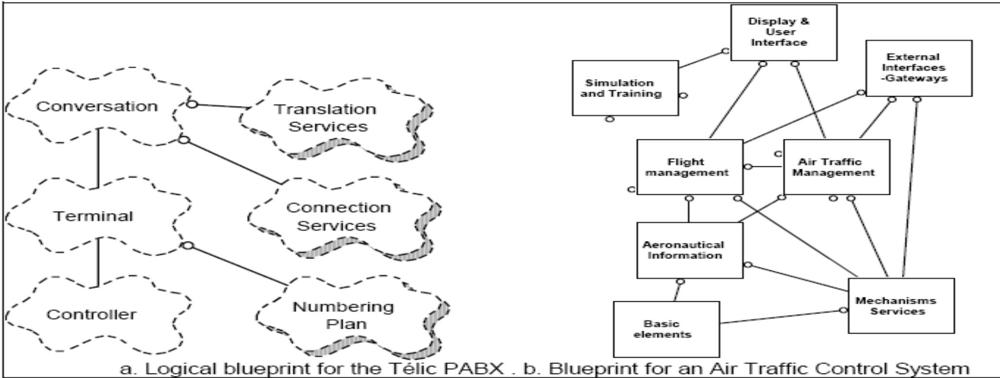
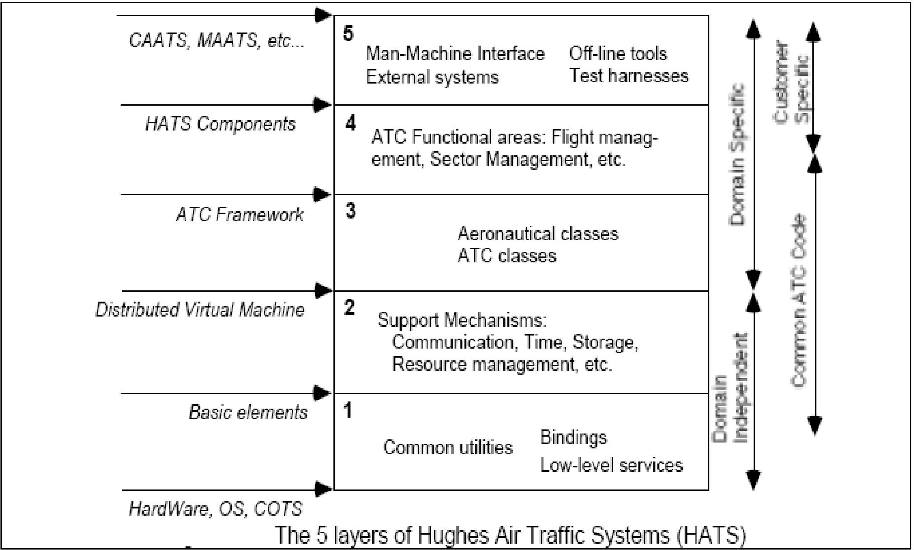
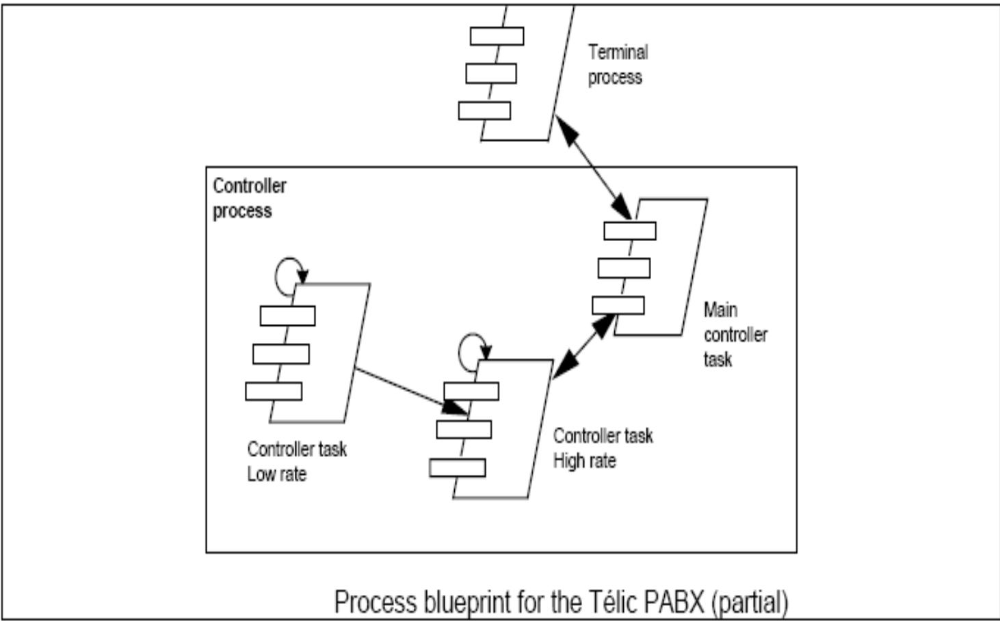
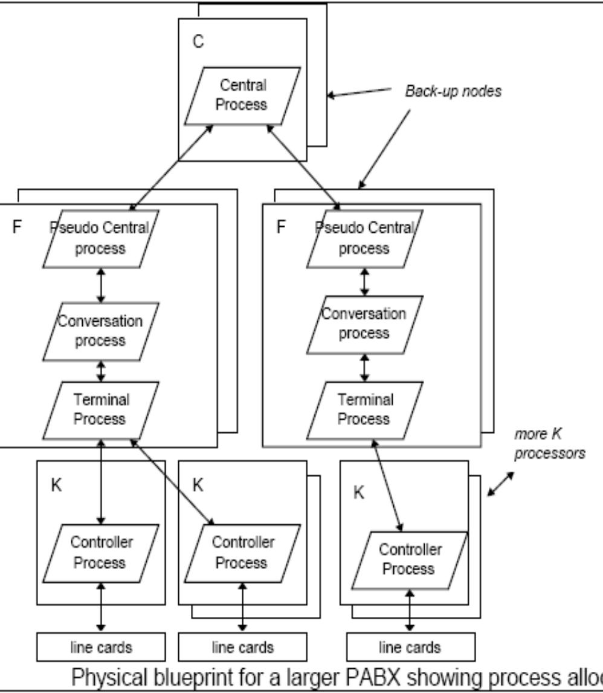
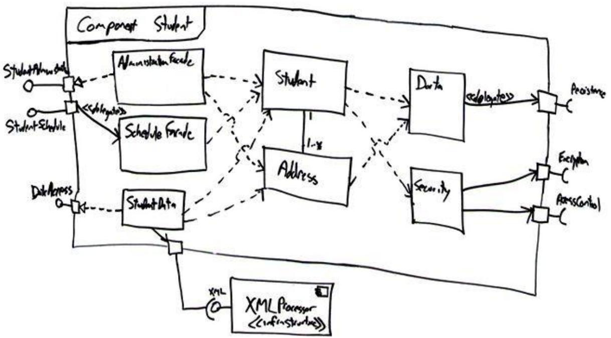
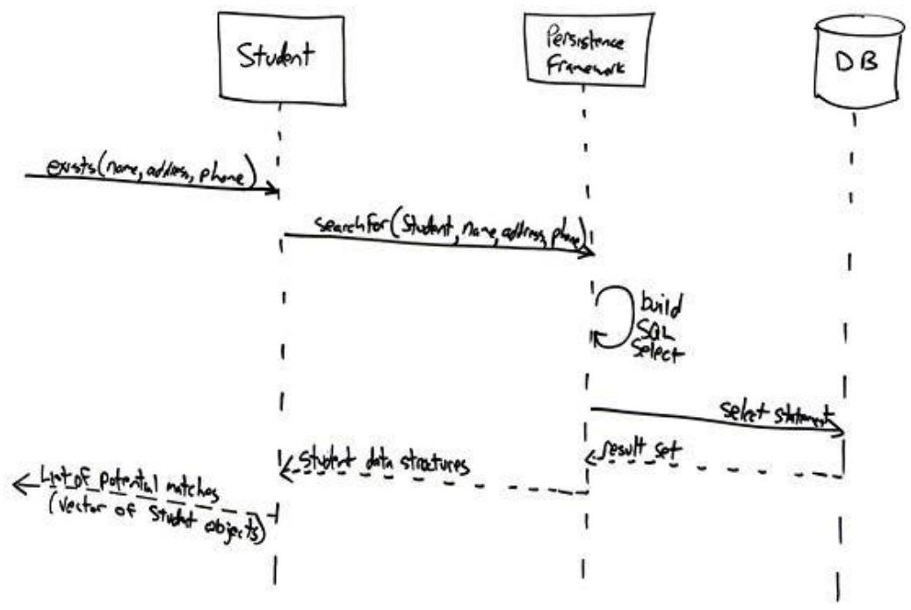

# 《软件工程（双语）》实验2 软件设计说明书的设计和撰写（课件）

原件经识别和整理；“参考解答”是我们补的。

本资料由郑尚东老师提供，南京邮电大学计算机学院、软件学院、网络空间安全学院。内容为实验指导及软件概要设计说明书的格式规范示例，基于GB8567—88国家标准整理。

## 一、实验目的

### 实验目的

该实验要求学生能够根据前期的需求分析说明书，正确表达软件设计说明书中的具体内容。

## 二、设计内容

### 设计内容

完成系统体系结构设计、数据设计、接口设计和过程设计等。

## 三、实验要求

### 实验要求

1. 概要设计过程中需要完成的工作有：软件系统结构的总体设计；处理方式设计；数据结构设计；可靠性设计。
2. 详细设计过程中需要完成的工作有：确定软件各个组成部分内的算法以及各部分的内部数据组织；选定某种过程的表达形式来描述各种算法。
3. 按照国标文档的规范格式，编制软件设计文档。

## 四、实验报告要求

### 实验报告要求

实验报告标准参照软件设计文档国家标准 GB8567—88 中概要设计和详细设计部分。

## 五、实验文档的格式说明

> **注意**：以下格式仅供参考，旨在展示《软件概要设计说明书》的标准结构。

### 封面模板

<项目名称>

Version 1.0

| 团队成员 | |
| :--- | :--- |
| 学号 | 姓名 |
| | |
| | |
| | |
| | |
| | |
| | |
| | |
| | |

- **项目名称**
- **实验分组**：4～6 人
    - 组长：
    - 组员：

*注：封面应包含南京邮电大学计算机学院、软件学院、网络安全学院标识。*

### 版本变更记录

记录文档书写中的版本变更。

| 版本 | 文档时间 | 更新人 | 变更说明(更新摘要) |
| :--- | :--- | :--- | :--- |
| | | | |
| | | | |
| | | | |
| | | | |
| | | | |
| | | | |
| | | | |
| | | | |
| | | | |

### 目录规范

仅列出 2 级目录。

```text
目录
1. 引言....1
   1.1 目的....1
   1.2 范围....1
   1.3 定义与缩写....1
   1.4 参考文献....1
2. 体系结构设计....2
   2.1 注意事项....2
   2.2 系统级期望行为....2
   2.3 体系结构的逻辑表示....3
   2.4 体系构件概述....4
   2.5 流程框架....5
   2.6 部署架构....6
3. 组件设计....7
   3.1 组件-1 设计描述....7
   3.2 组件-2 设计描述....11
4. 未解决问题列表....11
```

## 六、软件概要设计说明书正文规范

### 1、引言

#### 1.1 目的

提供一份简要摘要，说明本文件的目的、范围和用途。

#### 1.2 范围

在此处描述设计的边界。
- 说明包含哪些功能和排除哪些功能。
- 此语句是根据业务功能给出的。

#### 1.3 定义与缩写

本节包括此处的术语与缩写词。

#### 1.4 参考文献

本文件引用了以下参考文献：
- [SRS] 请参阅文件的最新批准版本 <将SRS标题放在此处> <请为SRS标题提供到包含此SRS的库的超链接>
- [RTM] 请参阅该文件的最新批准版本。RTM可以用来跟踪与组件相关的所有需求 <将RTM标题放在此处> <请为RTM标题提供到包含此RTM的库的超链接>

（可选）请注意此处的任何参考资料或相关材料。（其他一些技术文档，如您上面提到的IETF、RFC…。）

### 2、体系结构设计

#### 2.1 注意事项

##### 2.1.1 设计选项

在高层，描述设计方向和基本原理。此外，描述考虑的替代方法以及未选择这些方法的理由。

##### 2.1.2 假设

记录指导设计或可能影响设计的假设、悬而未决的问题和关注点。
- 在设计完成之前，应解决悬而未决的问题。
- 如果假设无效或发生变化，则必须重新审查设计，以确保在必要时进行设计变更。

##### 2.1.3 约束条件

指出影响设计的限制，即对设计施加的限制，以某种方式迫使设计决策。这是由非功能性需求驱动的，如实时性、内存、可靠性、可扩展性等。

#### 2.2 系统级期望行为

这相当于 4+1 模型中的用例视图。
- 在最高级别上，描述需求将如何在系统级别上显示。
- 若设计涉及消息传递或类似行为，那么一个基本的概述将是一个好主意。
- 若使用的是 OO 设计方法，请记录关键用例，描述硬件模块或节点如何协同工作以满足功能要求。
- 强烈建议使用图表。

**示例**


小型 PABX 的场景片段，对应脚本：
1. Joe手机的控制器检测并验证从挂机到摘机的转换，并发送消息唤醒相应的终端对象。
2. 终端分配一些资源，并告诉控制器发出一些拨号音。
3. 控制器接收数字并将其发送到终端。
4. 终端使用编号计划来分析数字流。
5. 当输入了有效的数字序列时，终端打开对话。

*专用自动交换分机 private automatic branch exchange*

#### 2.3 体系结构的逻辑表示

这相当于 4+1 模型中的逻辑视图。
- 在最高层描述将用于满足功能需求的体系结构的逻辑表示。
- 这种表示不受现有软件体系结构、产品需求或目标硬件平台的约束，在这些平台上将满足功能需求。



#### 2.4 体系构件概述

这相当于按照 4+1 模型的实现视图。
- 识别并描述构成体系结构的软件组件及其关系。确定满足功能要求所需新的、更改的和删除的软件组件（如适用）。
- 在描述该级别的体系结构时，考虑非功能性需求（如实时性、冗余性等）是很重要的。



##### 2.4.1 软件相关性

在高层描述设计所依赖的软件。若适用，请参考正在并行进行的其他功能，以支持更大的项目或其他功能，这些功能可能会因该功能更改的同一软件中的交互或已知更改而产生影响。

##### 2.4.2 缔约方组成部分说明

若设计包括使用第三方软件，请记录构建与购买分析，以及围绕采用此方法做出决策的理由，并描述如何将其集成到设计的其余部分。
- 注意，应该大力鼓励使用现有软件，以避免因使用第三方 S/W 而产生的许可成本。

#### 2.5 流程框架

此部分是可选的：这相当于 4+1 模型中的过程视图。
- 在高层描述满足功能需求所需的过程体系结构。确定所需的新任务或流程和/或对现有任务的更改，以支持必要的执行流程。
- 如果设计是在一个单独的任务或过程中，和/或完全没有任务意识，只需说明这一点。



#### 2.6 部署架构

此部分是可选的：相当于 4+1 模型的部署视图。
- 在高层，将软件组件映射到将用于交付功能需求的硬件。
- 如果功能需求包含在单个硬件元素中或不知道硬件，只需说明这一点。



## 七、组件设计

本节（3、组件设计）及其小节规定了组件/模块的内部细节。他们还为组件和接口设计算法、数据类型和数据结构，典型活动包括：
1. 将所有软件需求分配给模块
2. 为模块选择算法、数据类型和数据结构
3. 指定模块接口的数据类型

*注：使用能描述功能需求的简短术语，替换“组件-1设计描述”。根据项目需求，依次扩展 3.2，3.3，......*

### 3.1 组件-1 设计描述

提供每个组件的组成类别的详细说明。列出每个类的重要属性，并描述每个类中每个主要方法的目的和处理。应提供适当的 UML 图来说明组件中每个类之间的关系以及单独组件中类之间的任何交互。

#### 3.1.1 对象模型

#### 3.1.2 场景

#### 3.1.3 组件类设计

##### 3.1.3.1 类1设计

##### 3.1.3.2 类2设计

##### 3.1.3.3 ...

#### 3.1.4 算法

#### 3.1.5 接口

#### 3.1.6 依赖（相关性）

#### 3.1.7 错误处理

#### 3.1.8 GUI实体模型

本小节包括该组件所需的类图。



# 《软件工程（双语）》实验2 软件设计说明书的设计和撰写（课件）

本部分整理自《软件工程（双语）》实验2课件第29–37页，主要讲解软件设计说明书中“组件设计”章节的具体撰写规范与内容要求。

## 三、组件设计

### 3.1 组件-1 设计描述

本节详细说明了在软件设计说明书中如何描述单个组件（Component）。对于每个组件，需要依次展开以下子节进行完整描述：

#### 3.1.1 对象模型

#### 3.1.2 场景

#### 3.1.3 组件类设计

在此小节中，需要对每个类进行完整的描述，包括方法、属性、操作。此外，如果涉及已经存在的类，请在此处突出显示所做的更改。

**注意事项：**
- 对每个类别重复上述描述过程。
- 使用真实的类名，替换模板中的“类-1”。
- 根据项目需求，依次扩展后续组件（如 3.2, 3.3 等）。

##### 3.1.3.1 类1设计

以具体类为例，其设计描述应包含以下表格形式的内容：

| 属性 | <数据元素/变量> |
| :--- | :--- |
| **<方法#1>** (使用真实的方法名) | 1. **Pre-condition**: 前提条件<br>&nbsp;&nbsp;&nbsp;&nbsp;列出任何必须为真的假设，以便组件正确运行。一个很好的例子是，组件可能假设某些文件已打开或已建立某个Internet连接。<br><br>2. **Post-condition**: 后置条件<br>&nbsp;&nbsp;&nbsp;&nbsp;描述由于执行此模块而导致的系统状态变化。注意：这是模块的“what”要求。<br><br>3. **Algorithm**: 算法<br>&nbsp;&nbsp;&nbsp;&nbsp;列出此组件为实现其预期目的而采取的步骤（可能是伪代码）。<br><br>4. **Error handling/Exception processing**: 错误处理/异常处理<br>&nbsp;&nbsp;&nbsp;&nbsp;描述算法描述中未明确的任何错误处理。 |
| **<方法#2>** | ... |
| ... | ... |

##### 3.1.3.2 类2设计

*(此处省略，结构同 3.1.3.1)*

##### 3.1.3.3

*(此处省略，结构同 3.1.3.1)*

#### 3.1.4 算法

包括对设计算法的描述。

#### 3.1.5 接口

包括编码单元接口的说明。

#### 3.1.6 依赖（相关性）

识别并描述依赖于此设计的其他组件，或者此功能所在的体系结构的其他区域的性质。

#### 3.1.7 错误处理

包括任何调试命令、启用扩展调试信息的设置、错误消息和与此组件关联的日志文件。

#### 3.1.8 GUI实体模型

包括此组件的任何屏幕布局或用户界面模型。



## 四、未解决问题列表

在此列出任何悬而未决的问题。
