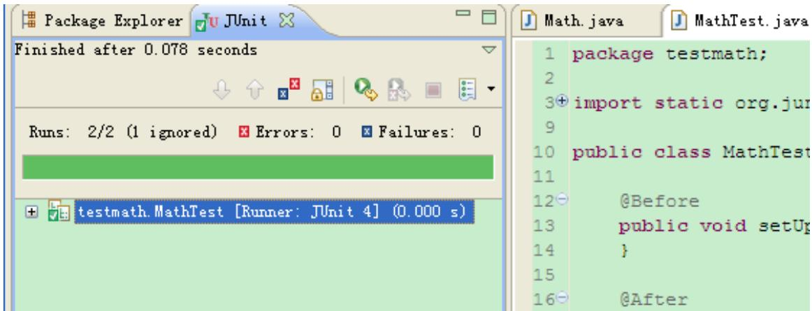

# 《软件工程（双语）》实验3 JUnit与TDD学习总结

原件经识别和整理；“参考解答”是我们补的。

# Junit 学习

整理自《软件工程（双语）》实验 3 的实验报告内容，覆盖 TDD 简介与 JUnit 框架的使用方法。

## 一、TDD 简介

### TDD 概述

许多书上都讨论了自动测试，但是只有很少的著作注意到这么一个问题，那就是怎样把这些测试组织起来。随着测试的增加，放置和调用这些测试却变得更加麻烦。这将成为一个重要问题，以至于出现了 TDD，极限编程（XP）使 TDD 得以普及。另外，你可以这样理解 TDD：通过测试来开发。

### TDD（Test-Driven Development：测试驱动开发）本质和优势

测试驱动开发不是一种测试技术，它是一种分析技术、设计技术，更是一种组织所有开发活动的技术。相对于传统的结构化开发过程方法，它具有以下优势：

1. TDD 根据客户需求编写测试用例，对功能的过程和接口都进行了设计，而且这种从使用者角度对代码进行的设计通常更符合后期开发的需求。因为关注用户反馈，可以及时响应需求变更，同时因为从使用者角度出发的简单设计，也可以更快地适应变化。
2. 出于易测试和测试独立性的要求，将促使我们实现松耦合的设计，并更多地依赖于接口而非具体的类，提高系统的可扩展性和抗变性。而且 TDD 明显地缩短了设计决策的反馈循环，使我们几秒或几分钟之内就能获得反馈。
3. 将测试工作提到编码之前，并频繁地运行所有测试，可以尽量地避免和尽早地发现错误，极大地降低了后续测试及修复的成本，提高了代码的质量。在测试的保护下，不断重构代码，以消除重复设计，优化设计结构，提高了代码的重用性，从而提高了软件产品的质量。
4. TDD 提供了持续的回归测试，使我们拥有重构的勇气，因为代码的改动导致系统其他部分产生任何异常，测试都会立刻通知我们。完整的测试会帮助我们持续地跟踪整个系统的状态，因此我们就不需要担心会产生什么不可预知的副作用了。
5. TDD 所产生的单元测试代码就是最完美的开发者文档，它们展示了所有的 API 该如何使用以及是如何运作的，而且它们与工作代码保持同步，永远是最新的。
6. TDD 可以减轻压力、降低忧虑、提高我们对代码的信心、使我们拥有重构的勇气，这些都是快乐工作的重要前提。

### TDD 现状

由于发展时间不长，相关应用并不是很成熟。现今越来越多的公司都在尝试实践测试驱动开发，但由于测试驱动开发对开发人员要求比较高，更与开发人员的传统思维习惯相违背，因此实践起来有一定困难。

## 二、Junit 的简单介绍

### Junit 概述

简单的说，junit 是用来做单元测试的一个工具。用其主页上的话来说就是：“JUnit 是由 Erich Gamma 和 Kent Beck 编写的一个回归测试框架（regression testing framework）。”在 www.junit.org 上可以下载到最新版本的 junit 包。

### 单元测试与集成测试

单元测试是一种白盒测试。目的是验证一个或若干个类是否按所设计的那样正常工作。集成测试则是验证所有的类是否能互相配合，协同完成特定的任务。

需要强调的是：测试是一个持续的过程。也就是说测试贯穿于开发的整个过程中，单元测试尤其适合于迭代增量式（iterative and incremental）的开发过程。

因为我们是测试新手，我们也不理会那些复杂的测试原理，先说一说最简单的：测试就是比较预期的结果是否与实际执行的结果一致。如果一致则通过，否则失败。

## 三、回归测试框架 —— JUnit

回归测试就是你不断地对所编写的代码进行测试：编写一些，测试一些，调试一些，然后循环这一过程，你会不断地重复先前的测试，哪怕你正编写其他的类，由于软件熵的存在，你可能在编写第五个类的时候发现，第五个类的某个操作会导致第二个类的测试失败。通过回归测试我们抓住了这条大 Bug。

## 四、junit 中的几个关键点

### Junit4 与 Junit3 的区别

Junit4 与 junit3 相比，做了比较大的改动。具体不细讲了，有兴趣可在网上查找些资料进行了解。

### 1. junit 框架（函数结构）简单实例

我们要测试 add 这个方法，我们在 junit4 中写单元测试得这么写：

（此处原件为代码块占位，未给出具体代码内容）

### @Ignore 元数据标记

该元数据标记的测试方法在测试中会被忽略。当测试的方法还没有实现，或者测试的方法已经过时，或者在某种条件下才能测试该方法（比如需要一个数据库连接，而在本地测试的时候，数据库并没有连接），那么使用该标签来标示这个方法。同时，你可以为该标签传递一个 String 的参数，来表明为什么会忽略这个测试方法。比如：`@Ignore("该方法还没有实现")`，在执行的时候，仅会报告该方法没有实现，而不会运行测试方法。

另外还有一些其他的元数据，具体请自己查资料。

### setUp 与 tearDown

setUp 与 tearDown，这两个函数是 junit framework 中提供初始化和反初始化每个测试方法的。setUp 在每个测试方法调用前被调用，负责初始化测试方法所需要的测试环境；tearDown 在每个测试方法被调用之后被调用，负责撤销测试环境。

它们与测试方法的关系可以描述如下：

（此处原件为示意图占位）

### 2. 建立测试的流程（步骤）

假设我们要写一个整数除法和乘法的类，并且给他写测试用例：

#### 1) 建立 Math 类

（此处原件为 Java 代码块占位，未给出具体代码内容）

#### 2) 建立测试用例

选中需要建立测试用例的包，选择 new → other → JUnit Test Case。

有 5 个方法可以选择：

- setUp() 方法在测试方法前调用，一般用来做测试准备工作。
- tearDown() 方法在测试方法后调用，一般作测试的清理工作。
- setUpBeforeClass() 方法在整个类初始化之后调用，一般用来做测试准备工作。
- tearDownAfterClass() 方法在整个类结束之前调用，一般作测试的清理工作。
- constructor() 为是否包含构造方法。

自动生成的代码如下：

（此处原件为 Java 代码块占位，未给出具体代码内容）

**说明：**

@BeforeClass 标签注释的方法用于在整个类测试过程的初始化后调用一次，@AfterClass 标签注释的方法则是整个测试类结束之前调用一次。这两个标签的搭配可以避免使用 @Before、@After 标签组合在每个测试方法前后都调用的弊端，减少系统开销，提高系统测试速度。（不过对环境独立性要求较高的测试还是应当使用 @Before、@After 来完成）

@Test 标签用来标注待测试的方法，按照类中声明的顺序执行。

我们在 testDivide 方法加入测试代码，分别测试三种情况：
- a. 完全正确也没有可能出错的数据，如：9 除 3 结果必须等于 3
- b. 可能有问题的边缘数据，如：10 除 3 结果也必须等于 3
- c. 错误的数据，如：10 除 0 必须抛出异常

忽略 testMultiple 方法。

代码如下：

（此处原件为 Java 代码块占位，未给出具体代码内容）

**说明：**

Junit4 为测试方法增加了判断异常的方式，避免了以前还要通过 try/catch 块捕捉异常再抛出的复杂方式，简单的这样声明 `@Test(expected=ArithmeticException.class)`，Junit4 就会检查此方法是否抛出 ArithmeticException 异常，如果抛出则测试通过，没抛出则测试不通过。（@Test 标签还有一些其他参数，例如超时测试 `@Test(timeout=1)` 这样，但是由于并不能准确反应实际时间，所以应用较少，经过我测试误差太大绝对不适合拿来做超时测试的。）

@Ignore 标签会告诉 Junit4 忽略它所标注的方法，例如数据库不可用时可以用此标注标注一些测试数据库连接的方法来避免测试失败。

#### 3) 运行测试

系统会打开 JUnit 透视图，如果测试全部通过，则显示颜色条为绿色：

我们将 `assertEquals(3, Math.divide(9, 3));` 改成 `assertEquals(2, Math.divide(9, 3));` 则显示颜色条为红色，我们可以对错误或者故障的地方进行追踪。

#### 4) 创建测试套件

测试套件可以将多个测试用例合在一起测试，将相关的测试用例合成一个测试套件，在做一个修改后，只需要运行测试套件就可以，不需要运行每一个测试用例。

Junit4 没有采用以前的套件测试方法，同样使用 annotation 的方式进行。简单在你所要构建测试套件的包里创建一个文件，一般以包名+4Suite。

下面我在上面的测试包中复制一下之前的测试类并且一个改名字叫做 MathTestAnother，新建一个 class 类叫做 Uitl4Suite，代码如下：

（此处原件为 Java 代码块占位，未给出具体代码内容）

**说明：**

通过 @RunWith 和 @SuiteClasses 标签来注释一个空的包含无参数构造函数的类来作为套件类，将需要组成套件运行的类加到 @SuiteClasses 的属性中即可。

可以看到运行套件类的结果是 2 个测试类都进行了测试。

#### 5) 参数测试

修改 testMultiple：

（此处原件为 Java 代码块占位，未给出具体代码内容）

编写参数方法：

（此处原件为 Java 代码块占位，未给出具体代码内容）

**说明：**

需要使用 @Parameters 标签注解一个静态的返回集合对象的方法。

增加成员变量和构造函数：

（此处原件为 Java 代码块占位，未给出具体代码内容）

最后在给测试类增加如下注释：

（此处原件为 Java 代码块占位，未给出具体代码内容）

完整的循环测试代码如下：

（此处原件为 Java 代码块占位，未给出具体代码内容）

结果如下图示，程序跑了 5 次，并通过运行。

| testmath.MathTest [Runner: JUnit 4] (0.000 s) |      |
|-----------------------------------------------|------|
| [0]                                           | (0.000 s) |
| [1]                                           | (0.000 s) |
| [2]                                           | (0.000 s) |
| [3]                                           | (0.000 s) |
| [4]                                           | (0.000 s) |
