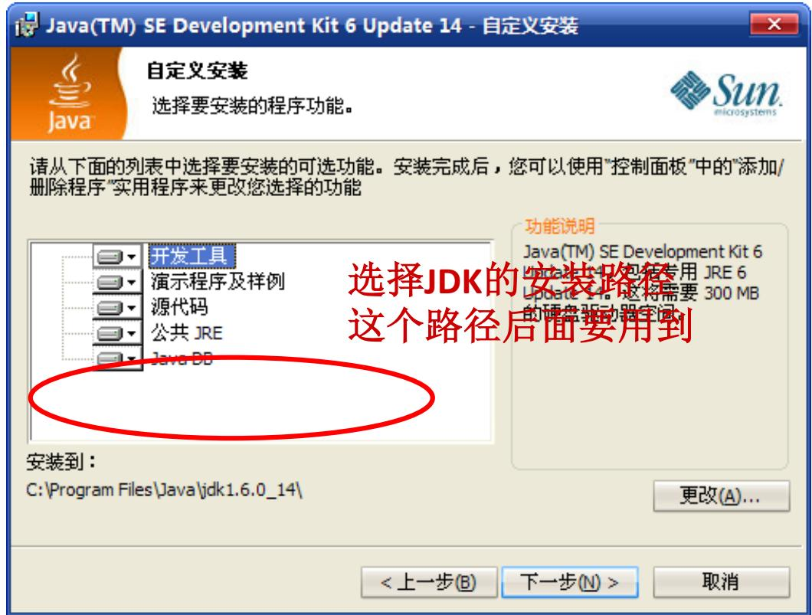
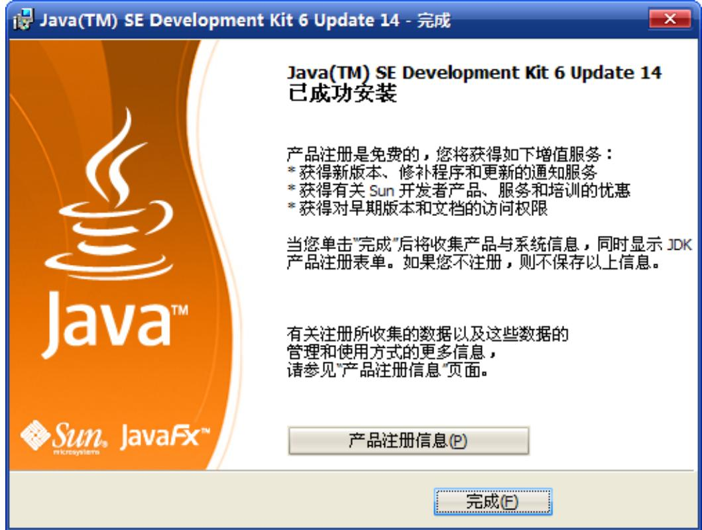
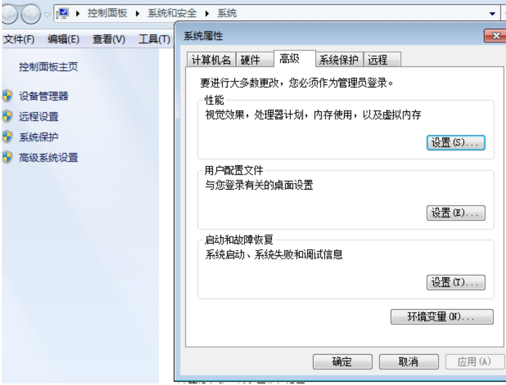
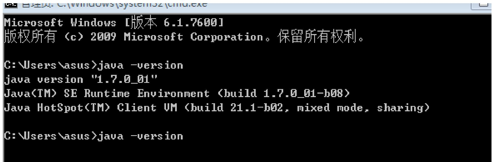
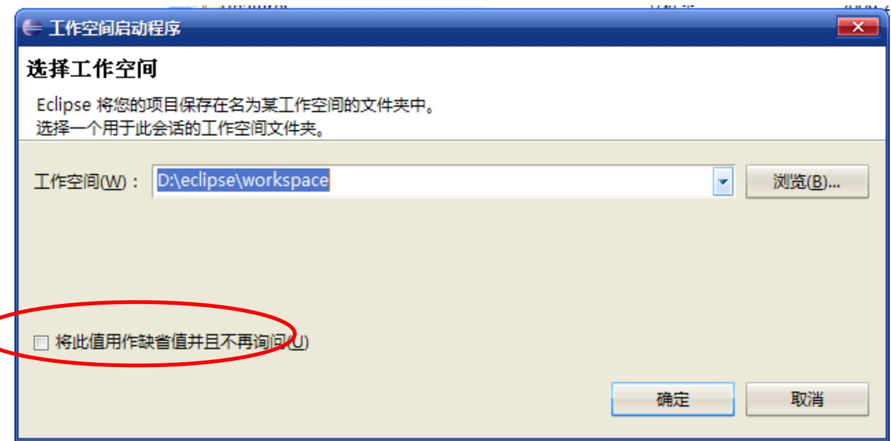
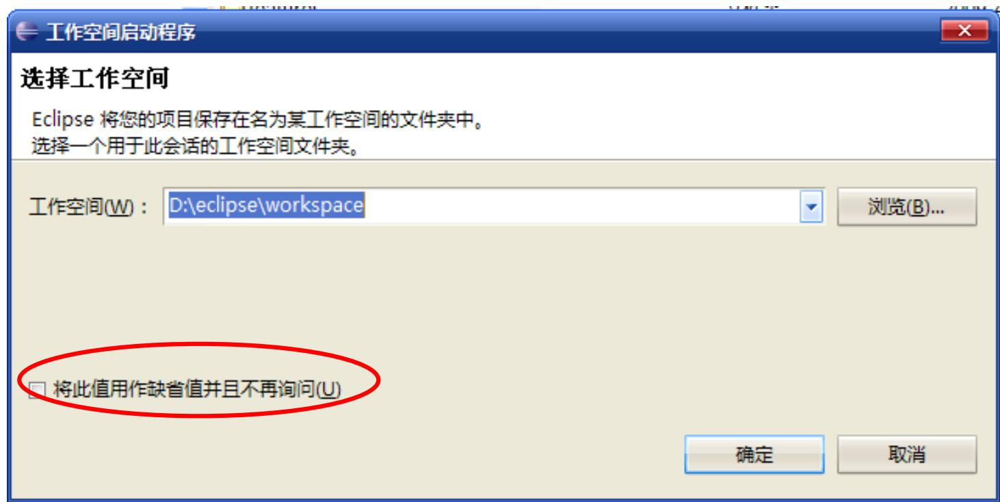
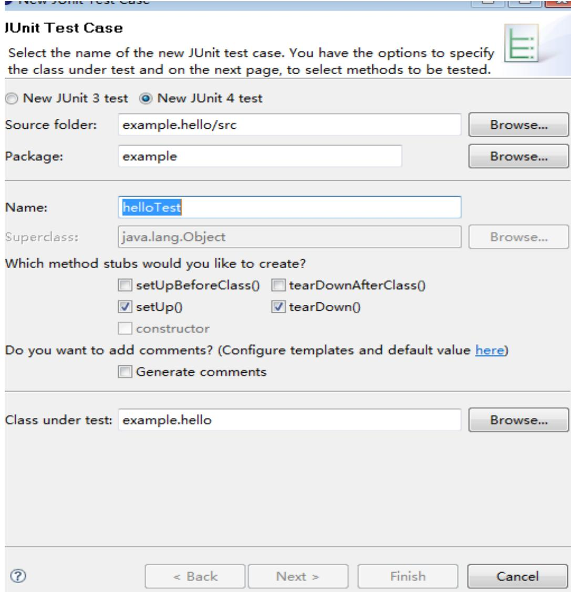
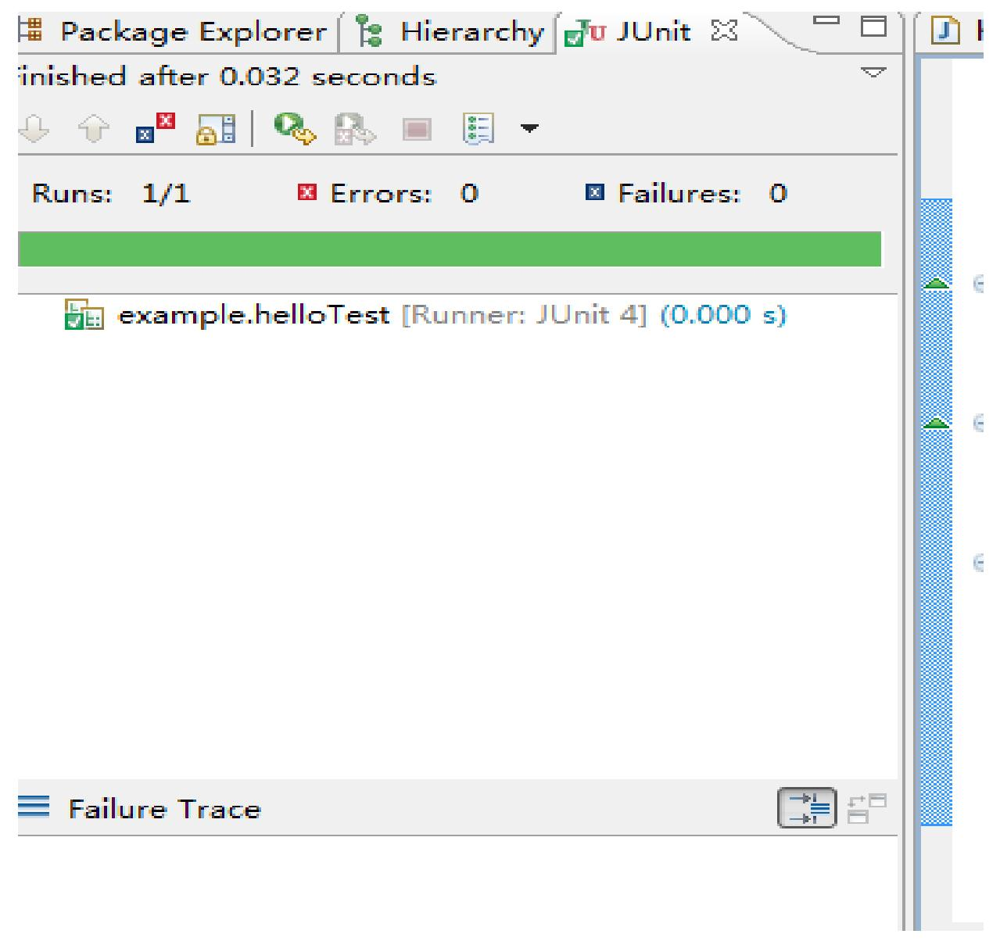

# 《软件工程（双语）》实验3 参考资料：JDK配置、Eclipse安装与JUnit使用（课件）

原件经识别和整理；“参考解答”是我们补的。

## JUNIT 使用方法

- 1、Eclipse 的配置

安装配置指南：

- 安装 jdk-7u1-windows-7.0
- 安装 eclipse-SDK-3.4.1-win32

- 2、JUnit 使用

### 1、安装 JDK

#### 运行 jdk-7u1-windows-7.0.exe

选择安装路径。



安装到：

C:\Program Files\Java\jre6

选择 JRE 的安装路径使用默认路径即可。

正在安装 Java(TM) SE Development Kit 6 Update 14。

Java 安装 - 目标文件夹：

目标文件夹：单击“更改...”以将 Java 安装到其他文件夹。

#### 安装完成



注：Java 是一个运行环境/平台，因此安装完毕后，在“开始”→“程序”中，不会有 Java 的启动程序什么的。

#### 配置环境变量

如果是 Win2000、WinXP 系统，使用鼠标右击“我的电脑”->属性->高级->环境变量：

- 系统变量->新建->变量名：`JAVA_HOME`，变量值：jdk-7u1-windows-7.0
- 系统变量->新建->变量名：`CLASSPATH`，变量值：`.;%JAVA_HOME%\lib`
- 系统变量->编辑->变量名：`Path`，在变量值的最前面加上：`%JAVA_HOME%\bin;`

如果是 Vista、Win7、Win8 系统，使用鼠标右击“计算机”->属性->左侧高级系统设置->高级->环境变量：

- 系统变量->新建->变量名：`JAVA_HOME`，变量值：`c:\jdk1.6.0_21`
- 系统变量->新建->变量名：`CLASSPATH`，变量值：`.;%JAVA_HOME%\lib`
- 系统变量->编辑->变量名：`Path`，在变量值的最前面加上：`%JAVA_HOME%\bin;`

（CLASSPATH 中有一英文句号“.”后跟一个分号，表示当前路径的意思）

（使用命令行的方法设置环境变量，只会对当前窗口生效）

（改 Path 变量时，不是删除原有的值而是添加新的路径）

#### 在“高级”选项卡中，选择“环境变量”



#### 下面是我配置好的

编辑系统变量：

| 变量名 | 变量值 |
| --- | --- |
| classpath | `.;%JAVA_HOME%\lib\dt.jar;%JAVA_HOME%\lib\tools.jar` |
| JAVA_HOME | `C:\Program Files (x86)\Java\jdk1.7.0_01` |
| Path | `%JAVA_HOME%\bin;%JAVA_HOME%\jre\bin` |

#### 安装确认

打开“cmd”，分别输入命令：

- `java -version`
- `Java -version`

可以看到版本为 1.6.0_14，说明已经安装成功。

如果未出现或提示错误，请检查“环境变量”的设置是否正确。



### 3、Eclipse 3.4.1

#### 安装

- 将 eclipse-SDK-3.4.1-win32.rar 解压缩
- 解压缩后会有一个 eclipse 目录
- 运行 eclipse.exe
- 或者：
  - eclipse_en.bat：英文版
  - eclipse_zh.bat：中文版

#### 运行

启动画面：

eclipse GALILEO

(c) Copyright Eclipse contributors and others. 2000, 2009. All rights reserved. Java and all Java-related trademarks and logos are trademarks or registered trademarks of Sun Microsystems Inc. in the U.S., other countries, or both. Eclipse is a trademark of the Eclipse Foundation, Inc.

选择工作空间：

- 一般使用默认设置。
- 这个目录是用来保存你的程序的。当然你也可以保存到别的目录。



Eclipse 主画面：

```java
package cn.edu.xidian.liujiong.javacourse.chapter1;

public class HelloWorld {
    public static void main(String[] args) {
        System.out.println("Hello, world");
    }
}
```

#### 选择工作空间

- 一般使用默认设置。
- 这个目录是用来保存你的程序的。当然你也可以保存到别的目录。



Eclipse 主画面：

```java
package cn.edu.xidian.liujiong.javacourse.chapter1;

public class HelloWorld {
    public static void main(String[] args) {
        System.out.println("Hello, world");
    }
}
```

### 2、JUnit 使用

一般如何使用 JUnit 写测试：

JUnit 框架的结构：

1. import 声明引入必须的 JUnit 类（核心包：`junit.framework` 和 `junit.runner`）；
2. 定义一个测试类从 `TestCase` 继承；
3. 重载 `setUp()`，封装测试环境初始化及测试数据准备；
4. 测试类包含一些以 `test` 开头的测试方法；
5. 每个方法包含一个或者多个断言语句。

当然还有一些其他的内容，但满足以上几条的就已经是一个 JUnit 测试了。

#### JUnit 断言

JUnit 提供了一些辅助函数，用于帮助开发人员确定某些被测试函数是否工作正常。通常而言，把所有这些函数统称为断言，断言是单元测试最基本的组成部分。

`Assert` 类中的断言以及部分实现，每个函数的实现方法都为 `Assert` 类中定义的方法。

#### 常用的断言方法

| 断言方法 | 描述 |
| --- | --- |
| `assertEquals(a,b)` | 测试 a 是否等于 b |
| `assertNull(a)` | 测试 a 是否为 null，a 是一个对象或者 null |
| `assertNotNull(a)` | 测试 a 是否非空，a 是一个对象或者 null |
| `assertSame(a,b)` | 测试 a 和 b 是否都引用同一个对象 |
| `assertNotSame(a,b)` | 测试 a 和 b 是否没有都引用同一个对象 |
| `assertTrue(a)` | 测试 a 是否为 true，a 是一个 Boolean 值 |
| `assertFalse(a)` | 测试 a 是否为 false，a 是一个 Boolean 值 |

#### 示例

首先新建一个类 hello，新建一个方法 test：

```java
package example;

public class hello {
    public static int test(int n) {
        // TODO Auto-generated method stub
        return n >= 0 ? n : (-n);
    } // 返回一个整形的绝对值
}
```

在类名上点右键，然后新建一个 JUnit Test Case：

| 菜单项 | 快捷键 |
| --- | --- |
| Package |  |
| Open | F3 |
| Open With |  |
| Open Type Hierarchy | F4 |
| Show In | Alt+Shift+W |
| Copy | Ctrl+C |
| Copy Qualified Name |  |
| Paste | Ctrl+V |
| Delete | Delete |
| Build Path |  |
| Source | Alt+Shift+S |
| Refactor | Alt+Shift+T |
| Import... |  |

在 setup 和 tearDown 前打钩，并且为文件起名：

Select the name of the new JUnit test case. You have the options to specify the class under test and on the next page, to select methods to be tested.



```java
package example;

import junit.framework.TestCase; // 包的引入

public class helloTest extends TestCase { // 定义一个测试类从 TestCase 继承；
    protected void setUp() throws Exception {
        super.setUp(); // 重载 setUp()，封装测试环境初始化及测试数据准备；
    }

    protected void tearDown() throws Exception {
        super.tearDown();
    }

    public void testTest() {
        assertEquals(hello.test(14), 14);
        // 测试类包含一些以 test 开头的测试方法
        assertEquals(hello.test(-5), 5);
        assertEquals(hello.test(0), 0);
        // 每个方法包含一个或者多个断言语句。
        // assertEquals(a,b) 测试 a 是否等于 b
    }
}
```

如果运行正确，左边截图是绿色，否则是红色。



如果本身不带 JUnit 包的话，我们需要手动包含。步骤如下：

在工程名上点右键，点 Build Path，把文件包的路径写进去。
