# 《软件工程（双语）》实验3 软件单元测试指导书

原件经识别和整理；“参考解答”是我们补的。

# 实验三：Software Unit Testing

## 一、 实验目的

对 Java单元测试有初步的了解，学会使用 Junit 编写自己的测试用例，掌握对被测试类进行测试的实现方法；了解轻量级的自动化工具 Selenium，学会使用Selenium 进行网站自动化测试（选做）。

## 二、 实验内容

1. 阅读理解 Junit 的工作机制。
2. Eclipse 环境下的单元测试。
3. 利用Junit 编写测试用例，并对被测试类进行相关功能测试。
   a) 验证 Book 类的 equals 方法；
   b) 设计 Triangle类的测试用例，并进行测试。
4. 利用Selenium 进行Web 应用程序的自动化测试。（选做）

## 三、 实验步骤

实验采用 Eclipse IDE for Enterprise Java Developers

### 步骤 1

开始—〉程序—〉Eclipse IDE for Enterprise Java Developers，启动 Eclipse工作环境。

### 步骤 2

File——〉New——〉Project 创建一个新的工程，选择 Java Project，如图所示，点击 Next。

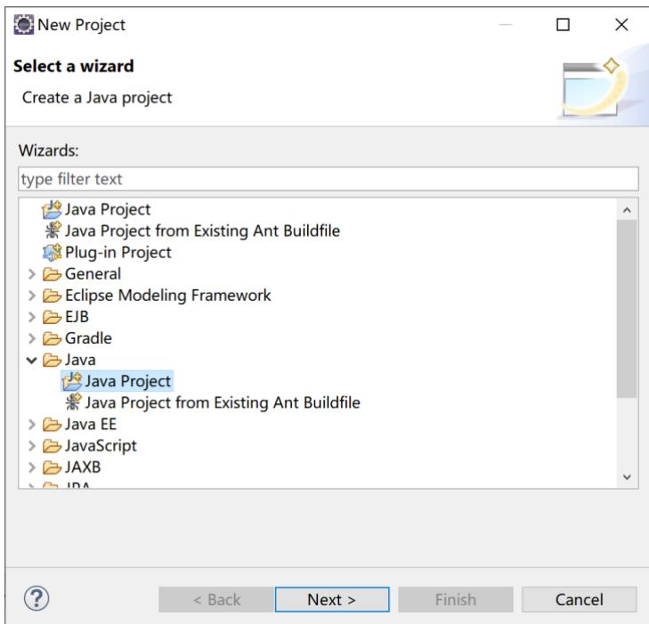

### 步骤 3

项目名称（Project name）输入“UnitTest”，点击 Next。

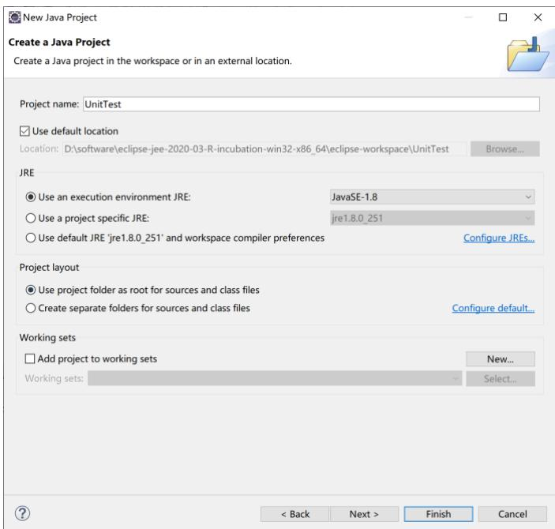

### 步骤 4

选中 Libraries 标签，点击“add Library”添加必要的 Junit 类库。

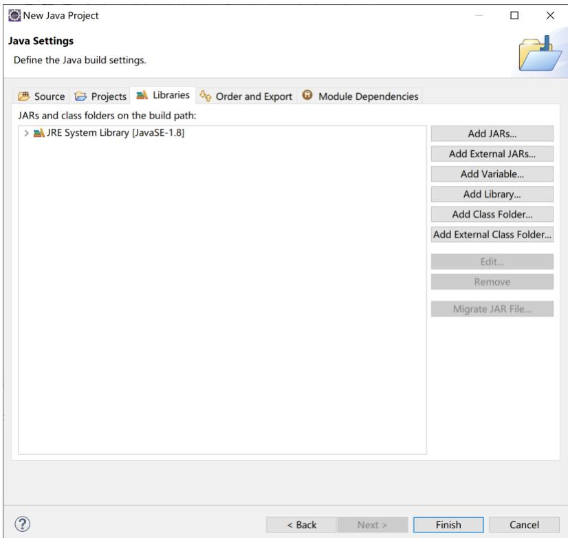

### 步骤 5

选中 JUnit，点击 Next；

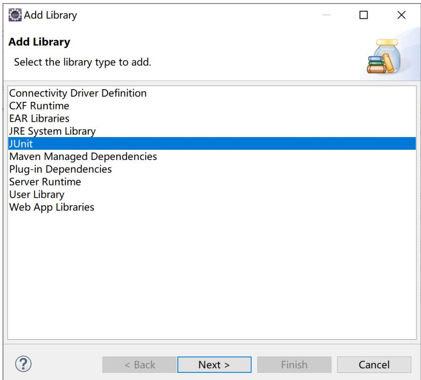

### 步骤 6

选择默认的Junit5，点击Finish，完成类库的添加，如图所示

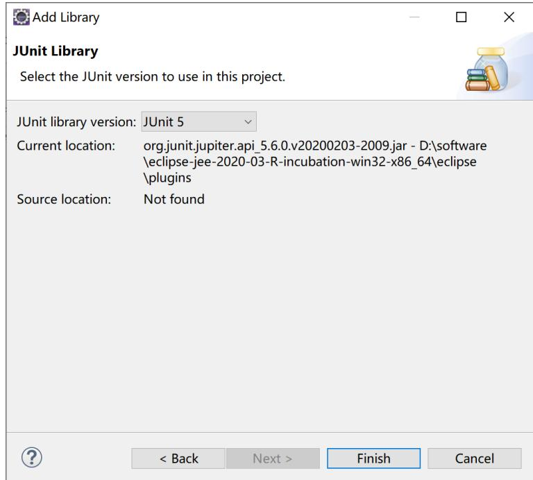

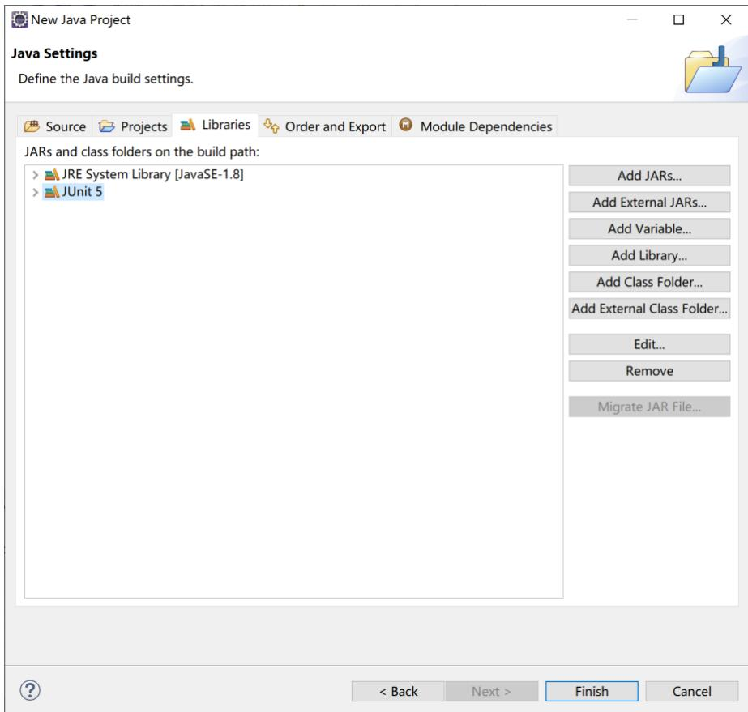

### 步骤 7

点击Finish，完成UnitTest项目的设置，进入项目工作界面。

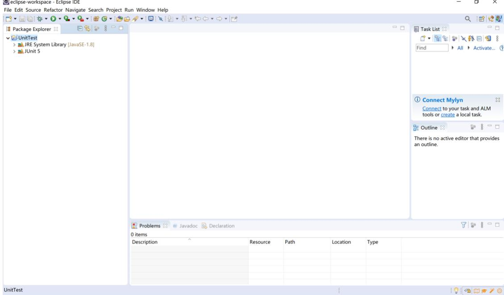

### 步骤 8

在 UnitTest 上右键，——〉New——〉Class，弹出添加类窗口。Package 中填写cn.edu.njupt，Name 中填写 Book。（注意大小写）

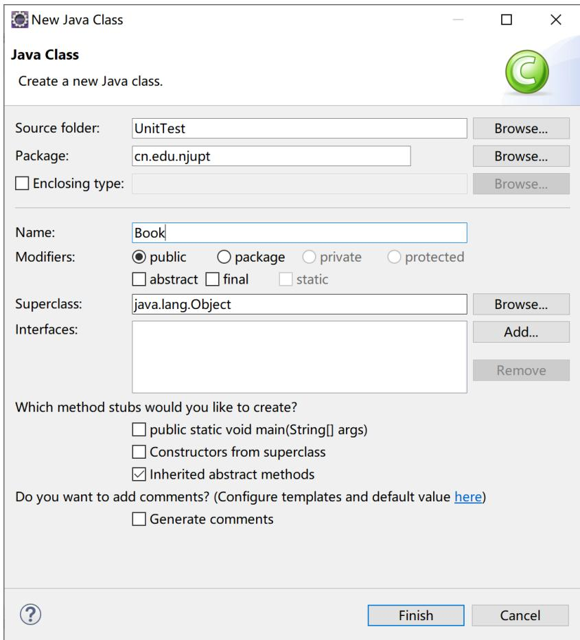

### 步骤 9

在Book类中填充内容如下，完成Book类的编写。

*(注：原文此处未提供具体代码文本，仅提及需填充内容)*

### 步骤 10

右键点击 UnitTest 项目，——〉New——〉Other，选择 Java 下的 JUnit 下的 JUnit Test Case，点击 Next；

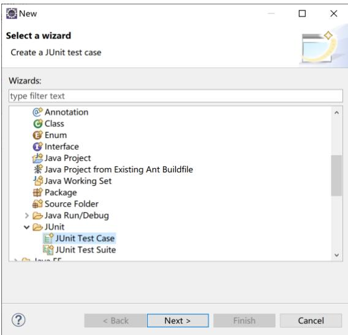

### 步骤 11

在 Package 中填写“cn.edu.njupt”，在 Name 中填写“BookTest”，在 Class under test中填写“cn.edu.njupt.Book”（注意大小写），选中 setUp(), teardown()复选框，点击Next；在弹出的窗口中选中 equals成员函数，所完成的BookTest类如图所示。

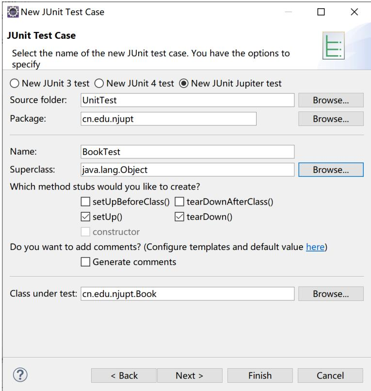

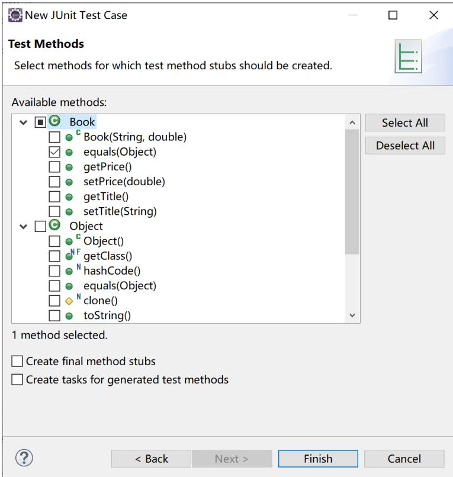

### 步骤 12

为 BookTest 添加两个私有成员变量

*(注：原文此处未提供具体变量定义代码)*

### 步骤 13

分别完成 setUp（）和 tearDown（）两个成员函数

*(注：原文此处未提供具体函数实现代码)*

### 步骤 14

编写测试用例函数 testEqualsObject（），使用下列两条语句替换fail("Not yet implemented");

*(注：原文此处未提供具体替换语句)*

### 步骤 15

点击 Run As JUnit Test，观察测试运行结果。

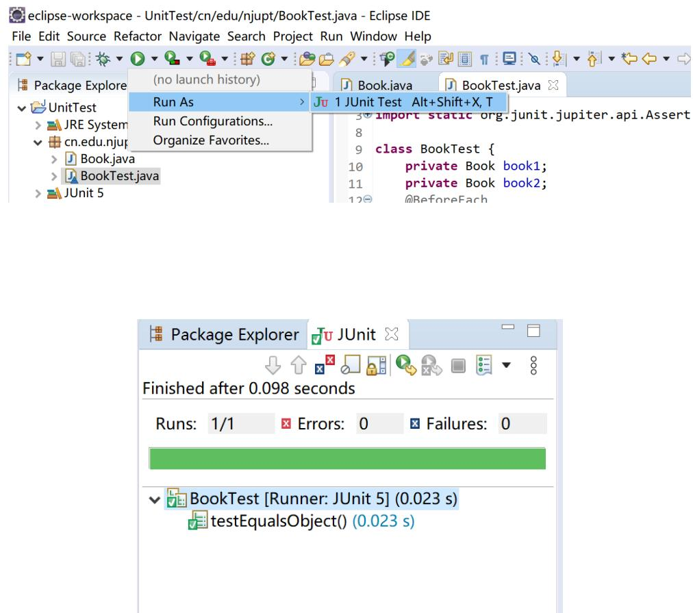

BookTest [Runner: JUnit 5] (0.023 s) testEqualsObject() (0.023 s)

### 补充任务

为 Triangle 类编写测试用例。

## 四、 参考资料

Junit 官方网站：

http://www.junit.org

## （选做）利用 Selenium进行 Web 应用程序的自动化测试

### 步骤 1

在新建项目 UnitTest 下，新建一个包 king.test，包下新建一个类 Demo。然后，把 Selenium 的相关jar 包引进来，把下载的 Selenium 的 zip 包解压。

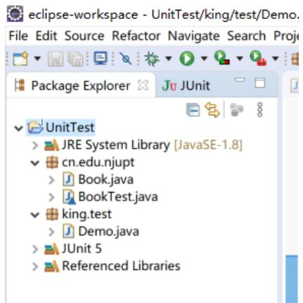

### 步骤 2

右击 UnitTest，点击最后一项 Properties，左边点 Java Build Path，右边点Add External JARs...。然后文件路径中选择到 Selenium 的包解压的路径。

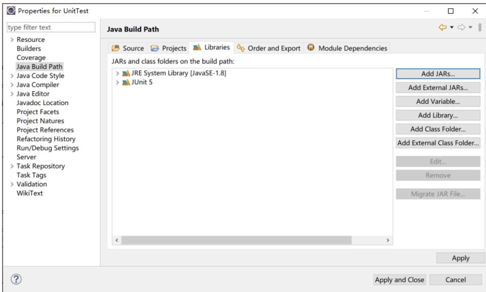

### 步骤 3

选择 client 开头的jar文件，点确定

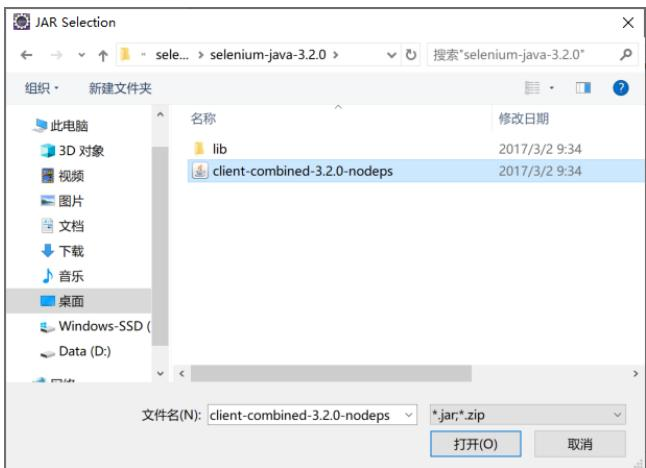

### 步骤 4

然后再点 Add External JARs...，这次，进入 lib，把 lib 里的 jar 文件全部引入项目。进入 lib，按Ctrl+A全选，再点确定，就全部引进来了

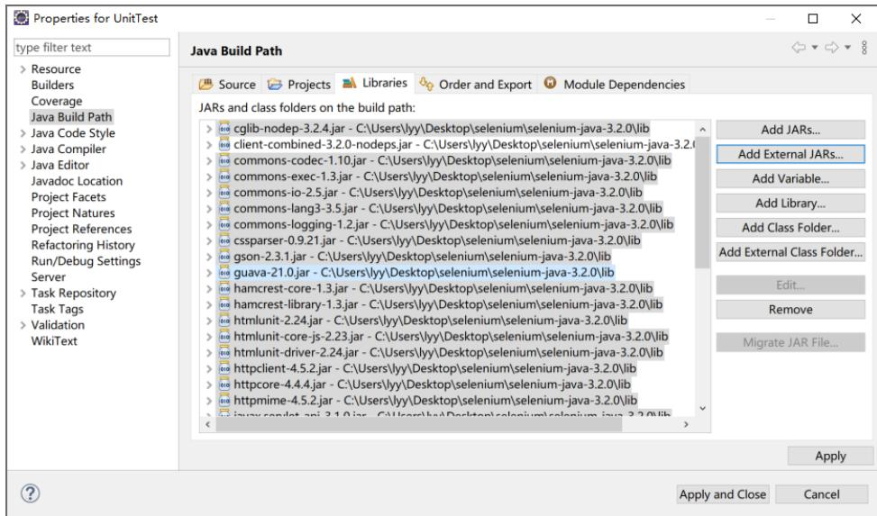

### 步骤 5

点 Apply and Close，jar 包就引用好了。然后，就可以在 Demo 里编写代码。还需要先下载谷歌浏览器的驱动，使用selenium 启动谷歌 Chrome浏览器的时候，是需要用到 chromedirver 的，两者之间的版本需要匹配。Demo 的相关代码如下：

*(注：原文此处未提供具体代码文本)*

### 步骤 6

设置谷歌浏览器的驱动，后面的路径，换成在你电脑上驱动存放的路径即可，然后，运行脚本，就会启动谷歌浏览器了，然后浏览器就会打开百度首页，停留三秒钟，关闭浏览器。

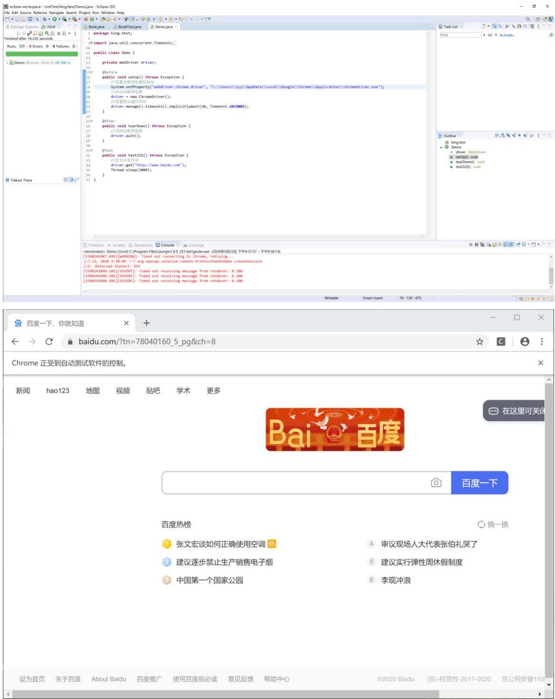

### 步骤 7

接下来进行元素的查找及操作，首先，准备一个简单的 html 页面，新建一个记事本，输入以下代码，更改后缀为 html，名称为test.html。

*(注：原文此处未提供具体 HTML 代码)*

### 步骤 8

双击它，就会用浏览器打开，打开以后，把地址栏里的地址复制一下，贴粘到java代码里，替换掉原先写的百度首页的网址。

．然后运行脚本，就会使用谷歌浏览器打开测试页面了。那现在，这个页面有三个输入框和一个按钮，我们现在要操作这几个元素。

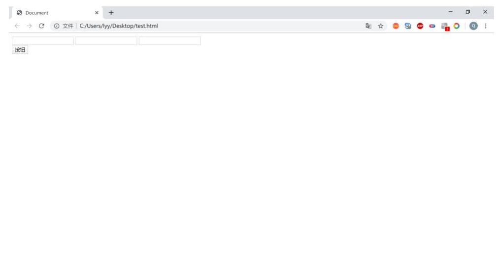

### 步骤 10

替换 public void test222() throws Exception 中的代码为

*(注：原文此处未提供具体替换代码)*

### 步骤 11

得到的结果如下：

*(注：原文此处未提供具体结果描述或截图)*

# 软件工程（双语）实验 3：软件单元测试指导书

## 一、实验目的

1. 理解软件单元测试的基本概念、原则和方法。
2. 掌握常用单元测试工具的使用，如 JUnit、Mockito 等。
3. 能够编写高质量的单元测试代码，覆盖关键业务逻辑和边界条件。
4. 培养良好的代码测试习惯，提高软件质量和可维护性。

## 二、实验环境

- **操作系统**：Windows / Linux / macOS
- **开发工具**：Eclipse / IntelliJ IDEA / VS Code
- **编程语言**：Java / Python / C++（根据课程要求选择）
- **测试框架**：JUnit (Java), pytest (Python), Google Test (C++)
- **辅助工具**：JaCoCo (代码覆盖率), Mockito (模拟对象)

## 三、实验内容

### 任务 1：环境配置与工具熟悉

1. 安装并配置所选语言的集成开发环境（IDE）。
2. 下载并配置对应的单元测试框架（如 Maven/Gradle 添加 JUnit 依赖）。
3. 运行官方提供的 Hello World 测试用例，验证环境配置成功。

### 任务 2：基础单元测试编写

针对给定的简单类（例如 `Calculator` 类），完成以下测试：

- 测试加法、减法、乘法、除法等基本运算功能。
- 测试除零异常处理。
- 测试输入参数为 null 或非法值时的行为。

**示例代码结构：**

```java
public class CalculatorTest {

    @Test
    public void testAdd() {
        Calculator calc = new Calculator();
        assertEquals(5, calc.add(2, 3));
    }

    @Test(expected = ArithmeticException.class)
    public void testDivideByZero() {
        Calculator calc = new Calculator();
        calc.divide(10, 0);
    }
}
```

### 任务 3：复杂逻辑与边界测试

选择一个稍复杂的类（例如 `OrderService`），设计并编写测试用例，覆盖：

- 正常业务流程（下单、支付、发货）。
- 异常流程（库存不足、支付失败、订单取消）。
- 边界条件（最大订单量、最小金额、空列表等）。

### 任务 4：使用 Mock 技术隔离外部依赖

在测试涉及数据库、网络请求或第三方服务的类时，使用 Mock 对象模拟这些依赖，确保测试的独立性和可重复性。

**示例（Java + Mockito）：**

```java
@Mock
private PaymentGateway paymentGateway;

@InjectMocks
private OrderService orderService;

@Test
public void testOrderWithMockPayment() {
    when(paymentGateway.processPayment(any())).thenReturn(true);
    
    boolean success = orderService.placeOrder("item1", 100);
    
    assertTrue(success);
    verify(paymentGateway, times(1)).processPayment(any());
}
```

### 任务 5：代码覆盖率分析

使用 JaCoCo 等工具对测试代码进行覆盖率分析，确保核心逻辑的测试覆盖率达到 80% 以上。

- 生成覆盖率报告（HTML 格式）。
- 分析未覆盖的代码段，补充相应的测试用例。
- 提交覆盖率报告作为实验成果的一部分。

## 四、实验步骤

1. **阅读指导书**：理解实验目的、内容和要求。
2. **环境搭建**：配置好开发环境和测试框架。
3. **编写测试代码**：按照任务要求逐步编写单元测试。
4. **运行测试**：执行测试用例，检查是否通过。
5. **调试与优化**：修复失败的测试，优化测试代码结构。
6. **覆盖率分析**：生成并分析覆盖率报告。
7. **撰写实验报告**：总结实验过程、遇到的问题及解决方案。

## 五、实验报告要求

1. **实验目的与内容**：简要描述实验的目标和主要任务。
2. **实验环境与工具**：列出使用的操作系统、IDE、语言、框架等。
3. **测试代码展示**：选取典型测试用例，展示代码片段并说明其作用。
4. **测试结果分析**：包括测试通过率、覆盖率数据、发现的问题及改进措施。
5. **心得体会**：分享在实验过程中的收获、遇到的困难及解决方法。

## 六、参考资料

- [Selenium 官方网站](http://www.selenium.org.cn/)
- [51Testing 软件测试网](http://www.51testing.com)
- 南京邮电大学计算机学院软件工程系课程资料

---

> **提示**：本实验强调“测试驱动开发”（TDD）思想，建议在编写功能代码前先编写测试用例，确保代码质量。
