# 《软件工程（双语）》实验3 软件单元测试：JUnit介绍与使用（课件）

原件的每一页，下面附识别出的文字。

### JUnit

原文：

JUnit

Experiment 3 : Software Unit Testing

Software Engineering

### 内容

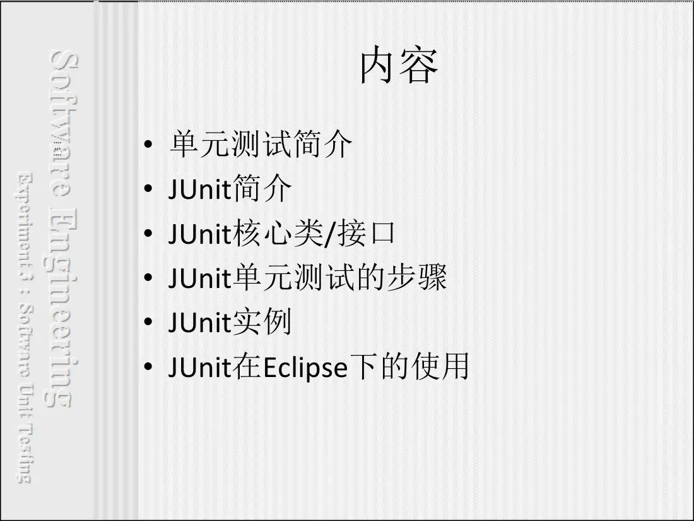

原文：

内容

\- 单元测试简介

\- JUnit简介

\- JUnit核心类/接口

\- JUnit单元测试的步骤

\- JUnit实例

\- JUnit在Eclipse下的使用

Software Engineering

Experimental : Software Unit Testing

### 单元测试

原文：

单元测试

\- 单元测试是开发者编写的一小段代码，用于检验被测代码的一个很小的、很明确的功能是否正确

\- 通常而言，一个单元测试是用于判断某个特定条件（或者场景）下某个特定函数的行为

Software Engineering
Experiments: Software Unit Testing

### JUnit简介

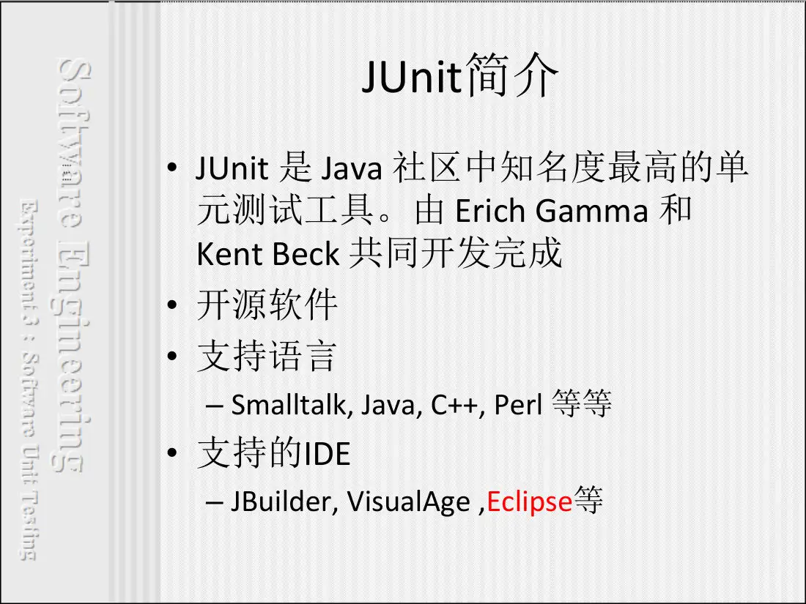

原文：

JUnit简介

\- JUnit 是 Java 社区中知名度最高的单元测试工具。由 Erich Gamma 和 Kent Beck 共同开发完成

\- 开源软件

\- 支持语言

\- Smalltalk, Java, C++, Perl 等等

\- 支持的IDE

\- JBuilder, VisualAge ,Eclipse等

Software Engineering Experiment 3 : Software Unit Testing

### JUnit功能

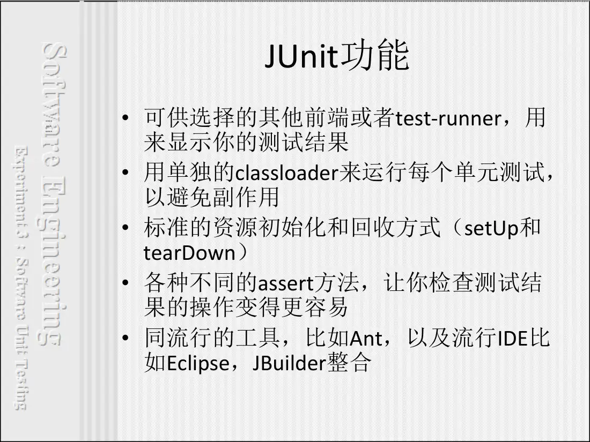

原文：

JUnit功能

\- 可供选择的其他前端或者test-runner，用来显示你的测试结果

\- 用单独的classloader来运行每个单元测试，以避免副作用

\- 标准的资源初始化和回收方式（setUp和tearDown）

\- 各种不同的assert方法，让你检查测试结果的操作变得更容易

\- 同流行的工具，比如Ant，以及流行IDE比如Eclipse，JBuilder整合

Experiment 3 : Software Unit Testing

Software Engineering

### JUnit 优点

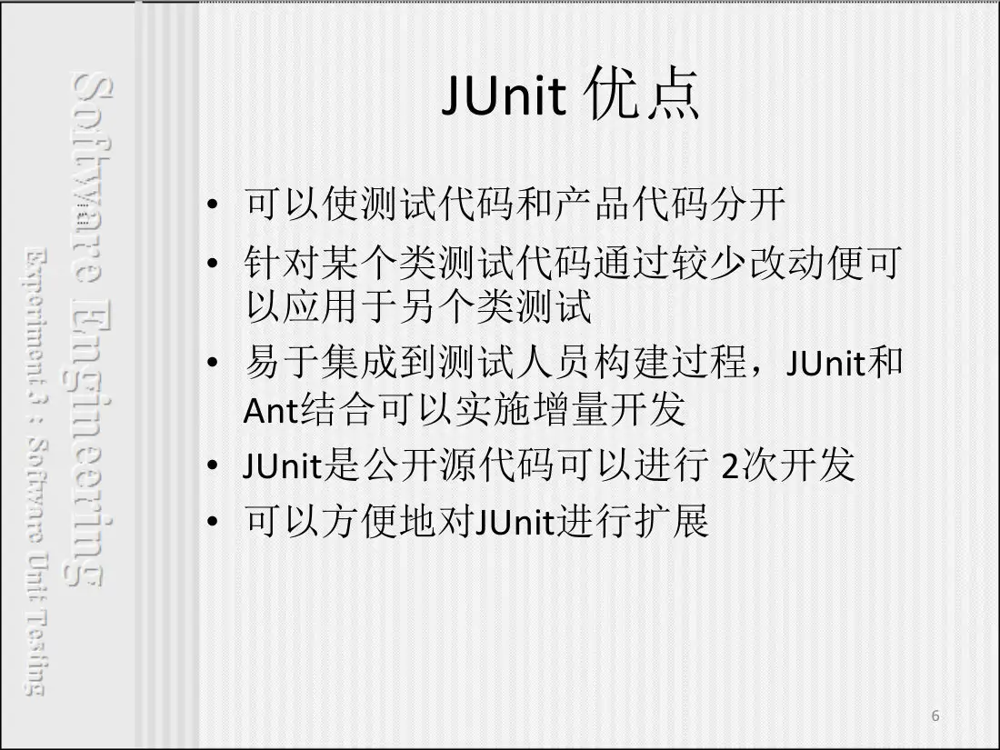

原文：

JUnit 优点

\- 可以使测试代码和产品代码分开

\- 针对某个类测试代码通过较少改动便可以应用于另个类测试

\- 易于集成到测试人员构建过程，JUnit和Ant结合可以实施增量开发

\- JUnit是公开源代码可以进行2次开发

\- 可以方便地对JUnit进行扩展

Software Engineering

Experiment 3 : Software Unit Testing

6

### JUnit 安装

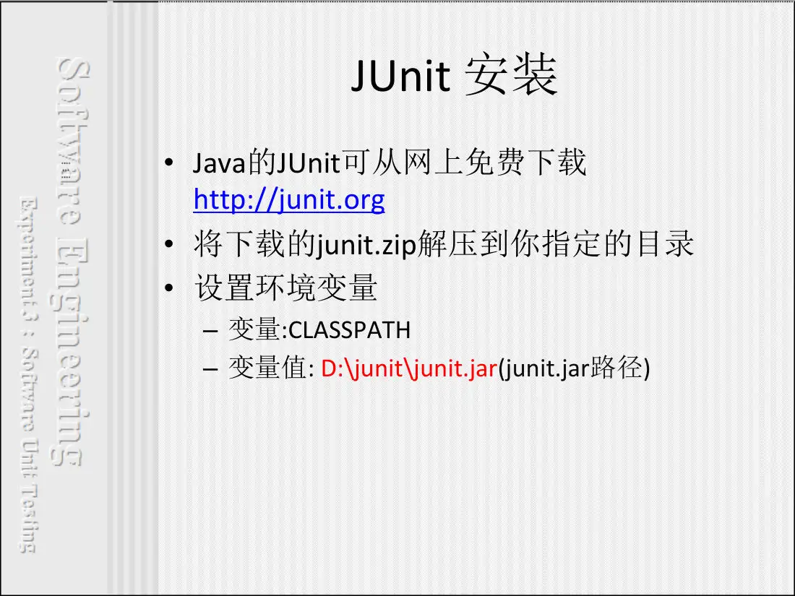

原文：

JUnit 安装

\- Java的JUnit可从网上免费下载
http://junit.org

\- 将下载的junit.zip解压到你指定的目录

\- 设置环境变量

\- 变量:CLASSPATH

\- 变量值: D:\junit\junit.jar(junit.jar路径)

Software Engineering Experiment 3: Software Unit Testing

### JUnit 框架

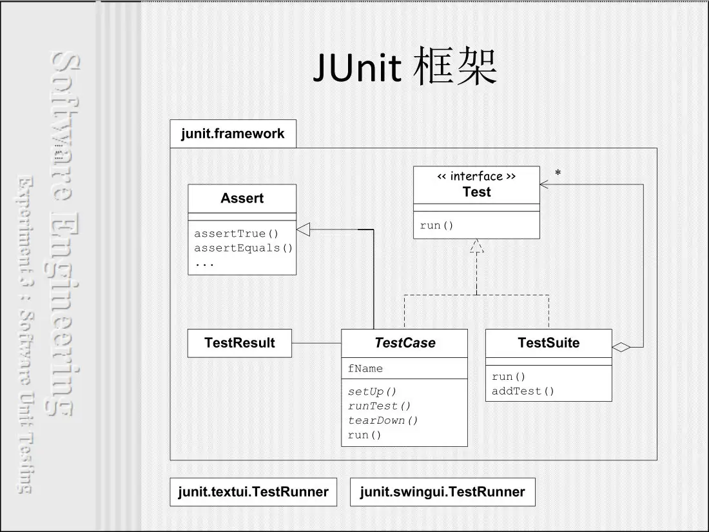

原文：

JUnit 框架

junit.framework

junit.textui.TestRunner

Software Engineering Experiment 3 : Software Unit Testing

junit.swingui.TestRunner

### JUnit核心类及接口(1)

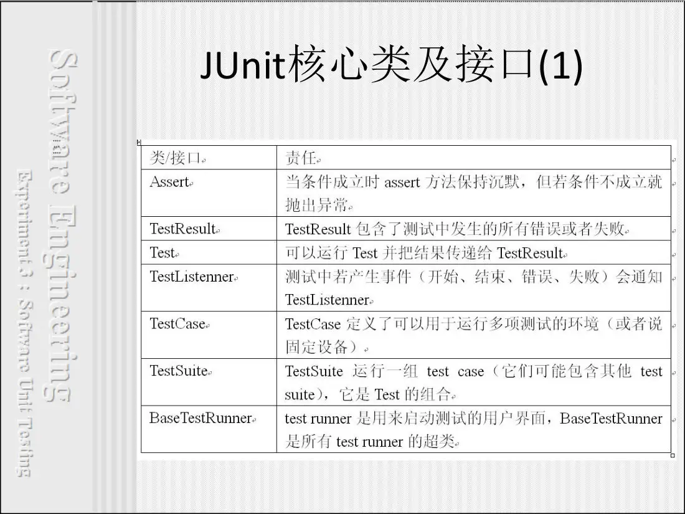

原文：

JUnit核心类及接口(1)

<table><tr><td>类/接口。</td><td>责任。</td></tr><tr><td>Assert。</td><td>当条件成立时 assert 方法保持沉默,但若条件不成立就抛出异常。</td></tr><tr><td>TestResult。</td><td>TestResult 包含了测试中发生的所有错误或者失败。</td></tr><tr><td>Test。</td><td>可以运行 Test 并把结果传递给 TestResult。</td></tr><tr><td>TestListener。</td><td>测试中若产生事件(开始、结束、错误、失败)会通知 TestListener。</td></tr><tr><td>TestCase。</td><td>TestCase 定义了可以用于运行多项测试的环境(或者说固定设备)。</td></tr><tr><td>TestSuite。</td><td>TestSuite 运行一组 test case(它们可能包含其他 test suite),它是 Test 的组合。</td></tr><tr><td>BaseTestRunner。</td><td>test runner 是用来启动测试的用户界面,BaseTestRunner 是所有 test runner 的超类。</td></tr></table>

Experimental : Software Unit Testing

Software Engineering

### JUnit核心类及接口(2)

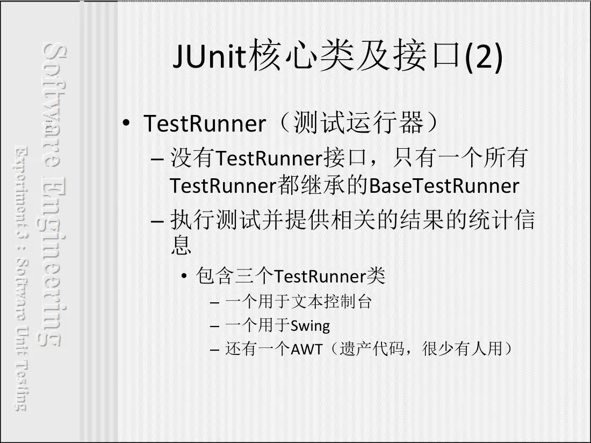

原文：

JUnit核心类及接口(2)

\- TestRunner（测试运行器）

\- 没有TestRunner接口，只有一个所有TestRunner都继承的BaseTestRunner

\- 执行测试并提供相关的结果的统计信息

\- 包含三个TestRunner类

\- 一个用于文本控制台

\- 一个用于Swing

\- 还有一个AWT（遗产代码，很少有人用）

Software Engineering
Experiments: Software Unit Testing

### JUnit核心类及接口(3)

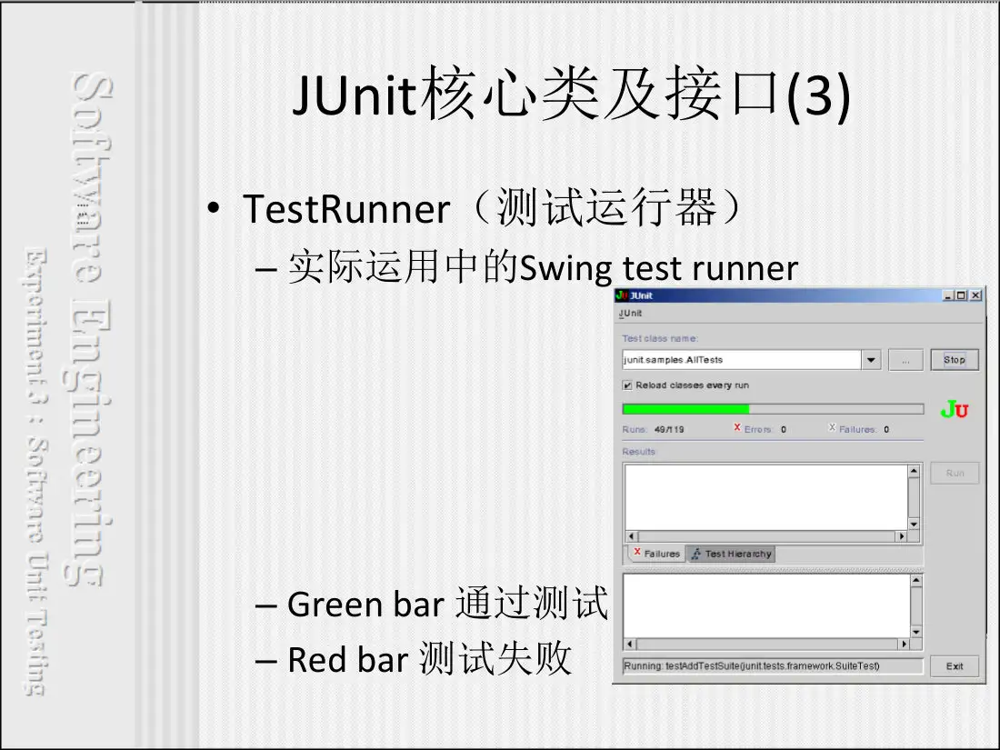

原文：

JUnit核心类及接口(3)

\- TestRunner（测试运行器）

\- 实际运用中的Swing test runner

\- Green bar 通过测试

\- Red bar 测试失败

Software Engineering
Experiments: Software Unit Testing

### JUnit核心类及接口(4)

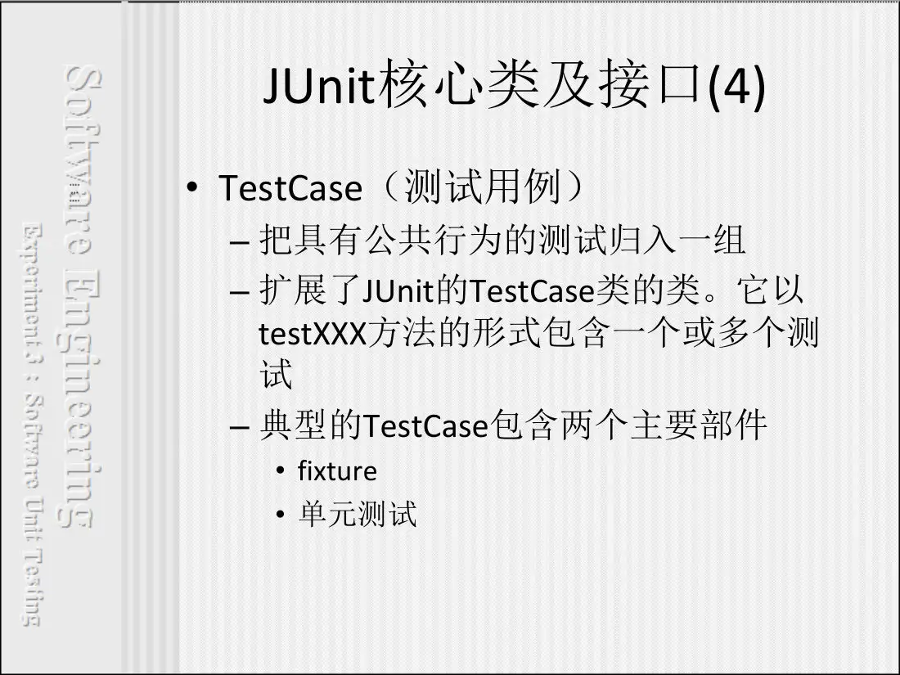

原文：

JUnit核心类及接口(4)

\- TestCase（测试用例）

\- 把具有公共行为的测试归入一组

\- 扩展了JUnit的TestCase类的类。它以testXXX方法的形式包含一个或多个测试

\- 典型的TestCase包含两个主要部件

\- fixture

\- 单元测试

Software Engineering Experiment 3 : Software Unit Testing

### JUnit核心类及接口(5)

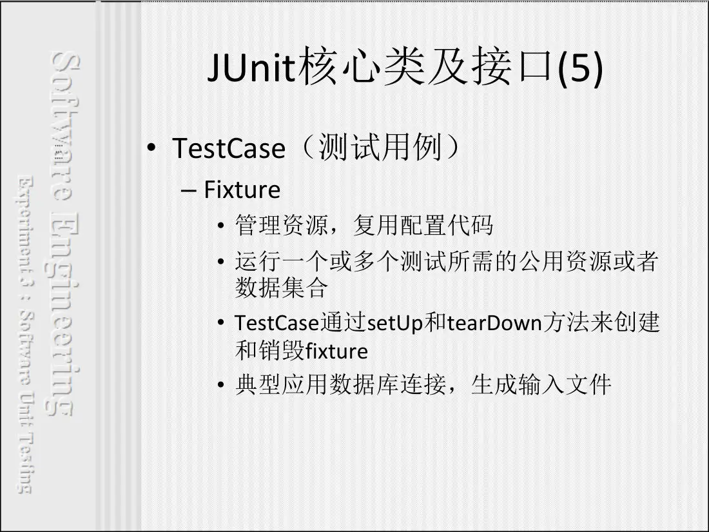

原文：

JUnit核心类及接口(5)

- TestCase（测试用例）

- Fixture

\- 管理资源，复用配置代码

\- 运行一个或多个测试所需的公用资源或者数据集合

\- TestCase通过setUp和tearDown方法来创建和销毁fixture

\- 典型应用数据库连接，生成输入文件

Software Engineering
Experimental : Software Unit Testing

### JUnit核心类及接口(6)

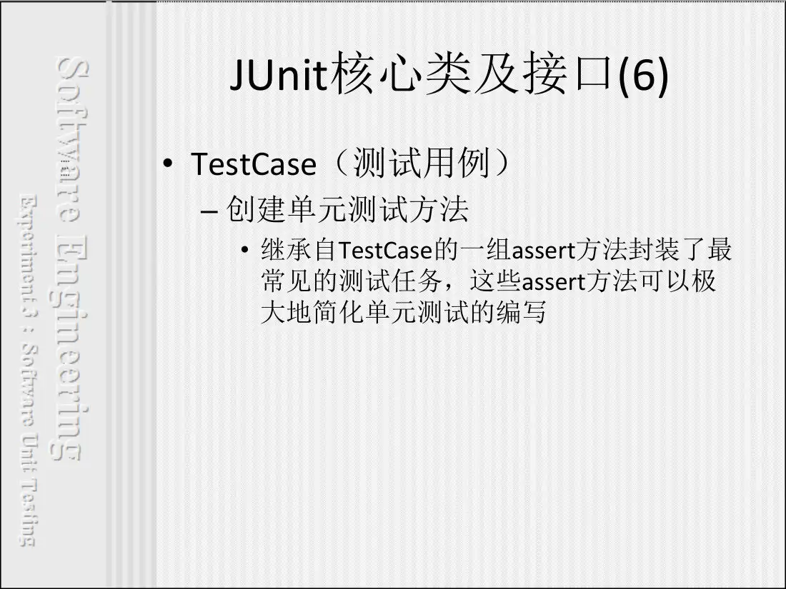

原文：

JUnit核心类及接口(6)

\- TestCase（测试用例）

\- 创建单元测试方法

\- 继承自TestCase的一组assert方法封装了最常见的测试任务，这些assert方法可以极大地简化单元测试的编写

Software Engineering
Experiments: Software Unit Testing

### Assert超类所提供的8个核心方法

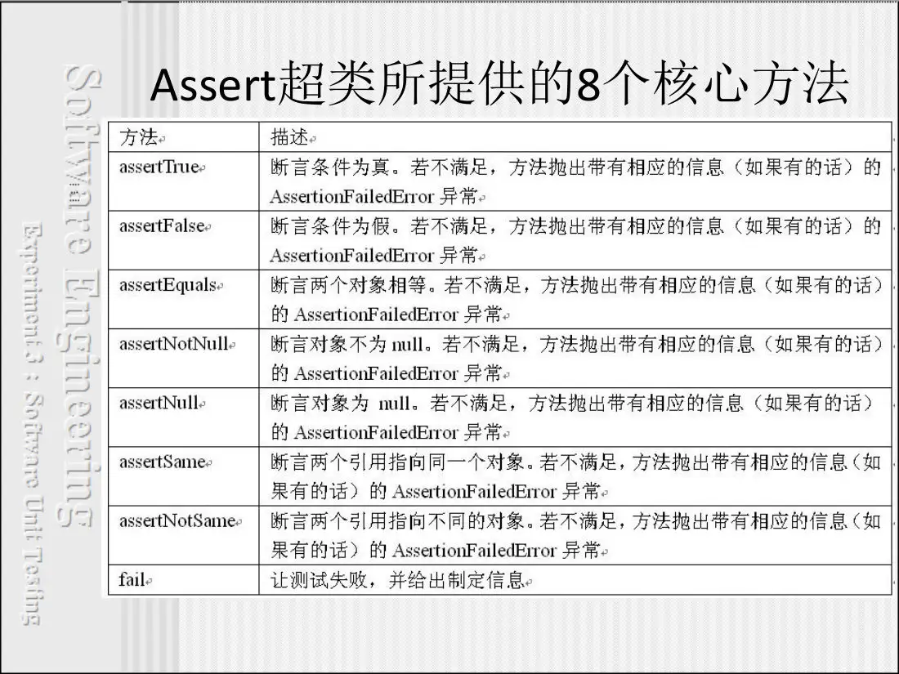

原文：

Assert超类所提供的8个核心方法
<table><tr><td>方法。</td><td>描述。</td></tr><tr><td>assertTrue。</td><td>断言条件为真。若不满足,方法抛出带有相应的信息(如果有的话)的AssertionFailedError异常。</td></tr><tr><td>assertFalse。</td><td>断言条件为假。若不满足,方法抛出带有相应的信息(如果有的话)的AssertionFailedError异常。</td></tr><tr><td>assertEquals。</td><td>断言两个对象相等。若不满足,方法抛出带有相应的信息(如果有的话)的AssertionFailedError异常。</td></tr><tr><td>assertNotNull。</td><td>断言对象不为null。若不满足,方法抛出带有相应的信息(如果有的话)的AssertionFailedError异常。</td></tr><tr><td>assertNull。</td><td>断言对象为null。若不满足,方法抛出带有相应的信息(如果有的话)的AssertionFailedError异常。</td></tr><tr><td>assertSame。</td><td>断言两个引用指向同一个对象。若不满足,方法抛出带有相应的信息(如果有的话)的AssertionFailedError异常。</td></tr><tr><td>assertNotSame。</td><td>断言两个引用指向不同的对象。若不满足,方法抛出带有相应的信息(如果有的话)的AssertionFailedError异常。</td></tr><tr><td>fail。</td><td>让测试失败,并给出制定信息。</td></tr></table>

Experimental: Software Unit Testing

Software Engineering

### JUnit核心类及接口(7)

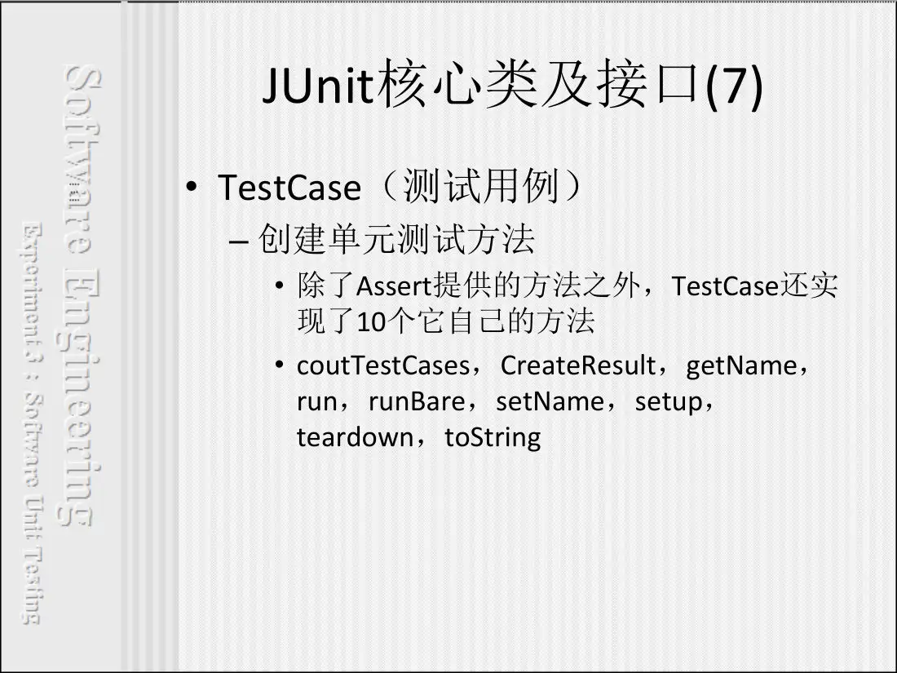

原文：

JUnit核心类及接口(7)

- TestCase（测试用例）

\- 创建单元测试方法

\- 除了Assert提供的方法之外，TestCase还实现了10个它自己的方法

\- coutTestCases, CreateResult, getName, run, runBare, setName, setup, teardown, toString

Software Engineering
Experiments: Software Unit Testing

### TestCase的10个自己的方法

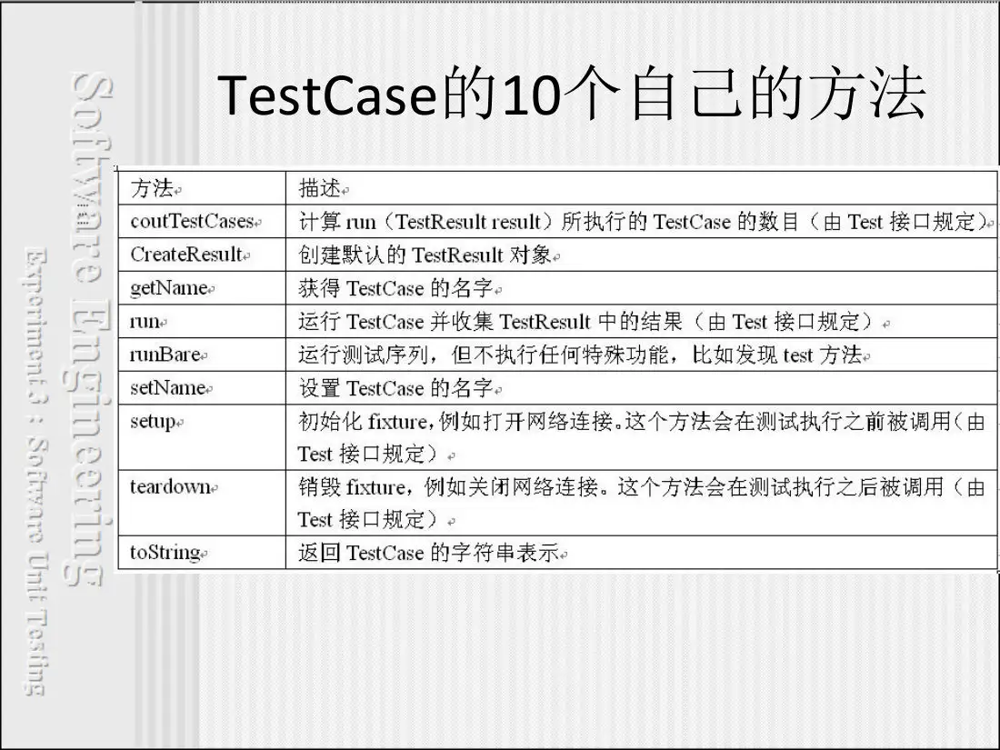

原文：

TestCase的10个自己的方法

<table><tr><td>方法</td><td>描述</td></tr><tr><td>coutTestCases</td><td>计算 run(TestResult result)所执行的 TestCase 的数目(由 Test 接口规定)</td></tr><tr><td>CreateResult</td><td>创建默认的 TestResult 对象</td></tr><tr><td>getName</td><td>获得 TestCase 的名字</td></tr><tr><td>run</td><td>运行 TestCase 并收集 TestResult 中的结果(由 Test 接口规定)</td></tr><tr><td>runBare</td><td>运行测试序列,但不执行任何特殊功能,比如发现 test 方法</td></tr><tr><td>setName</td><td>设置 TestCase 的名字</td></tr><tr><td>setup</td><td>初始化 fixture,例如打开网络连接。这个方法会在测试执行之前被调用(由 Test 接口规定)</td></tr><tr><td>teardown</td><td>销毁 fixture,例如关闭网络连接。这个方法会在测试执行之后被调用(由 Test 接口规定)</td></tr><tr><td>toString</td><td>返回 TestCase 的字符串表示</td></tr></table>

Software Engineering

Experiments: Software Unit Testing

### JUnit核心类及接口(8)

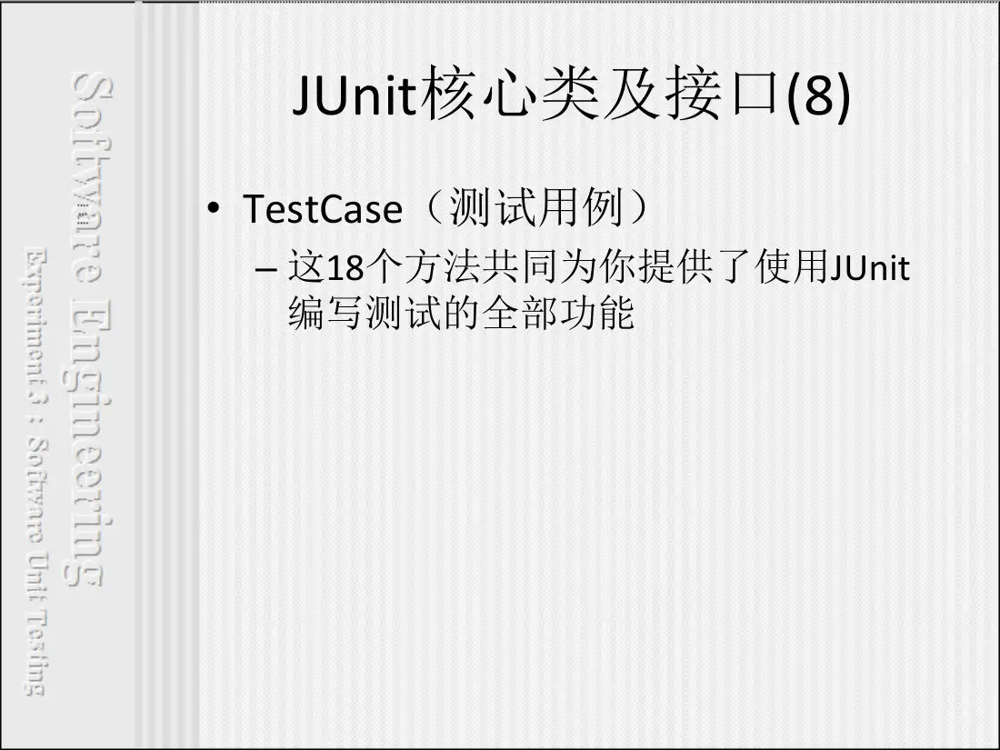

原文：

JUnit核心类及接口(8)

\- TestCase（测试用例）

\- 这18个方法共同为你提供了使用JUnit编写测试的全部功能

Software Engineering Experiment 3 : Software Unit Testing

### JUnit核心类及接口(9)

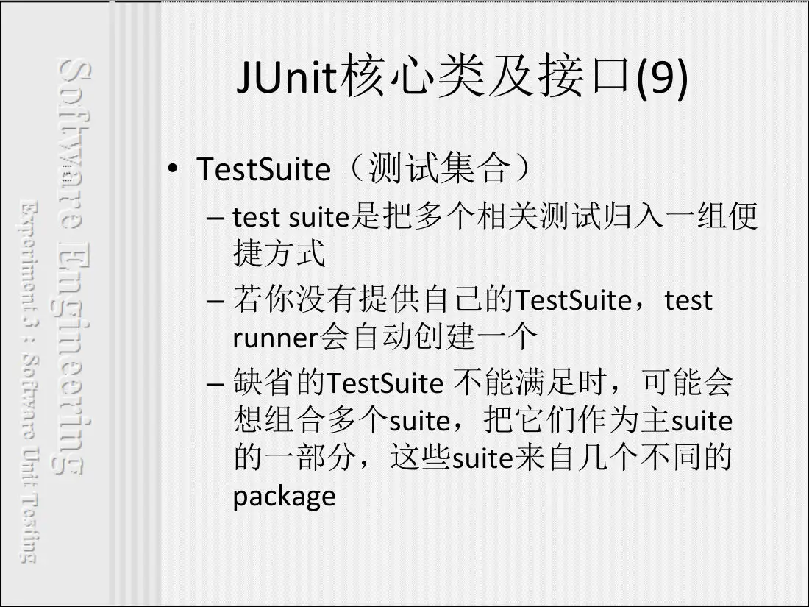

原文：

JUnit核心类及接口(9)

\- TestSuite（测试集合）

\- test suite是把多个相关测试归入一组便捷方式

\- 若你没有提供自己的TestSuite，test runner会自动创建一个

\- 缺省的TestSuite 不能满足时，可能会想组合多个suite，把它们作为主suite的一部分，这些suite来自几个不同的package

Software Engineering Experiment 3 : Software Unit Testing

### JUnit核心类及接口(10)

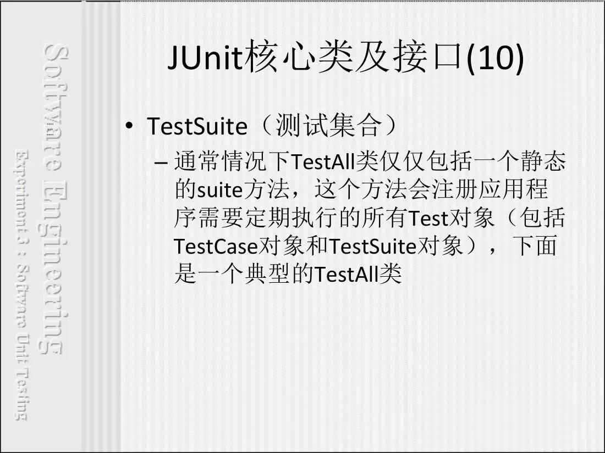

原文：

JUnit核心类及接口(10)

- TestSuite（测试集合）

\- 通常情况下TestAll类仅仅包括一个静态的suite方法，这个方法会注册应用程序需要定期执行的所有Test对象（包括TestCase对象和TestSuite对象），下面是一个典型的TestAll类

Software Engineering
Experiments: Software Unit Testing

### JUnit核心类及接口(11)

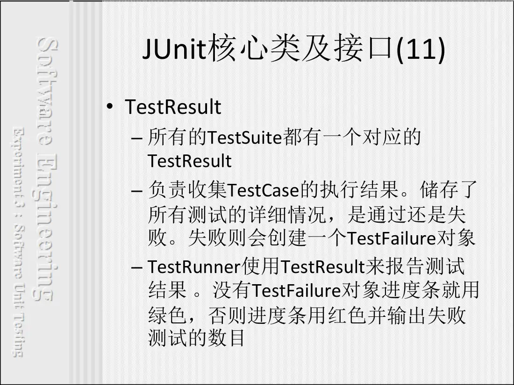

原文：

JUnit核心类及接口(11)

- TestResult

\- 所有的TestSuite都有一个对应的TestResult

\- 负责收集TestCase的执行结果。储存了所有测试的详细情况，是通过还是失败。失败则会创建一个TestFailure对象

\- TestRunner使用TestResult来报告测试结果。没有TestFailure对象进度条就用绿色，否则进度条用红色并输出失败测试的数目

Software Engineering Experiment 3 : Software Unit Testing

### JUnit核心类及接口(12)

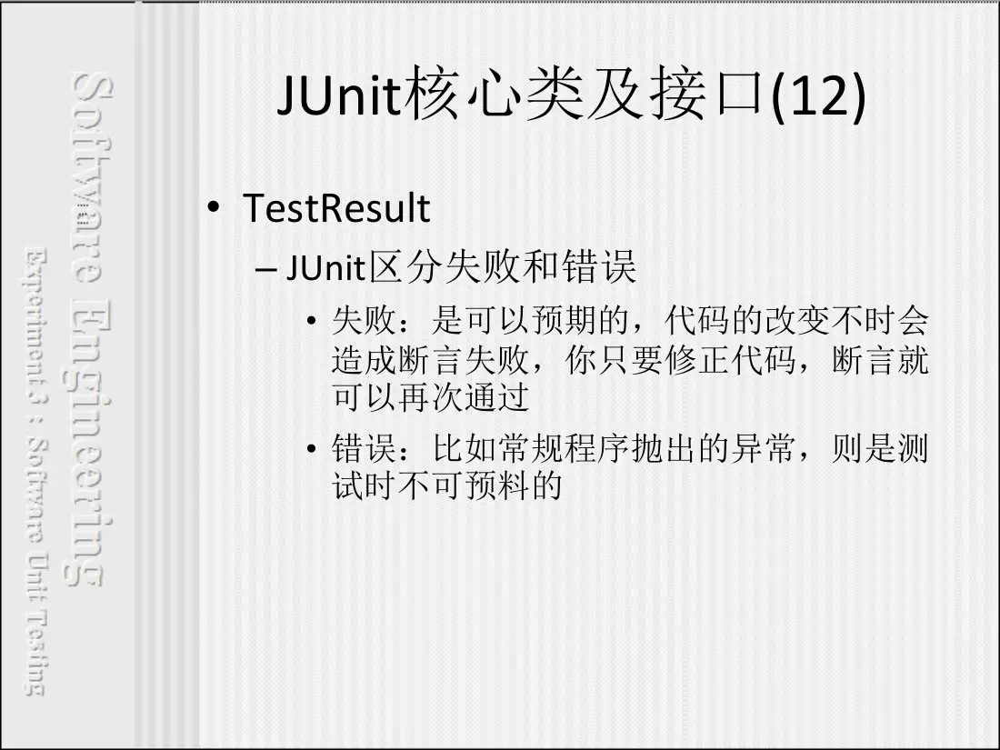

原文：

JUnit核心类及接口(12)

- TestResult

-JUnit区分失败和错误

\- 失败：是可以预期的，代码的改变不时会造成断言失败，你只要修正代码，断言就可以再次通过

\- 错误：比如常规程序抛出的异常，则是测试时不可预料的

Software Engineering
Experimental : Software Unit Testing

### JUnit核心类及接口(13)

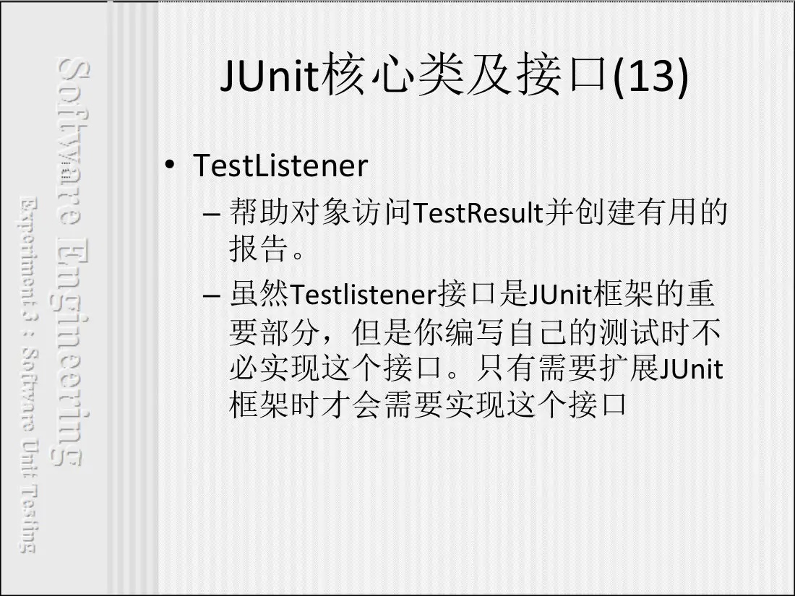

原文：

JUnit核心类及接口(13)

- TestListener

\- 帮助对象访问TestResult并创建有用的报告。

\- 虽然Testlistener接口是JUnit框架的重要部分，但是你编写自己的测试时不必实现这个接口。只有需要扩展JUnit框架时才会需要实现这个接口

Software Engineering Experiment 3: Software Unit Testing

### JUnit单元测试的步骤(1)

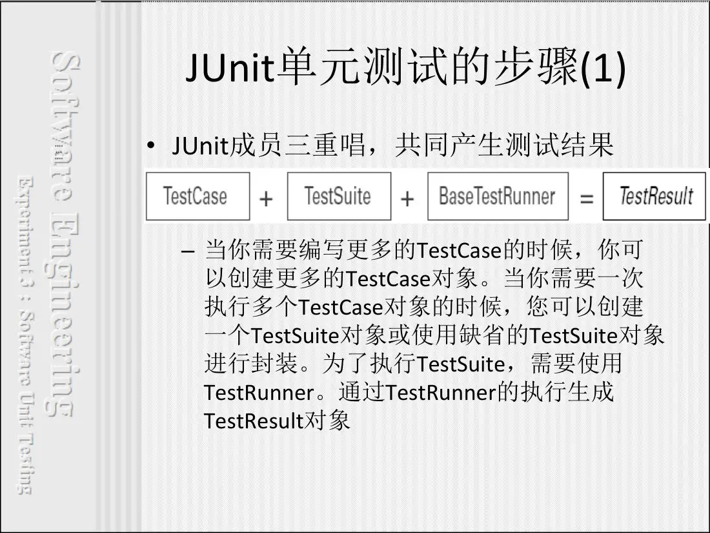

原文：

JUnit单元测试的步骤(1)

\- JUnit成员三重唱，共同产生测试结果

TestCase

TestSuite

BaseTestRunner

TestResult

\- 当你需要编写更多的TestCase的时候，你可以创建更多的TestCase对象。当你需要一次执行多个TestCase对象的时候，您可以创建一个TestSuite对象或使用缺省的TestSuite对象进行封装。为了执行TestSuite，需要使用TestRunner。通过TestRunner的执行生成TestResult对象

Experimental : Software Unit Testing

Software Engineering

### JUnit单元测试的步骤(2)

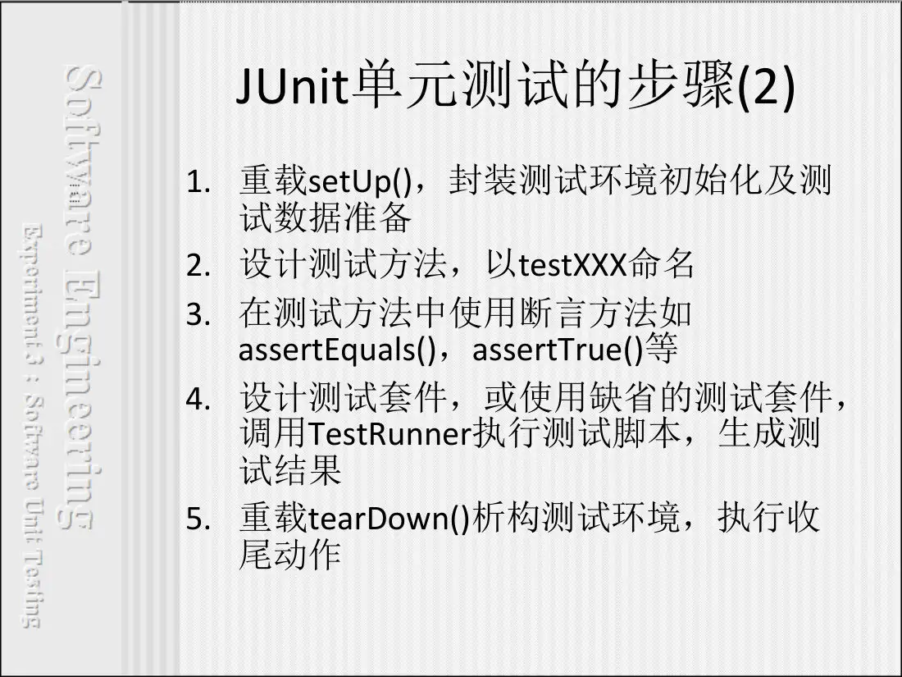

原文：

JUnit单元测试的步骤(2)

1. 重载setUp()，封装测试环境初始化及测试数据准备

2. 设计测试方法，以testXXX命名

3. 在测试方法中使用断言方法如 assertEquals(), assertTrue()等

4. 设计测试套件，或使用缺省的测试套件，调用TestRunner执行测试脚本，生成测试结果

5. 重载tearDown()析构测试环境，执行收尾动作

Software Engineering

Experimental: Software Unit Testing

### 待测类

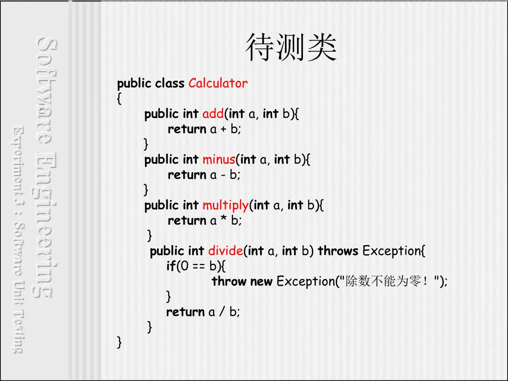

原文：

待测类

Experimental : Software Unit Testing

Software Engineering

### 该类的测试类[1/4]

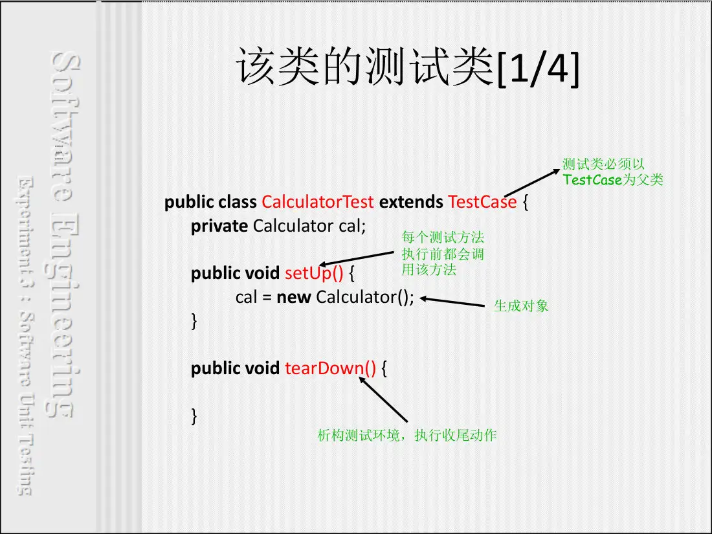

原文：

该类的测试类[1/4]

public class CalculatorTest extends TestCase {
private Calculator cal; 每个测试方法

public void setUp() {

cal = new Calculator();

每个测试方法执行前都会调用该方法

生成对象测试类必须以
TestCase为父类

public void tearDown() {

析构测试环境，执行收尾动作

Software Engineering

Experiment 3 : Software Unit Testing

### 该类的测试类[2/4]

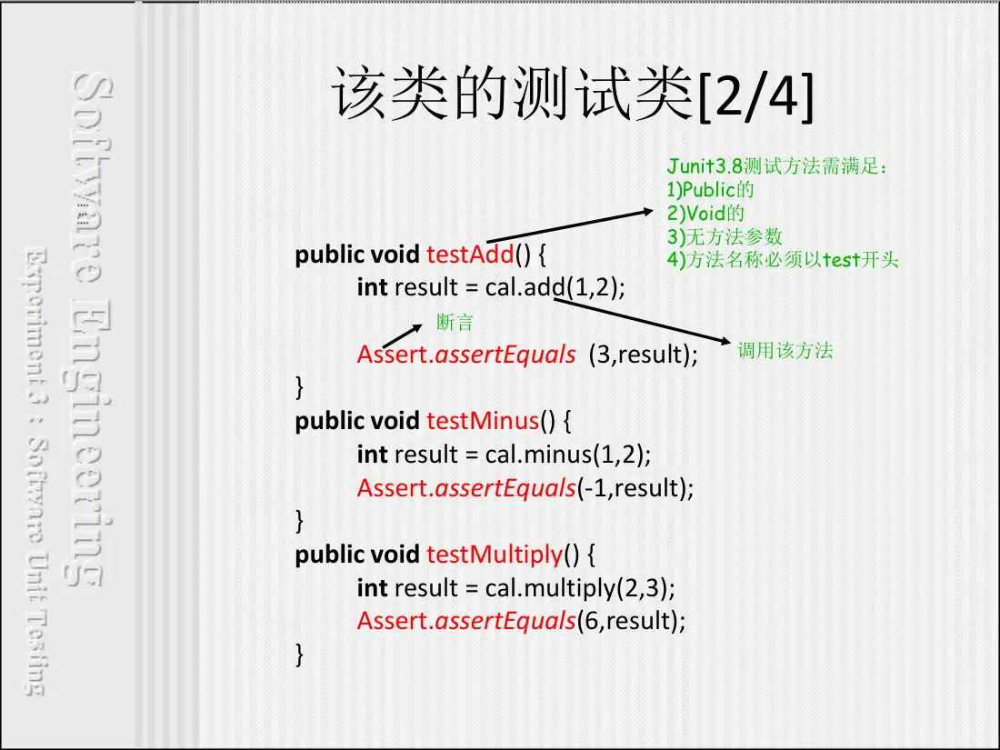

原文：

该类的测试类[2/4]

public void testAdd() {
int result = cal.add(1,2);

Junit3.8测试方法需满足：

1)Public的

2)Void的

3)无方法参数

4)方法名称必须以test开头

调用该方法

public void testMultiply() {
    int result = cal.multiply(2,3);
    AssertasserEquals(6,result);

Software Engineering

Experimental: Software Unit Testing

### 该类的测试类[3/4]

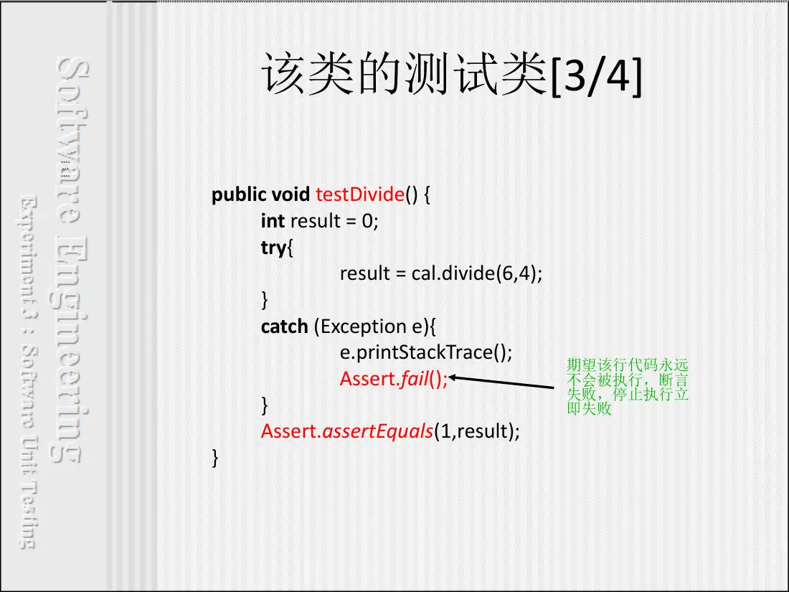

原文：

该类的测试类[3/4]

Software Engineering

Experiment 3 : Software Unit Testing

### 该类的测试类[4/4]

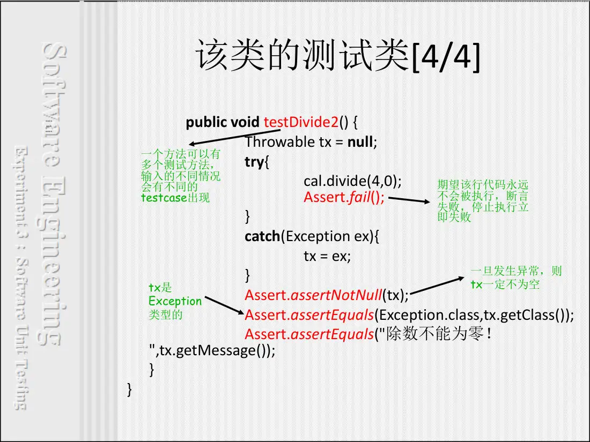

原文：

该类的测试类[4/4]

public void testDivide2() {

一个方法可以有多个测试方法，输入的不同情况会有不同的testcase出现

Throwable tx = null;

try{

tx是Exception类型的

",tx.getMessage());

cal.divide(4,0); Assert.fail();

catch(Exception ex){

tx = ex;

期望该行代码永远不会被执行，断言失败，停止执行立即失败

Assert NWt Not Null(tx);

一旦发生异常，则 $\mathsf{t}\times$ 一定不为空

AssertasserEquals(Exception.class, tx.getClass());

AssertJB equals("除数不能为零！

Software Engineering

Experimental : Software Unit Testing

### 同时测试多个类(1)

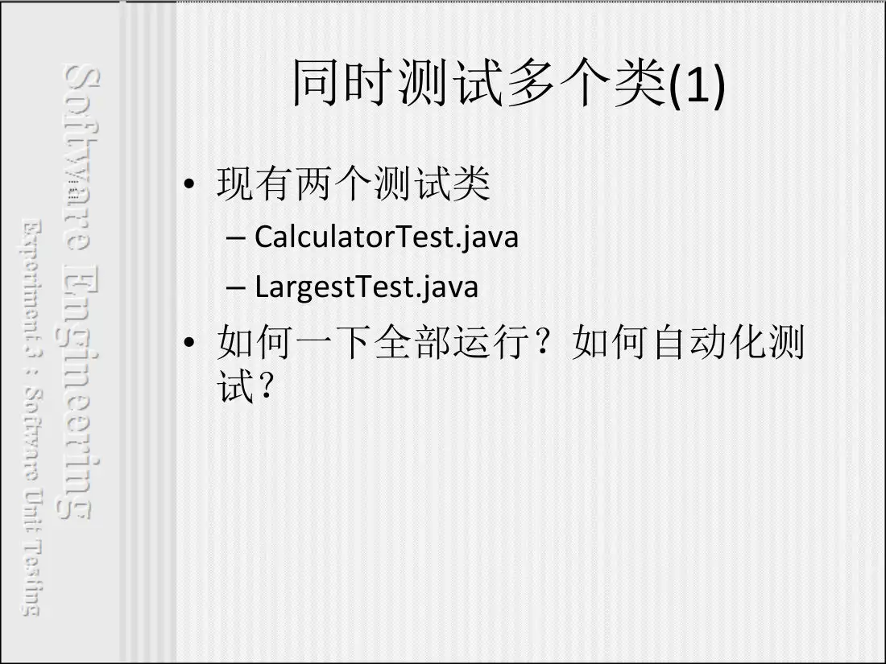

原文：

同时测试多个类(1)

\- 现有两个测试类
  - CalculatorTest.java
  - LargestTest.java

\- 如何一下全部运行？如何自动化测试？

Software Engineering Experiment 3 : Software Unit Testing

### 同时测试多个类(2)

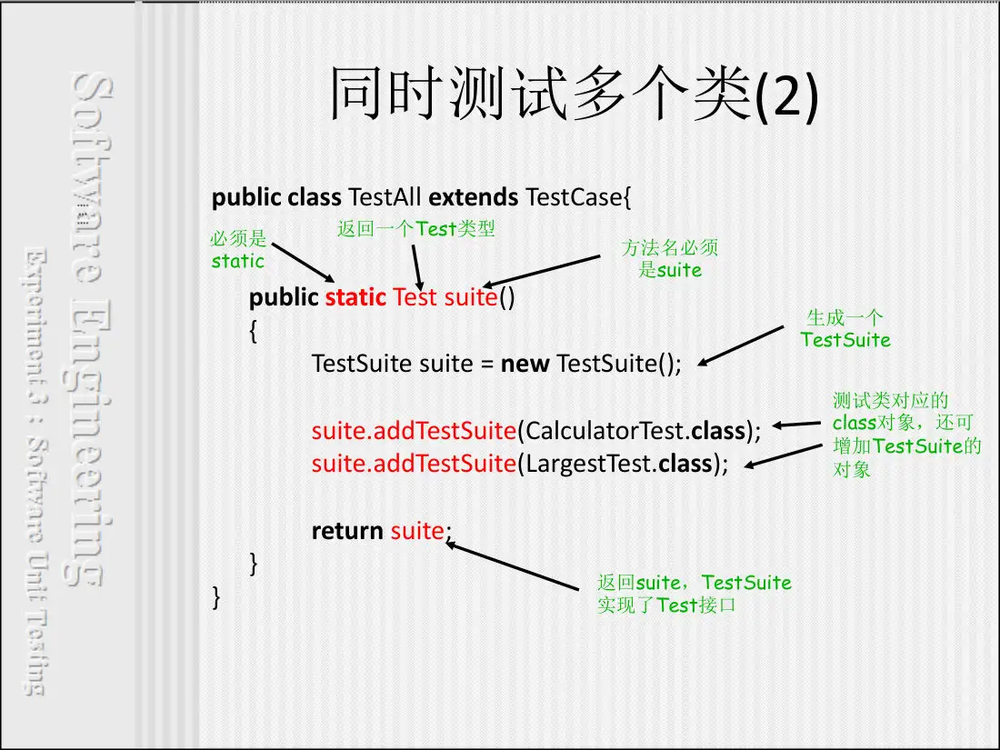

原文：

同时测试多个类(2)

public class TestAll extends TestCase{

必须是static

返回一个Test类型

public static Test suite()

方法名必须是suite

TestSuite suite = new TestSuite();

suite.addTestSuite(CalculatorTest.class);
suite.addTestSuite(LargestTest.class);

return suite:

生成一个TestSuite

测试类对应的class对象，还可增加TestSuite的对象

返回suite, TestSuite实现了Test接口

Software Engineering

Experimental Software Unit Testing

### 在Eclipse下使用JUnit

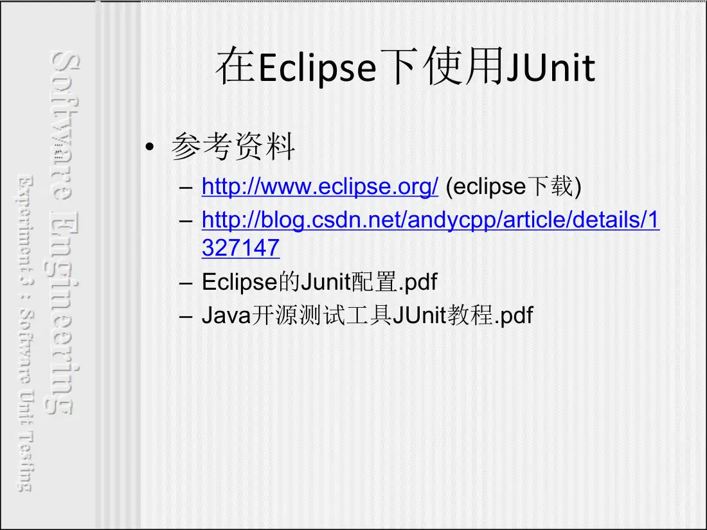

原文：

在Eclipse下使用JUnit

- 参考资料

\- http://www.eclipse.org/ (eclipse下载)

\- http://blog.csdn.net/andycpp/article/details/1327147

\- Eclipse的Junit配置.pdf

\- Java开源测试工具JUnit教程.pdf

Software Engineering

Experiment 3 : Software Unit Testing

### 在Eclipse下使用JUnit(1)

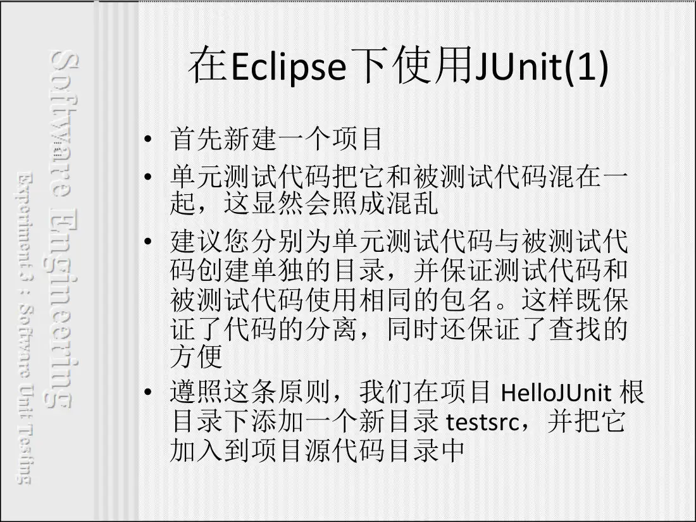

原文：

在Eclipse下使用JUnit(1)

\- 首先新建一个项目

\- 单元测试代码把它和被测试代码混在一起，这显然会照成混乱

\- 建议您分别为单元测试代码与被测试代码创建单独的目录，并保证测试代码和被测试代码使用相同的包名。这样既保证了代码的分离，同时还保证了查找的方便

\- 遵照这条原则，我们在项目 HelloJUnit 根目录下添加一个新目录 testsrc，并把它加入到项目源代码目录中

Software Engineering
Experiments: Software Unit Testing

### 在Eclipse下使用JUnit(2)

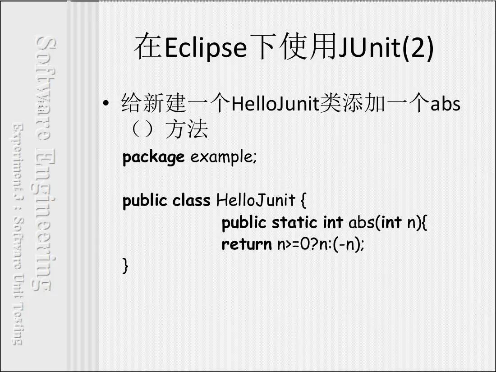

原文：

在Eclipse下使用JUnit(2)

\- 给新建一个HelloJunit类添加一个abs（）方法
package example;

public class HelloJunit {
    public static int abs(int n){
    return n>=0?n:(-n);
    }
}

Software Engineering Experiment3 : Software Unit Testing

### 在Eclipse下使用JUnit(3)

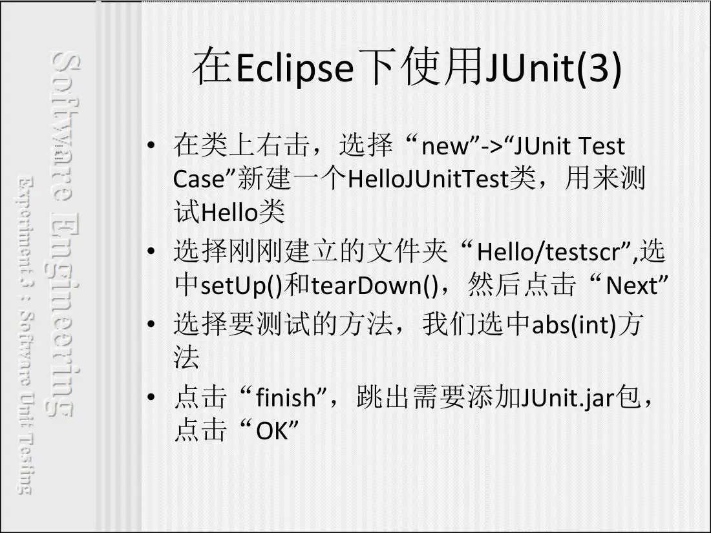

原文：

在Eclipse下使用JUnit(3)

\- 在类上右击，选择“new”->“JUnit Test Case”新建一个HelloJUnitTest类，用来测试Hello类

\- 选择刚刚建立的文件夹 “Hello/testscr”,选中setUp()和tearDown(), 然后点击 “Next”

\- 选择要测试的方法，我们选中abs(int)方法

\- 点击 “finish”，跳出需要添加JUnit.jar包，点击 “OK”

Software Engineering Experiment 3 : Software Unit Testing

### 在Eclipse下使用JUnit(4)

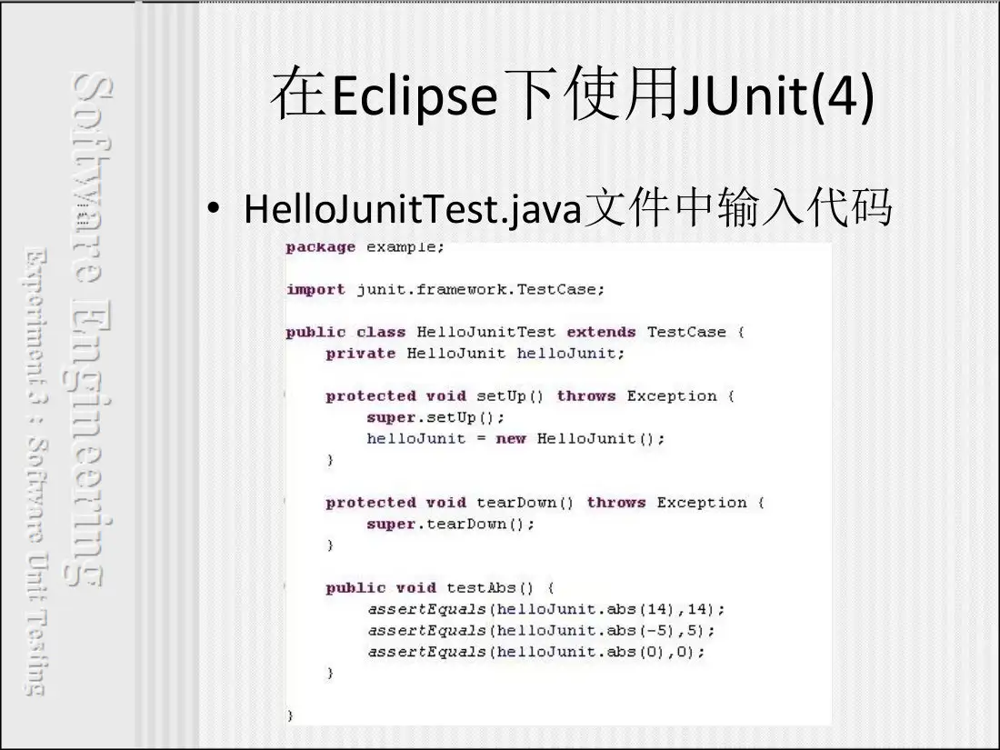

原文：

在Eclipse下使用JUnit(4)

- HelloJUnitTest.java文件中输入代码

Experimental : Software Unit Testing

Software Engineering

### 在Eclipse下使用JUnit(5)

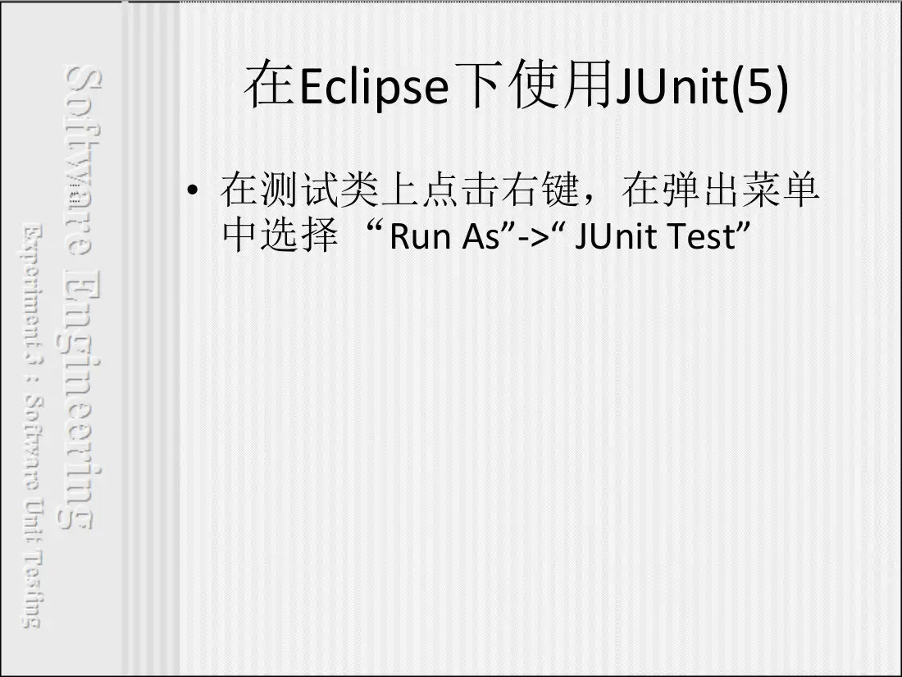

原文：

在Eclipse下使用JUnit(5)

\- 在测试类上点击右键，在弹出菜单中选择 “Run As”->“JUnit Test”

Software Engineering Experiment 3: Software Unit Testing

### Software Engineering

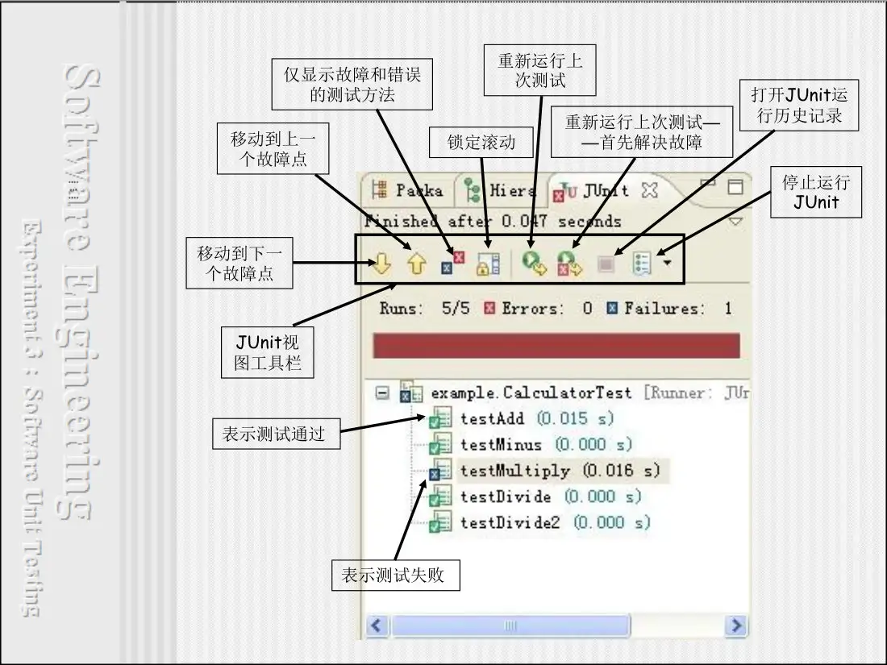

原文：

Software Engineering
