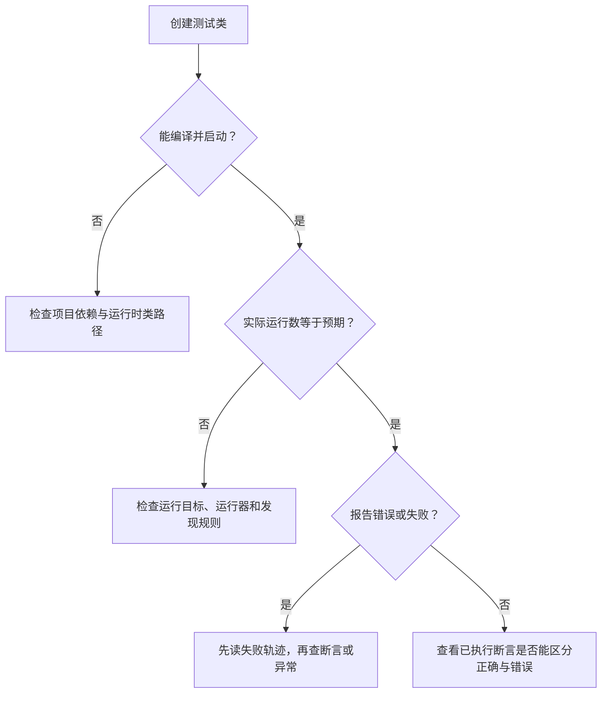

# 在 Eclipse 中区分 JUnit 类路径、源码与运行结果

这份历史参考资料以 Eclipse 3.0.2 和 JUnit 3.8.1 为例。原件先配置 `JUNIT` 和 `JUNIT_SRC`，再在示例项目里创建 `Student` 与 `StudentTest`，选择待测方法、补充测试并运行；不说明被测业务的正确性规范。它的价值不是复用二十年前的安装路径，而是理解：测试代码能编译、能读到库源码、被框架实际执行，是三件不同的事。

## 同一个库，为什么要两个路径

| 配置 | 哪一层用它 | 配错的典型症状 |
| --- | --- | --- |
| 将 `JUNIT`（编译后的库）加入项目的 Java Build Path | 编译器解析测试库中的类型；启动测试时，也需要让运行时能加载这些类 | 测试文件导入处报错，或编译通过而启动时发生类加载错误 |
| 将 `JUNIT_SRC`（匹配版本的库源码）附加到这个库条目上 | 编辑器定位源码，调试器显示库内部执行位置 | 可以执行测试，但跳进库的方法时看不到相应源码，或看到的行与执行位置对不上 |
| 选择与测试写法匹配的 JUnit 运行器，再运行测试类 | 框架发现测试方法、组织执行、汇报通过和失败 | 测试未被发现、运行数低于预期，或找到了测试但其断言失败 |

**订正**：原件有一处称二者为“环境变量”。这里指 Eclipse 工作区的 **Classpath Variables**，不是操作系统环境变量。仅在工作区定义变量，并没有给某个项目增加依赖；还要在项目的 Java Build Path 中引用它。附上源码也不是导入编译库的替代步骤。新项目一般由构建文件声明测试依赖或用 Eclipse 提供的 JUnit 库配置，不照抄历史插件目录。

## 文件写好了，先问测试到底跑了没有

下面的图是对原件路径的归纳。原件使用 `New → JUnit Test Case` 创建测试类，然后用 `Run As → JUnit Test` 启动；若视图没显示，可从 `Window → Show View → Other → Java → JUnit` 打开。打开视图是显示结果，不是补跑测试。

> [!TIP]
> 如果看到 ==运行数少于预期==，先检查测试发现，不要先改业务逻辑。原件第 15 页的成功画面是 `Runs: 1/1`、`Errors: 0`、`Failures: 0`，只说明当时发现并执行的那一个测试没有报错，不能推断其他方法已被验证。

**补充**：JUnit 3 典型的发现入口是继承 `TestCase` 的公开、无参、返回 `void` 的 `test…` 方法。后来的注解写法不是这个版本的规则。若旧式测试类把方法改名为 `checksEnrollment` 而没有手动把它加入测试套件，就不该期待 JUnit 3 的常规规则发现它；反过来，改回 `testEnrollment` 也只是通过发现这一步，前提是方法签名符合规则，随后仍需写有区分力的断言。

> [!WARNING]
> 附加源码后能进入库内部，不代表断言有效。一个只调用方法、不核对返回值或副作用的测试，面对悄悄返回错误结果的实现也可能通过。先明确输入、预期与判据，再保存结果；见[单元测试](../../../topics/软件工程/单元测试.md)、[测试目标与可测试性](../../../topics/软件工程/测试目标与可测试性.md)和[软件单元测试报告](../../../topics/软件工程/软件单元测试报告.md)。
