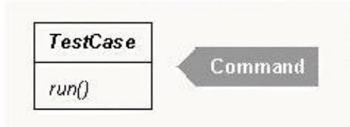
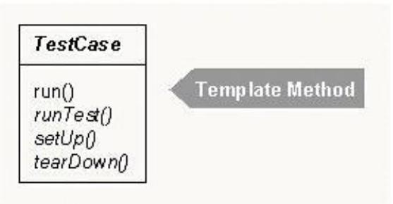
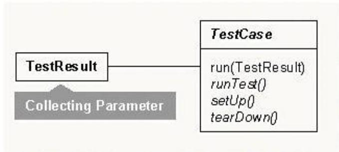
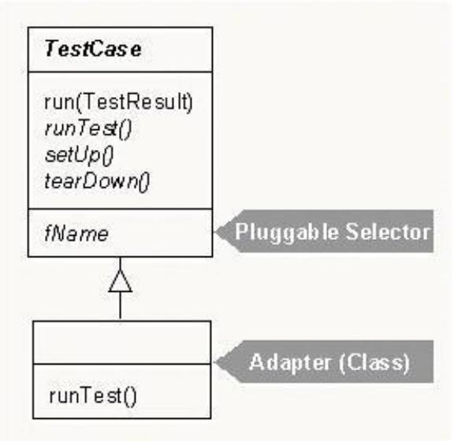
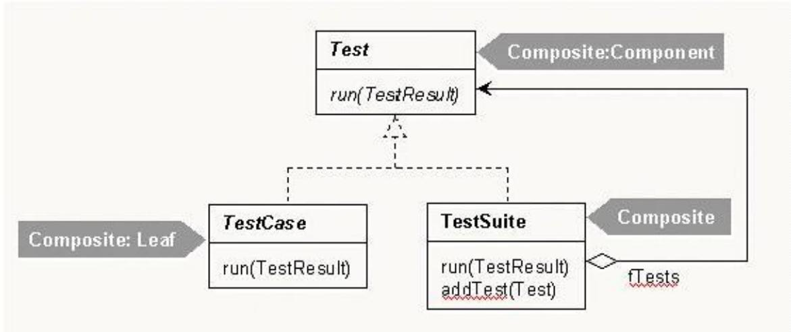
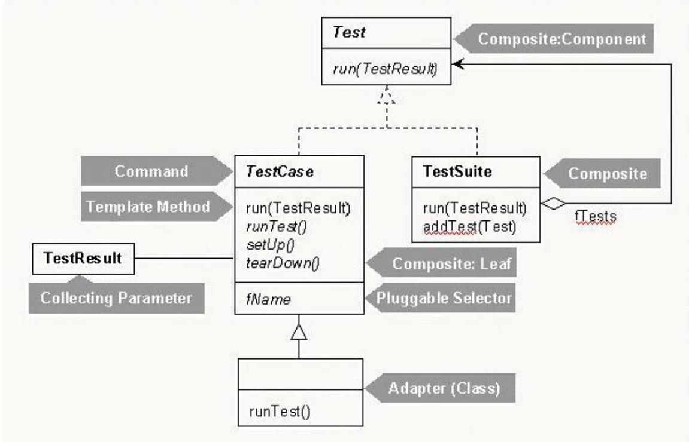
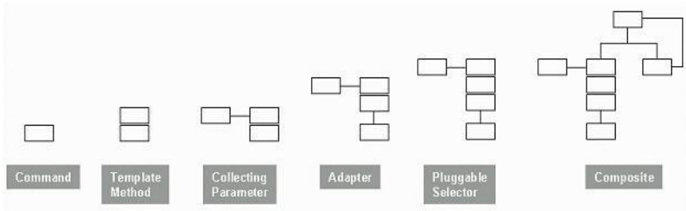
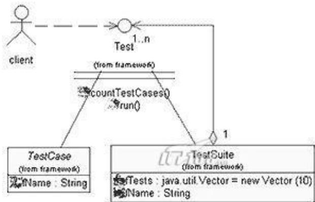
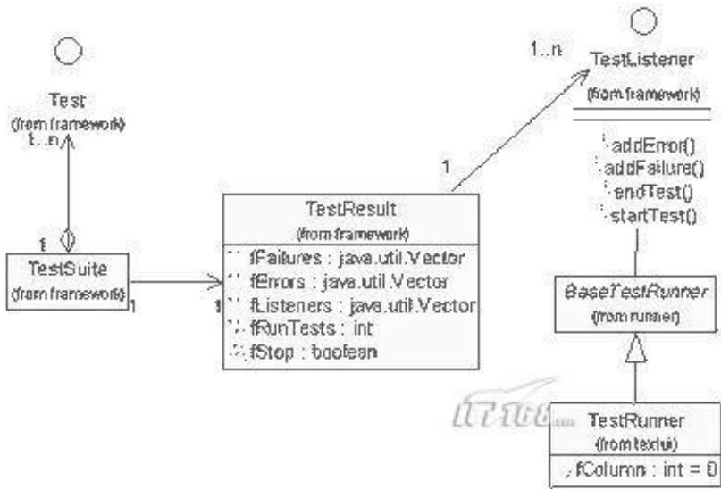
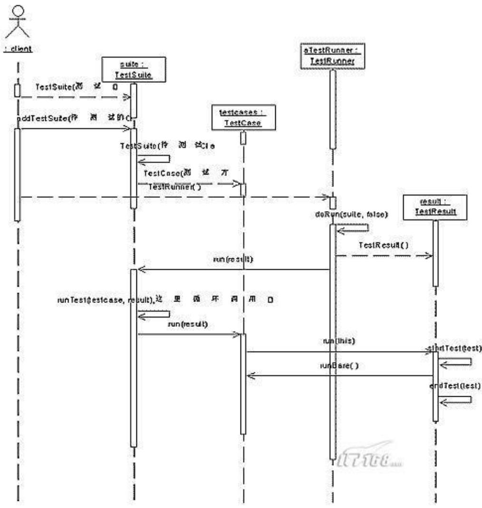

# 《软件工程（双语）》实验3参考资料：Java开源测试工具JUnit教程

原件经识别和整理；“参考解答”是我们补的。

---
title: 《软件工程（双语）》实验3参考资料：Java开源测试工具JUnit教程
kind: 实验
course: 软件工程（双语）
source: <原件地址或来源路径>
---

# 《软件工程（双语）》实验3参考资料：Java开源测试工具JUnit教程

本资料整理自《Java 开源测试工具 JUnit 简介》，涵盖 JUnit 的目标、设计模式应用及核心类结构。

## Java 开源测试工具 JUnit 简介

### 1. 简介

在一篇早些的文章（请参见 Test Infected: Programmers Love Writing Tests, Java Report, July 1998, Volume 3, Number 7）中，我们描述了如何使用一个简单的框架来编写可重复的测试。在本文中我们将匆匆一瞥其内中细节，并向你展示该框架本身是如何被构造的。

我们细致地研究 JUnit 框架并思索如何来构造它。我们发现了许多不同层次上的教训。在本文中，我们将尝试着立刻与它们进行沟通，这是一个令人绝望的任务，但至少它是在我们向你展示设计和构造一件价值被证实的软件的上下文中来进行的。

我们引发了一个关于框架目标的讨论。在对框架本身的表达期间，目标将重复出现许多小的细节中。此后，我们提出框架的设计和实现。设计将从模式（惊奇，惊奇）的角度进行描述，并作为优美的程序来予以实现。我们总结了一些优秀的关于框架开发的想法。

### 2. 什么是 JUnit 的目标呢？

首先，我们不得不回到开发的假定上去。如果缺少一个程序特性的自动测试（automated test），我们便假定其无法工作。这看起来要比主流的假定更加安全，主流的假定认为如果开发者向我们保证一个程序特性能够工作，那么现在和将来其都会永远工作。

从这个观点来看，当开发者编写和调试代码时，它们的工作并没有完成，它们还要必须编写测试来演示程序能够工作。然而，每个人都太忙，他们要做的事情太多，他们没有充足的时间用于测试。我已经有太多的代码需要编写，要我如何再来编写测试代码？回答我，强硬的项目经理先生。因此，首要目标就是编写一个框架，在这个框架中开发者能够看到实际来编写测试的希望之光。该框架必须要使用常见的工具，从而学习起来不会有太多的新东西。其不能比完全编写一个新测试所必须的工作更多。必须排除重复性的工作。

如果所有测试都这样去做的话，你将可以仅在一个调试器中编写表达式来完成。然而，这对于测试而言尚不充分。告诉我你的程序现在能够工作，对我而言并没有什么帮助，因为它并没有向我保证你的程序从我现在集成之后的每一分钟都将会工作，以及它并没有向我保证你的程序将依然能够工作五年，那时你已经离开了很长的时间。

于是，测试的第二个目标就是生成可持续保持其价值的测试。除原作者以外的其他人必须能够执行测试并解释其结果。应该能够将不同作者的测试结合起来并在一起运行，而不必担心相互冲突。

最后，必须能够以现有的测试作为支点来生成新的测试。生成一个装置（setup）或夹具（fixture）是昂贵的，并且一个框架必须能够对夹具进行重用，以运行不同的测试。哦，还有别的吗？

### 3. JUnit 的设计

JUnit 的设计将以一种首次在 Patterns Generate Architectures（请参见 "Patterns Generate Architectures", Kent Beck and Ralph Johnson, ECOOP 94）中使用的风格来呈现。其思想是通过从零开始来应用模式，然后一个接一个，直至你获得系统架构的方式来讲解一个系统的设计。我们将提出需要解决的架构问题，总结用来解决问题的模式，然后展示如何将模式应用于 JUnit。

#### 3.1 由此开始－TestCase

首先我们必须构建一个对象来表达我们的基本概念，TestCase（测试案例）。开发者经常在头脑中存在着测试案例，但在实现它们的时候却采用了许多不同的方式：

- 打印语句
- 调试器表达式
- 测试脚本

如果我们想要轻松地操纵测试，就必须将它们构建成对象。这将会获取到一个仅仅是隐藏在开发者头脑中的测试，并使之具体化，其支持我们创建测试的目标，即能够持续地保持它们的价值。同时，对象的开发者比较习惯于使用对象来进行开发，因此将测试构建成对象的决定支持我们的目标－使测试的编写更加吸引人（或至少是不太华丽）。

Command（命令）模式（请参见 Gamma, E., et al. Design Patterns: Elements of Reusable Object-Oriented Software, Addison-Wesley, Reading, MA, 1995）则能够比较好地满足我们的需求。摘引其意图（intent），“将一个请求封装成一个对象，从而使你可用不同的请求对客户进行参数化；对请求进行排队或记录请求日志...” Command 告诉我们可以为一个操作生成一个对象并给出它的一个“execute（执行）”方法。以下代码定义了 TestCase 类：

```java
// 原文此处应有代码块，因识别内容缺失，保留文字描述
// 声明为 public abstract
```

因为我们期望可以通过继承来对该类进行重用，我们将其声明为“public abstract”。暂时忽略其实现接口 Test 的事实。鉴于当前设计的需要，你可以将 TestCase 看作是一个孤立的类。

每一个 TestCase 在创建时都要有一个名称，因此若一个测试失败了，你便可识别出失败的是哪个测试。

为了阐述 JUnit 的演变过程，我们将使用图（diagram）来展示构架的快照（snapshot）。我们使用的标记很简单。其使用包含相关模式的尖方框来标注类。当类在模式中的角色（role）显而易见时，则仅显示模式的名称。如果角色并不清晰，则在尖方框中增加与该类相关的参与者的名称。该标记可使图的混乱度降到最小限度，并首次见诸于 Applying Design Patterns in Java（请参见 Gamma, E., Applying Design Patterns in Java, in Java Gems, SIGS Reference Library, 1997）。图 1 展示了这种应用于 TestCase 中的标记。由于我们是在处理一个单独的类并且没有不明确的地方，因此仅显示模式的名称。



#### 3.2 空白填充－run()

接下来要解决的问题是给开发者一个便捷的“地方”，用于放置他们的夹具代码和测试代码。将 TestCase 声明为 abstract 是指开发者希望通过子类化（subclassing）来对 TestCase 进行重用。然而，如果我们所有能作的就是提供一个只有一个变量且没有行为的超类，那么将无法做太多的工作来满足我们的首个目标－使测试更易于编写。

幸运的是，所有测试都具有一个共同的结构－建立一个测试夹具，在夹具上运行一些代码，检查结果，然后清理夹具。这意味着每一个测试将与一个新的夹具一起运行，并且一个测试的结果不会影响到其它测试的结果。这支持测试价值最大化的目标。

Template Method（模板方法）比较好地涉及到我们的问题。摘引其意图，“定义一个操作中算法的骨架，并将一些步骤延迟到子类中。Template Method 使得子类能够不改变一个算法的结构便可重新定义该算法的某些特定步骤。”这完全恰当。我们就是想让开发者能够分别来考虑如何编写夹具（建立和拆卸）代码，以及如何编写测试代码。不管怎样，这种执行的次序对于所有测试都将保持相同，而不管夹具代码如何编写，或测试代码如何编写。

这些方法被缺省实现为“什么都不做”：

由于 setUp 和 tearDown 会被用来重写（override），而且其将由框架来进行调用，因此我们将其声明为 protected。我们的第二个快照如图 2 所示。



#### 3.3 结果报告－TestResult

如果一个 TestCase 在森林中运行，是否有人关心其结果呢？当然－你之所以运行测试就是为了要证实它们能够运行。测试运行完后，你想要一个记录，一个什么能够工作和什么未能工作的总结。

如果测试具有相等的成功或失败的机会，或者如果我们刚刚运行一个测试，我们可能只是在 TestCase 对象中设定一个标志，并且当测试完毕时去看这个标志。然而，测试（往往）是非常不均匀的－他们通常都会工作。因此我们只是想要记录失败，以及对成功的一个高度浓缩的总结。

The Smalltalk Best Practice Patterns（请参见 Beck, K. Smalltalk Best Practice Patterns, Prentice Hall, 1996）有一个可以适用的模式，称为 Collecting Parameter（收集参数）。其建议当你需要在多个方法间进行结果收集时，应该在方法中增加一个参数，并传递一个对象来为你收集结果。我们创建一个新对象，TestResult（测试结果），来收集运行的测试的结果。

这个简单版本的 TestResult 仅仅能够计算所运行测试的数目。为了使用它，我们不得不在 TestCase.run() 方法中添加一个参数，并通知 TestResult 该测试正在运行：

并且 TestResult 必须要记住所运行测试的数目：

我们将 TestResult 的 startTest 方法声明为 synchronized，从而当测试运行在不同的线程中时，一个单独的 TestResult 能够安全地对结果进行收集。最后，我们想要保持 TestCase 简单的外部接口，因此创建一个无参的 run() 版本，其负责创建自己的 TestResult。

我们下面的设计快照可如图 3 所示。



如果测试总是能够正确运行，那么我们将没有必要编写它们。只有当测试失败时测试才是让人感兴趣的，尤其是当我们没有预期到它们会失败的时候。更有甚者，测试能够以我们所预期的方式失败，例如通过计算一个不正确的结果；或者它们能够以更加吸引人的方式失败，例如通过编写一个数组越界。无论测试怎样失败，我们都想执行后面的测试。

JUnit 区分了失败（failures）和错误（errors）。失败的可能性是可预期的，并且以使用断言（assertion）来进行检查。而错误则是不可预期的问题，如 ArrayIndexOutOfBoundsException。失败可通过一个 AssertionFailedError 来发送。为了能够识别出一个不可预期的错误和一个失败，将在 catch 子句 (1) 中对失败进行捕获。子句 (2) 则捕获所有其它的异常，并确保我们的测试能够继续运行...

TestCase 提供的 assert 方法会触发一个 AssertionFailedError。JUnit 针对不同的目的提供一组 assert 方法。下面只是最简单的一个：

AssertionFailedError 不应该由客户（TestCase 中的一个测试方法）来负责捕获，而应该由 Template Method 内部的 TestCase.run() 来负责。因此我们将 AssertionFailedError 派生自 Error。

在 TestResult 中收集错误的方法可如下所示：

TestFailure 是一个小的框架内部帮助类（helper class），其将失败的测试和为后续报告发送信号的异常绑定在一起。

规范形式的 Collecting parameter 模式要求我们将 Collecting parameter 传递给每一个方法。如果我们遵循该建议，每一个测试方法都将需要 TestResult 的参数。其将会造成这些方法签名（signature）的“污染”。使用异常来发送失败可以作为一个友善的副作用，使我们能够避免这种签名的污染。一个测试案例方法，或一个其所调用的帮助方法（helper method），可在不必知道 TestResult 的情况下抛出一个异常。作为一个进修材料，这里给出一个简单的测试方法，其来自于我们 MoneyTest 套件（【译者注】请参见 JUnit 发布版本中附带的另外一篇文章 JUnit Test Infected: Programmers Love Writing Tests）。其演示了一个测试方法是如何不必知道任何关于 TestResult 的信息的。

}(【译者注】由于与 JDK 中的关键字 assert 冲突，在最新的 JUnit 发布版本中此处的 assert 已经改为 assertTrue。)

JUnit 提出了关于 TestResult 的不同实现。其缺省实现是对失败和错误的数目进行计数并收集结果。TextTestResult 收集结果并以一种文本的形式来表达它们。最后，JUnit Test Runner 的图形版本则使用 UITestResult 来更新图形化的测试状态。

TestResult 是框架的一个扩展点（extension point）。客户能够自定义它们的 TestResult 类，例如 HTMLTestResult 可将结果上报为一个 HTML 文档。

#### 3.4 不愚蠢的子类－再论 TestCase

我们已经应用 Command 来表现一个测试。Command 依赖于一个单独的像 execute() 这样的方法（在 TestCase 中称为 run()）来对其进行调用。这个简单接口允许我们能够通过相同的接口来调用一个 command 的不同实现。

我们需要一个接口对我们的测试进行一般性地运行。然而，所有的测试案例都被实现为相同类的不同方法。这避免了不必要的类扩散（proliferation of classes）。一个给定的测试案例类（test case class）可以实现许多不同的方法，每一个方法定义了一个单独的测试案例（test case）。每一个测试案例都有一个描述性的名称，如 testMoneyEquals 或 testMoneyAdd。测试案例并不符合简单的 command 接口。相同 Command 类的不同实例需要与不同的方法来被调用。因此我们下面的问题就是，使所有测试案例从测试调用者的角度上看都是相同的。

回顾当前可用的设计模式所涉及的问题，Adapter（适配器）模式便映入脑海。Adapter 具有以下意图“将一个类的接口转换成客户希望的另外一个接口”。这听起来非常适合。Adapter 告诉我们不同的这样去做的方式。其中之一便是 class adapter（类适配器），其使用子类化来对接口进行适配。例如，为了将 testMoneyEquals 适配为 runTest，我们实现了一个 MoneyTest 的子类并重写 runTest 方法来调用 testMoneyEquals。

使用子类化需要我们为每一个测试案例都实现一个子类。这便给测试者放置了一个额外的负担。这有悖于 JUnit 的目标，即框架应该尽可能地使测试案例的增加变得简单。此外，为每一个测试方法创建一个子类会造成类膨胀（class bloat）。许多类将仅具有一个单独的方法，这种开销不值得，而且很难会提出有意义的名称。

### 3.4 匿名内部类与 Pluggable Selector

Java 提供了匿名内部类（anonymous inner class），其提供了一个让人感兴趣的 Java 所专门的方案来解决类的命名问题。通过匿名内部类我们能够创建一个 Adapter 而不必创造一个类的名称：

这与完全子类化相比要便捷许多。其是以开发者的一些负担作为代价以保持编译时期的类型检查（compile-time type checking）。Smalltalk Best Practice Pattern 描述了另外的方案来解决不同实例的问题，这些实例是在共同的 pluggable behavior（插件式行为）标题下的不同表现。该思想是使用一个单独的参数化的类来执行不同的逻辑，而无需进行子类化。

Pluggable behavior 的最简单形式是 Pluggable Selector（插件式选择器）。Pluggable Selector 在一个实例变量中保存了一个 Smalltalk 的 selector 方法。该思想并不局限于 Smalltalk，其也适用于 Java。在 Java 中并没有一个 selector 方法的标记。但是 Java reflection（反射）API 允许我们可以根据一个方法名称的表示字符串来调用该方法。我们可以使用该种特性来实现一个 Java 版的 pluggable selector。岔开话题而言，我们通常不会在平常的应用程序中使用反射。在我们的案例中，我们正在处理的是一个基础设施框架，因此它可以戴上反射的帽子。

JUnit 可以让客户自行选择，是使用 pluggable selector，或是实现上面所提到的匿名 adapter 类。正因如此，我们提供 pluggable selector 作为 runTest 方法的缺省实现。在该情况下，测试案例的名称必须要与一个测试方法的名称相一致。如下所示，我们使用反射来对方法进行调用。首先我们会查找 Method 对象。一旦我们有了 method 对象，便会调用它并传递其参数。由于我们的测试方法没有参数，所以我们可以传递一个空的参数数组。

JDK1.1 的 reflection API 仅允许我们发现 public 的方法。基于这个原因，你必须将测试方法声明为 public，否则将会得到一个 NoSuchMethodException 异常。

在下面的设计快照中，添加进了 Adapter 和 Pluggable Selector。



### 3.5 不必关心一个或多个——TestSuit

为了获得对系统状态的信心，我们需要运行许多测试。到现在为止，JUnit 能够运行一个单独的测试案例并在一个 TestResult 中报告结果。我们接下来的挑战是要对其进行扩展，以使其能够运行许多不同的测试。当测试调用者不必关心其运行的是一个或多个测试案例时，这个问题便能够轻松地解决。能够在该情况下度过难关的一个流行模式就是 Composite（组合）。摘引其意图，“将对象组合成树形结构以表示‘部分-整体’的层次结构。Composite 使得用户对单个对象和组合对象的使用具有一致性。”在这里‘部分-整体’的层次结构是让人感兴趣的地方。我们想支持能够层层相套的测试套件。

Composite 引入如下的参与者：

- Component：声明我们想要使用的接口，来与我们的测试进行交互。
- Composite：实现该接口并维护一个测试的集合。
- Leaf：代表 composite 中的一个测试案例，其符合 Component 接口。

该模式告诉我们要引入一个抽象类，来为单独的对象和 composite 对象定义公共的接口。这个类的基本意图就是定义一个接口。在 Java 中应用 Composite 时，我们更倾向于定义一个接口，而非抽象类。使用接口避免了将 JUnit 提交成一个具体的基类来用于测试。所必需的是这些测试要符合这个接口。因此我们对模式的描述进行变通，并引入一个 Test 接口：

TestCase 对应着 Composite 中的一个 Leaf，并且实现了我们上面所看到的这个接口。

下面，我们引入参与者 Composite。我们将其取名为 TestSuit（测试套件）类。TestSuit 在一个 Vector 中保存了其子测试（child test）：

run() 方法对其子成员进行委托（delegate）：



最后，客户必须能将测试添加到一个套件中，它们将使用 addTest 方法来这样做：

注意所有上面的代码是如何仅对 Test 接口进行依赖的。由于 TestCase 和 TestSuit 两者都符合 Test 接口，我们可以递归地将测试套件再组合成套件。所有开发者都能够创建他们自己的 TestSuit。我们可创建一个组合了这些套件的 TestSuit 来运行它们所有的。

下面是一个创建 TestSuit 的示例：

这会很好地工作，但它需要我们手动地将所有测试添加到一个套件中。早期的 JUnit 采用者告诉我们这样是愚蠢的。只要你编写一个新的测试案例，你就必须记着要将其添加到一个 static 的 suit() 方法中，否则其将不会运行。我们添加了一个 TestSuit 的便捷构造方法，该构造方法将测试案例类作为一个参数。其意图是提取（extract）测试方法，并创建一个包含这些测试方法的套件。测试方法必须遵循的简单的约定是，以前缀“test”开头且不带参数。便捷构造方法就使用该约定，通过使用反射发现测试方法来构造测试对象。使用该构造方法，以上代码将会简化为：

当你只是想运行测试案例的一个子集时，则最初的方式将依然有用。

### 3.6 总结

现在我们位于 JUnit 走马观花的最后。通过模式的角度来阐述 JUnit 的设计，可如下图所示。



注意 TestCase 作为框架抽象的中心，其是如何与四个模式进行相关的。成熟的对象设计的描述展示了这种相同的“模式密度”。设计的中心是一个丰富的关系集合，这些关系与所支持的参与者（player）相互关联。

这是另外一种看待 JUnit 中所有模式的方式。在这个情节图板（storyboard）上，依次对每个模式的影响进行抽象地表示。于是，Command 模式创建了 TestCase 类，Template Method 模式创建了 run 方法，等等。（情节图板的标记是在图 6 中标记的基础上删除了所有的文字）。



关于情节图板有一点要注意的是，图的复杂性是如何在我们应用 Composite 时进行跃迁的。其以图示的方式证实了我们的直觉，即 Composite 是一个强大的模式，但它会“使得图变得复杂。”因此应该谨慎地予以使用。

## 4 结论

最后，让我们作一些全面的观察：

### 模式

我们发现从模式的角度来论述设计是非常宝贵的，无论是在我们进行框架的开发中，还是我们试图向其他人论述它时。你现在正处于一个完美的位置来判定，以模式来描述一个框架是否有效。如果你喜欢上面的论述，请为你自己的系统尝试相同的表现风格。

### 模式密度

TestCase 周围的模式“密度”比较高，其是 JUnit 的关键抽象。高模式密度的设计更加易于使用，但却更加难于修改。我们发现像这样一个在关键抽象周围的高模式密度，对于成熟的框架而言是常见的。其对立面则应适用于那些不成熟的框架——它们应该具有低模式密度。一旦你发现你所要真正解决的问题，你便能够开始“浓缩（compress）”这个解决方案，直到一个模式越来越密集的区域，而这些模式在其中提供了杠杆的作用。

### 用自己做的东西

一旦我们完成了基本的单元测试功能，我们自身就要将其应用起来。TestCase 可以验证框架能够为错误，成功和失败报告正确的结果。我们发现随着框架设计的继续演变，这是无价的。我们发现 JUnit 的最具挑战性的应用便是测试其本身的行为。

### 交集（intersection），而非并集（union）

在框架开发中有一个诱惑就是，包含每一个你所能够具有的特性。毕竟，你想使框架尽可能得有价值。然而，会有一种阻碍——开发者不得不来决定使用你的框架。框架所具有的特性越少，那么学起来就越容易，开发者使用它的可能性就越大。JUnit 便是根据这种风格写就的。其仅实现了那些测试运行所完全基本的特性——运行测试的套件，使各个测试的执行彼此相互隔离，以及测试的自动运行。是的，我们无法抵抗对于一些特性的添加，但是我们会小心地将其放到它们自己的扩展包中（test.extensions）。该包中有一个值得注意的成员是 TestDecorator，其允许在一个测试之前和之后可以执行附加的代码。

### 框架编写者要读他们的代码

我们花在阅读 JUnit 的代码上的时间比起编写它的时间要多出很多。而且花在去除重复功能上的时间几乎与添加新功能的时间相等。我们积极地进行设计上的实验，以多种我们能够想出的不同方式来添加新的类以及移动职责。通过对 JUnit 持续不断地洞察（测试，对象设计，框架开发），以及发表更深入的文章的机会，我们因为我们的偏执而获得了回报（并将依然获得回报）。

JUnit 的最新版本可从

ftp://www.armaties.com/D/home/armaties/ftp/TestingFramework/JUnit/ 下载。

## JUnit 和单元测试入门简介

### 1 几个相关的概念

白盒测试——把测试对象看作一个打开的盒子，程序内部的逻辑结构和其他信息对测试人员是公开的。

回归测试——软件或环境的修复或更正后的“再测试”，自动测试工具对这类测试尤其有用。

单元测试——是最小粒度的测试，以测试某个功能或代码块。一般由程序员来做，因为它需要知道内部程序设计和编码的细节。

JUnit——是一个开发源代码的 Java 测试框架，用于编写和运行可重复的测试。他是用于单元测试框架体系 xUnit 的一个实例（用于 java 语言）。主要用于白盒测试，回归测试。

### 2 单元测试概述

#### 2.1 单元测试的好处

A、提高开发速度——测试是以自动化方式执行的，提升了测试代码的执行效率。

B、提高软件代码质量——它使用小版本发布至集成，便于实现人员除错。同时引入重构概念，让代码更干净和富有弹性。

C、提升系统的可信赖度——它是回归测试的一种。支持修复或更正后的“再测试”，可确保代码的正确性。

#### 2.2 单元测试的针对对象

A、面向过程的软件开发针对过程。

B、面向对象的软件开发针对对象。

C、可以做类测试，功能测试，接口测试（最常用于测试类中的方法）。

#### 2.3 单元测试工具和框架

目前的最流行的单元测试工具是 xUnit 系列框架，常用的根据语言不同分为 JUnit（java），CppUnit（C++），DUnit（Delphi），NUnit（.net），PhpUnit（Php）等等。该测试框架的第一个和最杰出的应用就是由 Erich Gamma（《设计模式》的作者）和 Kent Beck（XP（Extreme Programming）的创始人）提供的开放源代码的 JUnit。

### 3 JUnit 入门简介

#### 3.1 JUnit 的好处和 JUnit 单元测试编写原则

好处：A、可以使测试代码与产品代码分开。B、针对某一个类的测试代码通过较少的改动便可以应用于另一个类的测试。

C、易于集成到测试人员的构建过程中，JUnit 和 Ant 的结合可以实施增量开发。D、JUnit 是公开源代码的，可以进行二次开发。C、可以方便地对 JUnit 进行扩展。

编写原则：

A、是简化测试的编写，这种简化包括测试框架的学习和实际测试单元的编写。B、是使测试单元保持持久性。C、是可以利用既有的测试来编写相关的测试。

#### 3.2 JUnit 的特征

A、使用断言方法判断期望值和实际值差异，返回 Boolean 值。B、测试驱动设备使用共同的初始化变量或者实例。C、测试包结构便于组织和集成运行。D、支持图型交互模式和文本交互模式。

#### 3.3 JUnit 框架组成

A、对测试目标进行测试的方法与过程集合，可称为测试用例（TestCase）。

B、测试用例的集合，可容纳多个测试用例（TestCase），将其称作测试包（TestSuite）。

C、测试结果的描述与记录。（TestResult）。

D、测试过程中的事件监听者（TestListener）。

E、每一个测试方法所发生的与预期不一致状况的描述，称其测试失败元素（TestFailure）

F、JUnit Framework 中的出错异常（AssertionFailedError）。

JUnit 框架是一个典型的 Composite 模式：TestSuite 可以容纳任何派生自 Test 的对象；当调用 TestSuite 对象的 run() 方法是，会遍历自己容纳的对象，逐个调用它们的 run() 方法。（可参考《程序员》2003-6 期）。

#### 3.4 JUnit 的安装和配置

JUnit 安装步骤分解：

在 http://download.sourceforge.net/junit/ 中下载 JUnit 包并将 Junit 压缩包解压到一个物理目录中（例如 C：＼Junit3.8.1）。

记录 Junit.jar 文件所在目录名（例如 C：＼Junit3.8.1Junit.jar）。

进入操作系统（以 Windows2000 操作系统为准），按照次序点击“开始 设置 控制面板”。

在控制面板选项中选择“系统”，点击“环境变量”，在“系统变量”的“变量”列表框中选择“CLASS-PATH”关键字（不区分大小写），如果该关键字不存在则添加。

双击“CLASS-PATH”关键字添加字符串“C:＼Junit3.8.1Junti.jar”（注意，如果已有别的字符串请在该字符串的字符结尾加上分号“；”），这样确定修改后 Junit 就可以在集成环境中应用了。

对于 IDE 环境，对于需要用到的 JUnit 的项目增加到 lib 中，其设置不同的 IDE 有不同的设置。

#### 3.5 JUnit 中常用的接口和类

Test 接口——运行测试和收集测试结果

## 3.5 JUnit 核心类与接口

Test 接口使用了 Composite 设计模式，是单独测试用例（TestCase）、聚合测试模式（TestSuite）及测试扩展（TestDecorator）的共同接口。

它的 `public int countTestCases()` 方法用来统计这次测试有多少个 TestCase，另外一个方法就是 `public void run(TestResult)`，TestResult 是实例接受测试结果，run 方法执行本次测试。

### TestCase 抽象类——定义测试中固定方法

TestCase 是 Test 接口的抽象实现（不能被实例化，只能被继承），其构造函数 `TestCase(string name)` 根据输入的测试名称 name 创建一个测试实例。由于每一个 TestCase 在创建时都要有一个名称，若某测试失败了，便可识别出是哪个测试失败。

TestCase 类中包含的 `setUp()`、`tearDown()` 方法。`setUp()` 方法集中初始化测试所需的所有变量和实例，并且在依次调用测试类中的每个测试方法之前再次执行 `setUp()` 方法。`tearDown()` 方法则是在每个测试方法之后，释放测试程序方法中引用的变量和实例。

开发人员编写测试用例时，只需继承 TestCase，来完成 run 方法即可，然后 JUnit 获得测试用例，执行它的 run 方法，把测试结果记录在 TestResult 之中。

### Assert 静态类——一系列断言方法的集合

Assert 包含了一组静态的测试方法，用于期望值和实际值比对是否正确，即测试失败，Assert 类就会抛出一个 AssertionFailedError 异常，JUnit 测试框架将这种错误归入 Failes 并加以记录，同时标志为未通过测试。如果该类方法中指定一个 String 类型的传参则该参数将被做为 AssertionFailedError 异常的标识信息，告诉测试人员改异常的详细信息。

JUnit 提供了 6 大类 31 组断言方法，包括基础断言、数字断言、字符断言、布尔断言、对象断言。

其中 `assertEquals(Object expcted,Object actual)` 内部逻辑判断使用 `equals()` 方法，这表明断言两个实例的内部哈希值是否相等时，最好使用该方法对相应类实例的值进行比较。而 `assertSame(Object expected,Object actual)` 内部逻辑判断使用了 Java 运算符“==”，这表明该断言判断两个实例是否来自于同一个引用（Reference），最好使用该方法对不同类的实例的值进行比对。`asserEquals(String message,String expected,String actual)` 该方法对两个字符串进行逻辑比对，如果不匹配则显示着两个字符串有差异的地方。ComparisonFailure 类提供两个字符串的比对，不匹配则给出详细的差异字符。

### TestSuite 测试包类——多个测试的组合

TestSuite 类负责组装多个 Test Cases。待测得类中可能包括了对被测类的多个测试，而 TestSuit 负责收集这些测试，使我们可以在一个测试中，完成全部的对被测类的多个测试。

TestSuite 类实现了 Test 接口，且可以包含其它的 TestSuites。它可以处理加入 Test 时的所有抛出的异常。

TestSuite 处理测试用例有 6 个规约（否则会被拒绝执行测试）

- A 测试用例必须是公有类（Public）
- B 测试用例必须继承与 TestCase 类
- C 测试用例的测试方法必须是公有的（Public）
- D 测试用例的测试方法必须被声明为 Void
- E 测试用例中测试方法的前置名词必须是 test
- F 测试用例中测试方法误任何传递参数

### TestResult 结果类和其它类与接口

TestResult 结果类集合了任意测试累加结果，通过 TestResult 实例传递个每个测试的 Run() 方法。TestResult 在执行 TestCase 是如果失败会异常抛出

TestListener 接口是个事件监听规约，可供 TestRunner 类使用。它通知 listener 的对象相关事件，方法包括测试开始 `startTest(Test test)`，测试结束 `endTest(Test test)`，错误，增加异常 `addError(Test test,Throwable t)` 和增加失败 `addFailure(Test test,AssertionFailedError t)`

TestFailure 失败类是个“失败”状况的收集类，解释每次测试执行过程中出现的异常情况。其 `toString()` 方法返回“失败”状况的简要描述

## 3.6 JUnit 一个实例

在控制台中简单的范例如下：

1. 写个待测试的 Triangle 类，创建一个 TestCase 的子类 ExampleTest；
2. ExampleTest 中写一个或多个测试方法，断言期望的结果（注意：以 test 作为待测试的方法的开头，这样这些方法可以被自动找到并被测试）；
3. ExampleTest 中写一个 `suite()` 方法，它会使用反射动态的创建一个包含所有的 testXxxx 方法的测试套件；
4. ExampleTest 可以写 `setUp()`、`tearDown()` 方法，以便于在测试时初始化或销毁测试所需的所有变量和实例。（不是必须的）
5. 写一个 `main()` 方法以文本运行器或其它 GUI 的方式方便的运行测试
6. 编译 ExampleTest，执行测试。

## 3.7 Eclipse 中 JUnit 的使用

Eclipse 自带了一个 JUnit 的插件，不用安装就可以在你的项目中开始测试相关的类，并且可以调试你的测试用例和被测试类。

使用步骤如下：

1. 新建一个测试用例，点击“File->New->Other”菜单项，在弹出的“New”对话框中选择“Java->JUnit”，下的 TestCase 或 TestSuite，就进入“New JUnit TestCase”对话框
2. 在“New JUnit TestCase”对话框填写相应的栏目，主要有 Name（测试用例名），SuperClass（测试的超类一般是默认的 junit.framework.TestCase），Class Under Test（被测试的类），Source Folder（测试用例保存的目录），Package（测试用例包名），及是否自动生成 main,setUp,tearDown 方法。
3. 如果点击下面的“Next>”按钮，你还可以直接勾选你想测试的被测试类的方法，Eclipse 将自动生成与被选方法相应的测试方法，点击“Fishish”按钮后一个测试用例就创建好了。
4. 编写完成你的测试用例后，点击“Run”按钮就可以看到运行结果了。

## 3.8 JUnit 的扩展应用

以下罗列了些 JUnit 的扩展应用：

- JUnit + HttpUnit=WEB 功能测试工具
- JUnit + hansel =代码覆盖测试工具
- JUnit + abbot =界面自动回放测试工具
- JUnit + dbunit =数据库测试工具
- JUnit + junitperf=性能测试工具

## 3.9 一些使用 JUnit 经验

- 不要用 TestCase 的构造函数初始化，而要用 `setUp()` 和 `tearDown()` 方法。
- 不要依赖或假定测试运行的顺序，因为 JUnit 利用 Vector 保存测试方法。所以不同的平台会按不同的顺序从 Vector 中取出测试方法。
- 避免编写有副作用的 TestCase。例如：如果随后的测试依赖于某些特定的交易数据，就不要提交交易数据。简单的回滚就可以了。
- 当继承一个测试类时，记得调用父类的 `setUp()` 和 `tearDown()` 方法。
- 将测试代码和工作代码放在一起，一边同步编译和更新。
- 测试类和测试方法应该有一致的命名方案。如在工作类名前加上 test 从而形成测试类名。
- 确保测试与时间无关，不要依赖使用过期的数据进行测试。导致在随后的维护过程中很难重现测试。
- 如果你编写的软件面向国际市场，编写测试时要考虑国际化的因素。不要仅用母语的 Locale 进行测试。
- 尽可能地利用 JUnit 提供地 assert/fail 方法以及异常处理的方法，可以使代码更为简洁。
- 测试要尽可能地小，执行速度快。

## 参考资料与附件

1. http://www.junit.org JUnit 官方网站
2. http://bbs.51cmm.com 的测试论坛
3. http://www.uml.org.cn 的软件测试专栏
4. 单元测试 《程序员》 2002 年 7 期
5. JUnit 设计模式分析 《程序员》2003 年 6 期
6. 《软件测试和 JUnit 实践》
7. 附件 Triangle.java 一个要测试的类
8. 附件 ExampleTest.java 一个测试用例类

### Triangle.java

```java
/**
 * this is Triangle class
 * @author liujun
```

```java
//junit.swingui.TestRunner.run(suite().getClass());
//awtui 方式
//junit.awtui.TestRunner.run(suite().getClass());
```

## 用 JUnit 框架实现 Java 单元测试

随着软件项目的逐渐增大，软件测试在软件开发中的地位显得越来越重要。如果软件项目没有良好的测试流程，随着系统的增大，无论项目管理人员还是软件开发人员都会对项目的前景失去信心，甚至会对项目的目标产生分歧，因为长期以来没有对程序代码和系统设计进行有效的控制，很多问题都被暂时掩盖或逐渐演化成其他的问题。软件开发周期越长，就会使得问题进化的版本越多，最后造成的结果是“剪不断，理还乱”。

单元测试是整个测试流程中最基础的部分，它们要求程序员尽可能早地发现问题，并给予控制，这是其一。另外，如果集成测试出现问题，它们可以帮助诊断。这样就为在软件开发流程中建立高效的事件反应机制打下了坚实基础。

JUnit 就是为 Java 程序开发者实现单元测试提供一种框架，使得 Java 单元测试更规范有效，并且更有利于测试的集成。

### JUnit 的内部结构

#### JUnit 的软件结构

JUnit 共有七个包，核心的包就是 junit.framework 和 junit.runner。Framework 包负责整个测试对象的构架，Runner 负责测试驱动。

#### JUnit 的类结构

JUnit 有四个重要的类：TestSuite、TestCase、TestResult、TestRunner。前三个类属于 Framework 包，后一个类在不同的环境下是不同的。这里使用的是文本测试环境，所以用的是 junit.textui.TestRunner。各个类的职责如下：

1. TestResult，负责收集 TestCase 所执行的结果，它将结果分为两类，客户可预测的 Failure 和没有预测的 Error。同时负责将测试结果转发到 TestListener（该接口由 TestRunner 继承）处理；
2. TestRunner，客户对象调用的起点，负责对整个测试流程的跟踪。能够显示返回的测试结果，并且报告测试的进度。
3. TestSuite，负责包装和运行所有的 TestCase。
4. TestCase，客户测试类所要继承的类，负责测试时对客户类进行初始化，以及测试方法调用。

另外还有两个重要的接口：Test 和 TestListener。

1. Test，包含两个方法：`run()` 和 `countTestCases()`，它是对测试动作特征的提取。
2. TestListener，包含四个方法：`addError()`、`addFailure()`、`startTest()` 和 `endTest()`，它是对测试结果的处理以及测试驱动过程的动作特征的提取。

下面给出的两个类图（篇幅有限，只显示主要部分）很好地阐明了类之间的关系，以及 junit 的设计目标（如图 1）。测试案例的类采用 Composite 模式。这样，客户的测试对象就转变成一个“部分—整体”的层次结构。客户代码仅需要继承类 TestCase，就可以轻松的与已有的其他对象组合使用，从而使得单元测试的集成更加方便。



图 2 是测试跟踪类图。图 2 左边 TestSuite 包含了测试对象集合，右边包含了测试结果集。具体如何处理结果，以及包含哪些测试对象，并没有立即得出结论，而是尽量地延迟到具体实现的时候。例如，实现接口 TestListener 的 JUnit 中就含有：junit.awtui.TestRunner、junit.swingui.TestRunner、junit.ui.TestRunner 等，甚至客户用自己的类实现 TestListener，从而达到多样化的目的。



从以上两个类图，可以了解 JUnit 对单元测试的基本思路，这个框架的核心就是结果集和案例集。

### JUnit 的实现流程

典型的使用 JUnit 的方法就是继承 TestCase 类，然后重载它的一些重要方法：`setUp()`、`teardown()`、`runTest()`（这些都是可选的），最后将这些客户对象组装到一个 TestSuite 对象中，交由 junit.textui.TestRunner.run（案例集）驱动。下面分析案例集是如何运转的。

图 3 基本上阐述 JUnit 的测试流程架构。我们将从不同的角度来详细分析这个图。



首先，从对象的创建上来分析。客户类负责创建 Suite 和 aTestRunner。注意，类 TestRunner 含有一个静态函数 Run(Test)，它自创建本身，然后调用 `doRun()`。客户类调用的一般是该函数，其代码如下：

Suite 对象负责创建众多的测试案例，并将它们包容到本身。客户测试案例继承 TestCase 类，它将类，而不是对象传给 Suite 对象。Suite 对象负责解析这些类、提取构造函数和待测试方法。以待测试方法为单位构造测试案例，测试案例的 fName 就是待测试方法名。测试结果集由 aTestRunner 创建。这似乎同先前阐述的类图有些矛盾，那里阐述了一个测试集可以包含很多个不同的测试驱动，似乎先创建结果集比较理想。显然，这里对测试结果的处理只采用了一种方式，所以这样做同样可行。

## 实施 JUnit 的几点建议

从以上的分析中，可以了解 JUnit 的结构和流程，但是在实际应用 JUnit 时，有几点建议还需要说明，如下：

1. 客户类可以重载 runTest()，它的缺省实现是调用方法名为 fName 的测试方法。如果客户不是使用 TestSuite 加载 TestCase，就尤其需要对其重载，当然这种方式并不赞成使用，不利于集成。另外，setUp() 和 tearDown() 的功能似乎与构造函数雷同，但如果测试案例之间具有类继承关系，采用构造函数初始化一些参数就会造成数据的混乱，不利于判定测试结果的有效性。

2. 待测试函数的调用顺序是不确定的，采用的数据结构是 Vector()。如果需要有顺序关系，可以将它们组合到一起，然后用同一个测试方法。

3. 为了使测试结果清晰明了，程序中最好不要有打印输出，要么程序的打印输出与 JUnit 测试的打印输出不要用同一个数据源 System.out。其实这是两种测试习惯，直接打印输出是较传统的，从测试动机上考虑它也是较随意的，并且结果需要人工观察。如果直接打印输出较多的话，观察者可能无法获得满意的结果。

此外，如何扩展这个测试框架呢？junit.extensions 包给出了几点提示。我们可以使用 junit.extensions.ActiveTest 在不同的线程中运行一个测试实例。对于要对测试案例添加新的功能可以采用 Decorator 模式，可以参考 junit.extensions.TestDecorator 以及它的子类 junit.extensions.TestSetup、junit.extensions.RepeatedTest。这些仅仅提供了一些拓宽的思路，涉及到具体测试目标，还需进一步地挖掘。

### 备注

1. 本文档的内容均为从互联网上面收集和整理得到的。主要的信息源包括 ddvip.com 等互联网网站。

2. 文档中的包含的内容的版权等均为原拥有者所有。

3. 本文档仅为内部学习用途，不应进行传播、复制、修改和销售等。
