# 《软件工程（双语）》实验4参考资料：SVN使用手册大全

原件经识别和整理；“参考解答”是我们补的。

目录

1. 修改 SVN 访问密码
2. SVN 客户端使用说明
   2.1. 安装 SVN 客户端
   2.2. 迁出配置库内容
   2.3. 维护工作文件
       2.3.1. 增加文件
       2.3.2. 更新文件
       2.3.3. 删除文件
       2.3.4. 修改文件
       2.3.5. 比较版本差异
       2.3.6. 撤销更改
       2.3.7. 锁定和解锁
       2.3.8. 重命名文件
       2.3.9. 获取历史文件
       2.3.10. 检查冲突
       2.3.11. 解决冲突
       2.3.12. 忽略无需版本控制的文件
       2.3.13. 去除 SVN 标志
       2.3.14. 查看文件每行的修改信息
       2.3.15. 重置访问路径
       2.3.16. 本地路径转换
   2.4. 浏览版本库
   2.5. 建立标签
   2.6. 建立分支
   2.7. 清除用户名等信息
   2.8. 统计信息
3. MyEclipse 集成 SVN
   3.1. 安装 SVN 插件
   3.2. 配置 MyEclipse 提交目录

## 1. 修改 SVN 访问密码

打开 IE，在地址栏中输入地址：http://<服务器地址>/svnmanager/index.php，进入 SVNManager 的欢迎界面，如下图所示：

点击“登陆”按钮进入登陆界面，如下图所示：


登陆界面中的用户名输入框：


密码输入框：

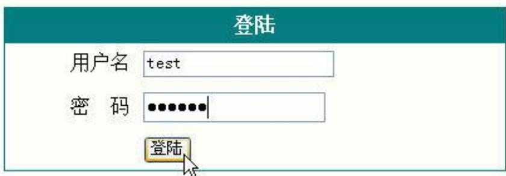

输入已知的用户名和密码，点击“登陆”按钮进入用户管理界面，点击“用户管理”按钮显示“编辑用户”菜单，如下图所示：


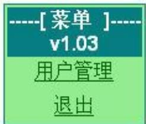

点击“编辑用户”按钮，进入用户信息修改界面（SVNManager 编辑用户，[菜单] 用户管理 退出），如下图所示：

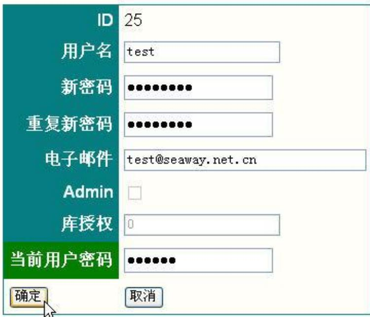

在上图界面的“新密码”和“重复新密码”框中输入你设定的新密码，两框中的密码要保持一致。在“当前用户密码”框中输入你的先前的登陆密码。

点击“确定”按钮修改密码，后返回到编辑用户成功界面，在此界面中点击“退出”按钮完成此操作。再次可使用新密码进行登陆。

## 2. SVN 客户端使用说明

### 2.1 安装 SVN 客户端

安装 SVN 客户端（我公司使用的 SVN 客户端为 TortoiseSVN-1.4.8.12137-win32-svn-1.4.6）：双击安装包 → Next → 选中 “I accept the terms in the license Agreement” → Next → Install → 选中 “Show Changelog” → Finish → 点击 “Yes” 按钮重新启动电脑。

SVN 客户端的存放位置为：

注意：安装 SVN 客户端后需重启电脑，否则 SVN 客户端无法正常使用。

可以下载 TortoiseSVN 的中文语言包，根据向导运行语言包安装程序，重新启动程序后，即可看到中文菜单。

所有的 TortoiseSVN 命令都是通过 Windows 资源管理器的右键菜单执行。

### 2.2 迁出配置库内容

1. 在本地硬盘上建立一个文件夹“SVN”，并在文件夹“SVN”中建立一个子文件夹（子文件夹为空文件夹），子文件夹的名称可以根据本公司配置库路径下的对应文件夹名称进行定义。例如在 SVN 中建立一个 test 子文件夹。

2. 鼠标选中文件夹“test”右键选择“SVN Checkout...”，如下图所示：

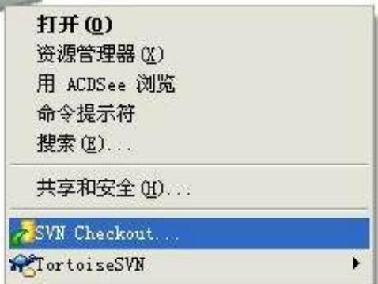

3. 在弹出的窗口中 URL of repository 栏中输入您要访问的配置库路径，如 http://<服务器地址>/test（此路径为实验路径，输入时依具体配置库路径而定，可以为根目录的路径也可以为子目录的路径，目录选择要适当），如下图所示：

点击“OK”按钮。

备注：在 Revision 栏中选择“HEAD revision”项只能获得所输入路径下的最新版本文件。选择“Revision”项可以输入或选择此路径下的任意历史版本文件。如果点击“Show log”按钮会弹出如下信息框：

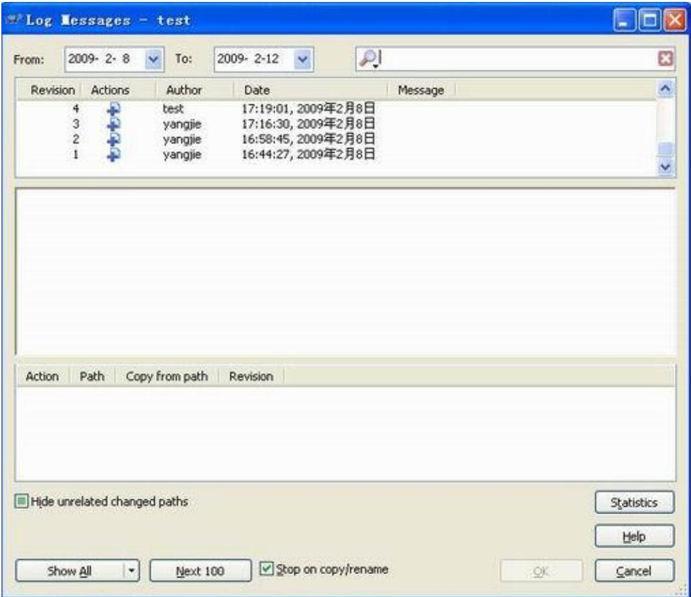

此信息框为版本日志对话框，在此信息框中可以选择某一历史版本。

4. 在弹出的窗口 Authentication 中的 Username 栏输入用户名，在 Password 栏输入用户密码，如下图所示：

可选择 Save authentication 复选框保存用户名和密码。

点击“OK”按钮下载配置库中 test 路径的文件到本地硬盘上的 test 文件中。下载完毕后本地文件夹 test 显示为如下图标：


### 2.3 维护工作文件

#### 2.3.1 增加文件

将需要增加的新文件放入到本地迁出的文件夹 test 目录的相应位置中，鼠标选中新文件右键选择“TortoiseSVN”的“Add”项，如下图所示：

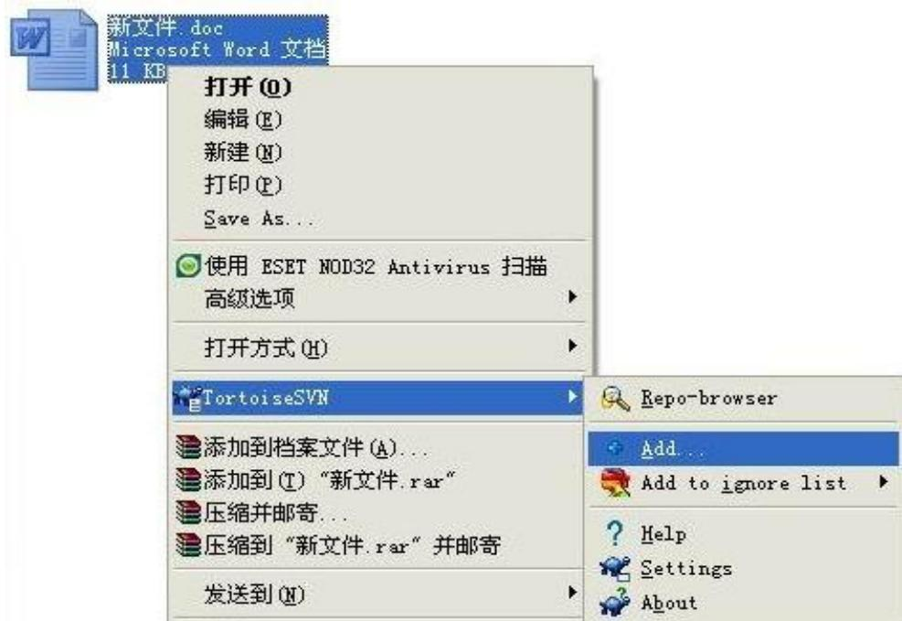

备注：此步骤也可通过右键选择“TortoiseSVN”的“Import...”项实现。在你的硬盘上创建一个空的文件夹，在此文件夹下只放入你要提交到配置库中的文件（所提交文件的目录结构已在本地设置完成，且不要放入非提交到配置库的文件），后在此文件夹的空白处右键选择“TortoiseSVN”的“Import...”项输入你要上传的路径和相关信息，点击“OK”按钮实现上传。如下图所示：

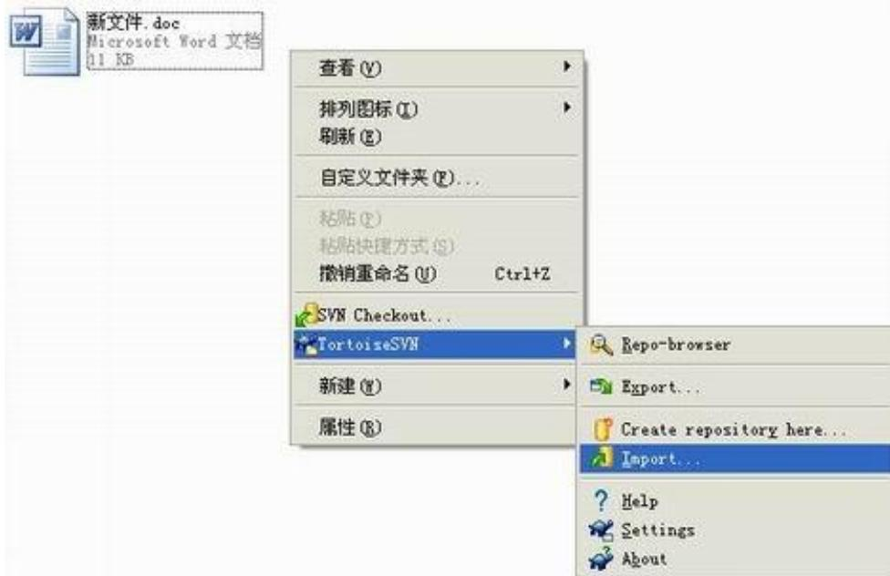

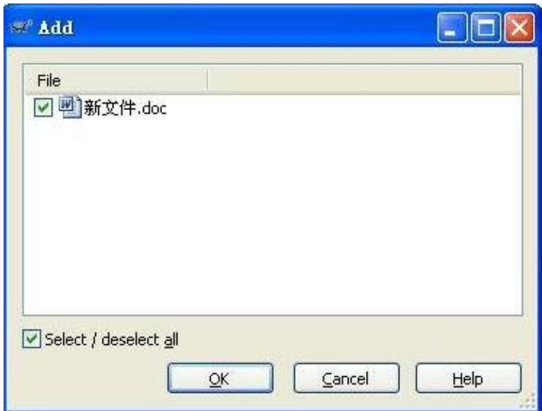

点击“OK”按钮，系统弹出信息框如下图所示：

TortoiseSVN Add... Finished!

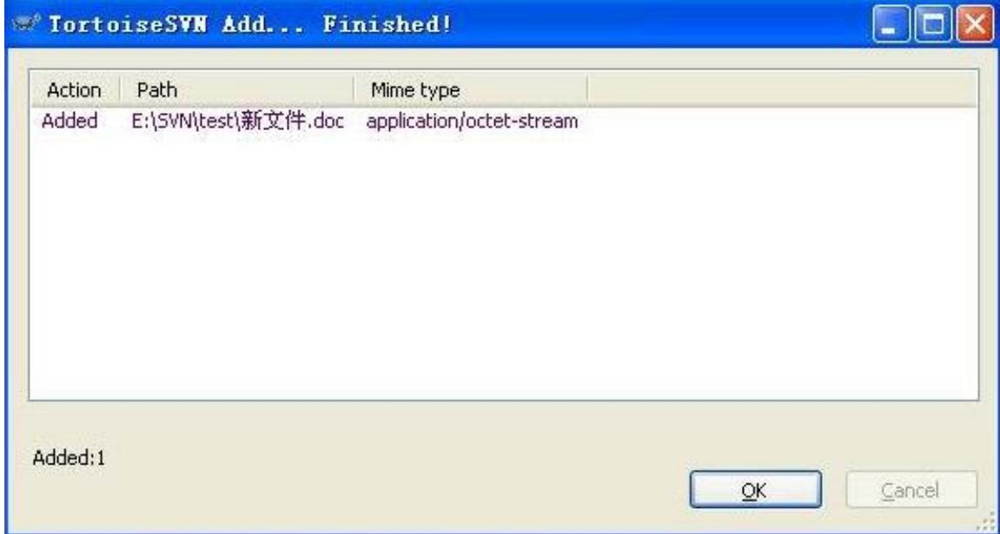

新文件.doc

这时本地硬盘 test 文件夹图标显示如下图：

鼠标选中本地硬盘 test 文件夹右键选择“SVN Commit…”项，将新文件上传配置库对应文件夹中（此时将本地硬盘 test 文件下修改的内容都上传到配置库中，若只上传单个文件，只需点中单个文件上传即可），如下图所示：

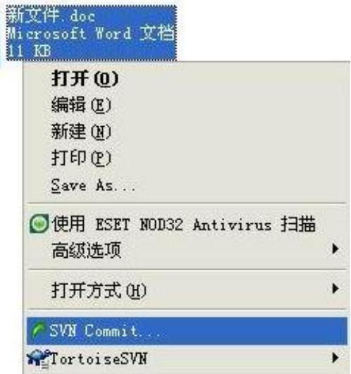


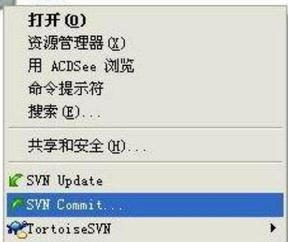

在系统弹出的信息框 Enter Log Message 的 Message 栏中填写本次操作的注释，如下图所示：

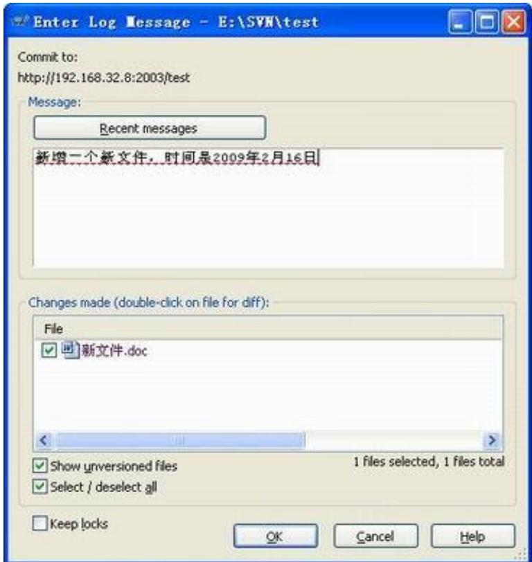

其中，选中 Show unversioned files 复选框则显示不处于版本控制下的文件；选中 Select/deselect all 复选框表示全部选择/全部不选择。

点击“OK”按钮，系统弹出信息框 Authentication，如下图所示：

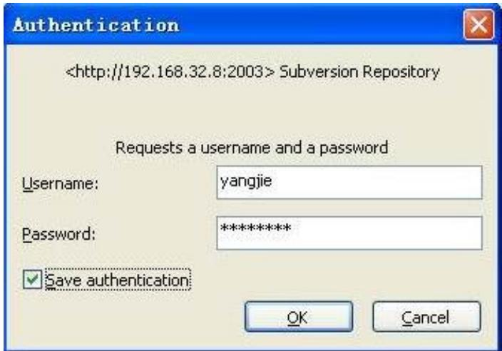

在 Username 栏中输入用户名，在 Password 栏中输入用户密码，点击“OK”按钮，系统弹出如下信息框：

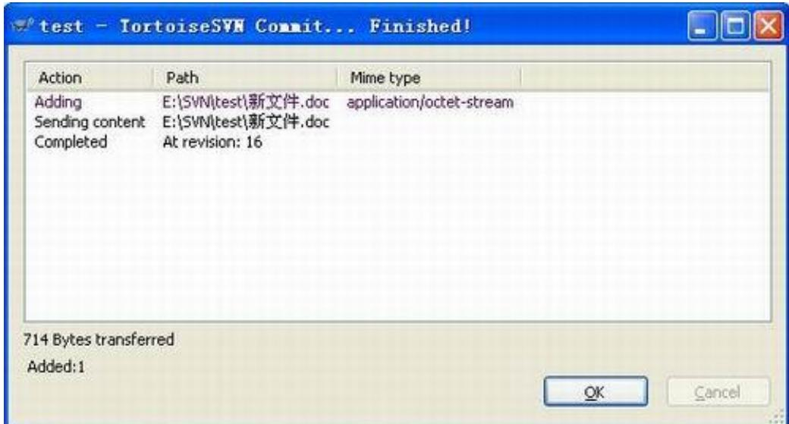

#### 2.3.2 更新文件

当你从配置库中迁出相应目录后，他人对服务器上此目录内容进行了修改，你需要再次获取改动内容到你本地硬盘空间目录（即先前已迁出的目录）的过程称为更新。更新可以针对一个文件、几个选中的文件或者整个文件目录。

选中要被更新的文件，右键选择“SVN Update”项，如下图所示：

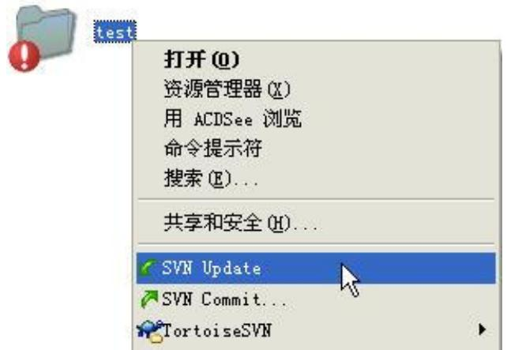

点击“SVN Update”后会弹出窗口显示更新的进度，如下图所示：

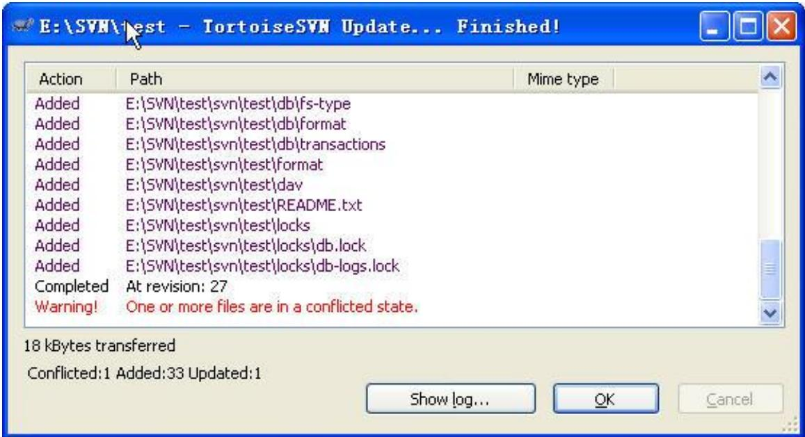

若上述框中的有文件出现亮红，说明来自配置库的内容与你本地修改内容合并时出现了冲突，解决方法详见本文档 2.3.11 解决冲突。

#### 2.3.3 删除文件

选中要被删除的文件，右键选择“TortoiseSVN”的“Delete”项，如下图所示：

# 《软件工程（双语）》实验4参考资料：SVN使用手册大全

## 2.3.4. 修改文件

选中本地硬盘 test 文件夹，右键选择“TortoiseSVN”的“SVN Update”项更新本地文件，里面的文件都有特殊标识，如“江西空中充值项目”的标识显示为：

打开“江西空中充值项目”修改部分内容，保存后退出。“江西空中充值项目”图标显示为：

鼠标选中“江西空中充值项目”右键选择“SVN Commit”项提交，系统弹出如下信息框：

在 Message 栏中填写修改文件的注释（这时可以点击“Recent messages”按钮查看本文档以前版本的注释信息），点击“OK”按钮进行提交，提交方式同增加文件的提交方式。在提交前可以在上图中双击“江西空中充值项目”文本文件查看既要提交的修改内容（比较上一版本所修改的内容，此步骤可直接在本地磁盘中通过右键选择“TortoiseSVN”的“Check for modifications”或“Diff”项实现）。

提交文件前，也可通过选中“江西空中充值项目”右键进行相关操作，如下图所示：

### 2.3.5. 比较版本差异

#### ◼ 本地更改内容与更改前内容比较

如果你想看到你本地的“江西空中充值项目”文本内容有哪些更改，鼠标选中“江西空中充值项目”文本右键选择“TortoiseSVN”的“Diff”项，系统弹出差异内容。

#### ◼ 本地更改内容与历史版本的比较

如果你想查看你本地的“江西空中充值项目”文本内容与其历史版本之间的差异，鼠标选中“江西空中充值项目”文本右键选择“TortoiseSVN”的“Show log”项显示日志对话框，在日志对话框选择要比较的历史版本，后右键选择“Compare with working copy”项，如下图所示：

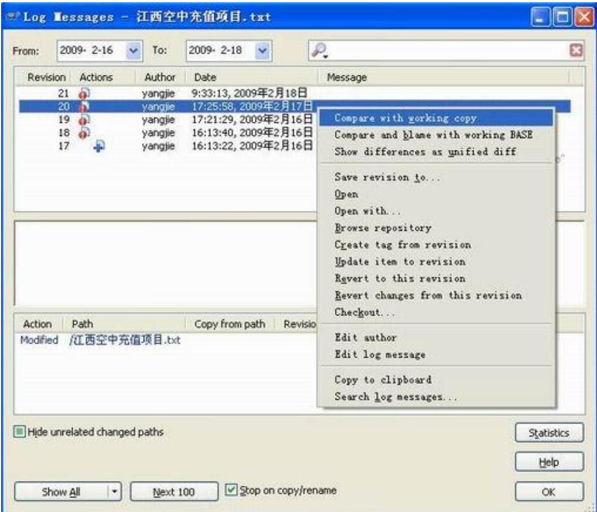

#### ◼ 两个历史版本的比较

如果你要查看“江西空中充值项目”文本任意已提交的两个历史版本之间的差异，在上述日志对话框中选择你要比较的两个版本，右键选择“Compare revisions”项，系统弹出差异内容。

#### ◼ 与另外一个分支/标签之间的比较

如果你想查看“江西空中充值项目”文本的某一分支（假如你在主线上开发）有哪些修改，选“江西空中充值项目”文本文件的同时按住 Shift 键，后右键选择“TortoiseSVN”的“Diff with URL”。如下图所示：

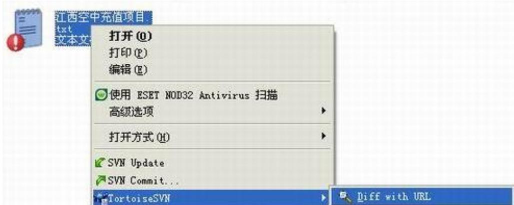

点击“OK”按钮后，系统弹出差异内容。

#### ◼ 比较两个文件差异

如果你想查看同一目录下两个没有关系的文件差异，选中这两个文件，右键选择“TortoiseSVN”的“Diff”项，系统弹出这两个文件的差异内容。

#### ◼ 比较两个文件夹差异

如果你想查看两个不同的文件夹之间的差异，需使用版本库浏览器打开此目录，选中要比较的两个文件夹，右键选择“Compare revisions”项，如下图所示：

单击后系统弹出这两个文件夹的修改列表，如下图所示：

可以选择上图中单个文件右键进行相关操作。

#### ◼ 比较两个图像差异

如果你想查看两个不同的图像之间的差异，选中要比较的两个图像或者选中被修改的图像，右键选择“TortoiseSVN”的“Diff”项，系统弹出这两个图像的差异内容。如下图所示：

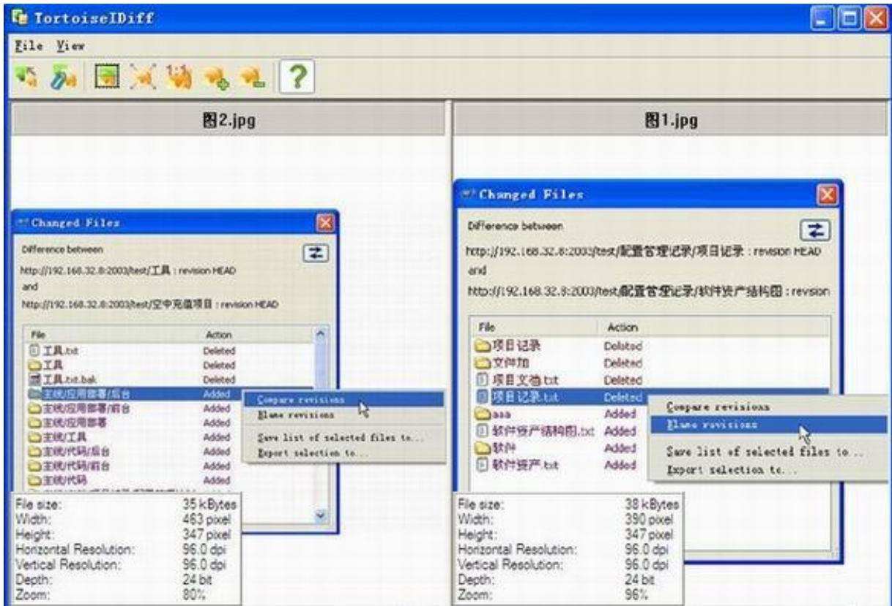

### 2.3.6. 撤销更改

在修改了某些文件后（文件未上传到配置库），需要返回到修改前的状态，则选中文件夹 test 右键选择“TortoiseSVN”的“Revert...”项进行撤销，本地硬盘上的文件将恢复到修改前的内容，修改的内容将被删除。

### 2.3.7. 锁定和解锁

当项目需要时可以在你本地硬盘中将你迁出的内容进行锁定，选中要被锁定的文件右键选择“TortoiseSVN”的“Get lock...”项进行锁定（锁定后他人将无法修改此文件），系统弹出锁定信息框，如下图所示：

点击“OK”按钮即可将“江西空中充值项目”文本文件锁定，锁定后显示如下：

解锁时选中被锁定的文件右键选择“TortoiseSVN”的“Release lock”项进行解锁。

### 2.3.8. 重命名文件

鼠标选中“江西空中充值项目”文本文件右键选择“TortoiseSVN”的“rename...”项，系统弹出如下信息框：

在 New name 框中输入新文件名后点击“OK”按钮，将出现重命名后的文件，原文件被删除，将它们提交后重命名生效。

### 2.3.9. 获取历史文件

#### ◼ 查看历史文件

鼠标选中文件夹 test 右键选择“TortoiseSVN”的“Show log”项，系统弹出此路径下的所有文件版本信息，如下图所示：

此时也可双击“江西空中充值项目”文本文件查看修改的内容（比较上一版本所修改的内容）。

#### ◼ 获取历史文件

鼠标选中文件夹 test 右键选择“TortoiseSVN”的“Update to revision”项，后系统提示需要选择下载的版本，如下图所示：

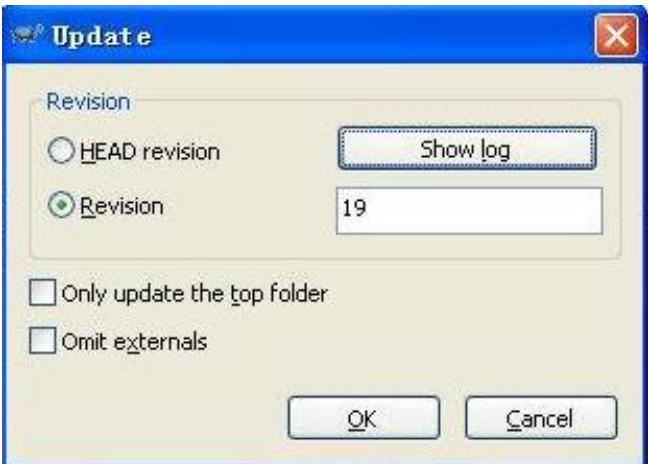

“Revision”栏中“HEAD revision”为最新版本，“Revision”手工输入版本号，也可点击“Show log”按钮选择需要的版本内容，选择版本 19 后，点击“OK”按钮，系统弹出如上信息框：点击“OK”按钮，系统开始下载文件，下载完毕后提示框如下：

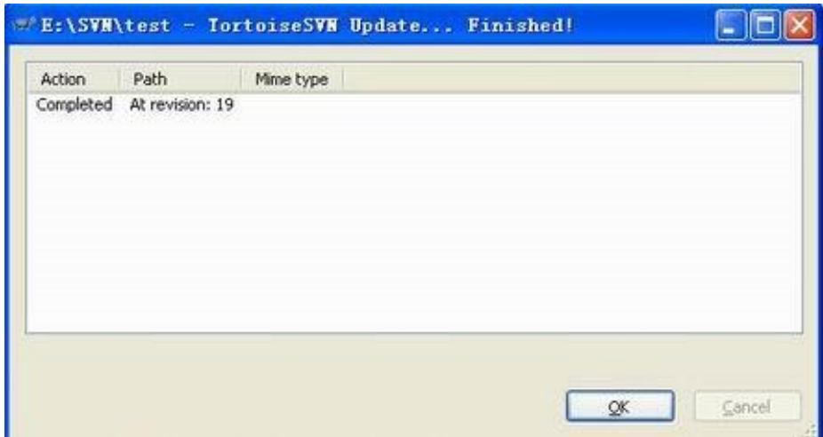

### 2.3.10. 检查冲突

在提交你修改的文件到配置库前，可先检查本地修改的内容是否与配置库中的内容冲突。选中修改的文件或文件夹，右键选择“TortoiseSVN”的“Check for modifications”项，将显示所有被修改的内容，检查“江西空中充值项目”文本如下图所示：

点击上图中“Check repository”按钮，后双击“江西空中充值项目”文本或右键处理，则显示出此文件在配置库中的改动内容和你本地的改动内容，判断是否存在冲突，如下图所示：

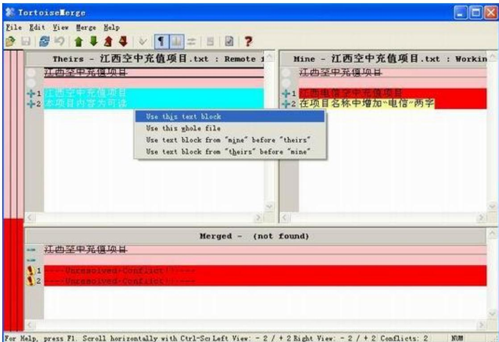

上图表明存在冲突，可以直接右键在上图中进行修改解决冲突（如上图灰色所示），或者将发生冲突的文件拖到文本编辑器或者其它应用程序中进行修改，也可选中发生冲突的文件右键选择“Open”或“Open with…”打开文件进行修改解决冲突。

### 2.3.11. 解决冲突

当你 Update “江西空中充值项目”文本文件出现冲突时，Subversion 会产生三个文件：“江西空中充值项目.txt.mine”；“江西空中充值项目.txt.r19”；“江西空中充值项目.txt.r20”，如下图所示：

在“江西空中充值项目”文本文件冲突的内容中，冲突的地方将使用“<<<<<<<”标示出来，查找以字符串 `<<<<<<<` 开头的行，人为进行合并的取舍，如下图所示：

> 示例说明：
> “江西空中充值项目 日”在项目名称中增加“电信”两字变为“江西电信空中充值项目”
>
> ```text
> <<<<<<< .mine
> 江西空中充值项目
> =======
> 江西电信空中充值项目
> >>>>>>> .r20
> ```
>
> 其中，`<<<<<<<` 前的内容为本地硬盘中文件的内容，`>>>>>>>` 后的内容为配置库中文件的内容，需要手工修改解决这两个内容的不同之处。

手工修改冲突的内容后，右键选择“TortoiseSVN”的“Resolved…”项，删除冲突所产生三个文件（也可手动删除这三个文件），如下图所示：

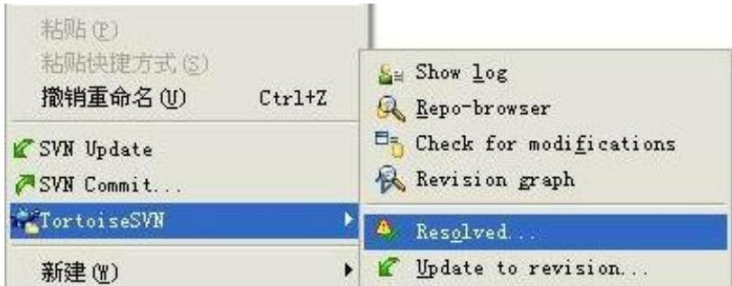

### 2.3.12. 忽略无需版本控制的文件

在你给配置库中提交内容时，会有一些文件和目录不需要进行版本控制，只需要在你本地硬盘保存即可，这可能包括一些由编译器生成的文件，如 `*.obj`, `*.lst` 等。此时可采用添加相应文件到该项目的忽略列表的方法解决。

选中本地硬盘中无需提交到配置库的文件（此文件在本地硬盘的父目录是处于版本控制下的），右键选择“TortoiseSVN”的“Add to ignore list”项，如下图所示：

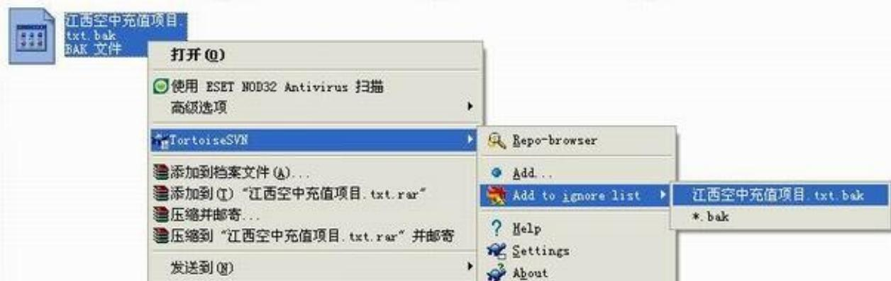

点击“Add to ignore list”项中的 `江西空中充值项目.txt.bak` 代表只忽略这一个文件，若点击 `*.bak` 代表忽略所有具有 `*.bak` 后缀的文件。

如果你同时选择多种文件进行忽略时，就没有子菜单了，仅显示待忽略的个数，如 `Ignore 2 items`。

点击后系统弹出如下信息框：

### 2.3.13. 去除 SVN 标志

选中需要取消 SVN 标记（脱离版本控制）的文件夹（其子文件夹也要取消相应标记）右键选择“TortoiseSVN”的“Export…”项，系统弹出导出路径的信息框，如下图所示：

选择上图中的“Export unversioned files too”复选框表示将本地不处于版本控制下的文件一起导出。

也可将每个文件目录下（包括子文件目录下）的 `.svn` 文件删除解决此问题。

### 2.3.14. 查看文件每行的修改信息

如果需要精确地知道谁修改了文件的哪一行，选中文件右键选择“TortoiseSVN”的“Blame…”项，系统提示需要选择的版本范围，如下图所示：

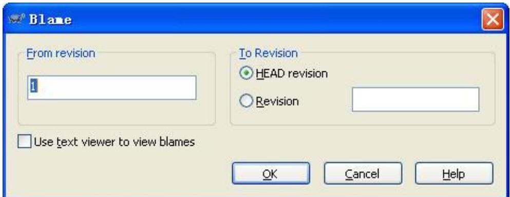

在上图中输入起始版本和目标版本，点击“OK”按钮后，系统弹出如下信息框：

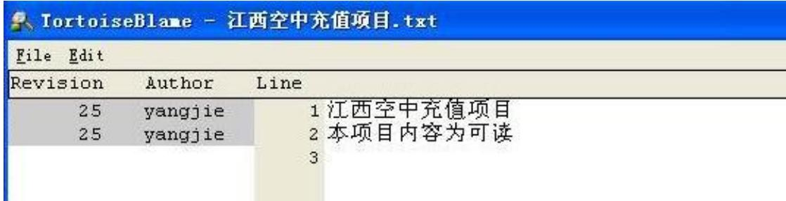

### 2.3.15. 重置访问路径

在你的本地硬盘选中已从配置库中获取的文件，右键选择“TortoiseSVN”的“Switch…”项，系统提示需要选择配置库中的路径，如下图所示：

点击“OK”按钮，则将你选中的文件夹内容更新为你输入的路径中的内容，转换访问路径。

### 2.3.16. 本地路径转换

举例说明，选中本地 `jxmtp2_c` 文件夹，右键选择“TortoiseSVN”的“Relocate...”项，在弹出框中输入需转换的路径，如 `http:///svn/jxmtp2_c`，如图，点击“OK”按钮即可将本地 `jxmtp2_c` 文件夹的路径从 `http:///svn/jxmtp2_c` 转换到 `http:///svn/jxmtp2_c`。此转换无需重新下载即可实现路径转换。

## 2.4. 浏览版本库

本文档 1.3 维护工作文件中的操作也可在版本库浏览器中进行，此时属于在服务端直接操作。在本地任意位置右键选择“TortoiseSVN”的“Repo-browser”项，如下图所示：

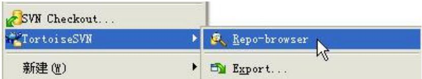

在上图 URL 框中输入你要访问的路径，点击“OK”按钮后显示此路径下的所有内容，如下

# 《软件工程（双语）》实验4参考资料：SVN使用手册大全（第3部分）

本资料整理自《SVN使用手册大全》第 3 部分，涵盖版本库操作、标签/分支管理、统计信息、数据同步及 MyEclipse 集成等内容。

## 2.5. 建立标签

鼠标选中主线目录右键选择“TortoiseSVN”的“Branch/tag…”项，系统弹出有关标签路径的信息，如下图所示：


在 To URL 栏中输入标签目录，如 `http:///test/空中充值项目/标签/V1.0.0.0`（输入的 V1.0.0.0 可自动生成，无需事先建立 V1.0.0.0 文件夹），点击“OK”按钮建立 V1.0.0.0 版本标签。

## 2.6. 建立分支

### 建立分支

分支建立方法和标签建立方法相同。

### 合并分支

首先保证你在分支上的修改已经全部提交。

鼠标选中主线文件夹右键选择“TortoiseSVN”的“Merge…”项，系统弹出有关分支合并的信息，如下图所示：


在 From 框中选择 URL (如 `http:///test/空中充值项目/分支`) 点击 show log 选择起始版本。

在 To 框中选择 URL（与 From 框中路径相同）和版本号（需合并的版本，若是最新版本可直接选择 HEAD Revision）。

点击“Merge”后，即完成将分支修改内容合并到主线目录的工作。

最下面的按钮介绍：

- “Diff”显示出所有发生变化的文件列表，双击具体文件可以查看分支文件与主线文件的区别。
- “Unified diff”显示分支和主线两版本树之间所有文件的内容的变化。
- “Dry run”能显示真正合并时的状态信息，但并没有做任何的合并操作。

### 查看版本分支图

选中要查看的文件，右键选择“TortoiseSVN”的“Revision graph”项，系统弹出有关版本分支的结构图，如下图所示：


## 2.7. 清除用户名等信息

当你的 SVN 客户端记录了你访问配置库的用户名和密码后，需要清除所记录的内容。右键选择“TortoiseSVN”的“Settings”项，系统弹出有关设置的信息框，如下图所示：


## 2.8. 统计信息

选中本地已迁出的文件或者浏览版本库，右键选择“TortoiseSVN”的“Show log”项，系统弹出日志对话框，如下：


点击上图中的“Statistics”按钮进行信息统计，系统弹出以下信息框：


在上图中可选择依据日期或依据作者进行统计。

依日期统计后如下图所示：


依作者统计后如下图所示：


## 2.9. SVN 数据同步

中英文路径都适合（如果是中文路径，则需要从 IE 中把乱码路径拷贝到 Value 中）。

要实现在 `http://localhost:2003/seaway/抚州水力` 目录下共享 `http:///seaway/快易营业点平台/工程文档` 的内容，只需要在本地 `http:///seaway/抚州水力` 上设置 svn:externals 属性：

1. 选中“抚州水力”目录，右键 TortoiseSVN -> Properties
2. 在 Properties 对话框里点 Add
3. 在 Add properties 界面属性下拉框选 svn:externals，输入属性值。在 Property value 中添加 external 对象“工程文档”和被同步的路径，如图：


注意：复选框 Apply property recursively 是“是否要在抚州水力的每个子目录下面都共享添加 `http:///seaway/快易营业点平台/工程文档`”的内容。如果选中，抚州水力的每个子目录下都会自动增加工程文档目录。

增加该属性后，你本地文件为已修改状态，先 Update 更新配置库中的最新内容，后提交修改到配置库中，在配置库生效。

加该属性后，再更新抚州水力目录的时候，自动在抚州水力目录下建工程文档目录，并把 `http:///seaway/快易营业点平台/工程文档` 里面的内容保存到 `http://localhost:2003/seaway/抚州水力/工程文档` 里。如果更新 `http://localhost:2003/seaway/抚州水力/工程文档` 目录里文件的内容，做 commit，对该文件的修改也会保存到 `http:///seaway/快易营业点平台/工程文档` 里面。

## 3. MyEclipse 集成 SVN

### 3.1. 安装 SVN 插件

本文以 myeclipse6.0 和 site-1.2.4.zip（插件）为例。安装 myeclipse6.0。

#### 方法一：直接上网下载

打开 myeclipse 点击其菜单 Help—>Software Updates—>Find and Install…，如下图所示：


选中“Search for new features to install”复选框，点击 Next。系统弹出 Install 信息框：


点击“New Remote Site…”按钮，系统弹出如下信息框：


在 Name 栏中输入 svn，在 URL 栏中输入访问地址 `http://subclipse.tigris.org/update_1.0.x`，点击“OK”按钮，系统将 svn 添加到“Sites to include in search”栏中，选中 svn 点击“Finish”按钮，搜索后系统弹出如下信息框：


选择“Install All”按钮进行安装，系统弹出安装信息框，如下图所示：


安装完成后，系统弹出如下信息框：


点击“Yes”按钮重启 MyEclipse 使安装生效。

#### 方法二：直接解压到 MyEclipse 安装目录

解压 SVN 插件，拷贝插件中文件夹下的所有内容到 MyEclipse 安装的根目录即可。

### 3.2. 配置 MyEclipse 提交目录

第一次使用时，在 MyEclipse 中新建一个 test 项目，选中该项目，右键选择“Team”的“Share Project…”项，如下图所示：


## 上传 SVN 路径

在 URL 中输入上传 SVN 的路径，后点击 Next。系统弹出如下信息框：

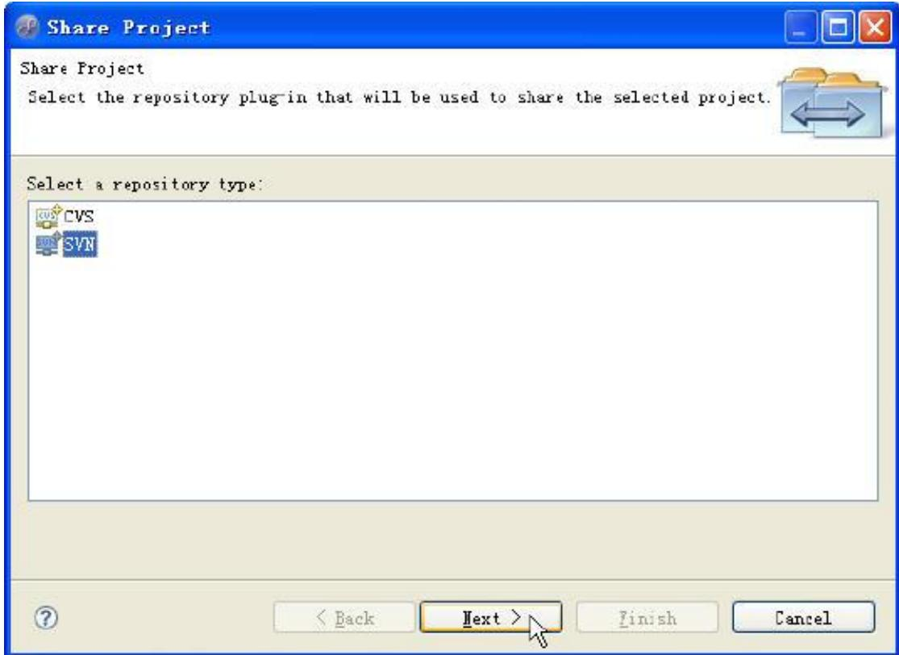

选择“名称”，点击 Next，系统弹出如下信息框：

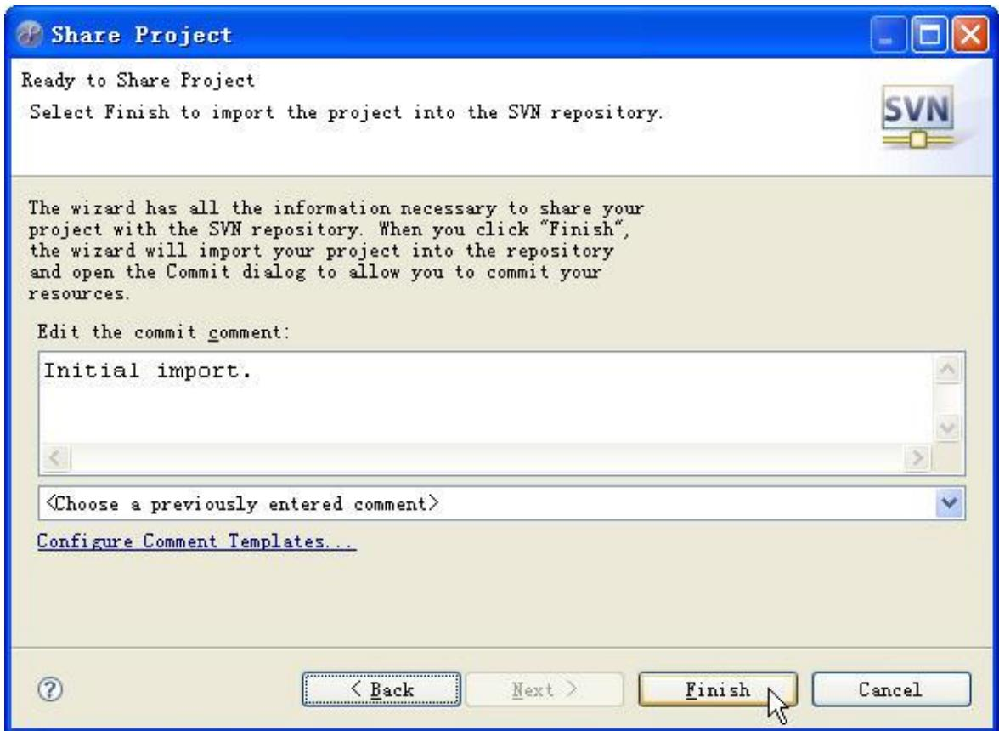

填写注释后点击“Finish”按钮，系统弹出如下信息框：

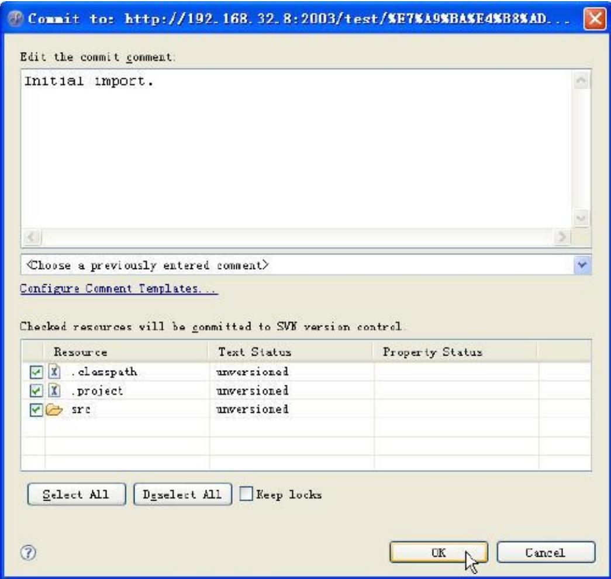

填写注释后点击“OK”按钮完成此次操作。

## Team 菜单操作

选中所建立的 test 项目，右键选择“Team”项进行相应操作，如下图所示：

| 菜单项 | 快捷键 |
| --- | --- |
| New | |
| Go Into | |
| Open in New Window | |
| Open Type Hierarchy | F4 |
| Show In | Alt+Shift+W |
| Copy | Ctrl+C |
| Copy Qualified Name | |
| Paste | Ctrl+V |
| Delete | Delete |
| Build Path | |
| Source | Alt+Shift+S |
| Refactor | Alt+Shift+T |
| Import... | |
| Export... | |
| Refresh | F5 |
| Close Project | |
| Close Unrelated Projects | |
| Assign Working Sets... | |
| Run As | |
| Debug As | |
| Profile As | |
| Team | |
