# 《软件工程（双语）》实验4参考资料：SVN培训PPT教程

原件经识别和整理；“参考解答”是我们补的。

本资料整理自《软件工程（双语）》实验 4 参考资料中的 SVN 培训 PPT 教程（第 1–21 页），内容涵盖配置管理理由、Subversion 基本概念、TortoiseSVN 安装与使用流程、图标说明及常用操作。

## 为什么需要使用配置管理软件

- 及时了解团队中其他成员的进度。
- 轻松比较不同版本间的细微差别。
- 记录每个文件成长的每步细节，利于成果的复用 (reuse)。
- 资料共享，避免以往靠邮件发送文件造成的版本混乱。
- 人人为我，我为人人。所有成员维护的实际是同一个版本库，无需专人维护所有文件的最新版本。

协同工作，大大提高团队工作效率，无论团队成员分布在天涯还是海角。

## Subversion 相关软件

### 基于 Subversion 和 TortoiseSVN 的版本控制系统

**Subversion**：是一个开源的版本控制系统，拥有 CVS 的大部分特征，并在 CVS 的基础上有更强的扩展，用来代替 CVS 系统。

**TortoiseSVN**：SVN 的客户端工具，和资源管理器完美集成，基于 TortoiseCVS 的代码开发，使用上与 TortoiseCVS 极其相似。

## SVN 基本概念

### 配置库（Repository）

SVN 的核心是配置库，储存所有的数据。配置库按照文件树形式储存数据——包括文件和目录。任意数量的客户端可以连接到配置库，读写这些文件。通过写数据，别人可以看到这些信息；通过读数据，可以看到别人的修改。

最特别的是 Subversion 会记录配置库中的每一次更改，不仅针对文件也包括目录本身，包括增加、删除和重新组织文件和目录。

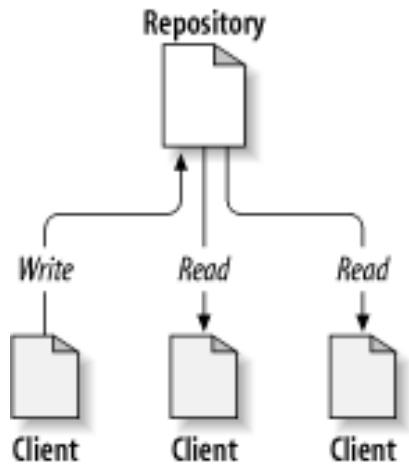

### 工作副本（WorkSpace）

与位于中央配置库相对应的是每个人的工作空间，它是每个程序员工作的地方。程序员从配置库拿到源代码，放在本地作为工作副本，在工作副本上进行查看、修改、编译、运行、测试等操作，并把新版本的代码从这里提交回配置库中。

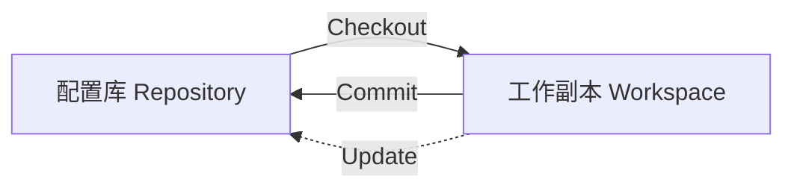

## SVN 的工作模式

### 复制 - 修改 - 合并方案 (Subversion 默认的模式)

在这种模型里，每一个客户读取项目配置库建立一个私有工作副本——版本库中文件和目录的本地映射。用户并行工作，修改各自的工作副本，最终，各个私有的复制合并在一起，成为最终的版本。这种系统通常可以辅助合并操作，但是最终要靠人工去确定正误。

### 锁定 - 修改 - 解锁方案

在这样的模型里，在一个时间段里配置库的一个文件只允许被一个人修改。此模式不适合软件开发这种工作。

## TortoiseSVN 的安装

### 需要安装客户端

安装完毕后，在“资源管理器”里点击右键，会有如下菜单出现：

安装包示例：`TortoiseSVN-1.5.0.13316-win32-svn-1.5.0语言包.msi` (Windows Installer 软件包)。


文件大小：18,216 KB。

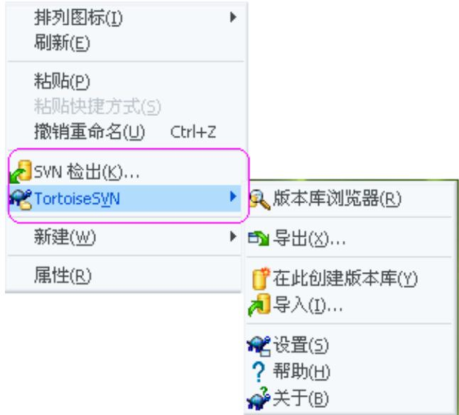

## TSVN 的使用基本流程

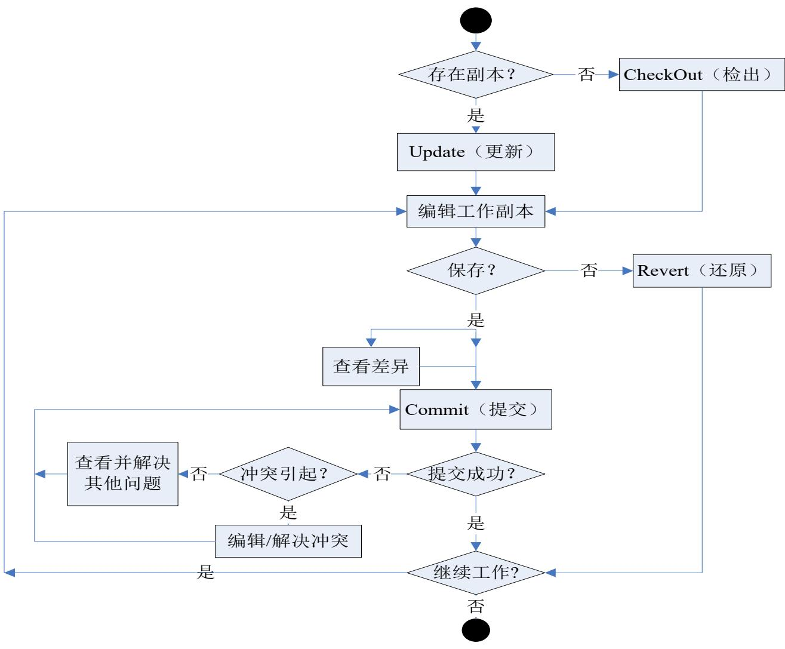

## SVN 使用图标说明

- **绿色对勾**：一个新检出的工作副本使用绿色的对勾做重载。表示 Subversion 状态正常。
- **红色感叹号**：当我们开始编辑一个文件后，图标将变成红色感叹号。通过这种方式，可以很容易地看出我们对哪些文件进行了修改操作，但是还没有提交到版本库中。
- **黄色感叹号**：如果在提交的过程中出现了冲突，图标将变成黄色感叹号。
- **重载图标（带锁提示）**：如果我们拥有了一个文件的锁，并且 Subversion 状态是正常，这个重载图标将提醒我们：如果不使用该文件的话，请进行释放锁操作，允许其他成员提交对该文件的修改。

该图标表示当前文件夹下的某些文件或文件夹已经被计划从版本控制中删除，或是该文件夹下某个受控的文件丢失了。

加号告诉我们有一个文件或是目录已经被计划加入版本控制。

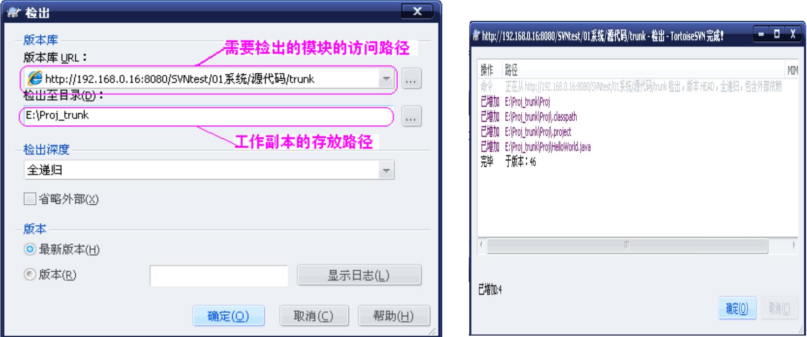

## CheckOut(检出)

### 作用

将版本库中的内容检出到本地工作副本。

### 步骤

1. 新建一个空文件夹；比如：`E:\Proj\_trunk`
2. 在此目录中点击右键 -> `SVN Checkout...`

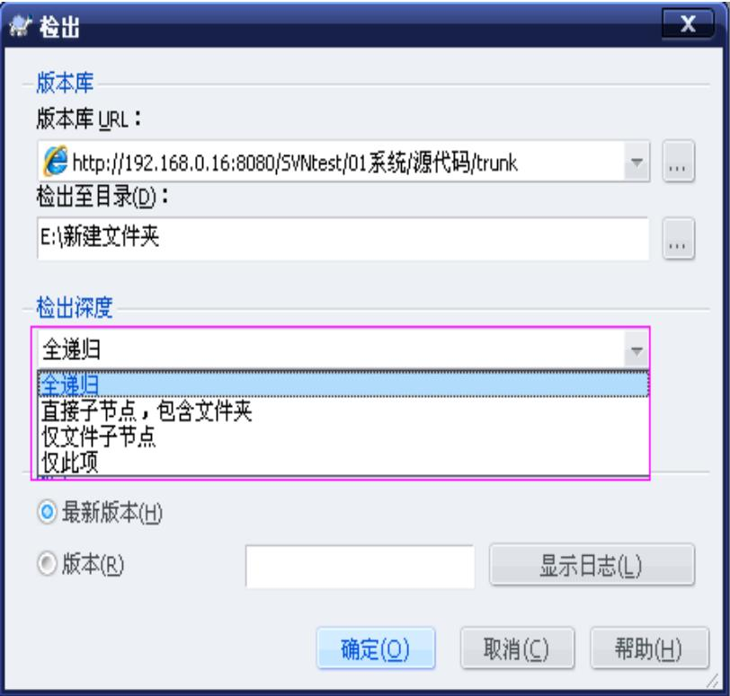

> **注意**：如果项目含有外部项目的引用，而这些引用我们不希望同时检出，请选中忽略外部项目复选框（省略外部引用）。如果选中了这个复选框，更新的时候要使用命令"更新至版本 Update to Revision..."。

### 检出深度

1. **全递归 (默认选择)**：检出完整的目录树，包含所有的文件或子目录。
2. **直接节点，包含目录**：检出目录，包含其中的文件或子目录，但是不递归展开子目录。
3. **仅文件子节点**：检出指定目录，包含所有文件，但是不检出任何子目录。
4. **仅此项**：只检出目录。不包含其中的文件或子目录。

## Update(更新)

### 作用

更新工作副本使其成为版本库中的最新版本。SVN 将显示出更新的文件和更新的次数。

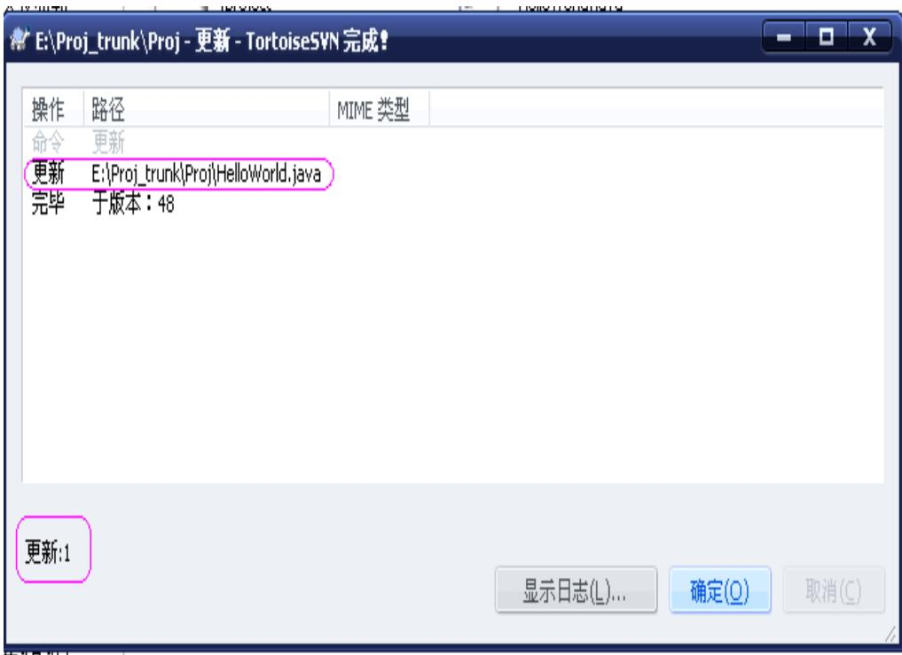

## Commit(提交)

- 对工作副本进行编辑后提交到 SVN。
- 在右键菜单中点击 `SVN Commit`。
- 提交前写好信息，点击确定。


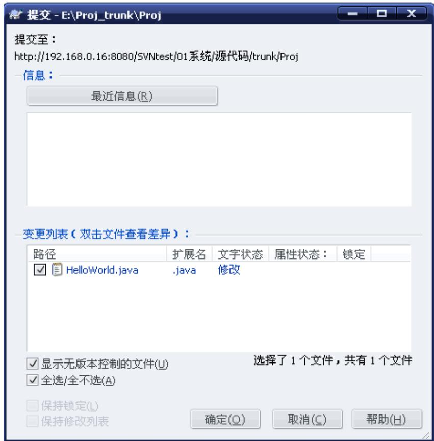

### 权限控制

当进行提交文件操作的时候您将看到权限提示信息。

- 输入您的用户名和密码。
- 保存权限设置（见红圈）可以避免将来重复输入用户名和密码。

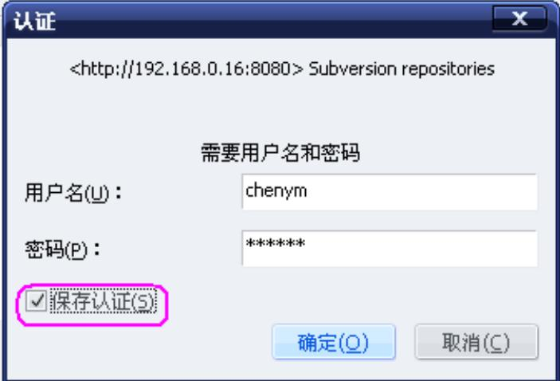

### 如何删除认证数据

**步骤**：点击右键 -> 选择设置 -> 清除认证数据。

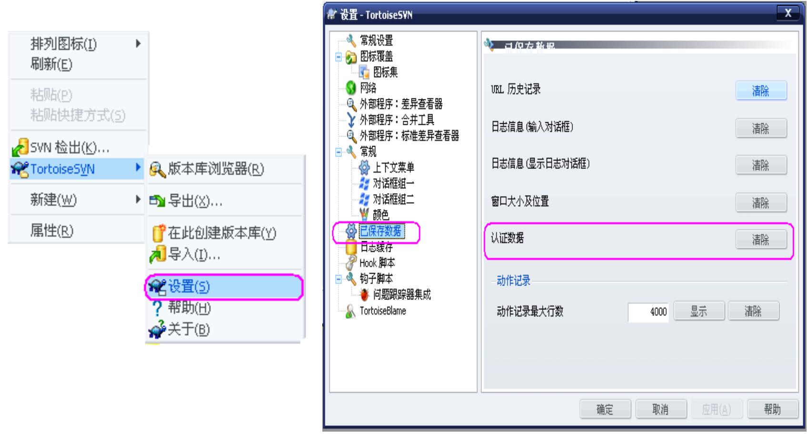

## Show log (显示日志)

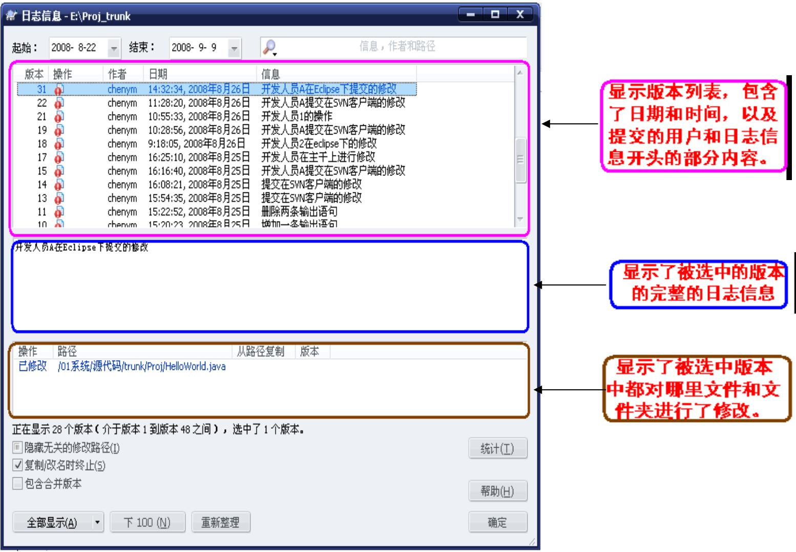

- 显示版本列表，包含了日期和时间，以及提交的用户和日志信息开头的部分内容。
- 显示了被选中的版本的完整的日志信息。
- 显示了被选中版本中都对哪里文件和文件夹进行了修改。

### 日志信息填写规则

#### 好的日志信息和糟糕的日志信息

日志信息主要记录的是每次的修改内容。建议把一些重要数据、关键操作写到日志信息中。

> **注**：修改人和提交时间由软件自动记录，无需人工写入日志信息。

| 不规范的日志 | 规范的日志 |
| :--- | :--- |
| 去除无用文件 | 删除分支中的无用文件 attachment.js_BAK_ 和 moderation.js |
| 线索报警 | 修改线索的样式 |
| 更新配置文件 | 更新公司主题包和栏目配置文件 |

## 如何得到历史版本

**步骤**：工作副本右键 -> 显示日志 -> 选择所需的版本号 -> 保存版本至。

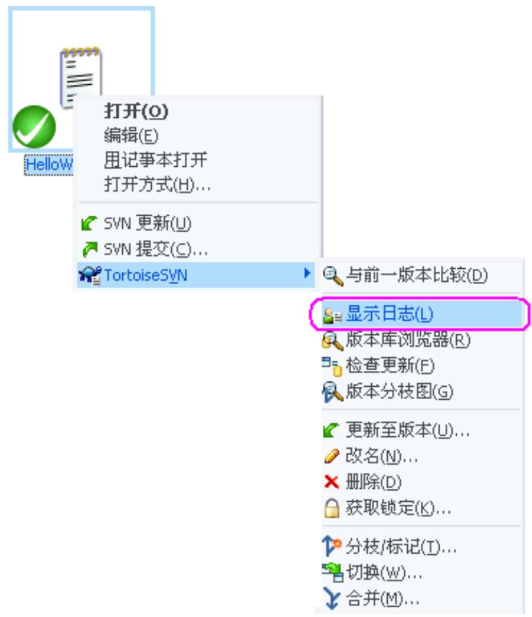

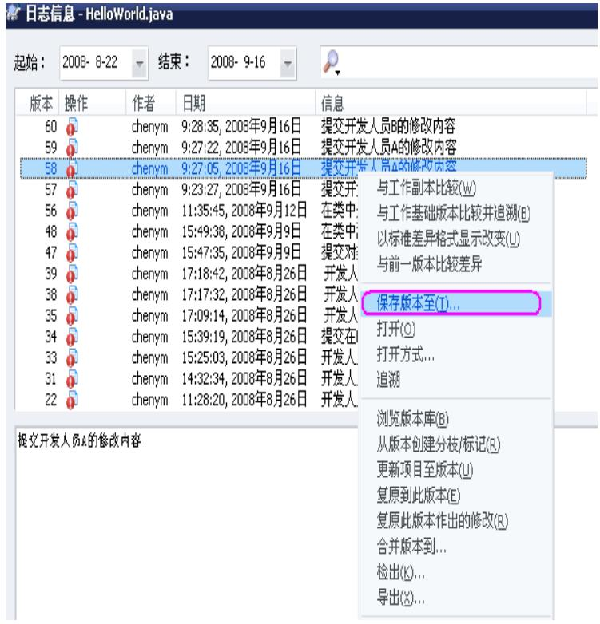

## Revert(还原)

### 作用

撤销本地所有未提交的修改。

> **注意**：还没有执行 Commit 操作之前执行此命令才可以，否则无效。

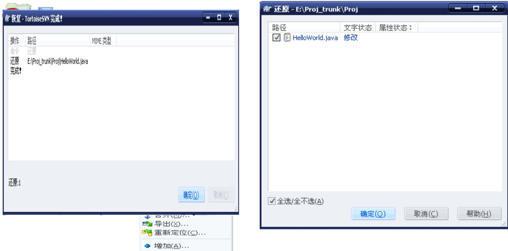

## 添加（Add）

◼ 选中文件/文件夹（在新文件/文件夹所在父文件夹点击右键），

◼ 在菜单中选择“添加 Add”命令。不需要受 SVN 控制的文件请取消打钩。

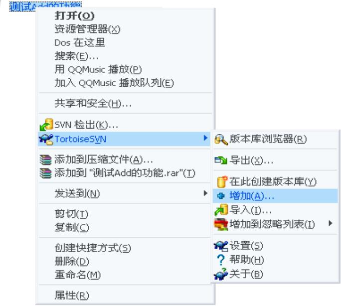

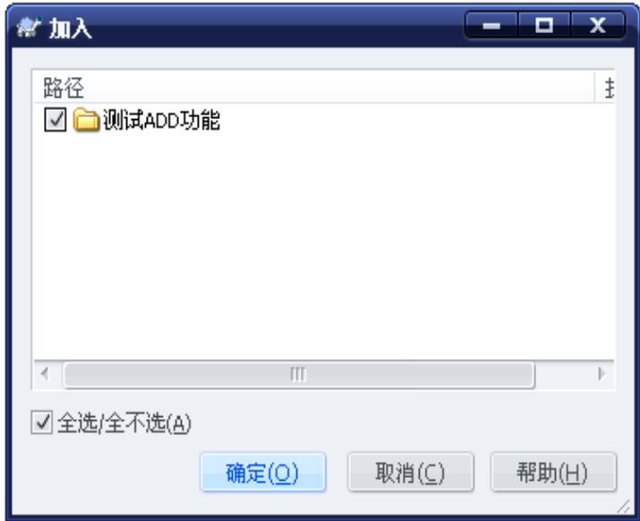

## Add to Ignore List（忽略文件）

### 添加忽略文件

右键一个单独的未进入版本控制文件 → TortoiseSVN →（加入忽略列表）Add to Ignore List，会出现一个子菜单允许你仅选择该文件，或者所有具有相同后缀的文件。

### 删除忽略文件

如果你想从忽略列表中移除一个或多个条目，右击这些条目，选择 TortoiseSVN → 从忽略列表删除。

### 已进入版本控制的文件或目录不能够忽略

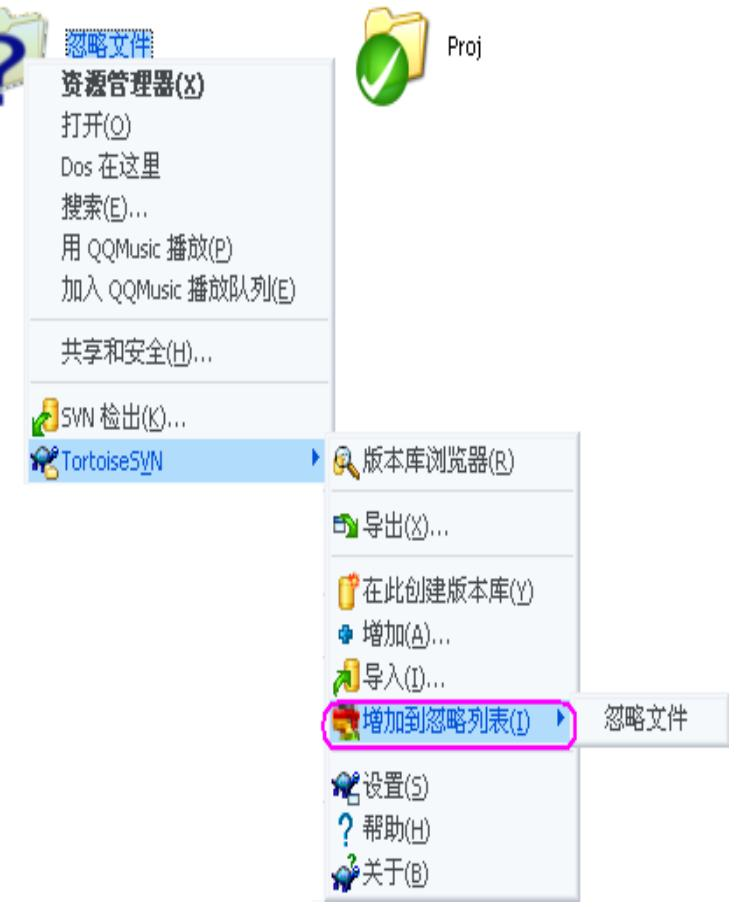

## 版本分支图

这个版本历史分析图能够显示分支/标签从什么地方开始创建，以及什么时候删除。

◼ 版本分支图将显示以下内容：

1. 增加文件/文件夹
2. 已删除文件/文件夹
3. 分支最新版本
4. 一般的文件/文件夹

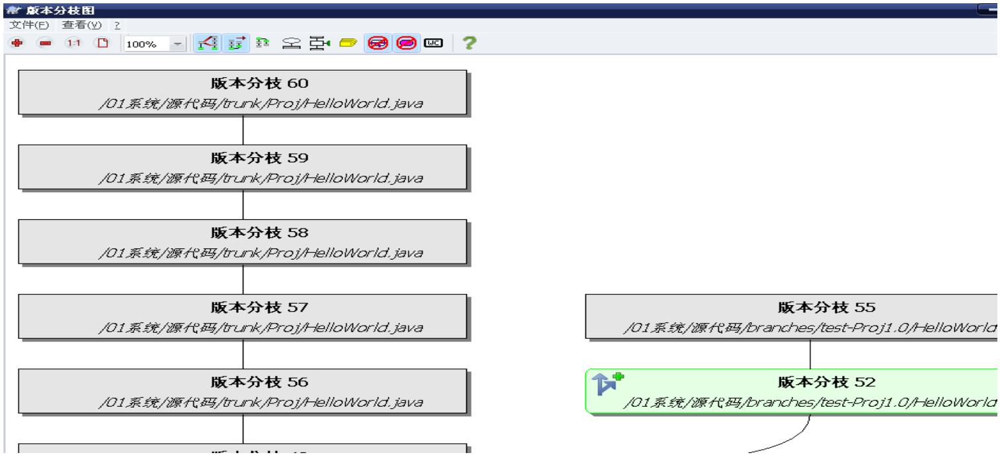

## 如何创建分支（Branch）

### 两种方式

#### 1. 在版本库浏览器中创建分支

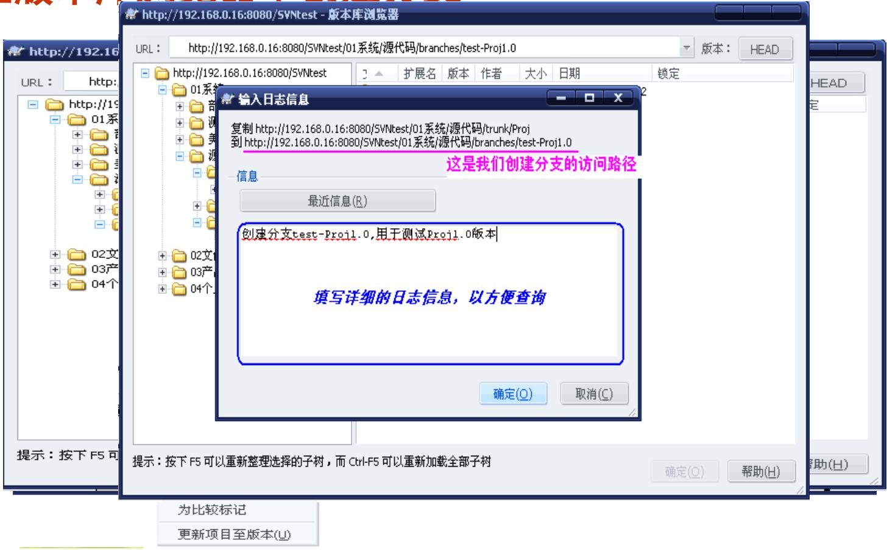

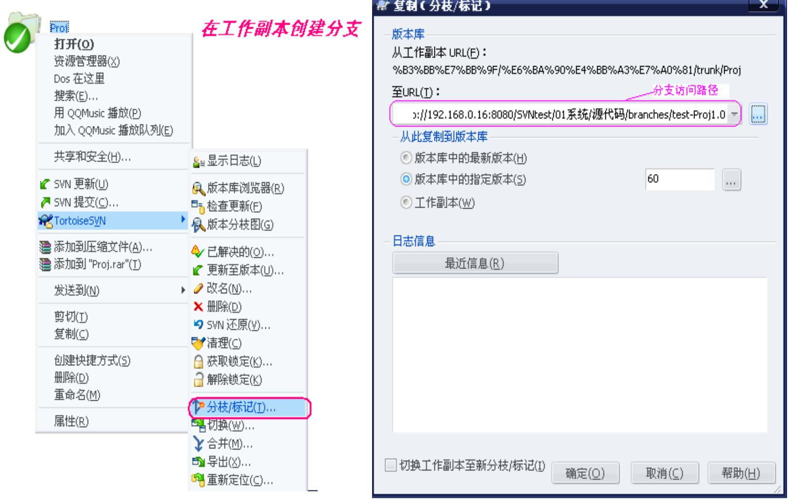

#### 2. 在工作副本创建分支

在工作副本所在文件夹点击右键，在 TortoiseSVN 菜单中选择“分支/标记（Branch/Tag）…”，弹出“复制（分支/标记）”对话框：

- 分支访问路径：`http://192.168.0.16:8080/SVNtest/01系统/源代码/branches/test-Proj1.0`
- 版本库中的最新版本（H）
- 版本库中的指定版本（S）
- 工作副本（W）
- 最近信息（R）
- 切换工作副本至新分支/标记（1）

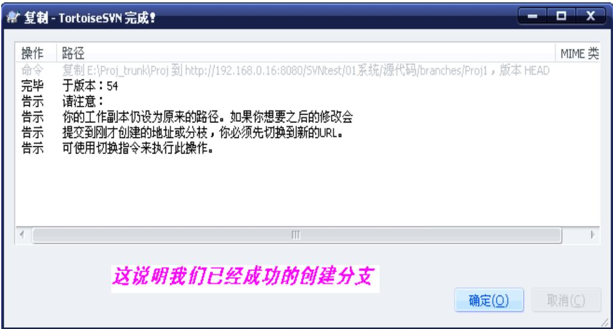

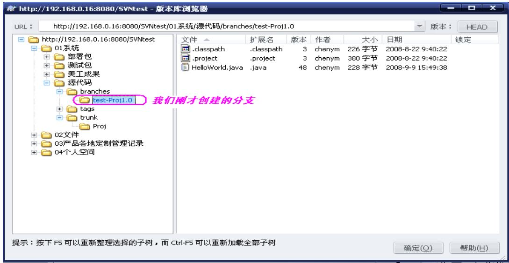

## Switch（切换）

文件创建分支后，可通过 Switch 选择在主干工作或者在分支工作。

◼ 注意：

1. 切换操作起来就像更新，因为它没有丢弃我们在本地做的修改。
2. 在工作副本里，当我们进行切换的时候，任何没有提交过的修改都会被混合。

◼ 解决方法：

1. 在切换前提交修改；
2. 把工作副本恢复到一个已经提交过的版本（比如最新版本）。

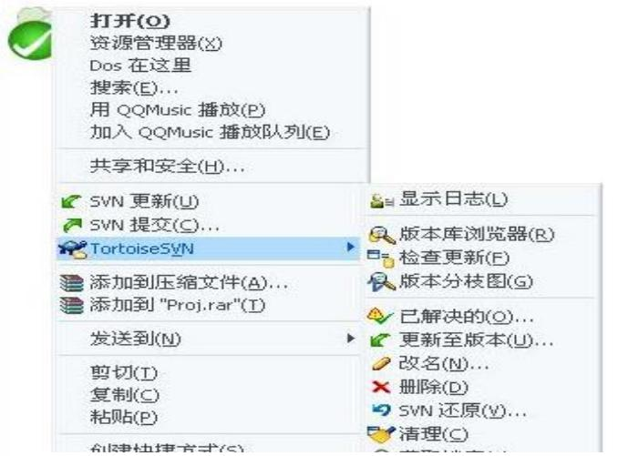

### 切换至分支/标记

- 切换：`E:\Proj\_trunk\Proj`
- 至 URL（T）：`http://192.168.0.16:8080/SVNtest/01系统/源代码/branches`
- 版本：最新版本（H）
  - 显示日志（L）
  - 版本（R）

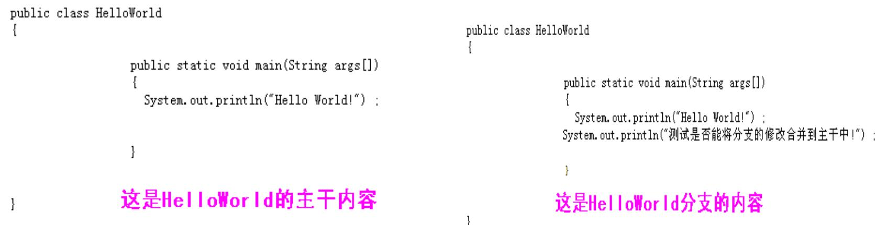

## 合并

假设我们在分支上进行修改：添加一条输出语句 `System.out.println("测试是否能将分支的修改合并到主干中!");`，提交到配置库中，现在执行将分支合并到主干的操作。

这是 HelloWorld 的主干内容

这是 HelloWorld 分支的内容

### 分支合并到主干

◼ 右键主干的文件 → 选择合并

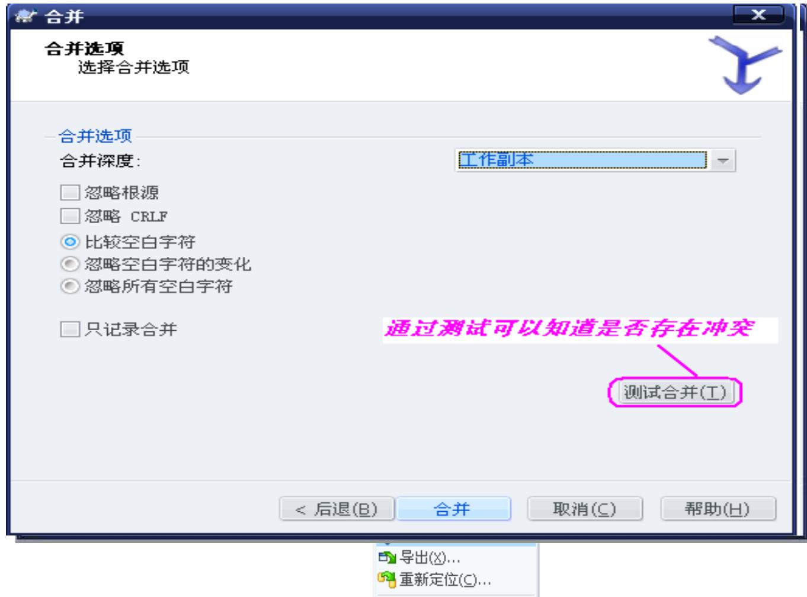

### 合并时出现冲突

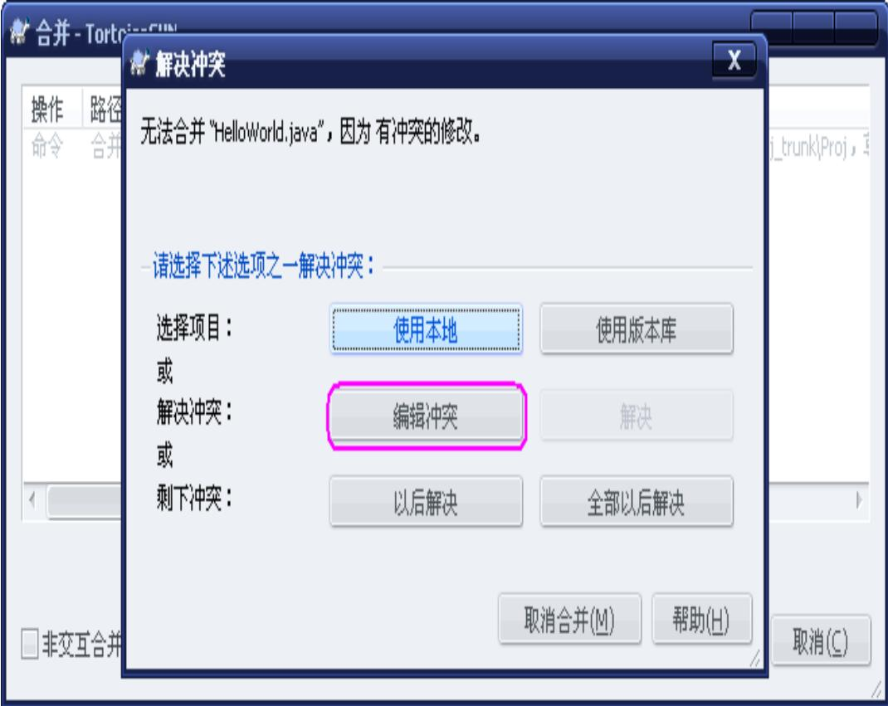

### 编辑冲突

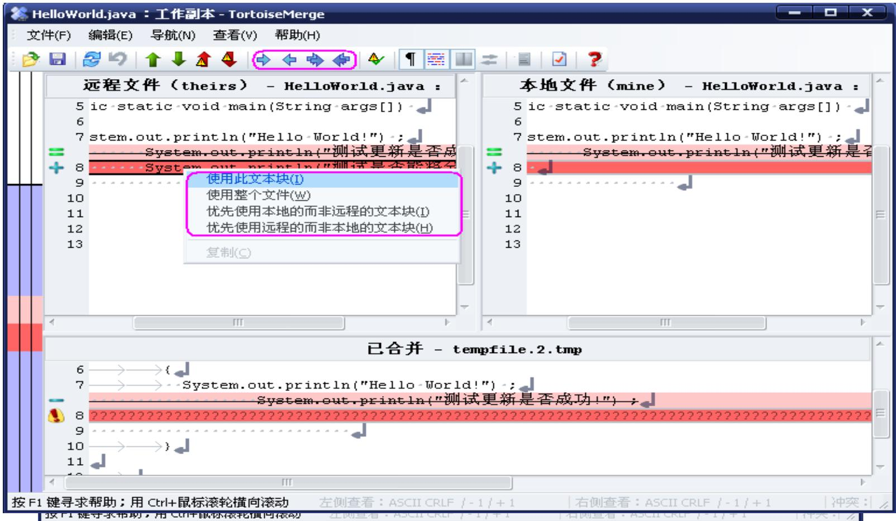

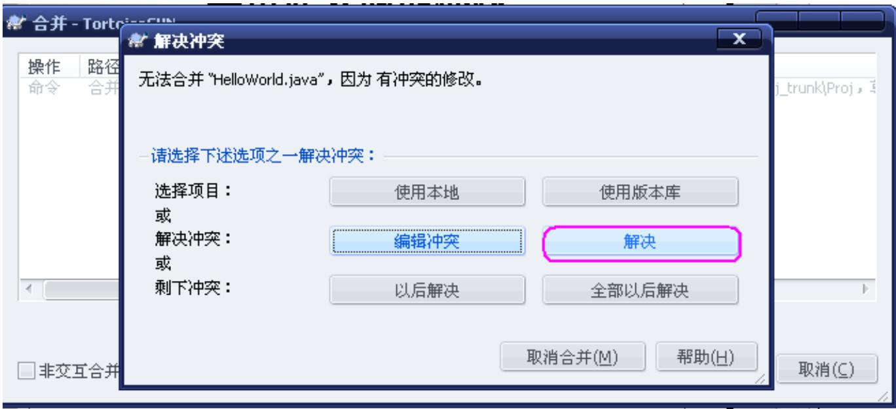

| 操作 | 路径 |
| --- | --- |
| 命令 | 合并版本 51-55 于 http://192.168.0.16:8080/SVNtest/01系统/源代码/branches/test-Proj1.0 到 E:\ |
| 正在合并 r51，经由 r55 | E:\Proj_trunk\Proj |
| 更新 | E:\Proj_trunk\Proj\HelloWorld.java |
| 完成！ | |

看到这样的话，就说明我们合并成功！

## 合并成功后的提交

合并成功之后主干被修改了，所以需要执行提交操作。

## 冲突

- 什么是冲突
- 冲突产生的原因
- 冲突产生的时机
- 解决冲突
- 关于避免冲突的建议

### 什么是冲突

冲突是指团队协同工作时，当多位团队成员同时修改同一个文件，造成本地文件与 SVN 系统中的文件版本不一致，而导致文件无法提交的情况。

### 冲突产生的原因

当团队协同工作的时候，多位团队成员同时操作一个文件。团队成员 A 操作完成后，将该文件提交到 SVN 上。此时，其他团队成员的本地文件与 SVN 上的文件版本不一致。当团队成员 B 操作完成并对文件进行提交操作时，就会产生冲突。

### 冲突的提示页面

提交时产生的冲突：

| 操作 | 路径 | MIME 类型 | |
| --- | --- | --- | --- |
| 命令 | 更新 | | |
| 冲突 | E:\Proj\_trunk\Proj\HelloWorld.java | | |
| 完毕 | 于版本:60 | | |
| 警告! | 至少还有一个的文件处于冲突状态。 | | |

### 冲突的解决方案

遇到冲突时，需要 update 该文件。我们将看到三个带问号的文件：

```
filename.mine
filename.rOLDREV
filename.rNEWREV
```


面对文件冲突，我们可以选择以下两种方式解决冲突：

- 使用工具解决冲突
- 用 revert 放弃所做的修改

### 使用工具解决冲突

- 使用自带工具，如图所示
- 对比两个版本的文件，解决冲突

工具中会列出两个版本冲突的部分，并让我们选择使用哪个版本的内容。

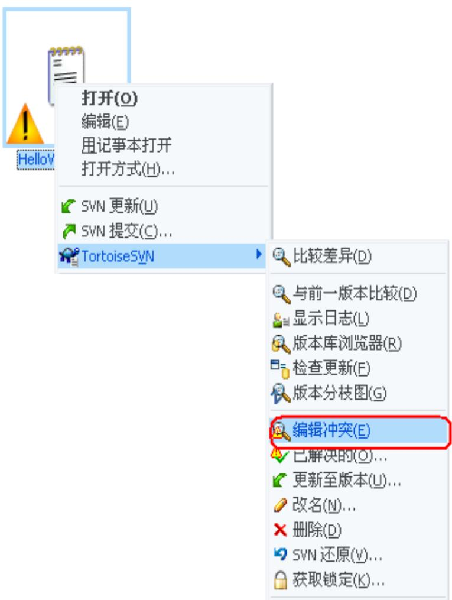

### 用 revert 放弃所做的修改

选择 SVN 还原（revert）放弃自己所做的修改。

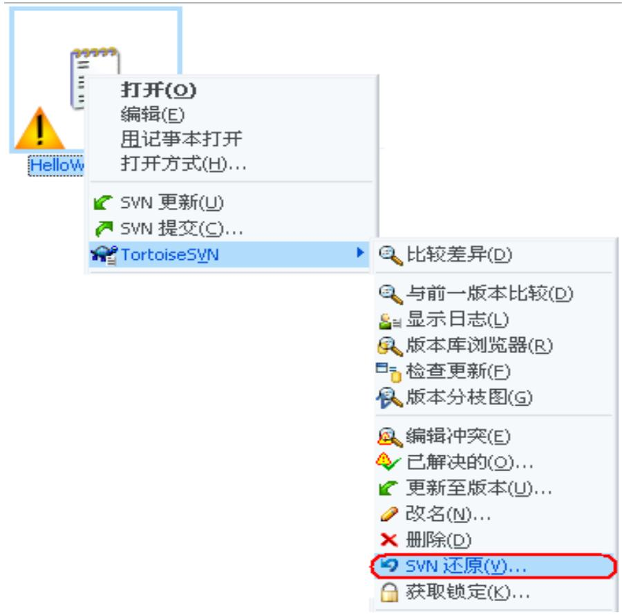

### 解决冲突后

通过上面所说的方法，解决冲突后要选择已解决的（resolved）。

- 解决后，带问号的三个文件将自动删除。
- 最后选择 commit 提交到 SVN。

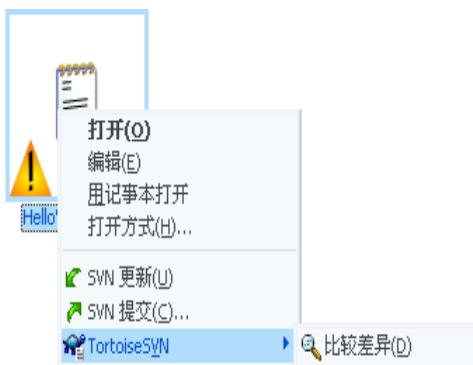

### 关于冲突的建议

- 修改文件之前，先进行一次 update 操作。
- 修改完成后，及时 commit，不要在本地停留过长时间。
- 在多位团队成员协作时，尽量修改自己撰写的部分，尽量不要修改不属于自己撰写的部分。
- 出现冲突很正常，可以通过前面的方法解决，不要相互覆盖。

## 其他 SVN 的功能

### Export（导出）

导出你需要的文件，导出后不再受 SVN 控制；而 checkout 检出的文件仍受 SVN 控制。

### Import（导入）

将需要的文件导入到版本库中。

### Relocated（重新定位）

当服务器上的版本库目录已经改变，我们可以把工作复本重新定位。

### CleanUp（清理）

递归地清理工作副本，删除锁定和保留的未完成操作。如果你得到工作副本已经锁定的错误，运行这个命令删除无用的锁定，并将工作副本恢复到可用的状态。

## Subclipse 的安装步骤

1. 帮助 > 软件更新 > 查找并安装
2. 选择“要安装的新功能部件”选项并点击 Next。
3. 点击“新站点”并且创建一个远程站点：
   - 名字：Subclipse
   - URL：http://subclipse.tigris.org/update_1.2.x
4. 在结果安装窗口中，把“Subclipse in the Features”选择到安装列表中，并且通过向导来开始安装插件。
5. 完成这些之后，重新启动 Eclipse。

## 在 Eclipse 下使用的图标

- 受 SVN 控制的文件被标记为小黄桶；
- 修改过的文件都被标记上一个黑色星号；
- 未受版本控制的文件被标记为问号。

## Eclipse 下使用 SVN 的主要功能

在 Eclipse 下使用 SVN，我们主要使用以下功能：

1. 将版本库导入到 SVN 资源库
2. 将新建项目导入到版本库
3. 小组
4. 比较对象
5. 替换为

# 软件工程（双语）实验4参考资料：SVN培训PPT教程（第4部分）

## 一、将版本库导入到SVN资源库

### 菜单操作

在Eclipse中，通过以下菜单路径进入相关设置：

- 新建窗口(N)
- 新建编辑器(D)
- 显示视图(V)
- 定制透视图(Z).
- 将透视图另存为
- 复位透视图(R)
- 关闭透视图(C)
- 关闭所有透视图
- 导航(G)
- 工作集(W)
- 添加新的 SVN资源库
- 首选项(P)...

### 添加 SVN资源库

将新的SVN资源库添加至“SVN资源库”视图。

**位置**

URL :http://192.168.0.16:8080/SVNtest

新SVN资源库的访问路径

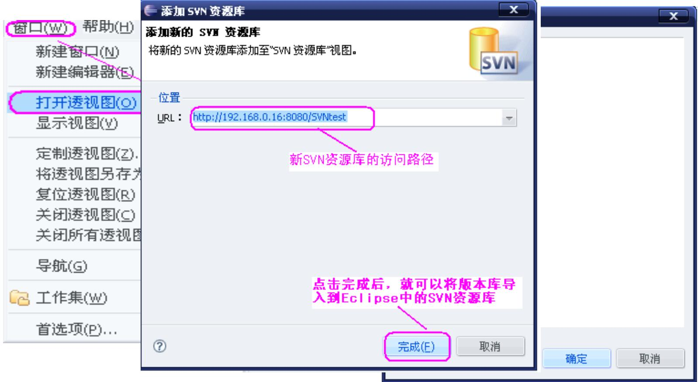

点击完成后，就可以将版本库导入到Eclipse中的SVN资源库。

按钮包括：完成(E)、取消、确定、取消。

## 二、将新建项目导入到版本库

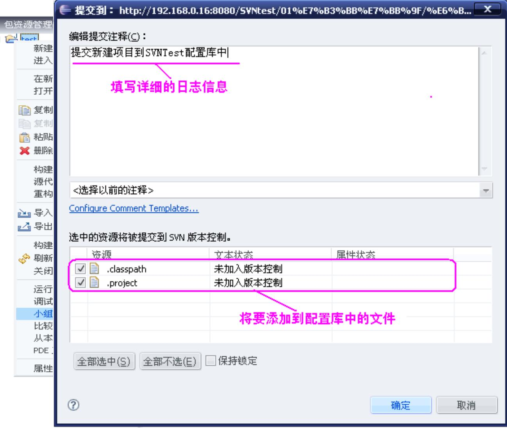

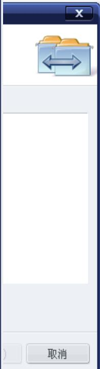

## 三、Eclipse中小组的使用

### ◼ 小组的主要功能(如图1.1)

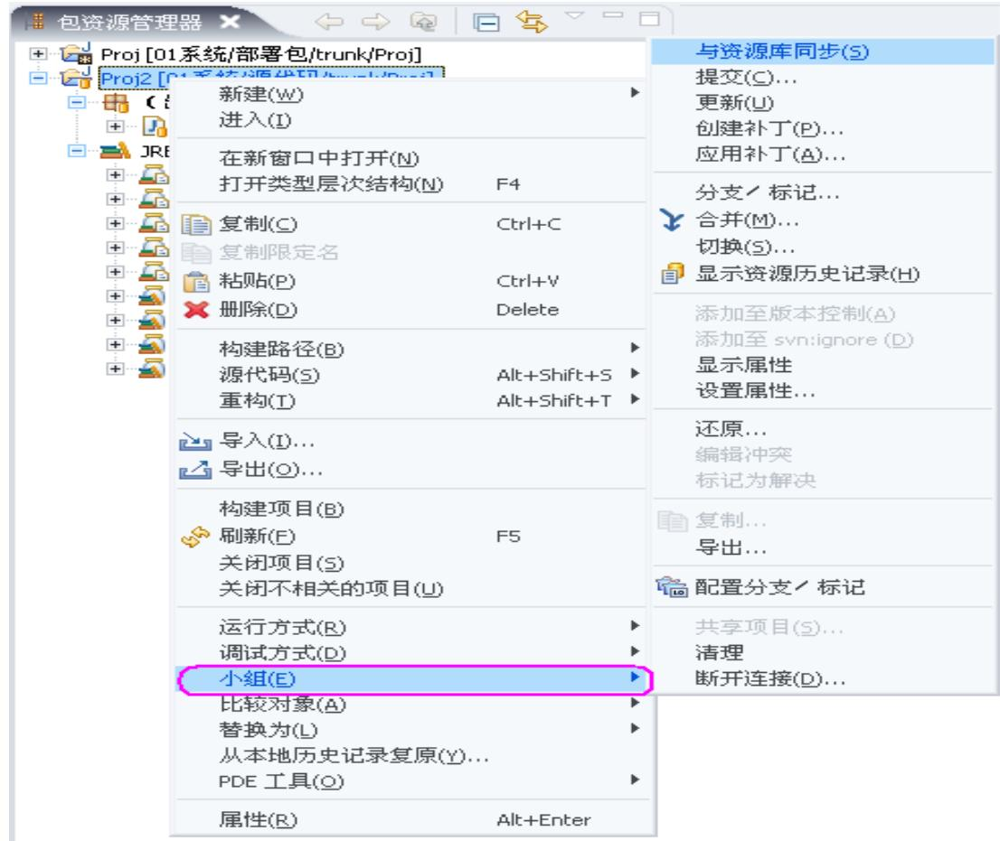

#### 比较对象

- 小组(E)
- 比较对象(A)
- 替换为(L)
- 从本地历史记录复原()..
- 属性(R)

#### 基本修订版(B)

- 分支/标记...
- Alt+Enter
- 修订版(R)..

#### 例如：

- 本地历史记录(L)..

##### DHelloWorld.java X HelloWorld.java <工作空间>和版本的比较

###### 基本修订版

#### ◼ 1）基本修订版:在Eclipse中的基本版

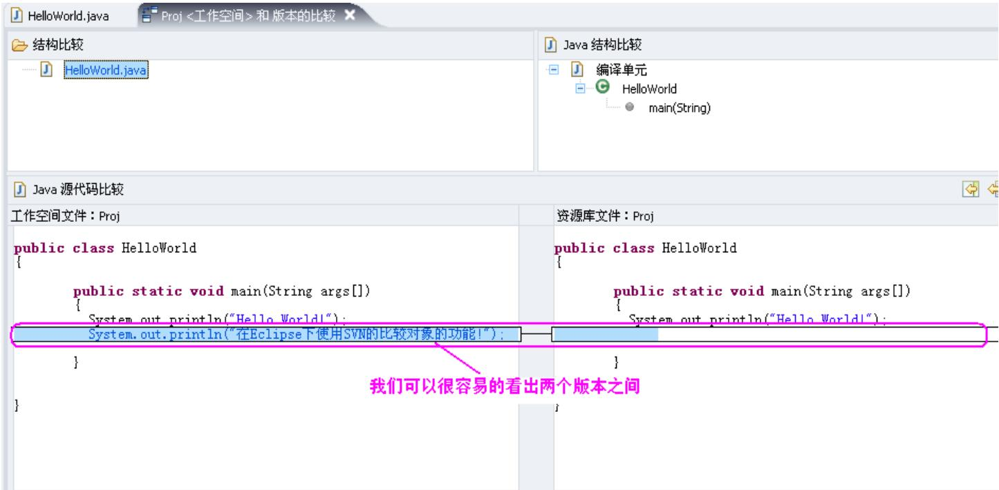

代码示例：

```java
public class HelloWorld
```

###### 2） 资源库中的最新内容

```java
public static void main(String args[]){System. out.println("Hello World!");System. out.println(“版本库中的最新内容!");
```

这是资源库中的最新版本

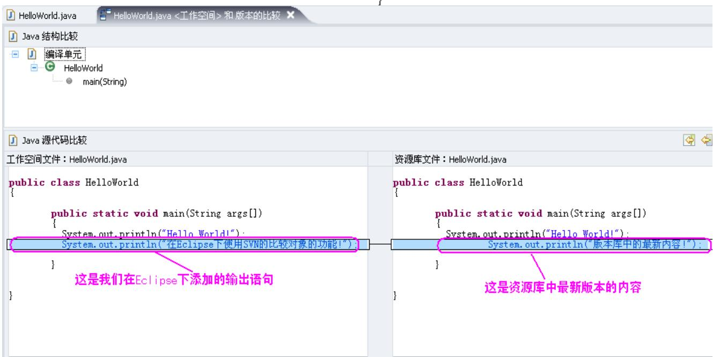

#### 分支/标记

###### 3）分支/标记

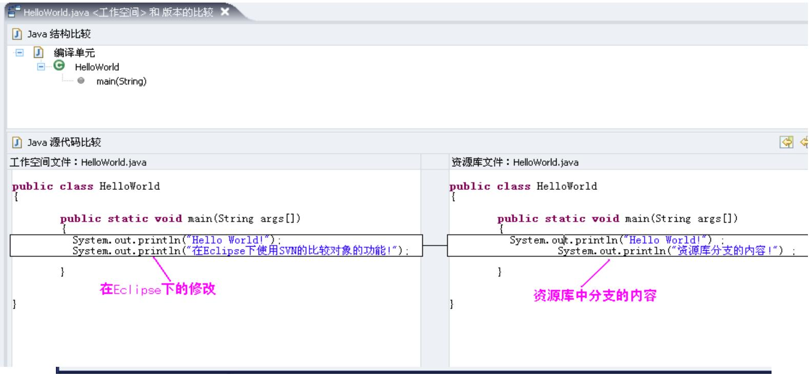

#### 修订版

###### 4）修订版

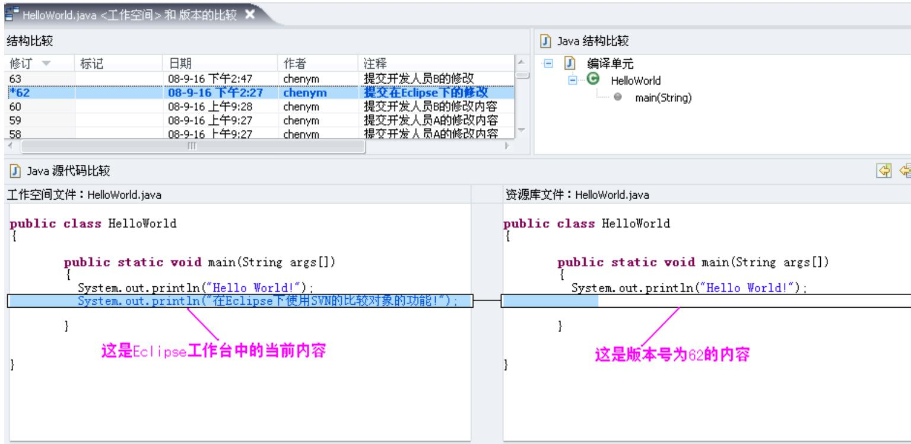

#### 本地历史记录

###### 5） 本地历史纪录

现修改的版本与本地修改的其他版本库进行比较

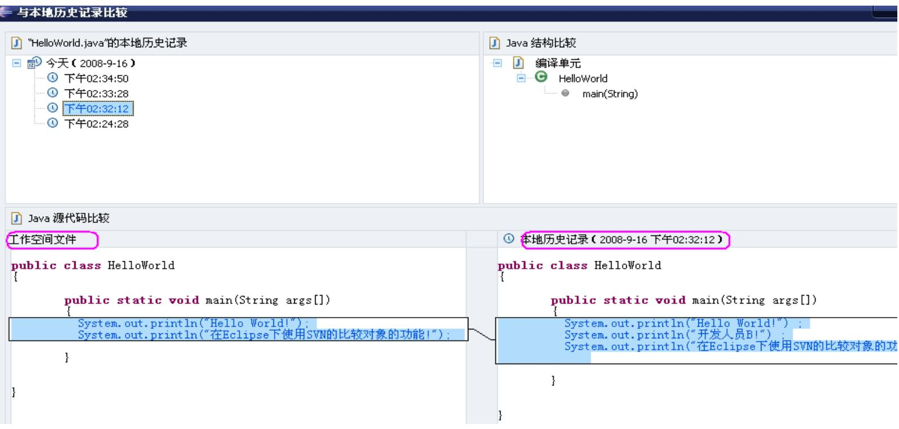

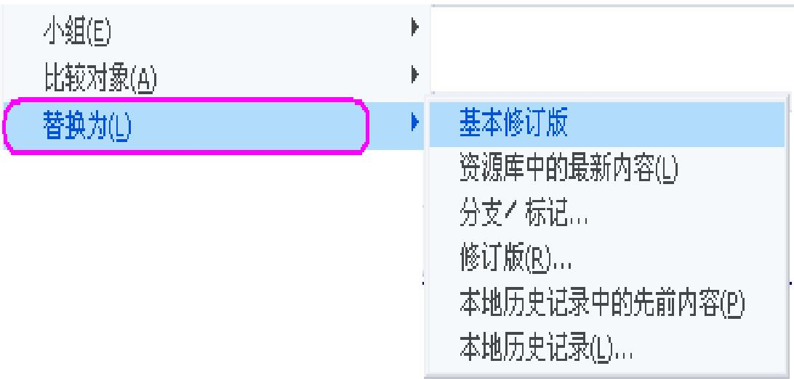

### Eclipse中的替换为

- 小组(E)
- 比较对象(A)
- 替换为(L)
    - 资源库中的最新内容(L)
    - 分支/标记...
    - 修订版(B)..
    - 本地历史记录中的先前内容(P)
    - 本地历史记录(L)..

注:与比较对象的应用一样,只是这是替换.
