# 《软件工程（双语）》实验4参考资料：SVN服务器与客户端安装配置

原件经识别和整理；“参考解答”是我们补的。

# 《软件工程（双语）》实验 4：SVN 服务器与客户端安装配置

## 一、SVN 服务器端安装与配置

### 安装服务器端 Visual SVN Server

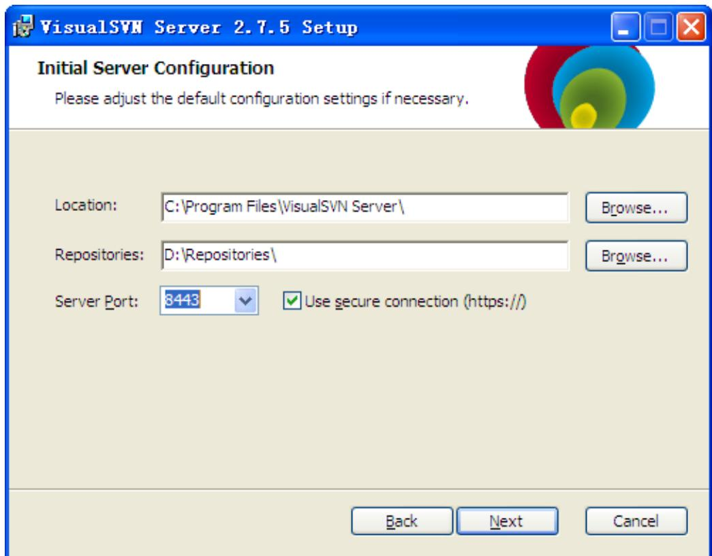

启动 Server 管理器时请注意选择端口 **8443**，并使用 HTTPS 链接方式。

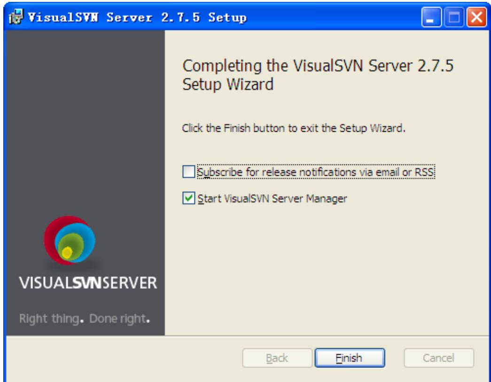

启动初始界面如下：

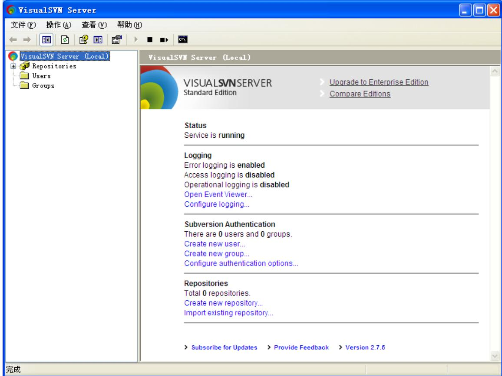

### 创建仓库

点击创建新仓库，键入仓库名称，一直点击“下一步”直至确认。

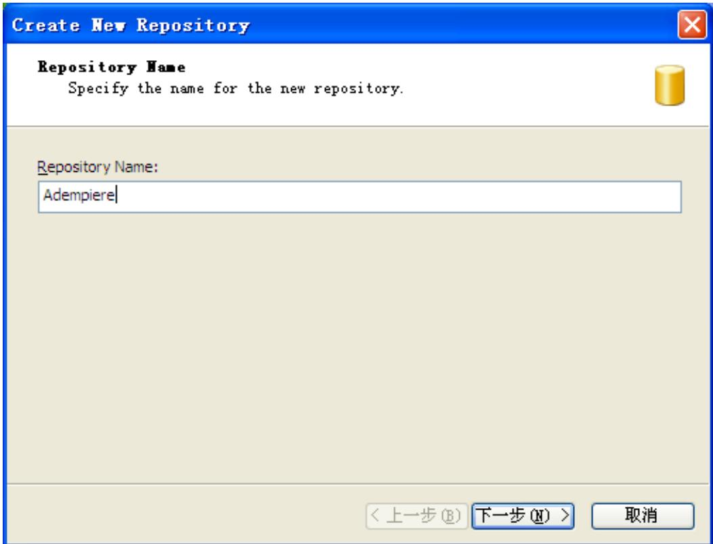

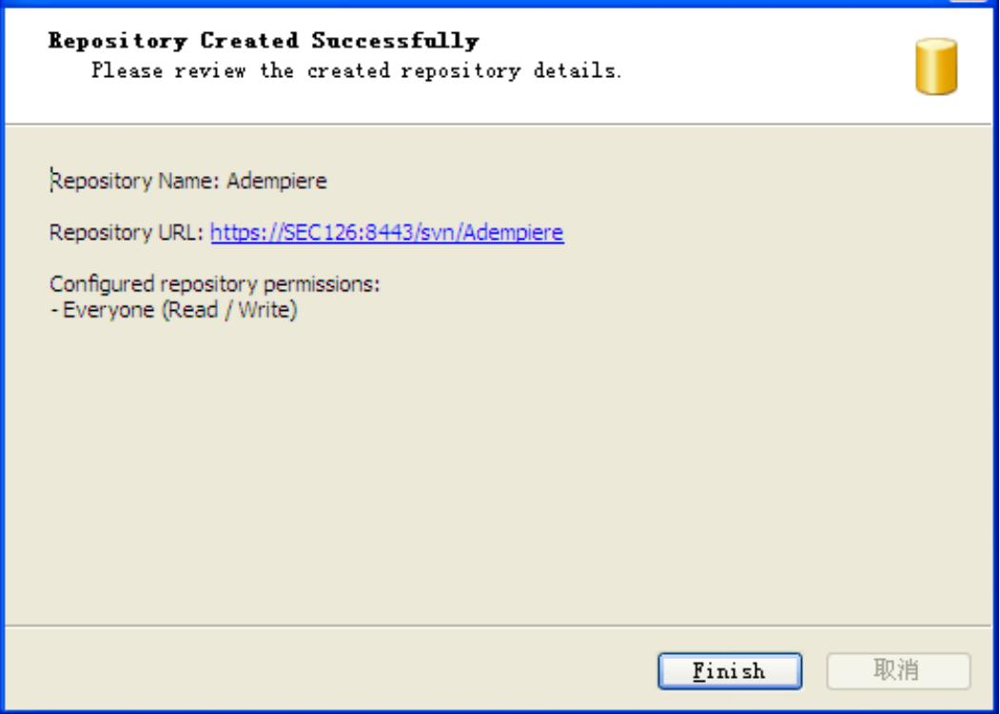

请查看创建的仓库详情：

- Repository Name: Adempiere
- Repository URL: `https://SEC126:8443/svn/Adempiere`
- Configured repository permissions: Everyone (Read / Write)

点击 Finish 完成创建。

> **注意**：记录仓库的 URL 地址，后续客户端连接将用到。

### 配置 SVN 服务器的用户、用户组和权限

在 VisualSVN Server 中创建用户，键入用户名和密码。

**注意**：请分别创建两个用户。

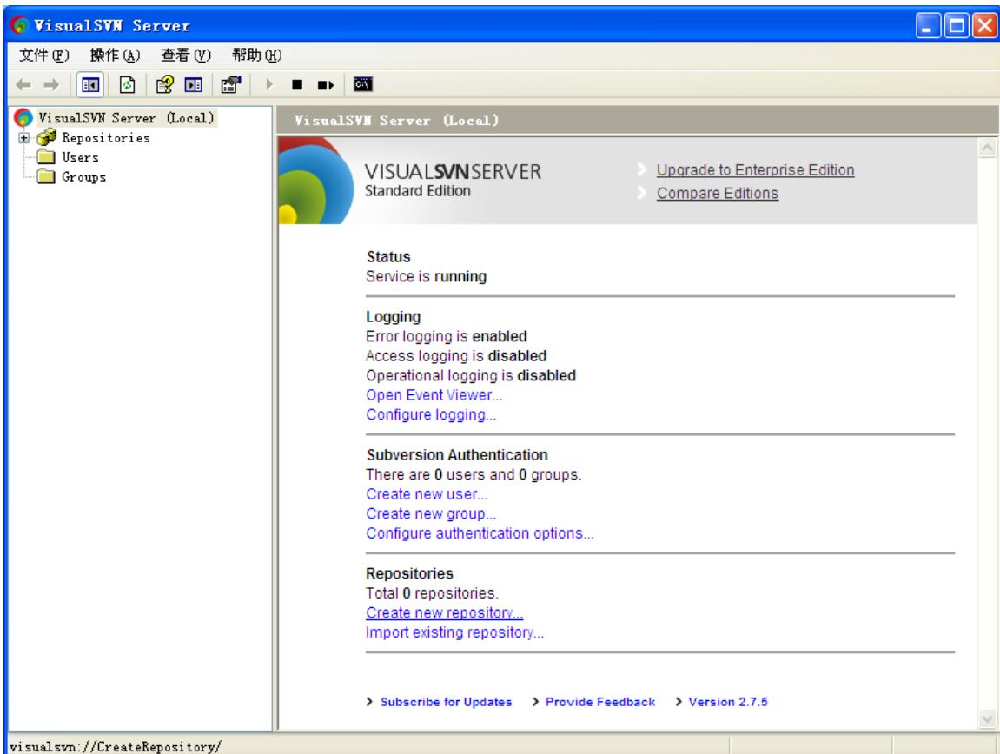

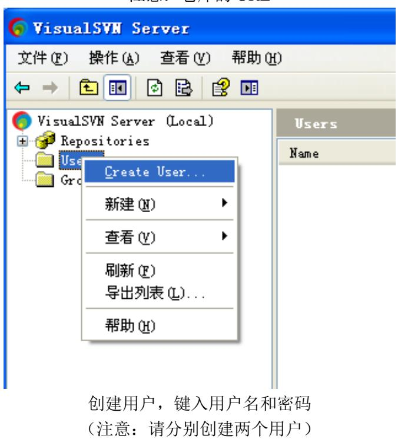

## 二、SVN 客户端安装与配置

### 安装客户端

建议在其他机器上安装。

访问下载地址：http://tortoisesvn.net/downloads.html

下载后直接点击“下一步”，安装完毕后重启机器。

### 客户端链接服务器端

在客户端机器上创建一个工作目录，例如 `D:\MyProject`。

1. 打开 TortoiseSVN 的 Checkout 功能。
2. **URL of repository**: `https://SEC126:8443/svn/Adempiere/`
   > 提示：仓库的 URL 可以通过单机右键 "url to clipboard" 复制，然后粘贴到文本框中。
3. **Checkout directory**: `D:\MyProject`
4. **Checkout Depth**: 选择 Fully recursive（完全递归）。
5. 勾选 Omit externals（如果需要）。
6. 点击 OK 开始下载。

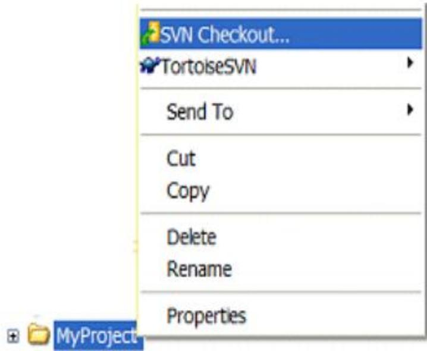

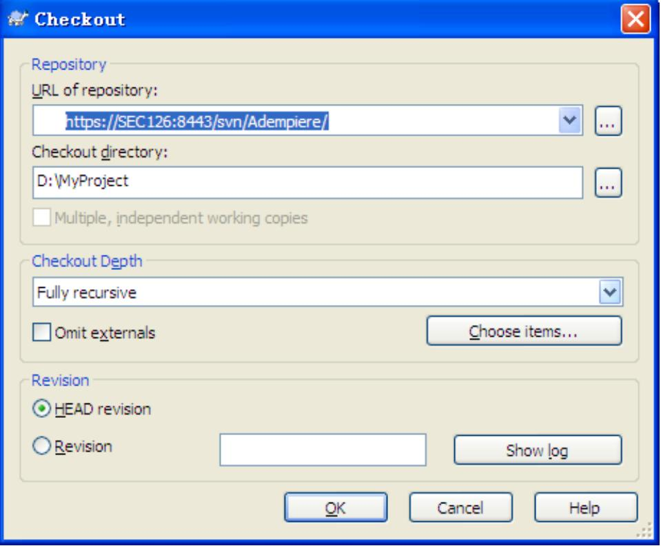

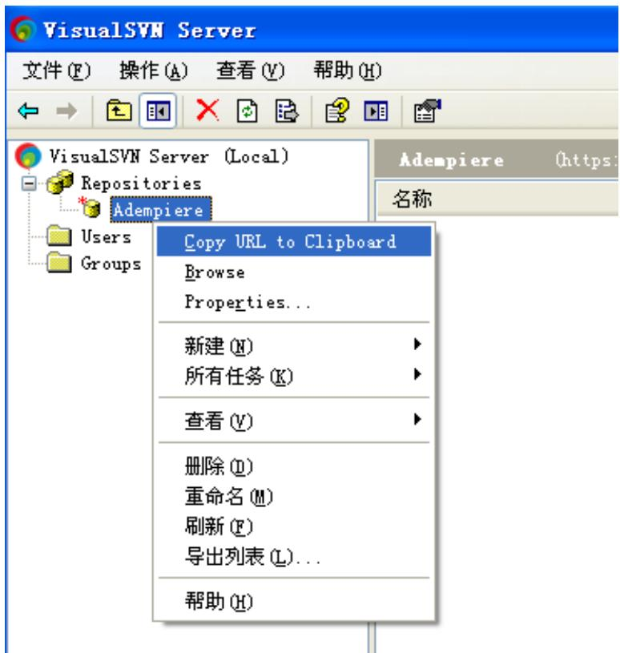

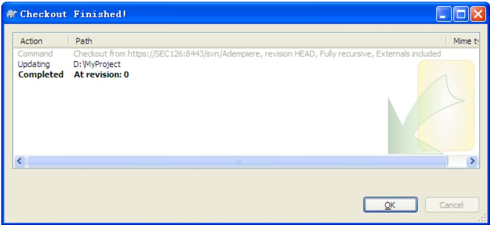

## 三、SVN 常用功能操作

完成 SVN 的添加、提交、更新、分支、合并等操作。

在 SVN 客户端的项目文件夹中，不同图标表示文件状态：

| 图标 | 含义 |
| :--- | :--- |
| 🟢 绿色对勾 | 文件与 SVN 仓库中的版本一致 (file is identical to svn repository) |
| 🔴 红色感叹号 | 文件与 SVN 仓库中的版本不同 (file is different from svn repository) |
| 🔵 蓝色加号 | 文件已添加到仓库，但尚未提交 (file has been added to the repository, but it must still be committed) |
| 无标记 | 文件不在仓库中 (file is not in repository) |

### 文件编辑与提交

可以通过“记事本”打开文件进行编辑，例如 `test.txt`。

在 TortoiseSVN 菜单中选择 "Add" 添加文件，或 "Commit" 提交修改。

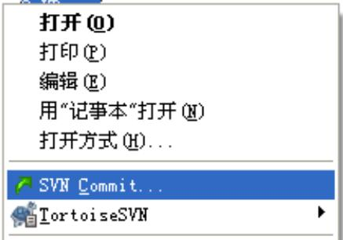

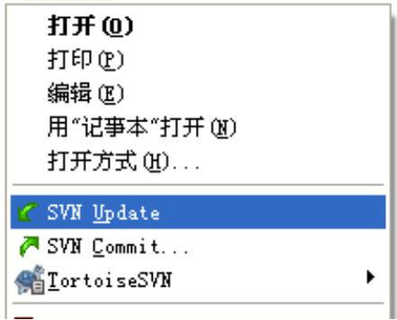

### 建立分支

鼠标选中主线目录，右键选择 "TortoiseSVN" 的 "**Branch/tag...**" 项，系统弹出有关标签路径的信息。

在 **To URL** 栏中输入标签目录，如 `/test/V1`（可自动生成，无需事先建立 V1 文件夹），点击 "**OK**" 按钮建立版本标签（如 V1.0.0.0）。

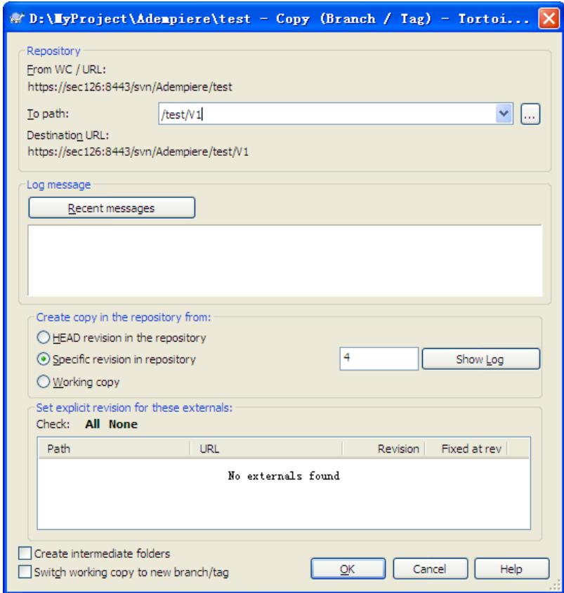

### 合并分支

首先保证你在分支上的修改已经全部提交。

1. 鼠标选中主线文件夹，右键选择 "TortoiseSVN" 的 "**Merge...**" 项，系统弹出有关分支合并的信息。
2. 在 **From** 框中选择 URL，点击 "show log" 选择起始版本。
3. 在 **To** 框中选择 URL（与 From 框中路径相同）和版本号（需合并的版本，若是最新版本可直接选择 HEAD Revision）。
4. 点击 "**Merge**" 后，即完成将分支修改内容合并到主线目录的工作。
