# 《软件工程（双语）》实验4参考资料：SVN服务器端、客户端安装以及集成到Eclipse的详细步骤

原件经识别和整理；“参考解答”是我们补的。

# SVN 服务器端、客户端安装以及集成到 Eclipse 的详细步骤

本资料由识别工具读取并整理，内容源自《软件工程（双语）》实验 4 参考资料，详细记录了 SVN 服务端的安装、仓库建立、权限配置以及在 Eclipse 中的插件集成步骤。

## 一、安装服务器端 SVN 和客户端 SVN

需要使用的软件版本如下：
- **Eclipse**: 3.3
- **SVN Server**: svn-1.4.5-setup
- **SVN Client (TortoiseSVN)**: 1.4.5.10425-win32-svn-1.4.5

### 安装服务器端软件

1. 首先安装服务器端软件 `svn-1.4.5-setup.exe`（附件可下载）。这个安装很简单，点击“下一步”、“下一步”即可。
   - 本例中安装目录为：`D:\Program Files\Subversion`

### 安装客户端软件

2. 其次安装客户端软件 `TortoiseSVN-1.4.5.10425-win32-svn-1.4.5`。
   - 该安装也很简单，点击“下一步”即可。
   - 客户端软件安装完成后，系统会要求重新启动电脑，请重启一下。

> **提示**：此时距离成功前进一步了！

## 二、建立 SVN 版本控制的服务目录

### 指定服务目录

1. 将 `D:\svn service root` 指定为 SVN 版本控制的服务目录。
   - **注意**：网上很多帖子将此命令称为“建立仓库”是不准确的。其实这个目录应该称作“仓库所在的目录”。
   - 假如我有三个仓库：`repository1`, `repository2`, `repository3`，它们的位置应该是：
     - `D:\svn service root\repository1`
     - `D:\svn service root\repository2`
     - `D:\svn service root\repository3`

### 建立仓库的方法

建立一个仓库有两种方法：

#### 方法 1：命令行模式

1. 进入命令行窗口，切换到 Subversion 的 bin 目录：
   ```bash
   C:\Program Files\Subversion\bin
   ```
2. 输入以下命令创建第一个仓库：
   ```bash
   svnadmin create D:\svn service root\repository1
   ```
   - 这样第一个仓库就建立好了，以后的项目就可以导入到这个仓库中（其他仓库的建立类似）。
   - 此时进入目录：桌面 -> 我的电脑 -> 本地磁盘 E: -> `svn service root` -> `repository1`。你会看到文件夹 `conf`, `davdb` 等。

#### 方法 2：图形界面模式

1. 打开目录：我的电脑 -> 本地磁盘 E: -> `svn service root`。
2. 在该目录下新建一个文件夹，命名为 `repository1`。
3. 右键点击刚才新建的文件夹，选择菜单项 `TortoiseSVN` -> `Create Repository Here`。
   - 效果与第一种方法一样。

### 开启 SVN 服务

3. 在命令行上转到 Subversion 目录下（即刚才安装 SVN 服务器的目录），输入以下命令启动服务：
   ```bash
   svnserve -d -r D:\svn service root
   ```

> **命令解释**：这一步是建立并开启客户端访问服务器端仓库目录下指定的文件。

### 配置用户和权限

4. 完成上述步骤后，SVN 安装和服务开启全部结束！距离在 Eclipse 中使用 SVN 已经完成一大半了。
   - *注：原文未提供具体的用户配置文件修改步骤，通常需编辑 `conf/passwd` 和 `conf/authz` 文件进行配置。*

## 三、Eclipse 集成 SVN 的使用

之前已安装好 SVN 的客户端和服务器端，并配置了用户权限。现在看看如何在 Eclipse 中集成 SVN 的插件 **Subclipse**。官网文档写得很清楚，这里仅做简要说明。

### 集成状态确认

这就已经集成好了。

### 运用到所建立的工程项目中

1. 随便选一个工程，右键选择 `Team` -> `SVN`。
2. 点击 `Next`。
3. 选择：**使用已有资源库位置** (`svn://localhost/repository1`)。
4. 点击 `Next`。
5. 选择项目名称或者新建项目名称（就是重新取一个名字而已）。
6. 点击 `Next`。
7. 编辑提交备注，点击 `Finish`。

执行到这步，就已经提交给 SVN 服务器中的 `repository1` 仓库管理该工程的版本了。

> **结语**：终于执行完了，累了吧，高兴下，好好休息下吧！嘿嘿 (*^_^*)……

## 四、附件：Subclipse 在 Eclipse 中的安装图解

以下是 SVN 集成 Eclipse 的图解说明。

以前提到过 SVN 版本控制器和客户端的安装和配置，这里再总结一下在编译器中怎么使用 SVN，使其既可以单独使用，也可以配合 SVN 客户端一起使用。由于编译器种类众多，插件种类也不同，这里只简单介绍下 Eclipse 的插件安装。

我用的版本是 Eclipse 3.2.2 + ME / Eclipse 5.1.1。由于本身只有 CVS 而没有集成 SVN，所以要想使用 SVN 做版本控制，只好装一个 Eclipse 插件 **Subclipse**。Subclipse 的详细安装过程在其官方网站 `http://subversio.tigris.org` 上写得很清楚，还带配图，我就直接 copy 了：

### 一、Install Subclipse in Eclipse 3.x

#### Step 1: Begin the installation from the Eclipse Help menu item

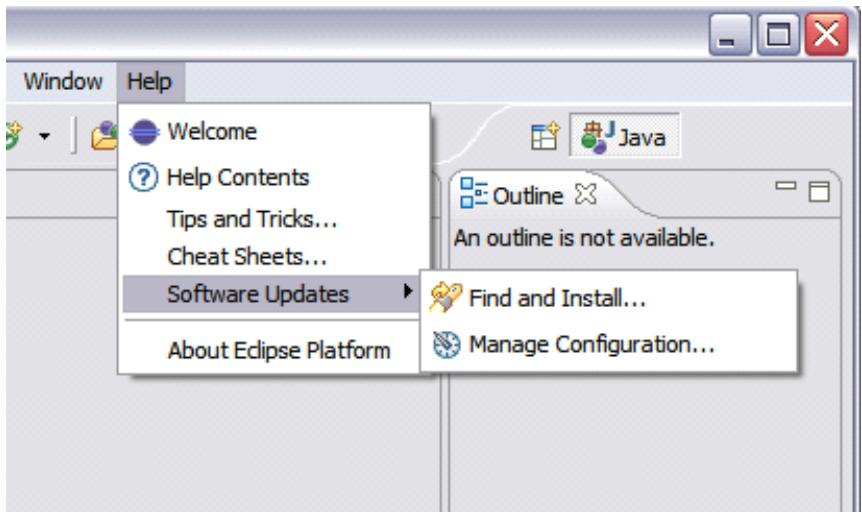

This screenshot shows the screen as it initially comes up. In this case you will need to change the radio button to indicate that this is a new install.

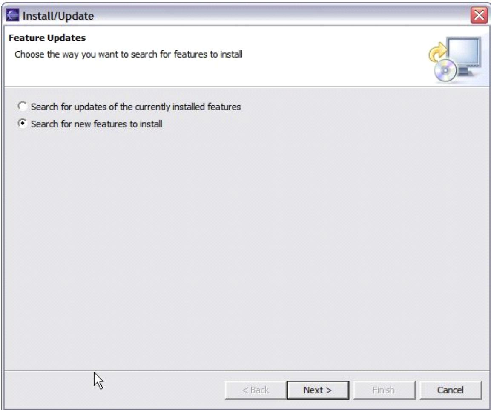

This screen will vary depending on the features you have installed already. You want to click on the **New Remote Site** button. If you are behind a proxy and the Eclipse install mechanism does not work then you can download a zipped version of the update site and then click the **New Local Site** button instead.

## 二、在 Eclipse 3.x 中使用 Subclipse（安装与使用）

### 安装 Subclipse

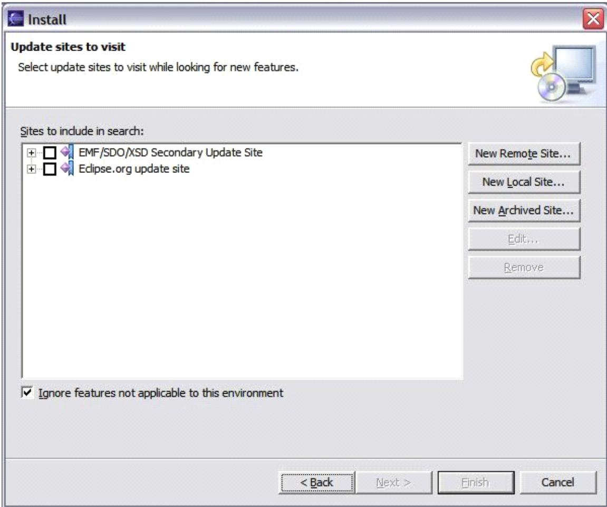

此界面显示已填入正确信息、用于安装 Subclipse 的 New Remote Site 对话框。

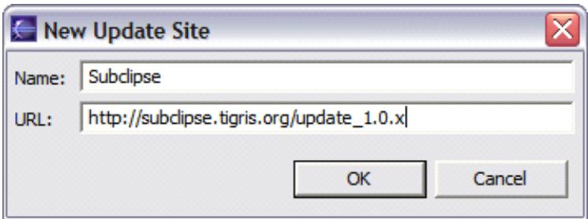

Name : Subclipse 1.2.x (Eclipse 3.2+)

URL : http://subclipse.tigris.org/update_1.2.x

Name : Subclipse 1.0.x (Eclipse 3.0/3.1)

URL : http://subclipse.tigris.org/update_1.0.x

### 步骤 5

第一次回到此界面时，刚添加的站点不会被选中，点击 Next 之前务必先选中它。

Select update sites to visit while looking for new features.

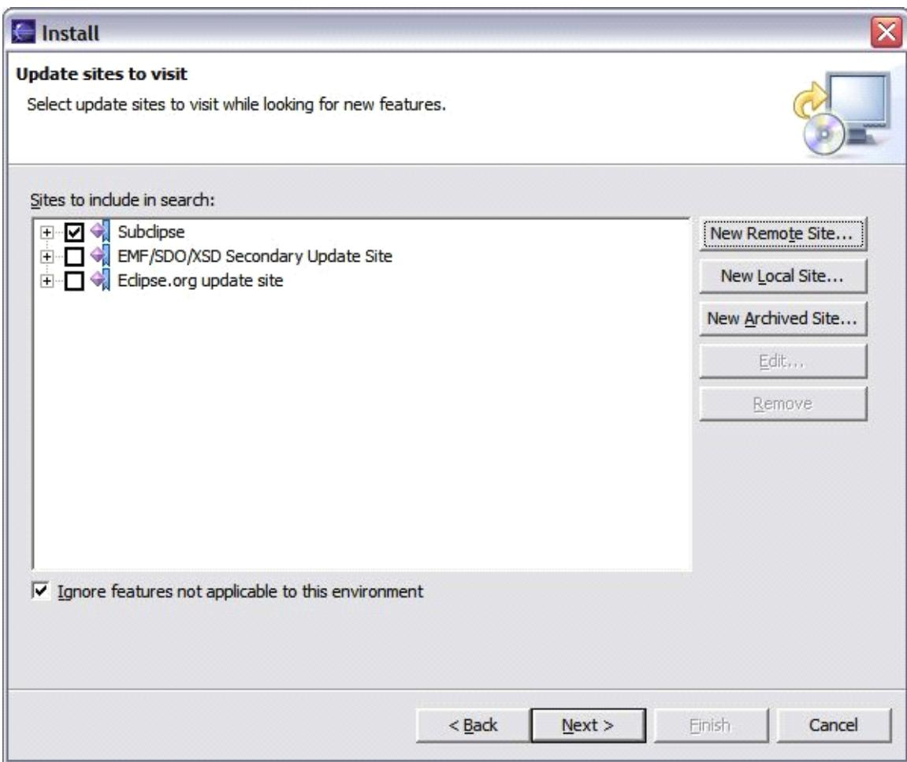

- EMF/SDO/XSD Secondary Update Site
- Eclipse.org update site

Ignore features not applicable to this environment

### 步骤 6

下一界面显示所有可安装的功能。

#### Updates

#### Search Results

Select features to install from the search result list.

Select the features to install:

Subclipse update site

- ☑ Subclipse
  - Subclipse 1.0.0

Deselect All　Select Required

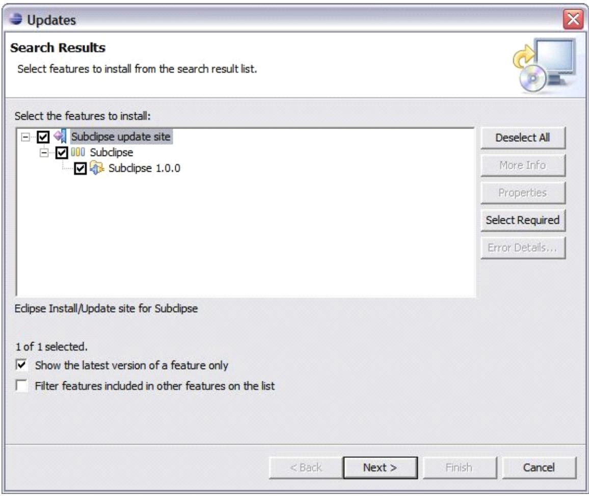

Eclipse Install/Update site for Subclipse

1 of 1 selected.

- Show the latest version of a feature only
- Filter features included in other features on the list

Next >　Cancel

### 步骤 7

点击按钮接受许可协议。

### 步骤 8

确认安装位置。

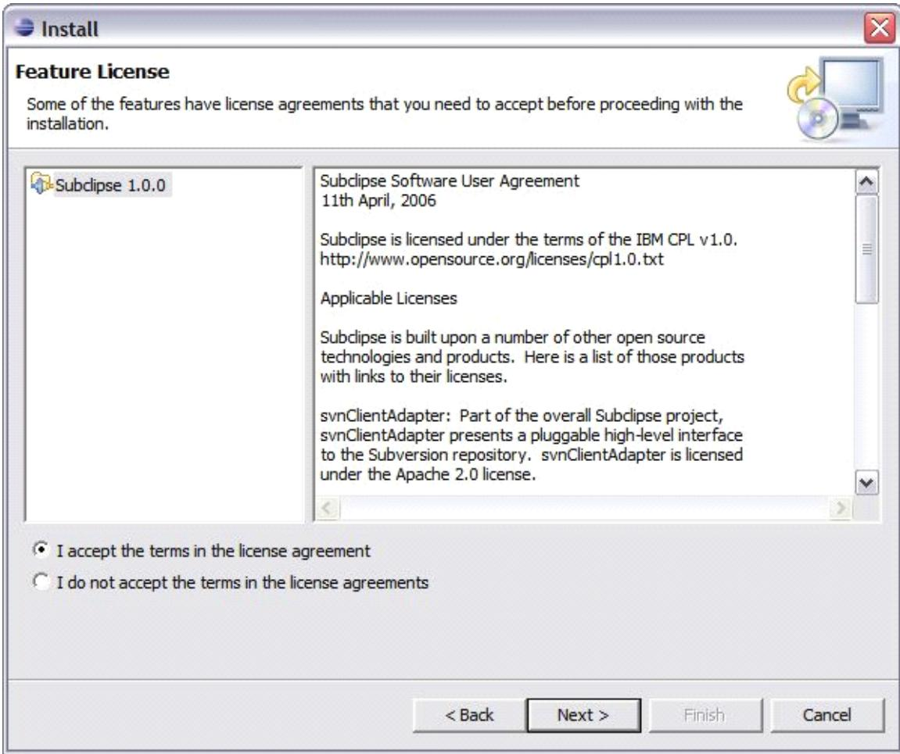

Features to install:

Subclipse 1.0.0

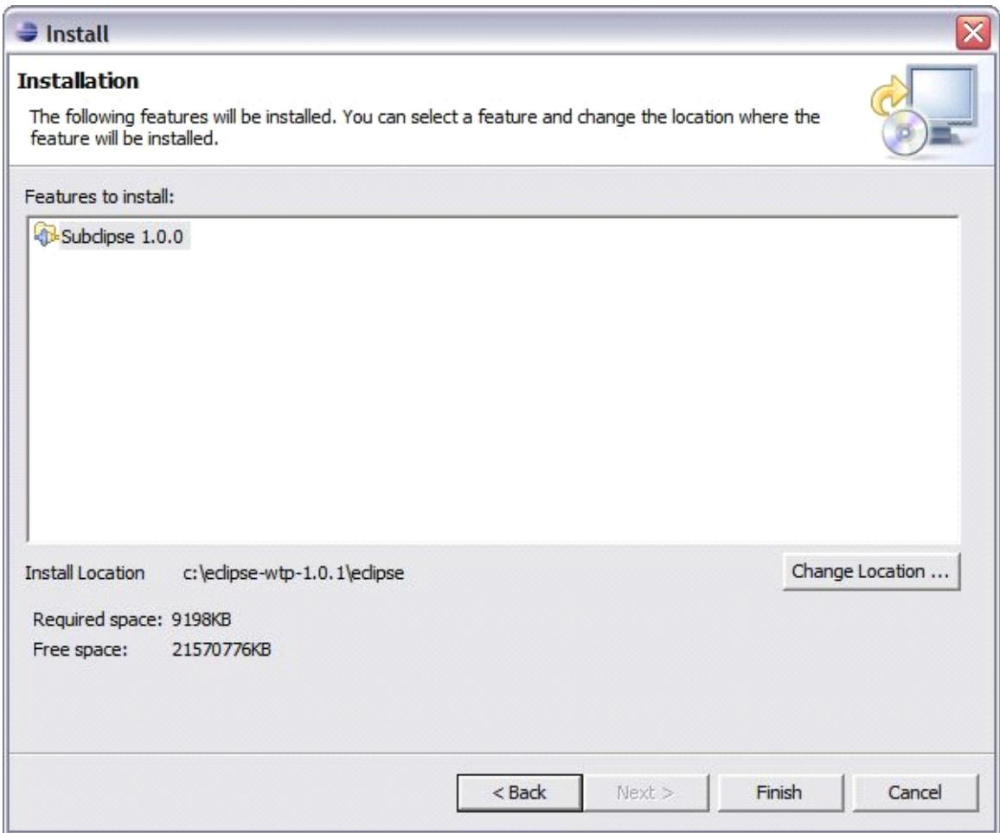

Install Location c:\eclipse-wtp-1.0.1\eclipse

Change Location ...

Required space: 9198KB

Free space: 21570776KB

< Back　Finish　Cancel

### 步骤 9

Eclipse 有一个首选项可以关闭接下来的这个对话框。我从未见过签名的功能，甚至 Eclipse.org 和 IBM 都不对其功能签名。

Installation

The following features will be installed. You can select a feature and change the location where the feature will be installed.

### 步骤 10

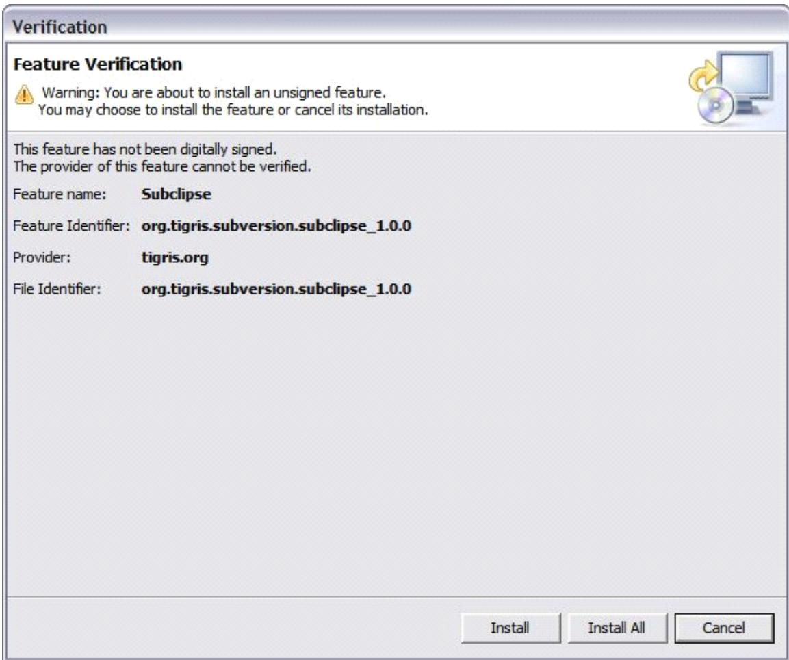

只是安装过程的截图。

### 步骤 11

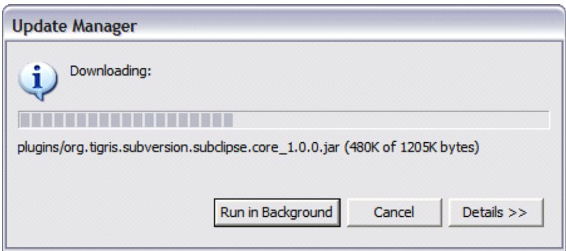

安装 Subclipse 后需要重启 Eclipse。

### 步骤 12

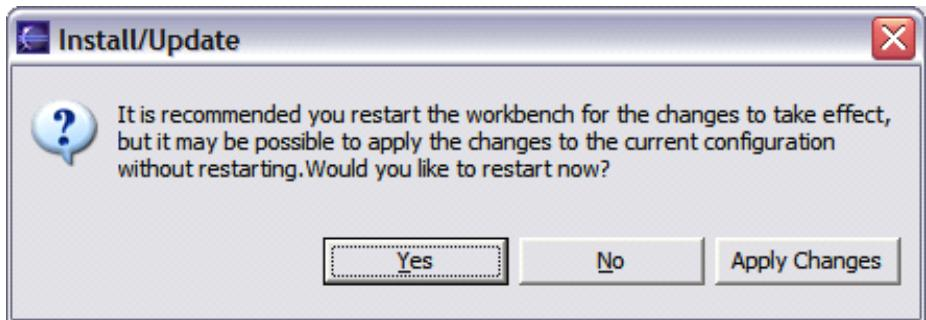

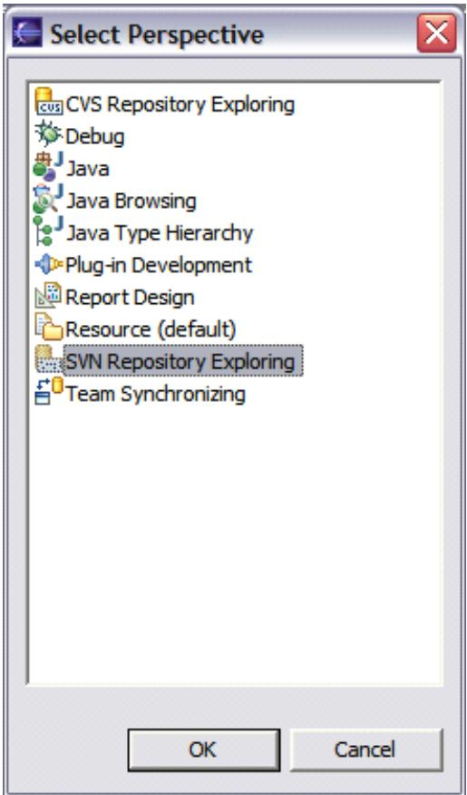

重启 Eclipse 后，通常第一件事就是打开 Subclipse Repository 透视图，在其中定义资源库。也务必查看在线帮助以及位于 Team -> SVN 下的 Subclipse 首选项。

卸载的方法也很简单，同样是点击 Help => Software Updates => Manage Configuration。

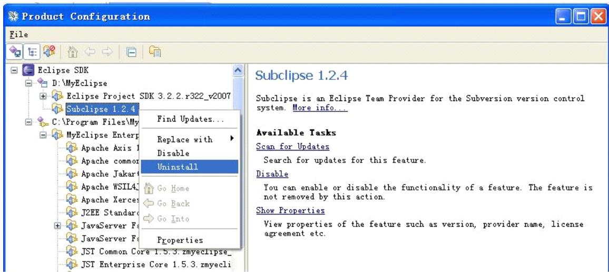

按上图操作就可以卸载了。

### 二、Use Subclipse in Eclipse 3.x（使用）

先向版本库中加入一个 Eclipse 工程，我这里是随便搭建的一个 WEB 工程 SVNtest，将它导入版本库 svn://localhost/ts（这使用本机装的版本库，其他机器就要打 IP 地址，之前说过）。导入后用版本库浏览器找到你导入的工程目录，把其下 WebRoot\WEB-INF\classes 目录删掉（注意：不删出以后会报错，原因后面再讨论）。这些初始化的操作都用客户端工具完成，毕竟插件的功能还不是那么强大。

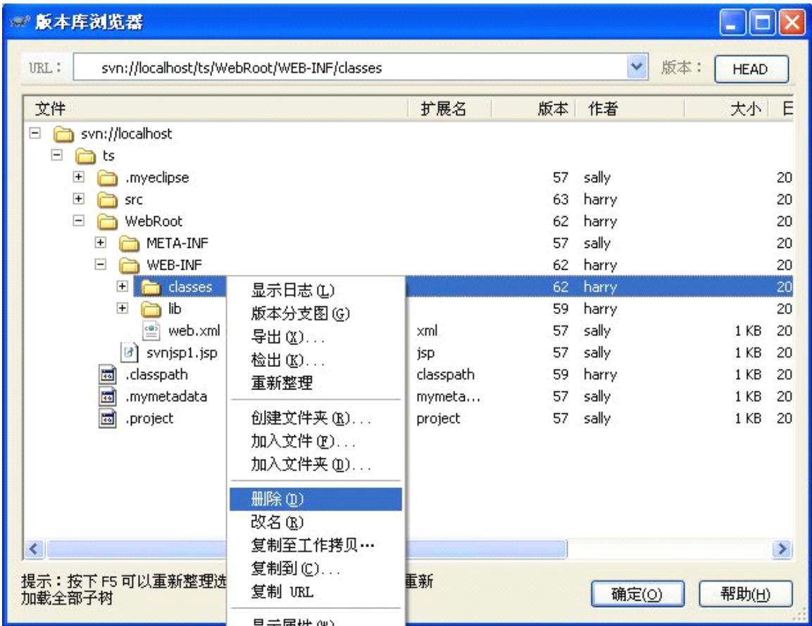

## 三、在 Eclipse 中集成 SVN 客户端

### 打开 SVN 视图并新建资源库

做好以上的准备后，打开 Eclipse 编译器，点击编译器右上角的 **Open Perspective** 打开 SVN 资源库界面，新建一个资源库。

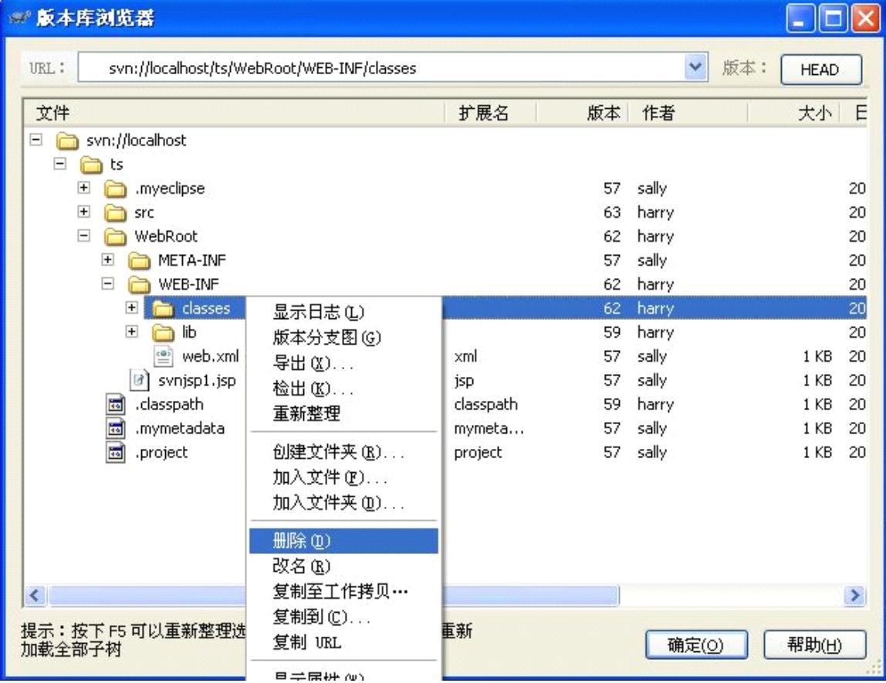
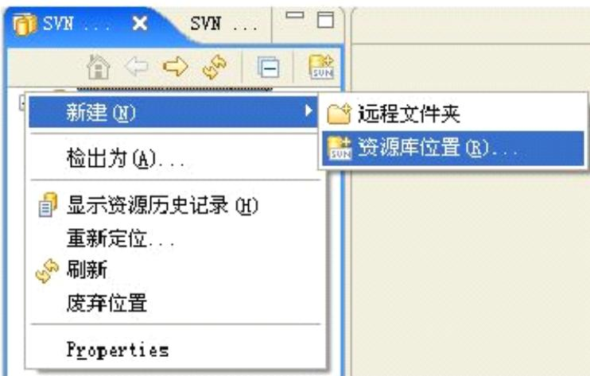

选择资源库的位置，这里我们就用刚才搭好的 `svn://localhost/ts` 作为工程目录，点击 **Finish**。如果成功则会看到版本服务器中工程的树形结构了（可能需要用户密码验证）。

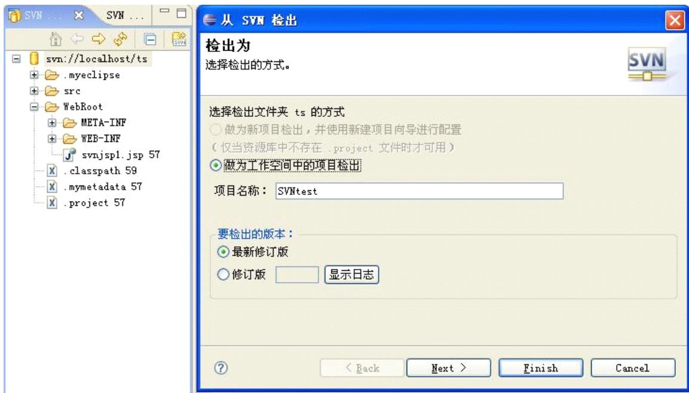

### 检出项目到本地工作空间

在 `svn://localhost/ts` 根目录上点右键，选择“检出”（英文版的可能叫 Check Out），在弹出窗口中选择“作为空间的项目检出”下边的项目名称随便叫，我这里还是用 `SVNtest` 作为项目名称。

一切没有问题了点击 **Finish** 之后它就会从服务器上把工程下到你本地了。

### 查看 SVN 控制标记与 Team 菜单

来到 Eclipse 编辑栏会发现刚才下的工程文件都会带有 SVN 版本控制标记了，再去 Workspace 看看也会发现下载的工程文件夹并且也有控制标记。而且我们会发现在 SVN 控制下的文件多出来一个 **Team** 选单，打开一看原来就是一个客户端工具呀：提交、更新、同步、合并、切换……我们再熟悉不过了，自己试试吧 ^_^

顺便说一下刚才为什么要删除 class 目 录<sub>，</sub> 起初我没有删掉它<sub>，</sub> 更改提交没有问题<sub>，</sub>但 在 更 新 时 总 是 报 错 <sub>：</sub> … … Workin<sub>g</sub> co<sub>py</sub> not locked<sub>;</sub> this is <sub>p</sub>robabl<sub>y</sub> a b<sub>ug,</sub> <sub>p</sub>lease re<sub>p</sub>orts<sub>v</sub>n: … … <sub>，</sub> 提示就是 class 目 录下 的 <sub>.</sub>s<sub>v</sub>n 有毛病 <sub>，</sub> 到 htt<sub>p</sub>://<sub>www.</sub>ti<sub>g</sub>ris<sub>.</sub>or<sub>g</sub> 查找解决方法 <sub>，</sub> 有一段描述<sub>：</sub>

Thi<sub>s message</sub> i<sub>s com</sub>i<sub>ng s</sub>t<sub>ra</sub>i<sub>g</sub>ht <sub>ou</sub>t <sub>o</sub>f th<sub>e</sub> S<sub>u</sub>b<sub>vers</sub>i<sub>on</sub> lib<sub>rary so</sub> t<sub>ec</sub>h<sub>n</sub>i<sub>ca</sub>ll<sub>y</sub> it i<sub>s</sub> S<sub>u</sub>b<sub>vers</sub>i<sub>on</sub> <sub>as</sub>ki<sub>ng you</sub> t<sub>o repor</sub>t th<sub>e pro</sub>bl<sub>em</sub> t<sub>o</sub> th<sub>em.</sub> Thi<sub>s error message</sub> i<sub>s</sub> ki<sub>n</sub>d <sub>o</sub>f th<sub>e</sub>i<sub>r genera</sub>l <sub>error message</sub> <sub>w</sub>h<sub>en some</sub>thi<sub>ng</sub> <sub>rea</sub>ll<sub>y</sub> <sub>unexpec</sub>t<sub>e</sub>d h<sub>appens .</sub> I<sub>n</sub> th<sub>e</sub> <sub>case</sub> <sub>o</sub>f E<sub>c</sub>li<sub>pse,</sub> th<sub>e</sub> <sub>pro</sub>bl<sub>em</sub> i<sub>s</sub> <sub>a</sub>l<sub>mos</sub>t <sub>a</sub>l<sub>ways</sub> <sub>one spec</sub>ifi<sub>c</sub> thi<sub>ng.</sub> Th<sub>e pro</sub>bl<sub>em</sub> i<sub>s</sub> th<sub>a</sub>t <sub>your</sub> E<sub>c</sub>li<sub>pse</sub> b<sub>u</sub>ild f<sub>o</sub>ld<sub>er</sub> <sub>was</sub> <sub>vers</sub>i<sub>one</sub>d <sub>an</sub>d <sub>a</sub>dd<sub>e</sub>d t<sub>o</sub> <sub>your</sub> <sub>repos</sub>it<sub>ory.</sub> Wh<sub>a</sub>t h<sub>appens</sub> i<sub>s</sub> th<sub>a</sub>t <sub>w</sub>h<sub>en</sub> E<sub>c</sub>li<sub>pse</sub> d<sub>oes a</sub> f<sub>u</sub>ll b<sub>u</sub>ild it <sub>w</sub>ill d<sub>e</sub>l<sub>e</sub>t<sub>e every</sub>thi<sub>ng</sub> i<sub>n</sub> thi<sub>s</sub> f<sub>o</sub>ld<sub>er</sub> i<sub>nc</sub>l<sub>u</sub>di<sub>ng</sub> th<sub>e</sub> <sup>"</sup> <sub>svn</sub><sup>"</sup> <sub>me</sub>t<sub>a</sub>d<sub>a</sub>t<sub>a</sub> f<sub>o</sub>ld<sub>er</sub> Wh<sub>en</sub> S<sub>u</sub>b<sub>vers</sub>i<sub>on canno</sub>t fi<sub>n</sub>d thi<sub>s</sub> f<sub>o</sub>ld<sub>er</sub> it i<sub>ssues</sub> th<sub>e</sub> <sub>a</sub>b<sub>ove error.</sub>

Th<sub>e so</sub>l<sub>u</sub>ti<sub>on</sub> i<sub>s</sub> t<sub>o</sub> d<sub>e</sub>l<sub>e</sub>t<sub>e</sub> thi<sub>s</sub> f<sub>o</sub>ld<sub>er</sub> f<sub>rom your repos</sub>it<sub>ory w</sub>hi<sub>c</sub>h <sub>you can</sub> d<sub>o</sub> f<sub>rom</sub> th<sub>e</sub> SVN R<sub>epos</sub>it<sub>or</sub>i<sub>es v</sub>i<sub>ew.</sub> Th<sub>en</sub> t<sub>ry</sub> d<sub>e</sub>l<sub>e</sub>ti<sub>ng</sub> th<sub>e</sub> f<sub>o</sub>ld<sub>er</sub> f<sub>rom your wor</sub>ki<sub>ng copy an</sub>d <sub>per</sub>f<sub>or</sub>i<sub>m</sub>i<sub>ng an up</sub>d<sub>a</sub>t<sub>e.</sub> You might need to checkout your proj ect again<sub>.</sub> Once you have a valid proj ect again be sure to <sub>a</sub>dd th<sub>e</sub> b<sub>u</sub>ild f<sub>o</sub>ld<sub>er</sub> t<sub>o</sub> th<sub>e svn:</sub> i<sub>gnore proper</sub>t<sub>y o</sub>f it<sub>s paren</sub>t f<sub>o</sub>ld<sub>er so</sub> th<sub>a</sub>t th<sub>e pro</sub>bl<sub>em</sub> d<sub>oes no</sub>t <sup>ha</sup>ppe<sup>n a</sup>g<sup>ain</sup>.

If thi<sub>s</sub> i<sub>s no</sub>t <sub>your pro</sub>bl<sub>em</sub> th<sub>en as</sub> b<sub>es</sub>t <sub>as you can</sub> t<sub>ry</sub> t<sub>o</sub> fi<sub>gure ou</sub>t <sub>w</sub>h<sub>a</sub>t <sub>m</sub>i<sub>g</sub>ht h<sub>ave</sub> l<sub>e</sub>d <sub>up</sub> t<sub>o</sub> having this problem and report it on th Subversion users@subversion tigris org mailing list

大意<sub>：</sub> 重新部署工程时会将文件夹 WEB-INF/classes 下的 内容全删了 包括<sup>"</sup> s<sub>v</sub>n<sup>"</sup>这个文件夹 从面导致 SVN 找不到这个文件夹的信息 于是报错 解决的方法是在 SVN 仓库内将classes 下的 内容清空 然后在确保本地工程已完全提交的情况下 将本地工程包括文件删除再从 SVN 仓库中重新取出 导致此问题的原因善不明确 估计是往这个文件夹手动添加了文件<sub>。</sub>

安装方面就介绍到此吧 如果有什么 问题在联系我吧

相关资源

S<sub>u</sub>b<sub>vers</sub>i<sub>on</sub> htt<sub>p :</sub>//<sub>su</sub>b<sub>vers</sub>i<sub>on.</sub>ti<sub>gr</sub>i<sub>s . org</sub>/

T<sub>or</sub>t<sub>o</sub>i<sub>se</sub> SVN htt<sub>p :</sub>//t<sub>or</sub>t<sub>o</sub>i<sub>sesvn ne</sub>t/d<sub>own</sub>l<sub>oa</sub>d<sub>s</sub> htt<sub>p :</sub>//t<sub>or</sub>t<sub>o</sub>i<sub>sesvn</sub> ti<sub>gr</sub>i<sub>s org</sub>/

S<sub>vn</sub> 1 Cli<sub>c</sub>kS <sub>e</sub>t<sub>up</sub> htt<sub>p :</sub>//<sub>svn</sub> 1 <sub>c</sub>li<sub>c</sub>k<sub>se</sub>t<sub>up .</sub>ti<sub>gr</sub>i<sub>s . org</sub>/

S<sub>u</sub>b<sub>c</sub>li<sub>p se</sub> htt<sub>p :</sub> //<sub>su</sub>b<sub>c</sub>li<sub>p se .</sub> ti<sub>gr</sub>i<sub>s . org</sub>/

S<sub>u</sub>b<sub>ve</sub>r<sub>s</sub>i<sub>o</sub>n 中 文站 htt<sub>p :</sub>//<sub>www su</sub>b<sub>ve</sub>r<sub>s</sub>i<sub>o</sub>n <sub>o</sub>r<sub>g c</sub>n/

## 四、SVN 的权限控制详细讲解

本章将详细介绍前一章所涉及的两个配置文件 `svnserve.conf` 和 `authz.conf`，通过对配置逐行的描述，来阐明其中的一些细节含义。除此之外的其他配置、安装等内容不是本文重点，读者若有什么疑问，请参考后面“参考文献”中列出的一些文档。

这里首先要注意一点：任何配置文件的有效配置行都**不允许存在前置空格**，否则程序可能会出错，给你一个 `` `Option expected` `` 的提示。也就是说，如果你直接从本文的纯文本格式中拷贝了相关的配置行过去，需要手动将前置的 4 个空格全部删除。当然了，如果你觉得一下子要删除好多行的同样数目的前置空格是一件苦差使，那么也许 UltraEdit 的“Column Mode”编辑模式可以给你很大帮助。

### svnserve.conf

`arm\conf\svnserve.conf` 文件，是 `svnserve.exe` 这个服务器进程的配置文件，我们逐行解释如下。

首先，我们告诉 `svnserve.exe`，用户名与密码放在 `passwd.conf` 文件下。当然，你可以改成任意的有效文件名，比如默认的就是 `passwd`：

```
password-db = passwd.conf
```

接下来这两行的意思是说只允许经过验证的用户方可访问代码库。那么哪些是“经过验证的”用户呢？噢，当然就是前面说那些在 `authz.conf` 文件里面持有用户名密码的家伙。这两行的等号后面目前只允许 `read`、`write`、`none` 三种值，你如果想实现一些特殊的值，比如说“read-once”之类的，建议你自己动手改源代码，反正它也是自由软件：

```
anon-access = none
auth-access = write
```

接下来就是最关键的一句呢，它告诉 `svnserve.exe`，项目目录访问权限的相关配置是放在 `authz.conf` 文件里：

```
authz-db = authz.conf
```

当然，SVN 1.3.2 引入本功能的时候，系统默认使用 `authz` 而不是 `authz.conf` 作为配置文件。不过可能由于鄙人是处女座的，据说有着强烈的完美主义情结，看着 `svnserve.conf` 有后缀而 `passwd` 和 `authz` 没有就是不爽，硬是要改了。

上述的 `passwd.conf` 和 `authz.conf` 两个文件也可以作为多个代码库共享使用。我们只要将它们放在公共目录下，比如说放在 `` `D:\svn` `` 目录下，然后在每个代码库的 `svnserve.conf` 文件中，使用如下语句：

```
password-db = ../../svn/passwd.conf
authz-db = ../../svn/authz.conf
```

或者：

```
password-db = D:/svn/passwd.conf
authz-db = D:/svn/authz.conf
```

这样就可以让多个代码库共享同一个用户密码、目录控制配置文件，这在有些情况下是非常方便的。

### authz.conf 之用户分组

`arm\conf\authz.conf` 文件的配置段，可以分为两类，`` `[group]` `` 是一类，里面放置着所有用户分组信息；其余以 `` `[arm:/]` `` 开头的是另外一类，每一段就是对应着项目的一个目录，其目录相关权限就在此段内设置。

首先，我们将人员分组管理，以便以后由于人员变动而需要重新设置权限时候，尽量少改动东西。我们一共设置了 5 个用户分组，分组名称统一采用 `` `g_` `` 前缀，以方便识别。当然了，分组成员之间采用逗号隔开：

```
[groups]
g_manager = michael
g_arm = michael, linda, rory
g_headquarters = linda, rory
g_docs = linda
g_vip = jack
```

注意到没有，linda 这个帐号同时存在“总部”和“文档员”两个分组里面，这可不是我老眼昏花写错了，是因为 Subversion 允许我这样设置。它意味着，这个家伙所拥有的权限将会比他的同事 rory 要多一些，这样的确很方便。具体多了哪些呢？请往下看！

### authz.conf 之项目根目录

接着，我们对项目根目录做了限制，该目录只允许 arm 事业部的经理才能修改，其他人都只能眼巴巴地看着：

```
[arm:/]
@g_manager = rw
* = r
```

- `` `[arm:/]` `` 表示这个目录结构的相对根节点，或者说是 arm 项目的根目录。其中的 arm 字样其实就是代码库的名称，即前面用 `svnadmin create` 命令创建出来的那个 arm。
- 这里的 `` `@` `` 表示接下来的是一个组名，不是用户名。因为目前 `g_manager` 组里面只有一个 michael，你当然也可以将 `` `@g_manager = rw` `` 这一行替换成 `` `michael = rw` ``，而表达的意义完全一样。
- `` `*` `` 表示“除了上面提到的那些人之外的其余所有人”，也就是“除了部门经理外的其他所有人”，当然也包括总经理那个怪老头。
- `` `* = r` `` 则表示“那些人只能读，不能写”。

### authz.conf 之项目子目录

然后，我们要给总部人员开放日志目录的读写权限：

```
[arm:/diary/headquarters]
@g_manager = rw
@g_headquarters = rw
@g_vip = r
* =
```

这个子目录的设置有些特色，因为从需求分析中我们知道，这个子目录的权限范围要比其父目录小，它不允许除指定了的之外其他任何人访问。在这段设置中，我们需要注意以下几点：

- 我敢打赌，设计 SVN 的家伙们大部分都是在类 Unix 平台下工作，所以他们总喜欢使用 `` `/` `` 来标识子目录，而完全忽视在 MS Windows 下是用 `` `\` `` 来做同样的事情。所以这儿为了表示 `` `diary\headquarters` `` 这个目录，我们必须使用 `` `[arm:/diary/headquarters]` `` 这样的格式。当然如果你一定要用 `` `\` ``，那么唯一的结果就是 Subversion 会将你的这部分设置置之不理，全当没看到。
- 这里最后一行的 `` `* =` `` 表示除了经理、总部人员、特别人士之外，任何人都被禁止访问本目录。这一行是否可以省略呢？不行，因为**权限具备继承性**，子目录会自动拥有父目录的权限。若没有这一行，则所有帐号都可以读取 `` `/diary/headquarters` `` 目录下的文件。因为虽然我们并没有设置这个目录的父目录权限，可是默认的规则使得 `` `/diary` `` 目录的权限与根目录完全一样，从而让其余帐号获得对 `` `/diary/headquarters` `` 目录的 r 权限。所以简单来说，`` `* =` `` 这一句的目的，就是割断权限继承性，使得管理员可以定制某个目录及其子目录的权限，从而完全避开其父目录权限设置的影响。
- 之所以这儿需要将 `` `@g_vip = r` `` 一句加上，就是因为存在上述这个解释。如果说你没有明确地给总经理授予读的权力，则他会和其他人一样，被 `` `* =` `` 给排除在外。
- 如果众位看官中间有谁玩过防火墙配置的话，可能会感觉上述的配置很熟悉。不过这里有一点与防火墙配置不一样，那就是各个配置行之间没有**先后顺序**一说，也就是说如果我将本段配置的 `` `* =` `` 这一行挪到最前面，完全不影响整个配置的最终效果。

接下来我们看看这一段：

```
[arm:/ref]
@g_docs = rw
* = r
```

这里的主要看点，就是 `g_docs` 组里面包含了一个 linda 帐号，她也同时在 `g_headquarters` 组里面出现，这就意味着，linda 将具备对 `` `/ref` `` 和 `` `diary\headquarters` `` 两个目录的读写权限。

### authz.conf 之目录表示法

在前面的描述中，我们都采用 `` `[repos:/some/dir]` `` 这样的格式来表示项目的某个目录，比如上一小节中的 `` `[arm:/diary/headquarters]` ``。而实际上，Subversion 允许你采用 `` `[/some/dir]` `` 这样的格式，即不指定代码库的方式来表示目录，此时的目录就匹配所有项目。

对于使用 `svnserve` 的用户来说，只有当 `svnserve` 运行的时候使用了 `` `-r` `` 参数，并且让多个代码库共享同一个目录权限文件（即 `authz.conf` 或 `authz`）时，不指明代码库名称才有可能惹麻烦。一般情况下，我们对每个代码库都会独立使用配置文件，毕竟每个项目的目录结构都有很大不同，混在一起意义不大。因此一般来说，为简洁起见，都可以不指明代码库名称。本文全都指明了代码库名称，主要是为了将来扩展成同一个配置文件，以方便配合 Apache 服务器。

## authz conf 的其他注意点

### 父目录的 `r` 权限对子目录 `w` 权限的影响

把这个问题专门提出来，是因为在 1.3.1 及其以前的版本里面有个 bug：即某个帐号为了对某个子目录具备写权限，则必须对其父目录具备读权限。因此现在使用了 1.3.2 及其更高的版本，就方便了那些想在一个代码库存放多个相互独立项目的管理员来分配权限了。比如说央舜公司建立一个大的代码库用于存放所有员工日志，叫做 `diary`，而 arm 事业部只是其中一个部门，则可以这样做：

这样，对于所有 arm 事业部的人员来说，就可以将 `svn://192.168.0.1/diary/arm` 这个 URL 当作根目录来进行日常操作，而完全不管它其实只是一个子目录。并且当有少数好奇心比较强的人想试着 checkout 一下 `svn://192.168.0.1/diary` 的时候，马上就会得到一个警告 “Access denied”，哇太酷了。

### 默认权限

如果说我对某个目录不设置任何权限会怎样？马上动手做个试验，将：

改成：

```ini
[diary:/] # @g chief manager = rw
```

这样就相当于什么都没有设置。在我的 svn 1.3.2 版本上，此时是禁止任何访问。也就是说如果你想要让某人访问某目录，你一定要显式指明这一点。这个策略看起来与防火墙的策略是一致的。

### 只读权限带来的一个小副作用

若设置了：

则 Subversion 会认为任何人都不允许改动 `diary` 目录，包括删除、改名和新增。

也就是说，如果你在项目初期创建目录时候一不小心写错目录名称，比如因拼写错误写成 `dairy`，以后除非你改动 `authz.conf` 里面的这行设置，否则无法利用 `svn mv` 命令将错误的目录更正。

### anon-access 属性对目录权限的影响

你想将你的代码库开放给所有人访问，于是你就开放了匿名访问权限，在 `svnserve.conf` 文件中添加一行：``anon-access=read``。可是对于部分目录你又不希望别人看到，于是针对那些特别目录你在 `authz.conf` 里面进行配置，添加了授权访问的人，并添加了 ``* =`` 标记。你认为一切 OK 了，可是你却发观那个特别目录却无法访问了，总是提示 ``Not authorized to open root of edit operation`` 或者 ``未授权打开根进行编辑操作``。你再三检查你配置的用户名与密码，确认一切正确，还是无法解决问题。

原来 Subversion 有个小 bug：当 ``anon-access=read`` 并且某个目录有被设置上 ``* =`` 标记，则会出现上述问题。这个 bug 在当前最新版本上（v1.4）还存在，也许在下一版本内可以被改正吧。

解决的办法是在 `svnserve.conf` 中将 `anon-access` 设置成 `none`。

## 改进：对中文目录的支持

上午上班的时候 Morson 来到 Michael 的桌子前面说道：“你是否可以将我们的北京办、上海办目录改成用中文的？看着那些拼音我觉得很难受？” Michael 心想，还好这两天刚了解了一些与 Unicode 编码相关的知识，于是微笑地回答：“当然可以，你明天下午就可以看到中文目录名称了。”

1. 使用 `svn mv` 指令将原来的一些目录改名并 commit 入代码库。改名后的目录结构如下：

```text
arm
├─工作日志
│ ├─总部人员
│ ├─北京办
│ └─上海办
├─公司公共文件参考目录
└─临时文件存放处
```

2. 修改代码库的 `authz.conf` 文件，将相应目录逐一改名。

3. UTF-8 格式的 `authz.conf` 文件以及 BOM。

将配置文件转换成 UTF-8 格式之后，Subversion 就能够正确识别中文字符了。但是这里需要注意一点，即必须保证 UTF-8 文件不包含 BOM。BOM 是 Byte Order Mark 的缩写，指 Unicode 文件头部用于指明高低字节排列顺序的几个字符，通常是 ``FF FE``，而将之用 UTF-8 编码之后，就是 ``EF BB BF``。由于 UTF-8 文件本身不存在字节序问题，所以对 UTF-16 等编码方式有重大意义的 BOM，对于 UTF-8 来说只有一个作用——表明这个文件是 UTF-8 格式。由于 BOM 会给文本处理带来很多难题，所以现在很多软件都要求使用不带 BOM 的 UTF-8 文件，特别是一些处理文本的软件，如 PHP、UNIX 脚本文件等，svn 也是如此。

目前常用的一些文本编辑工具中，MS Windows 自带的“记事本”里面“另存为”菜单保存出来的 UTF-8 格式文件会自动带上 BOM。新版本 UltraEdit 提供了选项允许用户选择是否需要 BOM，而老版本的不会添加 BOM。请各位查看一下自己常用的编辑器的说明文件，看看它是否支持这个功能。

对于已经存在 BOM 的 UTF-8 文件，比如说就是微软“记事本”弄出来的，我们可以利用 UltraEdit 来将 BOM 去掉。方法是：首先利用“UTF-8 TO ASCII”菜单将文件转换成本地编码（通常是 GB2312 码），然后再使用“ASCII TO UTF-8(UNICODE Editing)”来转换到 UTF-8 即可。当然，这么操作之前，你肯定得先保证你的 UltraEdit 保存出来的 UTF-8 文件的确是不带 BOM 的。

Subversion 为什么讨厌 BOM 呢？我不知道，毕竟我也只是一个普通用户，不是开发人员。如果你感兴趣，并且英文够好的话，不妨参考一下这个讨论：http://subversion.tigris.org/?page=users&msg_no=51334

## 安装 ApacheSVN 服务器教程（转载）

Subversion 的设计包括一个抽象的网络层，这意味着版本库可以通过各种服务器进程访问。理论上讲 Subversion 可以使用无限数量的网络协议实现，目前实践中存在着两种服务器。

*   **SVNServer**：`svnserver` 是一个小的（也叫轻型的）、独立服务器，使用自己定义的协议和客户端。（作者注：以下称这种服务器为“svnserver 服务器”，上面的安装配置就是安装 svnserver 服务器。）
*   **ApacheSVN**：Apache 是最流行的 web 服务器，通过使用 `mod_dav_svn` 模块，Apache 可以访问版本库，并且可以使客户端使用 HTTP 的扩展协议 WebDAV/DeltaV 进行访问。（作者注：以下称这种服务器为“ApacheSVN 服务器”。）

通过 HTTP 协议访问版本库是 Subversion 的亮点之一。ApacheSVN 服务器具备了许多 svnserve 服务器没有的特性，使用上更加灵活，但是有一点难于配置，灵活通常会带来复杂性。

由于 Subversion 需要版本化的控制，因此标准的 HTTP 协议不能满足需求。要让 Apache 与 Subversion 协同工作，需要使用 WebDAV（Web-based Distributed Authoring and Versioning，Web 分布式创作和版本控制）。WebDAV 是 HTTP 1.1 的扩展，关于 WebDAV 的规范和工作原理可以参考 IETF RFC 2518 (http://www.ietf.org/rfc/rfc2518.txt)。

### 一、必备条件

为了让你的版本库使用 HTTP 网络，你必需具备以下几个条件：

1.  配置好 httpd 2.2.x，并且使用 mod_dav 启动。
2.  为 mod_dav 安装 mod_dav_svn 插件。
3.  配置你的 httpd.conf，使 HTTP 协议能访问版本库。

下面以我的配置过程详细讲解。

环境：

| 组件 | 版本/系统 |
| :--- | :--- |
| OS | Windows XP SP2 |
| Web | Apache 2.2.6 |
| SVN | svn-win32-1.4.6 |

### 二、安装

1.  安装 Apache
    具体安装方法见：《Windows 下安装 Apache 2.2.x》

2.  安装 Subversion

### 三、基本的 Apache 配置

修改 Apache 的配置文件 `httpd.conf`，使用 `LoadModule` 来加载 `mod_dav_svn` 模块。

将：
```apache
#LoadModule dav_module modules/mod_dav.so
```
改成：
```apache
LoadModule dav_module modules/mod_dav.so
```
即去掉前面的“#”号。

添加：
```apache
LoadModule dav_svn_module modules/mod_dav_svn.so
```
一定确定它在 `mod_dav` 之后。

现在你已经设置了 Apache 和 Subversion，但是 Apache 不知道如何处理 Subversion 客户端，例如 TortoiseSVN。为了让 Apache 知道哪个目录是用来作为 Subversion 版本库，你需要使用编辑器（例如记事本）编辑 Apache 的配置文件。

在配置文件最后添加如下几行：

```apache
<Location /repository>
    DAV svn
    SVNPath E:/svn/repos
</Location>
```

这个配置告诉 Apache 首先需要启用 `dav` module，然后加载 `dav_svn` module。版本库对外的 URL 是：`http://服务器IP/repository`，所有的 Subversion 版本库在物理上位于 `e:/svn/repos`。

配置完毕后重新启动 Apache，打开浏览器输入 `http://服务器IP/repository` 将会看到如下画面：

这表示 Apache 的 `dav_svn` 模块已经可以正常工作了。用户可以使用任何一种 Subversion 的客户端通过 Http 协议访问你的版本库。

如果想要指定多个版本库，可以用多个 Location 标签，也可以使用 `SVNParentPath` 代替 `SVNPath`，例如在 `e:\svn` 下有多个版本库 `repos1`，`repos2` 等等，用如下方式指定：

```apache
SVNParentPath E:/svn
```
表示 `e:\svn` 下的每个子目录都是一个版本库，可以通过 `http://服务器IP/repository/repos1`，`http://服务器IP/repository/repos2` 来访问。

现在你的版本库任何人都可以访问并且有完全的写操作权限，也就是说任何人都可以匿名读取、修改、提交以及删除版本库中的内容。（注：这时不需要配置 `E:\svn\repos\conf\svnserve.conf` 文件，并且也不需要启动 `E:\subversion\bin\svnserve.exe`，因为提交是通过 Apache 的 dav 模块处理的而不是由 `svn_service` 处理。）我们用 TortoiseSVN 客户端验证即知显然大部分场合这是不符合需求的，那么如何进行权限设置呢？Apache 提供了基本的权限设置：

### 四、认证选项

#### 1. 基本 HTTP 认证

最简单的客户端认证方式是通过 HTTP 基本认证机制，简单的使用用户名和密码来验证一个用户的身份。Apache 提供了一个 `htpasswd` 工具来管理一个用户文件，这个文件包含用户名和加密后的密码，这些就是你希望赋予 Subversion 特别权限的用户。`htpasswd` 可以在 Apache 的 bin 安装目录下找到，具体使用方法如下：

添加新用户（-m 表示以 MD5 加密密码）：
```bash
htpasswd [-m] /etc/svn/password_file Newusername
```

删除用户（要用大写的 D）：
```bash
htpasswd –D /etc/svn/password_file username
```

接下来修改 `httpd.conf`，在 Location 标签中加入如下内容：

```apache
AuthName "svn repos"
AuthType Basic
AuthBasicProvider file
AuthzProvider file
AuthUserFile E:/usr/Apache2.2/bin/passwd
Require valid-user
```

*   `AuthName "svn repos"`：当一个认证对话框弹出时，出现在认证对话框中的信息。（最好用英文，TortoiseSVN 不支持中文，安装语言包除外。）
*   `E:\usr\Apache2.2\bin\passwd` 为用户文件，用来验证用户的用户名及密码。
*   `Require valid-user` 限定用户只有输入正确的用户名及密码后才能访问这个路径。

重新启动 Apache，打开浏览器访问版本库，Apache 会提示你输入用户名和密码来认证登录了。现在只有 passwd 文件中设定的用户才可以访问版本库。也可以配置只有特定用户可以访问，替换上述 `"Require valid-user"` 为 `"Require user tony robert"`，将只有用户文件中的 tony 和 robert 可以访问该版本库。

有的时候也许不需要这样严格的访问控制，例如大多数开源项目允许匿名的读取操作，而只有认证用户才允许写操作。为了实现更为细致的权限认证，可以使用 Limit 和 LimitExcept 标签。例如：

```apache
<Limit GET PROPFIND OPTIONS REPORT>
    Require all granted
</Limit>
<LimitExcept GET PROPFIND OPTIONS REPORT>
    Require valid-user
</LimitExcept>
```

以上配置将使匿名用户有读取权限，而限制只有 passwd 中配置的用户可以使用写操作。

如果这还不能满足你的要求，你希望精确的控制版本库目录访问，可以使用 Apache 的 `mod_authz_svn` 模块对每个目录进行认证操作。

#### 2. 用 mod_authz_svn 进行目录访问控制

首先需要让 Apache 将 `mod_authz_svn` 模块加载进来。在 Subversion 的安装目录中找到 `mod_authz_svn` 模块，将其拷贝到 Apache 安装目录的 `modules` 子目录下。修改 `httpd.conf` 文件，添加：

```apache
LoadModule authz_svn_module modules/mod_authz_svn.so
```

现在可以在 Location 标签中使用 authz 的功能了。一个基本的 authz 配置如下：

```apache
AuthzSVNAccessFile E:/svn/conf/access_policy.conf
```

`AuthzSVNAccessFile` 指向的是 authz 的策略文件，详细的权限控制可以在这个策略文件中指定。访问文件 `access_policy.conf` 的语法与 `svnserve.conf` 和 Apache 的配置文件非常相似，以（#）开头的行会被忽略。在它的简单形式里，每一小节命名一个版本库和一个里面的路径，认证用户名是在每个小节中的选项名；每个选项的值描述了用户访问版本库的级别：r（只读）或者 rw（读写）。如果用户没有提到或者值留空，访问是不允许的。* 表示所有用户，用它控制匿名用户访问权限；@符号区分组和用户，如：

```ini
[groups]
project1_committer = tony, robert

[/]
@project1_committer = rw
* = r

[/tags]
tony = rw
```

版本库都将按照这个策略文件配置。例如上例中 tony 将对所有版本库里的 `/tags` 目录具有读写权限。如果要对具体每个版本库配置，用如下的语法：

```ini
[repos1:/]
@project1_committer = rw
* = r

[repos2:/]
@project2_committer = rw
* = r
```

这样 `repos1` 的 `project1_committer` 组只能对 `repos1` 版本库下的文件具有写权限而不能修改版本库 `repos2`，同样 `repos2` 的 `project2_committer` 组也不能修改 `repos1` 版本库的文件。

### FAQ

1.  **路径或权限不足时将出现错误信息提示**
    *   **现象**：`svn://localhost/svn/repos` 不能访问或提交，提示：`Error: Can't connect to host 'localhost': 由于目标机器积极拒绝，无法连接。` 但 `file:///e:/svn/repos` 和 `http://localhost/svn/repos` 可以访问或提交。

# SVN 服务器常见问题及解决方法

本资料整理自《软件工程（双语）》实验 4 参考资料，针对 SVN 服务器端安装与配置中常见的路径、权限、服务启动及多库访问问题进行总结。

## 一、路径或权限不足时的错误处理

当访问 SVN 仓库时，若路径不正确或权限设置不当，会收到不同的错误提示。

### 选择 1：路径不对
**现象**：访问 `http://localhost` (路径不对)。
```text
Error: PROPFIND request failed on '/' PROPFIND of '/': 200 OK (http://localhost)
```

### 选择 2：权限不足
**现象**：访问 `http://localhost/svn` (权限不足)。
```text
Error: PROPFIND request failed on '/svn' PROPFIND of '/svn': 403 Forbidden (http://localhost)
```

### 选择 3：正常显示
**现象**：访问 `http://localhost/svn/repo` (正常显示)。

### 选择 4：方法不允许
**现象**：访问 `http://localhost/repo` (权限不允许)。
```text
Error: PROPFIND request failed on '/repo' PROPFIND of '/repo': 405 Method Not Allowed (http://localhost)
```

**解决办法**：填写正确的路径或给予适当的权限。

## 二、SVN Server 未启动但 Apache SVN 已启动的问题

### 现象描述
不启动 `E:\subversion\bin\svnserve.exe`，但启动了 Apache SVN 访问（TortoiseSVN -> Repo-browse）或提交（SVN Commit）。
此时 `svn://localhost/svn/repo` 不能访问或提交，提示：
> Error: Can't connect to host 'localhost': 由于目标机器积极拒绝无法连接

但以下地址可以访问或提交：
- `file:///e:/svn/repo`
- `http://localhost/svn/repo`

### 原因分析
- `svn://` 是独立服务器 `svnserver` 自己的协议。
- `file:///` 是本地访问，即服务器端和客户端在一个机器上。
- 当未启动 `svnserve.exe` 时，`svn://` 协议无法建立连接，而 `http://` 协议由 Apache 处理，因此不受影响。

**解决方法**：使用 `http` 方式访问。

## 三、设置 SVNLis tParentPath 后出现 Forbidden 错误

### 背景说明
配置 SVN 服务器为“多库”模式后（概念参考：http://bbs.usesvn.com/thread-157-1-1.html），我们希望让浏览器显示父目录列表，使访问者能直观看到版本库根目录下有哪些版本库。

在配置文件中加入 `SVNLis tParentPath on`。例如配置文件如下：
```apache
<Location /repos>
    DAV svn
    SVNPath "C:/svn/repos"
    SVNListParentPath On
    AuthType Basic
    AuthName "Subversion Repository"
    AuthUserFile C:/svn/repos/passwd
    Require valid-user
</Location>
```

### 问题表现
如果我们想查看版本库的根目录，看看有哪些版本库，输入 `http://svn 服务器 IP/repos`，回车后却出现禁止访问的信息。

### 排查过程
1. **检查访问控制策略文件** (`accesspolicy.conf`)：发现没有给根目录加权限。添加权限后，整个配置看起来如上所示。
2. **再次测试**：再次输入 `http://svn 服务器 IP/repos`，回车，还是出现禁止访问的信息。
3. **定位问题**：问题出在 `<Location /repos>` 标签上。

### 解决方案
将 `<Location /repos>` 改为 `<Location /repos/>`，即在后面加个斜线 `/`。
修改后的配置示例：
```apache
<Location /repos/>
    DAV svn
    SVNPath "C:/svn/repos"
    SVNListParentPath On
    # ... 其他配置
</Location>
```
问题得到解决。
