# 《软件工程（双语）》实验4：SVN安装与配置说明

原件经识别和整理；“参考解答”是我们补的。

# 一、软件准备

安装 SVN 需要用到以下 2 个软件：
1. `TortoiseSVN-1.6.16.21511-win32-svn-1.6.17.msi`（客户端）
2. `VisualSVN-Server-1.6.1.msi`（服务端）

# 二、服务端安装步骤

运行 `VisualSVN-Server-1.6.1.msi` 程序，点击 **Next**，按照截图顺序进行安装。经过四步操作，即可完成服务端安装。

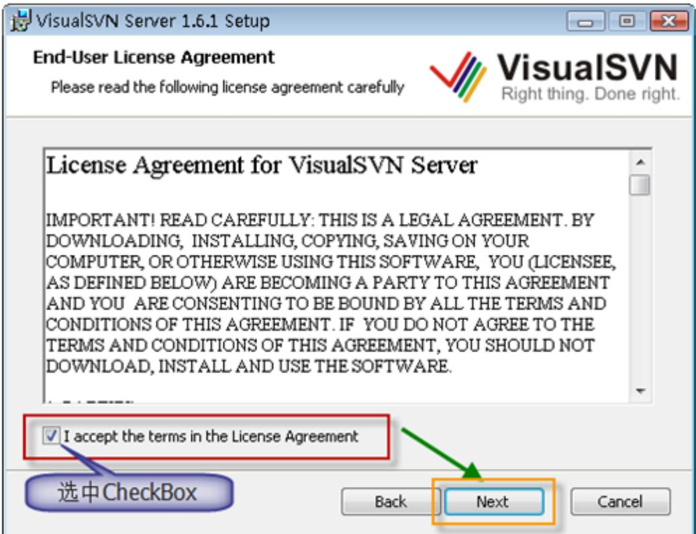

**注意端口配置：**
在设置端口时，如果您本地已安装有自己的网站或应用，建议修改默认端口以避免冲突。例如，测试时可将其改为 `8080`。

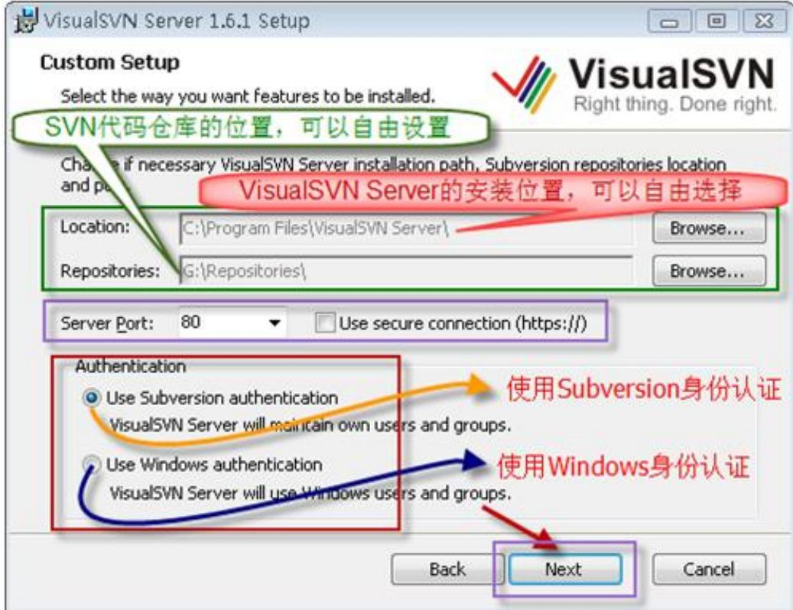

# 三、启动管理界面

点击 **Finish** 之后，系统会自动弹出 VisualSVN Server Manager 对话框。

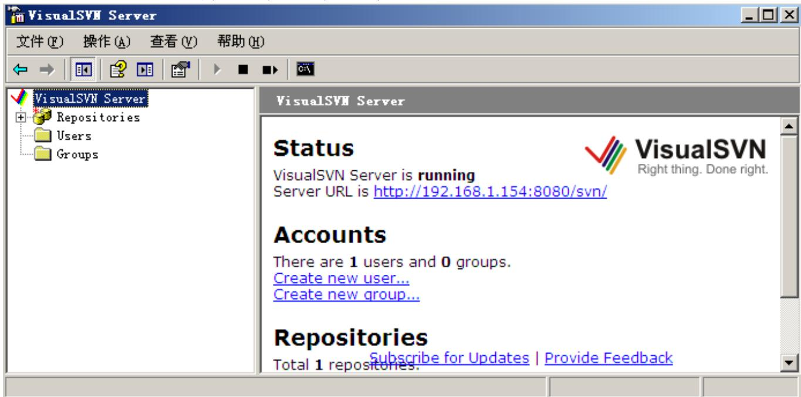

# 四、手动启动管理界面

如果上述对话框未自动弹出，请前往“开始”菜单或程序列表中找到并打开 **VisualSVN Server Manager**。

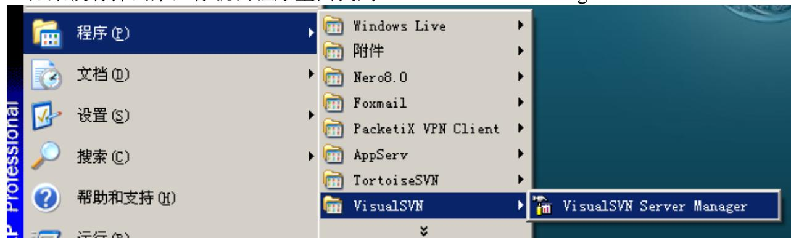

# 五、创建代码库与用户权限

接下来的步骤较为重要，主要包含两项任务：
1. **创建代码库 (Repository)**
2. **添加用户或组 (Users/Groups)**

您可以根据不同的组或用户分配不同的权限（如只读、读写等）。

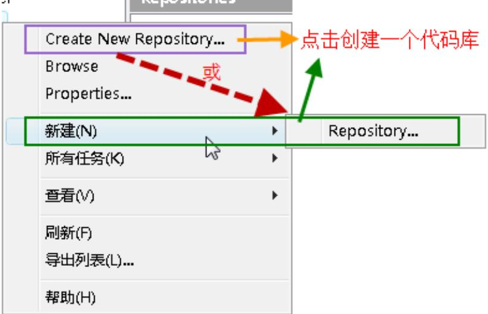

完成代码库建立后，该库目前是空的，这是正常现象。由于没有用户无法直接添加代码，需先创建用户后再进行后续操作。

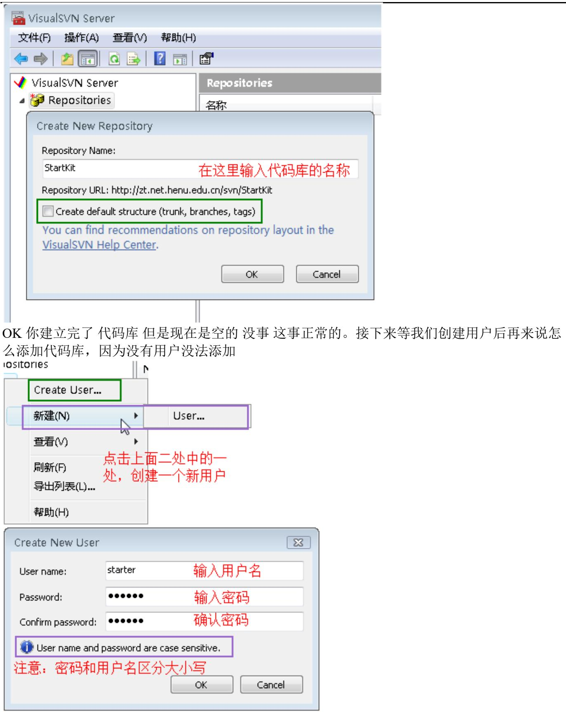

# 六、提交代码库

**提示：** 请务必记住刚才添加的用户名和密码。建议建立一个文档来统一管理这些账户信息，随着时间推移，仅靠记忆难以维护所有账号。

接下来演示如何通过客户端提交代码到代码库。

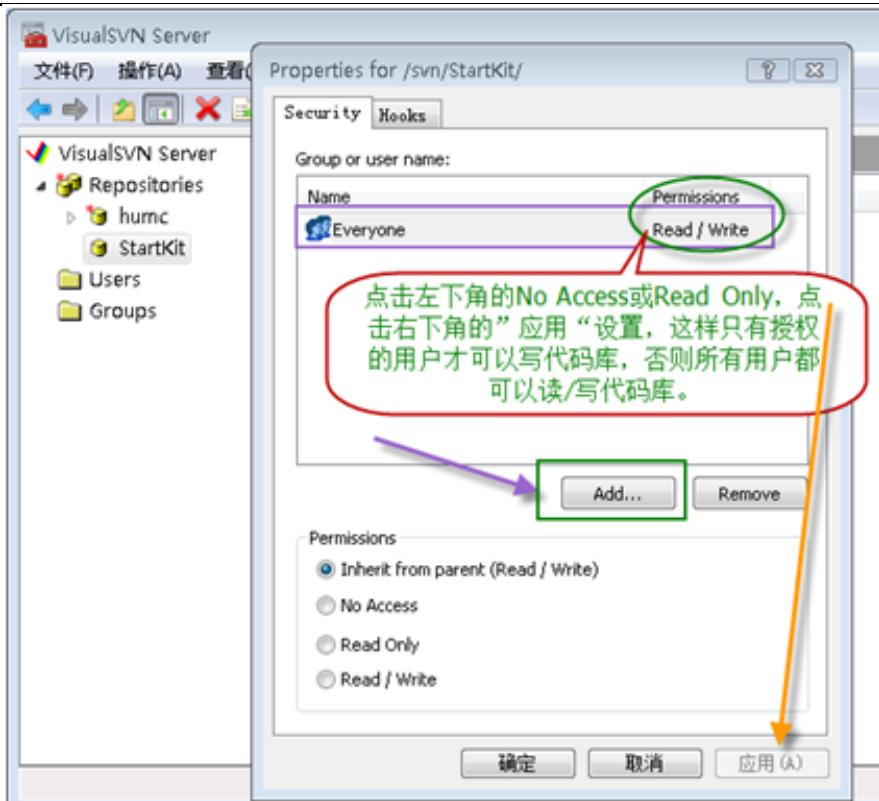

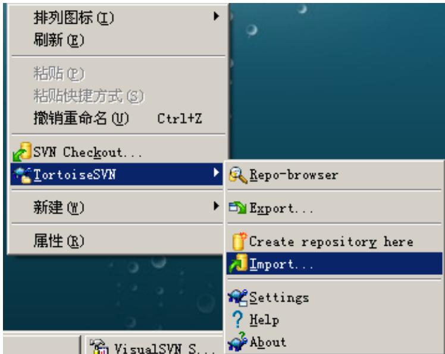

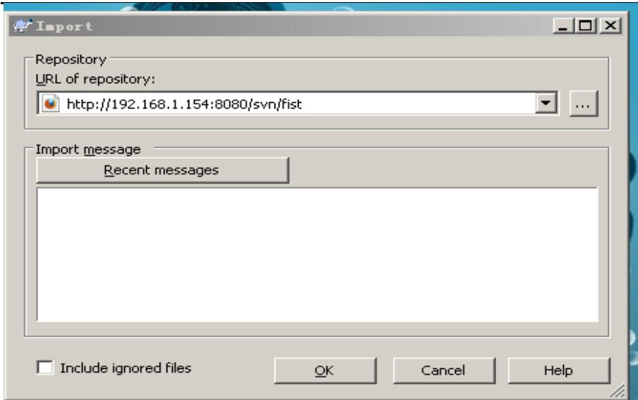

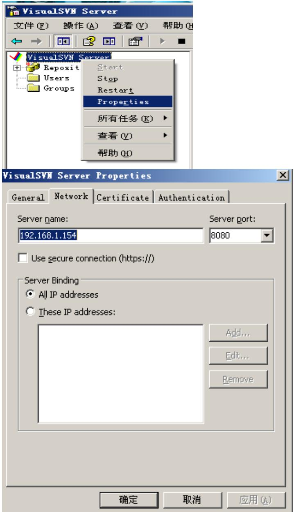

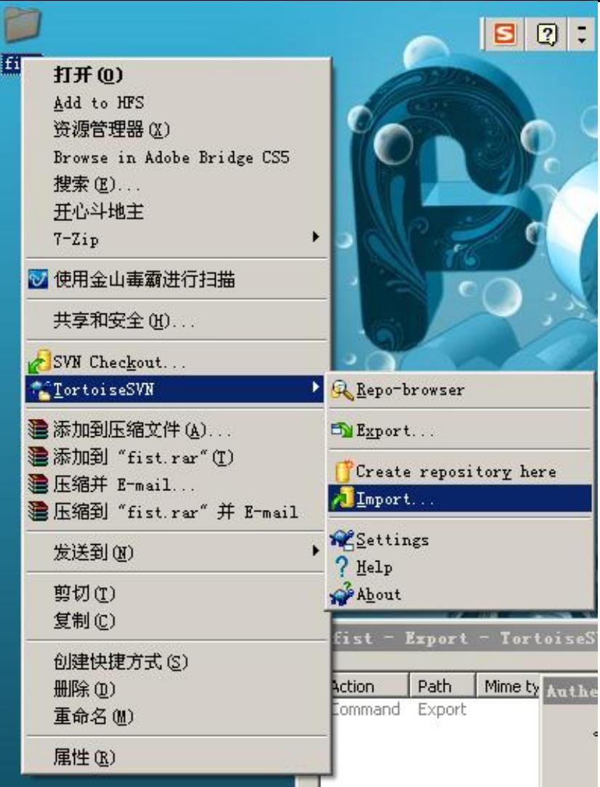

# 七、检出代码

确保输入的仓库地址正确，并填写之前新建的用户名与密码。验证通过后，即可通过客户端将代码从服务器检出（Checkout）到本地工作目录。

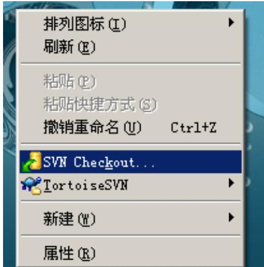

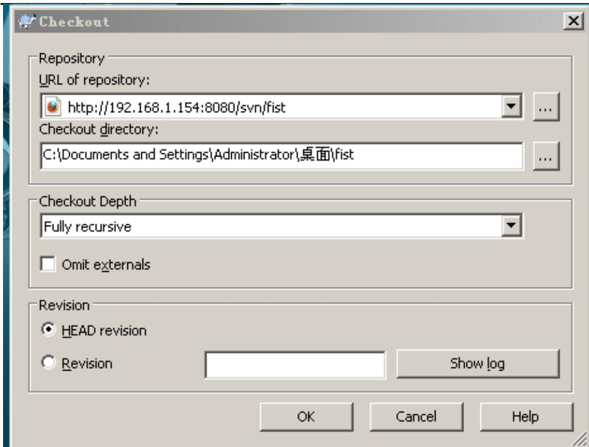
