# 《软件工程（双语）》实验4：SVN搭建和使用手册

原件经识别和整理；“参考解答”是我们补的。

本资料由识别工具读取整理，内容源自侯在存编写的《SVN + APACHE 整合使用手册》，主要介绍 SVN 版本控制工具的原理、基于 Apache 的搭建步骤及客户端使用方法。

## 一、SVN 介绍

### SVN 基本概念

SVN 是一个版本控制工具，Subversion 的版本库（repository），就是位于服务器端，统一管理和储存数据的地方。

要创建一个版本库，首先要确定采用哪种数据存储方式。在 Subversion 中，版本库的数据存储有两种方式：一种是在 Berkeley DB 数据库中存放数据；另一种是使用普通文件采用自定义的格式来储存，称为 FSFS。

表 1 两种版本库数据存储对照表

| 特性 | Berkeley DB | FSFS |
| :--- | :--- | :--- |
| 对操作中断的敏感 | 很敏感;系统崩溃或者权限问题会导致数据库“塞住”,需要定期进行恢复。 | 不敏感 |
| 可只读加载 | 不能 | 可以 |
| 存储平台无关 | 不能 | 可以 |
| 可从网络文件系统访问 | 不能 | 可以 |
| 版本库大小 | 稍大 | 稍小 |
| 扩展性:修订版本树数量 | 无限制 | 某些本地文件系统在处理单一目录包含上千个条目时会出现问题。 |
| 扩展性:文件较多的目录 | 较慢 | 较慢 |
| 检出最新代码的速度 | 较快 | 可以 |
| 大量提交的速度 | 较慢,但时间被分配在整个提交操作中 | 较快,但最后较长的延时可能会导致客户端操作超时 |
| 组访问权处理 | 对于用户的 umask 设置十分敏感,最好只由一个用户访问。 | 对 umask 设置不敏感 |
| 功能成熟时间 | 2001 年 | 2004 年 |

### SVN 工作原理图示

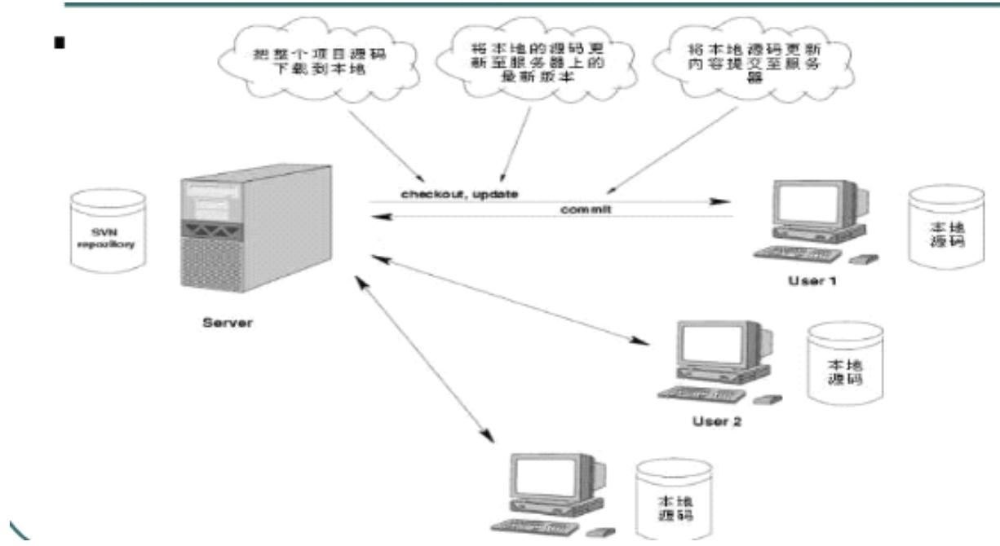

## 二、SVN 的搭建

### 1. 所需软件包

服务端安装包：
- `httpd-2.2.4`
- `apr-1.3.8.tar.gz`
- `apr-util-1.3.9.tar.gz`
- `sqlite-amalgamation-3.6.17.tar.gz`
- `subversion-1.6.5.tar.bz2`
- `expat-1.95.7-4`
- `expat-devel-1.95.7-4`

客户端安装包：
- `TortoiseSVN-1.6.5.16974-win32-svn-1.6.5.msi`

### 2. 安装 SVN

#### 安装 Apache

```bash
# /configure --prefix=/usr/local/apache2 \
--enable-dav \
--enable-so \
--enable-modules=most
//注：编译 apache 时要加上--enable-dav 选项
```

```bash
# make
# make install
```

### 3. Apache 的整合

测试域名绑定成功。

### 4. SVN 使用

#### 创建 SVN 项目仓库

```bash
# mkdir /data/svn  # 创建 svn 根目录
# svnadmin create /data/svn/drug //创建项目仓库 drug
# /usr/local/svn/bin/svn import /www/drug file:///data/svn/drug -m "import"
```

将 `/www/drug` 导入到 svn 库下。

> 注：在导入仓库后，原来的目录树并没有转化成一个工作副本，需要使用 checkout 手动导出一个工作副本。

```bash
# chown –R www:www /data/svn/drug
# svn checkout file:///data/svn/drug /www/drug_new
# chown –R www:www /www/drug_new
# chmod –R 700 /data/svn/
```

#### 编写 SVN 与 Apache 同步脚本

```bash
# vi /data/svn/drug/hooks/post-commit
```

```bash
#!/bin/sh
export LC_CTYPE=zh_CN.GB18030 # 语言支持
SVN=/usr/local/svn/bin/svn     # 指定 svn 路径
WEB=/www/drug                  # 指定 apache 虚拟主机路径
$SVN update $WEB –username www –password xywyxywy
```

赋予脚本执行权限：

```bash
# chmod 700 post-commit
# chown www:www post-commit
```

#### 创建 Apache 认证用户

```bash
# /usr/local/apache2/bin/htpasswd -c /data/svn/authfile sum
输入密码：sum123
# /usr/local/apache/bin/htpasswd /data/svn/authfile wyj //再添加一个用户
```

#### SVN 权限配置文件

```bash
# vi /data/svn/data/authz.conf
```

```ini
[drug:/] # 表示仓库 drug 根目录
sum = rw # 用户 sum 对 drug 库有读写权限
hou = r  # 用户 hou 对 drug 库有读权限 (原文误写为 wyj，根据上下文修正为用户名 hou)
* = r    # 这个表示对所有的用户都具有读权限

[groups] # 这个表示群组设置
developers = sum, hou # developers 组中的用户
@svn1-developers = rw # 对这个组有读写权限
```

### 启动 SVN 服务

```bash
svnserve -d -r /data/svndata
```

#### 设置 SVN 和 Apache 服务开机自动启用

```bash
# vi /etc/rc.local
/usr/local/apache/bin/apachectl start
svnserve –d –r /data/svn
```

## 5. 客户端使用

1. 在客户机上安装 `TortoiseSVN-1.6.5.16974-win32-svn-1.6.5.msi`。
2. 在客户机上从服务器上 checkout 工作副本。
3. 在新的项目里面添加一个文件然后提交。
4. 查看 `/www/drug/` 里面有没有添加的文件，来证实 svn 库能够同步更新到 linux 下面那个虚拟主机的目录。

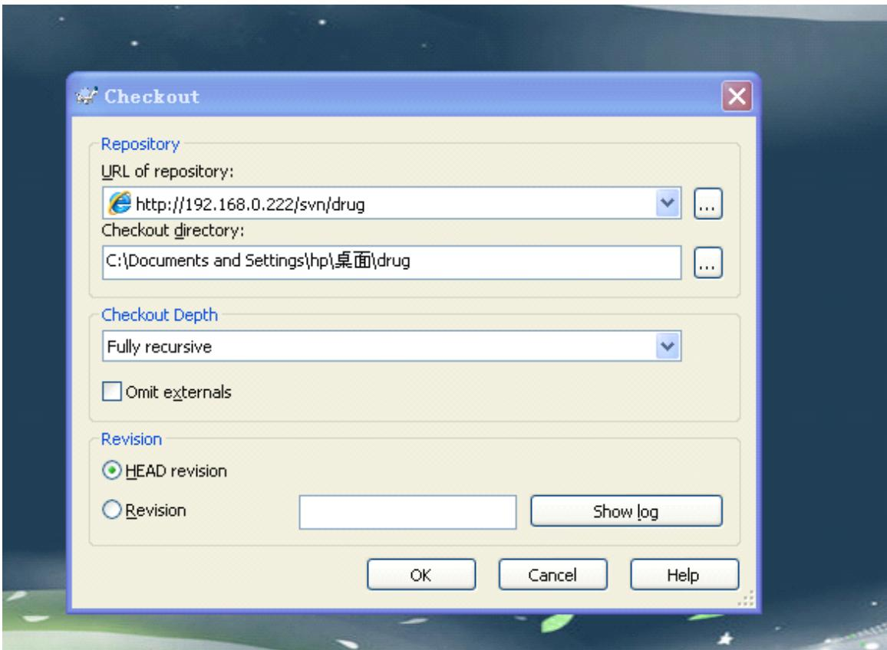

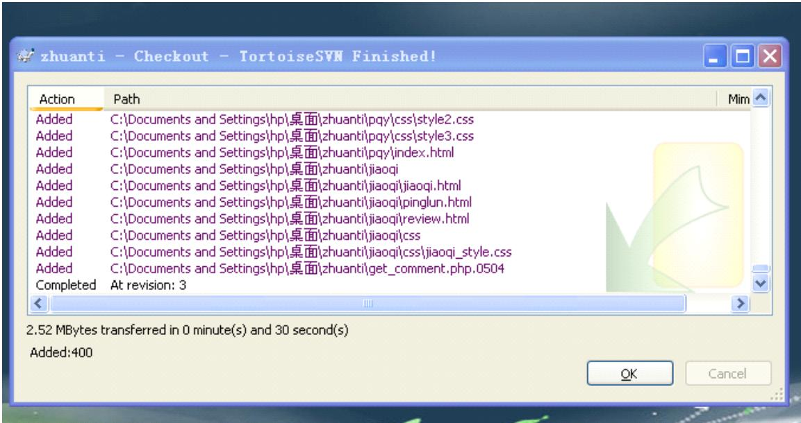

### 三<sub>、</sub> SVN 管理命令

C<sub>razy</sub>li<sub>nux</sub> 工作室

SVN 第 2 版本

发展开源精神 普及 Linux 教育

htt<sub>p :</sub>//bl<sub>og s</sub>i<sub>na com cn</sub>/h<sub>ouza</sub>i<sub>cun</sub>

### 1 <sub>、</sub> svn 命令

导入数据到版本库

\# <sub>svna</sub>d<sub>m</sub>i<sub>n</sub> <sub>crea</sub>t<sub>e</sub> /d<sub>a</sub>t<sub>a</sub>/<sub>svn</sub>d<sub>a</sub>t<sub>a</sub>/<sub>pro</sub> 1

\# <sub>svn</sub> i<sub>mpor</sub>t /<sub>www</sub>/<sub>s</sub>h<sub>op</sub> fil<sub>e :</sub>///d<sub>a</sub>t<sub>a</sub>/<sub>svn</sub>d<sub>a</sub>t<sub>a</sub>/<sub>pro</sub> 1 -<sub>m</sub> <sup>“</sup>i<sub>mpor</sub>t<sup>”</sup>

查看版本库下的 内容

\# <sub>svn</sub> li<sub>s</sub>t fil<sub>e :</sub> ///d<sub>a</sub>t<sub>a</sub>/<sub>svn</sub>d<sub>a</sub>t<sub>a</sub>/<sub>pro</sub> 1

注 在导入仓库后 原来的 目 录树并没有转化成一个工作副本 需要使用 checkout 手动导出一个工作副本

从版本库导出数据

\# <sub>svn c</sub>h<sub>ec</sub>k<sub>ou</sub>t fil<sub>e :</sub>///d<sub>a</sub>t<sub>a</sub>/<sub>svn</sub>d<sub>a</sub>t<sub>a</sub>/<sub>pro</sub> 1

取出任意深度的数据

\# <sub>svn c</sub>h<sub>ec</sub>k<sub>ou</sub>t fil<sub>e :</sub>///d<sub>a</sub>t<sub>a</sub>/<sub>svn</sub>d<sub>a</sub>t<sub>a</sub>/<sub>pro</sub> 1 /<sub>a</sub>d/ht<sub>m</sub>l

将数据放到新 目 录

\# <sub>svn c</sub>h<sub>ec</sub>k<sub>ou</sub>t fil<sub>e :</sub>///d<sub>a</sub>t<sub>a</sub>/<sub>svn</sub>d<sub>a</sub>t<sub>a</sub>/<sub>pro</sub> 1 t<sub>es</sub>t<sub>we</sub>b

//将 <sub>p</sub>r<sub>o</sub>1 工作副本放到 te<sub>s</sub>t<sub>w</sub>eb 中 <sub>，</sub> 而不是默认生成的 <sub>p</sub>r<sub>o</sub>1 目 录

\# <sub>svn co</sub> fil<sub>e :</sub>///d<sub>a</sub>t<sub>a</sub>/<sub>svn</sub>/<sub>my xywy com</sub>/ /<sub>www</sub>/<sub>o</sub>th<sub>er</sub>/<sub>my.xywy.com</sub>

// 导 出 m<sub>y xywy co</sub>m 全部文件 <sub>，</sub> 到/<sub>www</sub>/<sub>o</sub>th<sub>e</sub>r/m<sub>y.xywy.co</sub>m 下

它可以显示工作副本中 的所有项 目

\# <sub>sv</sub>n <sub>s</sub>t<sub>a</sub>t<sub>us</sub> -<sub>u</sub> -<sub>v</sub>

### 2 <sub>、</sub> svnlook 命令

查看当前的版本仓库 内容

\# s<sub>v</sub>nlook info 版本仓库

发展开源精神 普及 Lin 教育

C<sub>razy</sub>li<sub>nux</sub> 工作室

SVN 第 2 版本

htt<sub>p :</sub>//bl<sub>og s</sub>i<sub>na com cn</sub>/h<sub>ouza</sub>i<sub>cun</sub>

查看最近一次更新的修订号

\# s<sub>v</sub>nlook <sub>y</sub>o<sub>u</sub>n<sub>g</sub>est 版本仓库

显示一个版本仓库中文件和 目 录的树形结构图

查看仓库中某一个文件内容

\# svnlook cat /data/svndata/<sub>p</sub>ro2/ index html //查看 <sub>p</sub>ro2 项 目 的 inde<sub>x</sub> html 文件 中 的 内 容

显示被修改的文件

\# <sub>svn</sub>l<sub>oo</sub>k diff /d<sub>a</sub>t<sub>a</sub>/<sub>svn</sub>d<sub>a</sub>t<sub>a</sub>/<sub>pro</sub>2/

//显示增加 了 1 1 txt 文件

### 3<sub>、</sub> 导出 s<sub>v</sub>n 版本库中 的文件夹

若要彻底删除 SVN 版本库某文件夹 可以使用下面的方法

查看项 目 <sub>su</sub>mit<sub>es</sub>t 中 的列表

\# <sub>svn</sub> li<sub>s</sub>t fil<sub>e :</sub> ///d<sub>a</sub>t<sub>a</sub>/<sub>svn</sub>/<sub>sum</sub>it<sub>e s</sub>t

C<sub>razy</sub>li<sub>nux</sub> 工作室

SVN 第 2 版本

发展开源精神 普及 Lin 教育

htt<sub>p :</sub>//bl<sub>og s</sub>i<sub>na com cn</sub>/h<sub>ouza</sub>i<sub>cun</sub>

<table><tr><td>fxywy/</td></tr><tr><td>fxywy/src</td></tr><tr><td>jxywy/</td></tr><tr><td>jxywy/src</td></tr><tr><td>src/</td></tr></table>

要把 fx<sub>ywy</sub>/src 文件夹删除<sub>，</sub> 重新导入到新的项 目 s<sub>u</sub>mitest2 中 <sub>，</sub> 方法如下 <sub>：</sub>

\# <sub>svna</sub>d<sub>m</sub>i<sub>n</sub> d<sub>ump</sub> /d<sub>a</sub>t<sub>a</sub>/<sub>svn</sub>/<sub>sum</sub>it<sub>es</sub>t > <sub>sum</sub>i 1 <sub>.</sub> d<sub>ump</sub>

// 导 出 <sub>su</sub>mit<sub>es</sub>t 整个项 目 到 <sub>su</sub>mi 1 .d<sub>u</sub>m<sub>p</sub>

\# cat sumi 1 <sub>.</sub> dump | /usr/local/svn/bin/svndumpfilter exclude /fxywy/src > sumi2 <sub>.</sub> dump

// 从 <sub>su</sub>mi 1 d<sub>u</sub>m<sub>p</sub> 过滤 出 /f<sub>xywy</sub>/<sub>s</sub>r<sub>c</sub> 目 录 <sub>。</sub> Wind<sub>ows</sub> 中 <sub>ca</sub>t 换成 t<sub>ype</sub>

\# <sub>svna</sub>d<sub>m</sub>i<sub>n crea</sub>t<sub>e</sub> /d<sub>a</sub>t<sub>a</sub>/<sub>svn</sub>/<sub>sum</sub>it<sub>es</sub>t2

// 创建新的项 目 库

\# <sub>svna</sub>d<sub>m</sub>i<sub>n</sub> l<sub>oa</sub>d /d<sub>a</sub>t<sub>a</sub>/<sub>svn</sub>/<sub>sum</sub>it<sub>es</sub>t2 < <sub>sum</sub>i2 <sub>.</sub> d<sub>ump</sub>

//导 出 /f<sub>xywy</sub>/<sub>s</sub>r<sub>c</sub> 到 <sub>su</sub>mit<sub>es</sub>t2 库

### 4<sub>、</sub> 删除 s<sub>v</sub>n 版本库中 的文件夹

s<sub>v</sub>n delete 可以从工作拷贝或版本库删除一个项 目

\# <sub>svn</sub> d<sub>e</sub>l<sub>e</sub>t<sub>e</sub> -<sub>m</sub> <sup>“</sup> D<sub>e</sub>l<sub>e</sub>ti<sub>ng</sub> fil<sub>e</sub> <sup>”</sup> fil<sub>e :</sub>///d<sub>a</sub>t<sub>a</sub>/<sub>svn</sub>/<sub>sum</sub>it<sub>es</sub>t2/f<sub>xywy</sub>/

// 删 除 sumitest2 下 的/fx<sub>y</sub>w<sub>y</sub> 目 录

### 四 <sub>、</sub> SVN 管理命令

1 CentOS5 安装 svn 时 make 时 出 现下面 的错误

/<sub>usr</sub>/bi<sub>n</sub>/ld<sub>: canno</sub>t fi<sub>n</sub>d -l<sub>expa</sub>t

<sub>co</sub>ll<sub>ec</sub>t2 <sub>:</sub> ld <sub>re</sub>t<sub>urne</sub>d 1 <sub>ex</sub>it <sub>s</sub>t<sub>a</sub>t<sub>us</sub>

make : <sup>\* \* \*</sup> [ subversion/svn/svn] Error 1

解决方法

缺少-lex<sub>p</sub>at 库文件 找安装盘中 的

\# <sub>rpm</sub> - i <sub>v</sub>h <sub>expa</sub>t-<sub>x.x.x.x.rpm</sub>

\# <sub>rpm</sub> - i <sub>v</sub>h <sub>expa</sub>t-d<sub>eve</sub>l-<sub>x.x.x.x.rpm</sub>

发展开源精神 普及 Lin 教育

C<sub>razy</sub>li<sub>nux</sub> 工作室

SVN 第 2 版本

htt<sub>p :</sub>//bl<sub>og s</sub>i<sub>na com cn</sub>/h<sub>ouza</sub>i<sub>cun</sub>

# SVN 搭建和使用手册

本资料整理自《软件工程（双语）》实验 4 原始文档，修正了识别错误并规范了格式。

## 一、常见问题与解决

### 问题 1：在 MyEclipse 进行 Java 开发用 SVN 进行版本控制 Update 时提示错误

**错误提示：**
Update 时提示如下错误。

**解决方法：**
打开 Eclipse 中的 Project -> Properties -> Java Build Path 菜单。在右侧面板中的 "Source" 选项卡中，在 Excluded 中加入 `**/svn/**`。也就是把 svn 文件夹从编译路径中排除，这样就不会出现上面的问题了。

### 问题 2：提交时显示权限错误

**错误提示：**
当提交时显示如下错误：
`attempt to write a readonly database`

**原因分析：**
这是因为 `/data/svn/yishengquan/db` 目录中，权限不是 apache 可写的权限。

**解决方法：**
修改 db 目录权限为 apache 可写即可。

```bash
chmod www:www /data/svn/yishengquan/db
```

---

## 二、SVN 介绍

SVN 是一个版本控制工具，Subversion 的版本库（repository），就是位于服务器端，统一管理和储存数据的地方。

要创建一个版本库，首先要确定采用哪种数据存储方式。在 Subversion 中，版本库的数据存储有两种方式：一种是在 Berkeley DB 数据库中存放数据；另一种是使用普通文件采用自定义的格式来储存，称为 FSFS。

### 两种版本库数据存储对照表

| 特性 | Berkeley DB | FSFS |
| :--- | :--- | :--- |
| 对操作中断的敏感 | 很敏感;系统崩溃或者权限问题会导致数据库“塞住”,需要定期进行恢复。 | 不敏感 |
| 可只读加载 | 不能 | 可以 |
| 存储平台无关 | 不能 | 可以 |
| 可从网络文件系统访问 | 不能 | 可以 |
| 版本库大小 | 稍大 | 稍小 |
| 扩展性:修订版本树数量 | 无限制 | 某些本地文件系统在处理单一目录包含上千个条目时会出现问题。 |
| 扩展性:文件较多的目录 | 较慢 | 较慢 |
| 检出最新代码的速度 | 较快 | 可以 |
| 大量提交的速度 | 较慢,但时间被分配在整个提交操作中 | 较快,但最后较长的延时可能会导致客户端操作超时 |
| 组访问权处理 | 对于用户的 umask 设置十分敏感,最好只由一个用户访问。 | 对 umask 设置不敏感 |
| 功能成熟时间 | 2001 年 | 2004 年 |

### SVN 工作原理图示

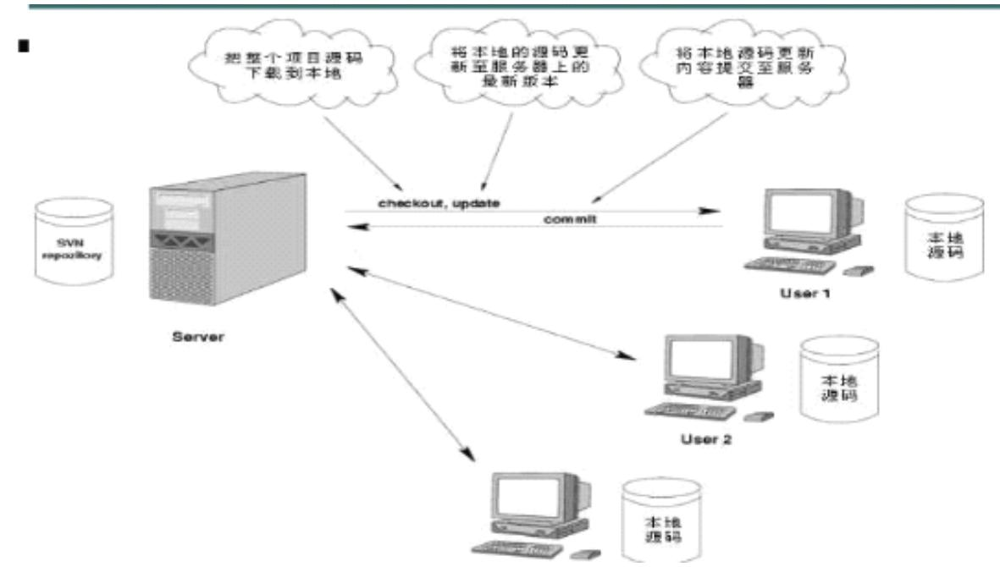

---

## 三、SVN 的搭建

### 1. 所需软件包

- `httpd-2.2.4-apr-1.3.8.tar.gz`
- `apr-util-1.3.9.tar.gz`
- `sqlite-amalgamation-3617.tar.gz`
- `subversion-1.6.5.tar.bz2`
- `expat-1.95.7-4`
- `expat-devel-1.95.7-4`
- **客户端：** `TortoiseSVN-1.6.5.16974-win32-svn-1.6.5.msi`

### 2. 安装 SVN

配置编译参数：

```bash
--with-apr-util=/usr/local/apr-util
--with-sqlite=/usr/local/sqlite/
--with-ssl
--with-zlib  # 打开 zlib 库支持
--enable-maintainer-mode # 打开调试和编译时警告，仅供开发人员使用
```

执行编译和安装：

```bash
make
make install
```

### 3. Apache 的整合

修改 Apache 配置文件 `vi /usr/local/apache/conf/httpd.conf`：

1.  **修改用户：**
    ```apache
    User www
    Group www
    ```
    修改 Apache 默认启用用户为 www。

2.  **修改主页路径：**
    找到 `DocumentRoot "/usr/local/apache/htdocs"` 和 `<Directory "/usr/local/apache/htdocs">`，将 Apache 的主页改为 `/www` 下：
    ```apache
    DocumentRoot "/www"
    <Directory "/www">
    ```

3.  **配置 Apache 中 SVN 认证：**
    ```apache
    <Location /svn>
        # 设置 url 代表要访问的仓库的父目录
        DAV svn
        SVNParentPath /data/svn      # svn 根目录
        AuthType Basic
        AuthName "SVN Test"
        AuthzSVNAccessFile /data/svn/authz.conf   # svn 认证文件
        AuthUserFile /data/svn/authfile           # apache 认证文件
        Require valid-user
    </Location>
    ```
    *创建 `authz.conf` 文件*

4.  **启动 Apache：**
    ```bash
    /usr/local/apache/bin/apachectl start
    ```

5.  **绑定域名：**
    编辑 `/usr/local/apache/conf/extra/httpd-vhosts.conf`：
    ```apache
    NameVirtualHost *:80
    <VirtualHost *:80>
        DocumentRoot /www/drug
        ServerName drug.xywy.com
        DirectoryIndex index.jsp index.html index.htm
        ErrorDocument 404 /404.php
        ErrorDocument 403 /403.php
        XbitHack full
    </VirtualHost>
    ```

### 4. SVN 使用

#### 创建 SVN 项目仓库

```bash
# mkdir /data/svn             # 创建 svn 根目录
# svnadmin create /data/svn/drug // 创建项目仓库 drug
# /usr/local/svn/bin/svn import /www/drug file:///data/svn/drug -m "import t"
```
*注：将/www/drug 导入到 svn 库下。在导入仓库后，原来的目录树并没有转化成一个工作副本，需要使用 checkout 手动导出一个工作副本。*

```bash
chown –R www:www /data/svn/drug
```

#### SVN 权限配置文件

编辑 `/data/svn/data/authz.conf`：

```ini
[drug:/]
sum = rw       # 用户 sum 对 drug 库有读写权限
hou = r        # 用户 wyj 对 drug 库有读权限 (原文误写为读写，此处按原文 r 保留，通常 r=read, w=write)
* = r          # 这个表示对所有的用户都具有读权限

[groups]       # 这个表示群组设置
developers = sum hou  # developers 组中的用户

[pro1:/]
@svn1-developers = rw  # 对这个组有读写权限
```

#### 启动 SVN 服务

*(具体启动命令需根据实际部署环境配置，通常通过 Apache 模块自动管理)*

s vn s erver -d -r /dat a/ s vndat a设置 svn 和 a ache 服务开机 自 动启用#<sub>v</sub>i /<sub>e</sub>t<sub>c</sub>/<sub>rc</sub> l<sub>oca</sub>l/<sub>usr</sub>/l<sub>oca</sub>l/<sub>apac</sub>h<sub>e</sub>/bi<sub>n</sub>/<sub>apac</sub>h<sub>ec</sub>tl <sub>s</sub>t<sub>ar</sub>t<sub>svnserve</sub> –d –<sub>r</sub> /d<sub>a</sub>t<sub>a</sub>/<sub>svn</sub>

### 6<sub>.</sub>客户端使用

在 客户 机上 安装 TortoiseSVN- 1 <sub>.</sub> 6 <sub>.</sub> 5 <sub>.</sub> 1 6974-win3 2-svn- 1 <sub>.</sub> 6 <sub>.</sub> 5 <sub>.</sub>msi在客户机上从服务器上 checkout 工作副本

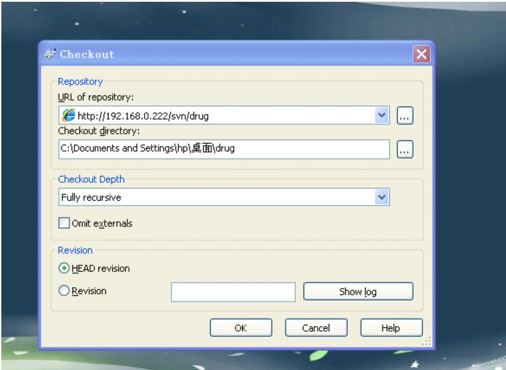

C<sub>razy</sub>li<sub>nux</sub> 工作室

SVN 第 2 版本

发展开源精神 普及 Linux 教育

htt<sub>p :</sub>//bl<sub>og s</sub>i<sub>na com cn</sub>/h<sub>ouza</sub>i<sub>cun</sub>


在新的项 目 里面添加一个文件然后提交 查看/www/dru<sub>g</sub>/ 里面有没有添加的文件 来证实 svn 库能够同步更新到 linux 下面那个虚拟主机的没

### 三<sub>、</sub> SVN 管理命令

### 1 <sub>、</sub> svn 命令

导入数据到版本库

\# <sub>svna</sub>d<sub>m</sub>i<sub>n crea</sub>t<sub>e</sub> /d<sub>a</sub>t<sub>a</sub>/<sub>svn</sub>d<sub>a</sub>t<sub>a</sub>/<sub>pro</sub> 1

\# <sub>svn</sub> i<sub>mpor</sub>t /<sub>www</sub>/<sub>s</sub>h<sub>op</sub> fil<sub>e :</sub>///d<sub>a</sub>t<sub>a</sub>/<sub>svn</sub>d<sub>a</sub>t<sub>a</sub>/<sub>pro</sub> 1 -<sub>m</sub> <sup>“</sup>i<sub>mpor</sub>t<sup>”</sup>

查看版本库下的 内容

\# <sub>svn</sub> li<sub>s</sub>t fil<sub>e :</sub> ///d<sub>a</sub>t<sub>a</sub>/<sub>svn</sub>d<sub>a</sub>t<sub>a</sub>/<sub>pro</sub> 1

注 在导入仓库后 原来的 目 录树并没有转化成一个工作副本 需要使用 checkout 手动导出一个工作副本

从版本库导出数据

\# <sub>svn c</sub>h<sub>ec</sub>k<sub>ou</sub>t fil<sub>e :</sub>///d<sub>a</sub>t<sub>a</sub>/<sub>svn</sub>d<sub>a</sub>t<sub>a</sub>/<sub>pro</sub> 1

取出任意深度的数据

\# <sub>svn c</sub>h<sub>ec</sub>k<sub>ou</sub>t fil<sub>e :</sub>///d<sub>a</sub>t<sub>a</sub>/<sub>svn</sub>d<sub>a</sub>t<sub>a</sub>/<sub>pro</sub> 1 /<sub>a</sub>d/ht<sub>m</sub>l

将数据放到新 目 录

\# <sub>svn c</sub>h<sub>ec</sub>k<sub>ou</sub>t fil<sub>e :</sub>///d<sub>a</sub>t<sub>a</sub>/<sub>svn</sub>d<sub>a</sub>t<sub>a</sub>/<sub>pro</sub> 1 t<sub>es</sub>t<sub>we</sub>b

//将 ro1 工作副本放到 testweb 中 而不是默认生成的 ro1 目 录

发展开源精神 普及 Linux 教育

C<sub>razy</sub>li<sub>nux</sub> 工作室

SVN 第 2 版本

htt<sub>p :</sub>//bl<sub>og s</sub>i<sub>na com cn</sub>/h<sub>ouza</sub>i<sub>cun</sub>

\# <sub>svn co</sub> fil<sub>e :</sub>///d<sub>a</sub>t<sub>a</sub>/<sub>svn</sub>/<sub>my xywy com</sub>/ /<sub>www</sub>/<sub>o</sub>th<sub>er</sub>/<sub>my.xywy.com</sub>

// 导 出 m<sub>y</sub>\_<sub>xywy</sub>\_<sub>co</sub>m 全部文件 <sub>，</sub> 到/<sub>www</sub>/<sub>o</sub>th<sub>e</sub>r/m<sub>y.xywy.co</sub>m 下

它可以显示工作副本中 的所有项 目

\# <sub>sv</sub>n <sub>s</sub>t<sub>a</sub>t<sub>us</sub> -<sub>u</sub> -<sub>v</sub>

<table><tr><td>18</td><td>16 sum</td><td>fff.txt</td></tr><tr><td>18</td><td>1 root</td><td>index2.php</td></tr><tr><td>18</td><td>10 sum</td><td>index20090416.html</td></tr><tr><td>18</td><td>17 sum</td><td>111/fff.txt</td></tr><tr><td>18</td><td>17 sum</td><td>111/index2.php</td></tr><tr><td>18</td><td>17 sum</td><td>111/index20090416.html</td></tr><tr><td>18</td><td>17 sum</td><td>111/index.jsp</td></tr></table>

### 2 <sub>、</sub> svnlook 命令

查看当前的版本仓库 内容

\# s<sub>v</sub>nlook info 版本仓库

查看最近一次更新的修订号

\# s<sub>v</sub>nlook <sub>y</sub>o<sub>u</sub>n<sub>g</sub>est 版本仓库

显示一个版本仓库中文件和 目 录的树形结构图

\# <sub>svn</sub>l<sub>oo</sub>k t<sub>ree</sub> /d<sub>a</sub>t<sub>a</sub>/<sub>svn</sub>d<sub>a</sub>t<sub>a</sub>/ <sub>ro</sub>2/ --<sub>s</sub>h<sub>ow</sub>-id<sub>s</sub>

C<sub>razy</sub>li<sub>nux</sub> 工作室

SVN 第 2 版本

发展开源精神 普及 Lin 教育

htt<sub>p :</sub>//bl<sub>og s</sub>i<sub>na com cn</sub>/h<sub>ouza</sub>i<sub>cun</sub>

查看仓库中某一个文件内容

\# svnlook cat /data/svndata/<sub>p</sub>ro2/ index html //查看 <sub>p</sub>ro2 项 目 的 inde<sub>x</sub> html 文件 中 的 内 容

显示被修改的文件

\# <sub>svn</sub>l<sub>oo</sub>k diff /d<sub>a</sub>t<sub>a</sub>/<sub>svn</sub>d<sub>a</sub>t<sub>a</sub>/<sub>pro</sub>2/

### 3 导出 s<sub>v</sub>n 版本库中 的文件夹

若要彻底删除 SVN 版本库某文件夹 可以使用下面的方法

### 查看项 目 <sub>su</sub>mit<sub>es</sub>t 中 的列表

\# <sub>svn</sub> li<sub>s</sub>t fil<sub>e :</sub> ///d<sub>a</sub>t<sub>a</sub>/<sub>svn</sub>/<sub>sum</sub>it<sub>e s</sub>t

要把 fx<sub>ywy</sub>/src 文件夹删除<sub>，</sub> 重新导入到新的项 目 s<sub>u</sub>mitest2 中 <sub>，</sub> 方法如下 <sub>：</sub>

\# <sub>svna</sub>d<sub>m</sub>i<sub>n</sub> d<sub>ump</sub> /d<sub>a</sub>t<sub>a</sub>/<sub>svn</sub>/<sub>sum</sub>it<sub>es</sub>t > <sub>sum</sub>i 1 <sub>.</sub>d<sub>ump</sub>

// 导 出 sumitest 整个项 目 到 sumi 1 dum<sub>p</sub>

\# cat sumi 1 dump | /usr/local/svn/bin/svndumpfilter exclude /fxywy/src > sumi2 dump

// 从 sumi 1 dum 过滤 出 /fx w /src 目 录 Windows 中 cat 换成 t e

\# <sub>svna</sub>d<sub>m</sub>i<sub>n crea</sub>t<sub>e</sub> /d<sub>a</sub>t<sub>a</sub>/<sub>svn</sub>/<sub>sum</sub>it<sub>es</sub>t2

// 创建新的项 目 库

\# <sub>svna</sub>d<sub>m</sub>i<sub>n</sub> l<sub>oa</sub>d /d<sub>a</sub>t<sub>a</sub>/<sub>svn</sub>/<sub>sum</sub>it<sub>es</sub>t2 < <sub>sum</sub>i2 d<sub>ump</sub>

//导 出 /fx<sub>y</sub>w<sub>y</sub>/src 到 sumitest2 库

### 4<sub>、</sub> 删除 svn 版本库中 的文件夹

s<sub>v</sub>n delete 可以从工作拷贝或版本库删除一个项 目

\# <sub>svn</sub> d<sub>e</sub>l<sub>e</sub>t<sub>e</sub> -<sub>m</sub> <sup>“</sup> D<sub>e</sub>l<sub>e</sub>ti<sub>ng</sub> fil<sub>e</sub> <sup>”</sup> fil<sub>e :</sub>///d<sub>a</sub>t<sub>a</sub>/<sub>svn</sub>/<sub>sum</sub>it<sub>es</sub>t2/f<sub>xywy</sub>/

C<sub>razy</sub>li<sub>nux</sub> 工作室

SVN 第 2 版本

发展开源精神 普及 Lin 教育

htt<sub>p :</sub>//bl<sub>og s</sub>i<sub>na com cn</sub>/h<sub>ouza</sub>i<sub>cun</sub>

// 删 除 s<sub>u</sub>mitest2 下 的/f<sub>xywy</sub> 目 录

### 四 <sub>、</sub> SVN 管理命令

### 1 <sub>、</sub> C<sub>e</sub>ntOS5 安装 <sub>sv</sub>n 时 <sub>，</sub> mak<sub>e</sub> 时 出 现下面 的错误

3 在 M E<sub>c</sub>li <sub>s</sub>e 进行 Ja<sub>v</sub>a 开发 用 SVN 进行版本控制 U<sub>p</sub>date 时提示如下错误

解决方法<sub>：</sub>

打开 E<sub>c</sub>li <sub>s</sub>e 中 的 Pr<sub>o</sub>j e<sub>c</sub>t->Pr<sub>o</sub> ertie<sub>s</sub>->Ja<sub>v</sub>a B<sub>u</sub>ild Path 菜单 在 右侧 面板 中的 <sup>“</sup> S<sub>ou</sub>r<sub>ce</sub> <sup>”</sup> 选项卡 在 E<sub>xc</sub>l<sub>u</sub>d<sub>e</sub>d 中 加入 <sup>“</sup> \* \*/ <sub>sv</sub>n/\* \* <sup>”</sup> 也就是把 <sub>sv</sub>n 文件夹从编译路径中排除 这样就不会出现上面的 问题了

4 当提交时显示如下错误<sub>：</sub>

<sub>a</sub>tt<sub>emp</sub>t t<sub>o wr</sub>it<sub>e a rea</sub>d<sub>on</sub>l<sub>y</sub> d<sub>a</sub>t<sub>a</sub>b<sub>ase</sub>

则 是 因 为/data/<sub>sv</sub>n/<sub>y</sub>i<sub>s</sub>h<sub>e</sub>n<sub>gqu</sub>an/db 目 录 中 <sub>，</sub> 权 限不是 a<sub>p</sub>a<sub>c</sub>h<sub>e</sub> 可写 的权 限 <sub>。</sub>修改 db 目 录权限为 a<sub>p</sub>ache 可写即可

### SVN 客户 端使用手册 （Windo<sub>w</sub>s 平台 ）

C<sub>razy</sub>li<sub>nux</sub> 工作室

SVN 第 2 版本

发展开源精神 普及 Linux 教育

htt<sub>p :</sub>//bl<sub>og s</sub>i<sub>na com cn</sub>/h<sub>ouza</sub>i<sub>cun</sub>

### 安装 TortoiseSVN

点安装程序，按正常步骤下去，安装 TortoiseSVN。完后需要重启计算机，然后在操作系统的目录浏览器上点右键，弹出菜单会多出一些 SVN 内容。如图：

SVN 功能菜单主要有如下：

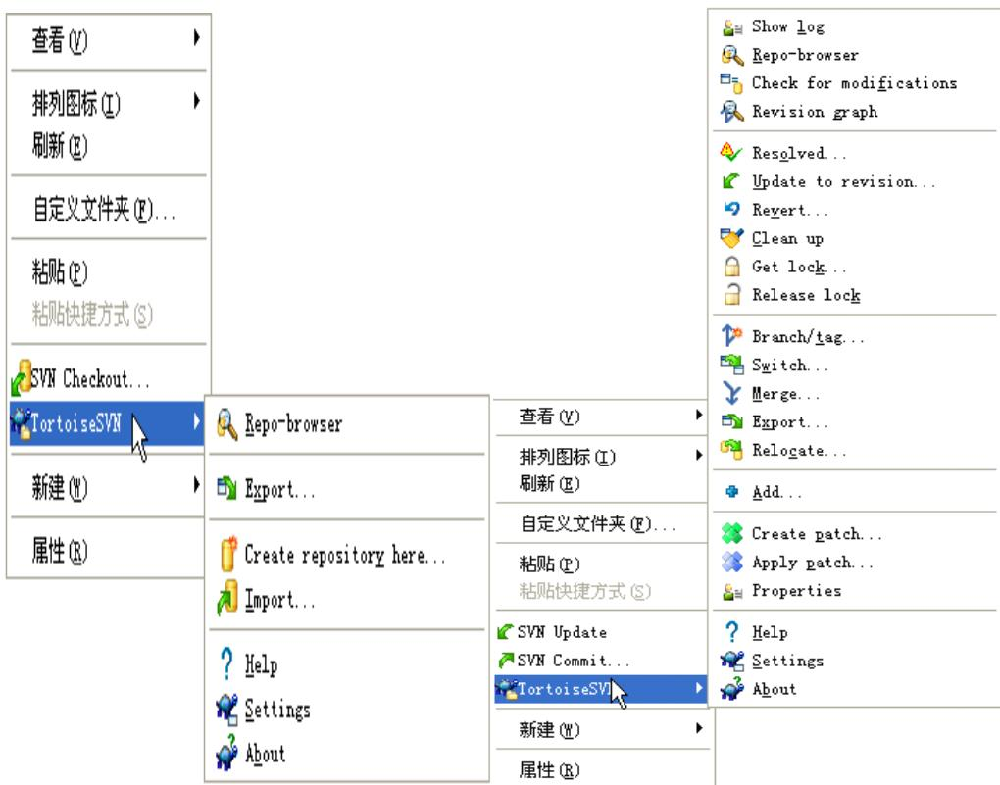

| 菜单项 | 快捷键 |
| :--- | :--- |
| 查看(V) | |
| 排列图标(I) | |
| 刷新(E) | |
| 自定义文件夹(F)... | |
| 粘贴(P) | |
| 粘贴快捷方式(S) | |
| 撤销重命名(U) | Ctrl+Z |
| SVN Checkout... | |
| TortoiseSVN | |
| 新建(N) | |
| 属性(R) | |

安装后可设置一些参数以方便使用，主要如下：
1. 设置提示窗口的参数，在什么情况下可自动关闭。

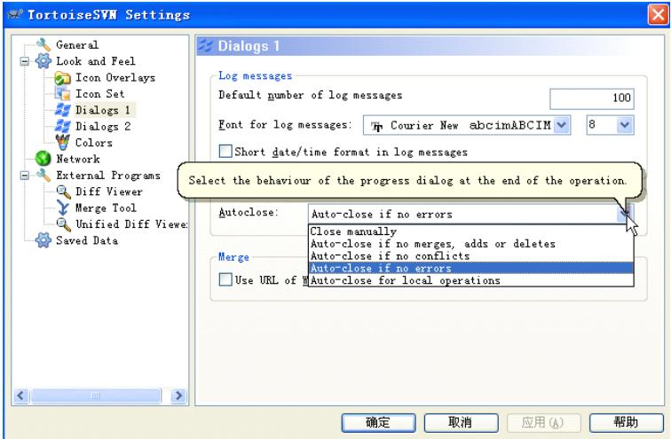

### PB 使用 SVN 说明

#### 安装方法

1. 先安装 svn，再安装 TortoiseSVN，最后安装 PBscc，顺序不可反。
2. 在装 PBscc 时需要选择原来的“SVN 安装目录”。
3. PBscc 的错误日志存放在“TortoiseSVN 目录”下的 `PBErr.txt`。

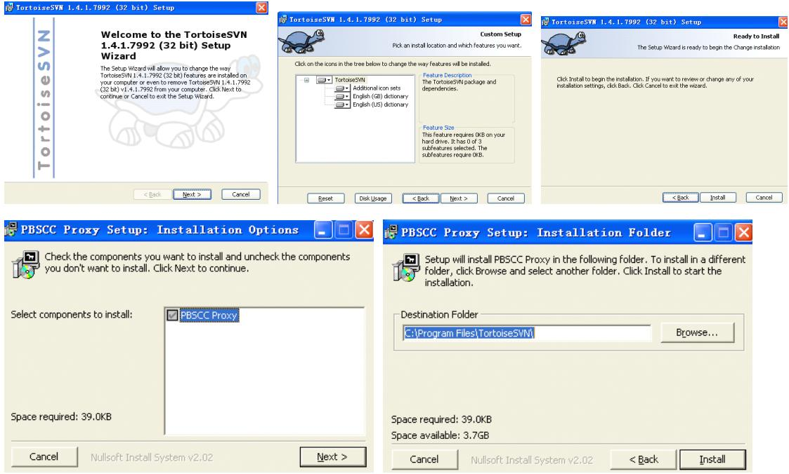

#### PB 使用 SVN 总步骤

1. 先要在“工作根目录”（例如：`d:\his2003`）建立一个“源代码管理目录”（例如：`source`）。
2. 然后从 SVN 服务器上取出代码，SVN 中叫 Check Out。（注：跟原来 VSS 的称呼有所不同，此处签出表示获取之意）
3. 获取后，再到 PB 中设置 PB 环境。

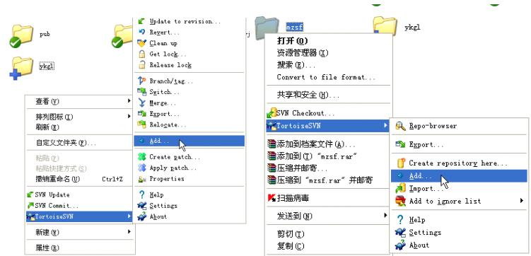

4. 把 PB 程序库加入到“SVN 管理目录”（即此例的 `source` 目录），如原来已加入过就不用此步骤，直接“刷新” PBL 库或其中的对象即可。
5. 使用 PB 的“签出”、“签入”、“取消签出”、“刷新状态”、“查看历史”功能。

#### 获取 SVN 代码库

1. 在“工作根目录”建立“源代码管理目录”后，获取 SVN 的“项目库”，称“repository”。

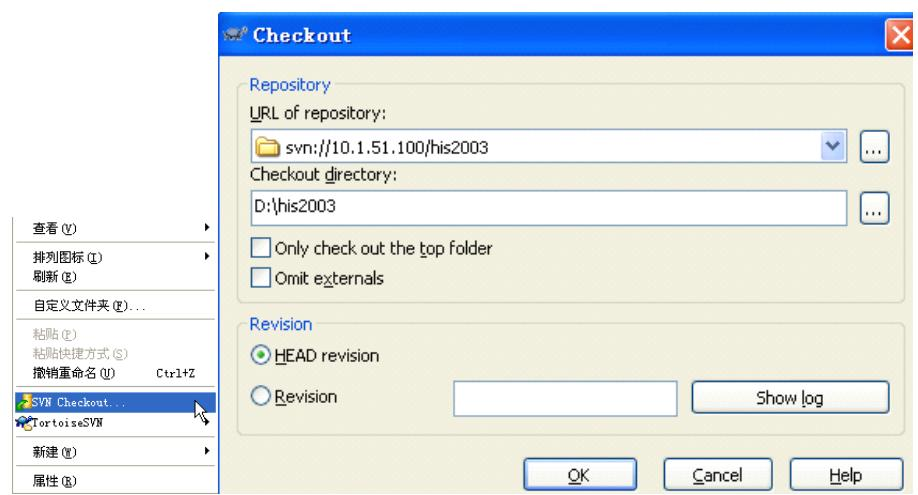

2. 取好后，目录图标会改变。
3. 在 `source` 目录下，建立多个目录，一个 PBL 库对应一个目录，文件名同于 PBL 库名。


4. 把建立的多个子目录加入到（add）到 SVN，图标变成一个“加号+”。
5. 加入到 SVN 后，最后还需要提交到 SVN（commit）。

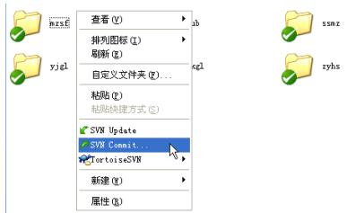

#### PB 环境设置

1. 与原来 VSS 的设置大致相同。
2. 设置“Workspace”的属性的 Source Control。

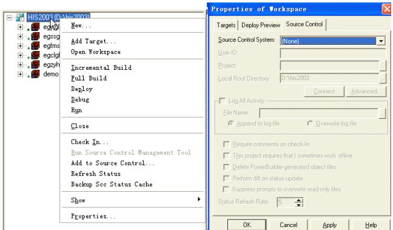

3. 设置“源代码管理工具”，指定用户 (User Id)，源代码管理目录(Proj ect)，本地目录(Local Root Directory)，设置后才能导入代码到 SVN。
   （注：用户名 UserId 一定要使用 SVN 帐号而千万不要用默认的本地系统用户）
   （注：选择 Project 目录时需先用 SVN 获取到本地）

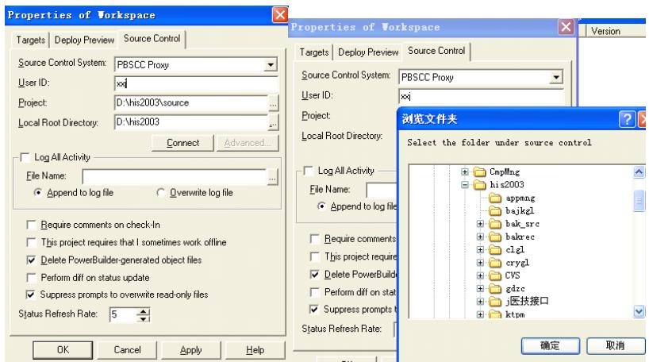

选好“源代码目录”后的图：

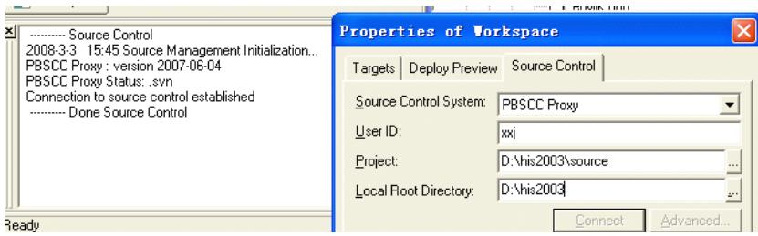

如果选中未属于“源码管辖的目录”，选择中时会提示出错：

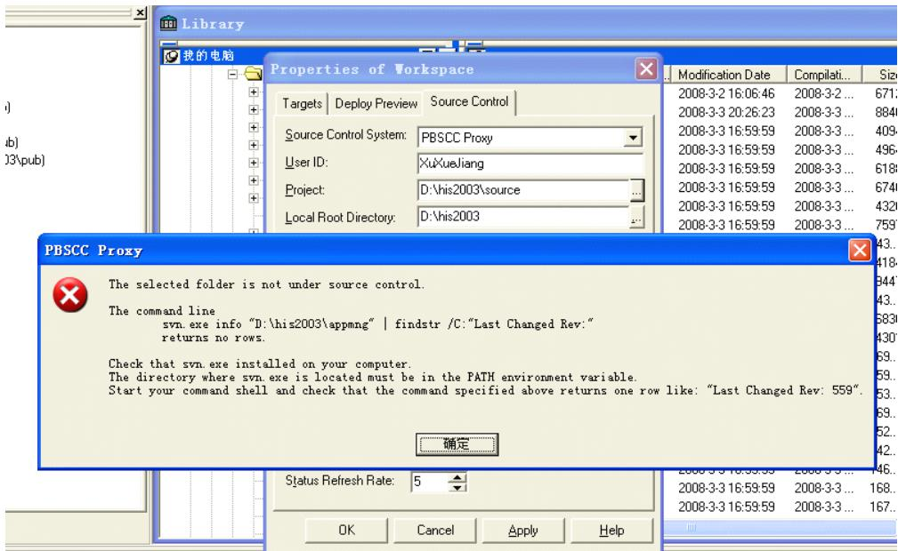

4. 点击《Connect》登录 SVN 系统，有可能会出现提示输入用户密码（注：可以记住用户名和密码，免去每次输入）。
5. 一定要选上“删除 PB 自动生成的临时对象文件”和“允许覆盖只读文件”，如下：

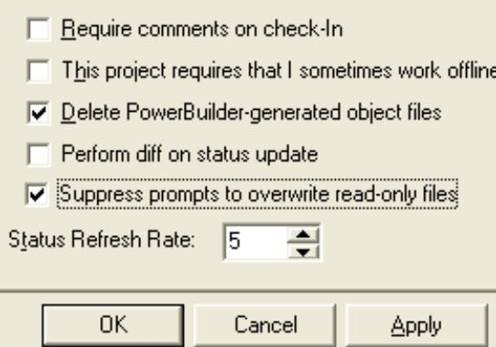

#### PB 程序加入到 SVN

1. 可对整个 workspace 或一个应用或一个 PBL 或一个对象，建议先把单个的应用(*.pbt)文件加入，然后再按 PBL 库一个一个的加入。

### 2 如要加入时出现错误或死机需要特殊处理

对于 PB 的应用项目文件（\*.bt）或整个 PBL 的对象加入时可能会死机。出现此情况，要强行中断 PB，再调出“任务管理器”，中断 findstr.exe 和 svn.exe 两个进程，然后在操作系统的目录中，点中“代码根目录”（如 source），点《SVN \ Clean Up》，再《SVN 的 Commit》，用手工提交，而不用 PBsccProxy。当再打开 PB 时，查看 Workspace 中的应用项目，其状态会变成“源码托管”（即一个绿点）。

| 映像名称 | 用户名 | CPU | 内存使用 |
|---|---|---|---|
| findstr.exe | XuYueJiang | 00 | 2,548 K |
| svchost.exe | SYSTEM | 00 | 4,164 K |
| Qzone.exe | XuYueJiang | 00 | 4,164 K |
| NOTEFAD.EXE | XuYueJiang | 00 | 4,636 K |
| TIMPlatform.exe | XuYueJiang | 00 | 4,012 K |
| cmd.exe | XuYueJiang | 00 | 1,136 K |
| alg.exe | LOCAL SERVICE | 00 | 4,224 K |
| Tdw.exe | XuYueJiang | 04 | 4,388 K |
| taskmgr.exe | XuYueJiang | 02 | 3,124 K |
| mitsc.exe | XuYueJiang | 00 | 1,296 K |
| svn.exe | XuYueJiang | 00 | 4,856 K |
| cmd.exe | XuYueJiang | 00 | 2,924 K |
| inetinfo.exe | SYSTEM | 00 | 6,028 K |
| wdmgr.exe | LOCAL SERVICE | 00 | 2,272 K |
| stacsv.exe | SYSTEM | 00 | 4,792 K |
| TSVMcache.exe | XuYueJiang | 00 | 7,104 K |
| explorer.exe | XuYueJiang | 00 | 22,468 K |
| scardsvr.exe | LOCAL SERVICE | 00 | 3,144 K |

进程数：53 CPU 使用：9% 提交更改：787M / 3938M

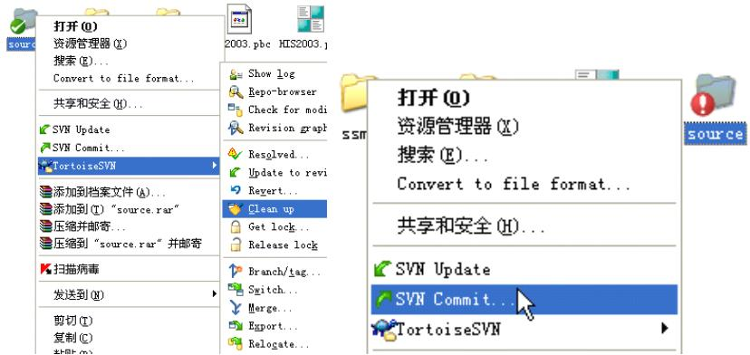

### 3 导入 PBL 库中的程序对象

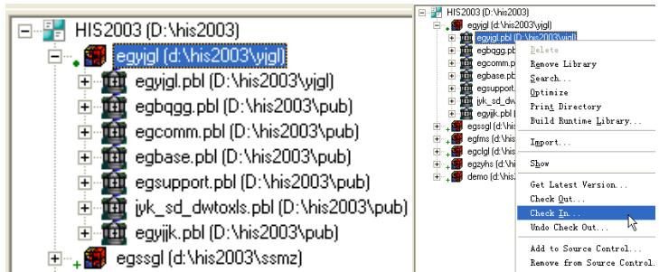

4．由于在 Workspace 中加入可能会出错，所以最好是在 PB 的 Library 中进行操作，选中所有对象，批量操作。为保险起见，按单个 PBL，只选中一小部分，分批操作。注意：在进行大量的对象“add to source control”时 PB 会出错！

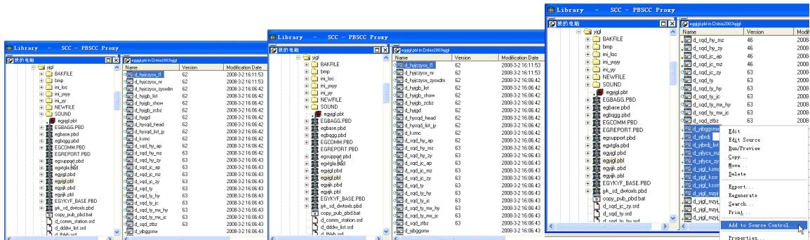

5．在此操作时，会反复出现“PBSCC Proxy”对话框，此问题还未解决！可从下拉框中随便选中上次输入的内容，但在以后的正式工作中，在“签入”时需要完全填写此“修改日志”信息。

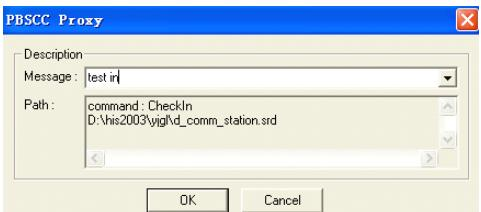

6．导入后，会在 \his2003\source\ 生成很多 PB 程序文件，一个文件对应 PB 中的一个程序对象。每个文件的图标都是“源代码托管”状态（绿色的勾）。

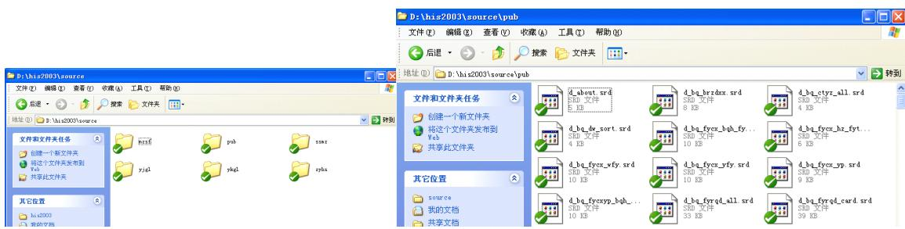

### PB 中 SVN 工作：

1．操作与原来的 VSS 相近，PB 通过 PBscc 代理调用 SVN 的功能，自动进行相应处理。

### 2．签出操作

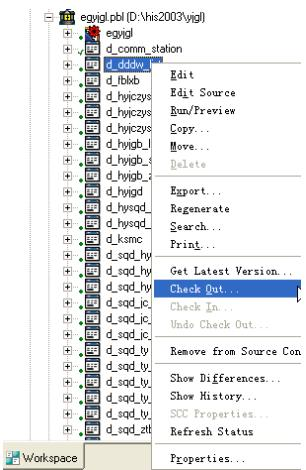

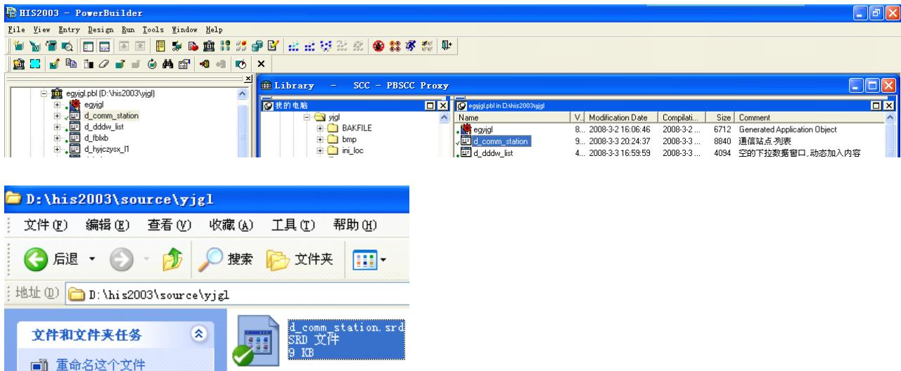

### 3．签入操作

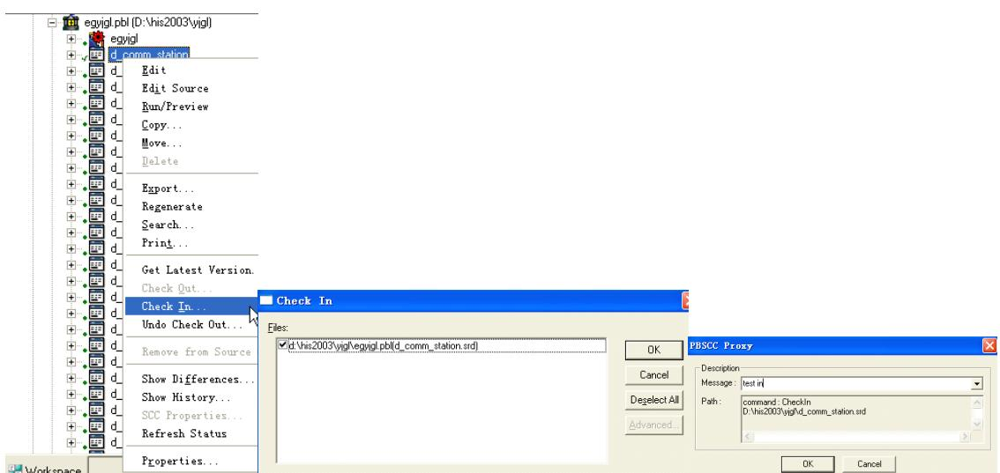

## SVN 主要功能介绍

### 目录归档

在“源代码管理”目录中（注：非 PB 工作根目录），建立目录，再加入 SVN，再提交。

### 文件归档

新建文件后（如 Word、Excel、文本、图片）或从其他地方拷贝到“源代码管理”目录或其下的子目录（注：其下的子目录也必有归档），文档也要先加入 SVN 再提交。

### 刷新目录或文件

点《SVN Update》从 SVN 取得最新版本。

### 删除文件或目录

在目标上，点出删除菜单后《SVN \ Delete》，再提交《SVN \ Commit》。

### 查看文件或目录的日志

在目标上，点出《SVN \ Show log》。

### 重命名文件

可直接修改，或在文件上点出《SVN \ Rename》。

### 远程访问 SVN

使用 `http://主机地址:端口号/svn/项目名称`，输入用户密码之后方可访问。

（注：公司内网访问 `http://10.1.51.100:90/svn/项目名称/`；公司外网访问 `http://60.190.25.222:90/svn/项目名称/`；用户密码使用原来服务器上操作系统的帐户。）

### 更新出错的处理

如果你更新到指定版本再送交时将出现 out of date 错误！如果你想撤销修改并从以前的版本开始工作，你必须使用从“显示记录”对话框中选择复原自此版本以来的变更（Revert changes from this revision）命令，或使用快捷菜单中的合并（Merge...）菜单命令。

## PB 问题处理

### 简答 1

如果密码改变，有可能打开 PB，连接 SVN 时，源码管理会没有反映（即菜单出不来）。

查看 PB 的提示信息，及 Pberr.txt 错误信息，发现如下：

在 DOS 下执行 Pberr 的出错代理命令：

```
D:\>svn update "D:\his2003\source" 认证领域:<svn://10.1.51.100:3690> 9591c920-9570-7f47-89fc-92e8b94cb8bd “XuXueJiang”的密码：^C
```

再到 “d:\his2003\source” 目录下点出《SVN \ Update》重新输入用户密码（可保存）。

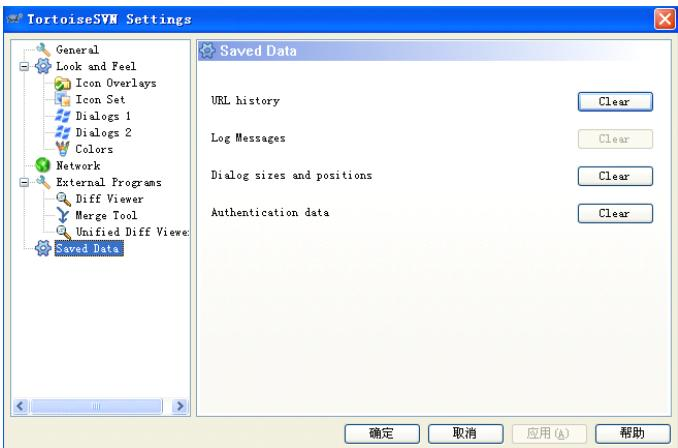

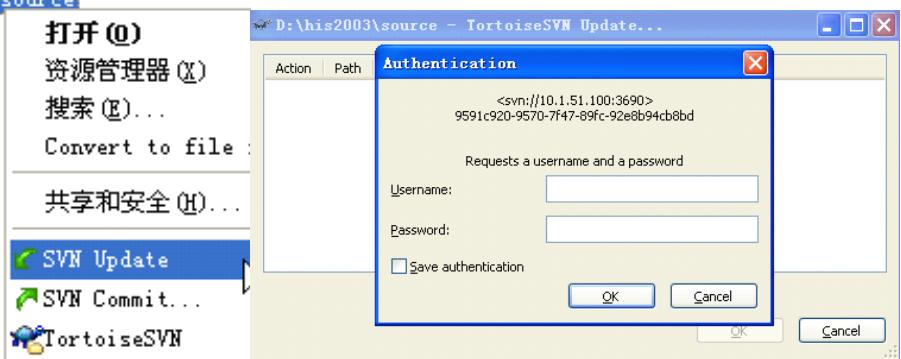

### 简答 2

关于各目录的权限问题。如对某些文件只有读没有写的权限；或对某些目录下没有读写权限，都会出现提示 “Access denied”，请与管理员联系。

### 简答 3

有关错误日志文件的设置和查看。

a) 如何设置 PB 错误日志

运行 Regedit.exe 注册表管理程序，找到：

```
HKEY_LOCAL_MACHINE\SOFTWARE\FM2i\PBSCC Proxy
"log.path"
```

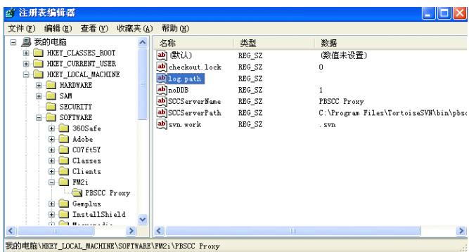

例如：设置 `log.path = D:\source\Pberr.txt`，即可把错误日志保存在此目录。

此值默认为空，表示不保存错误日志。

b) 保存错误日志会影响速度和性能，在找出问题后请关闭日志。

### 简答 4

End second.

## 附：PB 源码管理快捷菜单（识别结果）

| 菜单项 / 字段 | 说明 |
| --- | --- |
| HIS2003 (D:\his2003) | 工作空间 |
| egyigl (d:\his2003\vjigl) | 目标 |
| egyigl.pbl (D:\his2003\vjigl) | PBL 库 |
| egyigl | 应用对象 |
| d_comm_station | 数据窗口 |
| Edit | 编辑 |
| Edit Source | 编辑源码 |
| Run/Preview | 运行/预览 |
| Copy... | 复制 |
| Move... | 移动 |
| Delete | 删除 |
| Export... | 导出 |
| Regenerate | 重新生成 |
| Search... | 搜索 |
| Print... | 打印 |
| Get Latest Version... | 取得最新版本 |
| Check Out... | 签出 |
| Check In... | 签入 |
| Undo Check Out... | 撤销签出 |
| Remove from Source Control | 从源码管理移除 |
| Show Differences... | 显示差异 |
| Show History... | 显示历史 |
| SCC Properties... | SCC 属性 |
| Refresh Status | 刷新状态 |
| Properties... | 属性 |

版本历史对话框（Revision / Actions / Author / Date / Message）：

| Revision | Actions | Author | Date | Message |
| --- | --- | --- | --- | --- |
| 91 |  | xxj | 20:30:21 2008年3月3日 | ccc check in : test in |
| 90 |  | xxj |  | Compare with working copy |
| 46 |  | xxj |  | Compare and blame with working BASE |
|  |  |  |  | Show differences as unified diff |
|  |  |  |  | sc check in : test in |
|  |  |  |  | Save revision to... |
|  |  |  |  | Open |
|  |  |  |  | Open with... |
|  |  |  |  | Browse repository |
|  |  |  |  | Create tag from revision |
|  |  |  |  | Update item to revision |
|  |  |  |  | Revert to this revision |
|  |  |  |  | Revert changes from this revision |
|  |  |  |  | Checkout... |

| Action | Path |
| --- | --- |
| Modified | /yjgl/d_comm_station.srd |

右键菜单另含：Edit author、Edit log message、Copy to clipboard、Search log messages...

查看文件内容，点《Open》。

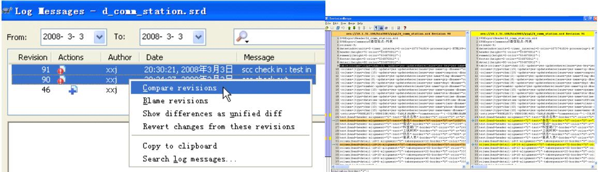

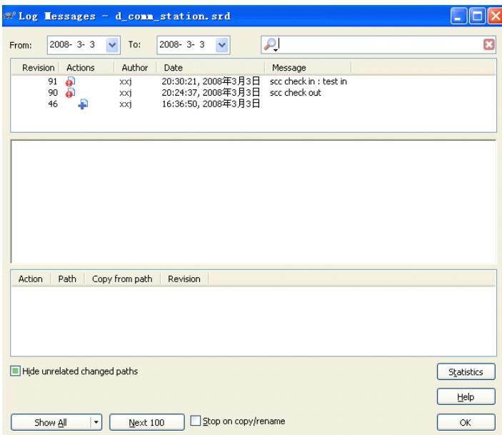

## 9 解决冲突 Resolving Conflicts

有时你从档案库更新文件会有冲突。冲突产生于两人都修改文件的某一部分。解决冲突只能靠人而不是机器。当产生冲突时，你应该打开冲突的文件，查找以 `<<<<<<<` 开始的行，冲突部分被标记：

```
<<<<<<< mine
code merged from repository
=======
>>>>>>> revision
```

Subversion 为每个冲突文件产生三个附加文件：

- `filename.ext.mine`：更新前的本地文件。
- `filename.ext.rOLDREV`：你作改动的基础版本。
- `filename.ext.rNEWREV`：更新时从档案库得到的最新版本。

使用外部合并工具或使用快捷菜单的“编辑冲突（Edit Conflict）”命令来解决冲突，然后从快捷菜单中执行“已解决（Resolved）”命令，将改动送交到档案库。请注意，解决命令并不解决冲突，而仅仅是删除 `filename.ext.mine` 和 `filename.ext.r*` 文件并允许你送交。

---

更新至版本 Update to Revision… 命令允许复原至低版本。比如你的工作目录版本是 100，你想复原至版本 50，直接填写在复原对话框中填写复原至版本 50。通常不复原单个文件，确实需要，从记录对话框（Log）选择“储存版本至（Save revision to…）”命令。
