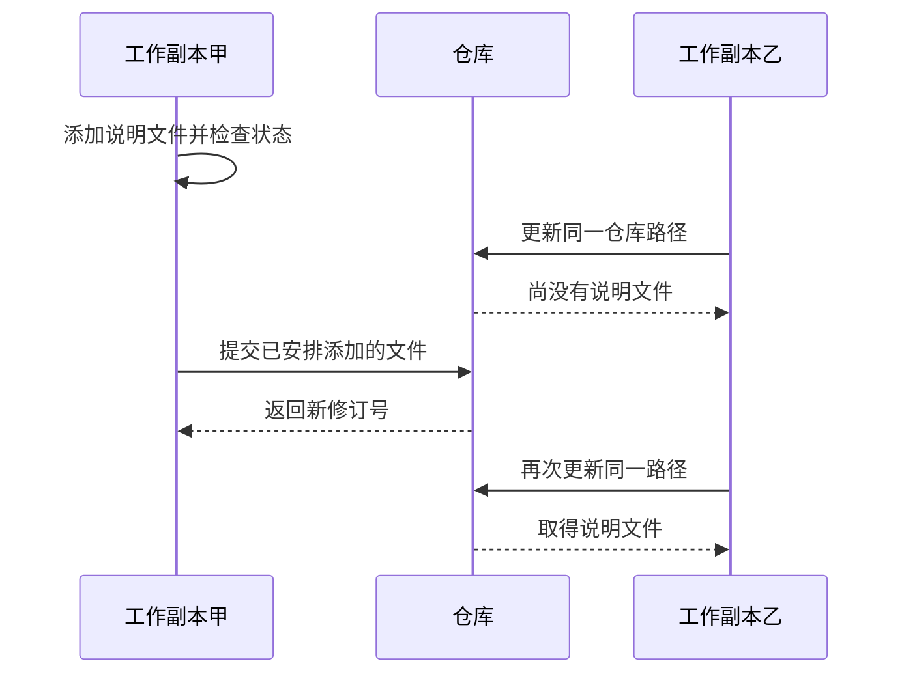

# 实验四：用两份工作副本验证 SVN 配置管理

原件要求配置 VisualSVN Server 和 Windows 客户端，在服务器上建立仓库、分别创建两个用户并设置访问权；随后从客户端检出并练习添加、提交、更新、分支和合并。安装画面和端口是当时的示例，不是现在的安装配置要求。**订正**：第 2 页的标题写成 “TortoiseCVS”，同页链接、第 5 页检出窗口和全文操作指的是 **TortoiseSVN**。

## 检出、更新和提交不走同一个方向

服务器保存共享历史，工作副本保存可编辑文件和所基于的版本信息。检出从指定仓库路径建立新的工作副本；更新把仓库变化整合进已有工作副本；提交才把选中的本地改动写入仓库。仓库是否真收到了改动，应看提交返回的修订号及仓库日志，而不是文件夹里的图标。

| 要判断什么 | 优先看哪里 | 不要据此推出什么 |
| --- | --- | --- |
| 未纳入版本控制，还是已计划添加？ | 客户端状态；命令行 `svn status` 中，`?` 与 `A` 不同 | `A` 不是“仓库已经收到” |
| 文件是否相对本地基础版本改动？ | 本地状态，必要时检查差异 | 客户端显示绿色不等于仓库没有更高修订 |
| 两个用户能否完成协作？ | 分别检出、提交和更新的记录，以及目标路径的仓库日志 | 能检出不等于有提交权限；本地文件访问不检验服务器授权 |

> [!WARNING]
> 第 5 页的蓝色加号表示==已安排添加、尚待提交==。原件将其口语化为“已添加到仓库”容易误读。在第一次提交前，另一份工作副本更新以后仍看不到新增文件。没有图标也不足以判定文件状态，先用客户端状态视图确认。

## 用另一份工作副本验证结果

**补充**：在隔离实验仓库中，把两个实验账号分别绑定到两个工作副本，给普通协作账号只开相应路径所需权限。下面以其中一个账号在主干增加说明文件为例。若两边操作的是不同仓库或不同分支，另一方更新后看不到文件并不能说明提交失败。

分支练习可以沿用同样的验证思路：先在分支只提交一处容易识别的改动，记录其修订号；合入主干前先确认合并来源、目标和范围；合并后检查主干工作副本差异并验证修改，确认正确再提交，由另一份主干工作副本更新复核。若出现冲突，先查两侧改动意图，再决定结果，不能为了让冲突标记消失而随意选边。

若改用 `file://` 访问本机仓库，可以验证基本的工作副本和修订变化，但不能据此判断 VisualSVN 服务器的 HTTPS 认证或权限已经配置正确。实验记录可以按“仓库路径、账号权限、操作前后的修订、实际观察”组织，不记录真实口令。参见[服务器与客户端配置](../../../topics/软件工程/SVN服务器与客户端配置.md)、[版本控制](../../../topics/软件工程/版本控制.md)、[变更控制](../../../topics/软件工程/变更控制.md)和[软件配置管理报告](../../../topics/软件工程/软件配置管理报告.md)。
