# 《软件工程（双语）》期末复习要点

原件经识别和整理；“参考解答”是我们补的。

## 零、常用英语词汇

多态 Polymorphism；利益相关者 stakeholder；版型 stereotype；基于构件的软件工程 Component-Based Software Engineering, CBSE；体系结构原型 Archetype；增量 increment；重构 refactor；原型 Prototyping（旨在快速构建软件系统的一个或多个初步版本，供用户和开发团队评估和反馈。原型的主要目的是在开发早期阶段验证需求、设计和功能，减少项目风险，确保最终产品满足用户需求。）；CRC（类-职责-协作者，是一种面向对象的设计工具，用于描述类、它们的职责和它们之间的协作。）

## 一、软件和软件工程（第一章）

### 软件和硬件的区别（P5-6）

1. Software is developed or engineered; it is not manufactured in the classical sense.
2. Software doesn't "wear out" but it does deteriorate.
3. Although the industry is moving toward component-based construction, most software continues to be custom-built.

1. 硬件是可替换的（零件统一标准，例如自行车的脚蹬坏了可以直接用一个新的脚蹬替换），软件是需要理解用户需求的基础上产生的。
2. 软件的要求比较高，不能大规模生产，要根据不同客户的需求进行生产。（用户提出需求，开发者确定需求）
3. 目前软件的发展方向是组件式发展，即可以修改部分模块。

软件 = 程序 + 数据 + 文档

软件和硬件失效率的解释：

- 硬件失效率曲线（左图）：硬件的失效率随着时间的推移表现为一个“浴缸曲线”。初始阶段的高失效率（称为“婴儿死亡率”），这是由于初期故障较多；中期失效率较低且稳定；最后阶段失效率再次升高，表示硬件开始“磨损”并逐渐失效。
- 软件失效率曲线（右图）：软件的失效率在初始阶段较高，主要由于早期的缺陷和错误；随着时间推移，失效率下降，但并不会像硬件那样达到一个恒定的低值，而是随着修改和更新（如图中标注的“更改”）可能再次升高。这种波动的失效率是由于每次修改可能引入新的错误，导致失效率上升，随后再下降到一个较低的水平，但不会完全稳定。

知识点：[软件的本质与定义（What is Software）](../../../topics/软件工程/软件的本质与定义.md)

### 软件过程（P10-11）

分为框架活动（the process framework）和普适性活动（umbrella activities）。

框架活动：沟通（communication）、计划（planning）、建模（modeling）、构建（construction）、部署（deployment），是和产生软件产品直接相关的。

普适性活动是管理的，和软件产品生产不直接相关，贯穿于整个项目过程（applied throughout a software project）。

软件工程的实施框架定义了 5 个框架活动与 8 个普适性活动，每一项活动都有其专有的动作、任务和内涵。但软件工程不应该是教条的法则，不要求项目团队机械执行，可以根据项目要解决的问题、特点与团队文化等因素，进行适应性调整，请根据自己的理解，简单描述每一个框架活动的任务（6 分），并谈一下不同项目的实施过程，应从哪些方面来调整（9 分）。

Description of the Five Framework Activities (6 points)

1. Communication: Involves gathering requirements through stakeholder meetings, interviews, and discussions to understand the project goals and constraints.
2. Planning: Entails defining the project scope, estimating costs, scheduling tasks, and allocating resources to create a project plan.
3. Modeling: Focuses on creating design models, such as UML diagrams, to represent the system architecture and components.
4. Construction: Involves the actual coding, testing, and debugging of the software components to build the system.
5. Deployment: Includes delivering the completed software to users, providing documentation, and training, and ensuring the system operates as intended in its environment.

Adjustments for Different Projects (9 points)

1. Project Size: Smaller projects may require less formal communication and modeling activities, while larger projects may need detailed planning and comprehensive modeling.
2. Team Experience: Experienced teams might streamline certain activities, while less experienced teams may need more detailed documentation and reviews.
3. Project Complexity: Complex projects may require more iterative modeling and testing phases, whereas simpler projects can move more linearly through the phases.
4. Stakeholder Involvement: Projects with high stakeholder involvement may need more frequent communication and feedback loops.
5. Risk Management: High-risk projects might require more extensive planning and risk mitigation strategies.
6. Timeline Constraints: Projects with tight deadlines may need to prioritize key features and possibly adopt agile methodologies for iterative development.

知识点：[五个通用框架活动（Five Framework Activities）](../../../topics/软件工程/通用过程框架活动.md)、[伞形活动（Umbrella Activities）](../../../topics/软件工程/伞形活动.md)

### 软件工程的本质（P12）

- Understand the problem (communication and analysis).
- Plan a solution (modeling and software design).
- Carry out the plan (code generation).
- Examine result for accuracy (testing & quality assurance).

理解问题（需求分析）、制定计划（需求建模和软件设计）、执行计划（生产代码）、检查结果（测试准确性）。

知识点：[五个通用框架活动（Five Framework Activities）](../../../topics/软件工程/通用过程框架活动.md)、[软件工程是一种层次化的技术（A Layered Technology）](../../../topics/软件工程/软件工程的层次化技术.md)、[需求工程（Requirements Engineering）的任务步骤](../../../topics/软件工程/需求工程任务.md)

### 软件工程的设计原则（P14-15）

- The Reason It All Exists – provide value to users.
- KISS (Keep It Simple, Stupid!) – design as simple as it can be.
- Maintain the Vision – clear vision is essential.
- What You Produce, Others Will Consume.
- Be Open to the Future – do not design yourself into a corner.
- Plan Ahead for Reuse – reduces cost and increases value.
- Think! – placing thought before action produces results.

最重要的两条规则：

1. 面向未来（Be Open to the Future）：体系结构的设计，例如女士养宠物的例子中，目前女士提出的是养猫，但是如果只实现养猫的话，不具有可扩展性，即无法面向未来，所以应该实现宠物的抽象类，这样以后女士提出养狗、鸟等不同宠物时，不用修改太多，这里就是用到了多态的概念。
2. 提前计划复用（Plan Ahead for Reuse）：降低项目成本，提升价值。

包括知识复用（分析结果复用，即分析模型）、方法复用（设计结果复用，设计模型）、软件成分复用（代码复用）；继承是共性局限性大（共性东西少），结构化关联。

知识点：[关注点分离（Separation of Concerns）](../../../topics/软件工程/关注点分离.md)、[模块化（Modularity）与信息隐藏（Information Hiding）](../../../topics/软件工程/模块化与信息隐藏.md)

### 封装、继承、多态

程序中实现多态（同样的行为调用不同的服务）的方法：

1. 子类继承父类（子类重写父类的方法，父类的变量指向子类的对象）
2. 具体类实现接口（具体类重写接口的方法，用接口类指向具体类的对象）

| | | 多态的 2 种形式 | |
|---|---|---|---|
| 3 个条件 | 继承 | | 实现 |
| | 子类中重写父类的方法 | | 具体类重写接口的方法 |
| | 父类引用指向子类对象 | | 接口引用指向具体类对象 |

Inheritance:

1. The subclass overrides methods of the superclass.
2. The superclass reference points to the subclass object.

Implementation:

1. The concrete class overrides methods of the interface.
2. The interface reference points to the concrete class object.

动态联编（dynamic binding）和滞后联编（late binding）是多态的概念，表示只有程序运行起来的时候才能真正确定子类对象。如女士养宠物中，宠物是一个抽象类，有猫狗等具体实现类，只有运行调用的时候才能知道是猫还是狗。

静态联编（static binding）是重载的概念，编译过程就已经确定，不会涉及抽象类的变量。

重载实现：

多态实现：

上述代码的类图：

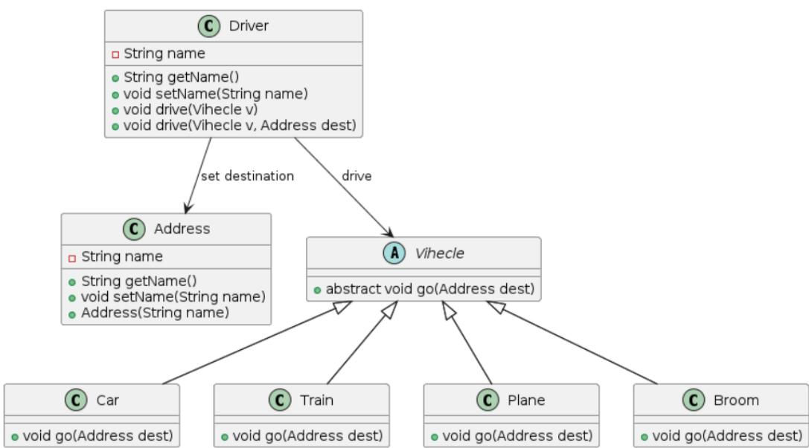

## 二、理解需求（第六章）

知识点：[面向对象基本概念（类、对象、实例）](../../../topics/软件工程/OO基本概念.md)、[抽象（Abstraction）：过程抽象与数据抽象](../../../topics/软件工程/抽象.md)、[设计步骤与指导良好设计演化的3个特征](../../../topics/软件工程/设计步骤与特征.md)

### 需求工程（P85）

是一个 action：沟通 → 策划 → 建模 → 构建 → 部署，前三步属于需求工程，因项目而异。

知识点：[需求工程（Requirements Engineering）的任务步骤](../../../topics/软件工程/需求工程任务.md)、[五个通用框架活动（Five Framework Activities）](../../../topics/软件工程/通用过程框架活动.md)

### Establishing the Groundwork（根基）

#### stakeholder（P89）

stakeholder 利益相关者（对项目有直接或者间接贡献需求的人）。这里暂时存疑，书上还有一部分给出了 stakeholder 的决策，需要查看一下具体指的是哪一部分。P92

#### 首次提问（P90-91）

#### Requirements Gathering（需求采集）P92

---
title: 《软件工程（双语）》期末复习要点（第 2 部分，P8–11）
kind: 复习要点
course: 软件工程
source: 识别工具读出内容（第 8–11 页）
---

# 《软件工程（双语）》期末复习要点（第 2 部分，P8–11）

本部分整理自《软件工程（双语）》期末复习要点第 2 部分（对应教材或课件 P8–11 页），涵盖需求采集、用例建模、类图关系及设计模式等核心知识点。

## 一、需求工程与沟通技巧

知识点：[起始（Inception）与建立基础工作](../../../topics/软件工程/起始Inception.md)、[确认利益相关者（Stakeholders）与识别多种观点](../../../topics/软件工程/利益相关者.md)、[需求获取（Elicitation）与需求收集会议](../../../topics/软件工程/获取Elicitation.md)

### 节 1：首次提问（First Set of Questions）

**来源说明**：基于教材 P90-91 页内容。考试可能会给出三种问题类型中的一种，要求回答该问题的重点和意义。答案通常对应原文中的加粗部分或总结性语句。

**特点**：上下文无关 (Context-free)

#### The first set of questions focuses on the customer and other stakeholders and the overall project goals and benefits.

This set helps to identify all stakeholders who will have interest in the software to be built, and identify the measurable benefit of a successful implementation and possible alternatives to custom software development.

Key questions include:
- Who is behind the request for this work?
- Who will use the solution?
- What will be the economic benefit of a successful solution?
- Is there another source for the solution that you need?

#### The second set of questions focuses on a solution.

These questions enable you to gain a better understanding of the problem and allows the customer to voice their perceptions about a solution.

Key questions include:
- How would you characterize “good” output that would be generated by a successful solution?
- What problem(s) will this solution address?
- Can you show me (or describe) the business environment in which the solution will be used?
- Will special performance issues or constraints afect the way the solution is approached?

#### The third set of questions (meta-questions) focuses on the efectiveness of the communication activity itself.

These questions will help to “break the ice” and initiate the communication that is essential to successful elicitation.

Key questions include:
- Are you the right person to answer these questions? Are your answers “oficial”?
- Are my questions relevant to the problem that you have?
- Am I asking too many questions?
- Can anyone else provide additional information?
- Should I be asking you anything else?

知识点：[需求获取（Elicitation）与需求收集会议](../../../topics/软件工程/获取Elicitation.md)、[确认利益相关者（Stakeholders）与识别多种观点](../../../topics/软件工程/利益相关者.md)

### 节 2：Requirements Gathering（需求采集）

**来源说明**：基于教材 P92 页。

通过协作需求处理（开会），执行需求工程。具体方式为召开需求采集会议，来执行需求工程。

## 二、需求建模（第七章）

**概述**：基于场景的建模、基于类的建模、行为建模。

知识点：[需求获取（Elicitation）与需求收集会议](../../../topics/软件工程/获取Elicitation.md)

### 节 3：用例图中的 `<<include>>` 和 `<<extend>>`

**说明**：画用例图时，图中每个符号都不是多余的。向前反应需求，向后体现在代码中。用例图中的一个圈代表一个场景。

#### <<include>>

表示强制性的包含关系。当执行事件 A 时，必然触发事件 B。用于提取公共功能和行为。

#### <<extend>>

表示可选的扩展关系。当执行事件 A 且满足特定条件时，可以选择执行事件 B。用于描述可选行为和条件行为。

#### 典型例题

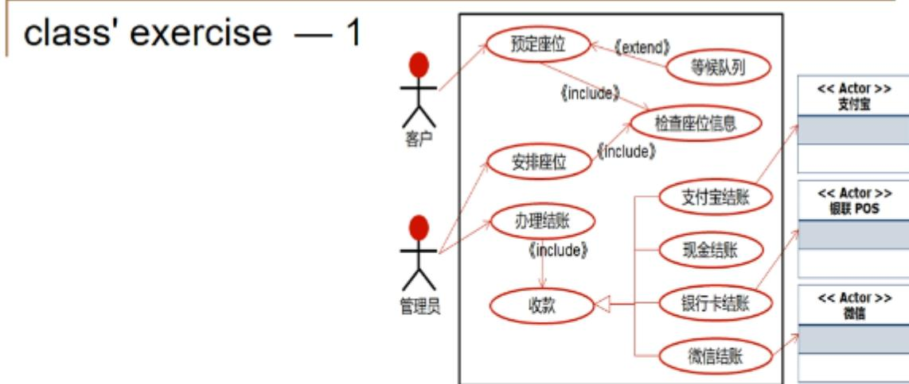

**Question**: In the use-case model shown in the figure, which user requirements are described by `<<include>>` and `<<extend>>` respectively?

**Answer**:

**User requirements described by `<<include>>`**:
Mandatory Behavior: The "Reserve Seat" use case includes the "Check Seat Availability" and "Install Seat" use cases. This means that whenever a user performs the "Reserve Seat" action, it will necessarily involve checking seat availability and installing the seat. The "Process Transaction" use case includes the "Generate Payment" use case, indicating that generating a payment is a required step in processing a transaction.

**User requirements described by `<<extend>>`**:
Optional Behavior: The "Queue" use case extends the "Reserve Seat" use case. This extension means that while reserving a seat, the action of queuing might be performed under certain conditions (e.g., if all seats are initially booked and the user needs to wait for availability), but it is not a mandatory step every time "Reserve Seat" is executed.

知识点：[开发用例（Developing Use Cases）与绘制用例图](../../../topics/软件工程/用例开发.md)、[创建初始用例（Preliminary Use Case）与细化用例](../../../topics/软件工程/初始用例创建与细化.md)

### 节 4：面向对象的软件开发过程（画用例图的意义）

**来源说明**：基于教材 P113 页。

涉及基于构件的软件工程（Component-Based Software Engineering, CBSE）和统一过程。

用例驱动，面向对象的软件开发从画用例图开始：
1. 第一步是找 actor（参与者，即各种角色使用软件的人和设备，比如教务管理系统里面学生、老师、教务管理人员）。
2. 第二步找 actor 和系统之间的交互。

Use-case as a "contract for behavior" and more formal than a user story.
In essence, a use case captures the interactions that occur between producers and consumers of information and the system itself.
Use-cases are simply an aid to defining what exists outside the system (actors) and what should be performed by the system (use-cases).

关于用例描述的思考：
1. What to write about?
2. How much to write about it?
3. How detailed to make your description?
4. How to organize the description?

知识点：[开发用例（Developing Use Cases）与绘制用例图](../../../topics/软件工程/用例开发.md)、[需求分析的总体目标、哲学与两种方法学（结构化与OO）](../../../topics/软件工程/需求分析方法学.md)

### 节 5：类图中符号的含义

类之间的关系有泛化（继承）、关联、聚合、组合、依赖、实现。

#### 典型例题

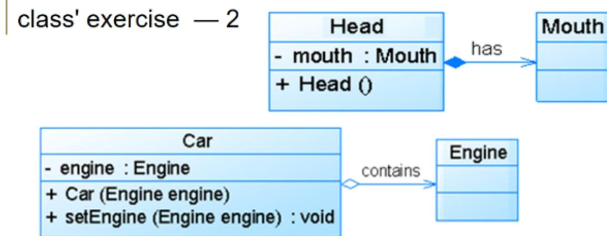

**Question**: In the class model shown in the figure, what are the meanings of "◊---->" and "◆---->" respectively? which user requirements are described by them respectively?

**Answer**:

In the class model shown in the figure, the meanings of "◊---->" and "◆---->" are as follows:

"◊---->" represents an **aggregation relationship**. This means that the part (in this case, Engine ) can exist independently of the whole (in this case, Car ). The lifecycles of the whole and its parts are diferent, meaning that the parts can exist even if the whole is destroyed.

"◆---->" represents a **composition relationship**. This means that the part (in this case, Mouth ) cannot exist independently of the whole (in this case, Head ). The lifecycles of the whole and its parts are the same, meaning that the parts cannot exist if the whole is destroyed.

**User requirements**:
The aggregation relationship describes a user requirement where the Engine can be separately used or replaced without afecting the existence of the Car .
The composition relationship describes a user requirement where the Mouth is an integral part of the Head , meaning the Mouth cannot exist if the Head does not exist.

知识点：[UML类图与类之间的关系](../../../topics/软件工程/UML类图与类关系.md)、[关联（Associations）、依赖（Dependencies）与分析包](../../../topics/软件工程/关联与依赖.md)

### 节 6：对象图

对象图是类图的一张照片，变量和变量在某个时间点上存在的关系，程序在运行的过程中对象之间的链接关系。对象之间的关系就不是继承关联之类的，只有亲戚关系（即链接关系，因为对象是真实存在的）。

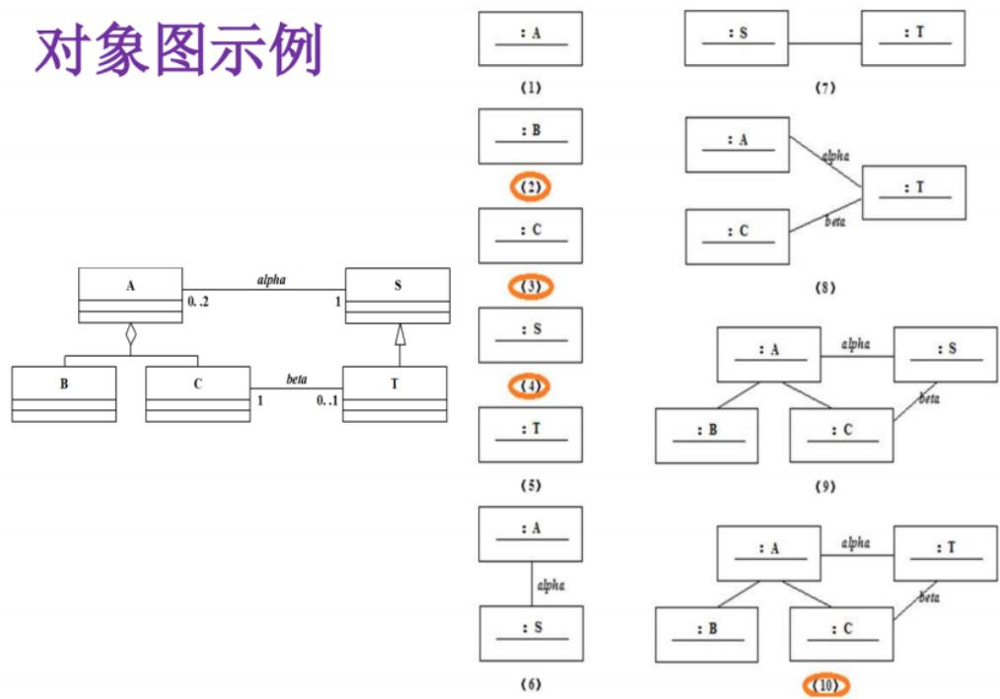

左边的是类图，右边可能会询问哪些是该类的对象图，可以根据具体语义/环境关系，以及类图之间的关系来判断。

知识点：[UML类图与类之间的关系](../../../topics/软件工程/UML类图与类关系.md)、[UML体系结构描述（5视图）与UML图（9+4图）](../../../topics/软件工程/UML五视图与九图.md)

### 节 7：接口

实现设计类之间的可控连接（传统方法中叫模块之间的可控连接）、强调构件（即模块）的可替换性。

知识点：[面向对象与设计类（OO and Design Classes）](../../../topics/软件工程/OO设计类.md)、[模块化（Modularity）与信息隐藏（Information Hiding）](../../../topics/软件工程/模块化与信息隐藏.md)、[什么是构件（What is a Component）及示例](../../../topics/软件工程/构件定义.md)

### 节 8：设计模式

#### 典型例题 1（组合设计模式）

**Question**: The combination of fruit plates is shown in the figure. How will you design and develop this system? Please use the class diagram to give the design model and explain the reasons for choosing the scheme.?(10 pts)

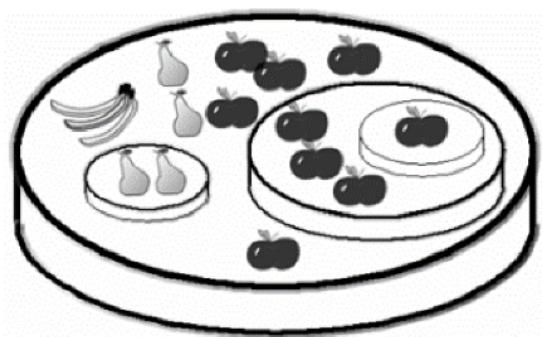

# 《软件工程（双语）》期末复习要点 第3部分

本部分为《软件工程（双语）》期末复习要点第3部分（原稿第12–15页），主要涵盖组合模式在系统设计中的应用、状态图与顺序图的对比分析，以及软件设计过程的基本概念。内容基于识别文本整理，修正了明显的拼写错误和格式问题。

## 一、典型例题：组合模式的应用

知识点：[设计模式（Patterns）的名称与要素](../../../topics/软件工程/设计模式.md)、[UML类图与类之间的关系](../../../topics/软件工程/UML类图与类关系.md)

### 选择 1

题干：To design and develop the system for the combination of fruit plates as shown in the figure, we use the Composite Design Pattern. This pattern allows us to compose objects into tree structures to represent part-whole hierarchies. It lets clients treat individual objects and compositions of objects uniformly.

**Key Classes and Relationships:**
- Component (MyElement): This abstract class declares the eat() method which will be implemented by all concrete classes.
- Leaf (Apple, Banana, Pear): These classes represent individual fruits and implement the eat() method.
- Composite (Plate): This class can contain other MyElement objects (either Apple, Banana, Pear, or other Plate objects). It provides methods to add and remove elements and implements the eat() method which iterates over its elements and calls their eat() method.

**Design Highlights:**
- Uniformity: Treats individual objects and compositions of objects uniformly.
- Flexibility: Easily extendable by adding new types of fruits or plates.
- Simplicity: Simplifies client code by allowing it to work with composite structures through a common interface.

答案：无具体选项，此为知识点阐述。
参考解答：该案例展示了如何使用组合模式（Composite Design Pattern）来处理“部分-整体”层次结构。通过将水果（Leaf）和果盘（Composite）统一为实现同一接口（Component/MyElement）的对象，客户端可以统一对待单个对象和组合对象，从而简化代码并提高扩展性。

知识点：[设计模式（Patterns）的名称与要素](../../../topics/软件工程/设计模式.md)

### 简答 1

题干：Windows的资源管理器如图所示，若由你来系统实现，你将如何设计？请用类图来给出设计方案（7分)，并阐述方案选择的理由（3分）？

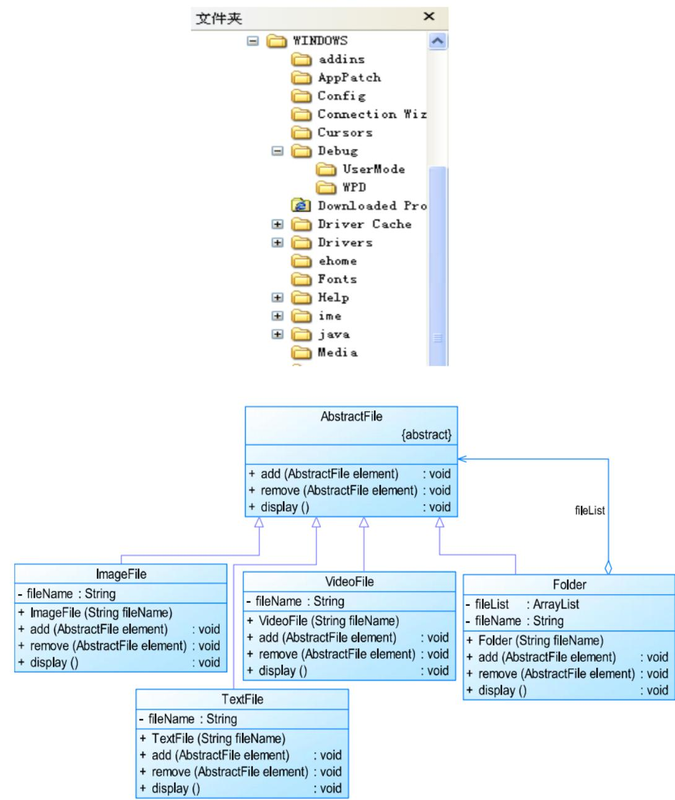

答案：
**设计方案：**
采用组合模式（Composite Design Pattern）。
1. **Component (FileSystemItem)**: 抽象基类，声明通用方法如 `open()`, `delete()`, `rename()`。
2. **Leaf (File)**: 表示文件，实现 FileSystemItem 中定义的方法。
3. **Composite (Directory)**: 表示目录，可以包含其他 FileSystemItem 对象（文件或子目录）。提供添加和移除元素的方法，并实现 FileSystemItem 中声明的通用方法。

**方案选择的理由：**
1. **Uniformity (统一性)**: 统一处理文件和目录，客户端无需区分它们是叶子节点还是容器节点。
2. **Flexibility (灵活性)**: 易于扩展，可以添加新的文件类型或目录结构。
3. **Simplicity (简洁性)**: 通过公共接口简化客户端代码，使其能够以相同的方式处理复合结构。

## 二、行为建模：状态图和顺序图的区别

知识点：[设计模式（Patterns）的名称与要素](../../../topics/软件工程/设计模式.md)、[面向对象基本概念（类、对象、实例）](../../../topics/软件工程/OO基本概念.md)、[基于类的建模（Class-Based Modeling）与识别分析类](../../../topics/软件工程/基于类的建模.md)

### 简答 2

题干：状态图和顺序图的区别是什么？

答案：
1. **状态图 (State Diagram)**:
   - 建模了一个对象的一生（lifecycle）。
   - 表示类的活动状态以及导致这些状态之间变化的事件（触发器）。
   - 关注单个对象在不同事件响应下的状态转换。
   - 关键概念包括：箭头（状态转换）、标签（触发事件）、守卫条件（布尔条件）、动作（伴随状态转换的操作）。

2. **顺序图 (Sequence Diagram)**:
   - 建模了一个场景中对象发生的交互。
   - 自上而下有时间顺序，展示事件如何导致对象间的消息流动。
   - 是用例的一种简写形式，侧重于对象间随时间推移的协作。

知识点：[行为建模（Behavioral Modeling）：状态图与顺序图](../../../topics/软件工程/行为建模.md)

### 简答 3

题干：如图所示，在家庭安保SafeHome系统设计中，图（a）给出了系统安全功能的顺序图，图（b）给出了ControlPanel类的状态图，请解释两种建模方式的区别是什么？ (10分)

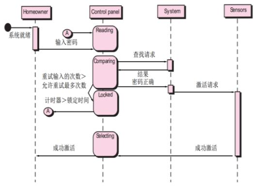

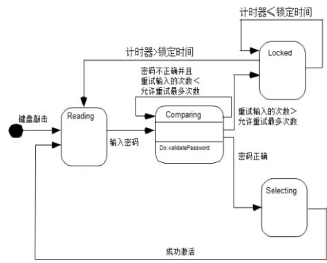

答案：
**Sequence Diagram (图(a))**:
1. **Focus (焦点)**: 建模特定场景中对象之间的交互。
2. **Time Order (时间顺序)**: 显示消息交换的时间顺序，事件从上到下发生。
3. **Explanation (解释)**: 捕捉特定场景中的交互，强调不同对象随时间推移完成过程的协作。

**State Diagram (图(b))**:
1. **Focus (焦点)**: 建模单个对象的生命周期。
2. **States and Transitions (状态与转换)**: 说明对象如何基于事件在不同状态间转换，捕捉其整个生命周期。
3. **Explanation (解释)**: 捕捉对象的完整生命周期，显示它如何响应事件在各种状态间移动。强调单个对象在整个存在期间的动态行为和状态变化。

## 三、设计过程与设计概念

知识点：[行为建模（Behavioral Modeling）：状态图与顺序图](../../../topics/软件工程/行为建模.md)、[UML体系结构描述（5视图）与UML图（9+4图）](../../../topics/软件工程/UML五视图与九图.md)

### 简答 4

题干：简述软件设计过程中的显式需求与隐式需求，以及指导原则。

答案：
**1. 显式需求和隐式需求**
- **显式需求 (Explicit Requirements)**: 指用户明确说明的需求，即功能性需求。
- **隐式需求 (Implicit Requirements)**: 一般指非功能性需求 (NFR, Non-functional requirements)。

**2. 指导原则**
设计应实现需求模型中包含的所有显式需求，并且必须满足利益相关者期望的所有隐式需求。
*(注：原文此处仅列出了第一条原则，后续内容在原稿截断处未显示)*

## 设计原则与质量属性

2. Design should be a readable, understandable guide for those who generate code and for those who test and subsequently support the software.

3. Design should provide a complete picture of the software, addressing the data, functional, and behavioral domains from an implementation perspective.

知识点：[设计步骤与指导良好设计演化的3个特征](../../../topics/软件工程/设计步骤与特征.md)

### A design should

1. exhibit an architecture (a) created using recognizable architectural styles or patterns, (b) composed of well-designed components, (c) implemented in an evolutionary fashion.
2. be modular (partitioned into elements or subsystems).
3. contain distinct representations of data, architecture, interfaces, and components.
4. lead to data structures that are drawn from recognizable data patterns.
5. contain functionally independent components.
6. lead to interfaces that reduce the complexity of connections between components and the external environment.
7. be derived using a repeatable method.
8. be represented using meaningful notation.

## 内聚与耦合（P149-152）

高内聚低耦合，内聚表示模块内部各个元素之间的关系，即模块内部元素各方法定义恰到好处；耦合是指模块与模块之间的关系，通过接口实现构建之间可控连接

知识点：[设计步骤与指导良好设计演化的3个特征](../../../topics/软件工程/设计步骤与特征.md)、[功能独立性（Functional Independence）](../../../topics/软件工程/功能独立性.md)、[模块化（Modularity）与信息隐藏（Information Hiding）](../../../topics/软件工程/模块化与信息隐藏.md)

### Cohesion:

Definition: It indicates the relative functional strength of a module.

Key Points:

*   It's a natural extension of the information-hiding concept.
*   A cohesive module performs a single task, requiring little interaction with other components.

知识点：[模块化（Modularity）与信息隐藏（Information Hiding）](../../../topics/软件工程/模块化与信息隐藏.md)、[内聚（Cohesion）的类型：功能、分层、通信、顺序、过程、时间、实用内聚](../../../topics/软件工程/内聚.md)、[功能独立性（Functional Independence）](../../../topics/软件工程/功能独立性.md)

### Coupling:

Definition: It indicates the relative interdependence among modules.

Key Points:

*   It refers to the interconnections among modules.
*   Coupling depends on the interface complexity between modules, the point at which entry or reference is made to a module, and what data pass across the interface.

## 设计模型

数据设计模型、体系结构设计、接口设计、构件级设计、部署级设计

下面内容了解即可：

Data design – using high level model depicting user’s view of the data or information (e.g., relational model).

数据设计 – 使用高级模型描述用户视角的数据或信息（例如，关系模型）。

Architecture design – show relationships & collaborations among major structured elements (specific analysis model soft- & hard-ware elements), implying by style, patterns, and constraints.

架构设计 – 展示主要结构化元素之间的关系和协作（具体分析模型的软硬件元素），通过风格、模式和约束来体现。

Interface design – interface depicts a set of operations describing the externally visible behavior of a class and provides access to its services.

接口设计 – 接口描绘了一组操作，描述类的外部可见行为并提供对其服务的访问。

Component-level design – the internal details of each component.

组件级设计 – 每个组件的内部细节。

Deployment-level design – indicates how software functionality and subsystems will be allocated in the physical computing environment that will support the software.

部署级设计 – 指出软件功能和子系统如何在物理计算环境中分配，以支持软件。

## 接口的三个组成要素（分类）P157

知识点：[耦合（Coupling）的类型：内容、共用、控制、标记、数据、例程调用、类型使用、包含导入、外部耦合](../../../topics/软件工程/耦合.md)、[设计模型（The Design Model）：数据、体系结构、接口、构件级、部署级设计元素](../../../topics/软件工程/设计模型元素.md)

### 用户接口、外部接口、内部接口

知识点：[规格说明（Specification）与软件需求规格说明书（SRS）模板](../../../topics/软件工程/规格说明Specification.md)、[软件需求规格说明书（SRS）模板结构与撰写规范（引言、总体描述、外部接口、系统特性、非功能需求）](../../../topics/软件工程/SRS模板规范.md)

### 1. User Interface (UI)

English: The user interface (UI) is the space where interactions between humans and machines occur. It encompasses the design and layout of a system's visual elements ensuring usability and a seamless user experience.

Chinese: 用户界面（UI）是人机交互发生的空间。它包含系统视觉元素的设计和布局，确保可用性和无缝的用户体验。

知识点：[UML体系结构描述（5视图）与UML图（9+4图）](../../../topics/软件工程/UML五视图与九图.md)、[设计模型（The Design Model）：数据、体系结构、接口、构件级、部署级设计元素](../../../topics/软件工程/设计模型元素.md)、[关注点分离（Separation of Concerns）](../../../topics/软件工程/关注点分离.md)

### 2. External Interfaces to Other Systems

English: External interfaces refer to the points of interaction where a system connects and communicates with other systems. These interfaces facilitate data exchange and integration, enabling systems to work together effectively.

Chinese: 外部接口是系统与其他系统连接和通信的交互点。这些接口促进数据交换和集成，使系统能够有效地协同工作。

知识点：[需求工程（Requirements Engineering）的任务步骤](../../../topics/软件工程/需求工程任务.md)、[规格说明（Specification）与软件需求规格说明书（SRS）模板](../../../topics/软件工程/规格说明Specification.md)

### 3. Internal Interfaces Between Various Design Components

English: Internal interfaces are the connections within a system that link different design components. These interfaces allow for modular development, where components interact and integrate seamlessly within the system's architecture.

Chinese: 内部接口是系统内部连接不同设计组件的连接点。这些接口允许模块化开发，使组件在系统架构中无缝地交互和集成。

## 重构（P150）

通过重构可以使得设计容易集成、测试和维护，不改变接口，而改变其中的算法，即接口对外的功能保持不变，但是实现方式改变以增加效率

知识点：[重构（Refactoring）](../../../topics/软件工程/重构.md)、[模块化（Modularity）与信息隐藏（Information Hiding）](../../../topics/软件工程/模块化与信息隐藏.md)、[面向对象与设计类（OO and Design Classes）](../../../topics/软件工程/OO设计类.md)

### What is design refactoring?

A reorganization technique of changing a software system in such a way that simplifies the design (or code) without altering functionality (and the external behavior) yet improves its internal structure.

When software is refactored, the existing design is examined for ... that can be corrected to yield a better design.

redundancy, unused design elements, inefficient or unnecessary algorithms, poorly constructed or inappropriate data structures, or any other design failure.

Why: is easier to integrate, to test, to maintain.

## 组织良好的设计类

1、如图所示的司机驾车设计方案存在什么问题？（4分）进一步阐述如何评价“组织良好的”设计类？（6分）

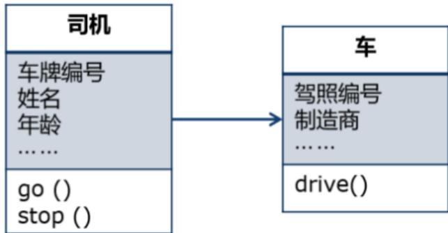

知识点：[重构（Refactoring）](../../../topics/软件工程/重构.md)、[模块化（Modularity）与信息隐藏（Information Hiding）](../../../topics/软件工程/模块化与信息隐藏.md)、[功能独立性（Functional Independence）](../../../topics/软件工程/功能独立性.md)

### Problems in the Design (4 points)

1. Role Confusion: The Driver class includes go() and stop() methods, which are responsibilities that should belong to the Car class, leading to unclear responsibilities.
2. High Coupling: The Driver class directly controls the behavior of the Car class increasing coupling between the classes, making maintenance and extension difficult.
3. Poor Extensibility: Adding more vehicle operations would require frequent modifications to the Driver class, which does not comply with the open-closed principle.

知识点：[开闭原则（Open-Closed Principle, OCP）与多态条件](../../../topics/软件工程/开闭原则OCP.md)、[功能独立性（Functional Independence）](../../../topics/软件工程/功能独立性.md)、[面向对象与设计类（OO and Design Classes）](../../../topics/软件工程/OO设计类.md)

### Evaluating a "Well-Organized" Design Class (6 points)

1. Complete and Sufficient:

Each class should contain all necessary attributes and methods to fulfill its responsibilities but should not include unnecessary elements.

For example, the Car class should contain all methods related to vehicle operations, while the Driver class should only contain information and operations related to the driver.

2. Primitiveness:

Methods within a class should be basic operations and should not be subdivided further.

For example, the Car class should have a drive() method that encompasses the implementations of go() and stop() without requiring the Driver class to handle these details.

3. High Cohesion:

The methods and attributes within a class should be closely related and focused on a single responsibility.

For example, all methods in the Car class should directly relate to vehicle operations, and methods in the Driver class should relate to the driver's actions

## 五、体系结构（第九章）

知识点：[面向对象与设计类（OO and Design Classes）](../../../topics/软件工程/OO设计类.md)、[内聚（Cohesion）的类型：功能、分层、通信、顺序、过程、时间、实用内聚](../../../topics/软件工程/内聚.md)、[实施构件级设计的指南（Design Guidelines）](../../../topics/软件工程/构件级设计指南.md)

### 1.定义、重要性、决策（P164-166）

**定义**：软件的整体结构。
Architecture is not the operational software, it is a representation that enables a software engineer to:
1. Analyze the effectiveness of the design in meeting its stated requirements,
2. Consider architectural alternatives at a stage when making design changes is still relatively easy,
3. Reduce the risks associated with the construction of the software.

**重要性**：最重要的就是利益相关者的沟通。
1. Architecture provides a representation that facilitates communication among all stakeholders.
   （架构提供了一种表示方式，促进所有利益相关者之间的沟通。）
2. Architecture highlights early design decisions that will have a profound impact on all SE work that follows, and plays an important role in the success of the system as a runnable entity.
   （架构强调早期设计决策，这些决策将对所有后续的软件工程工作产生深远影响，并在系统作为可运行实体的成功中发挥重要作用。）
3. Architecture constitutes a relatively small model (a set of abstractions) of how the system components are structured and work together.
   （架构构成了一个相对较小的模型（一组抽象），描述了系统组件如何结构化和协同工作。）

**决策**：早期决策对项目成功起至关重要的部分，如女士养宠物（上面面向未来部分已经详细解释过）。

知识点：[什么是体系结构（What is Architecture）及其重要性](../../../topics/软件工程/软件体系结构定义.md)、[体系结构（Architecture）及其属性](../../../topics/软件工程/体系结构概念.md)、[什么是体系结构（What is Architecture）及其重要性](../../../topics/软件工程/软件体系结构定义.md)

### 2.风格与模式

| 对比 | 类型(Genres) 应用领域 & 类别 | 风格、样式(Style) 关注整体 | 模式(Pattern) 关注局部 |
| :--- | :--- | :--- | :--- |
| **建筑** | 家用住宅、单元楼、办公楼、工厂厂房、仓库 | 2室1厅、北京四合院、殖民式中厅、歌特式、巴洛克、文艺复兴、古罗马 | 房间朝向、过道、门窗的位置、通风、强电弱电入户、上水下水实施 |
| **软件** | AI、通信、设备、金融、游戏、工业、法律、医疗、军事、OS、运输等 | 星型结构(数据中心)、数据流体系结构、调用返回式体系结构、层次体系结构、OO体系结构 | 23种设计组合模式、装饰模式、访问者模式、桥接模式、观察者模式...... |

*   **风格**实际描述一组通用的类别，是一个整体性描述。
*   **模式**是局部范围内的，模式是一组抽象类（abstract class），不是写好的代码，如女士养宠物中宠物就是模式。

**风格与模式的区别 P169**

风格由四个部分组成：一组构件、一组连接件、一组约束、一个语义模型。

What are the elements that make up the software architectural style? Each style describes a system category that encompasses:
1. a set of components (e.g., a database, computational modules) that perform a function required by a system,
2. a set of connectors that enable “communication, coordination and cooperation” among components,
3. constraints that define how components can be integrated to form the system, and
4. semantic models that enable a designer to understand the overall properties of a system by analyzing the known properties of its constituent parts.

知识点：[体系结构风格/流派（Architectural Genres）分类](../../../topics/软件工程/体系结构风格分类.md)、[什么是体系结构（What is Architecture）及其重要性](../../../topics/软件工程/软件体系结构定义.md)

### 3.体系结构原型(模式)

体系结构原型（Archetype）对应的就是模式的概念。

What is an archetype? The target system architecture is composed of a relatively small set of archetypes. Archetype design is critical to the design of an architecture.

An archetype:
*   is a class or pattern that represents a stable element with a core abstraction for the target system.
*   may be instantiated iteratively many different ways based on the behavior of the system.
*   can be derived by examining the analysis classes defined as part of the requirements model.

课本上的家庭安保系统这个模型实质上也是组合设计模式。

**SafeHome 安全功能的体系结构原型集**

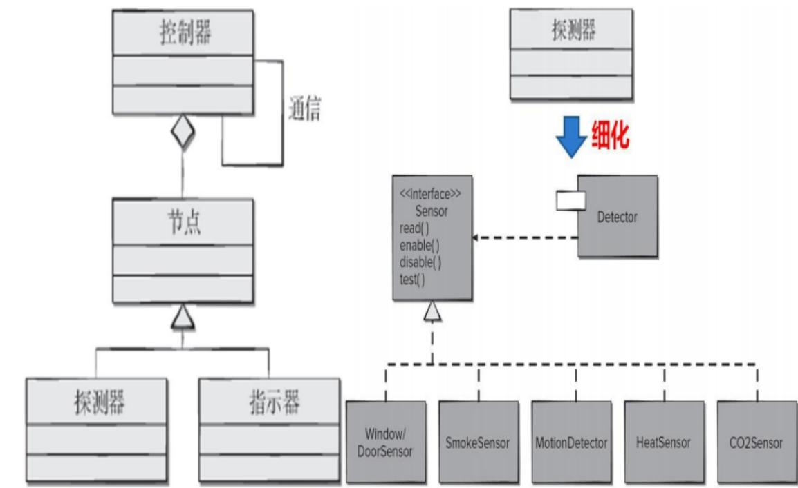

## 六、构件设计（第十章）

知识点：[定义原型（Defining Archetypes）](../../../topics/软件工程/定义原型.md)、[将体系结构精化为构件（Refining into Components）与描述系统实例](../../../topics/软件工程/精化为构件.md)、[设计模式（Patterns）的名称与要素](../../../topics/软件工程/设计模式.md)

### 1.三组不同观点（什么是构件）

**OO-View**: a component contains a set of collaborating classes.
A class is related to the problem domain and infrastructure domain.
Classes are elaborated by defining all attribute data structures, describing process flow for operations, specifying messaging details for interfaces.

**Traditional-View**: a module is a functional element of a program.
three types of modules: control, business, infrastructure.
All modules require representations to be created for processing logic, the internal data structures, and an interface that enables the modules to be invoked and data to be passed to it.

**A Process-Related View**: CBSE, assembling architecture by reusing components or design patterns.

*   **OO观点**：一个组件包含一组协作的类。构件就是一组协作的类，一组类之间的关系。一个类与问题域和基础设施域相关。类通过定义所有属性数据结构、描述操作的过程流程、指定接口的消息细节来进行详细说明。
*   **传统观点**：一个模块是程序的功能元素。构件就是模块可以直白理解为函数。三种类型的模块：控制、业务、基础设施。所有模块都需要创建表示来处理逻辑、内部数据结构，以及使模块能够被调用和传递数据的接口。
*   **过程相关观点**：CBSE，通过重用组件或设计模式来组装架构。

知识点：[什么是构件（What is a Component）及示例](../../../topics/软件工程/构件定义.md)、[面向对象与设计类（OO and Design Classes）](../../../topics/软件工程/OO设计类.md)、[基于类的建模（Class-Based Modeling）与识别分析类](../../../topics/软件工程/基于类的建模.md)

### 2.设计原则 P194

component design principles
开闭原则、里氏替换原则、依赖倒置原则、接口分离原则

*   **Open-Closed Principle (OCP)**. “A module [component] should be open for extension but closed for modification.”
    *   **开放封闭原则 (OCP)**：该原则建议软件实体（如类、模块和函数）应该对扩展开放，但对修改关闭。这意味着模块的行为可以通过扩展来增加功能，而无需修改其源代码，从而促进使用接口和抽象类。另外对于修改而言，仅仅只需要修改一个模块当中的内容，不需要修改其他模块当中的内容，不会蔓延。目标
*   **Liskov Substitution Principle (LSP)**. “Subclasses should be substitutable for their base classes.”
    *   **里氏替换原则 (LSP)**：根据该原则，超类的对象应该可以被其子类的对象替换，而不会影响程序的功能。这确保了子类可以替代其父类，从而支持多态性。手段 利用里氏替换原则，实现了开放封闭原则
*   **Dependency Inversion Principle (DIP)**. “Depend on abstractions. Do not depend on concretions.”
    *   **依赖倒置原则 (DIP)**：该原则提倡高层模块不应该依赖于低层模块，而是两者都应该依赖于抽象。此外，抽象不应该依赖于细节；细节应该依赖于抽象。这有助于减少软件组件之间的耦合。手段
*   **Interface Segregation Principle (ISP)**. “Many client-specific interfaces are better than one general purpose interface.”
    *   **接口隔离原则 (ISP)**：该原则指出，客户端不应该被迫依赖于它们不使用的接口。它建议为每组功能创建特定的接口，而不是使用单一的通用接口。这样可以确保系统更容易理解和维护，接口的大小正好满足需要。（瘦接口比胖接口更好）

对于这类题目常见的问题是，给出一个类图，问题：针对这样一个问题的设计方案，运用了什么样的设计原则，体现了什么样的设计概念，它的的好处是什么？

1. 阐述面向对象的多态概念 -- OO的概念
2. 这样的设计方案，运用了里氏替换原则和依赖倒置原则，解释一下这两个原则，从而实现了开闭原则，做到了对外延具有开放性，对修改具有封闭性；
3. 好处：可扩展性和可维护性

典型例题1（通过接口实现的多态）

知识点：[开闭原则（Open-Closed Principle, OCP）与多态条件](../../../topics/软件工程/开闭原则OCP.md)、[Liskov替换原则（Liskov Substitution Principle, LSP）](../../../topics/软件工程/Liskov替换原则LSP.md)、[依赖倒置原则（Dependency Inversion Principle, DIP）在构件级设计中的应用](../../../topics/软件工程/依赖倒置原则DIP.md)、[接口隔离原则（Interface Segregation Principle, ISP）](../../../topics/软件工程/接口隔离原则ISP.md)

### 练习 14

在旅游系统中，需求描述如下：

1. 有许多种旅行方式，如飞机、火车、自行车等。
2. 不同的旅行方式有不同的实现过程。客户根据自己的需要选择合适的旅行方式。

请讨论在设计模型中使用了哪些面向对象思想，设计中满足了哪些面向对象原则，以及该设计方案的优点是什么？

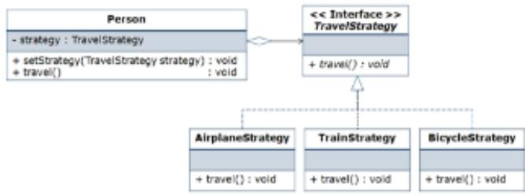

#### 1. 多态的概念

多态是面向对象编程中的一个基本概念，它允许将不同类的对象作为公共超类的对象来处理。它是通过方法重写（method overriding）实现的，即子类提供其父类中已定义的方法的具体实现。在此上下文中，`TravelStrategy` 是一个接口，而 `AirplaneStrategy`、`TrainStrategy` 和 `BicycleStrategy` 是该接口的不同实现。`Person` 类可以互换地使用这些策略中的任何一个。

#### 2. 应用的原则

**开闭原则 (Open-Closed Principle, OCP)**：系统对扩展开放，但对修改关闭。通过定义 `TravelStrategy` 接口，可以在不修改现有代码的情况下添加新的旅行方式。例如，如果引入一个新的旅行策略 `CarStrategy`，只需实现 `TravelStrategy` 接口即可添加。

**里氏替换原则 (Liskov Substitution Principle, LSP)**：超类的对象应该能够被子类的对象替换，而不影响程序的正确性。在这个设计中，任何 `TravelStrategy` 的实现都可以替换另一个实现，而不会改变 `Person` 类的功能。

**依赖倒置原则 (Dependency Inversion Principle, DIP)**：高层模块不应依赖于低层模块，而应依赖于抽象。`Person` 类依赖于 `TravelStrategy` 接口（抽象），而不是具体的旅行策略实现。

#### 3. 可替换性、可维护性和可扩展性

**可维护性**：系统易于维护和扩展。新的旅行策略可以以最小的改动添加到现有代码中，增强了系统的灵活性并降低了引入错误的风险。

**可扩展性**：通过创建实现 `TravelStrategy` 接口的新策略类，可以轻松添加新的旅行方式。这不需要对现有类进行任何更改。

知识点：[开闭原则（Open-Closed Principle, OCP）与多态条件](../../../topics/软件工程/开闭原则OCP.md)、[Liskov替换原则（Liskov Substitution Principle, LSP）](../../../topics/软件工程/Liskov替换原则LSP.md)、[依赖倒置原则（Dependency Inversion Principle, DIP）在构件级设计中的应用](../../../topics/软件工程/依赖倒置原则DIP.md)

### 练习 15

在绘图软件系统中，需求描述如下：

1. 必须实现许多几何图形，如矩形、圆形、多边形等。
2. 不同的几何图形有不同的实现过程。用户根据自己的需要选择合适的图形。

请详细讨论设计模型如何满足面向对象设计原则，如开闭原则、里氏替换原则和依赖倒置原则等。（15分）

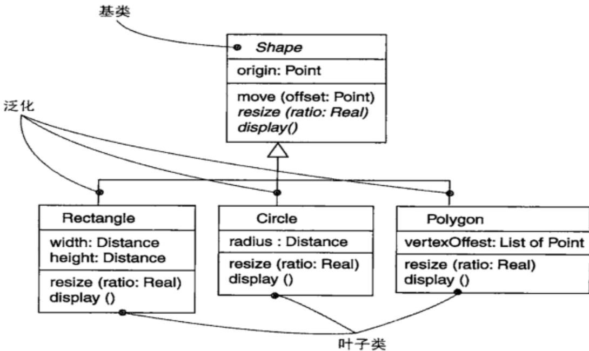

#### 开闭原则 (Open-Closed Principle)

类对扩展开放，但对修改关闭。`Shape` 类是基类，新的形状（`Rectangle`、`Circle`、`Polygon`）继承自它，而无需改变其代码。

#### 里氏替换原则 (Liskov Substitution Principle)

子类可以替换超类而不影响功能。任何 `Shape` 实例都可以被 `Rectangle`、`Circle` 或 `Polygon` 替换，因为它们实现了相同的方法。

#### 依赖倒置原则 (Dependency Inversion Principle)

高层模块依赖于抽象，而不是具体类。系统依赖于抽象的 `Shape` 类，从而允许轻松替换和添加新形状。

知识点：[开闭原则（Open-Closed Principle, OCP）与多态条件](../../../topics/软件工程/开闭原则OCP.md)、[Liskov替换原则（Liskov Substitution Principle, LSP）](../../../topics/软件工程/Liskov替换原则LSP.md)、[依赖倒置原则（Dependency Inversion Principle, DIP）在构件级设计中的应用](../../../topics/软件工程/依赖倒置原则DIP.md)

### 典型例题 3（接口分离原则）

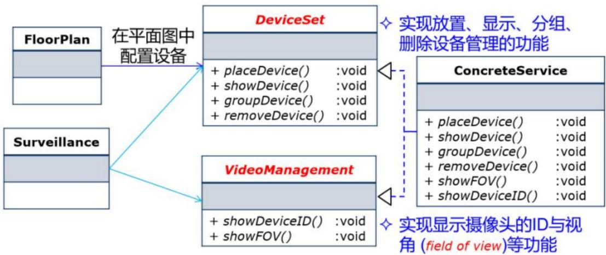

**接口分离原则 (Interface Segregation Principle)**：接口分离原则指出，客户端不应被迫依赖于它不使用的方法。该模型在以下方面遵循了这一原则：

#### 1. 关注点分离

功能被划分为不同的接口：`DeviceSet` 和 `VideoManagement`。每个接口包含特定于其领域的方法（例如，设备管理与视频管理），确保客户端只实现和依赖于与其需求相关的方法。

#### 2. 具体实现

`ConcreteService` 同时实现了 `DeviceSet` 和 `VideoManagement` 接口。这允许采用模块化方法，使得实现类可以被扩展或修改，而不会影响依赖于这些接口的客户端代码。

知识点：[接口隔离原则（Interface Segregation Principle, ISP）](../../../topics/软件工程/接口隔离原则ISP.md)、[关注点分离（Separation of Concerns）](../../../topics/软件工程/关注点分离.md)

### 典型例题 4

#### 2. 一款游戏软件的局部需求描述如下

1. 一个游戏人物由头、身体与胳膊、腿等等四肢组合而成。
2. 为实现游戏人物动作的协调一致，设计人员给出了如图所示的设计方案。

对此方案，体现了哪些面向对象的基本概念？（6分）尝试探析设计是如何运用面向对象设计的依赖倒置原则、里氏替换原则，来满足面向对象的开闭原则的(9分)。

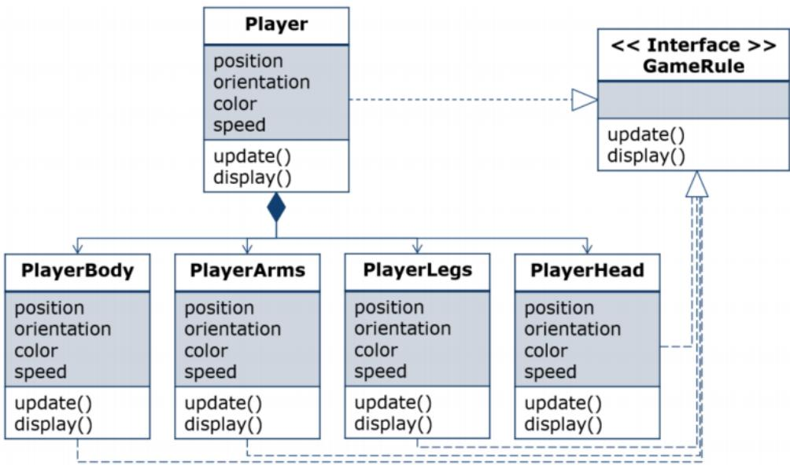

## 基本面向对象概念在设计中的体现（6 分）

1. 封装：每个类（PlayerBody、PlayerArms、PlayerLegs、PlayerHead）都包含自己的属性（position、orientation、color、speed）和方法（update()、display()）。

2. 继承：Player 类是基类，提供公共属性和方法，由子类（PlayerBody、PlayerArms、PlayerLegs、PlayerHead）继承。

3. 多态：子类（PlayerBody、PlayerArms、PlayerLegs、PlayerHead）重写 update() 和 display() 方法，允许不同的实现。

## 应用面向对象原则满足 OCP、DIP 和 LSP（9 分）

1. 开闭原则（OCP）：

设计对扩展开放，对修改关闭。新的玩家部件可以作为子类添加，而无需修改现有的 Player 类。

接口 GameRule 允许添加新的规则和行为，而无需更改现有代码。

2. 依赖倒置原则（DIP）：

高层模块（例如 Player 类）不依赖低层模块（例如 PlayerBody、PlayerArms）。相反，两者都依赖抽象（GameRule 接口）。

Player 类通过 GameRule 接口与玩家部件交互，减少了对具体实现的依赖。

3. 里氏替换原则（LSP）：

子类（PlayerBody、PlayerArms、PlayerLegs、PlayerHead）可以替换 Player 类而不影响功能。它们提供自己的 update() 和 display() 实现，遵守基类和接口契约。

这确保了派生类可以与基类互换使用，保持系统的完整性。

## 高内聚，低耦合是我们设计的目标 P198-200

High cohesion and low coupling are the goals of our design.

## 3. 接口的作用

UML 概念，通过接口实现可控连接（P203）、同时实现可替换性。

回答接口的作用的问题中，应该注意从可控连接和可替换性两方面进行回答。

典型例题

Component diagram

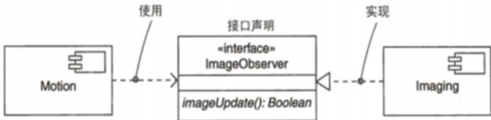

Describe the role of the interface "imageObserver" in the model diagram.

知识点：[面向对象基本概念（类、对象、实例）](../../../topics/软件工程/OO基本概念.md)、[开闭原则（Open-Closed Principle, OCP）与多态条件](../../../topics/软件工程/开闭原则OCP.md)、[依赖倒置原则（Dependency Inversion Principle, DIP）在构件级设计中的应用](../../../topics/软件工程/依赖倒置原则DIP.md)

### 可控连接与可替换性

1. 设计类之间的可控连接：ImageObserver 接口允许 Motion 组件控制其与 Imaging 组件的交互方式。通过依赖接口，Motion 可以调用 imageUpdate() 方法，而无需知道 Imaging 组件的具体实现细节。这解耦了组件，使系统更灵活、更易于维护。

2. 可替换性：由于 Imaging 实现了 ImageObserver 接口，它可以轻松替换为任何其他也实现该接口的组件。这意味着如果需要更新或更改图像处理逻辑，可以创建一个实现 ImageObserver 的新类，Motion 组件可以与新类交互而无需任何更改。

知识点：[依赖倒置原则（Dependency Inversion Principle, DIP）在构件级设计中的应用](../../../topics/软件工程/依赖倒置原则DIP.md)、[耦合（Coupling）的类型：内容、共用、控制、标记、数据、例程调用、类型使用、包含导入、外部耦合](../../../topics/软件工程/耦合.md)、[模块化（Modularity）与信息隐藏（Information Hiding）](../../../topics/软件工程/模块化与信息隐藏.md)

### 场景描述

在此场景中，Motion 依赖 ImageObserver 接口来更新图像，而 Imaging 实现该接口以提供实际的图像更新功能。这种设置允许灵活且可维护的代码，Motion 组件不需要知道图像更新处理的具体细节，而 Imaging 组件可以在需要时轻松替换。

class' exercise — 13

## 七、软件测试（第十五章）

知识点：[依赖倒置原则（Dependency Inversion Principle, DIP）](../../../topics/软件工程/依赖倒置.md)

### 1. 验证和确认（P285）

验证是保证正确实现特定功能（正确的构建产品）。

确认是保证满足客户需求（构建正确的产品）。

知识点：[验证与确认（V & V: Verification and Validation）](../../../topics/软件工程/V与V.md)

### How does software verification differ from validation?

Verification refers to the set of tasks that ensure that software correctly implements a specific function.

Verification: Are we building the product right?

Validation refers to a different set of tasks that ensure that the software that has been built is traceable to customer requirements.

Validation: Are we building the right product?

知识点：[验证与确认（V & V: Verification and Validation）](../../../topics/软件工程/V与V.md)

### 2. 测试角色

开发者测试（developers 写代码，以“交付”（delivery）为驱动力，是温和的（gently））。

独立测试组（independent test group (ITG) 从集成测试开始做，以“质量”（quality）为驱动力，尝试打破（break））。

Software developers are always responsible for testing individual program components and ensuring that each performs its designed function or behavior.

The role of an independent test group (ITG) is to remove the inherent problems associated with letting the builder test the thing that has been built.

Only after the architecture is complete does an ITG become involved.

But ITG is involved in the entire process from analysis, design to test planning, with independence is directly responsible for the SQA team.

ITG personnel are paid to find errors.

Developers and ITG work closely throughout a project to ensure that thorough tests will be conducted.

软件开发人员始终负责测试各个程序组件，并确保每个组件执行其设计的功能或行为。

独立测试组（ITG）的作用是消除让构建者测试已构建事物所带来的固有问题。

只有在架构完成后，ITG 才会介入。

但 ITG 参与整个过程，从分析、设计到测试计划，独立性直接负责 SQA 团队。

ITG 人员的工作是查找错误。

开发人员和 ITG 在整个项目中密切合作，以确保进行彻底的测试。

知识点：[软件测试的战略方法（Strategic Approach）与谁来测试](../../../topics/软件工程/测试战略方法.md)、[验证与确认（V & V: Verification and Validation）](../../../topics/软件工程/V与V.md)

### 3. 宏观步骤

单元测试（unit testing）——> 集成测试（integration testing）——> 确认测试（validation testing）——> 系统测试（system testing）

Unit testing begins at the center of the spiral and concentrates on each unit (for example, component, class, or content object) as they are implemented in source code.

Testing progresses to integration testing, where the focus is on design and the construction of the software architecture. Taking another turn outward on the spiral.

Validation testing is where requirements established as part of requirements modeling are validated against the software that has been constructed.

In system testing, the software and other system elements are tested as a whole.

单元测试就是分模块进行测试，对应详细设计，保证模块内无问题（单元测试应关注对项目成功至关重要的模块或那些被怀疑容易出错的模块。）

集成测试一般是两个两个一起集成，有两种方法自下而上或者自上而下，采用深度优先比宽度优先好，因为深度优先表示一个软件运行出来的分量，主要就是接口（即概要设计）

depth-first ensures that a software component is fully operational before moving on to the next component

确认测试就是看写出来的软件功能和需求的软件功能是否一致，软件规格说明，是软件需求团队验收

系统测试看写出的软件在整个系统下的情况，由客户验收

知识点：[软件测试的战略方法（Strategic Approach）与谁来测试](../../../topics/软件工程/测试战略方法.md)、[单元测试（Unit Testing）的时机与内容（模块接口、局部数据结构、独立路径、出错处理、边界条件）](../../../topics/软件工程/单元测试.md)、[集成测试（Integration Testing）：自顶向下、自底向上、三明治混合增量式](../../../topics/软件工程/集成测试.md)、[验证与确认（V & V: Verification and Validation）](../../../topics/软件工程/V与V.md)、[高级测试（High Order Testing）：确认测试/软件合格性测试、系统测试](../../../topics/软件工程/高级测试.md)

### 4. 脚手架

脚手架 scaffolding 驱动程序 driver 桩 stub

脚手架是为了单元测试产生的。

驱动程序就是主程序，是为了测试自己写的模块，让模块运行起来。

桩是指替换真正的代码，只提供我们的模块测试所需的数据即可，因为目前讨论的是构建级别的测试，每个程序员只完成自己的任务，但是可能会调用别人的代码，这时只需要那部分代码运行的结果所产生的数据，即用桩进行替代。

## 单元测试检查的错误

即上图中的五个部分，一般是用白盒测试（能看见代码），也可能用到黑盒（看不见代码）：interface 接口、local data structures 局部数据结构、boundary conditions 边界条件、independent paths 独立路径（不可能穷举测试，因此找重要路径）、error handling paths 错误处理路径。

PPT 中的对五个部分的介绍：

Design unit test cases before coding for a component to ensure that code that will pass the tests.

Test cases are designed to cover the following areas:

- The module interface is tested to ensure that information properly flows into and out of the program unit.
- Local data structures are examined to ensure that stored data stored maintains its integrity during execution.
- Independent paths through control structures are exercised to ensure all statements are executed at least once.
- Boundary conditions are tested to ensure module operates properly at boundaries established to limit or restrict processing.
- All error-handling paths are tested.

## 白盒测试（P296-297）

知识点：[单元测试（Unit Testing）的时机与内容（模块接口、局部数据结构、独立路径、出错处理、边界条件）](../../../topics/软件工程/单元测试.md)、[白盒测试（White-Box Testing）与基本路径测试（Basis Path Testing）](../../../topics/软件工程/白盒测试.md)

### 示例

1. Flowchart ⇒ Flow Graph

2. compute Cyclomatic Complexity

- The flow graph has 4 regions.

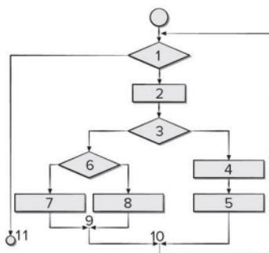

- $V(G)=11(\text{edges}) - 9(\text{nodes}) + 2 = 4$
- $V(G)=3(\text{predicate nodes}) + 1 = 4$

3. An independent path is any path through the program that introduces at least one new set of processing statements or a new condition (need 4 independent paths to test)

- path 1: 1-11
- path 2: 1-2-3-4-5-10-1-11
- path 3: 1-2-3-6-8-9-10-1-11
- path 4: 1-2-3-6-7-9-10-1-11

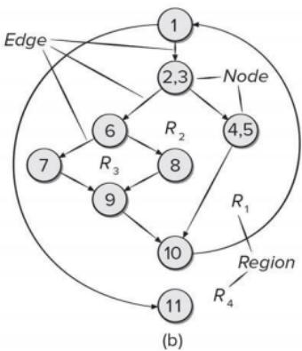

第一个问题是将流程图转化为流图，只要将顺序执行的结点合并即可。

第二个问题是求环路复杂度，一共有三种求解方法：

1. 求封闭区域的个数，复杂度为封闭区域个数 + 1，如上图中 R1、R2、R3 都为封闭区域。
2. 流图中 $V(\text{edges}) - V(\text{nodes}) + 2$。
3. 流程图中分支点的数量（即菱形数量）+ 1。

第三个问题是求所有的独立路径，独立路径的数量就是环路复杂度，要保证每一条分支路径都被走一遍，且一定要从起点走到终点，如上图中是从 1 到 11。

保证所有独立路径至少被测试一次（测试为真或者为假都算）。

知识点：[软件的本质与定义（What is Software）](../../../topics/软件工程/软件的本质与定义.md)、[软件危机（Software Crisis）及其原因](../../../topics/软件工程/软件危机.md)

### 典型例题

4、如图示，给了一段计算输入数据绝对值的程序代码。

1）请使用代码前面的序号，绘制流图（4 分）

2）计算程序的环路复杂性（2 分）

3）列出基本路径测试的独立路径（4 分）

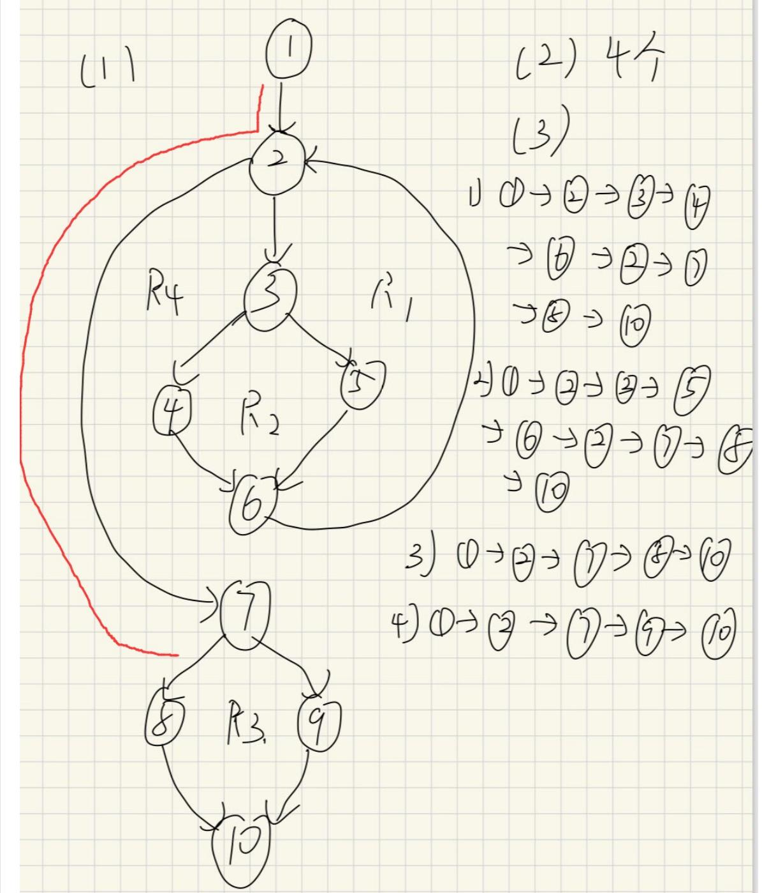

## 黑盒测试

传统结构化编程中的等价类划分法：

If an input condition

- specifies a range: one valid & two invalid（按范围分类）
- requires a specific value: one valid & two invalid（按特定值分类）
- specifies a member of a set: one valid & one invalid（按一个集合分类）
- is Boolean: one valid & one invalid（按布尔值分类）

最小测试序列：就是 account 这个类最短生命周期的序列。

设计测试类可以用是否改变状态来分类。

知识点：[白盒测试（White-Box Testing）与基本路径测试（Basis Path Testing）](../../../topics/软件工程/白盒测试.md)、[控制结构测试（Control Structure Testing）：条件测试与循环测试](../../../topics/软件工程/控制结构测试.md)、[测试的目标（Goal of Testing）与软件可测试性（Testability）](../../../topics/软件工程/测试目标与可测试性.md)

### 示例

知识点：[软件的本质与定义（What is Software）](../../../topics/软件工程/软件的本质与定义.md)、[软件危机（Software Crisis）及其原因](../../../topics/软件工程/软件危机.md)

### 示例：等价类划分法

- 基于状态划分：根据操作改变状态的能力，划分类的操作。
- 基于属性划分：根据操作使用的属性，划分类的操作。
- 基于类别划分：根据操作完成的功能，划分类的操作。

改变状态的操作：检查改变状态的能力。

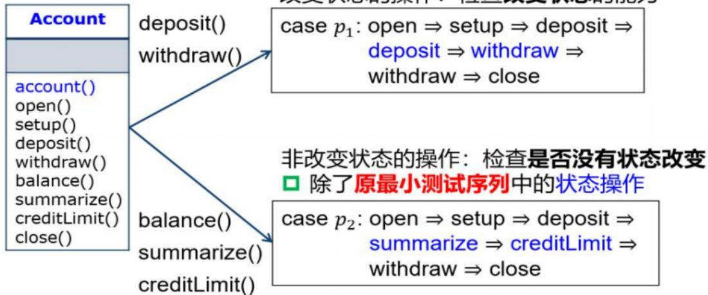

非改变状态的操作：检查是否没有状态改变，除了原最小测试序列中的状态操作。

## 面向对象的测试（P302）

类是组织单元，操作是基本测试单元，但是孤立的测试操作没有意义，因为在面向对象的环境中，独立测试单个操作可能无效，因为多态性使得不同子类具有不同的属性和操作逻辑，其上下文环境也不同于其他子类。因此，测试用例必须考虑每个子类在其特定环境中的具体行为和交互。

To illustrate, consider a class hierarchy in which an operation X is defined for the superclass and is inherited by a number of subclasses. Each subclass uses operation X, but it is applied within the context of the private attributes and operations that have been defined for the subclass. Because the context in which operation X is used varies in subtle ways, it is necessary to test operation X in the context of each of the subclasses. This means that testing operation X in a stand-alone fashion (the conventional unit-testing approach) is usually ineffective in the object-oriented context.

## 八、集成测试（第十六章）

知识点：[面向对象测试（OO Testing）：拓宽测试视野、测试CRC模型、OO测试策略](../../../topics/软件工程/面向对象测试.md)、[集成测试（Integration Testing）：自顶向下、自底向上、三明治混合增量式](../../../topics/软件工程/集成测试.md)、[单元测试（Unit Testing）的时机与内容（模块接口、局部数据结构、独立路径、出错处理、边界条件）](../../../topics/软件工程/单元测试.md)

### 增量集成方式

增量集成方式（就是两两集成）

incremental integration: a program is constructed and tested in small increments, making errors easier to isolate and correct. Far more cost-effective!

自顶向下（Top-Down Integration）、自底向上（Bottom-Up Integration），自顶向下的深度优先搜索的优点。

How does depth-first differ from breadth-first when using a top-down integration strategy?

- depth-first: integrates all components on a major control path of the program structure.
- breadth-first: incorporates all components directly subordinate at each level, moving across the structure horizontally.

If depth-first integration is selected, a complete function of the software may be implemented and demonstrated. Early demonstration of functional capability is a confidence builder for all stakeholders.

知识点：[集成测试（Integration Testing）：自顶向下、自底向上、三明治混合增量式](../../../topics/软件工程/集成测试.md)、[传统方法与面向对象方法的测试策略对比](../../../topics/软件工程/传统与OO测试策略.md)

### 持续集成

敏捷开发，DevOps 测试与运维，XP（Extreme Programming 极限编程）。

冒烟测试，新模块进入后要对整个系统完整性进行测试，判断新构件有没有对软件增加副作用。

回归测试，不断执行已经测试过的用例子集。

知识点：[敏捷思想（Agility）、敏捷原则及变更成本](../../../topics/软件工程/敏捷思想与原则.md)、[极限编程（Extreme Programming, XP）的计划、设计、编码与测试](../../../topics/软件工程/极限编程XP.md)、[回归测试（Regression Testing）与冒烟测试（Smoke Testing）](../../../topics/软件工程/回归测试与冒烟测试.md)

### 确认测试与验收测试

确认测试和验收测试同等地位，验收测试分为测试（受控）、测试（客户验收）。

用户会给出需求，需要通过用户需求提取验收标准，根据验收的标准确认软件是否实现。

验收是客户做的，确认是程序员做的。

What are the key differences between validation testing goals and acceptance testing goals?

验证测试目标和验收测试目标之间的主要区别是什么？

- In validation testing, the test team seeks to ensure that each software function or performance characteristic conforms to its specification.
- In acceptance testing, the test team needs to ensure that the software works correctly for the intended user in his or her normal work environment.

知识点：[高级测试（High Order Testing）：确认测试/软件合格性测试、系统测试](../../../topics/软件工程/高级测试.md)、[验证与确认（V & V: Verification and Validation）](../../../topics/软件工程/V与V.md)

### 系统测试

恢复测试：强制软件发生故障，验证其恢复能力。

# 软件工程（双语）期末复习要点

本资料由识别工具从《软件工程（双语）》第 9 部分（第 36–41 页）整理而成，内容涵盖软件配置管理、过程模型及敏捷开发等核心知识点。

## 九、软件配置管理（第十七章）

知识点：[高级测试（High Order Testing）：确认测试/软件合格性测试、系统测试](../../../topics/软件工程/高级测试.md)、[软件测试的战略方法（Strategic Approach）与谁来测试](../../../topics/软件工程/测试战略方法.md)

### 1. SCI 软件配置项 (P324-327)

**What information will make up the software configuration?**

Software configuration are work products that created by engineers during the software process.
*   Computer programs (source code and executables)
*   Documentation (technical and user)
*   Data (internal and external to programs)

软件配置是工程师在软件过程中创建的工作产品。
计算机程序（源代码和可执行文件）、文档（技术文档和用户文档）、数据（程序内部和外部的数据）。

In software configuration management (SCM) process, each work product is called a software configuration item (SCI).

In the extreme, an SCI could be considered to be a single section of a large specification or one test case in a large suite of tests.

More realistically, an SCI is all or part of a work product (e.g., a document, an entire suite of test cases, a named program component, a multimedia content asset, or a software tool).

Moreover, there is often a hierarchical structure between SCIs.

在软件配置管理（SCM）过程中，每个工作产品称为软件配置项（SCI）。
在极端情况下，SCI可以被认为是一个大规格的一部分或大型测试套件中的一个测试用例。
更现实地说，SCI是工作产品的一部分或全部（例如，一个文档，一整套测试用例，一个命名的程序组件，一个多媒体内容资产，或一个软件工具）。
此外，SCI之间通常存在分层结构。

知识点：[软件配置管理（SCM）的概念、第一定律与主要活动](../../../topics/软件工程/SCM基本概念.md)、[基线（Baselines）与软件配置项（Software Configuration Items, SCIs）](../../../topics/软件工程/基线与配置项.md)

### 2. 基线 (P327)

baseline 基线，当一个产品成为基线前可以随意变更（非正式变更），成为基线后一定是正式变更，可以理解为目前这个产品已经合理且存入库。

The IEEE defines a baseline as:
> A specification or product that has been formally reviewed and agreed upon, that thereafter serves as the basis for further development, and that can be changed only through formal change control procedures.

A baseline is a milestone in the development of software
that is marked by the delivery of one or more software configuration items and
the approval of these SCI that is obtained through a formal technical review.

IEEE 将基线定义为：
已经正式审查并达成一致的规范或产品，此后作为进一步开发的基础，并且只能通过正式的变更控制程序进行更改。

**基线是软件开发中的一个里程碑**
*   标志着一个或多个软件配置项的交付
*   通过正式的技术审查获得这些 SCI 的批准

知识点：[软件配置管理（SCM）的概念、第一定律与主要活动](../../../topics/软件工程/SCM基本概念.md)、[基线（Baselines）与软件配置项（Software Configuration Items, SCIs）](../../../topics/软件工程/基线与配置项.md)、[SCM过程3：变更控制（Change Control）](../../../topics/软件工程/变更控制.md)

### 3. 变更控制过程

**What are the steps in the change control process?**

1.  Evaluate a change request, and submit a change report to CCA (change control authority). The CCA makes the final determination as to the status and priority of the change.
2.  An ECO (engineering change order) is generated for each approved change.
3.  Change SCIs are checked out from the project database subject by its access control parameters.
4.  The modified SCIs is subjected to SQA procedures and checked into the project database.
5.  Version control procedures are followed to produce the next version of the software. Adopting Synchronization control ensures that parallel changes made by different people do not overwrite with each other.

**变更控制过程中的步骤是什么？**

1.  评估变更请求，并将变更报告提交给 CCA（变更控制机构）。CCA 对变更的状态和优先级做出最终确定。
2.  对于每个批准的变更，生成一个 ECO（工程变更单）。
3.  根据访问控制参数，从项目数据库中签出变更的 SCI。
4.  修改后的 SCI 遵循 SQA 程序并签入项目数据库。
5.  遵循版本控制程序以生成软件的下一个版本。采用同步控制确保不同人员进行的并行变更不会互相覆盖。

## 十、过程模型 (第二章)

知识点：[SCM过程3：变更控制（Change Control）](../../../topics/软件工程/变更控制.md)、[SCM过程2：版本控制（Version Control）](../../../topics/软件工程/版本控制.md)

### 1. 传统过程模型

追求结构和顺序（structure and order），预定义的可预测的，每个过程都可以描述为过程流 define a predefined set of process elements and a predictable process work flow.

Prescribe a set of process elements — framework activities, SE actions, tasks, work products, quality assurance, and change control mechanisms for each project.

Each process model also prescribes a process work flow — that is, the manner in which the process elements are interrelated to one another.

Strive for structure and order in software development.

Activities and tasks occur sequentially with defined guidelines for progress.

*   **瀑布模型**：不适于应对需求变更，用户反馈仅限于项目开始和结束时，模型建议在编码或测试前完成所有分析和设计工作。
*   **增量模型**：是创建可适应性过程的基础；鼓励利益相关者尽早且经常参与项目，降低开发出不被客户接受产品的风险。
    *   模型善于处理需求不确定问题，允许有控制地将需求扩展到演化的增量中。
    *   但项目团队规模小，不适于大项目（除非项目可分解为子系统实施），尤其是 Scrum，通过每日例会，保证项目不会偏离用户目标。
*   **螺旋模型**：风险评估的演化原型模型，依赖于适量利益相关者参与项目，每次迭代中创建可扩展原型，文档与每个原型同步，强调早期测试，适于大项目。缺点是项目起始难以确定项目范围。

实际项目过程，吸收增量模型特性：构造一个适应性强的模型，在每个周期中都内置灵活螺旋式的原型演化过程。

知识点：[通用过程模型（A Generic Process Model）](../../../topics/软件工程/通用过程模型.md)、[瀑布模型（The Waterfall Model）](../../../topics/软件工程/瀑布模型.md)、[增量模型（The Incremental Model）](../../../topics/软件工程/增量模型.md)

### 1. 瀑布模型（Waterfall Process Model）文档驱动

经典的生命周期模型（文档驱动、阶段性、连续型），每个阶段都会产生文档作为里程碑，然后开始下一步的设计。
Classic lifecycle model Document-driven: phase & continuous.

**Pros (优点)**
*   It is easy to understand and plan.
*   It works for well-understood small projects.
*   Analysis and testing are straightforward.

**Cons (缺点)**
*   It does not accommodate change well.
*   Testing occurs late in the process.
*   Customer approval is at the end.

**经典生命周期模型 文档驱动：阶段性和连续性**
*   **优点**：容易理解和计划；适用于对需求明确的小型项目；分析和测试直截了当。
*   **缺点**：不善于应对变更；测试在过程中较晚进行；客户审批在最后阶段进行。

知识点：[瀑布模型（The Waterfall Model）](../../../topics/软件工程/瀑布模型.md)

### 2. 原型模型（Prototyping Process Model）原型驱动

先把用户需求明确下来，再去写代码，是真原型，只有界面，后台没有什么业务逻辑，是原型驱动。

原型是一种快速构建的软件模型，用于展示和验证软件的设计和功能，即把客户需求通过界面展示，而后面的实现没有展示。

知识点：[演化模型之原型法（Prototyping Paradigm）](../../../topics/软件工程/原型法.md)、[软件应用领域与遗留软件（Legacy Software）](../../../topics/软件工程/软件应用领域与遗留软件.md)

### 3. 螺旋模型（Spiral Process Model）风险驱动

知识点：[螺旋模型（The Spiral Model）](../../../topics/软件工程/螺旋模型.md)

### 4. 统一过程模型（Unified Process Model）用例驱动

知识点：[专用过程模型：统一过程（Unified Process, UP）](../../../topics/软件工程/统一过程UP.md)、[开发用例（Developing Use Cases）与绘制用例图](../../../topics/软件工程/用例开发.md)、[需求工程（Requirements Engineering）的任务步骤](../../../topics/软件工程/需求工程任务.md)

### 2. 敏捷过程模型

#### 1. 敏捷的宣言

**Agile Manifesto**

A process model is working, it is necessary to adopt a realistic mechanism to ensure discipline while treating software engineers with tolerance.

What are the tradeoffs proposed by the "Agile Manifesto"?

1.  Individuals and interactions over processes and tools.
2.  Working software over comprehensive documentation.
3.  Customer collaboration over contract negotiation.
4.  Responding to change over following a plan.

Agile is not antithetical to solid SE practice, and can be applied as an overriding philosophy for all software work.

**敏捷宣言**

一个过程模型在起作用时，有必要采用一种现实的机制来确保纪律，同时以一定程度宽容对待软件工程师（产生可控的错误）。

“敏捷宣言”提出的权衡是什么？

1.  个体和互动胜过过程和工具。
2.  可工作的软件胜过详尽的文档。
3.  客户协作胜过合同谈判。
4.  响应变化胜过遵循计划。

敏捷并不与稳固的软件工程实践对立，并且可以作为所有软件工作的指导理念。

#### 2. 敏捷哲学

与上面的宣言一一对应。

**agile philosophy**

What are the key issues stressed by an agile philosophy?

1.  Emphasis on rapid delivery of software that satisfies the customer.
2.  Recognition that change represents opportunity.
3.  Communication and collaboration between team members and customers.
4.  The importance of self-organizing teams.

**敏捷哲学**

敏捷哲学强调的关键问题是什么？

1.  强调快速交付满足客户的软件。
2.  认识到变化代表着机会。
3.  团队成员与客户之间的沟通和协作。
4.  自组织团队的重要性。

#### 3. Scrum Framework

一个冲刺（Sprint）就是一个研发周期，一个冲刺就是三到四周。

**待冲项（Sprint Backlog）**：这个冲刺里面要干的事情，包括用户故事（User Stories）、任务（Tasks）、缺陷修复（Bug Fixes）、技术改进（Technical Improvements）、其他相关工作（Other Relevant Work）。

各种会议如下

## Scrum 框架

每日 Scrum 会议上，每个团队成员应回答哪三个问题？

- 自上次团队会议以来你做了什么？
- 你遇到了什么障碍？
- 到下次团队会议前你计划完成什么？

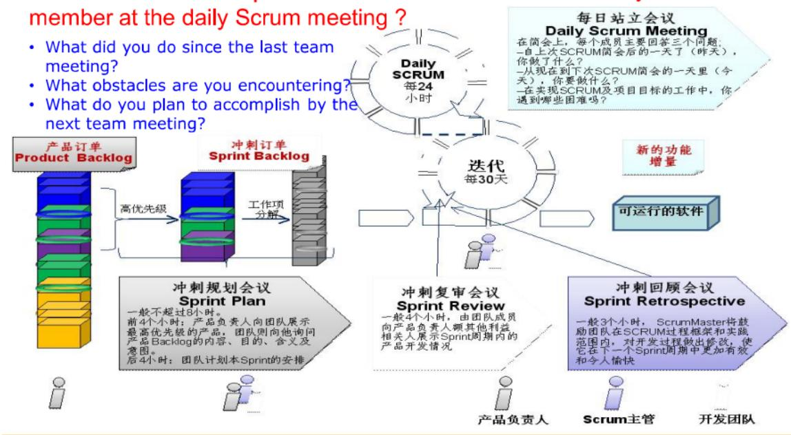

待办事项梳理会议 —— 开发人员与利益相关者合作创建产品待办事项。

冲刺规划会议 —— 从待办事项中提取的内容划分为“冲刺”，并定义下一个冲刺。

每日 Scrum 会议 —— 团队成员同步他们的活动并计划工作日（最多 15 分钟）。

冲刺评审 —— 将原型“演示”交付给利益相关者以供批准或拒绝。

冲刺回顾 —— 冲刺完成后，团队考虑哪些做得好以及哪些需要改进。

知识点：[敏捷思想（Agility）、敏捷原则及变更成本](../../../topics/软件工程/敏捷思想与原则.md)、[Scrum架构、过程流与关键工件](../../../topics/软件工程/Scrum框架.md)

### 极限编程（Extreme Programming, XP）

#### XP 框架

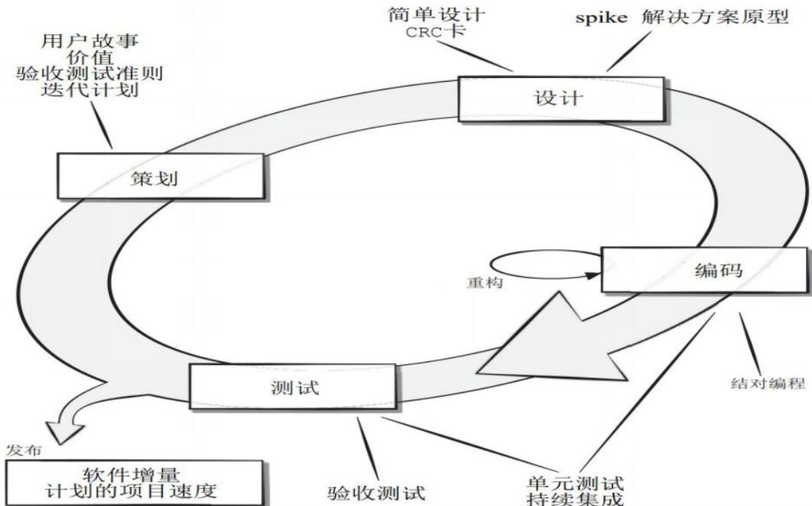

（1）策划：和用户沟通需求，用户讲故事，故事要有价值，故事就是功能，讲故事一定会指定相关的标准。

（2）设计：倡导简单，用户需求分为正常需求（功能）、隐含需求（NFR）、令人兴奋的需求（需要把控好），用 CRC 卡（类的职责，包括自己可以完成，还有必须和协作者合作才能完成，与协作），解决方案就是需求不清的时候做原型。

（3）编码：重构（保证接口不变的情况下改变接口的算法）与结对编程（Pair Programming，两个人负责一个功能模块，一个人负责设计，一个人负责质量）。

（4）后续单元测试与集成测试。

知识点：[敏捷思想（Agility）、敏捷原则及变更成本](../../../topics/软件工程/敏捷思想与原则.md)

### 基于项目的过程模型（第四章）

首个原型创建的重要性。

为什么要在考虑部署的情况下创建原型？

第一个原型可以证明初始架构在满足性能约束的同时能够提供所需的功能。

考虑部署的原型非常重要，因为它可以避免采取捷径，从而创建难以维护的软件。

随着迭代原型开发的进行，应仔细考虑所做的软件架构选择。

一旦软件应用程序发布到全球终端用户，改变其架构将非常昂贵。

## 十一、项目管理与进度计划

知识点：[演化模型之原型法（Prototyping Paradigm）](../../../topics/软件工程/原型法.md)、[体系结构（Architecture）及其属性](../../../topics/软件工程/体系结构概念.md)、[通用过程模型（A Generic Process Model）](../../../topics/软件工程/通用过程模型.md)

### 4P

有效项目管理的四个 P 是什么？

人员（People）—— 成功项目的最重要元素。

产品（Product）—— 要构建的软件。

过程（Process）—— 完成工作所需的一套框架活动和软件工程任务。

项目（Project）—— 实现产品所需的所有工作。

知识点：[项目管理的四个P（People, Product, Process, Project）](../../../topics/软件工程/四个P.md)、[项目（Project）：90-90法则与良好的开端](../../../topics/软件工程/项目与90-90法则.md)

### 软件工程师的素质（P75）

成功软件工程师的特质（要稍微扩展）。

软件工程师应该具备哪些特征？

- 个人责任感
- 对其他团队成员需求的敏锐意识
- 直言不讳
- 在压力下的韧性
- 高度的警觉性
- 注重细节
- 采取务实的软件工程方法

知识点：[人员（People）：利益相关者（Stakeholders）](../../../topics/软件工程/人员与干系人.md)

### 高效团队的特征（P77 第二段到第四段）

有效团队的属性（此题也要扩展）。

有效的软件团队的关键属性是什么？

- 目标感。
- 参与感。
- 信任感。
- 改进意识。
- 团队成员技能的多样性。

知识点：[人员（People）：利益相关者（Stakeholders）](../../../topics/软件工程/人员与干系人.md)、[敏捷团队（Agile Teams）的特点](../../../topics/软件工程/敏捷团队.md)、[软件团队（Software Teams）与团队领导（Team Leader）](../../../topics/软件工程/软件团队与领导.md)

### 影响团队的毒性因素和处理措施

哪些环境特征可以被认为对软件团队有毒？如何避免？

毒性因素：

1. 狂热的工作氛围，团队成员浪费精力并失去专注。
2. 高度的挫败感导致团队成员之间产生摩擦。
3. 碎片化或协调不良的过程模型成为完成任务的障碍。
4. 团队角色定义不明确，导致缺乏问责并随之相互推诿。
5. 持续反复地遭遇失败，导致信心丧失和士气低落。
6. 团队成员的人际特质存在差异且互不兼容。

避免措施：

1. 确保团队能够获取完成工作所需的全部信息。
2. 除非绝对必要，不应修改主要目标。
3. 应尽可能给予团队决策责任。
4. 允许团队选择过程模型。
5. 团队应建立自己的问责机制。
6. 建立基于团队的反馈和问题解决技术。

知识点：[人员（People）：利益相关者（Stakeholders）](../../../topics/软件工程/人员与干系人.md)、[软件团队（Software Teams）与团队领导（Team Leader）](../../../topics/软件工程/软件团队与领导.md)

### 项目团队结构（P78）

1963～1966 年，开发的 IBM System/360 机操作系统共 4000 多个模块，约 100 万条指令，投入 5000 人年，耗资数亿美元，结果延期交付后系统中仍发现大量（2000 个以上）的错误，项目负责人 F. D. Brooks 总结教训时提到：问题主要原因是管理出了问题，团队构建发生了问题。

请根据所学知识，简析选择团队结构应考虑什么因素（7 分）？并谈一下个人对构建团队的认识（8 分）。

项目规划中选择团队结构应考虑哪些因素？

1. 待解决问题的难度。
2. 最终程序的规模（代码行数或功能点）。
3. 团队共事的时间（团队生命周期）。
4. 问题可模块化的程度。
5. 所构建系统所需的质量和可靠性。
6. 交付日期的刚性。
7. 项目所需的沟通程度。

理解：

将人力资源管理と项目开发分离。

不同公司有不同的组织结构。

公司的组织结构无法轻易改变。

组织管理不是项目经理的职责。

项目经理应根据项目的性质和规模组织项目团队成员。

优秀的项目团队：取决于管理风格、人员数量、技能水平以及问题的难度等级。

知识点：[软件团队（Software Teams）与团队领导（Team Leader）](../../../topics/软件工程/软件团队与领导.md)、[人员（People）：利益相关者（Stakeholders）](../../../topics/软件工程/人员与干系人.md)、[项目（Project）：90-90法则与良好的开端](../../../topics/软件工程/项目与90-90法则.md)

### 问题分解和过程分解

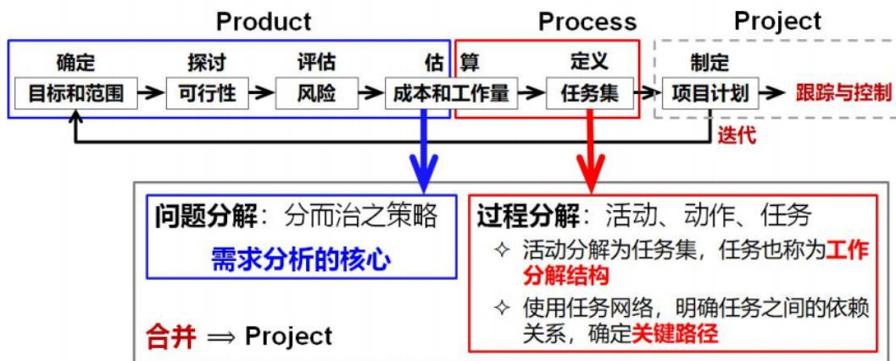

知识点：[产品（Product）：产品范围（Scope）与问题分解（Problem Decomposition）](../../../topics/软件工程/产品范围与分解.md)、[过程（Process）：过程分解与沟通活动的任务](../../../topics/软件工程/过程分解.md)
