# 《软件工程（双语）》第10章 软件配置管理（课件）

原件的每一页，下面附识别出的文字。

### Unit 10

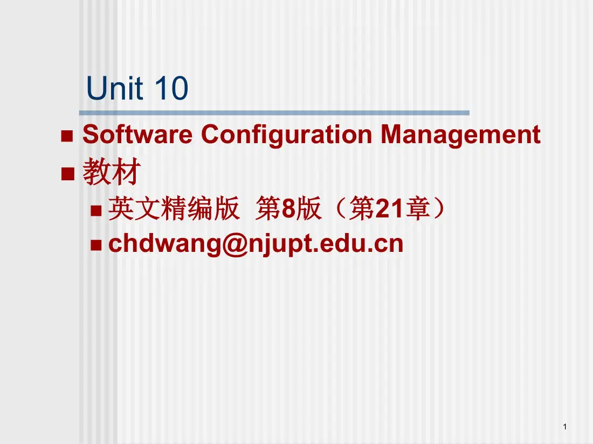

原文：

Unit 10

Software Configuration Management

教材

英文精编版 第8版（第21章）

◼ chdwang@njupt.edu.cn

1

### Contents & Requirements

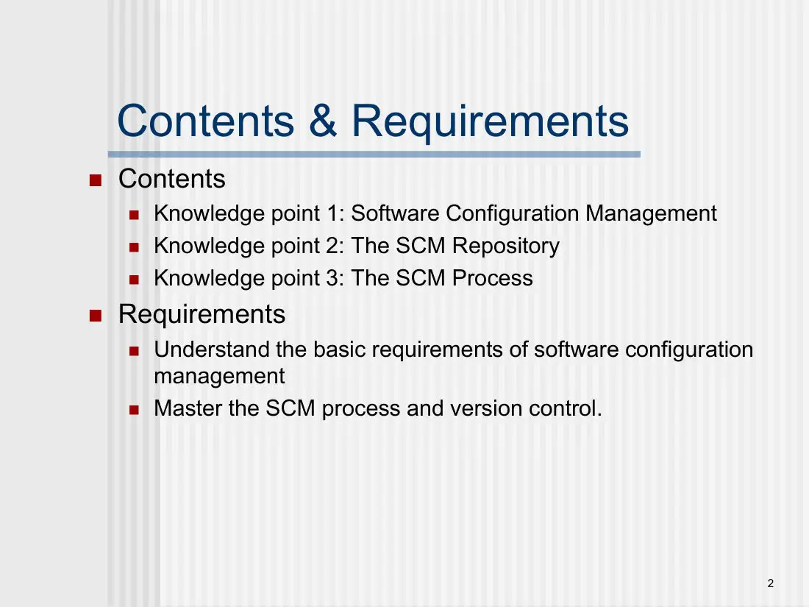

原文：

Contents & Requirements

◼ Contents

◼ Knowledge point 1: Software Configuration Management

◼ Knowledge point 2: The SCM Repository

◼ Knowledge point 3: The SCM Process

◼ Requirements

Understand the basic requirements of software configuration management

◼ Master the SCM process and version control.

2

### The “First Law”

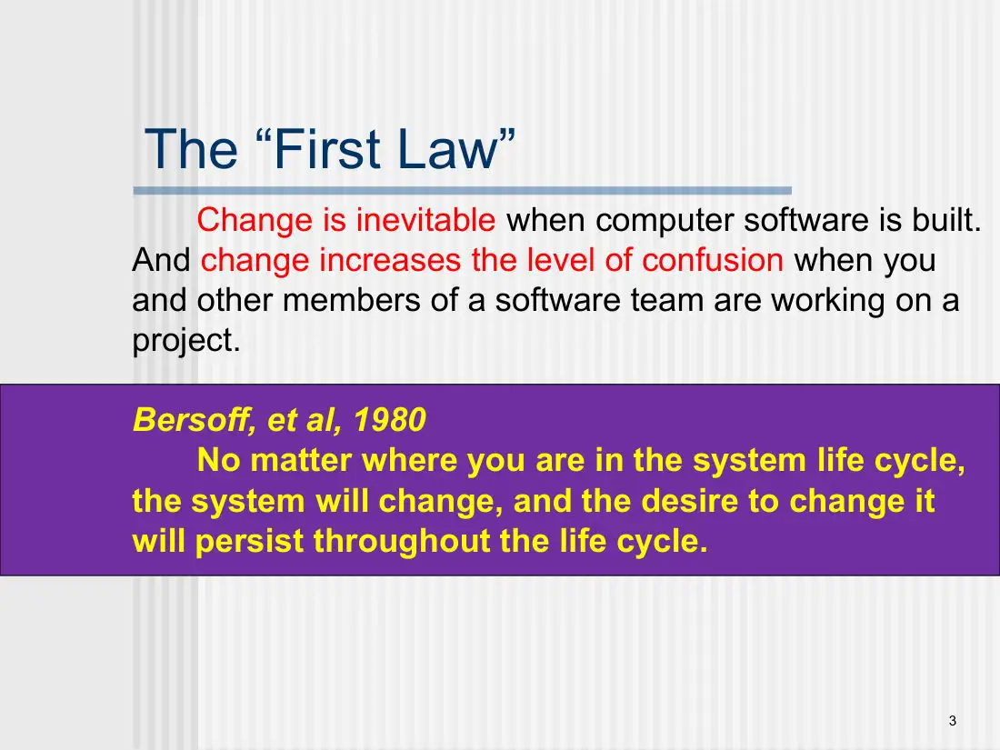

原文：

The “First Law”

Change is inevitable when computer software is built. And change increases the level of confusion when you and other members of a software team are working on a project.

Bersoff, et al, 1980

No matter where you are in the system life cycle, the system will change, and the desire to change it will persist throughout the life cycle.

3

### The major activities

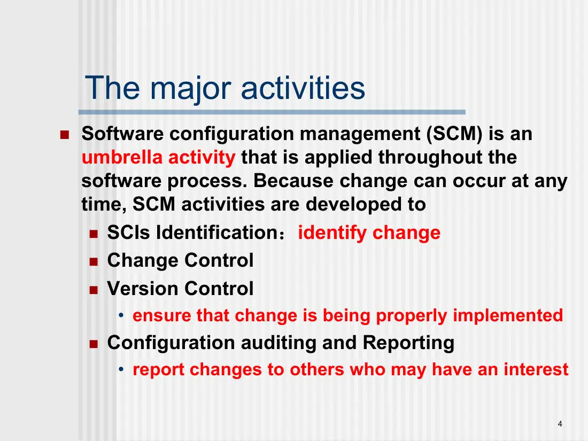

原文：

The major activities

Software configuration management (SCM) is an umbrella activity that is applied throughout the software process. Because change can occur at any time, SCM activities are developed to

◼ SCIs Identification：identify change

◼ Change Control

◼ Version Control

ensure that change is being properly implemented

◼ Configuration auditing and Reporting

• report changes to others who may have an interest

4

### What Are These Changes?

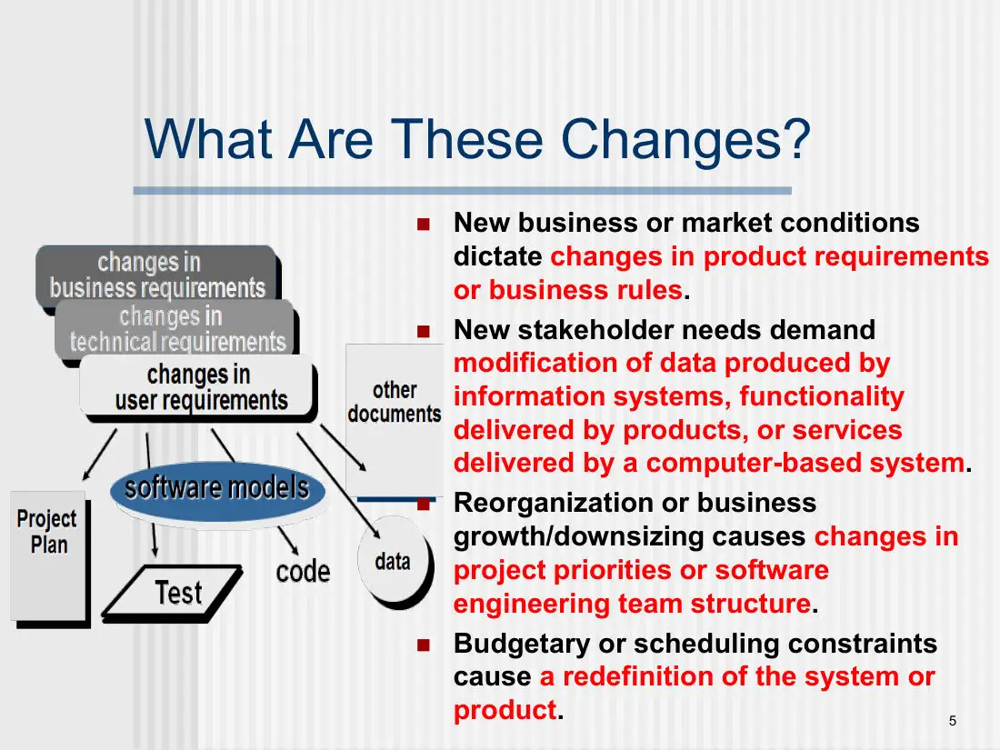

原文：

What Are These Changes?

changes in business réquirements changes in technical requirements

changes in user requirements

other documents ents

software models

Test

code

New business or market conditions dictate changes in product requirements or business rules.

New stakeholder needs demand modification of data produced by information systems, functionality delivered by products, or services delivered by a computer-based system.

Reorganization or business growth/downsizing causes changes in project priorities or software engineering team structure.

Budgetary or scheduling constraints cause a redefinition of the system or product.

5

### The pieces

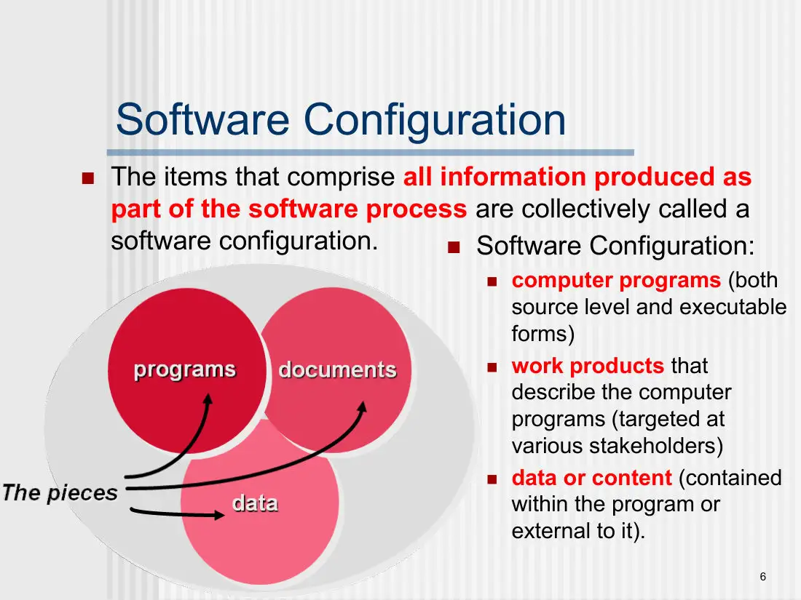

原文：

The pieces

Software Configuration

The items that comprise all information produced as part of the software process are collectively called a software configuration. Software Configuration:

computer programs (both source level and executable forms)

work products that describe the computer programs (targeted at various stakeholders)

data or content (contained within the program or external to it).

6

### SCM Scenario

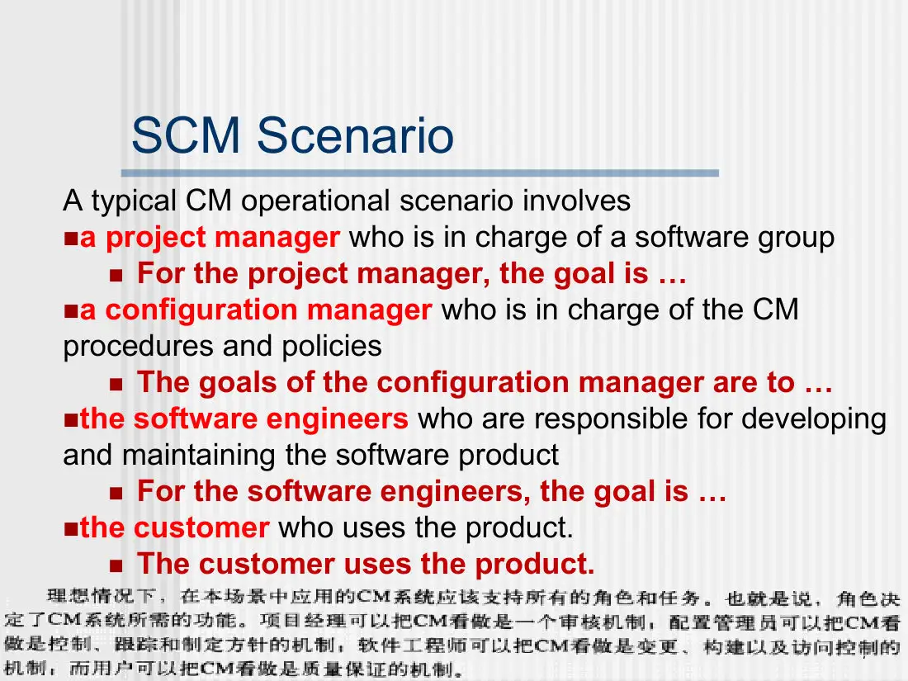

原文：

SCM Scenario

A typical CM operational scenario involves

◼a project manager who is in charge of a software group

◼ For the project manager, the goal is … ◼a configuration manager who is in charge of the CM procedures and policies

The goals of the configuration manager are to ◼the software engineers who are responsible for developing and maintaining the software product

For the software engineers, the goal is … ◼the customer who uses the product.

◼ The customer uses the product.

理想情况下，在本场景中应用的CM系统应该支持所有的角色和任务。也就是说，角色决定了CM系统所需的功能。项目经理可以把CM看做是一个审核机制，配置管理员可以把CM看做是控制、跟踪和制定方针的机制：软件工程师可以把CM看做是变更、构建以及访问控制的机制：而用户可以把CM看做是质量保证的机制。

### SCM Elements

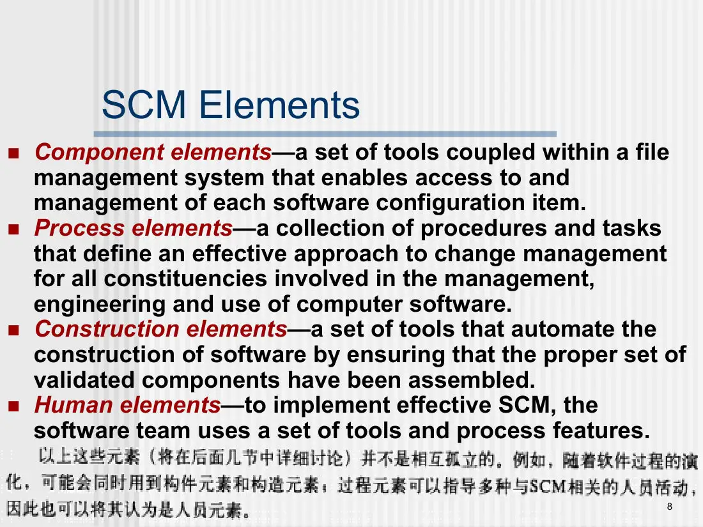

原文：

SCM Elements

Component elements—a set of tools coupled within a file management system that enables access to and management of each software configuration item.

Process elements—a collection of procedures and tasks that define an effective approach to change management for all constituencies involved in the management, engineering and use of computer software.

Construction elements—a set of tools that automate the construction of software by ensuring that the proper set of validated components have been assembled.

Human elements—to implement effective SCM, the software team uses a set of tools and process features.

以上这些元素（将在后面几节中详细讨论）并不是相互孤立的。例如，随着软件过程的演化，可能会同时用到构件元素和构造元素，过程元素可以指导多种与SCM相关的人员活动.因此也可以将其认为是人员元素。 8

### Baselines

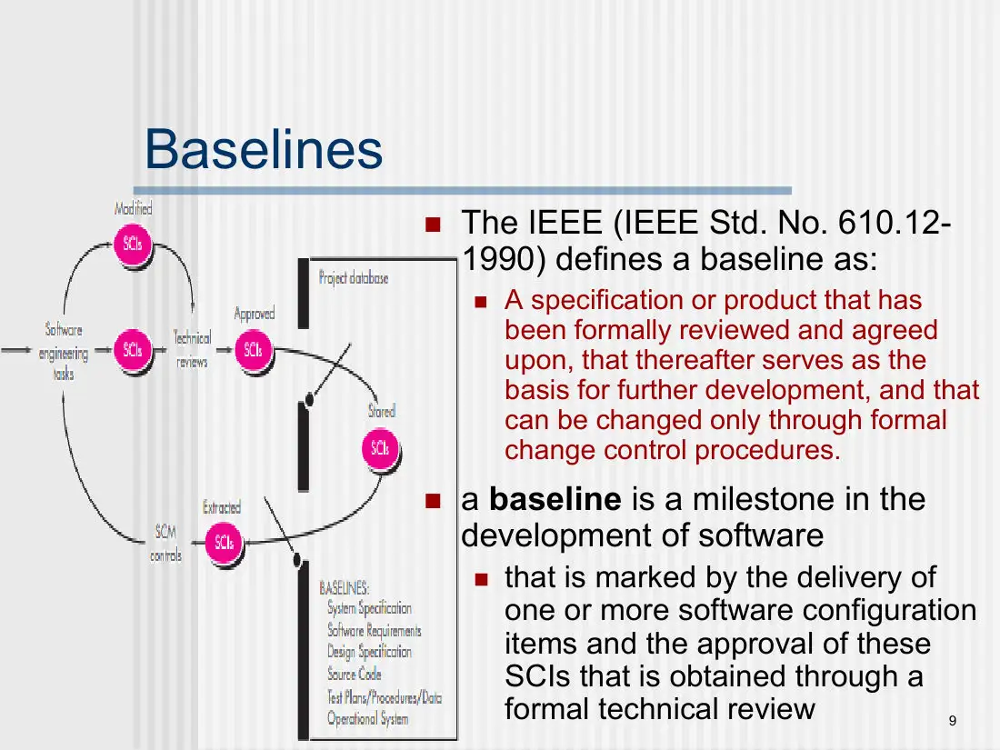

原文：

Baselines

The IEEE (IEEE Std. No. 610.12- 1990) defines a baseline as:

A specification or product that has been formally reviewed and agreed upon, that thereafter serves as the basis for further development, and that can be changed only through formal change control procedures.

a baseline is a milestone in the development of software

that is marked by the delivery of one or more software configuration items and the approval of these SCIs that is obtained through a formal technical review 9

### Software Configuration Items

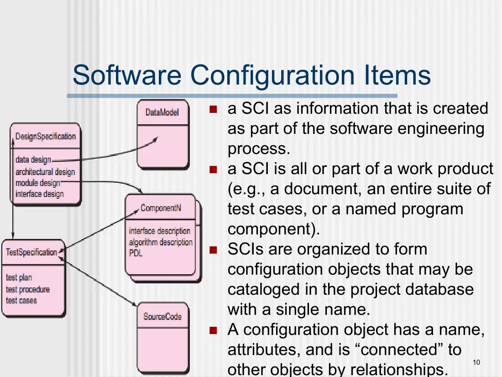

原文：

Software Configuration Items

a SCI as information that is created as part of the software engineering process.

a SCI is all or part of a work product (e.g., a document, an entire suite of test cases, or a named program component).

SCIs are organized to form configuration objects that may be cataloged in the project database with a single name.

A configuration object has a name, attributes, and is “connected” to 10 other objects by relationships.

### SCM Repository

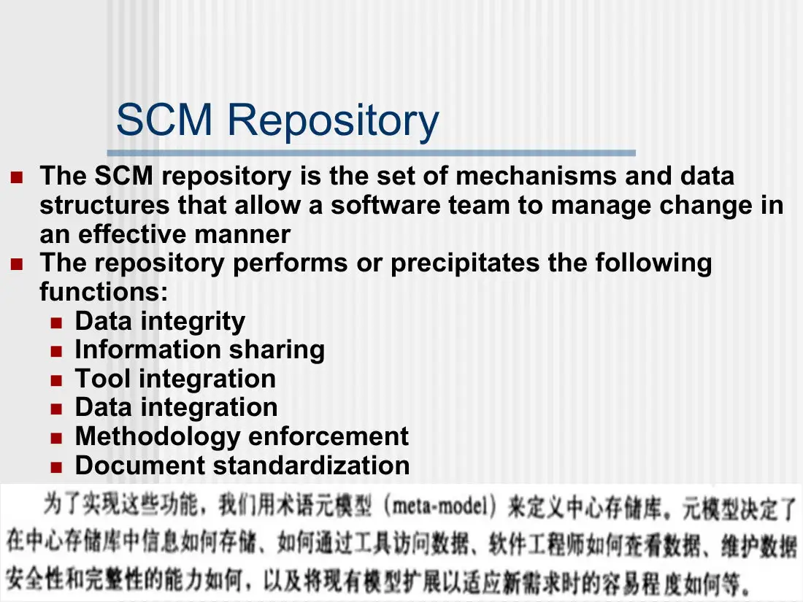

原文：

SCM Repository

◼ The SCM repository is the set of mechanisms and data structures that allow a software team to manage change in an effective manner

The repository performs or precipitates the following functions:

◼ Data integrity

◼ Information sharing

◼ Tool integration

◼ Data integration

◼ Methodology enforcement

◼ Document standardization

为了实现这些功能，我们用术语元模型(meta-model)来定义中心存储库。元模型决定了在中心存储库中信息如何存储、如何通过工具访问数据、软件工程师如何查看数据、维护数据安全性和完整性的能力如何，以及将现有模型扩展以适应新需求时的容易程度如何等。

### Content of the Repository

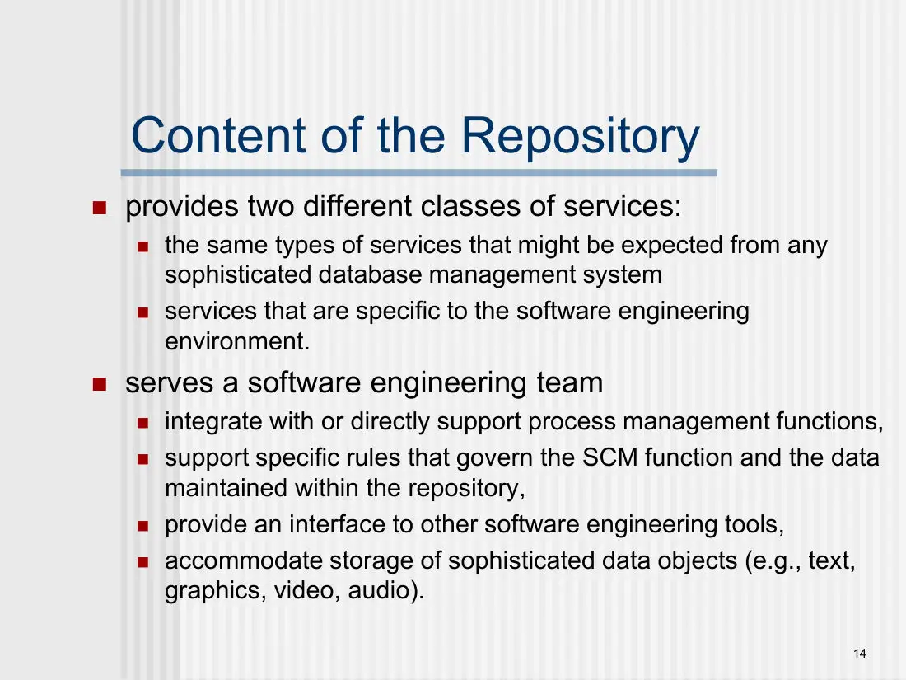

原文：

Content of the Repository

◼ provides two different classes of services:

◼ the same types of services that might be expected from any sophisticated database management system

services that are specific to the software engineering environment.

◼ serves a software engineering team

◼ integrate with or directly support process management functions,

◼ support specific rules that govern the SCM function and the data maintained within the repository,

◼ provide an interface to other software engineering tools,

accommodate storage of sophisticated data objects (e.g., text, graphics, video, audio).

14

### 15

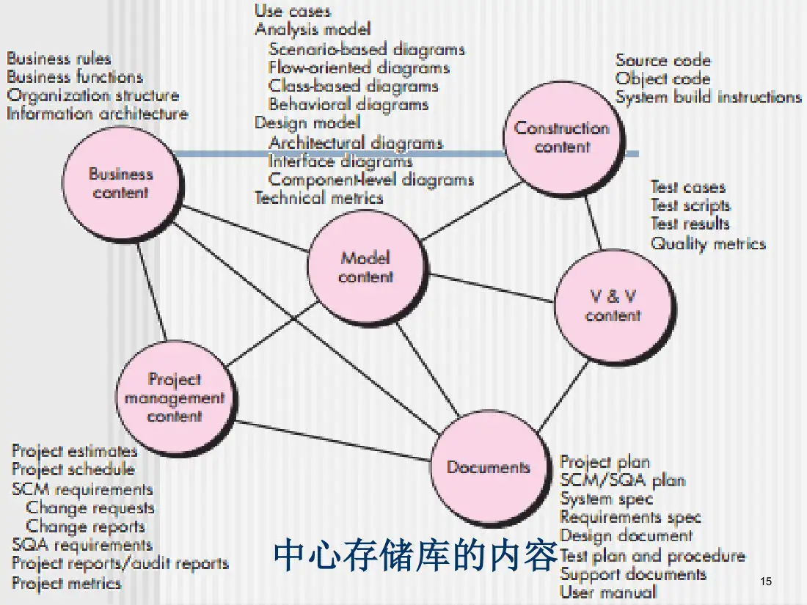

原文：

15

### Repository Features

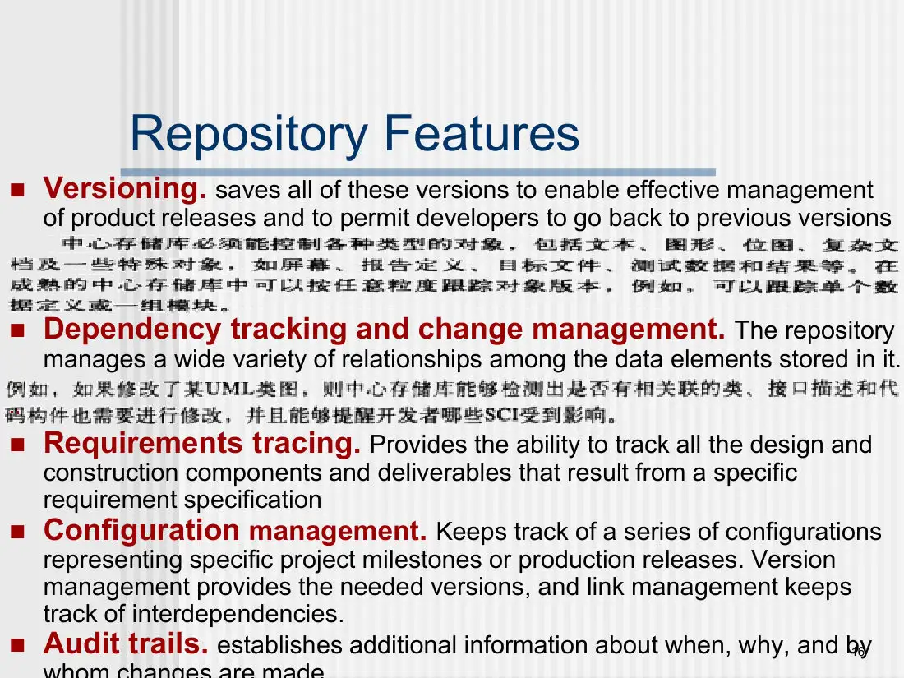

原文：

Repository Features

Versioning. saves all of these versions to enable effective management of product releases and to permit developers to go back to previous versions

中心存储库必须能控制各种类型的对象，包括文本、图形、位图、复杂文档及一些特殊对象，如屏幕、报告定义、目标文件、测试数据和结果等。在成熟的中心存储库中可以按任意粒度跟踪对象版本，例如，可以跟踪单个数据定义或一组模块。

◼ Dependency tracking and change management. The repositorymanages a wide variety of relationships among the data elements stored in it.例如，如果修改了某UML类图，则中心存储库能够检测出是否有相关联的类、接口描述和代码构件也需要进行修改，并且能够提醒开发者哪些SCI受到影响。

Requirements tracing. Provides the ability to track all the design and construction components and deliverables that result from a specific requirement specification

Configuration management. Keeps track of a series of configurations representing specific project milestones or production releases. Version management provides the needed versions, and link management keeps track of interdependencies.

16Audit trails. establishes additional information about when, why, and by whom changes are made

### SCM Objective

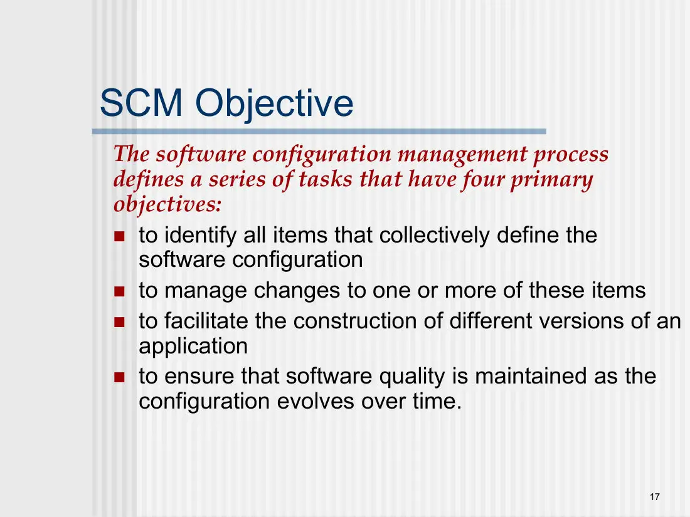

原文：

SCM Objective

The software configuration management process defines a series of tasks that have four primary objectives:

to identify all items that collectively define the software configuration

◼ to manage changes to one or more of these items

to facilitate the construction of different versions of an application

◼ to ensure that software quality is maintained as the configuration evolves over time.

17

### SCM Process

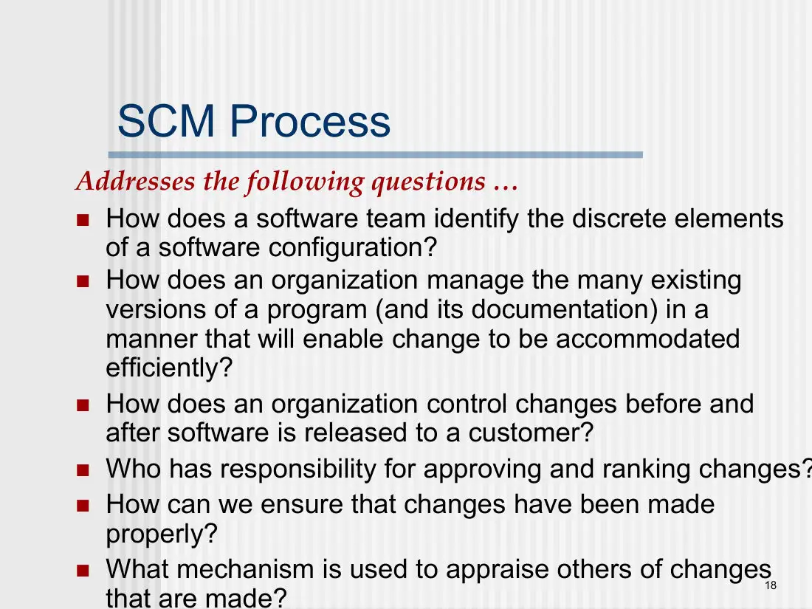

原文：

SCM Process

Addresses the following questions …

How does a software team identify the discrete elements of a software configuration?

How does an organization manage the many existing versions of a program (and its documentation) in a manner that will enable change to be accommodated efficiently?

◼ How does an organization control changes before and after software is released to a customer?

◼ Who has responsibility for approving and ranking changes?

How can we ensure that changes have been made properly?

◼ What mechanism is used to appraise others of changes 18 that are made?

### SCM Process（SCM过程）

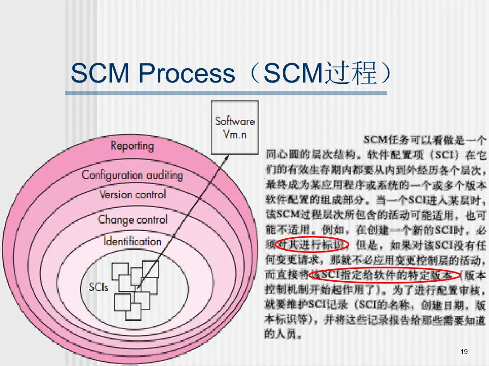

原文：

SCM Process（SCM过程）

SCM任务可以看做是一个同心圆的层次结构。软件配置项（SCI）在它们的有效生存期内都要从内到外经历各个层次，最终成为某应用程序或系统的一个或多个版本软件配置的组成部分，当一个SCI进入某层时该SCM过程层次所包含的活动可能适用，也可能不适用。例如，在创建一个新的SCI时，必须对其进行标识但是，如果对该SCI没有任何变更请求，那就不必应用变更控制层的活动。而直接将SCI指定给软件的特定版本（版本控制机制开始起作用了)。为了进行配置审核。就要维护SCI记录（SCI的名称，创建日期，版本标识等)，并将这些记录报告给那些需要知道的人员。

19

### SCM过程1—配置项(SCIs)标识

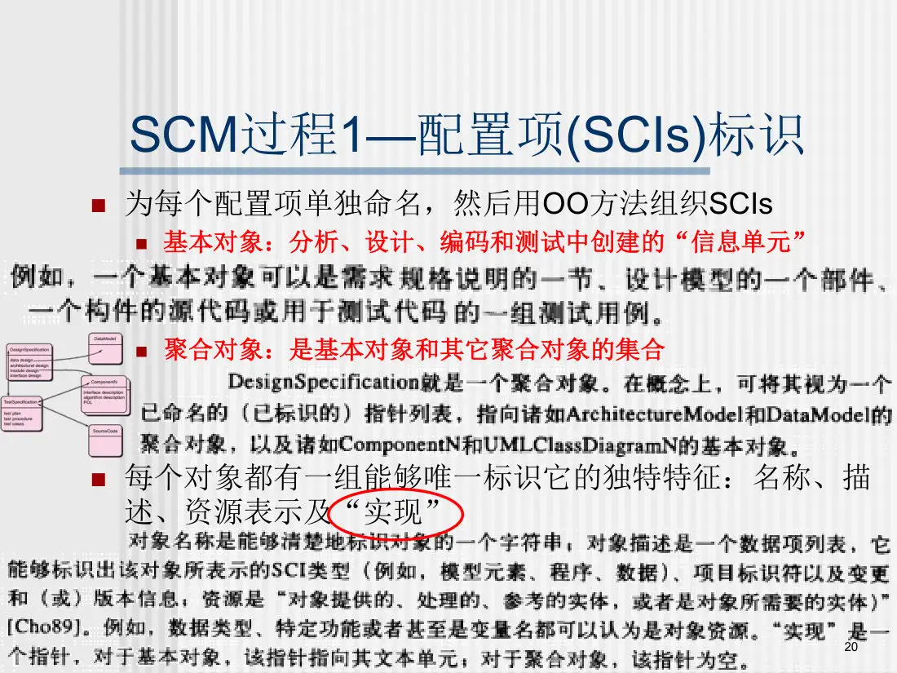

原文：

SCM过程1—配置项(SCIs)标识

◼ 为每个配置项单独命名，然后用OO方法组织SCIs

基本对象：分析、设计、编码和测试中创建的“信息单元”

例如，一个基本对象可以是需求规格说明的一节、设计模型的一个部件、一个构件的源代码或用于测试代码的一组测试用例。

聚合对象：是基本对象和其它聚合对象的集合

DesignSpecification就是一个聚合对象。在概念上，可将其视为一个已命名的（已标识的）指针列表，指向诸如ArchitectureModel和DataModel的聚合对象，以及诸如ComponentN和UMLClassDiagramN的基本对象。

◼ 每个对象都有一组能够唯一标识它的独特特征：名称、描述、资源表示及“实现”

对象名称是能够清楚地标识对象的一个字符串，对象描述是一个数据项列表，它

能够标识出该对象所表示的SCI类型（例如，模型元素、程序、数据）、项目标识符以及变更和（或）版本信息：资源是“对象提供的、处理的、参考的实体，或者是对象所需要的实体）”[Cho89]。例如，数据类型、特定功能或者甚至是变量名都可以认为是对象资源。“实现”是个指针，对于基本对象，该指针指向其文本单元：对于聚合对象，该指针为空。

### SCM过程1—配置项(SCIs)标识

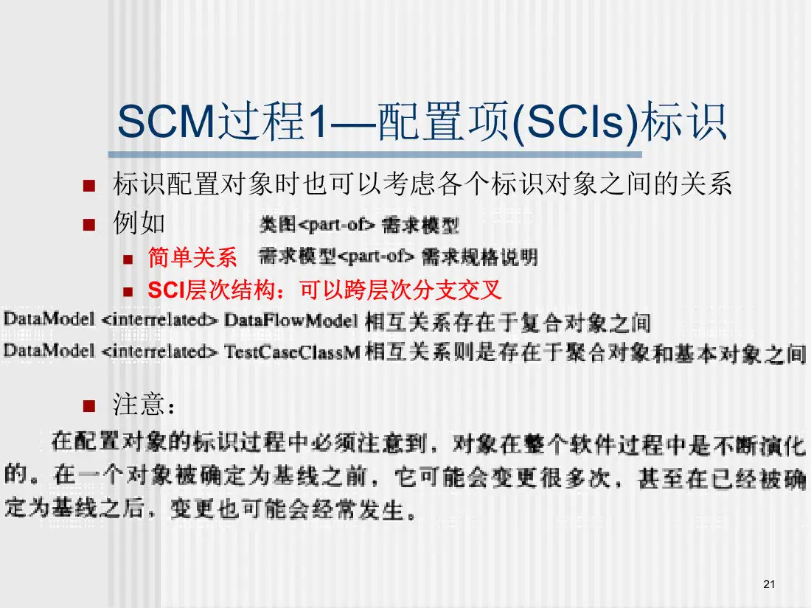

原文：

SCM过程1—配置项(SCIs)标识

◼ 标识配置对象时也可以考虑各个标识对象之间的关系

◼ 例如 类图<part-of>需求模型

简单关系需求模型<part-of>需求规格说明

SCI层次结构：可以跨层次分支交叉

DataModel <interrelated> DataFlowModel 相互关系存在于复合对象之间

DataModel <interrelated>TestCaseClassM相互关系则是存在于聚合对象和基本对象之间

◼ 注意：

在配置对象的标识过程中必须注意到，对象在整个软件过程中是不断演化的。在一个对象被确定为基线之前，它可能会变更很多次，甚至在已经被确定为基线之后，变更也可能会经常发生。

21

### SCM过程2—版本控制

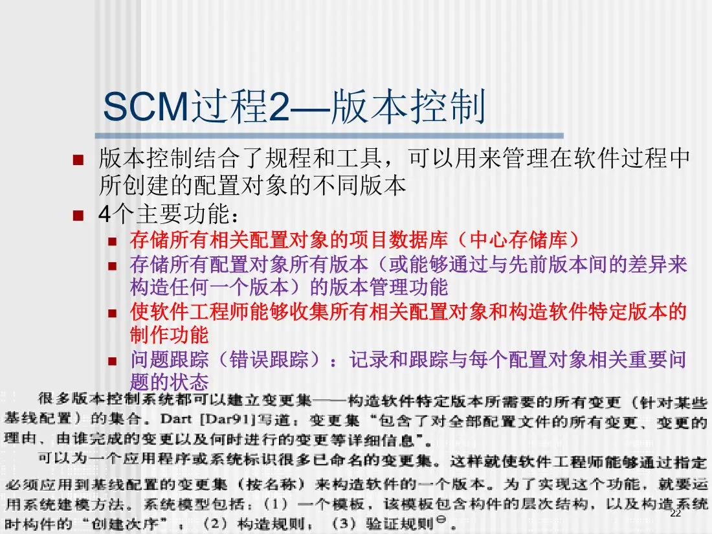

原文：

SCM过程2—版本控制

版本控制结合了规程和工具，可以用来管理在软件过程中所创建的配置对象的不同版本

◼ 4个主要功能：

存储所有相关配置对象的项目数据库（中心存储库）

存储所有配置对象所有版本（或能够通过与先前版本间的差异来构造任何一个版本）的版本管理功能

使软件工程师能够收集所有相关配置对象和构造软件特定版本的制作功能

问题跟踪（错误跟踪）：记录和跟踪与每个配置对象相关重要问题的状态

很多版本控制系统都可以建立变更集构造软件特定版本所需要的所有变更（针对某些基线配置）的集合。Dart[Dar91]写道：变更集“包含了对全部配置文件的所有变更、变更的理由、由谁完成的变更以及何时进行的变更等详细信息”。

可以为一个应用程序或系统标识很多已命名的变更集。这样就使软件工程师能够通过指定必须应用到基线配置的变更集（按名称）来构造软件的一个版本。为了实现这个功能，就要运用系统建模方法。系统模型包括：（1)一个模板，该模板包含构件的层次结构，以及构造系统时构件的“创建次序”，(2)构造规则，(3)验证规则。

### SCM过程3变更控制

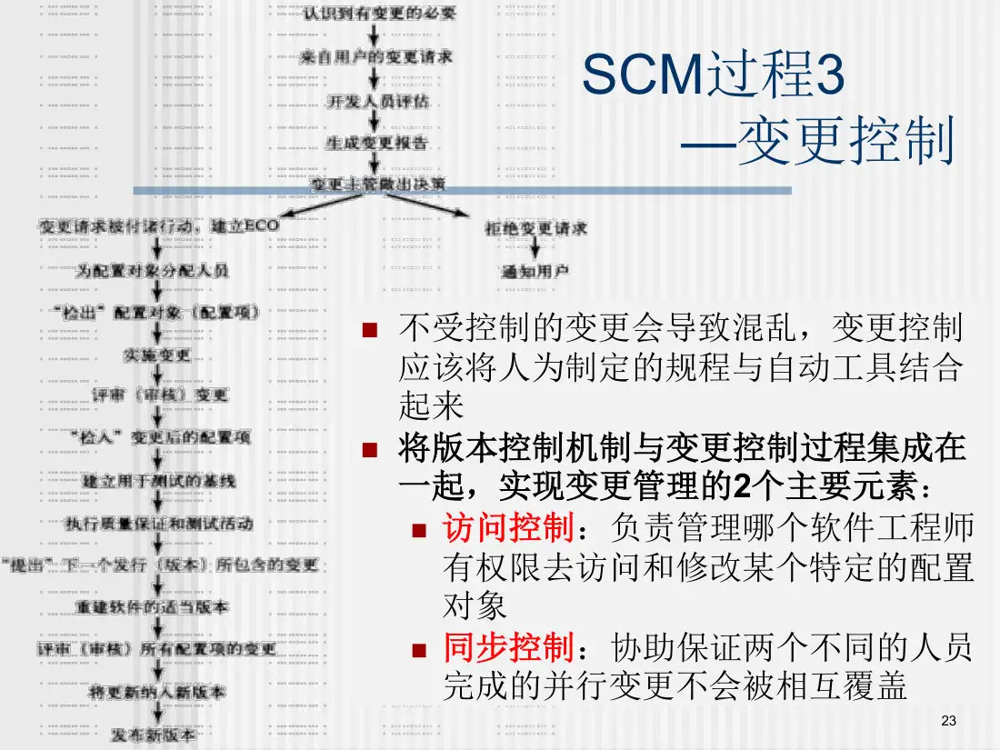

原文：

SCM过程3变更控制

不受控制的变更会导致混乱，变更控制应该将人为制定的规程与自动工具结合起来

将版本控制机制与变更控制过程集成在一起，实现变更管理的2个主要元素：

◼ 访问控制：负责管理哪个软件工程师有权限去访问和修改某个特定的配置对象

同步控制：协助保证两个不同的人员完成的并行变更不会被相互覆盖

23

### SCM过程3—变更控制

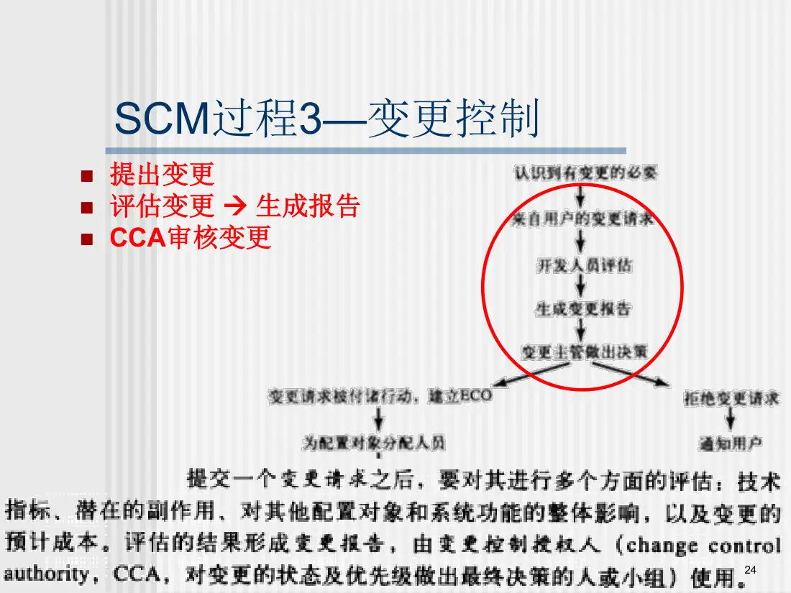

原文：

SCM过程3—变更控制

提出变更

评估变更 → 生成报告

CCA审核变更

提交一个变更请求之后，要对其进行多个方面的评估：技术指标、潜在的副作用、对其他配置对象和系统功能的整体影响，以及变更的预计成本。评估的结果形成变更报告，由变更控制授权人(changecontrolauthority，CCA，对变更的状态及优先级做出最终决策的人或小组）使用。24

### SCM过程3—变更控制

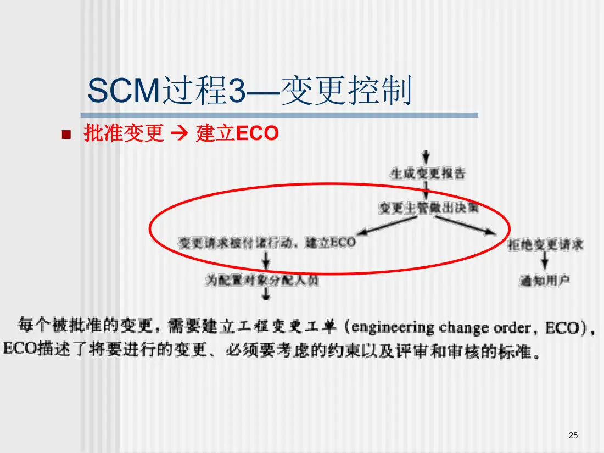

原文：

SCM过程3—变更控制

批准变更 → 建立ECO

每个被批准的变更，需要建立工程变史工单(engineering change order，ECO).ECO描述了将要进行的变更、必须要考虑的约束以及评审和审核的标准。

25

### SCM过程3—变更控制

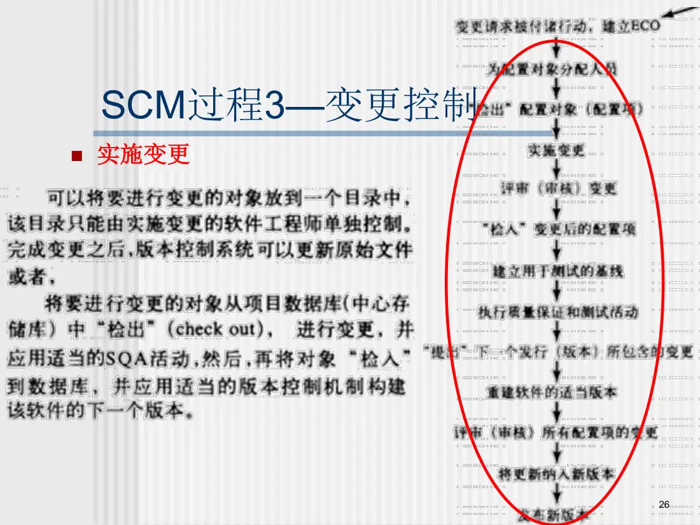

原文：

SCM过程3—变更控制

实施变更

可以将要进行变更的对象放到一个目录中，该目录只能由实施变更的软件工程师单独控制。完成变更之后，版本控制系统可以更新原始文件或者，

将要进行变更的对象从项目数据库(中心存储库）中“检出”(checkout)，进行变更，并应用适当的SQA活动，然后，再将对象“检入”到数据库，并应用适当的版本控制机制构建该软件的下一个版本。

变更请求被付诸行动，建立ECO

26

### SCM过程3—变更控制

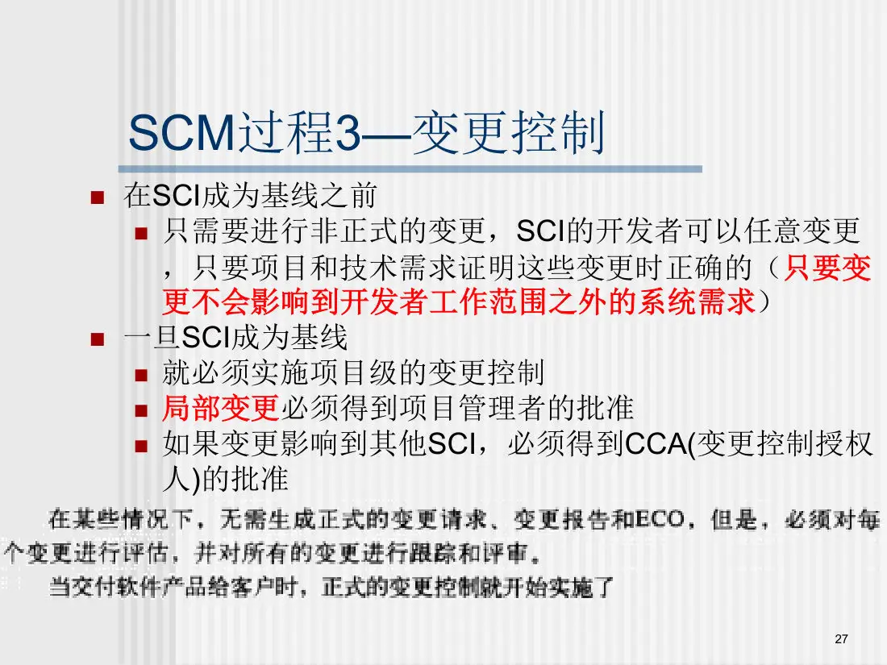

原文：

SCM过程3—变更控制

◼ 在SCI成为基线之前

只需要进行非正式的变更，SCI的开发者可以任意变更只要项目和技术需求证明这些变更时正确的（只要变更不会影响到开发者工作范围之外的系统需求）

◼ 一旦SCI成为基线

◼ 就必须实施项目级的变更控制

◼ 局部变更必须得到项目管理者的批准

如果变更影响到其他SCI，必须得到CCA(变更控制授权人)的批准

在某些情况下，无需生成正式的变更请求、变更报告和ECO，但是，必须对每个变更进行评估，并对所有的变更进行跟踪和评审。

当交付软件产品给客户时，正式的变更控制就开始实施了

27

### SCM过程4—配置审核

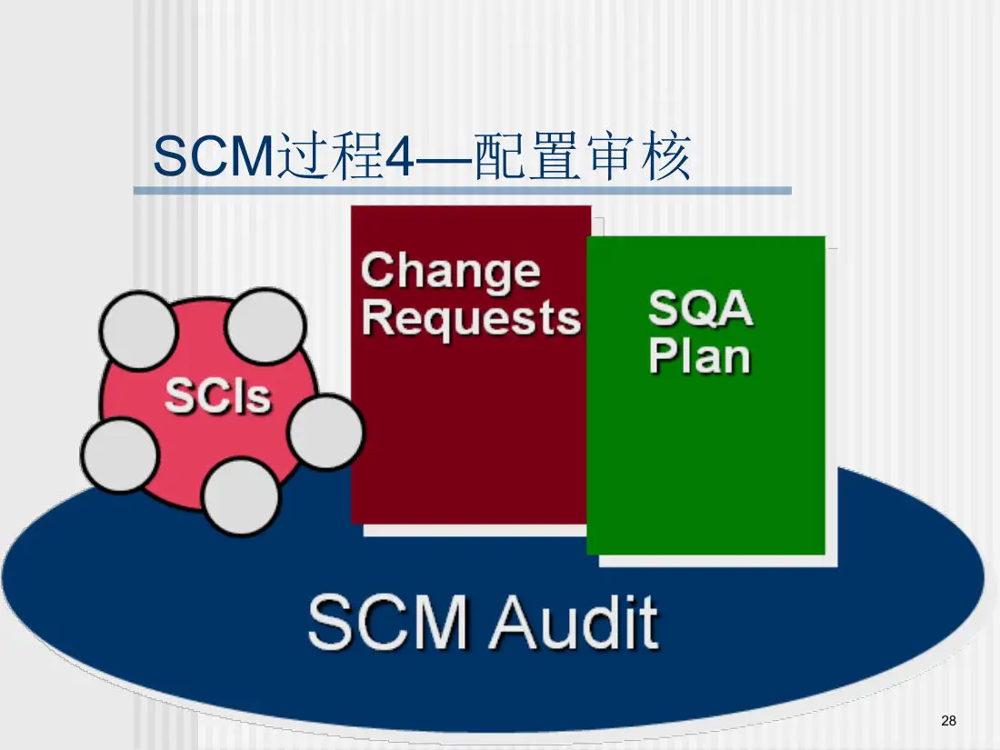

原文：

SCM过程4—配置审核

SCIs

Change Requēsts

SQA Plan

SCM Audit

28

### SCM过程4—配置审核

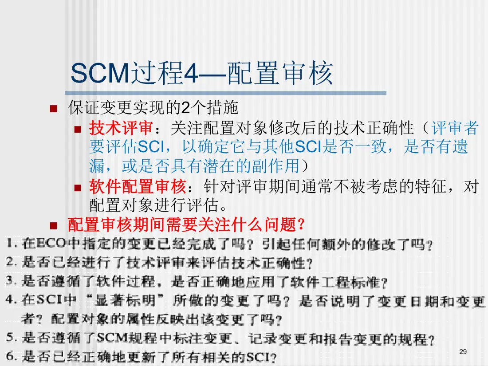

原文：

SCM过程4—配置审核

◼ 保证变更实现的2个措施

技术评审：关注配置对象修改后的技术正确性（评审者要评估SCI，以确定它与其他SCI是否一致，是否有遗漏，或是否具有潜在的副作用）

软件配置审核：针对评审期间通常不被考虑的特征，对配置对象进行评估。

配置审核期间需要关注什么问题？

1. 在ECO中指定的变更已经完成了吗？引起任何额外的修改了吗？

2. 是否已经进行了技术评审来评估技术正确性？

3. 是否遵循了软件过程，是否正确地应用了软件工程标准？

4.在SCI中“显著标明”所做的变更了吗？是否说明了变更日期和变更者？配置对象的属性反映出该变更了吗？

5. 是否遵循了SCM规程中标注变更、记录变更和报告变更的规程？

6. 是否已经正确地更新了所有相关的SCI？

29

### SCM过程5—状态报告

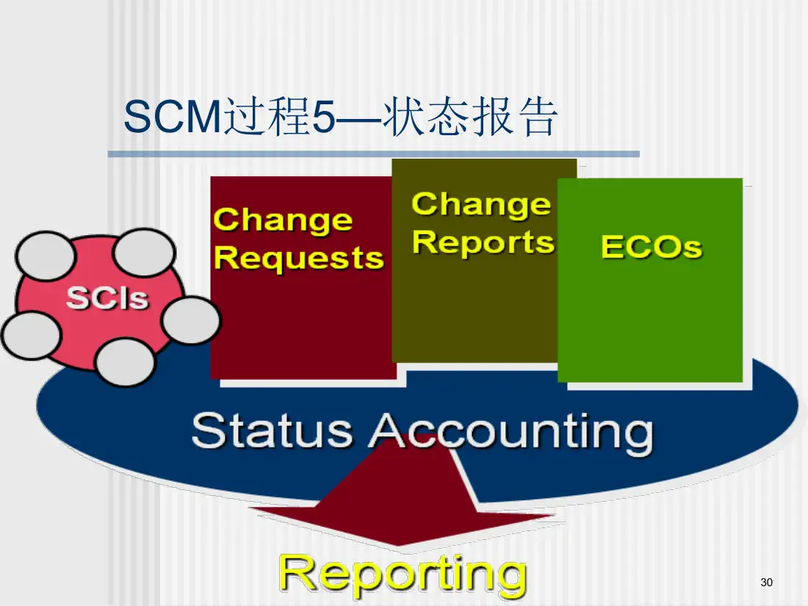

原文：

SCM过程5—状态报告

SCIs

Change Requests

Change Reports

ECOs

Status Acçounting

Reporting

30

### SCM过程5—状态报告

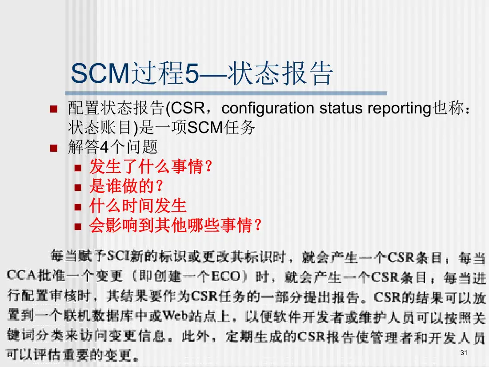

原文：

SCM过程5—状态报告

配置状态报告(CSR，configuration status reporting也称：状态账目)是一项SCM任务

◼ 解答4个问题

◼ 发生了什么事情？

是谁做的？

◼ 什么时间发生

◼ 会影响到其他哪些事情？

每当赋予SCI新的标识或更改其标识时，就会产生一个CSR条目：每当CCA批准一个变更（即创建一个ECO）时，就会产生一个CSR条目，每当进行配置审核时，其结果要作为CSR任务的一部分提出报告。CSR的结果可以放置到一个联机数据库中或Web站点上，以便软件开发者或维护人员可以按照关键词分类来访问变更信息。此外，定期生成的CSR报告使管理者和开发人员可以评估重要的变更。 31
