# 《软件工程（双语）》第11单元 项目管理概念（课件）

原件的每一页，下面附识别出的文字。

### UNIT 11

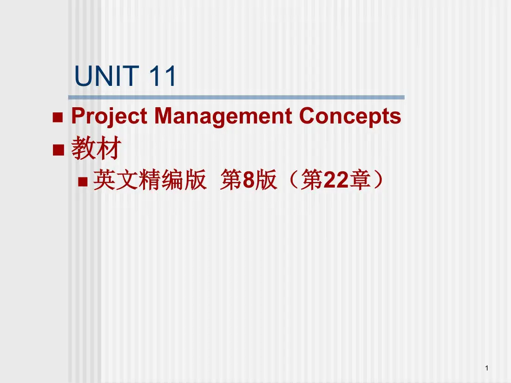

原文：

UNIT 11

◼ Project Management Concepts

教材

英文精编版 第8版（第22章）

1

### Contents & Requirements

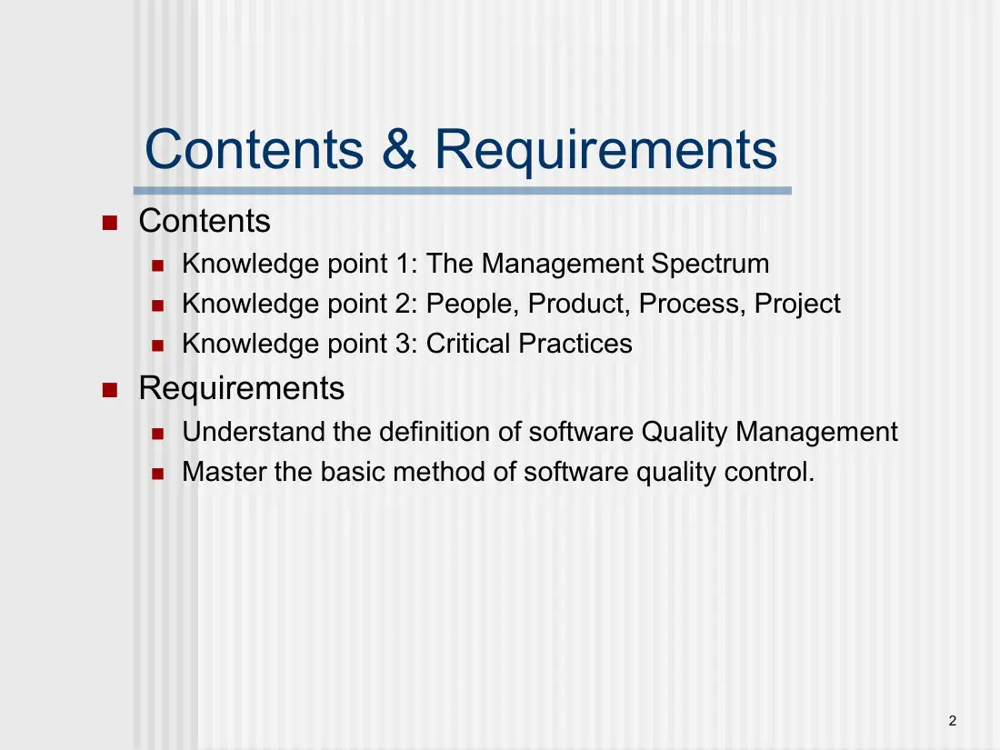

原文：

Contents & Requirements

◼ Contents

◼ Knowledge point 1: The Management Spectrum

◼ Knowledge point 2: People, Product, Process, Project

◼ Knowledge point 3: Critical Practices

◼ Requirements

◼ Understand the definition of software Quality Management

◼ Master the basic method of software quality control.

2

### The Four P’s

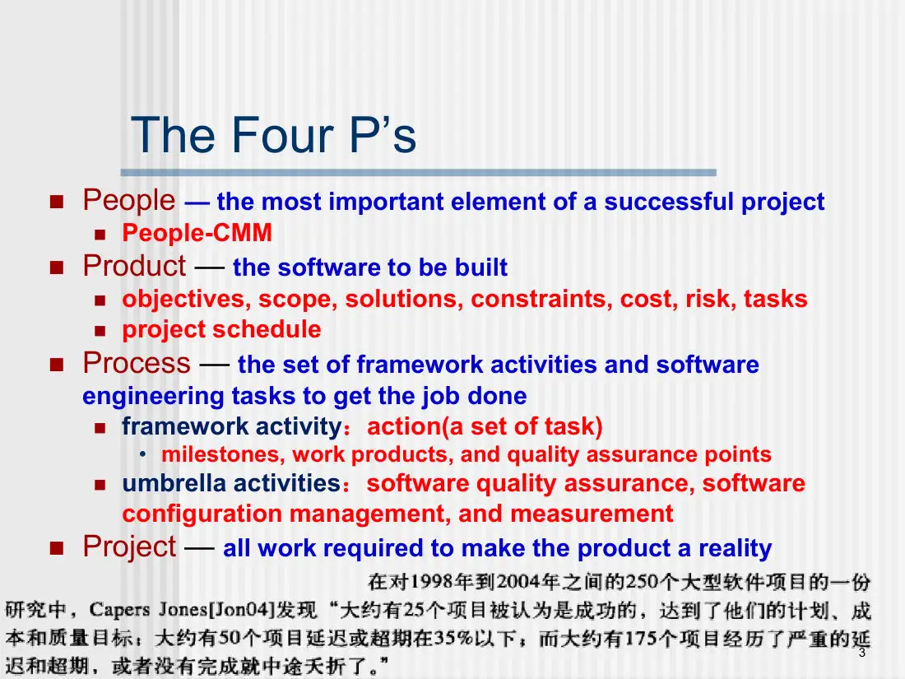

原文：

The Four P’s

People — the most important element of a successful project ◼ People-CMM

◼ Product — the software to be built

objectives, scope, solutions, constraints, cost, risk, tasks

◼ project schedule

Process — the set of framework activities and software engineering tasks to get the job done

◼ framework activity：action(a set of task)

• milestones, work products, and quality assurance points

umbrella activities：software quality assurance, software configuration management, and measurement

Project — all work required to make the product a reality

在对1998年到2004年之间的250个大型软件项目的一份研究中，Capers Jones[Jon04]发现“大约有25个项目被认为是成功的，达到了他们的计划、成本和质量目标：大约有50个项目延迟或超期在35%以下：而大约有175个项目经历了严重的延迟和超期，或者没有完成就中途天折了。”

### People

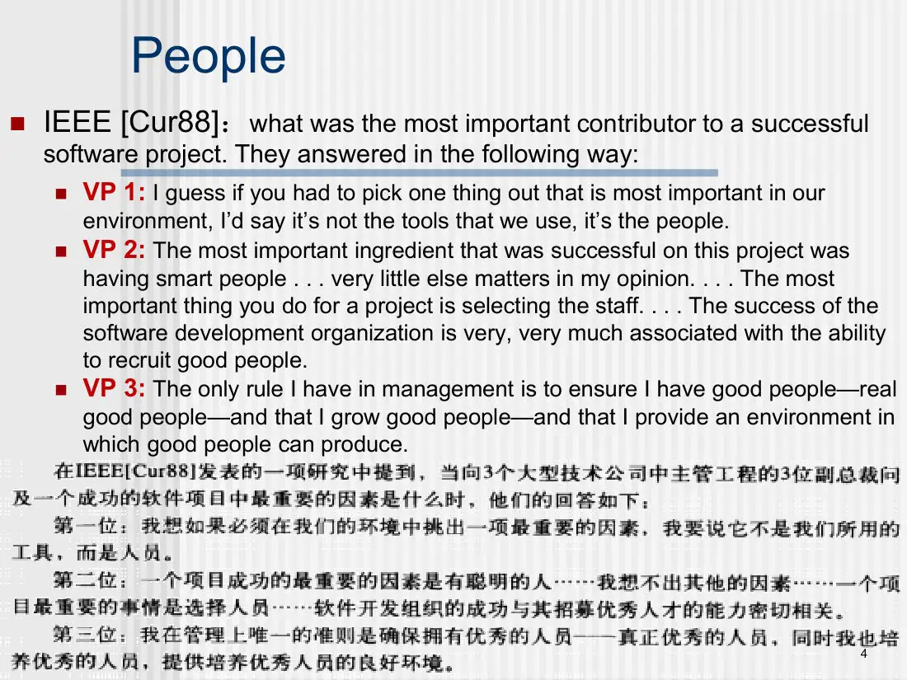

原文：

People

IEEE [Cur88]：what was the most important contributor to a successful software project. They answered in the following way:

VP 1: I guess if you had to pick one thing out that is most important in our environment, I’d say it’s not the tools that we use, it’s the people.

VP 2: The most important ingredient that was successful on this project was having smart people . . . very little else matters in my opinion. . . . The most important thing you do for a project is selecting the staff. . . . The success of the software development organization is very, very much associated with the ability to recruit good people.

VP 3: The only rule I have in management is to ensure I have good people—real good people—and that I grow good people—and that I provide an environment in which good people can produce.

在IEEE[Cur88]发表的一项研究中提到，当向3个大型技术公司中主管工程的3位副总裁问及一个成功的软件项目中最重要的因素是什么时，他们的回答如下：

第一位：我想如果必须在我们的环境中挑出一项最重要的因素，我要说它不是我们所用的工具，而是人员。

第二位：一个项目成功的最重要的因素是有聪明的人……我想不出其他的因素….一个项目最重要的事情是选择人员……软件开发组织的成功与其招募优秀人才的能力密切相关。

第三位：我在管理上唯一的准则是确保拥有优秀的人员——真正优秀的人员，同时我也培养优秀的人员，提供培养优秀人员的良好环境。

### People — Stakeholders

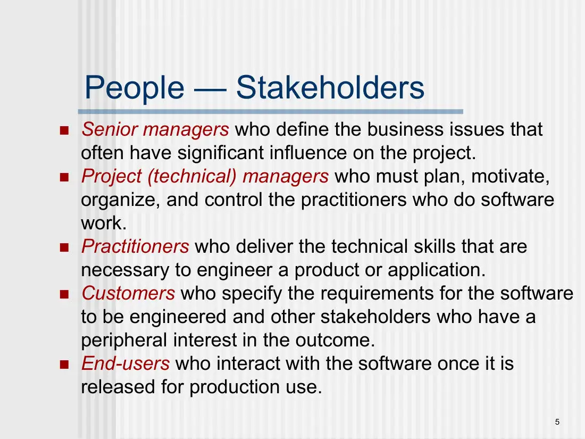

原文：

People — Stakeholders

◼ Senior managers who define the business issues that often have significant influence on the project.

Project (technical) managers who must plan, motivate, organize, and control the practitioners who do software work.

◼ Practitioners who deliver the technical skills that are necessary to engineer a product or application.

Customers who specify the requirements for the software to be engineered and other stakeholders who have a peripheral interest in the outcome.

End-users who interact with the software once it is released for production use.

5

### People — Software Teams

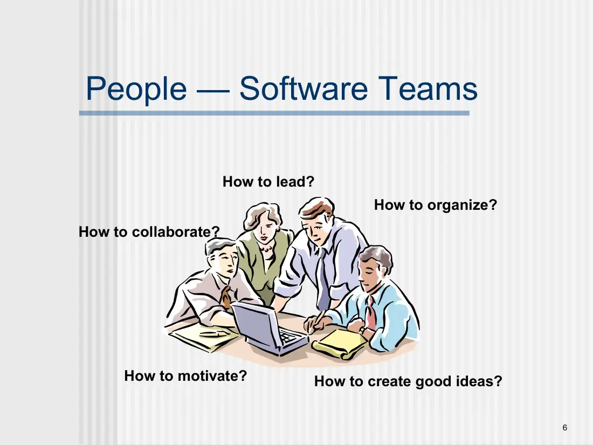

原文：

People — Software Teams

How to lead?

How to organize?

6

### People — Team Leader

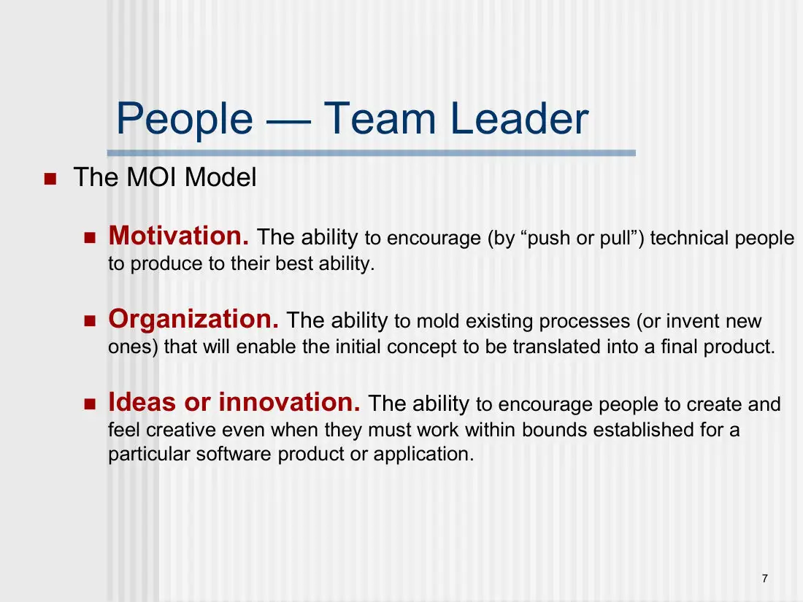

原文：

People — Team Leader

◼ The MOI Model

Motivation. The ability to encourage (by “push or pull”) technical people to produce to their best ability.

Organization. The ability to mold existing processes (or invent new ones) that will enable the initial concept to be translated into a final product.

Ideas or innovation. The ability to encourage people to create and feel creative even when they must work within bounds established for a particular software product or application.

7

### People — Team Leader

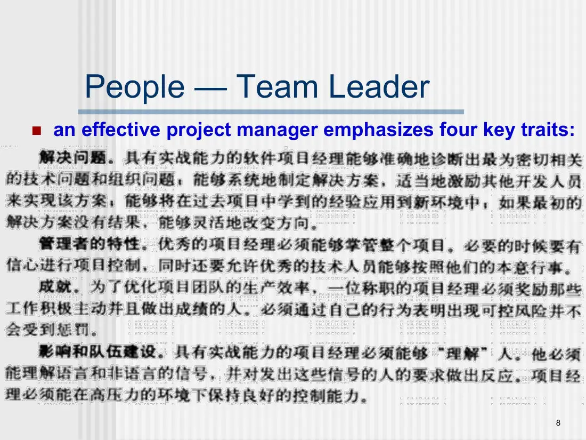

原文：

People — Team Leader

an effective project manager emphasizes four key traits:

解决问题。具有实战能力的软件项目经理能够准确地诊断出最为密切相关的技术问题和组织问题：能够系统地制定解决方案，适当地激励其他开发人员来实现该方案；能够将在过去项目中学到的经验应用到新环境中；如果最初的解决方案没有结果，能够灵活地改变方向。

管理者的特性。优秀的项目经理必须能够掌管整个项目。必要的时候要有信心进行项目控制，同时还要允许优秀的技术人员能够按照他们的本意行事。

成就。为了优化项目团队的生产效率，一位称职的项目经理必须奖励那些工作积极主动并且做出成绩的人。必须通过自己的行为表明出现可控风险并不会受到惩罚。

影响和队伍建设。具有实战能力的项目经理必须能够“理解”人。他必须能理解语言和非语言的信号，并对发出这些信号的人的要求做出反应。项目经理必须能在高压力的环境下保持良好的控制能力。

8

### People — Software Teams

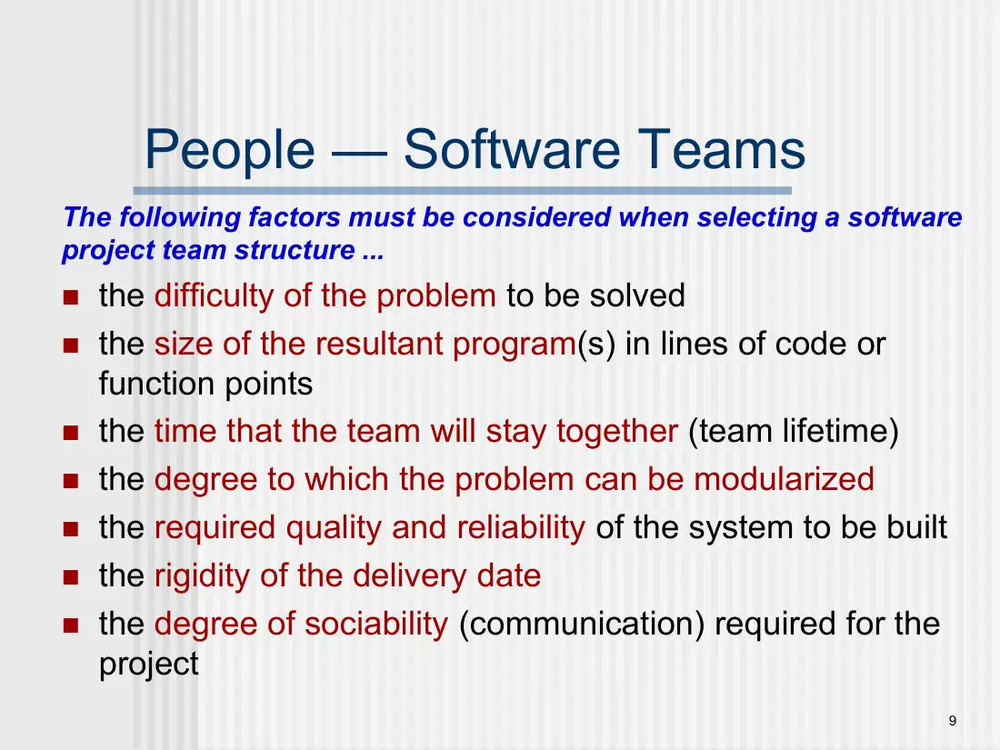

原文：

People — Software Teams

The following factors must be considered when selecting a software project team structure ...

◼ the difficulty of the problem to be solved

◼ the size of the resultant program(s) in lines of code or function points

◼ the time that the team will stay together (team lifetime)

◼ the degree to which the problem can be modularized

◼ the required quality and reliability of the system to be built

◼ the rigidity of the delivery date

◼ the degree of sociability (communication) required for the project

9

### People — Software Teams

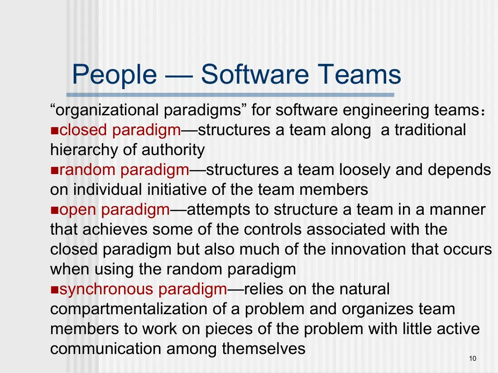

原文：

People — Software Teams

“organizational paradigms” for software engineering teams： ◼closed paradigm—structures a team along a traditional hierarchy of authority

◼random paradigm—structures a team loosely and depends on individual initiative of the team members

◼open paradigm—attempts to structure a team in a manner that achieves some of the controls associated with the closed paradigm but also much of the innovation that occurs when using the random paradigm

◼synchronous paradigm—relies on the natural compartmentalization of a problem and organizes team members to work on pieces of the problem with little active communication among themselves 10 10

### 第 11 页

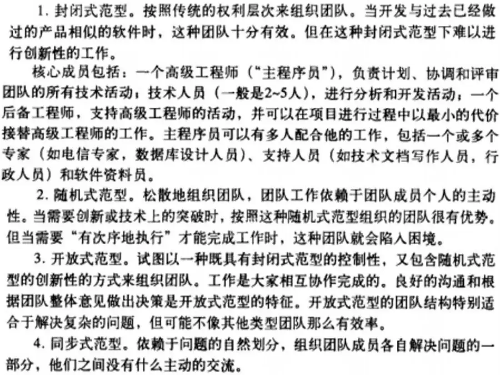

原文：

1. 封闭式范型。按照传统的权利层次来组织团队。当开发与过去已经做过的产品相似的软件时，这种团队十分有效。但在这种封闭式范型下难以进行创新性的工作。

People——Software Teams 团队的所有技术活动；技术人员（一般是2\~5人)，进行分析和开发活动；一个 “organizational paradigms” for software engineering teams： ◼closed paradigm—structures a team along a traditional hierarchy of authority ◼random para

on individual initiative of the team members◼open paradigm—attempts to structure a team in a manner但当需要“有次序地执行”才能完成工作时，这种团队就会陷入困境。

3. 开放式范型。试图以一种既具有封闭式范型的控制性，又包含随机式范型的创新性的方式来组织团队。工作是大家相互协作完成的。良好的沟通和根据团队整体意见做出决策是开放式范型的特征。开放式范型的团队结构特别适合于解决复杂的问题，但可能不像其他类型团队那么有效率。

4. 同步式范型。依赖于问题的自然划分，组织团队成员各自解决问题的一部分，他们之间没有什么主动的交流。

### People — Software Teams

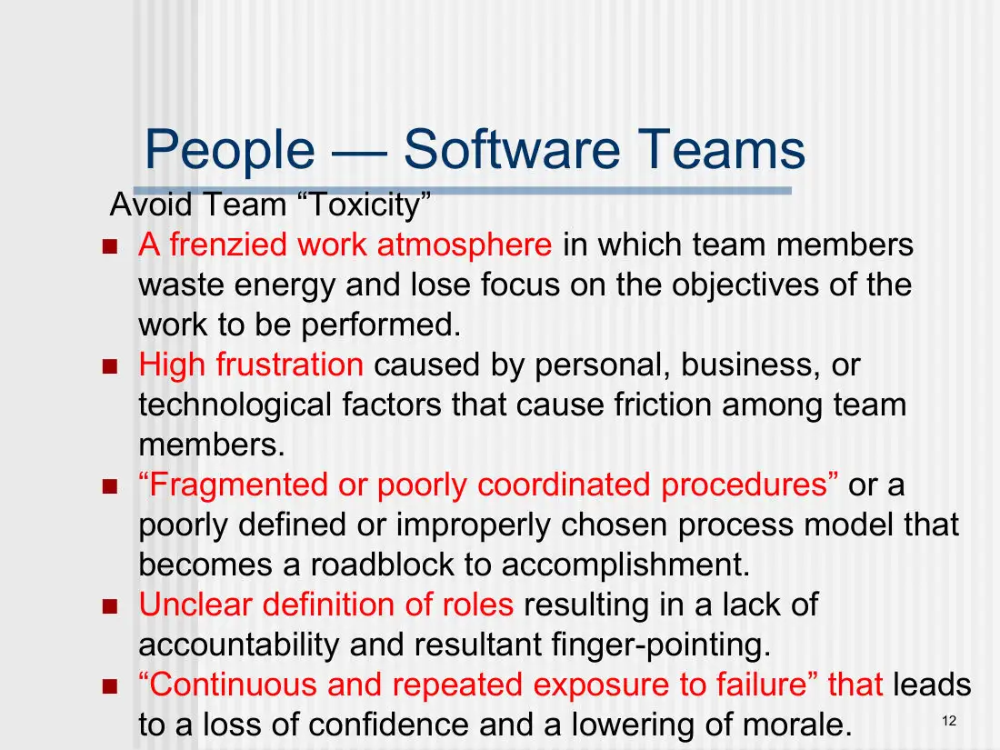

原文：

People — Software Teams

Avoid Team “Toxicity”

A frenzied work atmosphere in which team members waste energy and lose focus on the objectives of the work to be performed.

High frustration caused by personal, business, or technological factors that cause friction among team members.

“Fragmented or poorly coordinated procedures” or a poorly defined or improperly chosen process model that becomes a roadblock to accomplishment.

Unclear definition of roles resulting in a lack of accountability and resultant finger-pointing.

“Continuous and repeated exposure to failure” that leads to a loss of confidence and a lowering of morale. 12

### People — Agile Teams

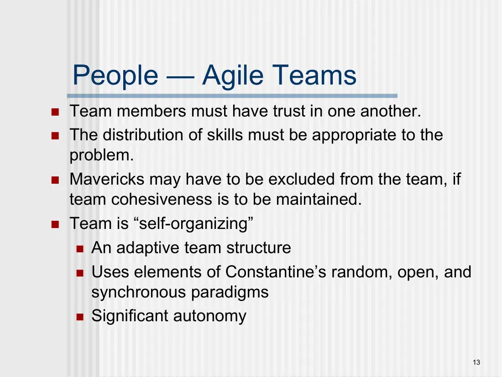

原文：

People — Agile Teams

◼ Team members must have trust in one another.

The distribution of skills must be appropriate to the problem.

◼ Mavericks may have to be excluded from the team, if team cohesiveness is to be maintained.

◼ Team is “self-organizing”

◼ An adaptive team structure

◼ Uses elements of Constantine’s random, open, and synchronous paradigms

◼ Significant autonomy

13

### ◼ Formal, impersonal approaches

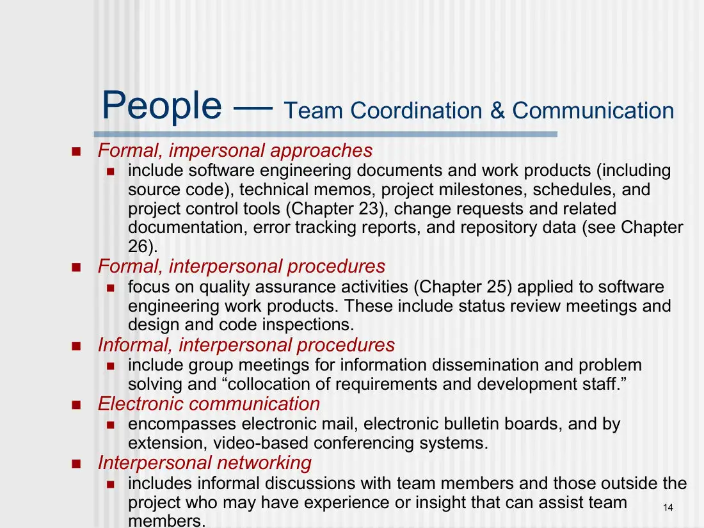

原文：

People — Team Coordination & Communication

◼ Formal, impersonal approaches

◼ include software engineering documents and work products (including source code), technical memos, project milestones, schedules, and project control tools (Chapter 23), change requests and related documentation, error tracking reports, and repository data (see Chapter 26).

◼ Formal, interpersonal procedures

focus on quality assurance activities (Chapter 25) applied to software engineering work products. These include status review meetings and design and code inspections.

◼ Informal, interpersonal procedures

include group meetings for information dissemination and problem solving and “collocation of requirements and development staff.”

Electronic communication

encompasses electronic mail, electronic bulletin boards, and by extension, video-based conferencing systems.

Interpersonal networking

includes informal discussions with team members and those outside the project who may have experience or insight that can assist team 14 members.

### Product

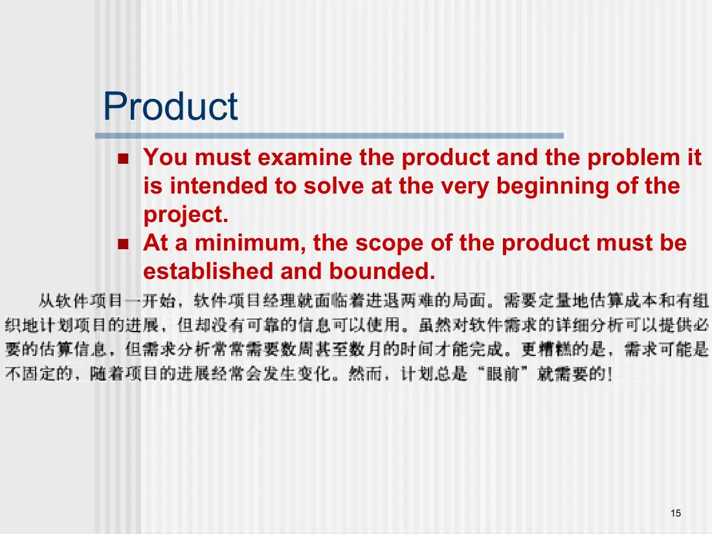

原文：

Product

You must examine the product and the problem it is intended to solve at the very beginning of the project.

At a minimum, the scope of the product must be established and bounded.

从软件项目一开始，软件项目经理就面临着进退两难的局面。需要定量地估算成本和有组织地计划项目的进展，但却没有可靠的信息可以使用。虽然对软件需求的详细分析可以提供必要的估算信息，但需求分析常常需要数周甚至数月的时间才能完成。更糟糕的是，需求可能是不固定的，随着项目的进展经常会发生变化。然而，计划总是“眼前”就需要的！

15

### Product Scope

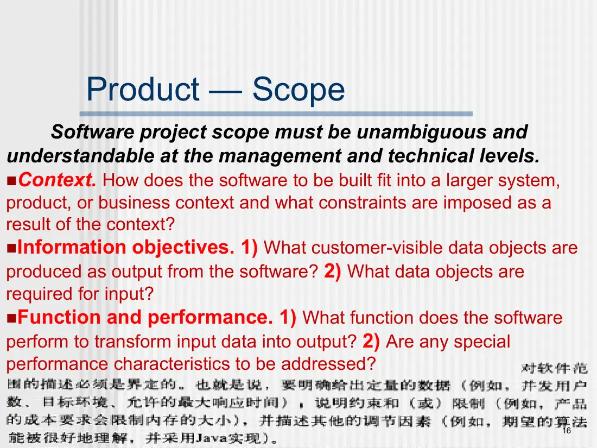

原文：

Product Scope

Software project scope must be unambiguous and understandable at the management and technical levels.

◼Context. How does the software to be built fit into a larger system, product, or business context and what constraints are imposed as a result of the context?

◼Information objectives. 1) What customer-visible data objects are produced as output from the software? 2) What data objects are required for input?

◼Function and performance. 1) What function does the software perform to transform input data into output? 2) Are any special performance characteristics to be addressed? 对软件范 对软件

围的描述必须是界定的。也就是说，要明确给出定量的数据（例如，并发用户数、目标环境、允许的最大响应时间）：说明约束和（或）限制（例如，产品的成本要求会限制内存的大小），并描述其他的调节因素（例如，期望的算法能被很好地理解，并采用Java实现）。

### Product — Problem Decomposition

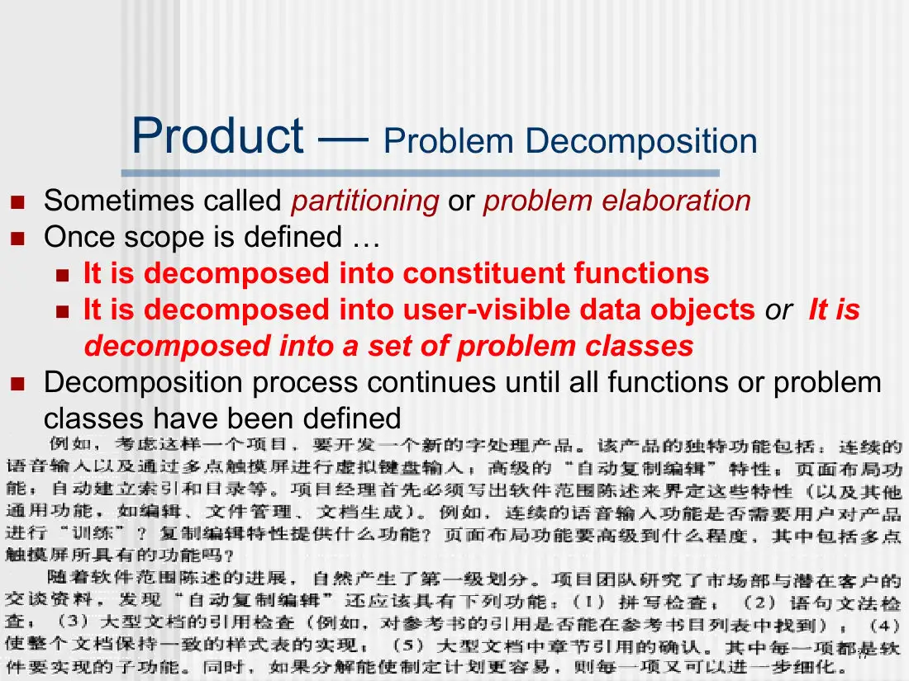

原文：

Product — Problem Decomposition

◼ Sometimes called partitioning or problem elaboration

◼ Once scope is defined …

◼ It is decomposed into constituent functions

It is decomposed into user-visible data objects or It is decomposed into a set of problem classes

Decomposition process continues until all functions or problem classes have been defined

例如，考虑这样一个项目，要开发一个新的字处理产品。该产品的独特功能包括：连续的语音输入以及通过多点触摸屏进行虚拟键盘输人：高级的“自动复制编辑”特性，页面布局功能：自动建立索引和目录等。项目经理首先必须写出软件范围陈述来界定这些特性（以及其他通用功能，如编辑、文件管理、文档生成）。例如，连续的语音输入功能是否需要用户对产品进行“训练”？复制编辑特性提供什么功能？页面布局功能要高级到什么程度，其中包括多点触摸屏所具有的功能吗？

随着软件范围陈述的进展，自然产生了第一级划分。项目团队研究了市场部与潜在客户的交谈资料，发现“自动复制编辑”还应该具有下列功能：(1)拼写检查，(2)语句文法检查：(3）大型文档的引用检查（例如，对参考书的引用是否能在参考书目列表中找到）：(4)使整个文档保持一致的样式表的实现：（5)大型文档中章节引用的确认。其中每一项都是软件要实现的子功能。同时，如果分解能使制定计划更容易，则每一项又可以进一步细化。

### Process

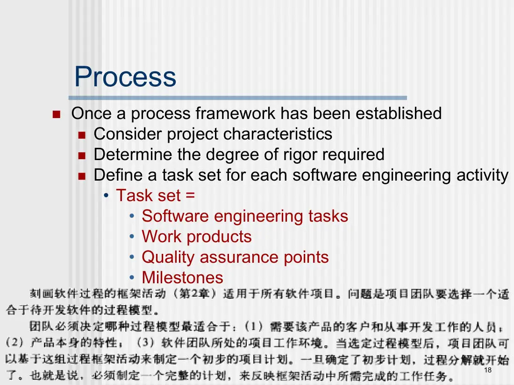

原文：

Process

◼ Once a process framework has been established

◼ Consider project characteristics

◼ Determine the degree of rigor required

Define a task set for each software engineering activity • Task set =

Software engineering tasks

Work products

Quality assurance points

Milestones

刻画软件过程的框架活动（第2章）适用于所有软件项目。问题是项目团队要选择一个适合于待开发软件的过程模型。

团队必须决定哪种过程模型最适合于：（1)需要该产品的客户和从事开发工作的人员：(2)产品本身的特性，(3)软件团队所处的项目工作环境。当选定过程模型后，项目团队可以基于这组过程框架活动来制定一个初步的项目计划。一旦确定了初步计划，过程分解就开始了。也就是说，必须制定一个完整的计划，来反映框架活动中所需完成的工作任务。 18

### 第 19 页

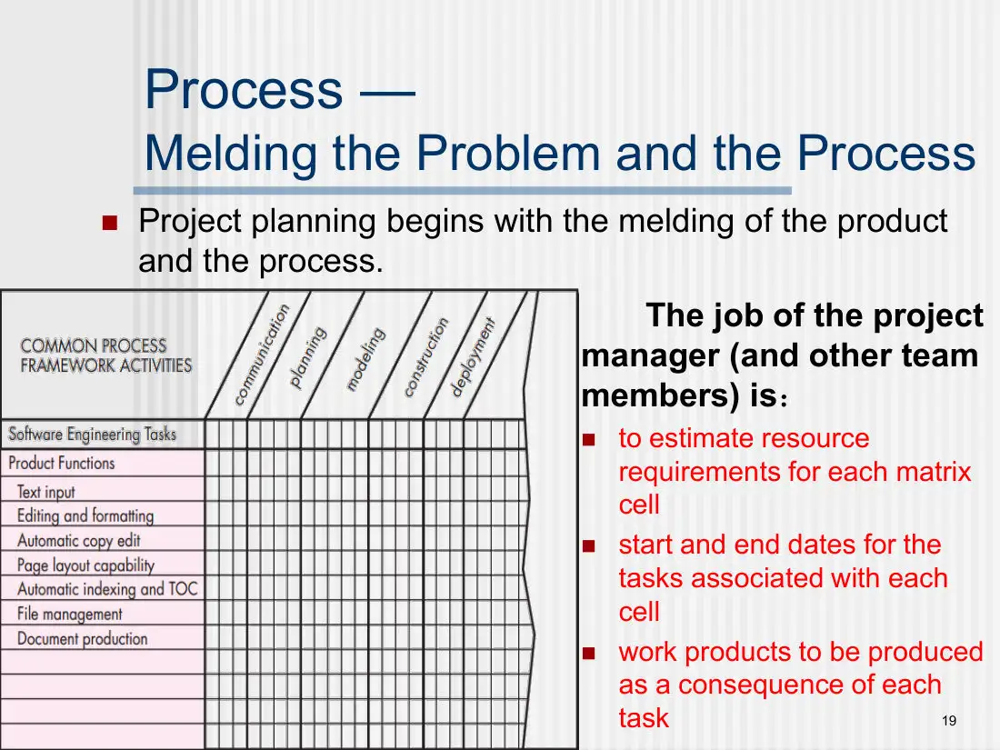

原文：

Process Melding the Problem and the Process

◼ Project planning begins with the melding of the product and the process.

The job of the project manager (and other team members) is：

to estimate resource requirements for each matrix cell

start and end dates for the tasks associated with each cell

work products to be produced as a consequence of each task 19

### Process— Decomposition

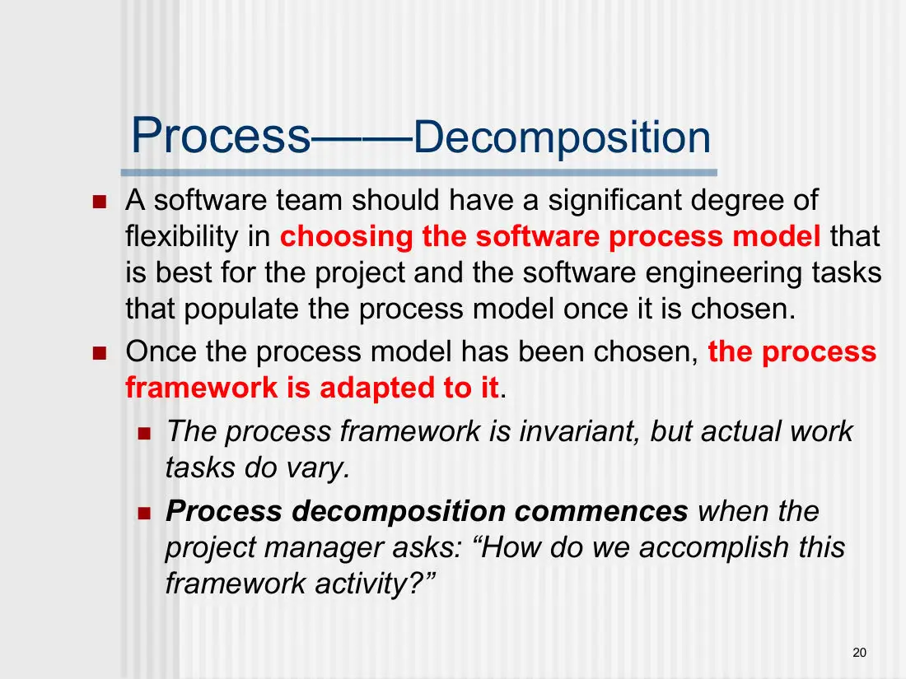

原文：

Process— Decomposition

A software team should have a significant degree of flexibility in choosing the software process model that is best for the project and the software engineering tasks that populate the process model once it is chosen.

Once the process model has been chosen, the process framework is adapted to it.

The process framework is invariant, but actual work tasks do vary.

Process decomposition commences when the project manager asks: “How do we accomplish this framework activity?”

20

### 一个小型的比较简单的项目在沟通活动中可能需要完成下列工作任务：

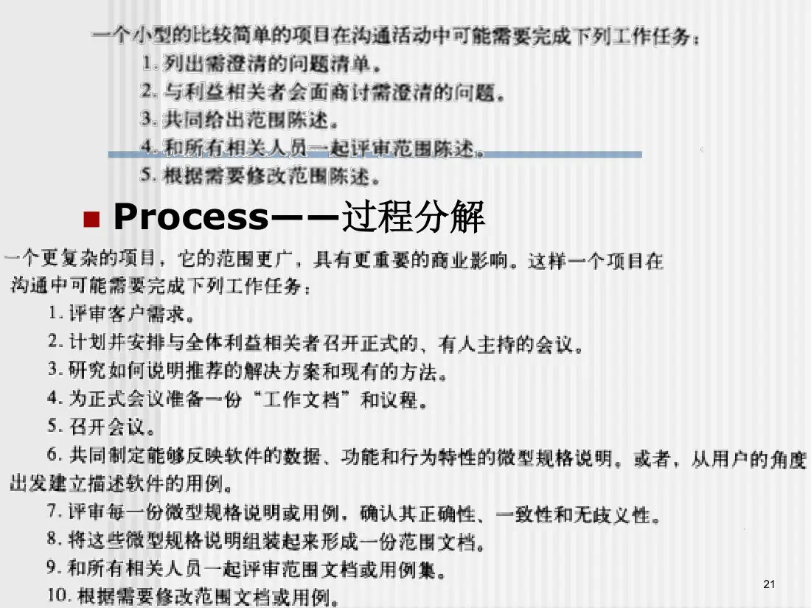

原文：

一个小型的比较简单的项目在沟通活动中可能需要完成下列工作任务：

1.列出需澄清的问题清单。

2.与利益相关者会面商讨需澄清的问题。

3.共同给出范围陈述。

4.和所有相关人员一起评审范围陈述。

5.根据需要修改范围陈述。

◼ Process——过程分解

一个更复杂的项目，它的范围更广，具有更重要的商业影响。这样一个项目在沟通中可能需要完成下列工作任务：

1. 评审客户需求。

2. 计划并安排与全体利益相关者召开正式的，有人主持的会议。

3. 研究如何说明推荐的解决方案和现有的方法。

4. 为正式会议准备一份“工作文档”和议程。

5. 召开会议。

6. 共同制定能够反映软件的数据、功能和行为特性的微型规格说明。或者，从用户的角度出发建立描述软件的用例。

7. 评审每一份微型规格说明或用例，确认其正确性、一致性和无歧义性。

8. 将这些微型规格说明组装起来形成一份范围文档。

9. 和所有相关人员一起评审范围文档或用例集。

10. 根据需要修改范围文档或用例。

21

### Project

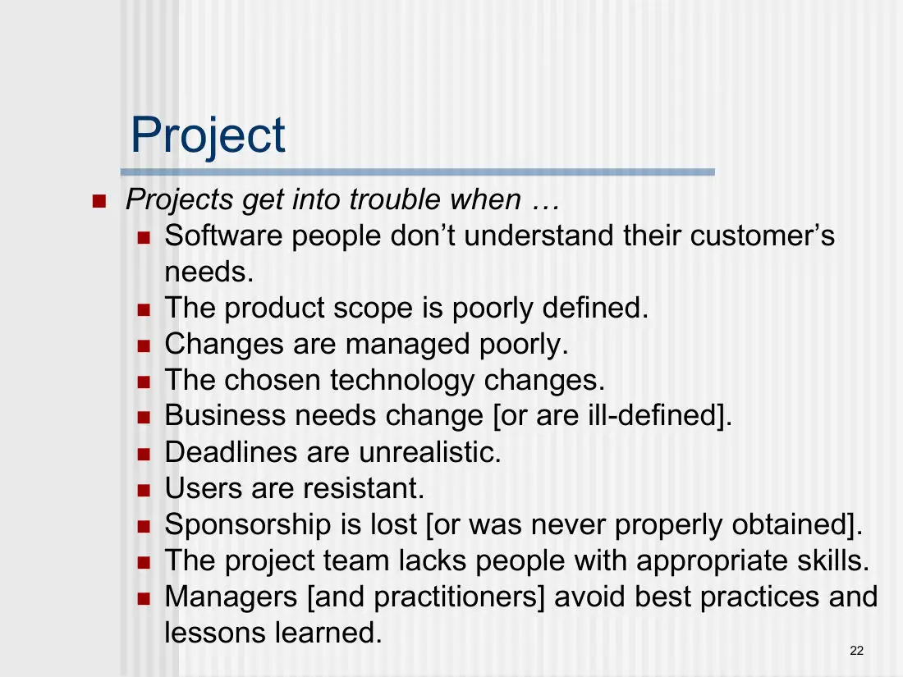

原文：

Project

◼ Projects get into trouble when …

◼ Software people don’t understand their customer’s needs.

◼ The product scope is poorly defined.

◼ Changes are managed poorly.

◼ The chosen technology changes.

◼ Business needs change [or are ill-defined].

◼ Deadlines are unrealistic.

◼ Users are resistant.

◼ Sponsorship is lost [or was never properly obtained].

◼ The project team lacks people with appropriate skills.

◼ Managers [and practitioners] avoid best practices and lessons learned.

22

### Project — the 90–90 rule

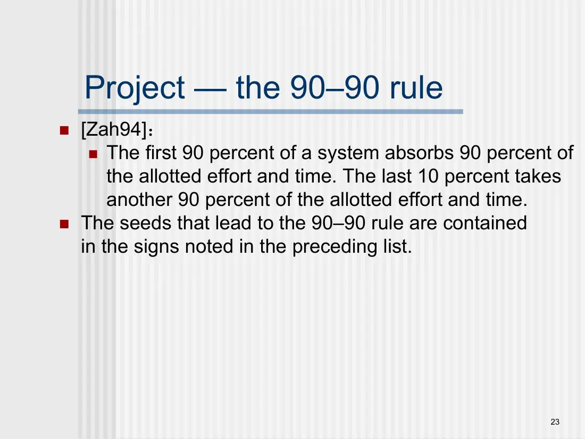

原文：

Project — the 90–90 rule

◼ [Zah94]：

The first 90 percent of a system absorbs 90 percent of the allotted effort and time. The last 10 percent takes another 90 percent of the allotted effort and time.

◼ The seeds that lead to the 90–90 rule are contained in the signs noted in the preceding list.

23

### Start on the right foot.

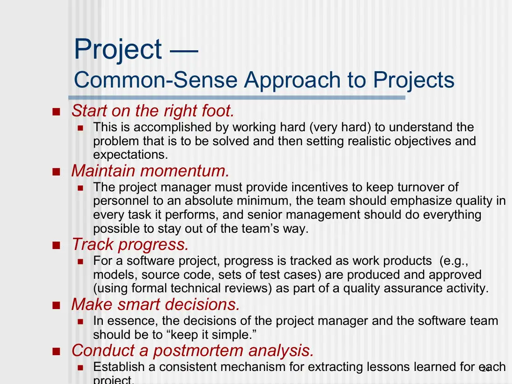

原文：

Project — Common-Sense Approach to Projects

Start on the right foot.

◼ This is accomplished by working hard (very hard) to understand the problem that is to be solved and then setting realistic objectives and expectations.

◼ Maintain momentum.

The project manager must provide incentives to keep turnover of personnel to an absolute minimum, the team should emphasize quality in every task it performs, and senior management should do everything possible to stay out of the team’s way.

Track progress.

For a software project, progress is tracked as work products (e.g., models, source code, sets of test cases) are produced and approved (using formal technical reviews) as part of a quality assurance activity.

◼ Make smart decisions.

In essence, the decisions of the project manager and the software team should be to “keep it simple.”

◼ Conduct a postmortem analysis.

◼ Establish a consistent mechanism for extracting lessons learned for each24 project.

### W5HH Principle

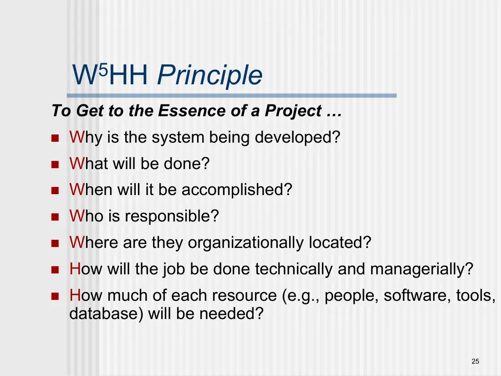

原文：

W5HH Principle

To Get to the Essence of a Project …

◼ Why is the system being developed?

◼ What will be done?

◼ When will it be accomplished?

◼ Who is responsible?

◼ Where are they organizationally located?

◼ How will the job be done technically and managerially?

How much of each resource (e.g., people, software, tools, database) will be needed?

25

### Critical Practices

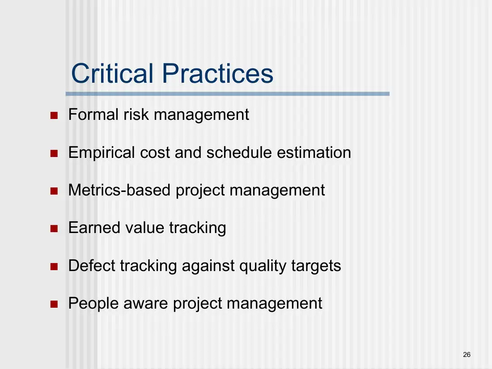

原文：

Critical Practices

◼ Formal risk management

◼ Empirical cost and schedule estimation

◼ Metrics-based project management

◼ Earned value tracking

◼ Defect tracking against quality targets

◼ People aware project management

26
