# 《软件工程（双语）》第1章 软件与软件工程（课件）

原件的每一页，下面附识别出的文字。

### Software & Software Engineering（教材1-2章）

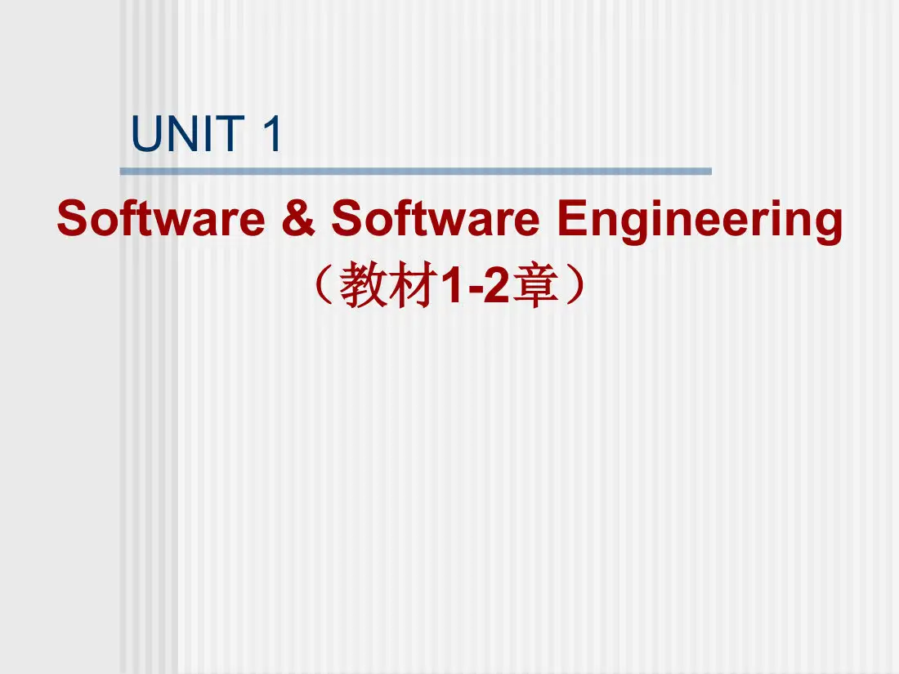

原文：

Software & Software Engineering（教材1-2章）

UNIT 1

### Contents & Requirements

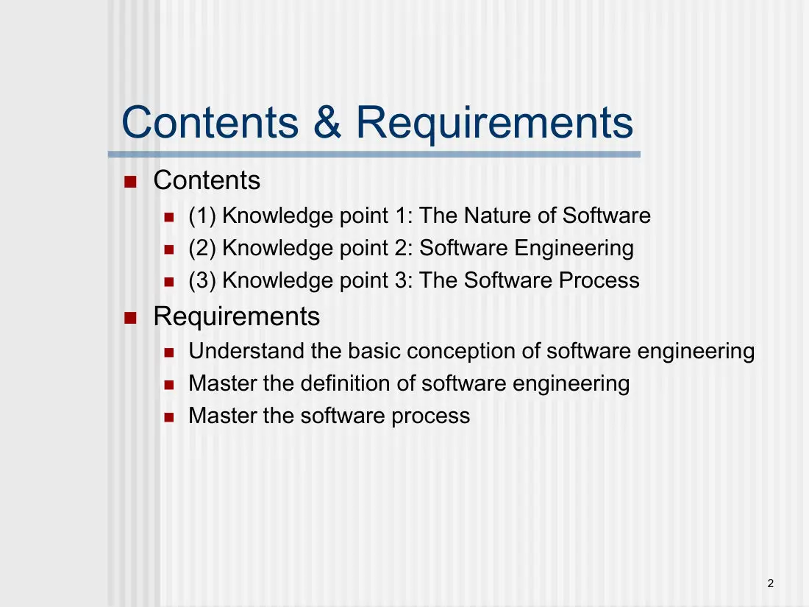

原文：

Contents & Requirements

◼ Contents

◼ (1) Knowledge point 1: The Nature of Software

◼ (2) Knowledge point 2: Software Engineering

◼ (3) Knowledge point 3: The Software Process

◼ Requirements

◼ Understand the basic conception of software engineering

◼ Master the definition of software engineering

◼ Master the software process

2

### ◼ This book presents a framework that

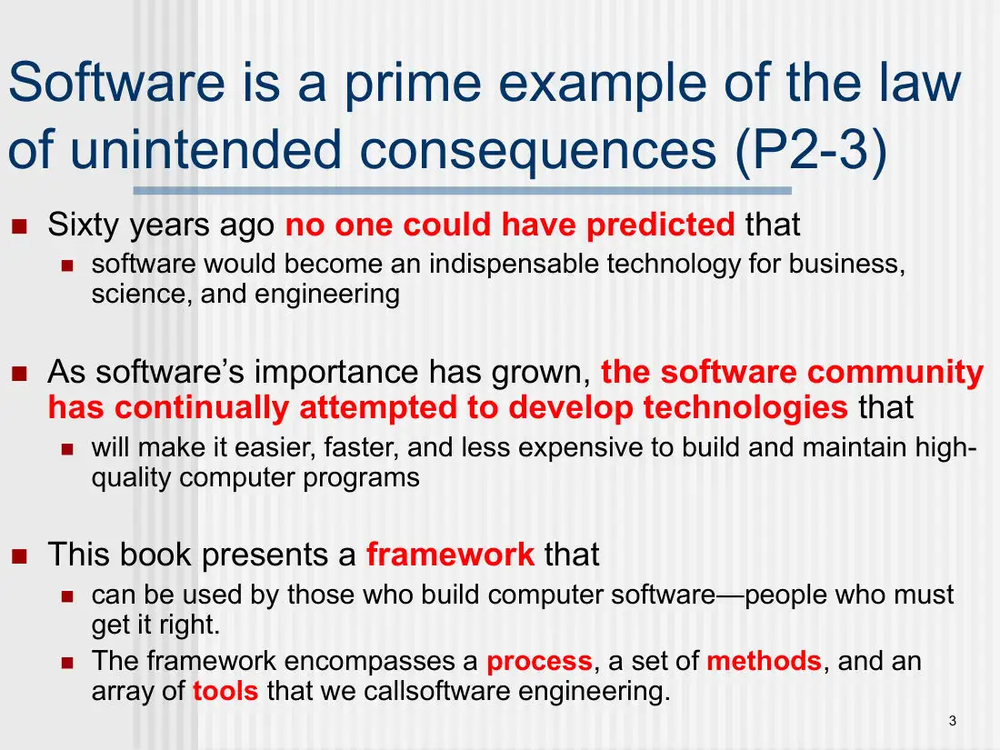

原文：

Software is a prime example of the law of unintended consequences (P2-3)

◼ Sixty years ago no one could have predicted that

software would become an indispensable technology for business, science, and engineering

As software’s importance has grown, the software community has continually attempted to develop technologies that

will make it easier, faster, and less expensive to build and maintain highquality computer programs

◼ This book presents a framework that

can be used by those who build computer software—people who must get it right.

The framework encompasses a process, a set of methods, and an array of tools that we callsoftware engineering.

3

### 授课内容

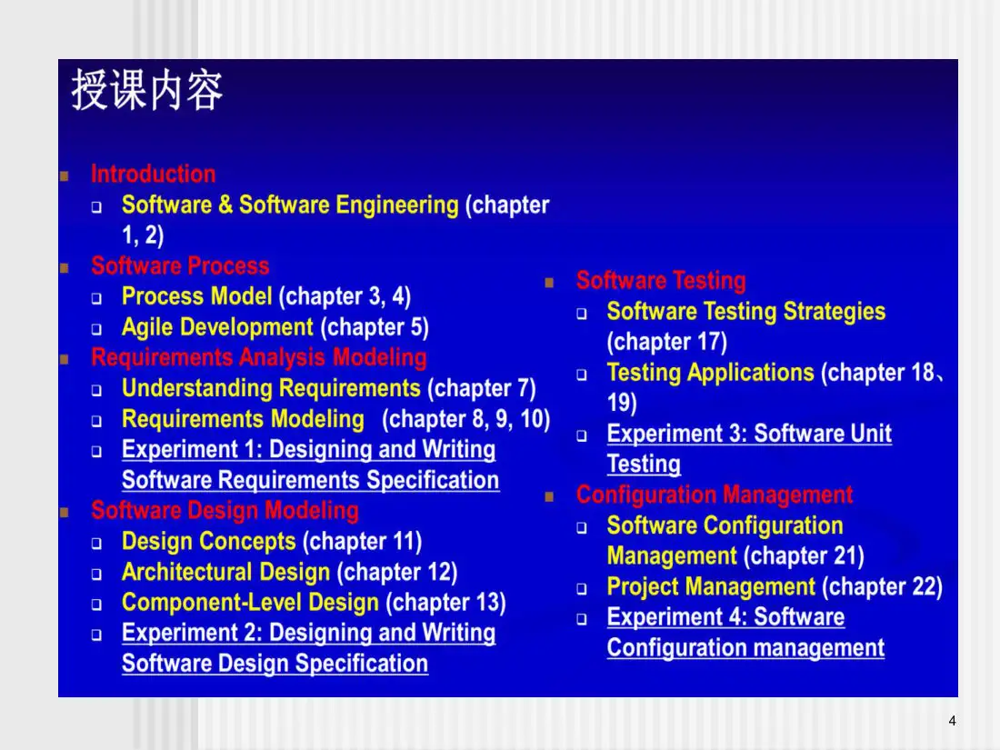

原文：

授课内容

Introduction

□ Software & Software Engineering (chapter

Software Process

□ Process Model (chapter 3, 4)

□ Agile Development (chapter 5) Requirements Analysis Modeling

□ Understanding Requirements (chapter 7)

□ Requirements Modeling (chapter 8, 9, 10)

□ Experiment 1: Designing and Writing Software Requirements Specification

Software Design Modeling

□ Design Concepts (chapter 11)

□ Architectural Design (chapter 12)

□ Component-Level Design (chapter 13)

□ Experiment 2: Designing and Writing Software Design Specification

Software Testing

□ Software Testing Strategies (chapter 17)

□ Testing Applications (chapter 18、

□ Experiment 3: Software Unit Testing

Configuration Management

□ Software Configuration Management (chapter 21)

□ Project Management (chapter 22)

□ Experiment 4: Software Configuration management

4

### The Nature of Software (P3)

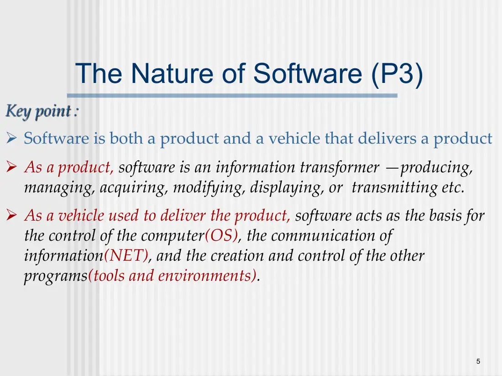

原文：

The Nature of Software (P3)

Key point ：

➢ Software is both a product and a vehicle that delivers a product

➢ As a product, software is an information transformer —producing, managing, acquiring, modifying, displaying, or transmitting etc.

➢ As a vehicle used to deliver the product, software acts as the basis for the control of the computer(OS), the communication of information(NET), and the creation and control of the other programs(tools and environments).

5

### What is Software? (P4)

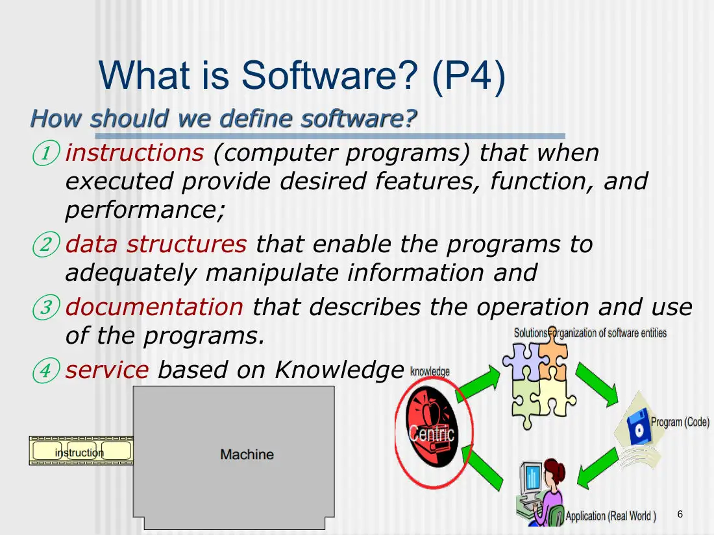

原文：

What is Software? (P4)

How should we define software?

instructions (computer programs) that when executed provide desired features, function, and performance;

data structures that enable the programs to adequately manipulate information and

documentation that describes the operation and use of the programs. Solutionsrganization of oftar eties

service based on Knowledge

6

### 第 7 页

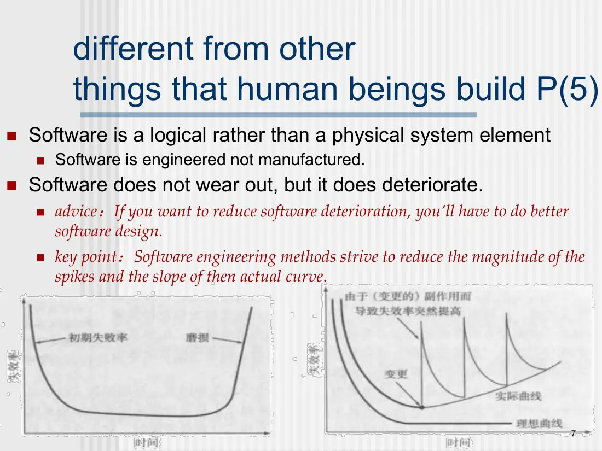

原文：

different from other things that human beings build P(5)

◼ Software is a logical rather than a physical system element ◼ Software is engineered not manufactured.

◼ Software does not wear out, but it does deteriorate.

advice ： If you want to reduce software deterioration, you’ll have to do better software design.

key point ： Software engineering methods strive to reduce the magnitude of the spikes and the slope of then actual curve.

### Software Application Domains P(6)

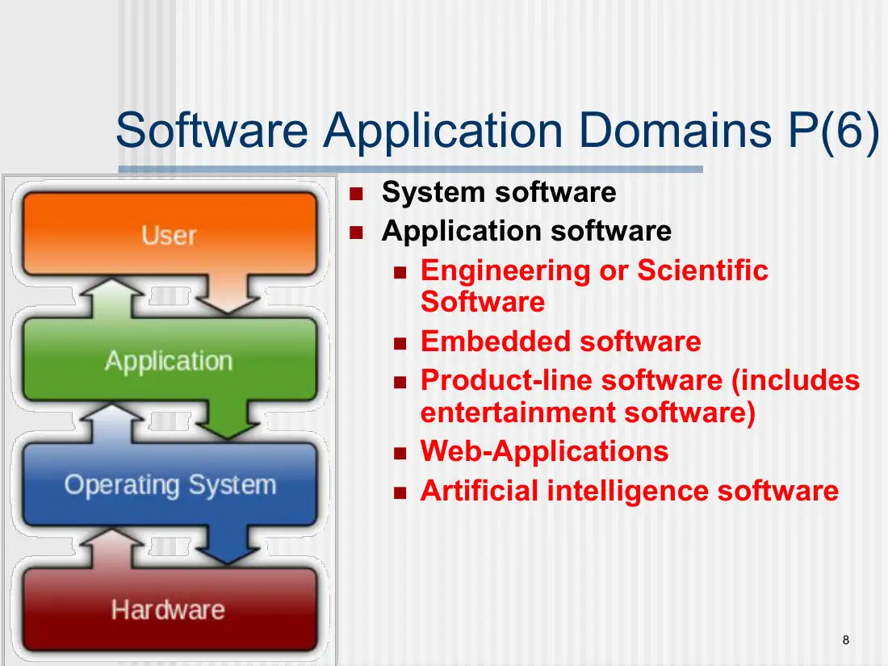

原文：

Software Application Domains P(6)

User

Application

Operating System

Hardware

◼ System software

◼ Application software

Engineering or Scientific Software

◼ Embedded software

Product-line software (includes entertainment software)

◼ Web-Applications

Artificial intelligence software

8

### ■ 1. 文字处理软件

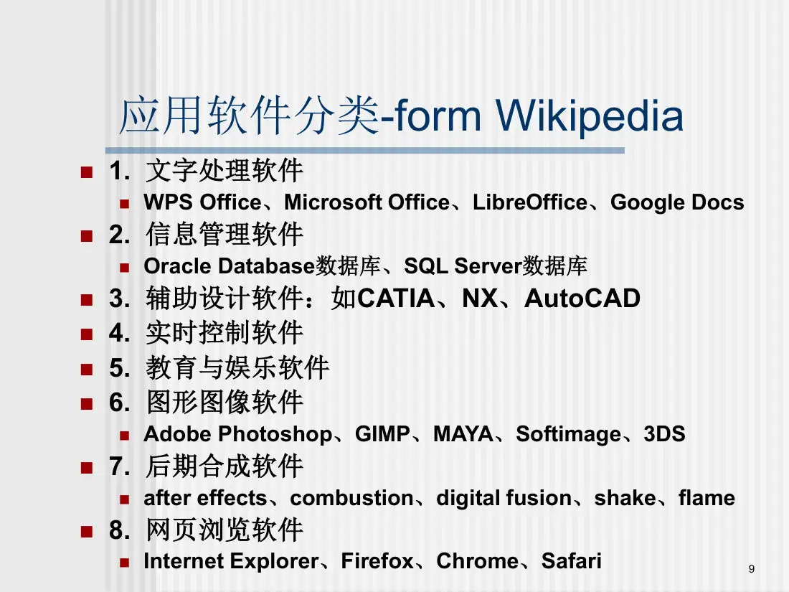

原文：

■ 1. 文字处理软件
■ WPS Office、Microsoft Office、LibreOffice、Google Docs
■ 2. 信息管理软件
■ Oracle Database数据库、SQL Server数据库
■ 3. 辅助设计软件：如CATIA、NX、AutoCAD
■ 4. 实时控制软件
■ 5. 教育与娱乐软件
■ 6. 图形图像软件
■ Adobe Photoshop、GIMP、MAYA、Softimage、3DS
■ 7. 后期合成软件
■ after effects、combustion、digital fusion、shake、flame
■ 8. 网页浏览软件
■ Internet Explorer、Firefox、Chrome、Safari

应用软件分类-form Wikipedia

9

### 应用软件分类-form Wikipedia

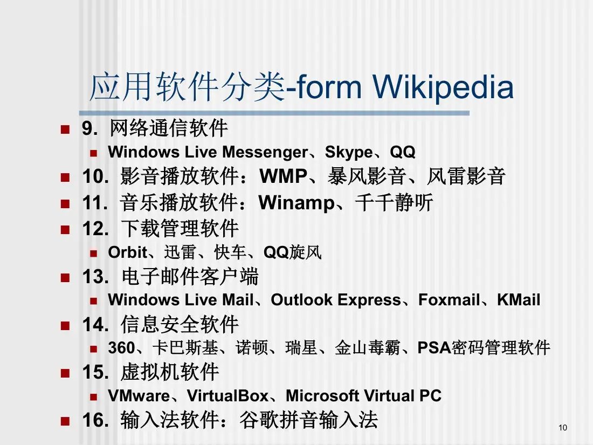

原文：

应用软件分类-form Wikipedia

◼ 9. 网络通信软件

◼ Windows Live Messenger、Skype、QQ

◼ 10. 影音播放软件：WMP、暴风影音、风雷影音

◼ 11. 音乐播放软件：Winamp、千千静听

◼ 12. 下载管理软件

◼ Orbit、迅雷、快车、QQ旋风

◼ 13. 电子邮件客户端

◼ Windows Live Mail、Outlook Express、Foxmail、KMail

◼ 14. 信息安全软件

◼ 360、卡巴斯基、诺顿、瑞星、金山毒霸、PSA密码管理软件

◼ 15. 虚拟机软件

◼ VMware、VirtualBox、Microsoft Virtual PC

◼ 16. 输入法软件：谷歌拼音输入法

10

### Legacy Software P(7)

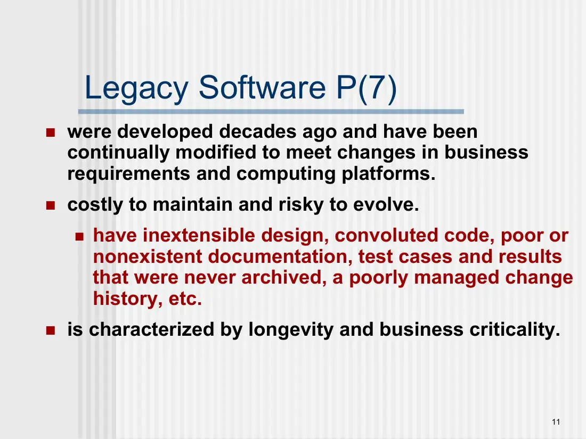

原文：

Legacy Software P(7)

◼ were developed decades ago and have been continually modified to meet changes in business requirements and computing platforms.

◼ costly to maintain and risky to evolve.

have inextensible design, convoluted code, poor or nonexistent documentation, test cases and results that were never archived, a poorly managed change history, etc.

◼ is characterized by longevity and business criticality.

11

### Reasons

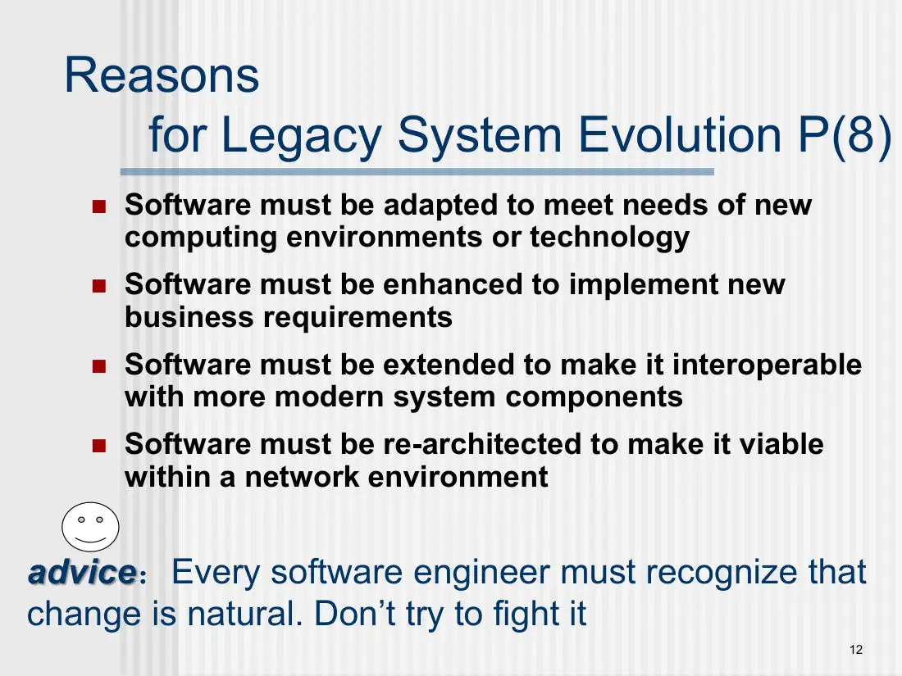

原文：

Reasons

for Legacy System Evolution P(8)

◼ Software must be adapted to meet needs of new computing environments or technology

◼ Software must be enhanced to implement new business requirements

◼ Software must be extended to make it interoperable with more modern system components

◼ Software must be re-architected to make it viable within a network environment

advice：Every software engineer must recognize that change is natural. Don’t try to fight it

12

### ◼ Why are development costs so high?

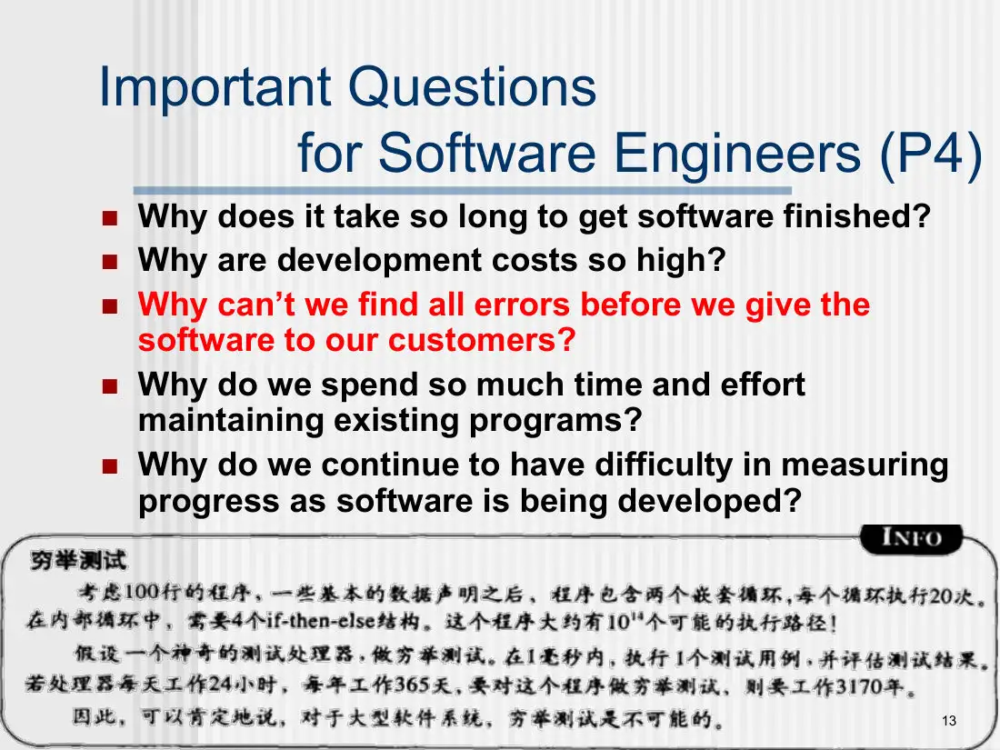

原文：

Important Questions for Software Engineers (P4)

◼ Why does it take so long to get software finished?

◼ Why are development costs so high?

Why can’t we find all errors before we give the software to our customers?

Why do we spend so much time and effort maintaining existing programs?

Why do we continue to have difficulty in measuring progress as software is being developed?

INFO

穷举测试

考虑100行的程序，一些基本的数据声明之后，程序包含两个嵌套循环，每个循环执行20次。在内部循环中，需要4个if-then-else结构。这个程序大约有1014个可能的执行路径！

假设一个神奇的测试处理器，做穷举测试。在1毫秒内，执行1个测试用例，并评估测试结果。若处理器每天工作24小时，每年工作365天，要对这个程序做穷举测试，则要工作3170年。

因此，可以肯定地说，对于大型软件系统，穷举测试是不可能的。

13

### 软件危机

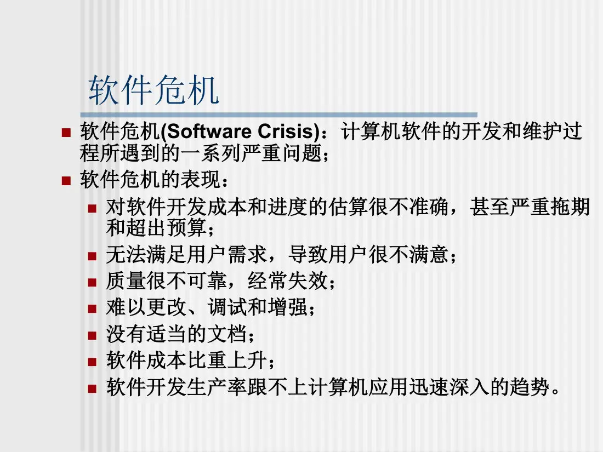

原文：

软件危机

◼ 软件危机(Software Crisis)：计算机软件的开发和维护过程所遇到的一系列严重问题；

◼ 软件危机的表现：

对软件开发成本和进度的估算很不准确，甚至严重拖期和超出预算；

◼ 无法满足用户需求，导致用户很不满意；

◼ 质量很不可靠，经常失效；

◼ 难以更改、调试和增强；

◼ 没有适当的文档；

◼ 软件成本比重上升；

◼ 软件开发生产率跟不上计算机应用迅速深入的趋势。

### 软件工程的作用

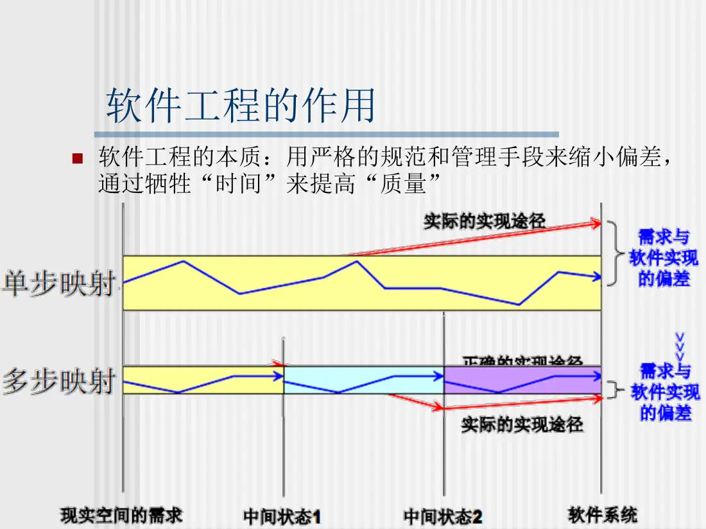

原文：

软件工程的作用

软件工程的本质：用严格的规范和管理手段来缩小偏差，通过牺牲“时间”来提高“质量”

### 软件工程映射之1：概念映射

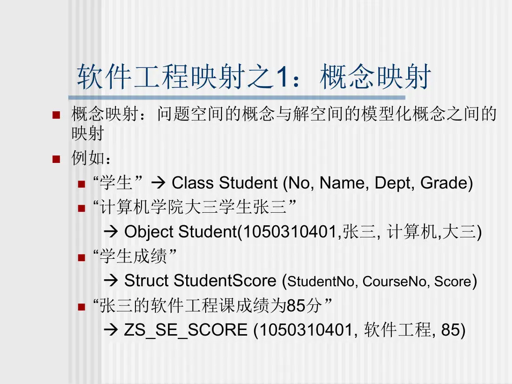

原文：

软件工程映射之1：概念映射

概念映射：问题空间的概念与解空间的模型化概念之间的 映射

◼ 例如：

◼ “学生”→ Class Student (No, Name, Dept, Grade)

“计算机学院大三学生张三”→ Object Student(1050310401,张三, 计算机,大三)

“学生成绩” → Struct StudentScore (StudentNo, CourseNo, Score)

“张三的软件工程课成绩为85分”→ ZS\_SE\_SCORE (1050310401, 软件工程, 85)

### 软件工程映射之2：业务逻辑映射

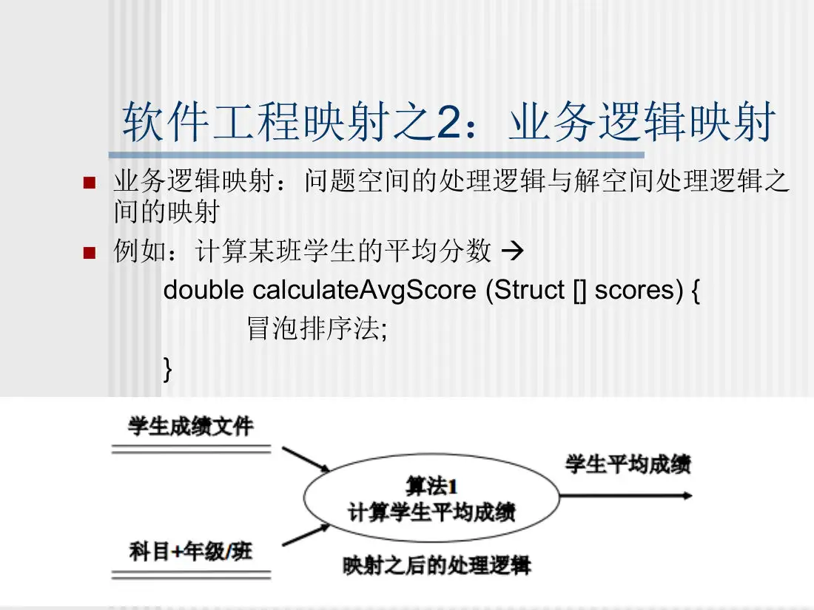

原文：

软件工程映射之2：业务逻辑映射

业务逻辑映射：问题空间的处理逻辑与解空间处理逻辑之间的映射

例如：计算某班学生的平均分数 →

double calculateAvgScore (Struct [] scores) { 冒泡排序法;

### 软件工程的作用

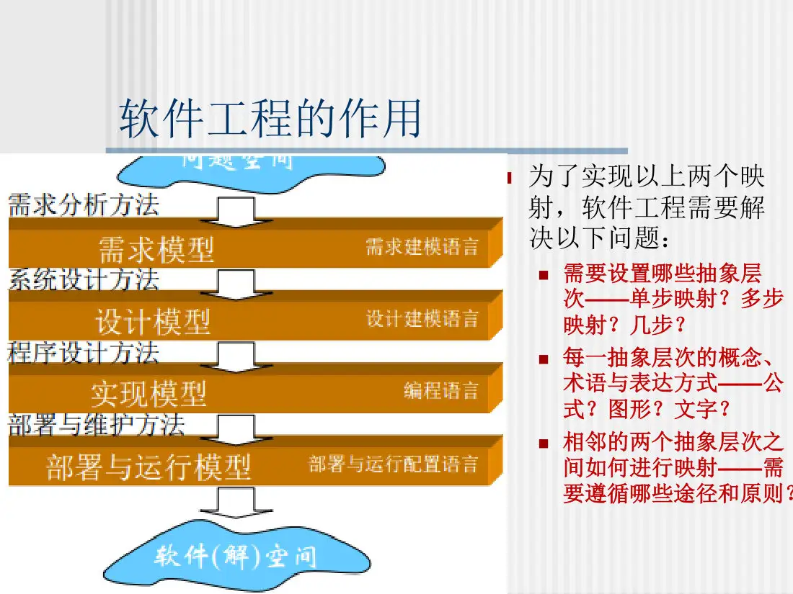

原文：

软件工程的作用

需求分析方法

需求模型

系统设计方法

设计模型

程序设计方法

实现模型

部署与维护方法

需求建模语言

设计建模语言

部署与运行模型

编程语言

部署与运行配置语言

为了实现以上两个映射，软件工程需要解决以下问题：

需要设置哪些抽象层次——单步映射？多步映射？几步？

每一抽象层次的概念、术语与表达方式——公式？图形？文字？

相邻的两个抽象层次之间如何进行映射——需要遵循哪些途径和原则？

### 软件工程的作用

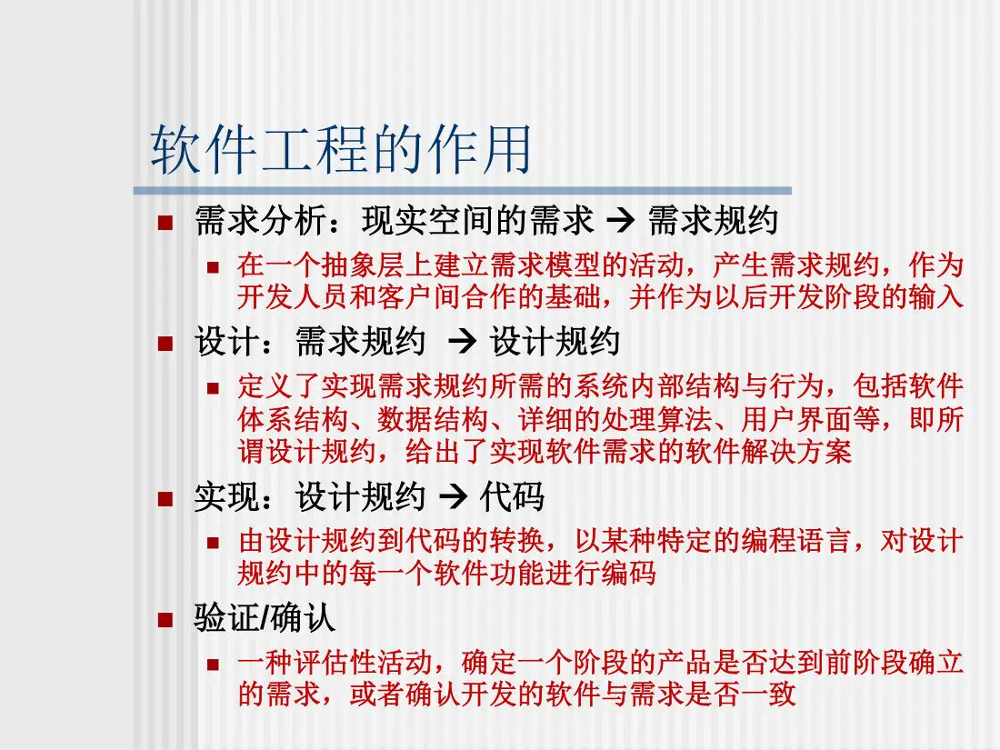

原文：

软件工程的作用

◼ 需求分析：现实空间的需求 → 需求规约

在一个抽象层上建立需求模型的活动，产生需求规约，作为开发人员和客户间合作的基础，并作为以后开发阶段的输入

◼ 设计：需求规约 → 设计规约

定义了实现需求规约所需的系统内部结构与行为，包括软件体系结构、数据结构、详细的处理算法、用户界面等，即所谓设计规约，给出了实现软件需求的软件解决方案

◼ 实现：设计规约 → 代码

由设计规约到代码的转换，以某种特定的编程语言，对设计规约中的每一个软件功能进行编码

◼ 验证/确认

一种评估性活动，确定一个阶段的产品是否达到前阶段确立的需求，或者确认开发的软件与需求是否一致

### Software Engineering P(15)

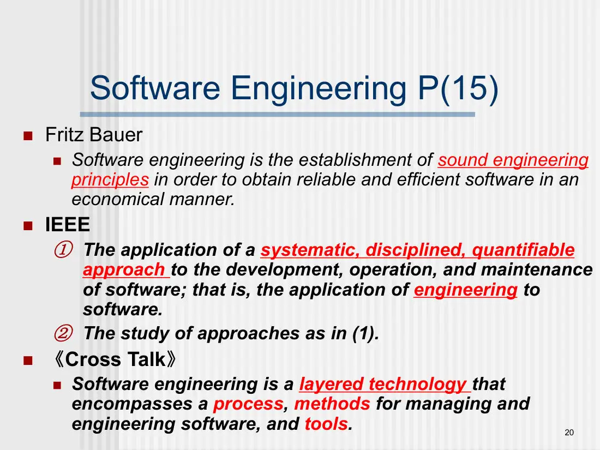

原文：

Software Engineering P(15)

◼ Fritz Bauer

Software engineering is the establishment of sound engineering principles in order to obtain reliable and efficient software in an economical manner.

◼ IEEE

The application of a systematic, disciplined, quantifiable approach to the development, operation, and maintenance of software; that is, the application of engineering to software.

The study of approaches as in (1).

◼ 《Cross Talk》

Software engineering is a layered technology that encompasses a process, methods for managing and engineering software, and tools.

20

### A Layered Technology P(15)

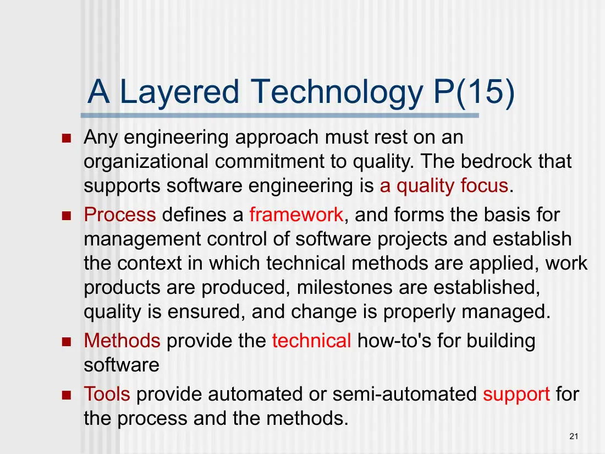

原文：

A Layered Technology P(15)

Any engineering approach must rest on an organizational commitment to quality. The bedrock that supports software engineering is a quality focus.

Process defines a framework, and forms the basis for management control of software projects and establish the context in which technical methods are applied, work products are produced, milestones are established, quality is ensured, and change is properly managed.

Methods provide the technical how-to's for building software

◼ Tools provide automated or semi-automated support for the process and the methods.

21

### 传统方法学

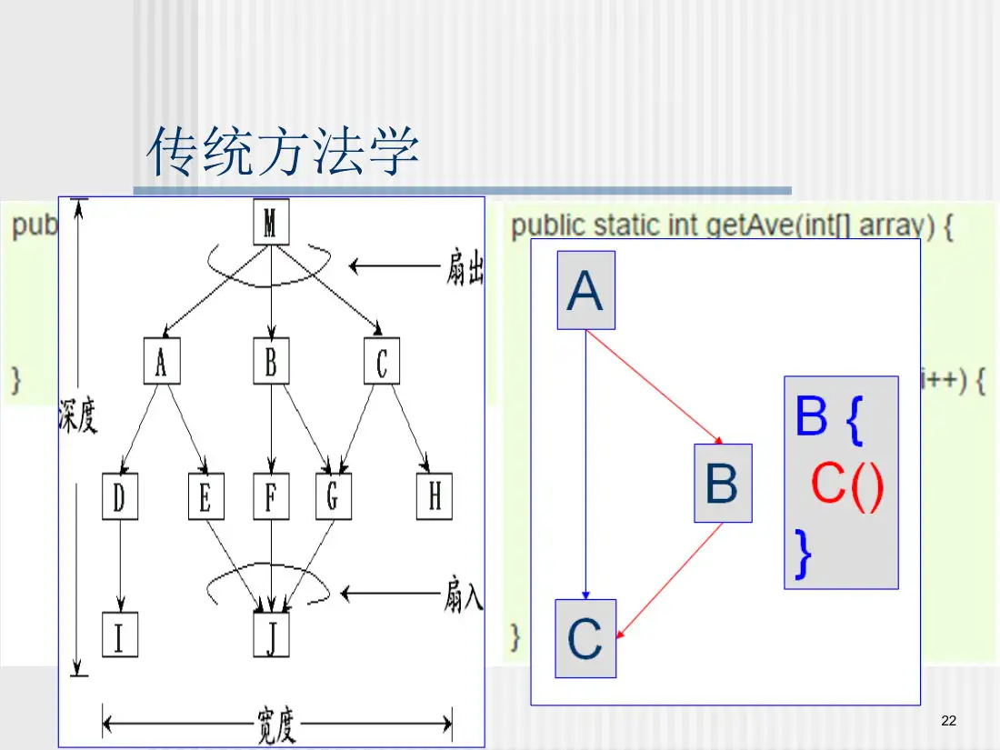

原文：

传统方法学

22

### OO方法学

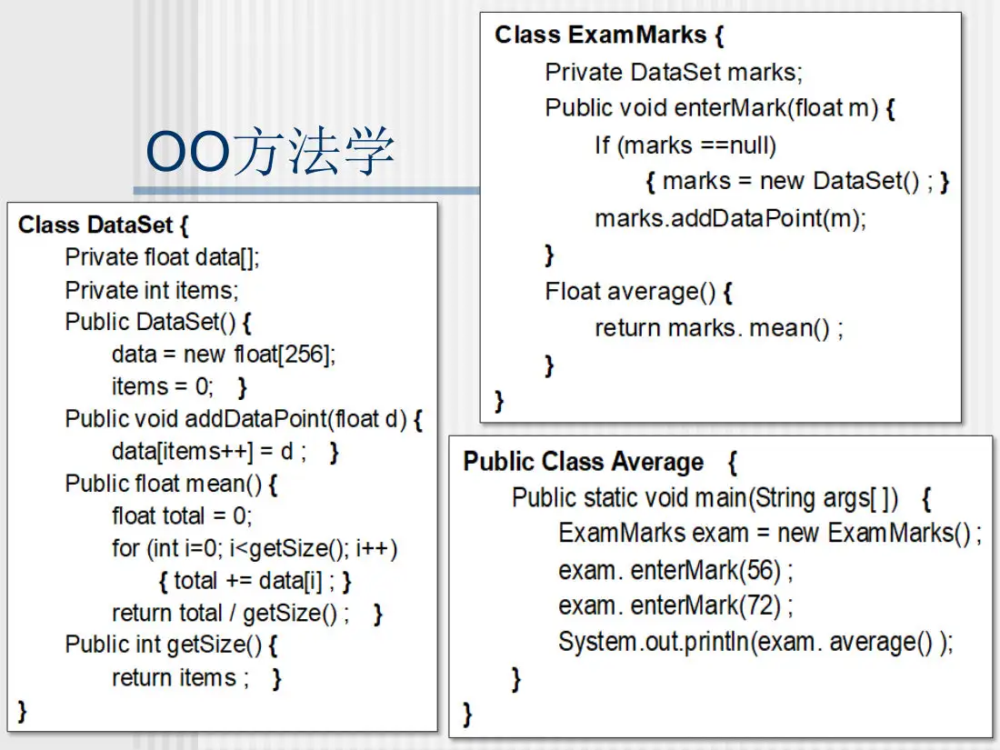

原文：

OO方法学

### OO方法学

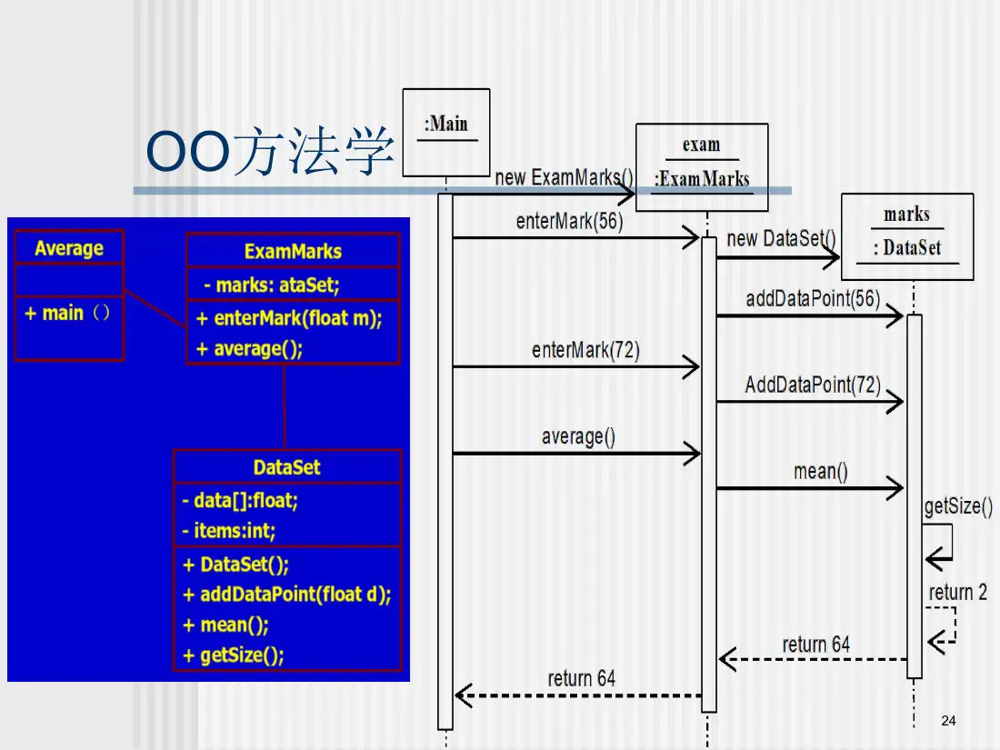

原文：

OO方法学

Average

ExamMarks

\- marks: ataSet;

\+ main ()

\+ enterMark(float m);

\+ average();

DataSet

\- data[]:float;

\- items:int;

\+ DataSet();

\+ addDataPoint(float d);

:Main

\+ mean();

\+ getSize();

new ExamMarks()

enterMark(56)

enterMark(72)

average()

exam :ExamMarks

new DataSet()

return 64 marks : DataSet

addDataPoint(56)

AddDataPoint(72)

mean()

getSize()

return 64

24

### OO方法学

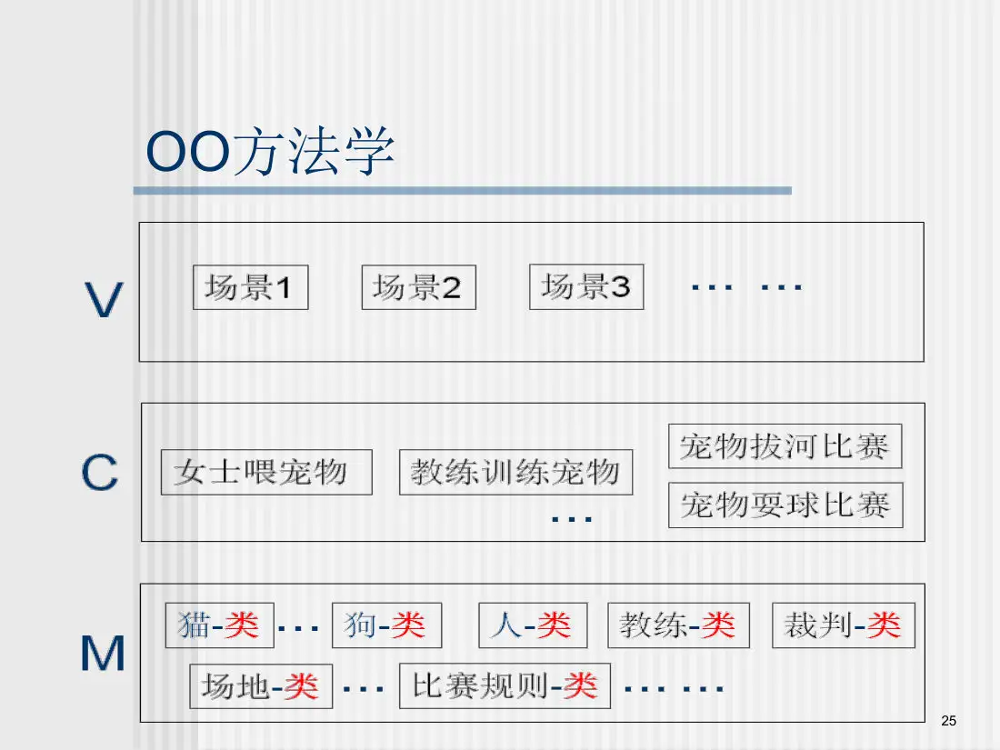

原文：

OO方法学

场景1

场景2

场景3

女士喂宠物

教练训练宠物

宠物拔河比赛

宠物耍球比赛

场地-类

猫-类

狗-类

人-类

教练-类

裁判-类

比赛规则-类

25

### OO方法学

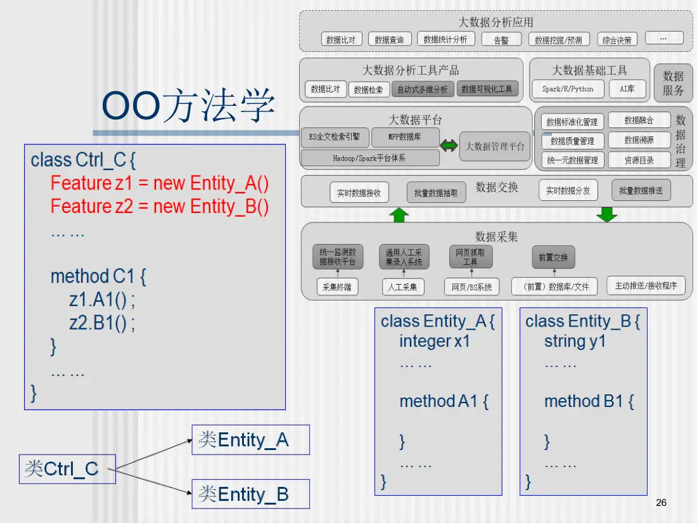

原文：

OO方法学

26

### 软件工程是一种层次化的技术

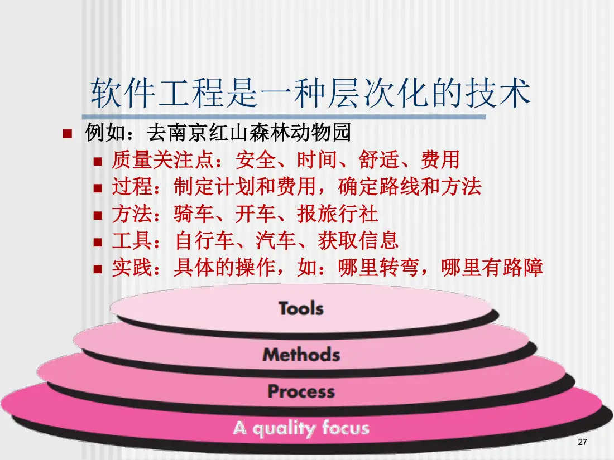

原文：

软件工程是一种层次化的技术

◼ 例如：去南京红山森林动物园

质量关注点：安全、时间、舒适、费用

◼ 过程：制定计划和费用，确定路线和方法

方法：骑车、开车、报旅行社

◼ 工具：自行车、汽车、获取信息

◼ 实践：具体的操作，如：哪里转弯，哪里有路障

27

### Generic

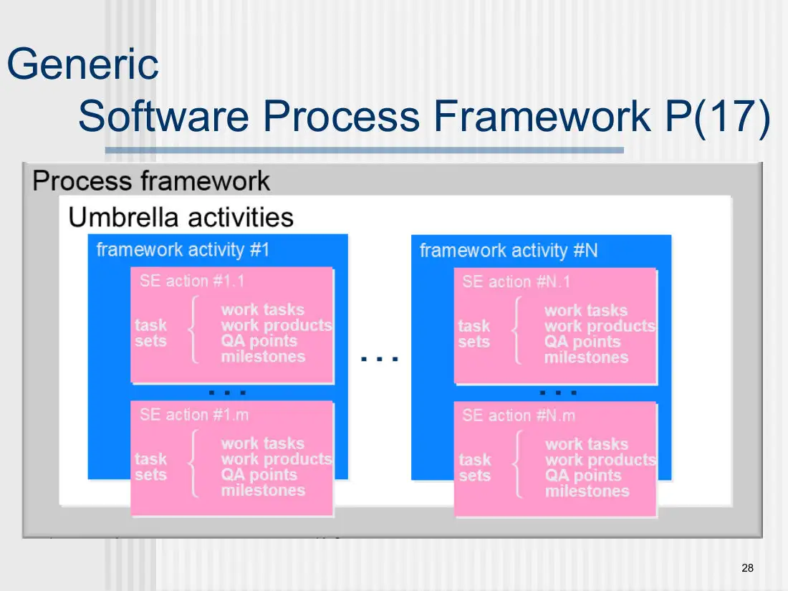

原文：

Generic

Software Process Framework P(17)

◼ Process F Umbrella activities

framework activity #1

framework activity #N

28

### Process Elements P(17)

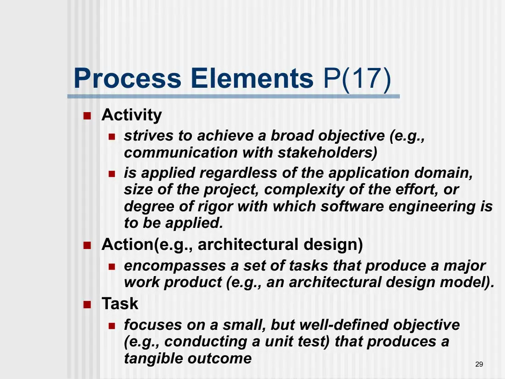

原文：

Process Elements P(17)

◼ Activity

◼ strives to achieve a broad objective (e.g., communication with stakeholders)

is applied regardless of the application domain, size of the project, complexity of the effort, or degree of rigor with which software engineering is to be applied.

◼ Action(e.g., architectural design)

encompasses a set of tasks that produce a major work product (e.g., an architectural design model).

◼ Task

focuses on a small, but well-defined objective (e.g., conducting a unit test) that produces a tangible outcome

29

### Five Framework Activities P(17)

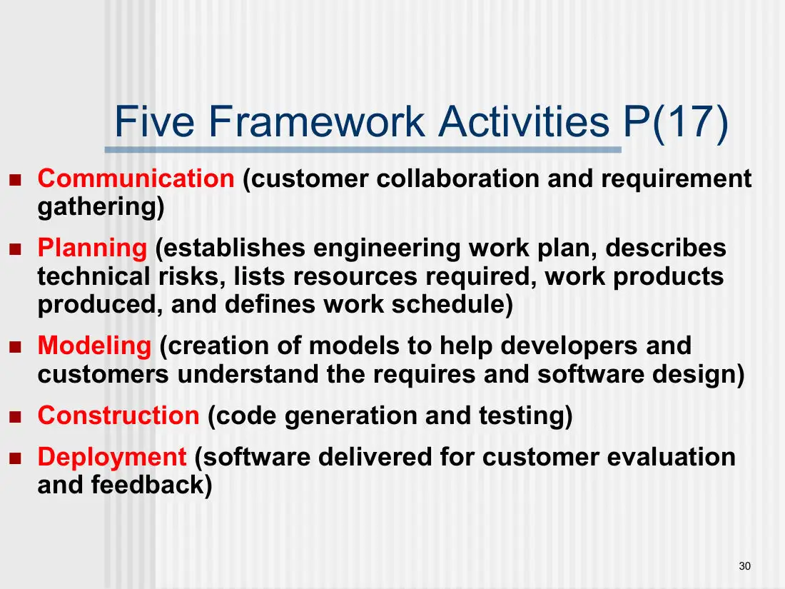

原文：

Five Framework Activities P(17)

Communication (customer collaboration and requirement gathering)

◼ Planning (establishes engineering work plan, describes technical risks, lists resources required, work products produced, and defines work schedule)

Modeling (creation of models to help developers and customers understand the requires and software design)

◼ Construction (code generation and testing)

Deployment (software delivered for customer evaluation and feedback)

30

### Five Framework Activities

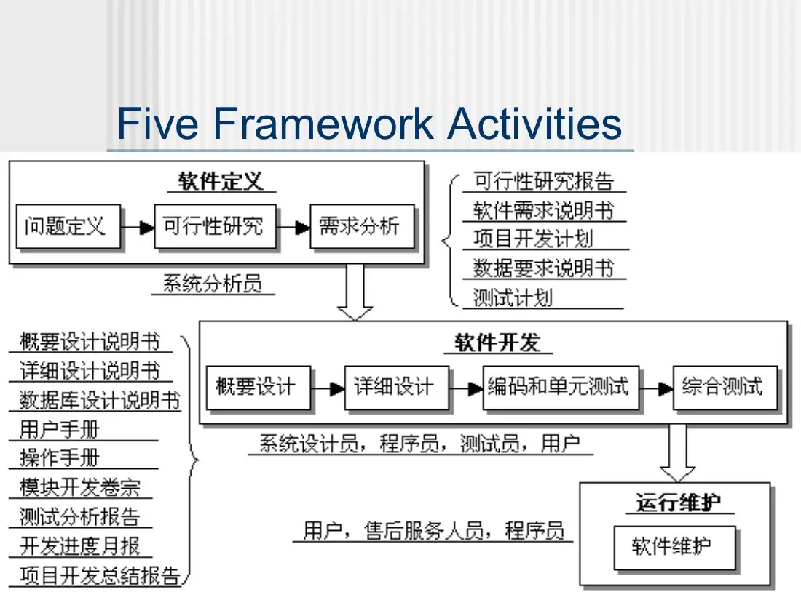

原文：

Five Framework Activities

问题定义

软件定义

可行性研究

系统分析员

需求分析

项目开发计划

数据要求说明书

可行性研究报告

概要设计说明书

详细设计说明书

软件需求说明书

数据库设计说明书

模块开发卷宗

用户手册

测试分析报告

操作手册

开发进度月报

项目开发总结报告

测试计划

概要设计

软件开发

详细设计

编码和单元测试

系统设计员，程序员，测试员，用户

综合测试

用户，售后服务人员，程序员

运行维护

软件维护

### ◼ Software project tracking and control

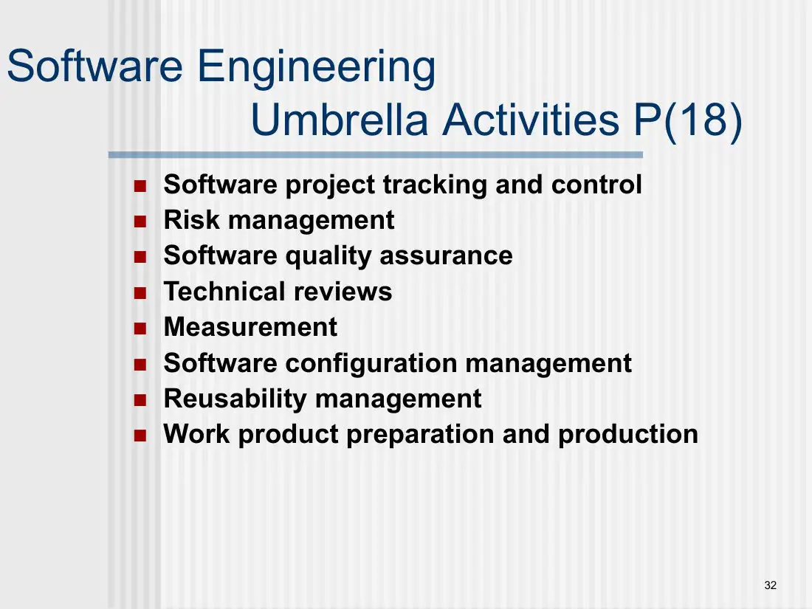

原文：

Software Engineering Umbrella Activities P(18)

◼ Software project tracking and control

◼ Risk management

◼ Software quality assurance

◼ Technical reviews

◼ Measurement

◼ Software configuration management

◼ Reusability management

◼ Work product preparation and production

32

### 第 33 页

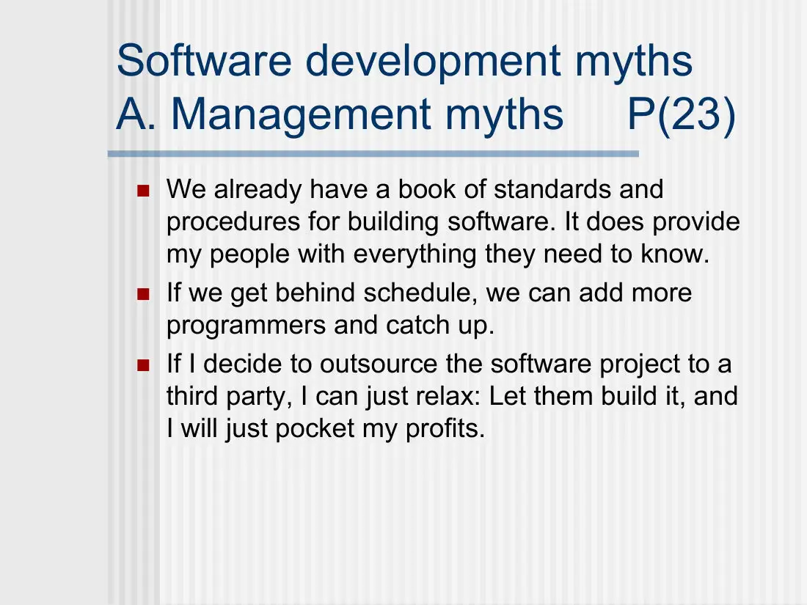

原文：

Software development myths A. Management myths P(23)

We already have a book of standards and procedures for building software. It does provide my people with everything they need to know.

If we get behind schedule, we can add more programmers and catch up.

If I decide to outsource the software project to a third party, I can just relax: Let them build it, and I will just pocket my profits.

### 第 34 页

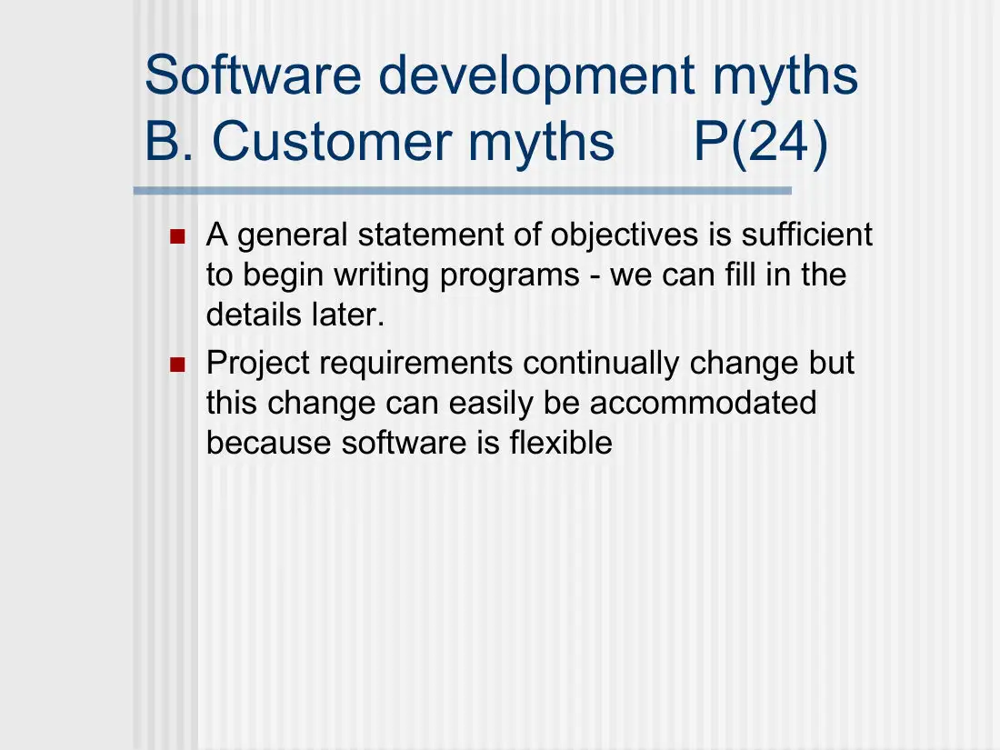

原文：

Software development myths B. Customer myths P(24)

A general statement of objectives is sufficient to begin writing programs - we can fill in the details later.

Project requirements continually change but this change can easily be accommodated because software is flexible

### 第 35 页

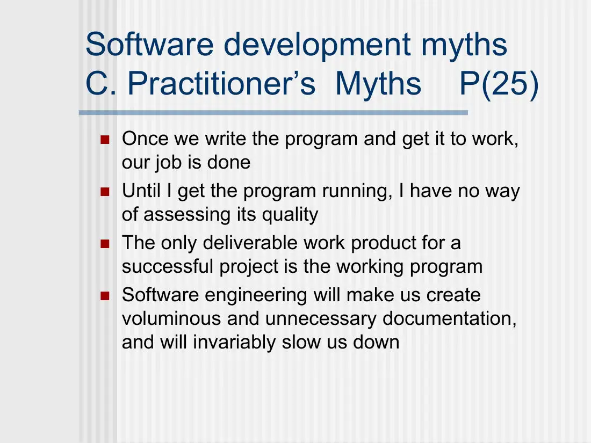

原文：

Software development myths C. Practitioner’s Myths P(25)

Once we write the program and get it to work, our job is done

Until I get the program running, I have no way of assessing its quality

The only deliverable work product for a successful project is the working program

Software engineering will make us create voluminous and unnecessary documentation, and will invariably slow us down
