# 《软件工程（双语）》第3章 理解需求（课件）

原件的每一页，下面附识别出的文字。

### UNIT 3

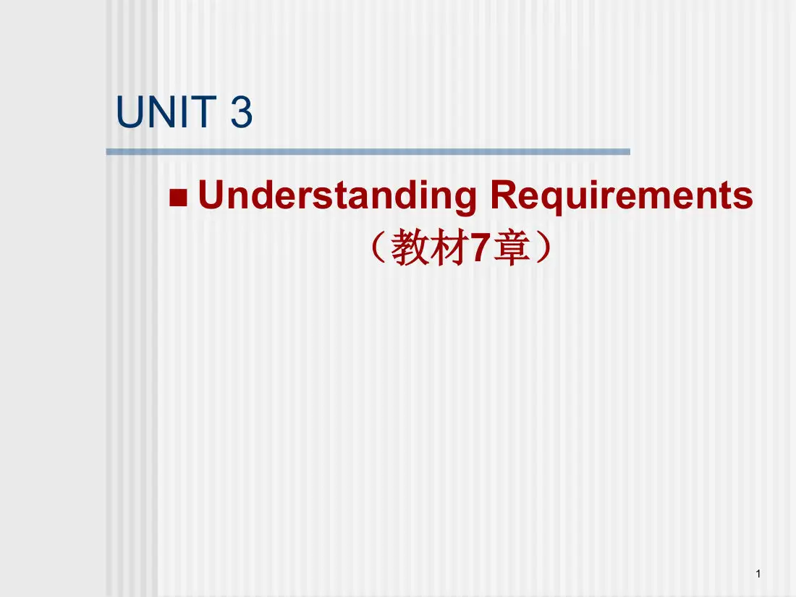

原文：

UNIT 3

◼ Understanding Requirements（教材7章）

1

### MODELING — Part 2 P(97)

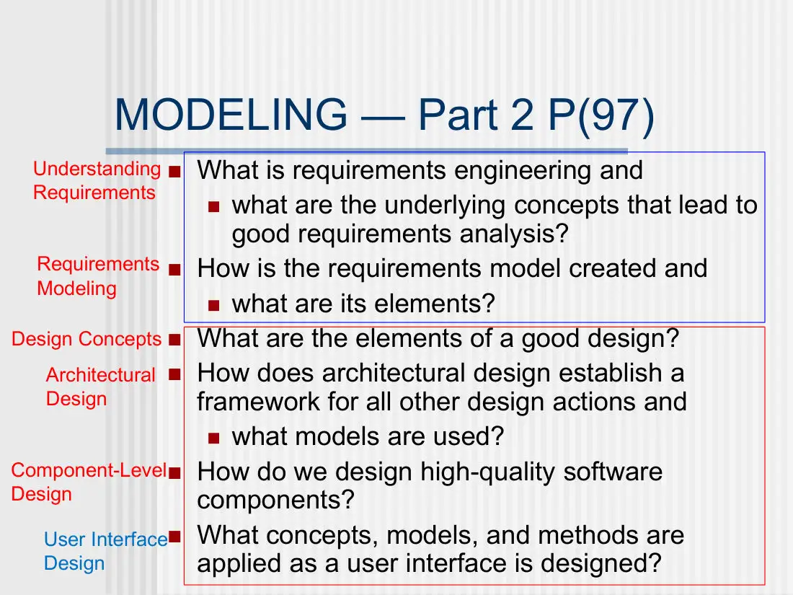

原文：

MODELING — Part 2 P(97)

<table><tr><td>Understanding Requirements</td><td>What is requirements engineering and what are the underlying concepts that lead to good requirements analysis?</td></tr><tr><td>Requirements Modeling</td><td>How is the requirements model created and what are its elements?</td></tr><tr><td>Design Concepts</td><td>What are the elements of a good design?</td></tr><tr><td>Architectural Design</td><td>How does architectural design establish a framework for all other design actions and what models are used?</td></tr><tr><td>Component-Level Design</td><td>How do we design high-quality software components?</td></tr><tr><td>User Interface Design</td><td>What concepts, models, and methods are applied as a user interface is designed?</td></tr></table>

### Contents & Requirements

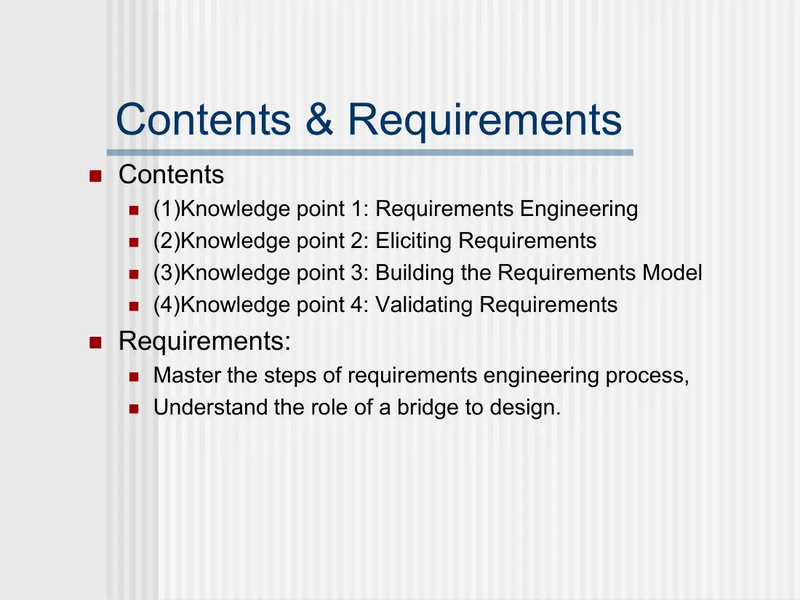

原文：

Contents & Requirements

◼ Contents

◼ (1)Knowledge point 1: Requirements Engineering

◼ (2)Knowledge point 2: Eliciting Requirements

◼ (3)Knowledge point 3: Building the Requirements Model

◼ (4)Knowledge point 4: Validating Requirements

◼ Requirements:

◼ Master the steps of requirements engineering process,

◼ Understand the role of a bridge to design.

### The Worst Nightmare P(98)

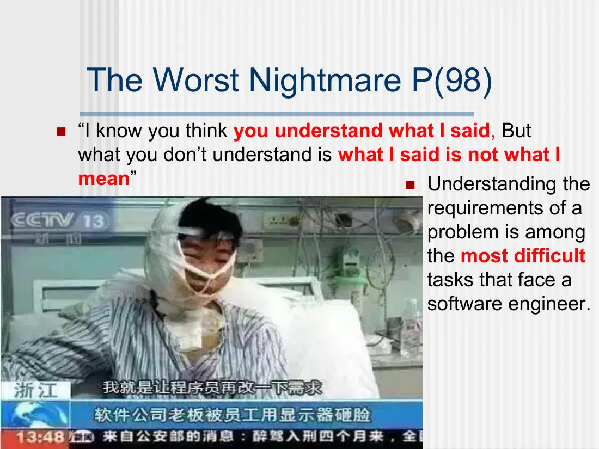

原文：

The Worst Nightmare P(98)

“I know you think you understand what I said, But what you don’t understand is what I said is not what I mean” Understanding Understanding the

requirements of a problem is among the most difficult tasks that face a software engineer.

### Requirements Engineering P(99)

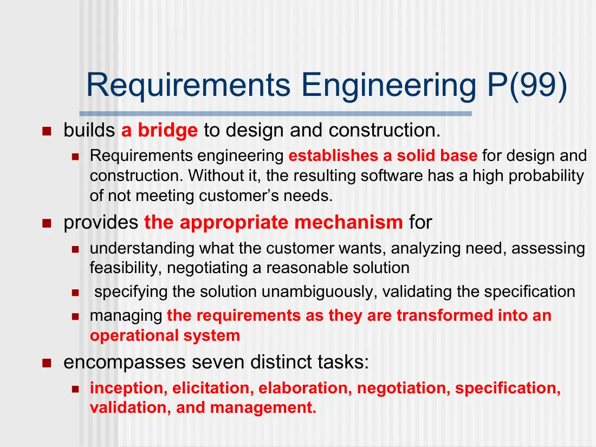

原文：

Requirements Engineering P(99)

◼ builds a bridge to design and construction.

Requirements engineering establishes a solid base for design and construction. Without it, the resulting software has a high probability of not meeting customer’s needs.

◼ provides the appropriate mechanism for

◼ understanding what the customer wants, analyzing need, assessing feasibility, negotiating a reasonable solution

◼ specifying the solution unambiguously, validating the specification

managing the requirements as they are transformed into an operational system

◼ encompasses seven distinct tasks:

inception, elicitation, elaboration, negotiation, specification, validation, and management.

### Inception P(100)

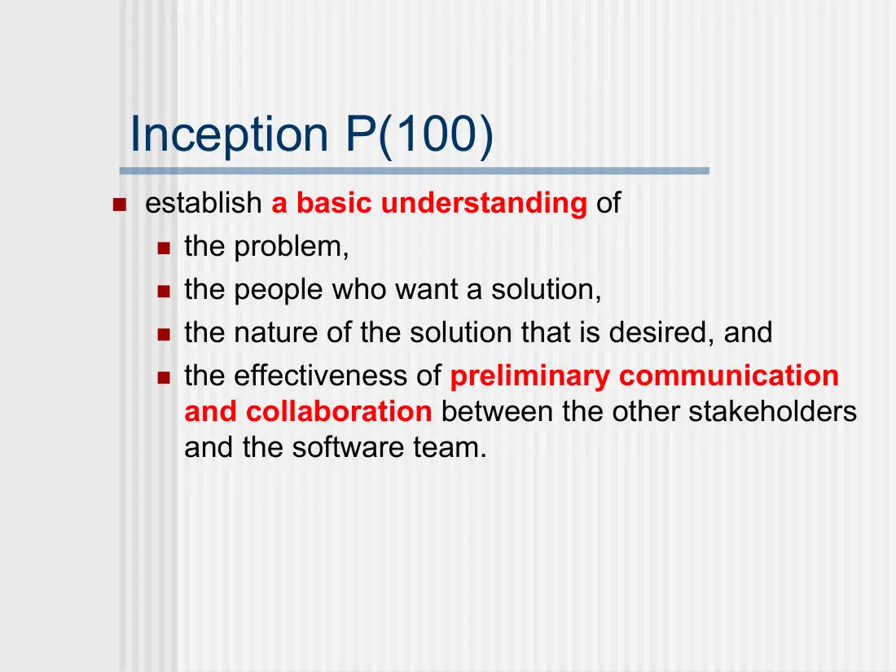

原文：

Inception P(100)

◼ establish a basic understanding of

◼ the problem,

◼ the people who want a solution,

◼ the nature of the solution that is desired, and

the effectiveness of preliminary communication and collaboration between the other stakeholders and the software team.

### Elicitation P(101)

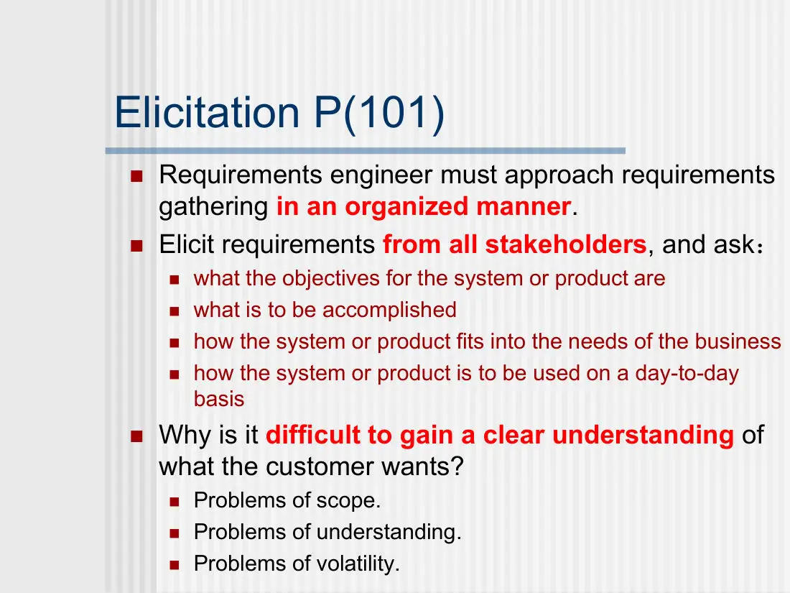

原文：

Elicitation P(101)

Requirements engineer must approach requirements gathering in an organized manner.

◼ Elicit requirements from all stakeholders, and ask：

◼ what the objectives for the system or product are

◼ what is to be accomplished

how the system or product fits into the needs of the business

how the system or product is to be used on a day-to-day basis

Why is it difficult to gain a clear understanding of what the customer wants?

◼ Problems of scope.

◼ Problems of understanding.

◼ Problems of volatility.

### Elaboration P(102)

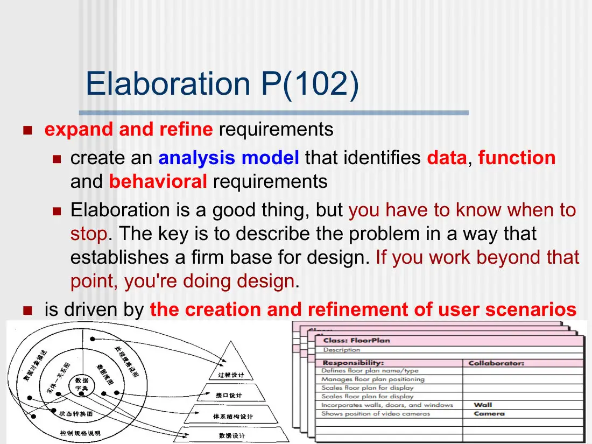

原文：

Elaboration P(102)

◼ expand and refine requirements

◼ create an analysis model that identifies data, function and behavioral requirements

Elaboration is a good thing, but you have to know when to stop. The key is to describe the problem in a way that establishes a firm base for design. If you work beyond that point, you're doing design.

◼ is driven by the creation and refinement of user scenarios

<table><tr><td colspan="2">Class: FloorPlan</td></tr><tr><td colspan="2">Description</td></tr><tr><td colspan="2"></td></tr><tr><td>Responsibility:</td><td>Collaborator:</td></tr><tr><td>Defines floor plan name/type</td><td></td></tr><tr><td>Manages floor plan positioning</td><td></td></tr><tr><td>Scales floor plan for display</td><td></td></tr><tr><td>Scales floor plan for display</td><td></td></tr><tr><td>Incorporates walls, doors, and windows</td><td>Wall</td></tr><tr><td>Shows position of video cameras</td><td>Camera</td></tr><tr><td></td><td></td></tr><tr><td></td><td></td></tr><tr><td></td><td></td></tr></table>

### Negotiation P(102)

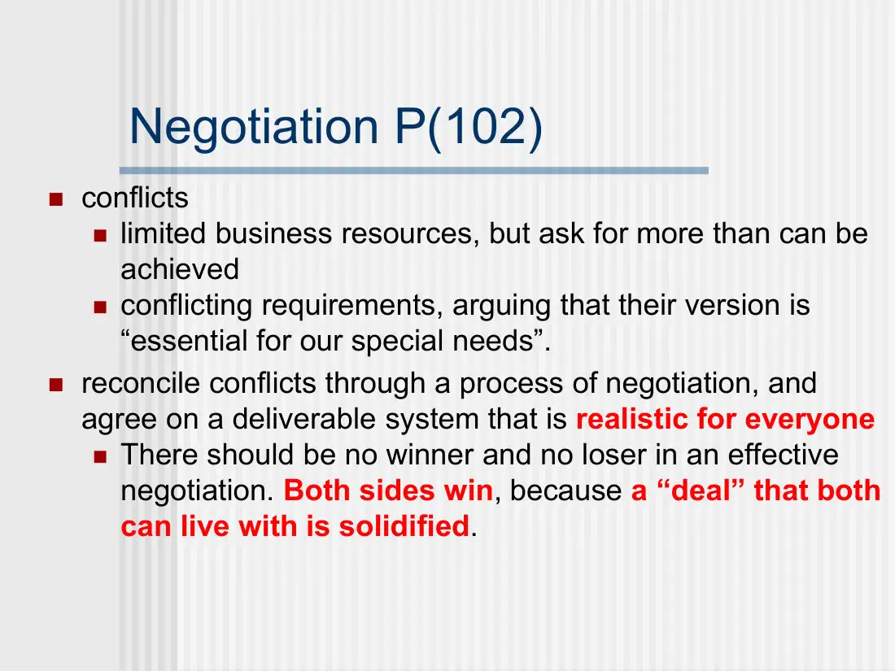

原文：

Negotiation P(102)

◼ conflicts

◼ limited business resources, but ask for more than can be achieved

◼ conflicting requirements, arguing that their version is “essential for our special needs”.

◼ reconcile conflicts through a process of negotiation, and agree on a deliverable system that is realistic for everyone

There should be no winner and no loser in an effective negotiation. Both sides win, because a “deal” that both can live with is solidified.

### 协商

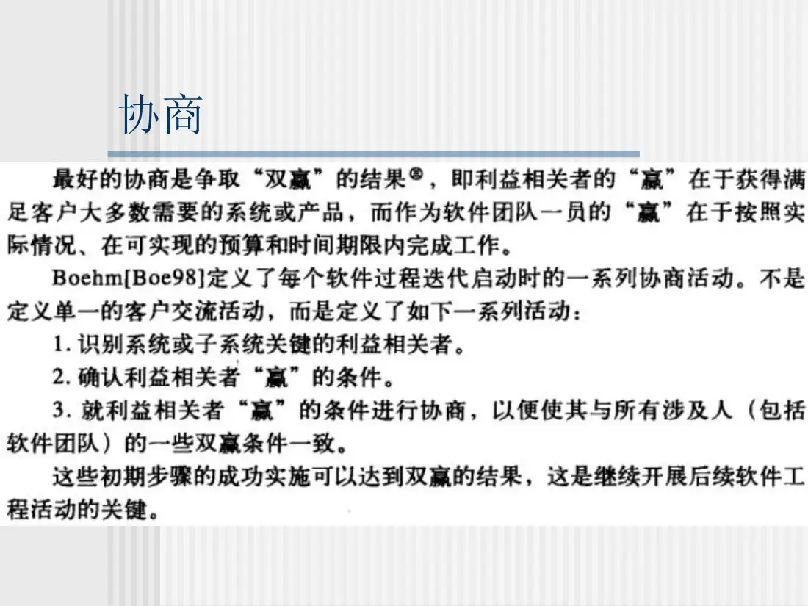

原文：

协商

最好的协商是争取“双赢”的结果，即利益相关者的“赢”在于获得满◼ 只给了有限的业务资源，但客户提出了过分的要求◼ 不同的客户提出了互相冲突

Boehm[Boe98]定义了每个软件过程迭代启动时的一系列协商活动。不是◼ 必须协商解决这些冲突，让所有共利

◼ 使用迭代的方式排序需

2. 确认利益相关者“赢”的条件。

3. 就利益相关者“赢”的条件进行协商，以便使其与所有涉及人(包括软件团队）的一些双赢条件一致。

这些初期步骤的成功实施可以达到双赢的结果，这是继续开展后续软件工程活动的关键。

### Specification P(102)

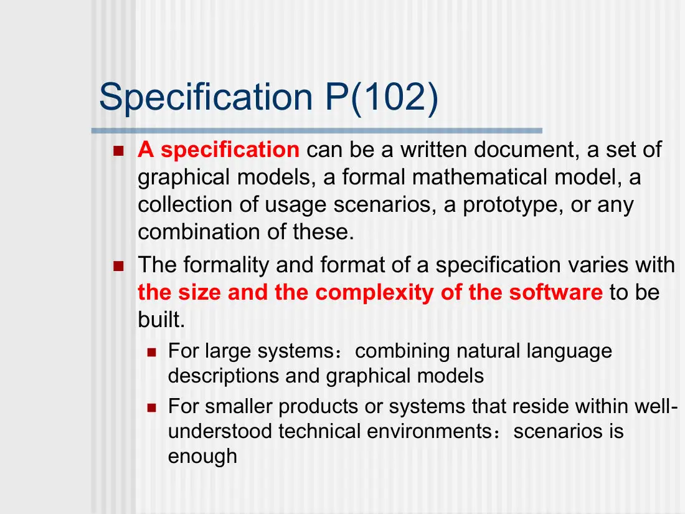

原文：

Specification P(102)

A specification can be a written document, a set of graphical models, a formal mathematical model, a collection of usage scenarios, a prototype, or any combination of these.

The formality and format of a specification varies with the size and the complexity of the software to be built.

For large systems：combining natural language descriptions and graphical models

For smaller products or systems that reside within wellunderstood technical environments：scenarios is enough

### 软件需求规格说明模板

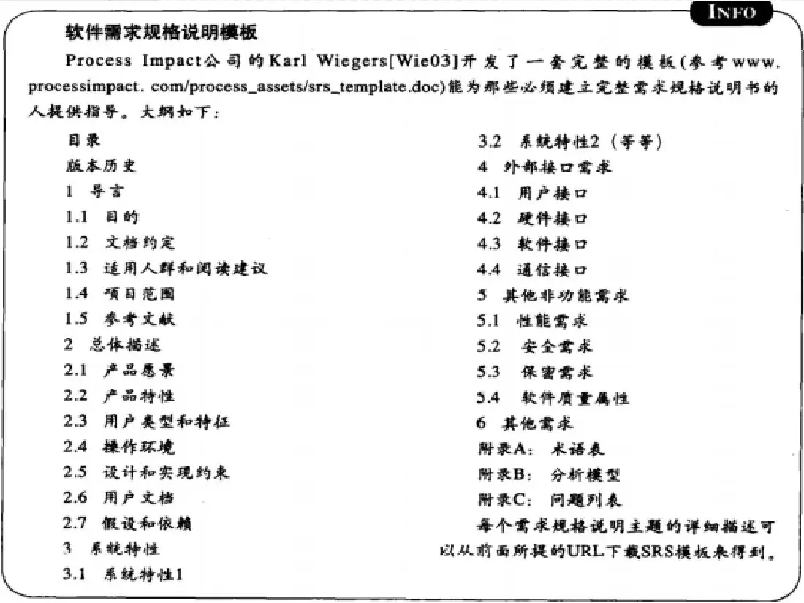

原文：

<table><tr><td>目录</td><td>3.2 系统特性2(等等)</td></tr><tr><td>版本历史</td><td>4 外部接口需求</td></tr><tr><td>1 导言</td><td>4.1 用户接口</td></tr><tr><td>1.1 目的</td><td>4.2 硬件接口</td></tr><tr><td>1.2 文档约定</td><td>4.3 软件接口</td></tr><tr><td>1.3 适用人群和阅读建议</td><td>4.4 通信接口</td></tr><tr><td>1.4 项目范围</td><td>5 其他非功能需求</td></tr><tr><td>1.5 参考文献</td><td>5.1 性能需求</td></tr><tr><td>2 总体描述</td><td>5.2 安全需求</td></tr><tr><td>2.1 产品愿景</td><td>5.3 保密需求</td></tr><tr><td>2.2 产品特性</td><td>5.4 软件质量属性</td></tr><tr><td>2.3 用户类型和特征</td><td>6 其他需求</td></tr><tr><td>2.4 操作环境</td><td>附录A:术语表</td></tr><tr><td>2.5 设计和实现约束</td><td>附录B:分析模型</td></tr><tr><td>2.6 用户文档</td><td>附录C:问题列表</td></tr><tr><td>2.7 假设和依赖</td><td rowspan="2">每个需求规格说明主题的详细描述可以从前面所提的URL下载SRS模板来得到。</td></tr><tr><td>3 系统特性</td></tr><tr><td>3.1 系统特性1</td><td></td></tr></table>

软件需求规格说明模板

Process Impact公司的Karl Wiegers[Wie03]开发了一套完整的模板(参考www.processimpact. com/process\_assets/srs\_template.doc)能为那些必须建立完整需求规格说明书的人提供指导。大纲扣下：

### Validation P(103)

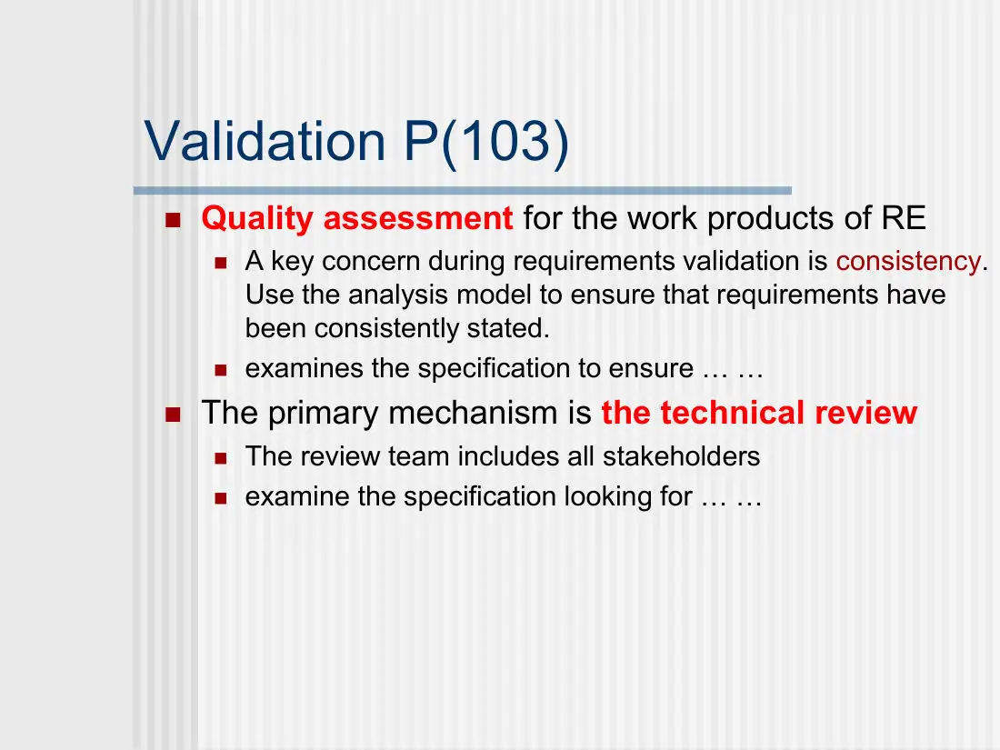

原文：

Validation P(103)

◼ Quality assessment for the work products of RE

A key concern during requirements validation is consistency. Use the analysis model to ensure that requirements have been consistently stated.

◼ examines the specification to ensure … …

◼ The primary mechanism is the technical review

◼ The review team includes all stakeholders

◼ examine the specification looking for … …

### “确认”涉及的一系列问题

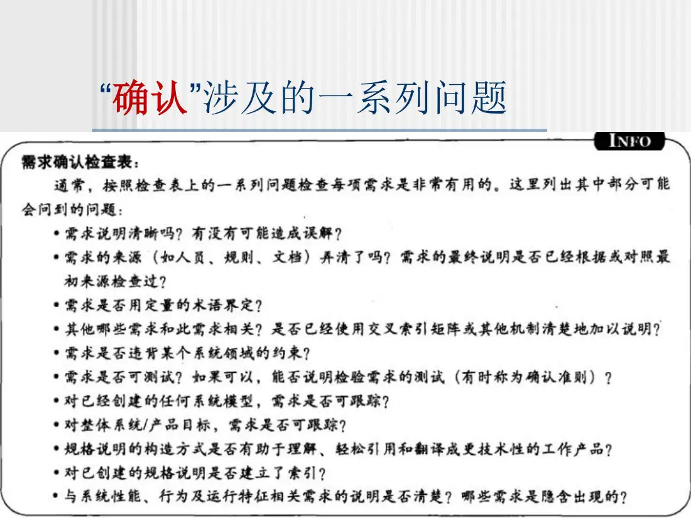

原文：

“确认”涉及的一系列问题

INFO

需求确认检查表：

◼ 需求确认的一个重要问题是一致性，使用分析模型会问到的问题：

·需求说明清晰吗？有没有可能造成误解？

·需求的来源(如人员、规则、文档)弄清了吗？需求的最终说明是否已经根据或对照最初来源检查过？

需求是否用定量的术语界定？

·其他哪些需求和此需求相关？是否已经使用交叉索引矩阵或其他机制清楚地加以说明？

·需求是否违背某个系统领域的约束？

·需求是否可测试？如果可以，能否说明检验需求的测试（有时称为确认准则）？

◼ 检查规格说明，查找内

要进一步解释澄清

，冲突的需求或不可实现的需求

·对已创建的规格说明是否建立了索引？

与系统性能、行为及运行特征相关需求的说明是否清楚？哪些需求是隐含出现的？

### Requirements management P(105）

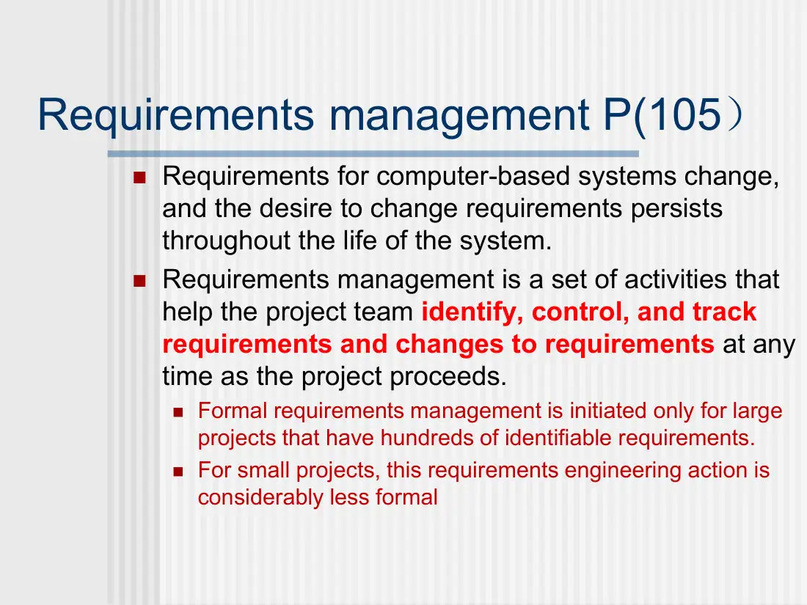

原文：

Requirements management P(105）

Requirements for computer-based systems change, and the desire to change requirements persists throughout the life of the system.

Requirements management is a set of activities that help the project team identify, control, and track requirements and changes to requirements at any time as the project proceeds.

Formal requirements management is initiated only for large projects that have hundreds of identifiable requirements.

For small projects, this requirements engineering action is considerably less formal

### Establishing the Groundwork (P105)

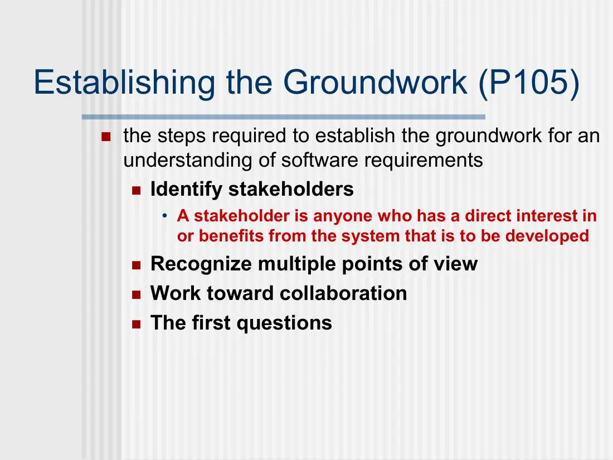

原文：

Establishing the Groundwork (P105)

the steps required to establish the groundwork for an understanding of software requirements

◼ Identify stakeholders

A stakeholder is anyone who has a direct interest in or benefits from the system that is to be developed

◼ Recognize multiple points of view

◼ Work toward collaboration

◼ The first questions

### 确认共利益者

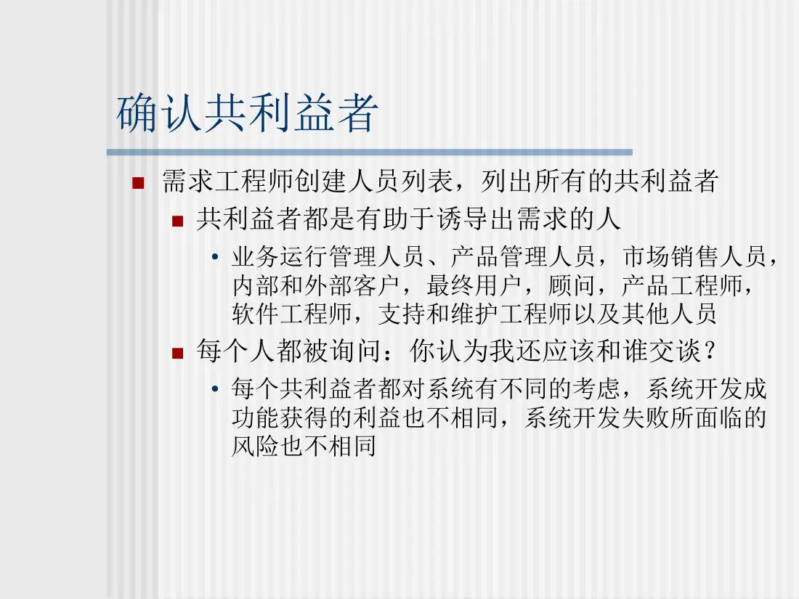

原文：

确认共利益者

◼ 需求工程师创建人员列表，列出所有的共利益者

◼ 共利益者都是有助于诱导出需求的人

业务运行管理人员、产品管理人员，市场销售人员，内部和外部客户，最终用户，顾问，产品工程师，软件工程师，支持和维护工程师以及其他人员

◼ 每个人都被询问：你认为我还应该和谁交谈？

每个共利益者都对系统有不同的考虑，系统开发成功能获得的利益也不相同，系统开发失败所面临的风险也不相同

### 识别多种观点

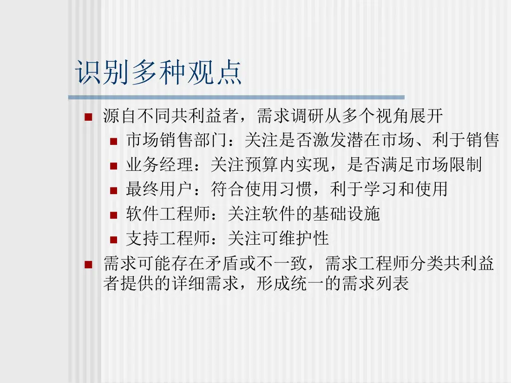

原文：

识别多种观点

◼ 源自不同共利益者，需求调研从多个视角展开

◼ 市场销售部门：关注是否激发潜在市场、利于销售

◼ 业务经理：关注预算内实现，是否满足市场限制

◼ 最终用户：符合使用习惯，利于学习和使用

◼ 软件工程师：关注软件的基础设施

◼ 支持工程师：关注可维护性

◼ 需求可能存在矛盾或不一致，需求工程师分类共利益者提供的详细需求，形成统一的需求列表

### 协同工作

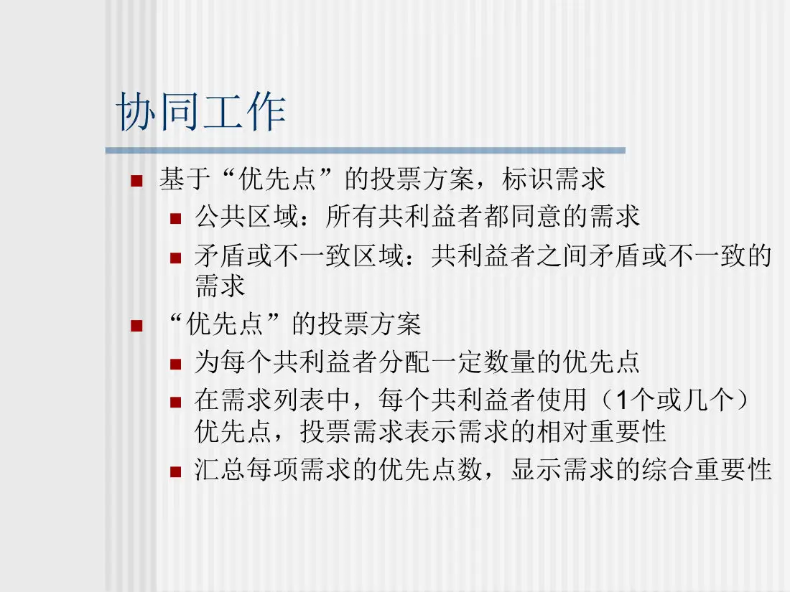

原文：

协同工作

◼ 基于“优先点”的投票方案，标识需求

◼ 公共区域：所有共利益者都同意的需求

矛盾或不一致区域：共利益者之间矛盾或不一致的 需求

◼ “优先点”的投票方案

◼ 为每个共利益者分配一定数量的优先点

◼ 在需求列表中，每个共利益者使用（1个或几个）优先点，投票需求表示需求的相对重要性

◼ 汇总每项需求的优先点数，显示需求的综合重要性

### 首次提问— —1

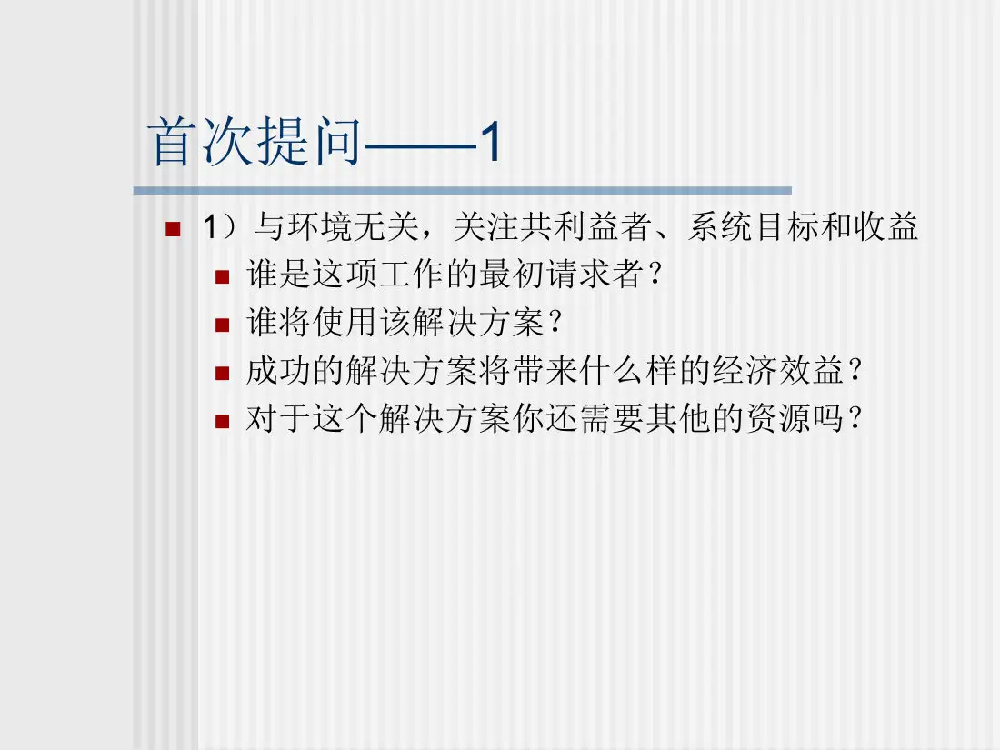

原文：

首次提问— —1

◼ 1）与环境无关，关注共利益者、系统目标和收益

◼ 谁是这项工作的最初请求者？

◼ 谁将使用该解决方案？

◼ 成功的解决方案将带来什么样的经济效益？

◼ 对于这个解决方案你还需要其他的资源吗？

### 首次提问— —2

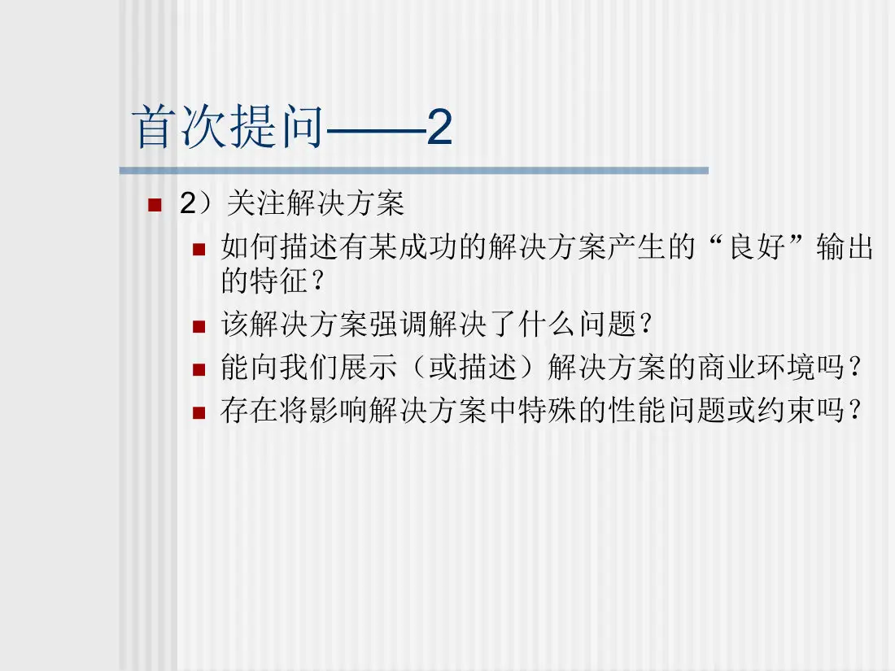

原文：

首次提问— —2

◼ 2）关注解决方案

如何描述有某成功的解决方案产生的“良好”输出的特征？

◼ 该解决方案强调解决了什么问题？

◼ 能向我们展示（或描述）解决方案的商业环境吗？

◼ 存在将影响解决方案中特殊的性能问题或约束吗？

### 首次提问— 3

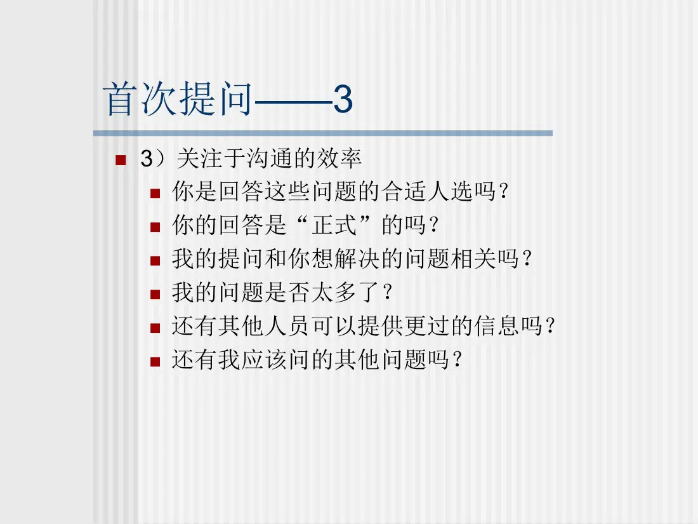

原文：

首次提问— 3

◼ 3）关注于沟通的效率

◼ 你是回答这些问题的合适人选吗？

◼ 你的回答是“正式”的吗？

◼ 我的提问和你想解决的问题相关吗？

◼ 我的问题是否太多了？

◼ 还有其他人员可以提供更过的信息吗？

◼ 还有我应该问的其他问题吗？

### Stakeholders work together

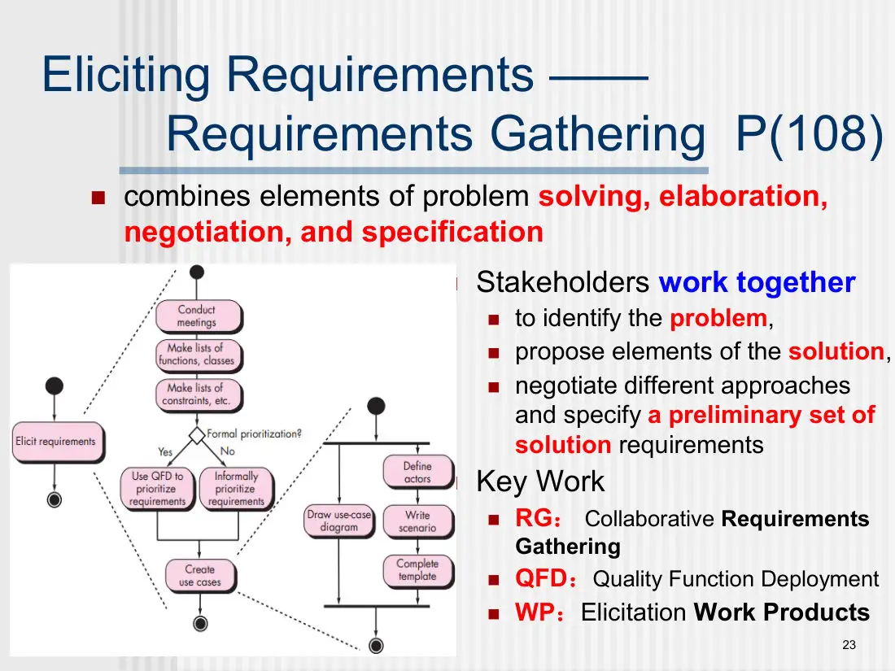

原文：

Eliciting Requirements Requirements Gathering P(108)

combines elements of problem solving, elaboration, negotiation, and specification

Stakeholders work together

◼ to identify the problem,

◼ propose elements of the solution,

negotiate different approaches and specify a preliminary set of solution requirements

Key Work

RG： Collaborative RequirementsGathering

◼ QFD：Quality Function Deployment

◼ WP：Elicitation Work Products

23

### 需求收集会议

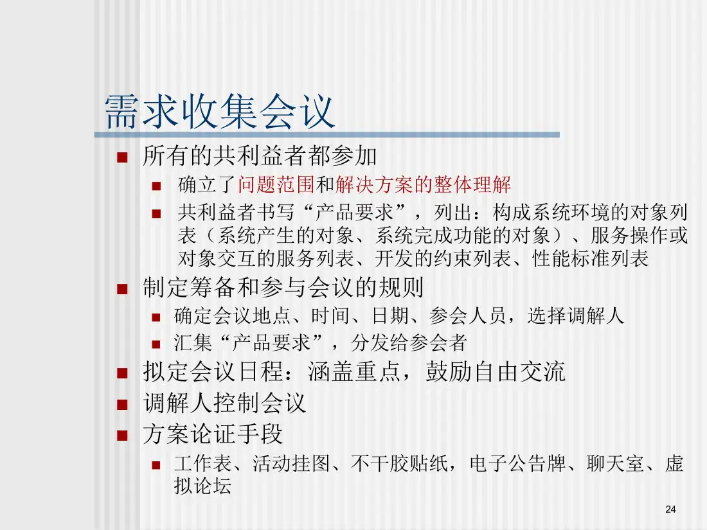

原文：

需求收集会议

◼ 所有的共利益者都参加

确立了问题范围和解决方案的整体理解

◼ 共利益者书写“产品要求”，列出：构成系统环境的对象列表（系统产生的对象、系统完成功能的对象）、服务操作或对象交互的服务列表、开发的约束列表、性能标准列表

◼ 制定筹备和参与会议的规则

◼ 确定会议地点、时间、日期、参会人员，选择调解人

◼ 汇集“产品要求”，分发给参会者

◼ 拟定会议日程：涵盖重点，鼓励自由交流

◼ 调解人控制会议

◼ 方案论证手段

◼ 工作表、活动挂图、不干胶贴纸，电子公告牌、聊天室、虚拟论坛

24

### 会议的主要进程

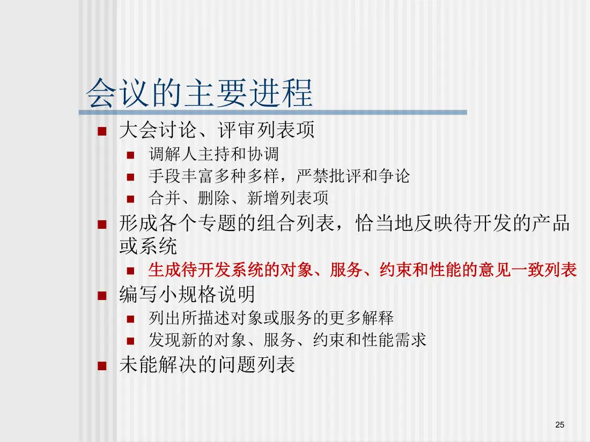

原文：

会议的主要进程

◼ 大会讨论、评审列表项

◼ 调解人主持和协调

◼ 手段丰富多种多样，严禁批评和争论

◼ 合并、删除、新增列表项

形成各个专题的组合列表，恰当地反映待开发的产品或系统

生成待开发系统的对象、服务、约束和性能的意见一致列表

◼ 编写小规格说明

◼ 列出所描述对象或服务的更多解释

◼ 发现新的对象、服务、约束和性能需求

◼ 未能解决的问题列表

25

### 会议的工作制品

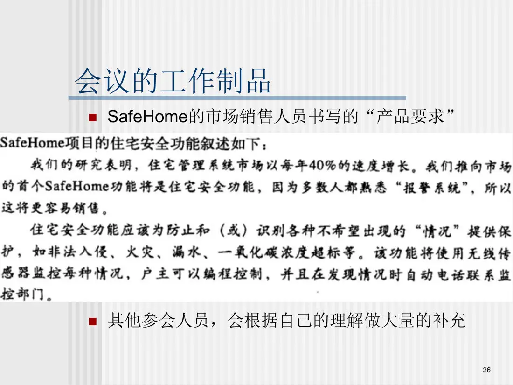

原文：

会议的工作制品

◼ SafeHome的市场销售人员书写的“产品要求”

SafeHome项目的住宅安全功能叙述如下：

我们的研究表明，住宅管理系统市场以每年40%的速度增长。我们推向市场的首个SafeHome功能将是住宅安全功能，因为多数人都熟悉“报警系统”，所以这将更容易销售。

住宅安全功能应该为防止和(或)识别各种不希望出现的“情况”提供保护，如非法入侵、火灾、漏水、一氧化碳浓度超标等。该功能将使用无线传感器监控每种情况，户主可以编程控制，并且在发现情况时自动电话联系监控部门。

◼ 其他参会人员，会根据自己的理解做大量的补充

26

### 会议的工作制品

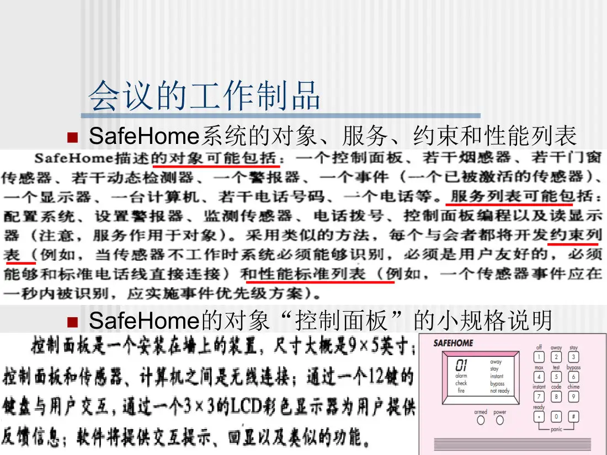

原文：

会议的工作制品

◼ SafeHome系统的对象、服务、约束和性能列表

SafeHome描述的对象可能包括：一个控制面板、若干烟感器、若干门窗传感器、若干动态检测器、一个警报器、一个事件（一个已被激活的传感器）、一个显示器、一台计算机、若干电话号码、一个电话等。服务列表可能包括：配置系统、设置警报器、监测传感器、电话拨号、控制面板编程以及读显示器（注意，服务作用于对象)。采用类似的方法，每个与会者都将开发约束列表（例如，当传感器不工作时系统必须能够识别，必须是用户友好的，必须能够和标准电话线直接连接）和性能标准列表（例如，一个传感器事件应在一秒内被识别，应实施事件优先级方案)。

◼ SafeHome的对象“控制面板”的小规格说明

控制面板是一个安装在墙上的装置，尺寸大概是9×5英寸；控制面板和传感器、计算机之间是无线连接；通过一个12键的键盘与用户交互，通过一个3×3的LCD彩色显示器为用户提供反馈信息；软件将提供交互提示、回显以及类似的功能。

### Quality Function deployment P(112)

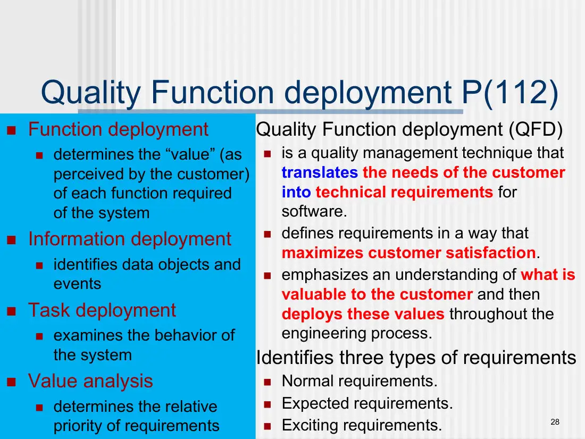

原文：

Quality Function deployment P(112)

◼ Function deployment

determines the “value” (as perceived by the customer) of each function required of the system

◼ Information deployment

◼ identifies data objects and events

◼ Task deployment

examines the behavior of the system

◼ Value analysis

determines the relative priority of requirements

Quality Function deployment (QFD)

is a quality management technique that translates the needs of the customer into technical requirements for software.

defines requirements in a way that maximizes customer satisfaction.

emphasizes an understanding of what is valuable to the customer and then deploys these values throughout the engineering process.

Identifies three types of requirements

◼ Normal requirements.

◼ Expected requirements.

◼ Exciting requirements.

28

### Elicitation Work Products P(113)

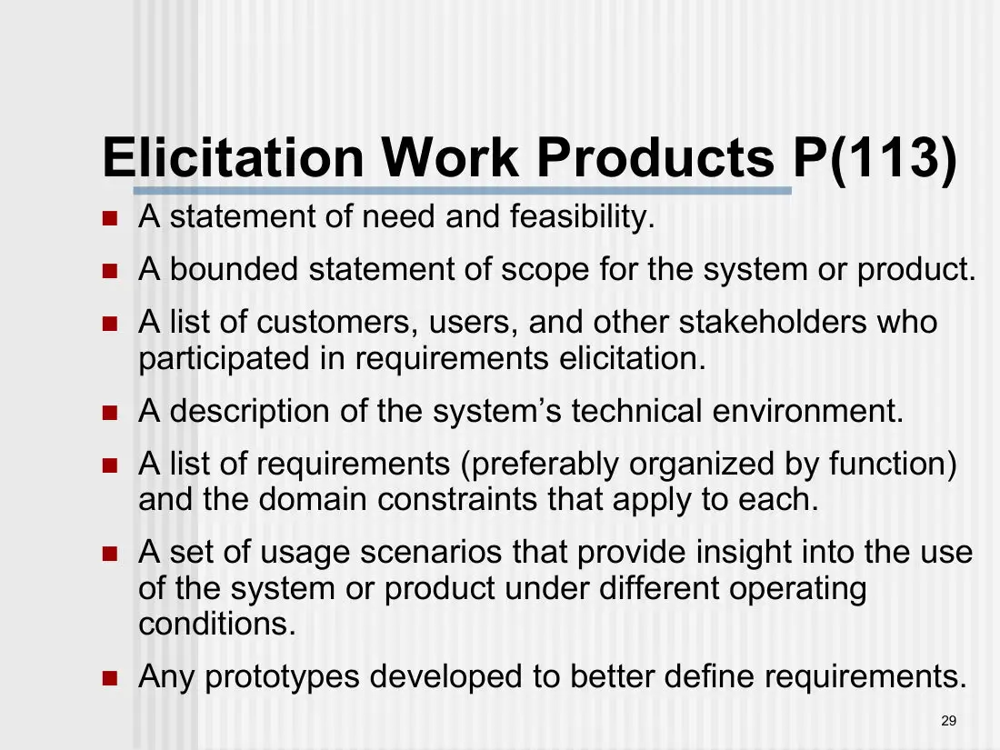

原文：

Elicitation Work Products P(113)

◼ A statement of need and feasibility.

◼ A bounded statement of scope for the system or product.

A list of customers, users, and other stakeholders who participated in requirements elicitation.

◼ A description of the system’s technical environment.

A list of requirements (preferably organized by function) and the domain constraints that apply to each.

A set of usage scenarios that provide insight into the use of the system or product under different operating conditions.

◼ Any prototypes developed to better define requirements.

29

### Developing Use Cases P(115)

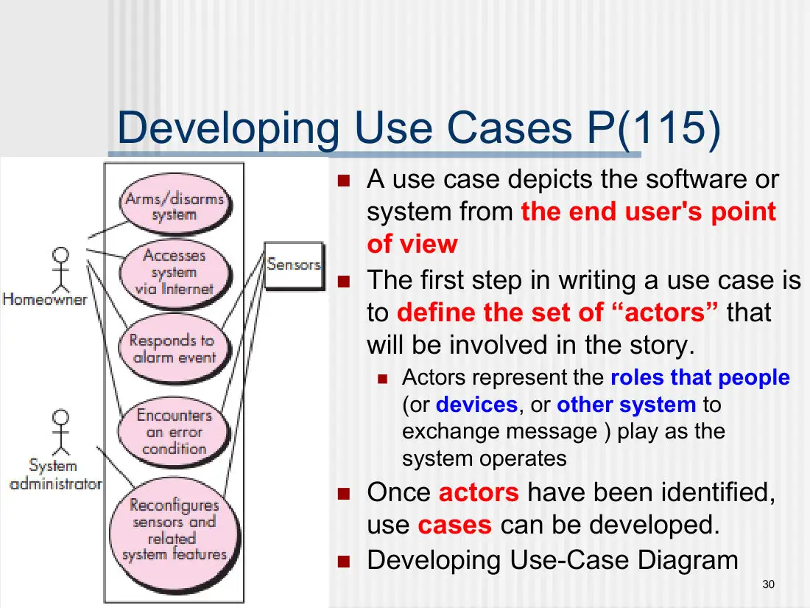

原文：

Developing Use Cases P(115)

A use case depicts the software or system from the end user's point of view

The first step in writing a use case is to define the set of “actors” that will be involved in the story.

Actors represent the roles that people (or devices, or other system to exchange message ) play as the system operates

Once actors have been identified, use cases can be developed.

◼ Developing Use-Case Diagram

30

### 绘制用例图必须明确的问题

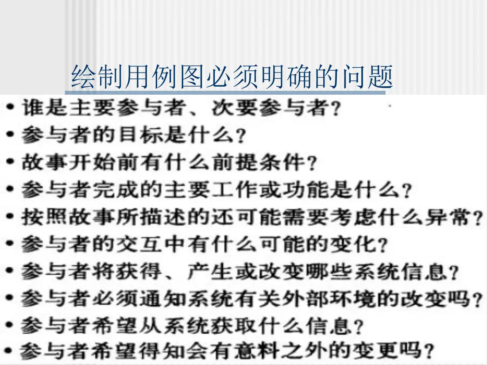

原文：

绘制用例图必须明确的问题

\- 谁是主要参与者、次要参与者？
- 参与者的目标是什么？
- 故事开始前有什么前提条件？
- 参与者完成的主要工作或功能是什么？
- 按照故事所描述的还可能需要考虑什么异常？
- 参与者的交互中有什么可能的变化？
- 参与者将获得、产生或改变哪些系统信息？
- 参与者必须通知系统有关外部环境的改变吗？
- 参与者希望从系统获取什么信息？
- 参与者希望得知会有意料之外的变更吗？

### 描述用例

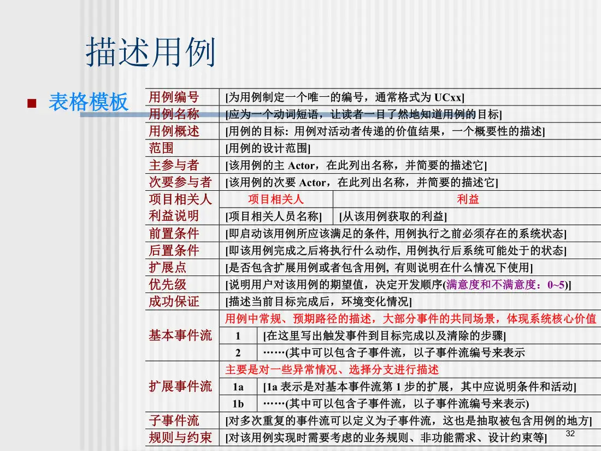

原文：

描述用例

表格模板

<table><tr><td>用例编号</td><td colspan="3">[为用例制定一个唯一的编号,通常格式为UCxx]</td></tr><tr><td>用例名称</td><td colspan="3">[应为一个动词短语,让读者一目了然地知道用例的目标]</td></tr><tr><td>用例概述</td><td colspan="3">[用例的目标:用例对活动者传递的价值结果,一个概要性的描述]</td></tr><tr><td>范围</td><td colspan="3">[用例的设计范围]</td></tr><tr><td>主参与者</td><td colspan="3">[该用例的主Actor,在此列出名称,并简要的描述它]</td></tr><tr><td>次要参与者</td><td colspan="3">[该用例的次要Actor,在此列出名称,并简要的描述它]</td></tr><tr><td rowspan="2">项目相关人利益说明</td><td colspan="2">项目相关人</td><td>利益</td></tr><tr><td colspan="2">[项目相关人员名称]</td><td>[从该用例获取的利益]</td></tr><tr><td>前置条件</td><td colspan="3">[即启动该用例所应该满足的条件,用例执行之前必须存在的系统状态]</td></tr><tr><td>后置条件</td><td colspan="3">[即该用例完成之后将执行什么动作,用例执行后系统可能处于的状态]</td></tr><tr><td>扩展点</td><td colspan="3">[是否包含扩展用例或者包含用例,有则说明在什么情况下使用]</td></tr><tr><td>优先级</td><td colspan="3">[说明用户对该用例的期望值,决定开发顺序(满意度和不满意度:0~5)]</td></tr><tr><td>成功保证</td><td colspan="3">[描述当前目标完成后,环境变化情况]</td></tr><tr><td rowspan="3">基本事件流</td><td colspan="3">用例中常规、预期路径的描述,大部分事件的共同场景,体现系统核心价值</td></tr><tr><td>1</td><td colspan="2">[在这里写出触发事件到目标完成以及清除的步骤]</td></tr><tr><td>2</td><td colspan="2">......(其中可以包含子事件流,以子事件流编号来表示)</td></tr><tr><td rowspan="3">扩展事件流</td><td colspan="3">主要是对一些异常情况、选择分支进行描述</td></tr><tr><td>1a</td><td colspan="2">[1a表示是对基本事件流第1步的扩展,其中应说明条件和活动]</td></tr><tr><td>1b</td><td colspan="2">......(其中可以包含子事件流,以子事件流编号来表示)</td></tr><tr><td>子事件流</td><td colspan="3">[对多次重复的事件流可以定义为子事件流,这也是抽取被包含用例的地方]</td></tr><tr><td>规则与约束</td><td colspan="3">[对该用例实现时需要考虑的业务规则、非功能需求、设计约束等] 32</td></tr></table>

### 用例：初始化监测

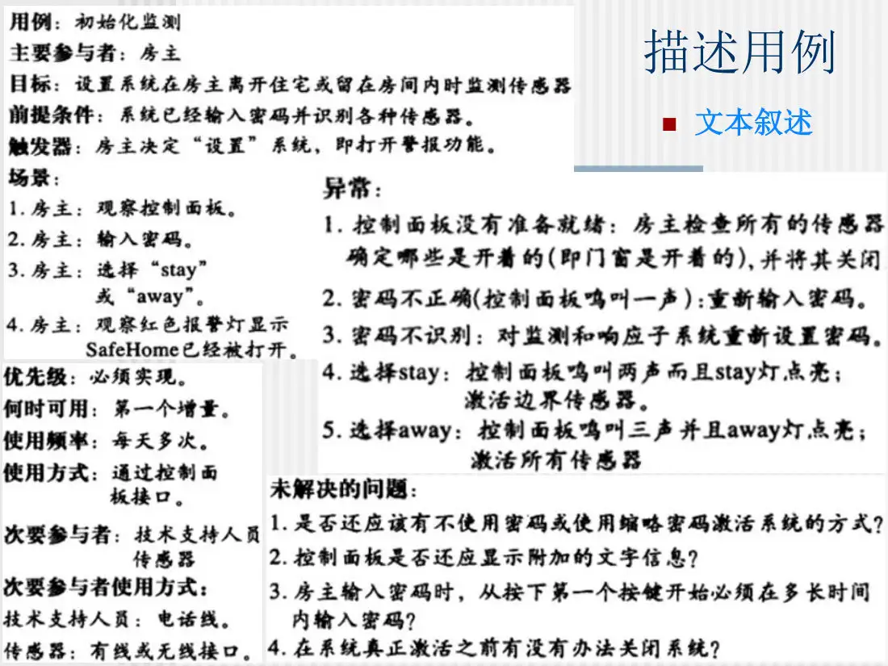

原文：

用例：初始化监测

主要参与者：房主

描述用例

目标：设置系统在房主离开住宅或留在房间内时监测传感器

前提条件：系统已经输入密码并识别各种传感器。

触发器：房主决定“设置”系统，即打开警报功能。

◼ 文本叙述

场景：

1. 房主：观察控制面板。

2. 房主：输入密码。

3. 房主：选择“stay”或“away”。

4. 房主：观察红色报警灯显示SafeHome已经被打开。

优先级：必须实现。

何时可用：第一个增量。

使用频率：每天多次。

使用方式：通过控制面板接口。

次要参与者：技术支持人员传感器

次要参与者使用方式：

技术支持人员：电话线。

传感器：有线或无线接口。

异常：

1. 控制面板没有准备就绪：房主检查所有的传感器确定哪些是开着的(即门窗是开着的)，并将其关闭

2. 密码不正确(控制面板鸣叫一声):重新输入密码。

3. 密码不识别：对监测和响应子系统重新设置密码。

4. 选择stay：控制面板鸣叫两声而且stay灯点亮；激活边界传感器。

5. 选择away：控制面板鸣叫三声并且away灯点亮；激活所有传感器

未解决的问题：

1. 是否还应该有不使用密码或使用缩略密码激活系统的方式？

2. 控制面板是否还应显示附加的文字信息？

3. 房主输入密码时，从按下第一个按键开始必须在多长时间内输入密码？

4. 在系统真正激活之前有没有办法关闭系统？

### 棋牌馆管理系统

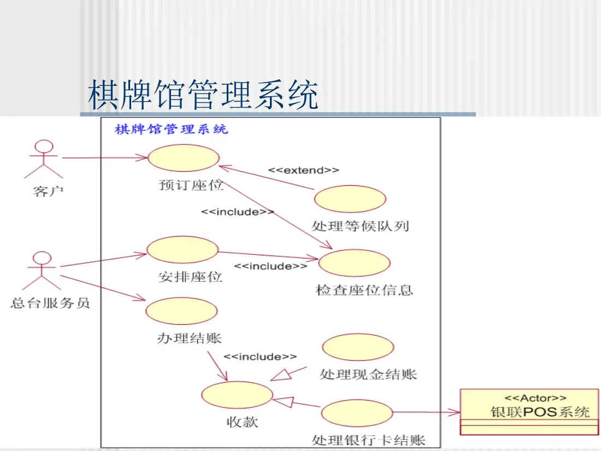

原文：

棋牌馆管理系统

### 第 35 页

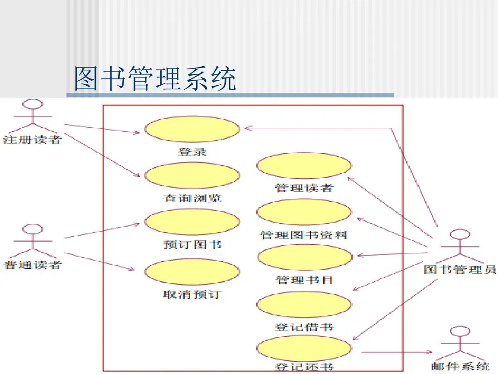

### Building the Requirements Model

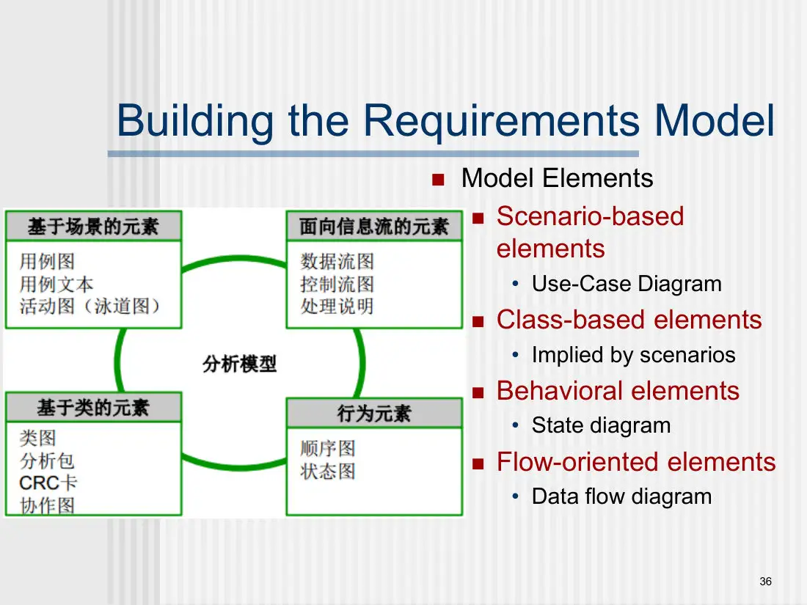

原文：

Building the Requirements Model

用例图用例文本活动图（泳道图）

分析模型

面向信息流的元素

数据流图控制流图处理说明

行为元素

顺序图状态图

◼ Model Elements

Scenario-based elements • Use-Case Diagram

Class-based elements Implied by scenarios

Behavioral elements State diagram

Flow-oriented elements Data flow diagram

36

### 两种方法学

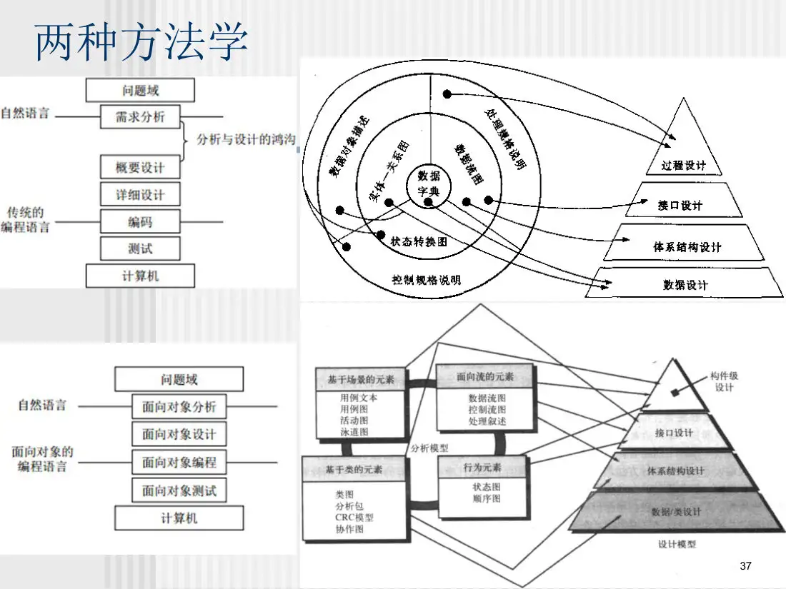

原文：

两种方法学

37

### Domain Analysis and Analysis Patterns

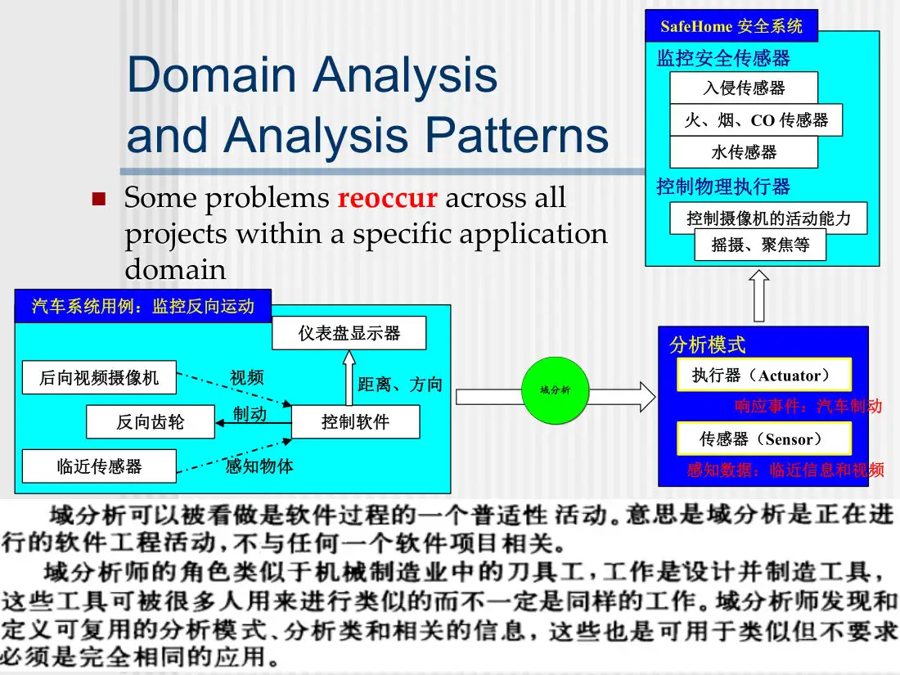

原文：

Domain Analysis and Analysis Patterns

Some problems reoccur across all projects within a specific application domain

SafeHome 安全系统

域分析可以被看做是软件过程的一个普适性活动。意思是域分析是正在进行的软件工程活动，不与任何一个软件项目相关。

监控安全传感器

入侵传感器

火、烟、CO传感器

域分析师的角色类似于机械制造业中的刀具工，工作是设计并制造工具，这些工具可被很多人用来进行类似的而不一定是同样的工作。域分析师发现和定义可复用的分析模式、分析类和相关的信息，这些也是可用于类似但不要求必须是完全相同的应用。

水传感器

控制物理执行器

控制摄像机的活动能力摇摄、聚焦等

### ◼ Domain Analysis

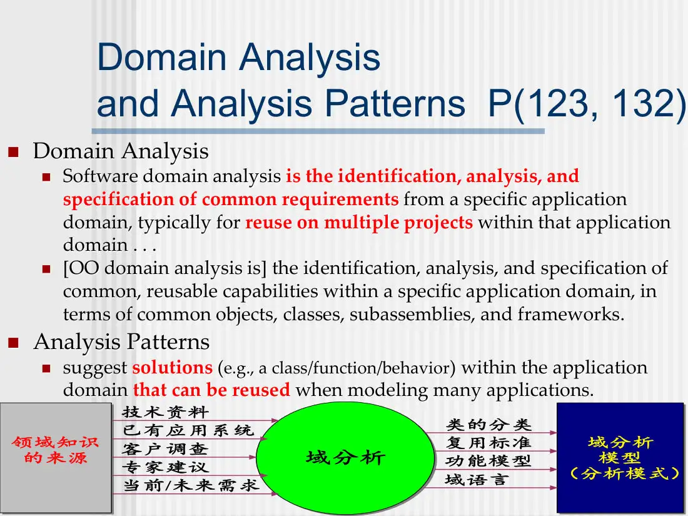

原文：

Domain Analysis and Analysis Patterns P(123, 132)

◼ Domain Analysis

Software domain analysis is the identification, analysis, and specification of common requirements from a specific application domain, typically for reuse on multiple projects within that application domain . . .

[OO domain analysis is] the identification, analysis, and specification of common, reusable capabilities within a specific application domain, in terms of common objects, classes, subassemblies, and frameworks.

◼ Analysis Patterns

suggest solutions (e.g., a class/function/behavior) within the application domain that can be reused when modeling many applications.

领域知识的来源

域分析模型（分析模式）
