# 《软件工程（双语）》第7章 软件配置管理（课件）

原件的每一页，下面附识别出的文字。

### UNIT 7

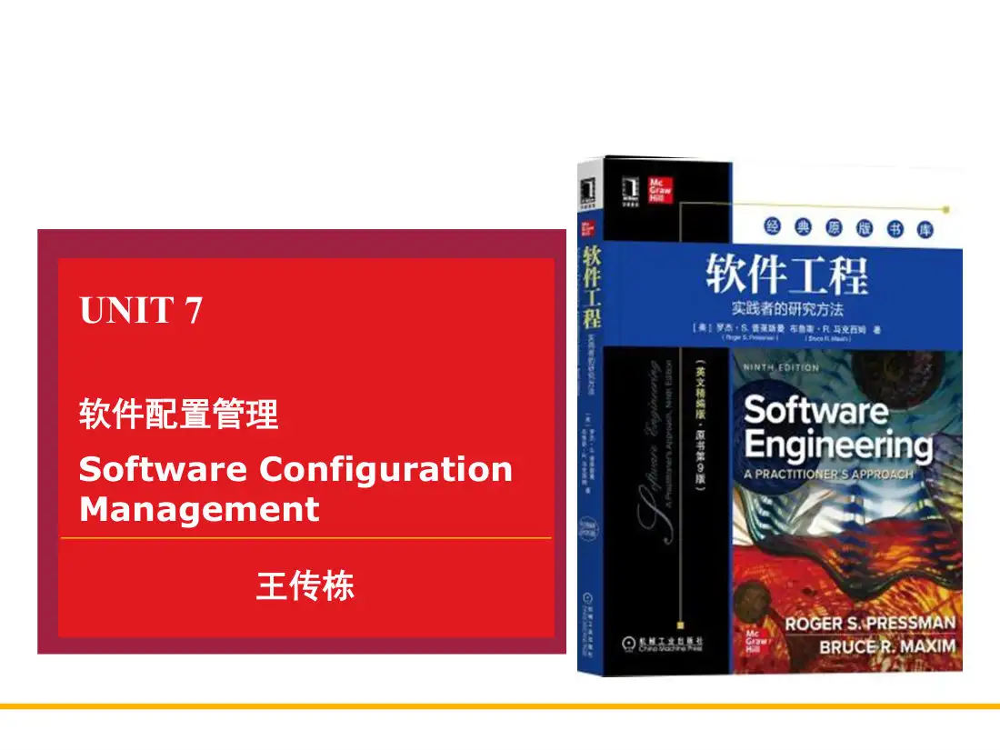

原文：

UNIT 7

软件配置管理

Software Configuration Management

王传栋

软件工程

实践者的研究方法

Software Engineering A PRACTITIONER'S APPROACH

工具质

### SCIs

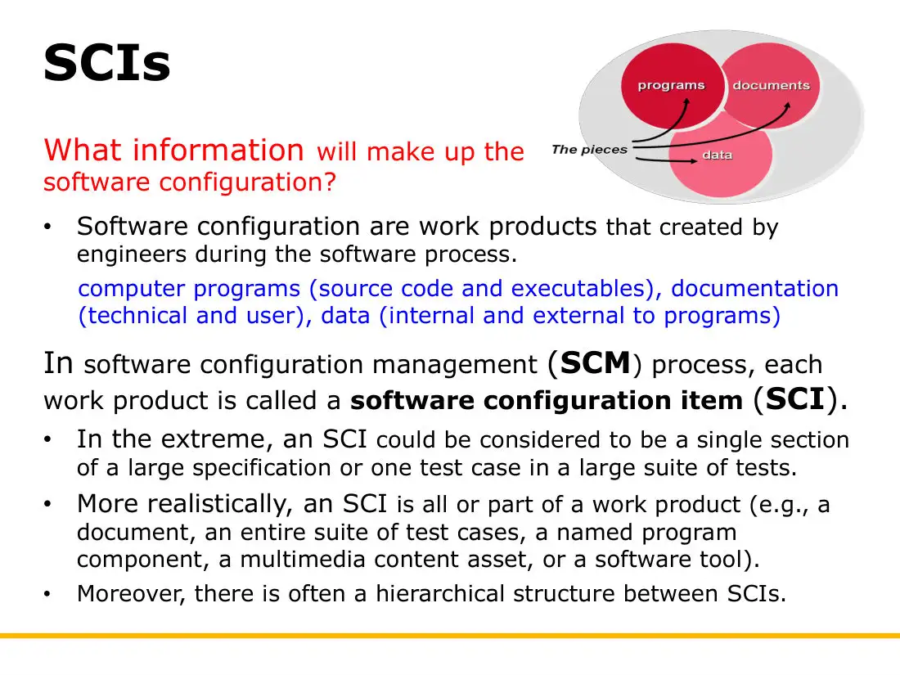

原文：

SCIs

What information will make up the software configuration?

• Software configuration are work products that created by engineers during the software process.

computer programs (source code and executables), documentation (technical and user), data (internal and external to programs)

In software configuration management (SCM) process, each work product is called a software configuration item (SCI).

• In the extreme, an SCI could be considered to be a single section of a large specification or one test case in a large suite of tests.

• More realistically, an SCI is all or part of a work product (e.g., a document, an entire suite of test cases, a named program component, a multimedia content asset, or a software tool).

• Moreover, there is often a hierarchical structure between SCIs.

### the origin of change

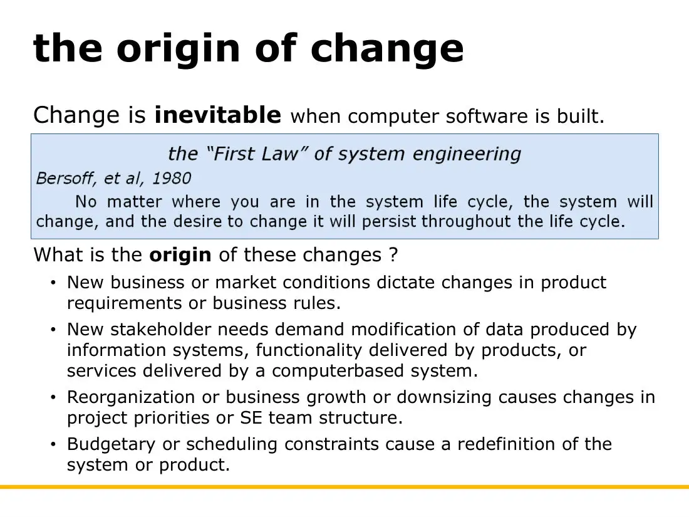

原文：

the origin of change

Change is inevitable when computer software is built.

the "First Law” of system engineering

Bersoff, et al, 1980

No matter where you are in the system life cycle, the system will change, and the desire to change it will persist throughout the life cycle.

What is the origin of these changes ?

• New business or market conditions dictate changes in product requirements or business rules.

• New stakeholder needs demand modification of data produced by information systems, functionality delivered by products, or services delivered by a computerbased system.

• Reorganization or business growth or downsizing causes changes in project priorities or SE team structure.

• Budgetary or scheduling constraints cause a redefinition of the system or product.

### SCM

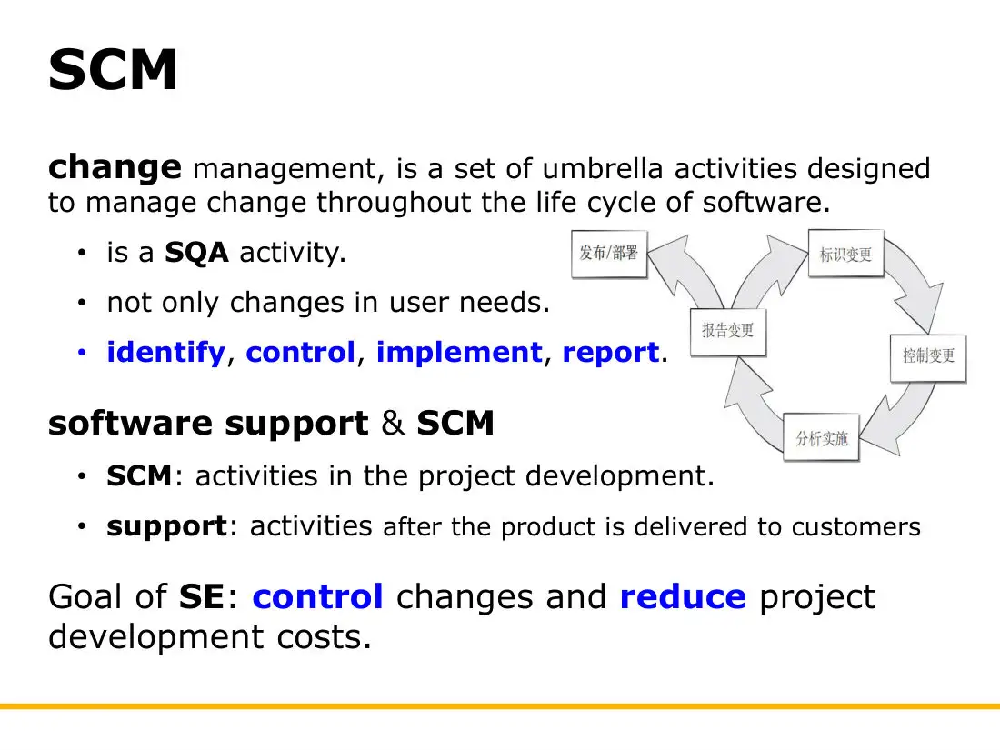

原文：

SCM

change management, is a set of umbrella activities designed to manage change throughout the life cycle of software.

• is a SQA activity.

• not only changes in user needs.

• identify, control, implement, report.

software support & SCM

• SCM: activities in the project development.

• support: activities after the product is delivered to customers

Goal of SE: control changes and reduce project development costs.

### System Elements of CM

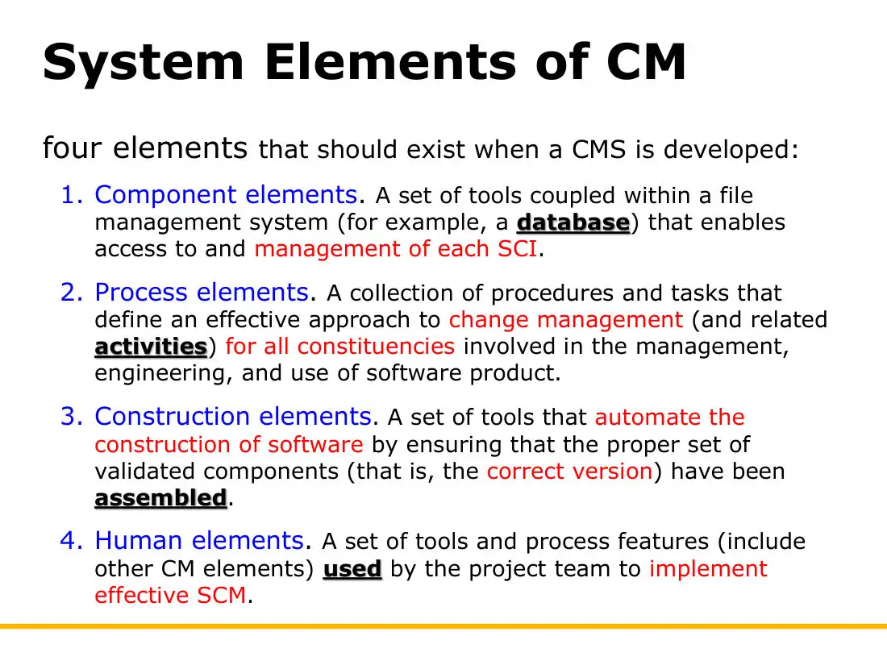

原文：

System Elements of CM

four elements that should exist when a CMS is developed:

1. Component elements. A set of tools coupled within a file management system (for example, a database) that enables access to and management of each SCI.

2. Process elements. A collection of procedures and tasks that define an effective approach to change management (and related activities) for all constituencies involved in the management, engineering, and use of software product.

3. Construction elements. A set of tools that automate the construction of software by ensuring that the proper set of validated components (that is, the correct version) have been assembled.

4. Human elements. A set of tools and process features (include other CM elements) used by the project team to implement effective SCM.

### SCM Scenario

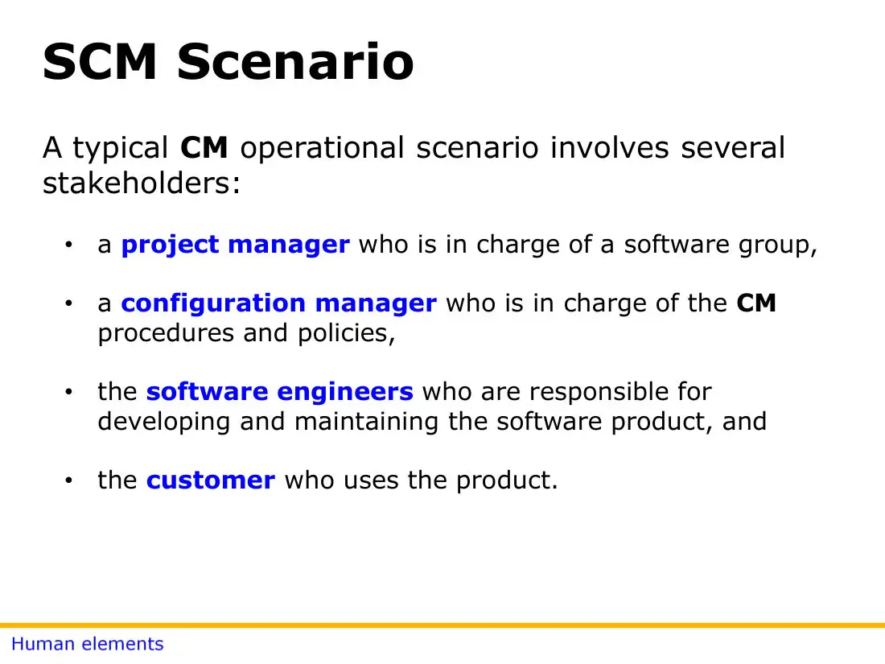

原文：

SCM Scenario

A typical CM operational scenario involves several stakeholders:

• a project manager who is in charge of a software group,

• a configuration manager who is in charge of the CM procedures and policies,

the software engineers who are responsible for developing and maintaining the software product, and

• the customer who uses the product.

Human elements

### The SCM Repository

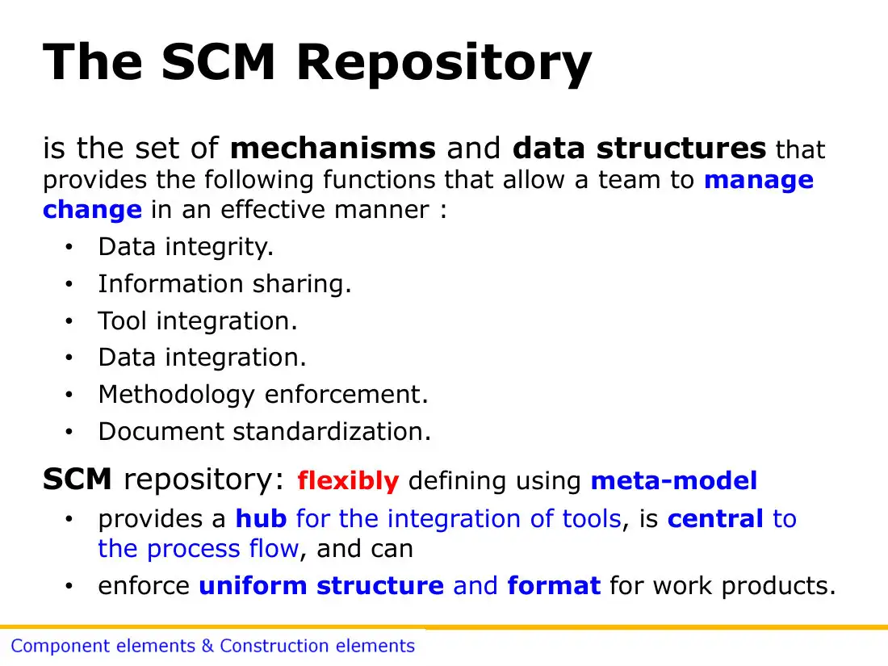

原文：

The SCM Repository

is the set of mechanisms and data structures that provides the following functions that allow a team to manage change in an effective manner :

• Data integrity.

• Information sharing.

• Tool integration.

• Data integration.

• Methodology enforcement.

• Document standardization.

SCM repository: flexibly defining using meta-model

provides a hub for the integration of tools, is central to the process flow, and can

• enforce uniform structure and format for work products.

Component elements & Construction elements

### Repository content and organization

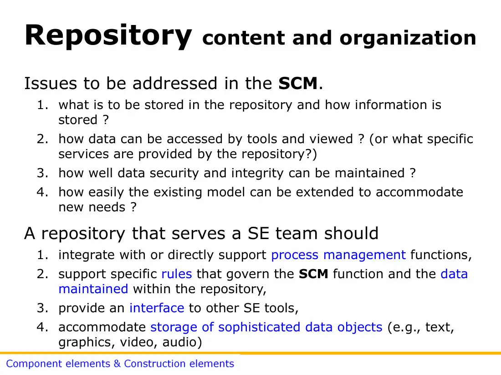

原文：

Repository content and organization

Issues to be addressed in the SCM.

1. what is to be stored in the repository and how information is stored ?

2. how data can be accessed by tools and viewed ? (or what specific services are provided by the repository?)

3. how well data security and integrity can be maintained ?

4. how easily the existing model can be extended to accommodate new needs ?

A repository that serves a SE team should

1. integrate with or directly support process management functions,

2. support specific rules that govern the SCM function and the data maintained within the repository,

3. provide an interface to other SE tools,

4. accommodate storage of sophisticated data objects (e.g., text, graphics, video, audio)

Component elements & Construction elements

### 存储库内容与组织

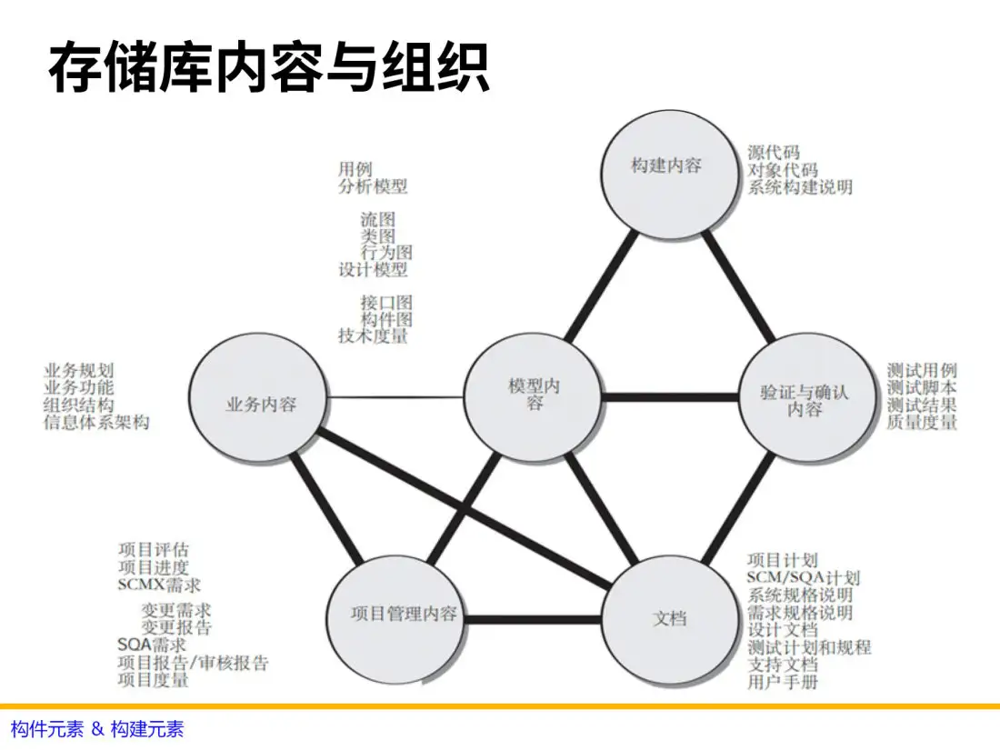

原文：

存储库内容与组织

### 存储库内容与组织

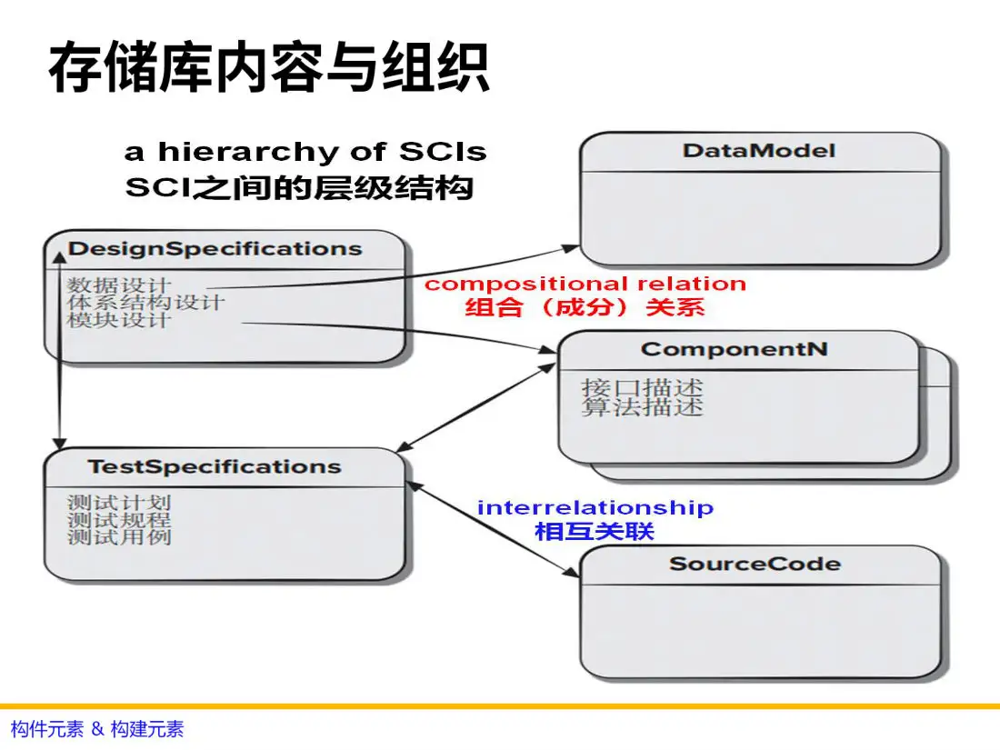

原文：

存储库内容与组织

a hierarchy of SCIsSCI之间的层级结构

构件元素&构建元素

### 存储库内容与组织

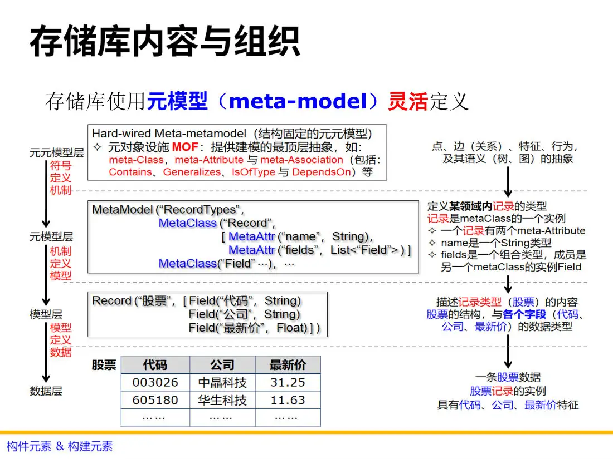

原文：

存储库内容与组织

存储库使用元模型（meta-model）灵活定义

构件元素& 构建元素

### MOF框架

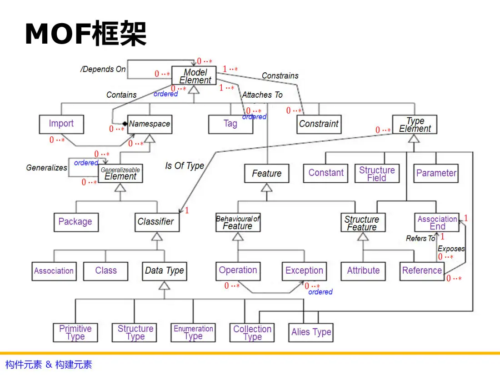

原文：

MOF框架

### 4 层建模体系

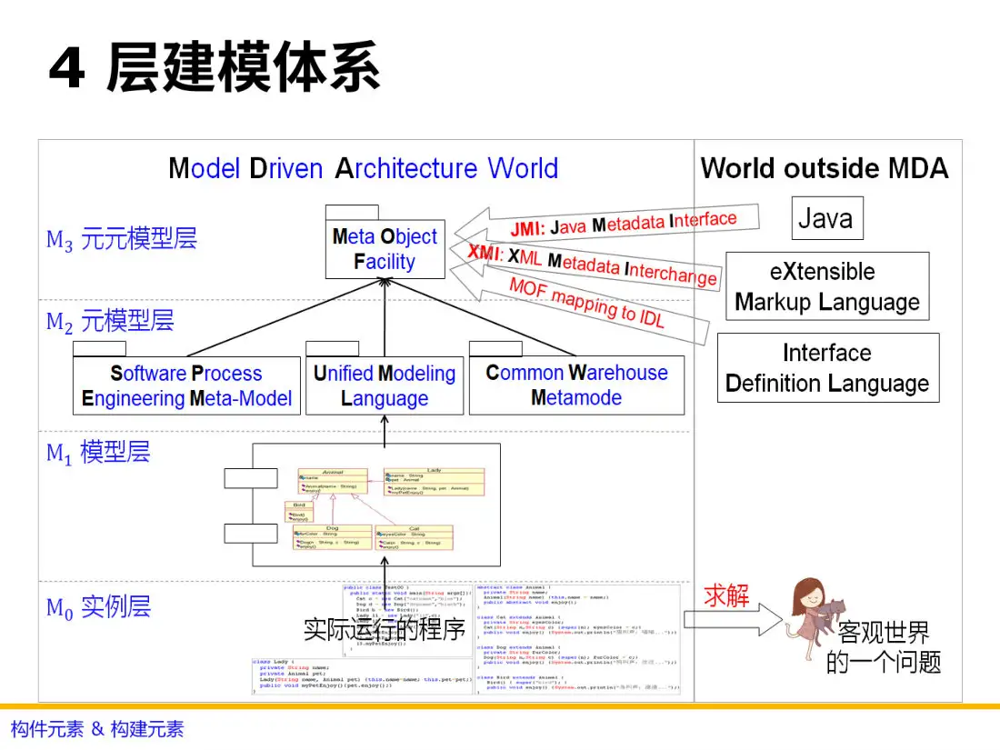

原文：

4 层建模体系

构件元素& 构建元素

### 4 层建模体系

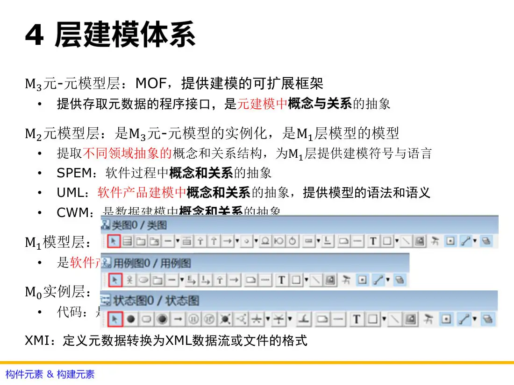

原文：

4 层建模体系

$\mathsf { M } _ { 3 }$ 元-元模型层：MOF，提供建模的可扩展框架

• 提供存取元数据的程序接口，是元建模中概念与关系的抽象

$\mathbf { M } _ { 2 }$ 元模型层：是 $\mathsf { M } _ { 3 }$ 元-元模型的实例化，是 $\mathsf { M } _ { 1 }$ 层模型的模型

• 提取不同领域抽象的概念和关系结构，为 $\mathbf { M } _ { 1 }$ 层提供建模符号与语言

• SPEM：软件过程中概念和关系的抽象

• UML：软件产品建模中概念和关系的抽象，提供模型的语法和语义

• CWM：是数据建模中概念和关系的抽象

类图0/类图

M1模型层：

• 是软件产品中概念与关系

M0实例层：

状态图0/状态图

• 代码：

XMI：定义元数据转换为XML数据流或文件的格式

构件元素& 构建元素

### CWM框架

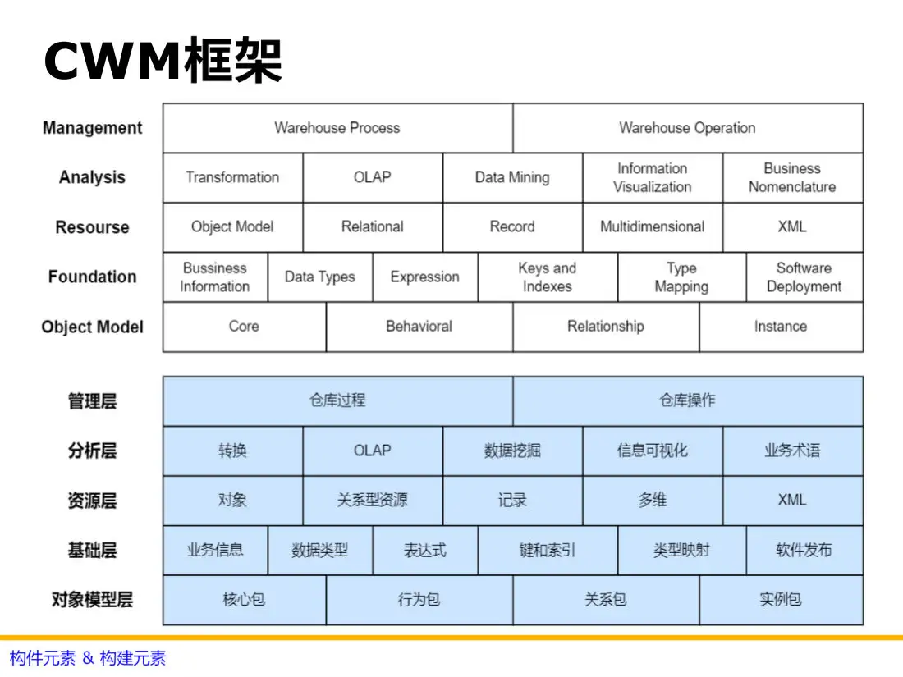

原文：

CWM框架

<table><tr><td>Management</td><td colspan="6">Warehouse Process</td><td colspan="5">Warehouse Operation</td></tr><tr><td>Analysis</td><td colspan="2">Transformation</td><td colspan="2">OLAP</td><td colspan="3">Data Mining</td><td colspan="3">Information Visualization</td><td>Business Nomenclature</td></tr><tr><td>Resource</td><td colspan="2">Object Model</td><td colspan="2">Relational</td><td colspan="3">Record</td><td colspan="3">Multidimensional</td><td>XML</td></tr><tr><td>Foundation</td><td>Bussiness Information</td><td colspan="2">Data Types</td><td colspan="2">Expression</td><td colspan="3">Keys and Indexes</td><td colspan="2">Type Mapping</td><td>Software Deployment</td></tr><tr><td>Object Model</td><td colspan="2">Core</td><td colspan="4">Behavioral</td><td colspan="3">Relationship</td><td colspan="2">Instance</td></tr><tr><td colspan="12"></td></tr><tr><td>管理层</td><td colspan="6">仓库过程</td><td colspan="5">仓库操作</td></tr><tr><td>分析层</td><td colspan="2">转换</td><td colspan="2">OLAP</td><td colspan="3">数据挖掘</td><td colspan="3">信息可视化</td><td>业务术语</td></tr><tr><td>资源层</td><td colspan="2">对象</td><td colspan="2">关系型资源</td><td colspan="3">记录</td><td colspan="3">多维</td><td>XML</td></tr><tr><td>基础层</td><td>业务信息</td><td colspan="2">数据类型</td><td colspan="2">表达式</td><td colspan="3">键和索引</td><td colspan="2">类型映射</td><td>软件发布</td></tr><tr><td>对象模型层</td><td colspan="2">核心包</td><td colspan="4">行为包</td><td colspan="3">关系包</td><td colspan="2">实例包</td></tr></table>
构件元素& 构建元素

### 理解 SCM 存储库的定义机制

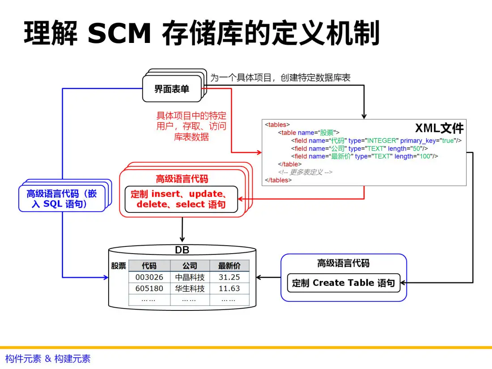

原文：

理解 SCM 存储库的定义机制

构件元素&构建元素

### Baselines

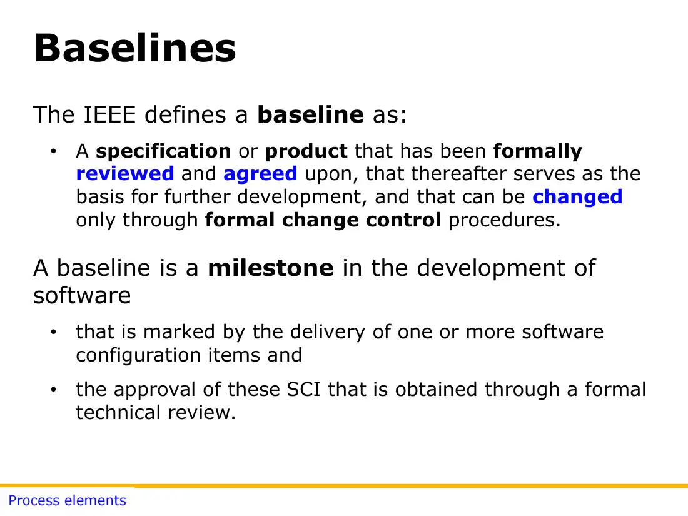

原文：

Baselines

The IEEE defines a baseline as:

A specification or product that has been formally reviewed and agreed upon, that thereafter serves as the basis for further development, and that can be changed only through formal change control procedures.

A baseline is a milestone in the development of software

• that is marked by the delivery of one or more software configuration items and

• the approval of these SCI that is obtained through a formal technical review.

Process elements

### formal change control

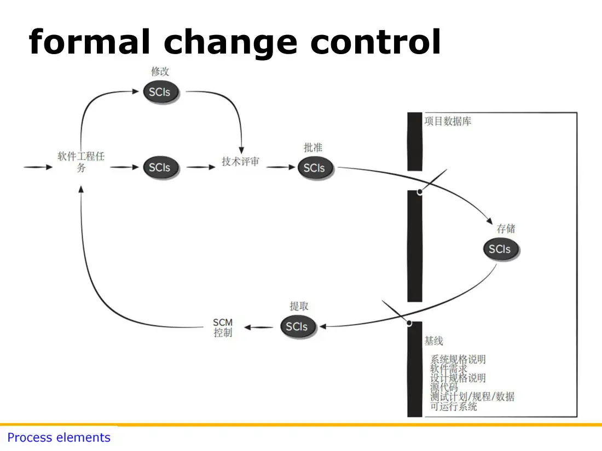

原文：

formal change control

Process elements

### Management of Dependencies and Changes

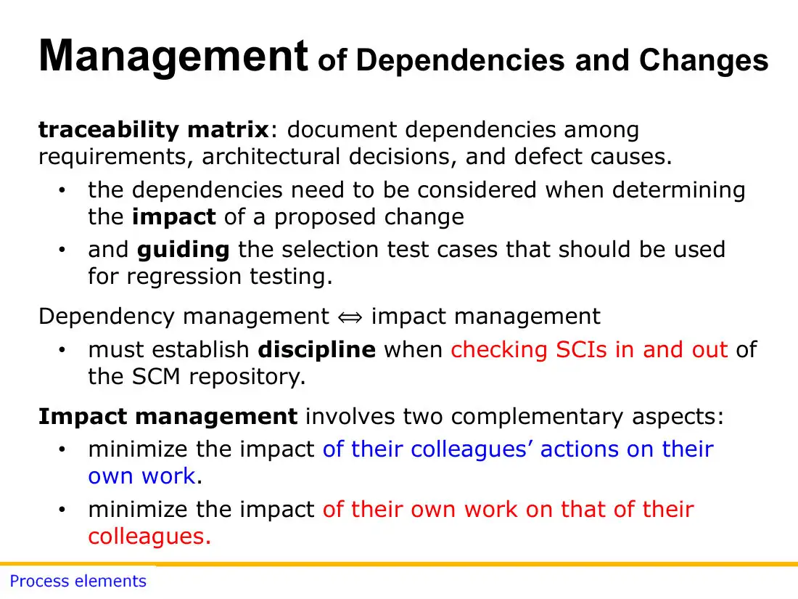

原文：

Management of Dependencies and Changes

traceability matrix: document dependencies among requirements, architectural decisions, and defect causes.

• the dependencies need to be considered when determining the impact of a proposed change

• and guiding the selection test cases that should be used for regression testing.

Dependency management ⟺ impact management

• must establish discipline when checking SCIs in and out of the SCM repository.

Impact management involves two complementary aspects:

minimize the impact of their colleagues’ actions on their own work.

• minimize the impact of their own work on that of their colleagues.

Process elements

### SCM Features

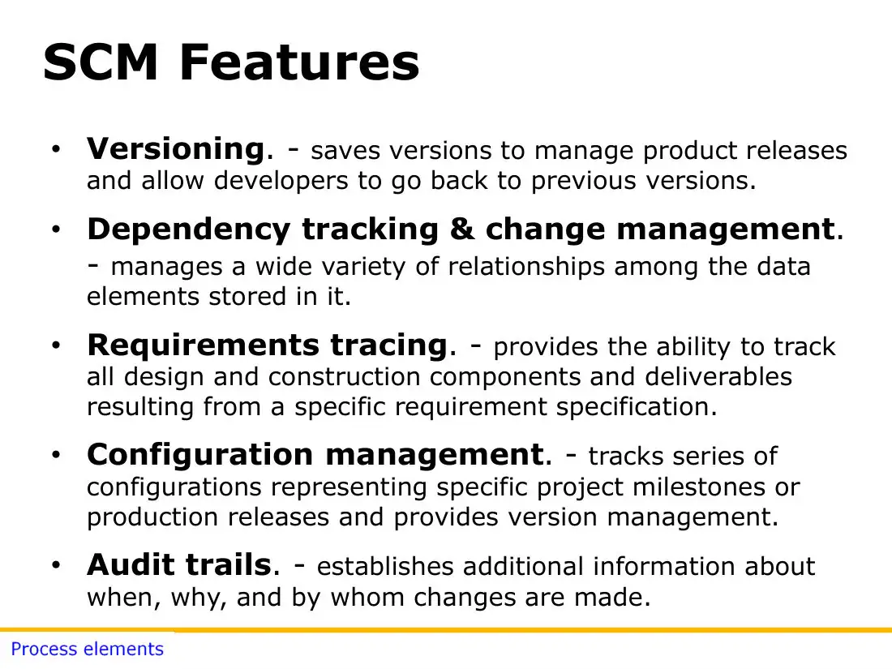

原文：

SCM Features

• Versioning. - saves versions to manage product releases and allow developers to go back to previous versions.

Dependency tracking & change management. - manages a wide variety of relationships among the data elements stored in it.

Requirements tracing. - provides the ability to track all design and construction components and deliverables resulting from a specific requirement specification.

Configuration management. - tracks series of configurations representing specific project milestones or production releases and provides version management.

Audit trails. - establishes additional information about when, why, and by whom changes are made.

Process elements

### SCM Best Practices

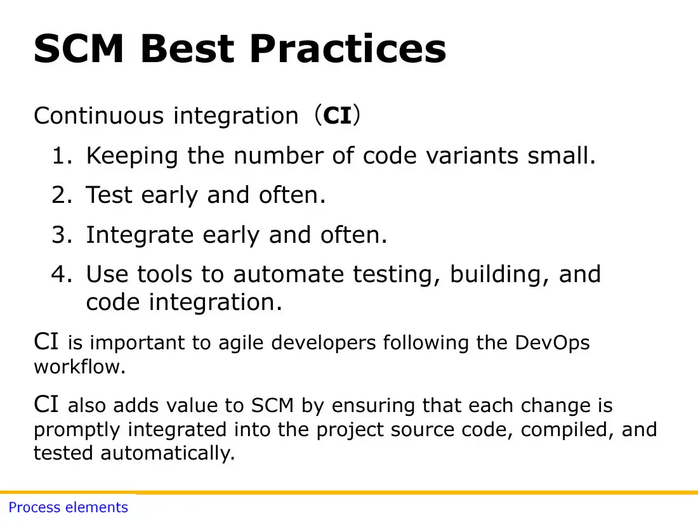

原文：

SCM Best Practices

Continuous integration（CI）

1. Keeping the number of code variants small.

2. Test early and often.

3. Integrate early and often.

4. Use tools to automate testing, building, and code integration.

CI is important to agile developers following the DevOps workflow.

CI also adds value to SCM by ensuring that each change is promptly integrated into the project source code, compiled, and tested automatically.

Process elements

### Continuous Integration

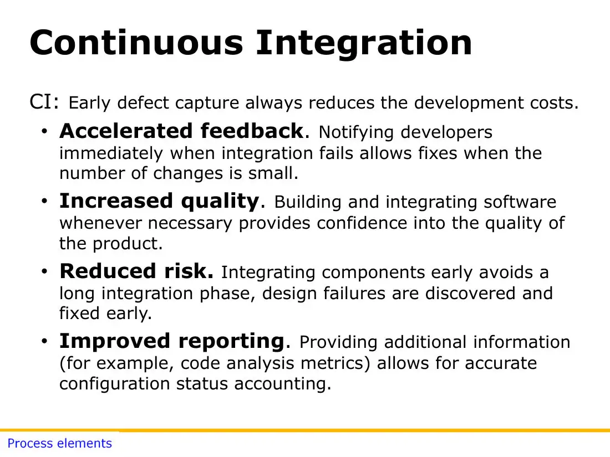

原文：

Continuous Integration

CI: Early defect capture always reduces the development costs.

• Accelerated feedback. Notifying developers immediately when integration fails allows fixes when the number of changes is small.

• Increased quality. Building and integrating software whenever necessary provides confidence into the quality of the product.

• Reduced risk. Integrating components early avoids a long integration phase, design failures are discovered and fixed early.

• Improved reporting. Providing additional information (for example, code analysis metrics) allows for accurate configuration status accounting.

Process elements

### Version Control System

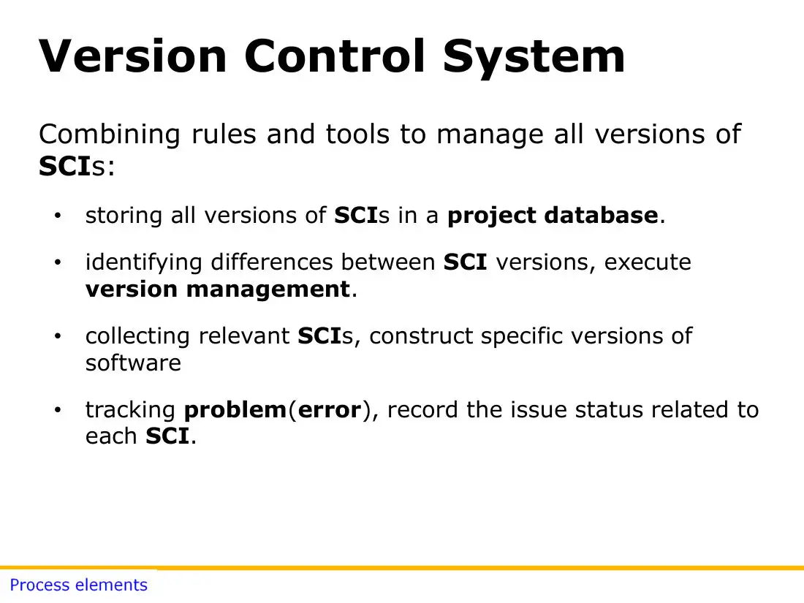

原文：

Version Control System

Combining rules and tools to manage all versions of SCIs:

• storing all versions of SCIs in a project database.

• identifying differences between SCI versions, execute version management.

• collecting relevant SCIs, construct specific versions of software

• tracking problem(error), record the issue status related to each SCI.

Process elements

### CVS: Version Building

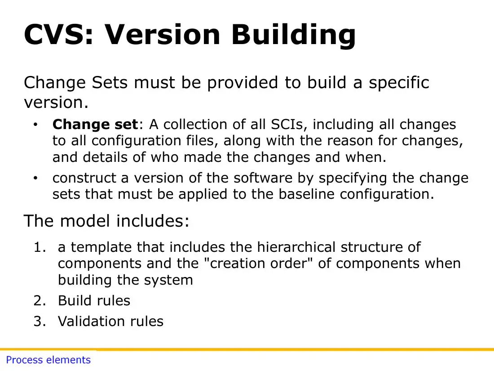

原文：

CVS: Version Building

Change Sets must be provided to build a specific version.

Change set: A collection of all SCIs, including all changes to all configuration files, along with the reason for changes, and details of who made the changes and when.

construct a version of the software by specifying the change sets that must be applied to the baseline configuration.

The model includes:

1. a template that includes the hierarchical structure of components and the "creation order" of components when building the system

2. Build rules

3. Validation rules

Process elements

### Change Management Process

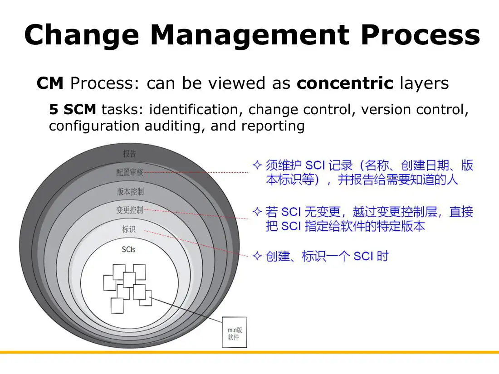

原文：

Change Management Process

CM Process: can be viewed as concentric layers

5 SCM tasks: identification, change control, version control, configuration auditing, and reporting

须维护SCI记录（名称、创建日期、版本标识等），并报告给需要知道的人

若SCI无变更，越过变更控制层，直接把SCI指定给软件的特定版本

创建、标识一个SCI时

### Issues to be addressed

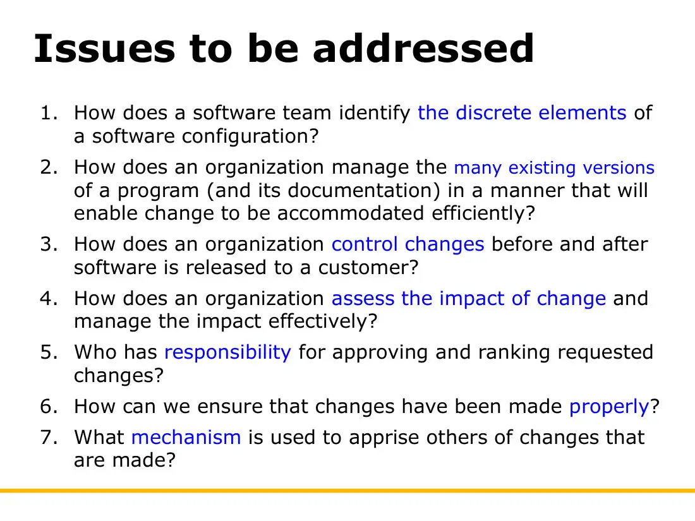

原文：

Issues to be addressed

1. How does a software team identify the discrete elements of a software configuration?

2. How does an organization manage the many existing versions of a program (and its documentation) in a manner that will enable change to be accommodated efficiently?

3. How does an organization control changes before and after software is released to a customer?

4. How does an organization assess the impact of change and manage the impact effectively?

5. Who has responsibility for approving and ranking requested changes?

6. How can we ensure that changes have been made properly?

7. What mechanism is used to apprise others of changes that are made?

### CM Objectives

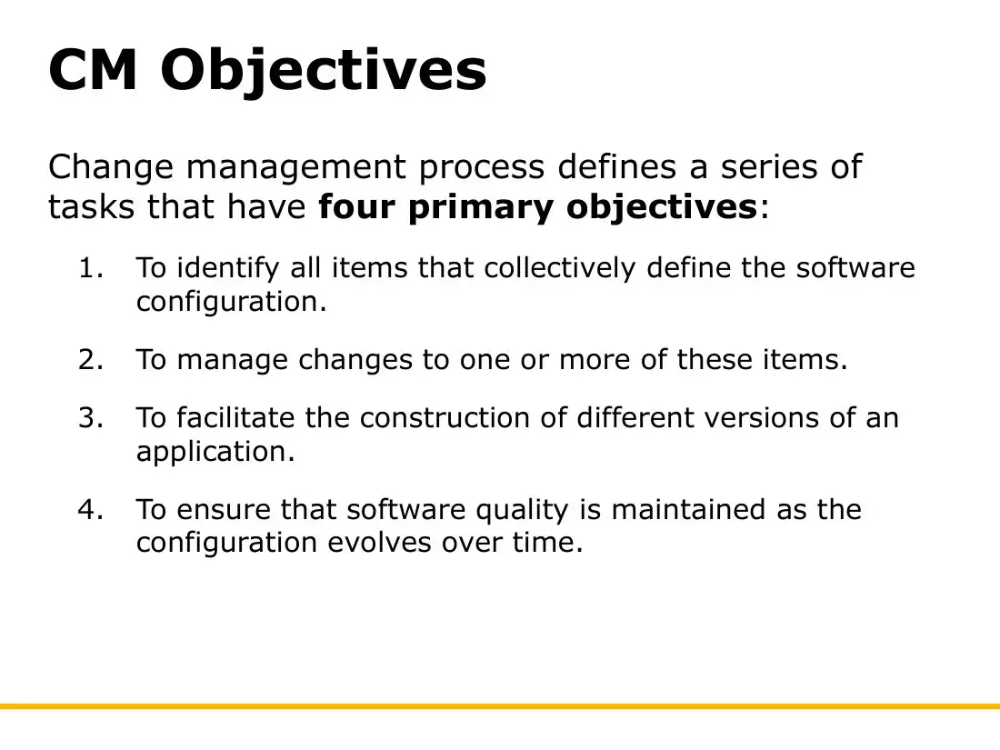

原文：

CM Objectives

Change management process defines a series of tasks that have four primary objectives:

1. To identify all items that collectively define the software configuration.

2. To manage changes to one or more of these items.

3. To facilitate the construction of different versions of an application.

4. To ensure that software quality is maintained as the configuration evolves over time.

### Change Control Process

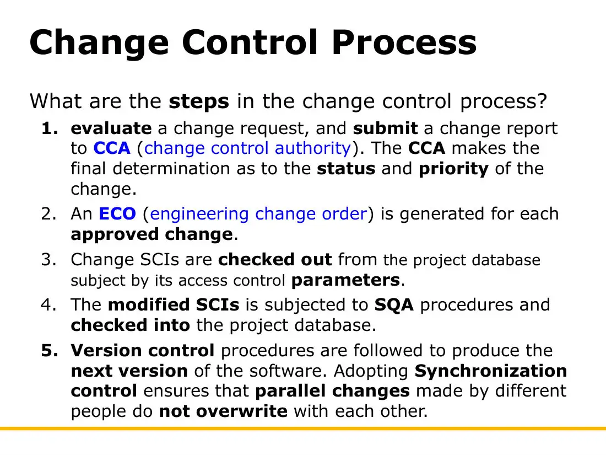

原文：

Change Control Process

What are the steps in the change control process?

1. evaluate a change request, and submit a change report to CCA (change control authority). The CCA makes the final determination as to the status and priority of the change.

2. An ECO (engineering change order) is generated for each approved change.

3. Change SCIs are checked out from the project database subject by its access control parameters.

4. The modified SCIs is subjected to SQA procedures and checked into the project database.

5. Version control procedures are followed to produce the next version of the software. Adopting Synchronization control ensures that parallel changes made by different people do not overwrite with each other.

### 变更控制过程

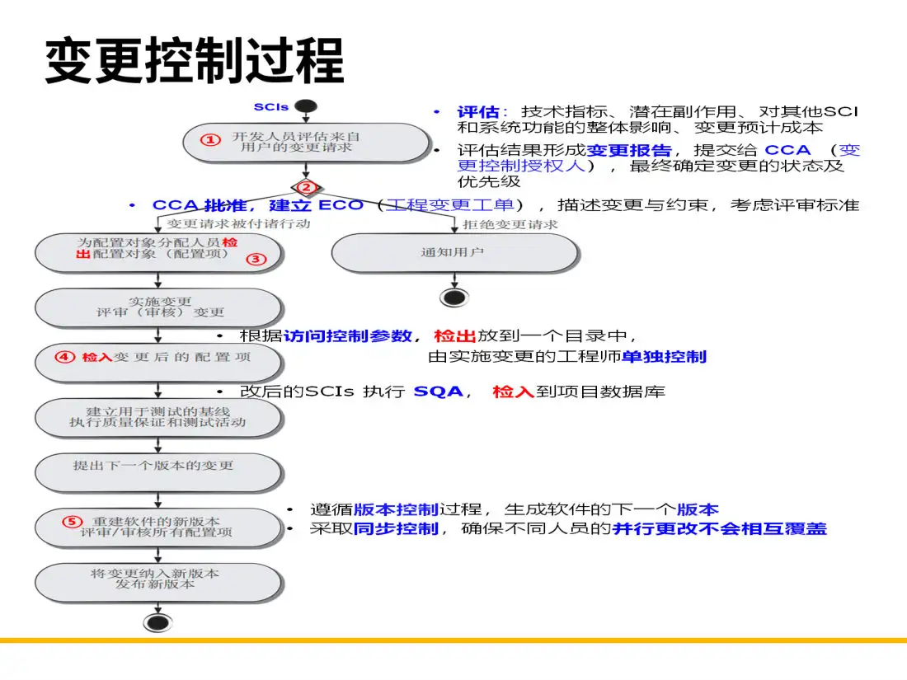

原文：

变更控制过程

评估：技术指标、潜在副作用、对其他SCI和系统功能的整体影响、变更预计成本). 评估结果形成变更报告，提交给CCA(变更控制授权人），最终确定变更的状态及优先级

### 变更机制与影响

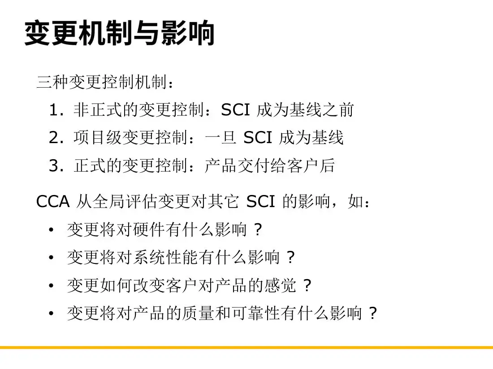

原文：

变更机制与影响

三种变更控制机制：

1. 非正式的变更控制：SCI 成为基线之前

2. 项目级变更控制：一旦 SCI 成为基线

3. 正式的变更控制：产品交付给客户后

CCA 从全局评估变更对其它 SCI 的影响，如：

• 变更将对硬件有什么影响 ?

• 变更将对系统性能有什么影响 ?

• 变更如何改变客户对产品的感觉 ?

• 变更将对产品的质量和可靠性有什么影响 ?

### Version Control

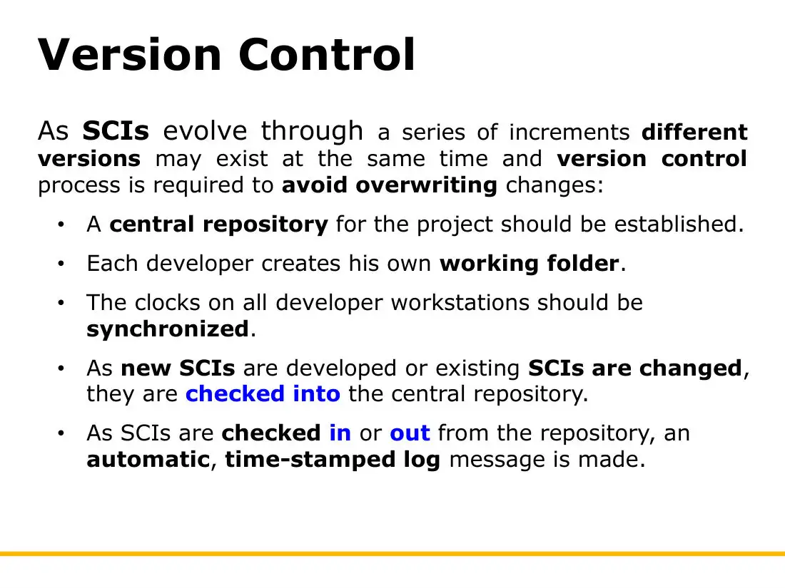

原文：

Version Control

As SCIs evolve through a series of increments different versions may exist at the same time and version control process is required to avoid overwriting changes:

• A central repository for the project should be established.

• Each developer creates his own working folder.

• The clocks on all developer workstations should be synchronized.

As new SCIs are developed or existing SCIs are changed, they are checked into the central repository.

As SCIs are checked in or out from the repository, an automatic, time-stamped log message is made.

### Impact Management

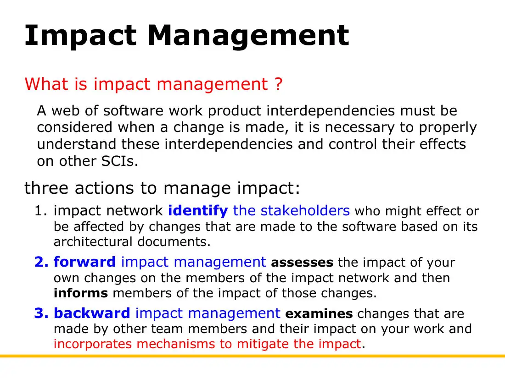

原文：

Impact Management

What is impact management ?

A web of software work product interdependencies must be considered when a change is made, it is necessary to properly understand these interdependencies and control their effects on other SCIs.

three actions to manage impact:

1. impact network identify the stakeholders who might effect or be affected by changes that are made to the software based on its architectural documents.

2. forward impact management assesses the impact of your own changes on the members of the impact network and then informs members of the impact of those changes.

3. backward impact management examines changes that are made by other team members and their impact on your work and incorporates mechanisms to mitigate the impact.

### Configuration Audit

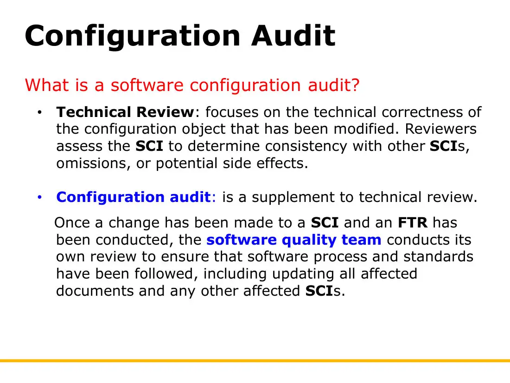

原文：

Configuration Audit

What is a software configuration audit?

Technical Review: focuses on the technical correctness of the configuration object that has been modified. Reviewers assess the SCI to determine consistency with other SCIs, omissions, or potential side effects.

• Configuration audit: is a supplement to technical review.

Once a change has been made to a SCI and an FTR has been conducted, the software quality team conducts its own review to ensure that software process and standards have been followed, including updating all affected documents and any other affected SCIs.

### Issues to be addressed

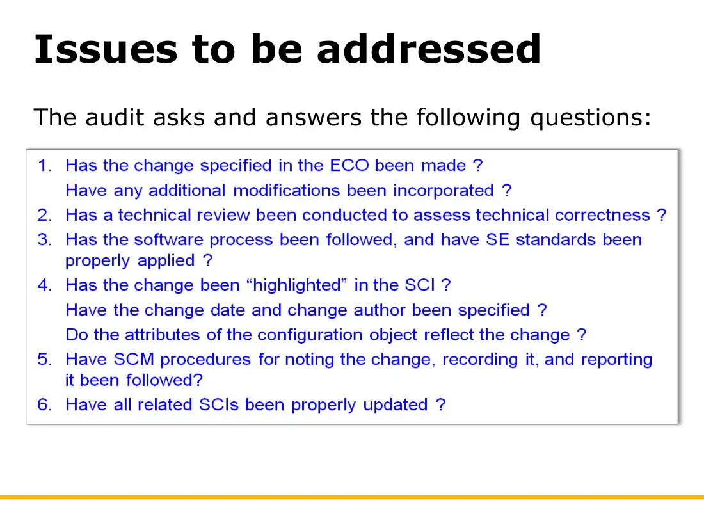

原文：

Issues to be addressed

The audit asks and answers the following questions:

### Status Reporting

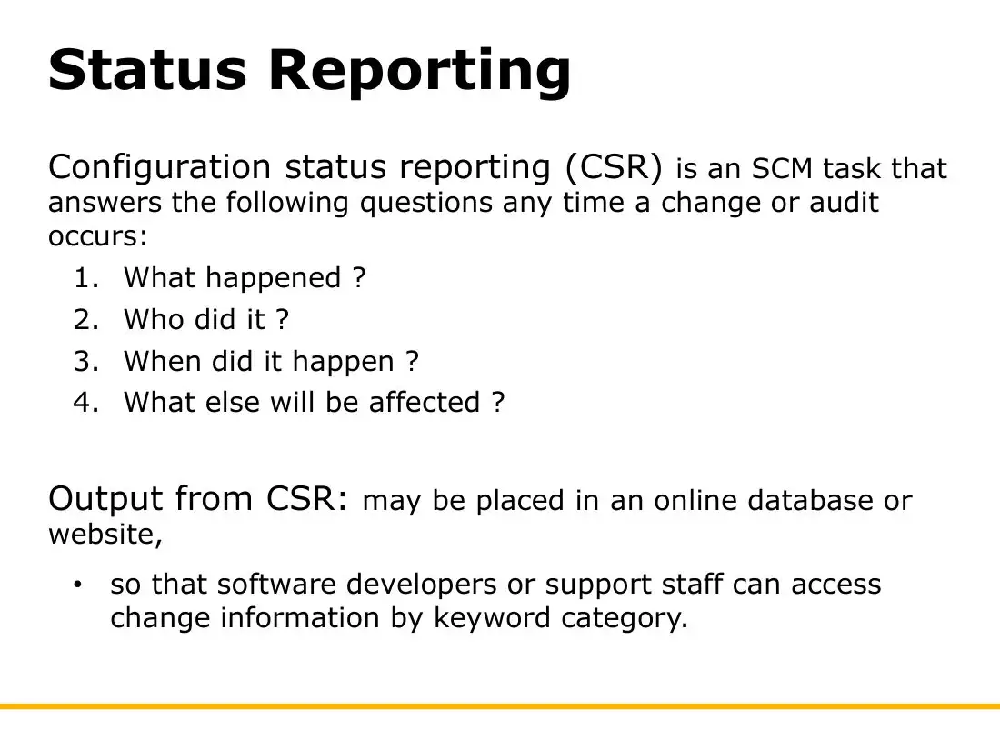

原文：

Status Reporting

Configuration status reporting (CSR) is an SCM task that answers the following questions any time a change or audit occurs:

1. What happened ?

2. Who did it ?

3. When did it happen ?

4. What else will be affected ?

Output from CSR: may be placed in an online database or website,

• so that software developers or support staff can access change information by keyword category.

### Homework after class

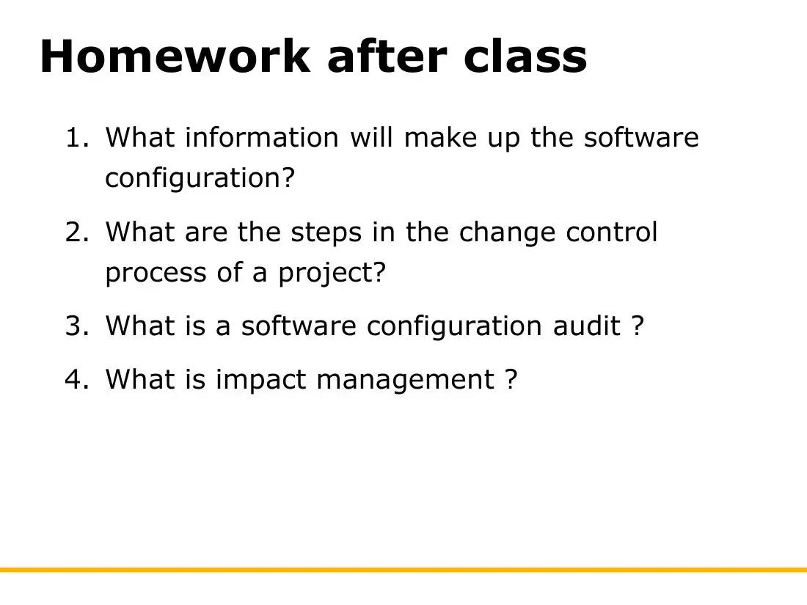

原文：

Homework after class

1. What information will make up the software configuration?

2. What are the steps in the change control process of a project?

3. What is a software configuration audit ?

4. What is impact management ?
