# 《软件工程（双语）》第8章 过程与过程模型（课件）

原件的每一页，下面附识别出的文字。

### UNIT 8

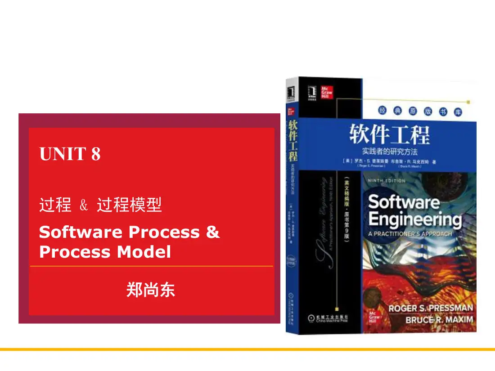

原文：

UNIT 8

过程 & 过程模型

Software Process & Process Model

郑尚东软件工程[美]罗杰·S 普莱斯最 布鲁南·R 马克西姆著

Software Engineering A PRACTITIONER'S APPROACH

工具质热

### “传统的” 过程模型

原文：

“传统的” 过程模型

### 软件工程的层次

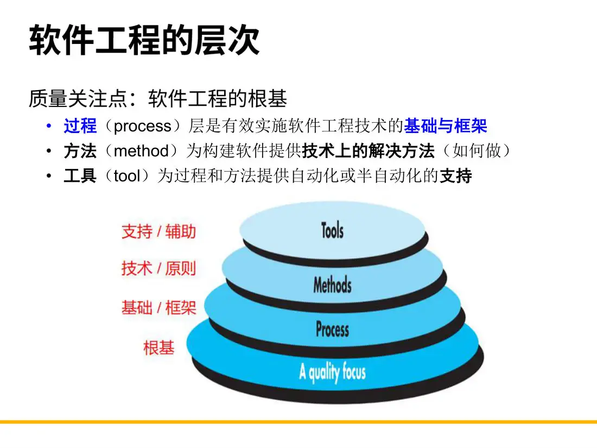

原文：

软件工程的层次

质量关注点：软件工程的根基

• 过程（process）层是有效实施软件工程技术的基础与框架

• 方法（method）为构建软件提供技术上的解决方法（如何做）

• 工具（tool）为过程和方法提供自动化或半自动化的支持

支持/辅助

### 软件过程

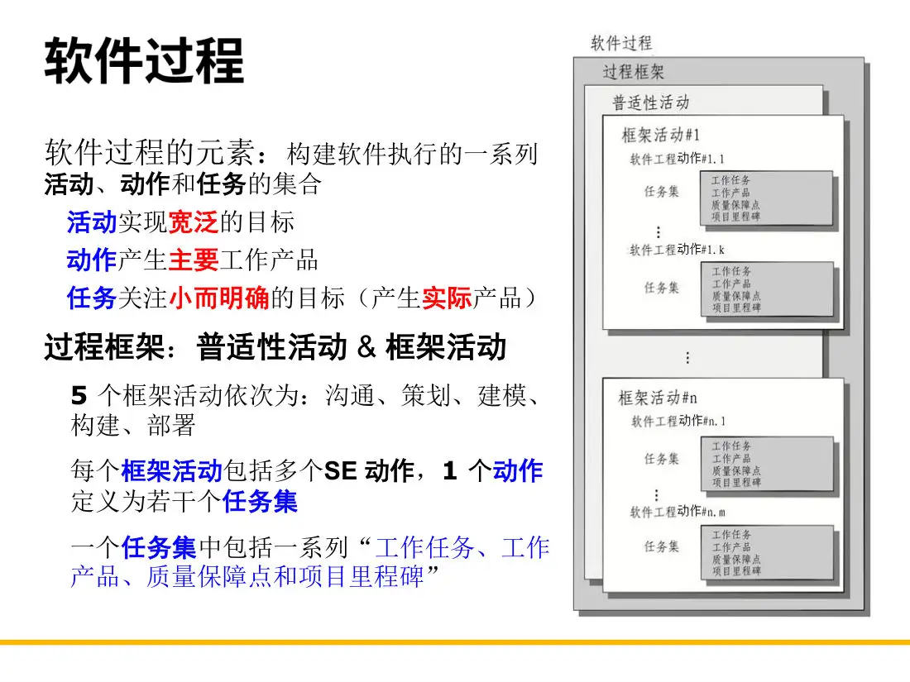

原文：

软件过程

软件过程的元素：构建软件执行的一系列活动、动作和任务的集合

活动实现宽泛的目标

动作产生主要工作产品

任务关注小而明确的目标（产生实际产品）

过程框架：普适性活动 & 框架活动

5 个框架活动依次为：沟通、策划、建模、构建、部署

每个框架活动包括多个SE 动作，1 个动作定义为若干个任务集

一个任务集中包括一系列“工作任务、工作产品、质量保障点和项目里程碑”

软件过程

### 过程框架活动

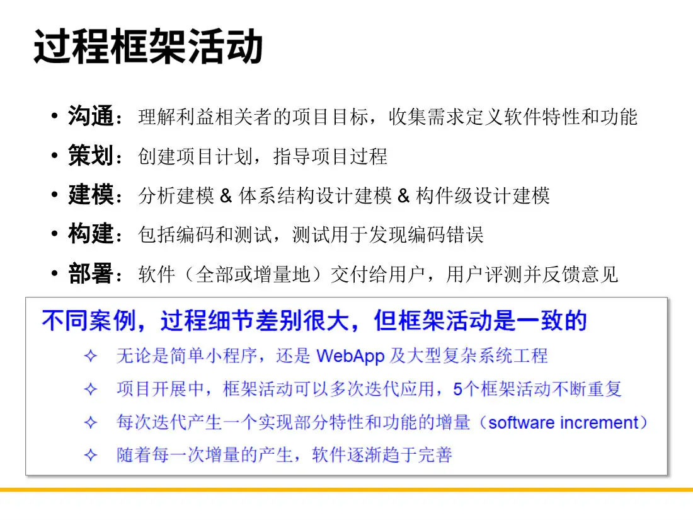

原文：

过程框架活动

• 沟通：理解利益相关者的项目目标，收集需求定义软件特性和功能

• 策划：创建项目计划，指导项目过程

• 建模：分析建模 & 体系结构设计建模 & 构件级设计建模

• 构建：包括编码和测试，测试用于发现编码错误

• 部署：软件（全部或增量地）交付给用户，用户评测并反馈意见

不同案例，过程细节差别很大，但框架活动是一致的

无论是简单小程序，还是WebApp 及大型复杂系统工程

项目开展中，框架活动可以多次迭代应用，5个框架活动不断重复

每次迭代产生一个实现部分特性和功能的增量（software increment）

随着每一次增量的产生，软件逐渐趋于完善

### 普适应活动

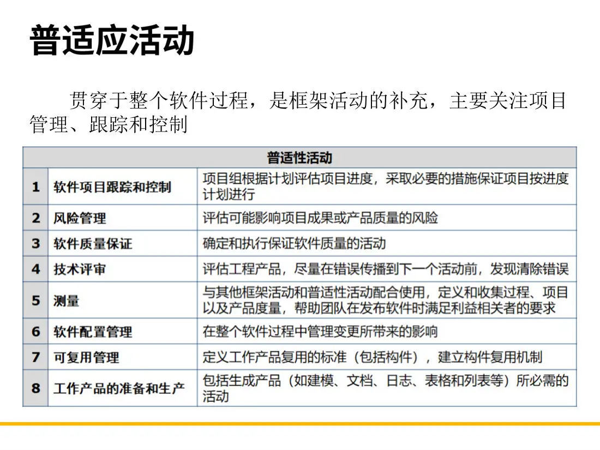

原文：

普适应活动

贯穿于整个软件过程，是框架活动的补充，主要关注项目管理、跟踪和控制

<table><tr><td colspan="3">普适性活动</td></tr><tr><td>1</td><td>软件项目跟踪和控制</td><td>项目组根据计划评估项目进度,采取必要的措施保证项目按进度计划进行</td></tr><tr><td>2</td><td>风险管理</td><td>评估可能影响项目成果或产品质量的风险</td></tr><tr><td>3</td><td>软件质量保证</td><td>确定和执行保证软件质量的活动</td></tr><tr><td>4</td><td>技术评审</td><td>评估工程产品,尽量在错误传播到下一个活动前,发现清除错误</td></tr><tr><td>5</td><td>测量</td><td>与其他框架活动和普适性活动配合使用,定义和收集过程、项目以及产品度量,帮助团队在发布软件时满足利益相关者的要求</td></tr><tr><td>6</td><td>软件配置管理</td><td>在整个软件过程中管理变更所带来的影响</td></tr><tr><td>7</td><td>可复用管理</td><td>定义工作产品复用的标准(包括构件),建立构件复用机制</td></tr><tr><td>8</td><td>工作产品的准备和生产</td><td>包括生成产品(如建模、文档、日志、表格和列表等)所必需的活动</td></tr></table>

### 过程流

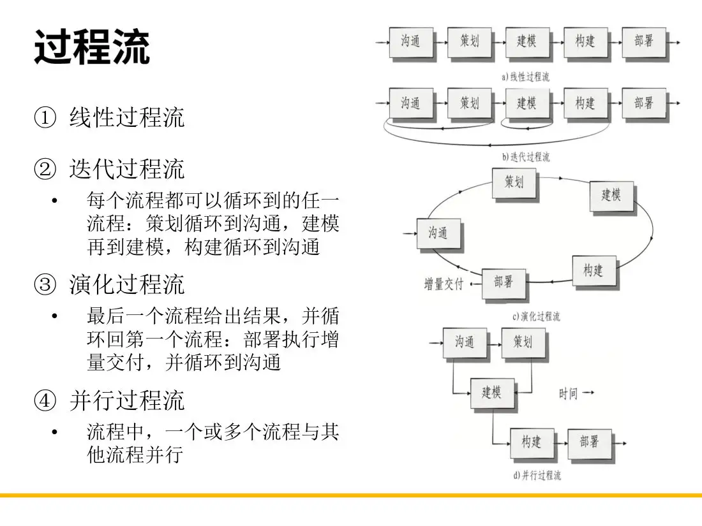

原文：

过程流

① 线性过程流

② 迭代过程流

每个流程都可以循环到的任一流程：策划循环到沟通，建模再到建模，构建循环到沟通

③ 演化过程流

• 最后一个流程给出结果，并循环回第一个流程：部署执行增量交付，并循环到沟通

④ 并行过程流

• 流程中，一个或多个流程与其他流程并行

### 定义框架活动

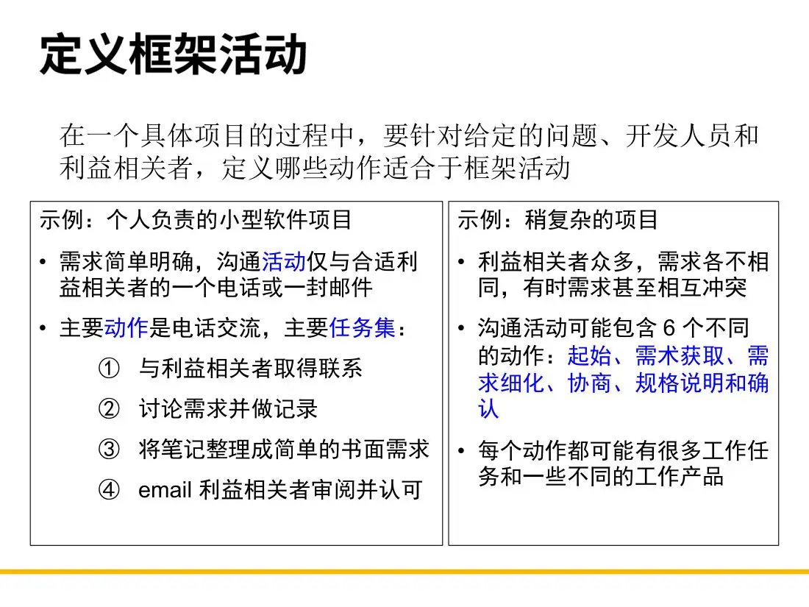

原文：

定义框架活动

在一个具体项目的过程中，要针对给定的问题、开发人员和利益相关者，定义哪些动作适合于框架活动

示例：个人负责的小型软件项目

• 需求简单明确，沟通活动仅与合适利益相关者的一个电话或一封邮件

• 主要动作是电话交流，主要任务集：

① 与利益相关者取得联系

② 讨论需求并做记录

③ 将笔记整理成简单的书面需求

④ email 利益相关者审阅并认可

示例：稍复杂的项目

• 利益相关者众多，需求各不相同，有时需求甚至相互冲突

• 沟通活动可能包含 6 个不同的动作：起始、需术获取、需求细化、协商、规格说明和确认

• 每个动作都可能有很多工作任务和一些不同的工作产品

### 明确任务集

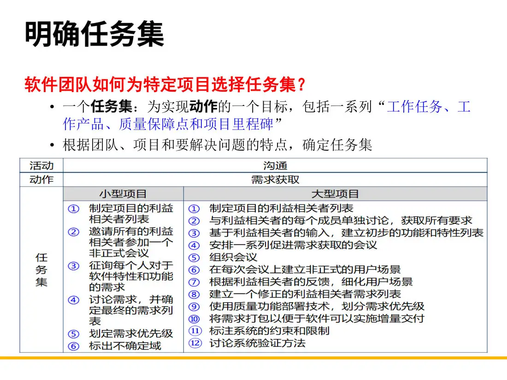

原文：

明确任务集

软件团队如何为特定项目选择任务集？

• 一个任务集：为实现动作的一个目标，包括一系列“工作任务、工作产品、质量保障点和项目里程碑”

• 根据团队、项目和要解决问题的特点，确定任务集

<table><tr><td>活动</td><td colspan="2">沟通</td></tr><tr><td>动作</td><td colspan="2">需求获取</td></tr><tr><td rowspan="2">任务集</td><td>小型项目</td><td>大型项目</td></tr><tr><td>1制定项目的利益相关者列表2邀请所有的利益相关者参加一个非正式会议3征询每个人对于软件特性和功能的需求4讨论需求,并确定最终的需求列表5划定需求优先级6标出不确定域</td><td>1制定项目的利益相关者列表2与利益相关者的每个成员单独讨论,获取所有要求3基于利益相关者的输入,建立初步的功能和特性列表4安排一系列促进需求获取的会议5组织会议6在每次会议上建立非正式的用户场景7根据利益相关者的反馈,细化用户场景8建立一个修正的利益相关者需求列表9使用质量功能部署技术,划分需求优先级10将需求打包以便于软件可以实施增量交付11标注系统的约束和限制12讨论系统验证方法</td></tr></table>

### 过程评估和改进

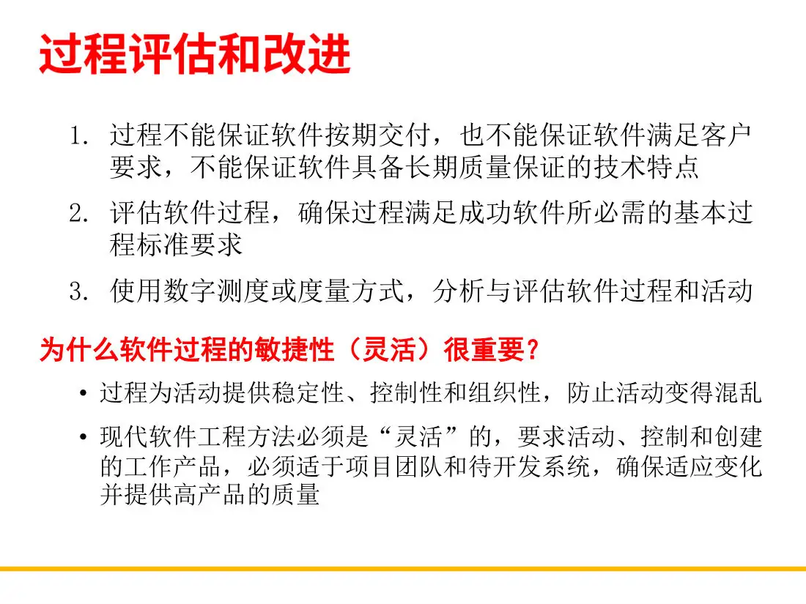

原文：

过程评估和改进

1. 过程不能保证软件按期交付，也不能保证软件满足客户要求，不能保证软件具备长期质量保证的技术特点

2. 评估软件过程，确保过程满足成功软件所必需的基本过程标准要求

3. 使用数字测度或度量方式，分析与评估软件过程和活动

为什么软件过程的敏捷性（灵活）很重要？

• 过程为活动提供稳定性、控制性和组织性，防止活动变得混乱

• 现代软件工程方法必须是“灵活”的，要求活动、控制和创建的工作产品，必须适于项目团队和待开发系统，确保适应变化并提供高产品的质量

### 过程模式：过程中遵循的做事套路

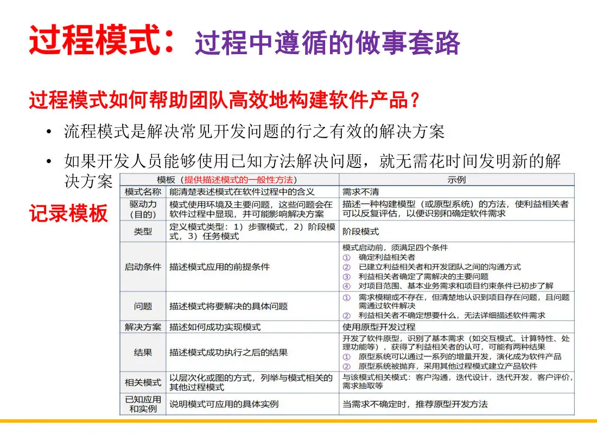

原文：

过程模式：过程中遵循的做事套路

过程模式如何帮助团队高效地构建软件产品？

• 流程模式是解决常见开发问题的行之有效的解决方案

• 如果开发人员能够使用已知方法解决问题，就无需花时间发明新的解

决方案

记录模板

<table><tr><td colspan="2">模板(提供描述模式的一般性方法)</td><td>示例</td></tr><tr><td>模式名称</td><td>能清楚表述模式在软件过程中的含义</td><td>需求不清</td></tr><tr><td>驱动力(目的)</td><td>模式使用环境及主要问题,这些问题会在软件过程中显现,并可能影响解决方案</td><td>描述一种构建模型(或原型系统)的方法,使利益相关者可以反复评估,以便识别和确定软件需求</td></tr><tr><td>类型</td><td>定义模式类型:1)步骤模式,2)阶段模式,3)任务模式</td><td>阶段模式</td></tr><tr><td>启动条件</td><td>描述模式应用的前提条件</td><td>模式启动前,须满足四个条件1 确定利益相关者2 已建立利益相关者和开发团队之间的沟通方式3 利益相关者确定了需解决的主要问题4 对项目范围、基本业务需求和项目约束条件已初步了解</td></tr><tr><td>问题</td><td>描述模式将要解决的具体问题</td><td>1 需求模糊或不存在,但清楚地认识到项目存在问题,且问题需通过软件解决2 利益相关者不确定想要什么,无法详细描述软件需求</td></tr><tr><td>解决方案</td><td>描述如何成功实现模式</td><td>使用原型开发过程</td></tr><tr><td>结果</td><td>描述模式成功执行之后的结果</td><td>开发了软件原型,识别了基本需求(如交互模式、计算特性、处理功能等),获得了利益相关者的认可,可能有两种结果1 原型系统可以通过一系列的增量开发,演化成为软件产品2 原型系统被抛弃,采用其他过程模式建立产品软件</td></tr><tr><td>相关模式</td><td>以层次化或图的方式,列举与模式相关的其他过程模式</td><td>与该模式相关模式:客户沟通,迭代设计,迭代开发,客户评价,需求抽取等</td></tr><tr><td>已知应用和实例</td><td>说明模式可应用的具体实例</td><td>当需求不确定时,推荐原型开发方法</td></tr></table>

### 传统过程模型

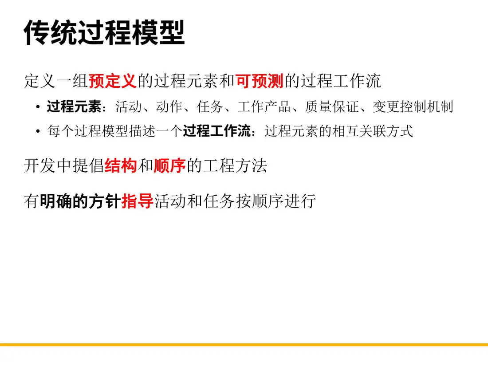

原文：

传统过程模型

定义一组预定义的过程元素和可预测的过程工作流

• 过程元素：活动、动作、任务、工作产品、质量保证、变更控制机制

• 每个过程模型描述一个过程工作流：过程元素的相互关联方式

开发中提倡结构和顺序的工程方法

有明确的方针指导活动和任务按顺序进行

### 瀑布过程模型

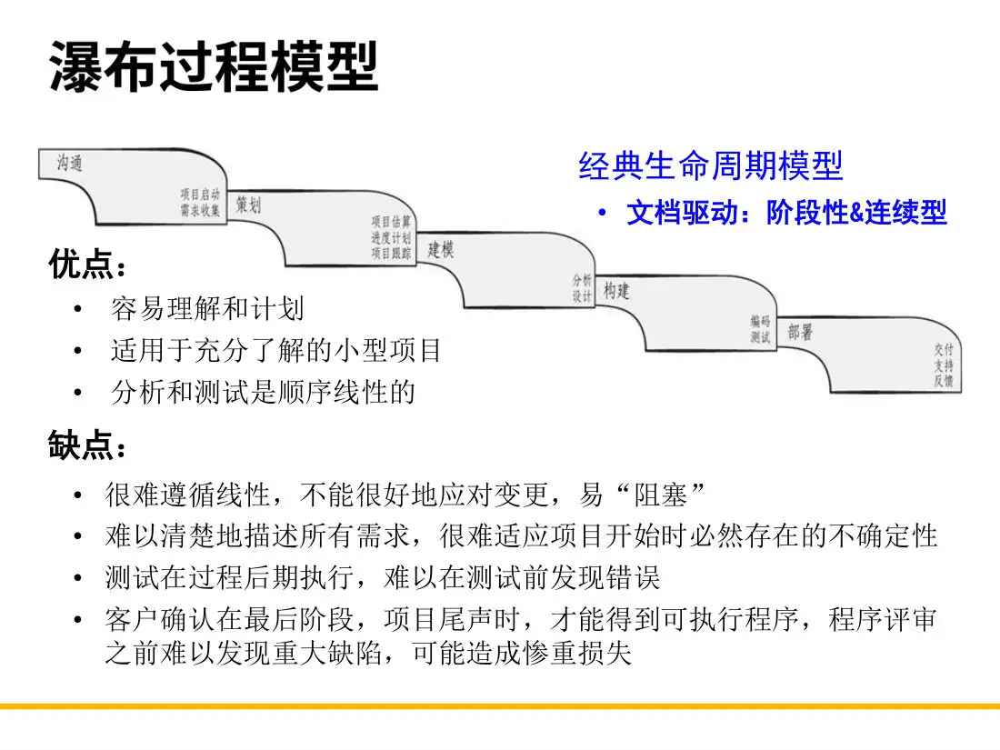

原文：

瀑布过程模型

经典生命周期模型

• 文档驱动：阶段性&连续型

优点：

• 容易理解和计划

• 适用于充分了解的小型项目

• 分析和测试是顺序线性的

缺点：

• 很难遵循线性，不能很好地应对变更，易“阻塞”

• 难以清楚地描述所有需求，很难适应项目开始时必然存在的不确定性

• 测试在过程后期执行，难以在测试前发现错误

• 客户确认在最后阶段，项目尾声时，才能得到可执行程序，程序评审之前难以发现重大缺陷，可能造成惨重损失

### 原型过程模型

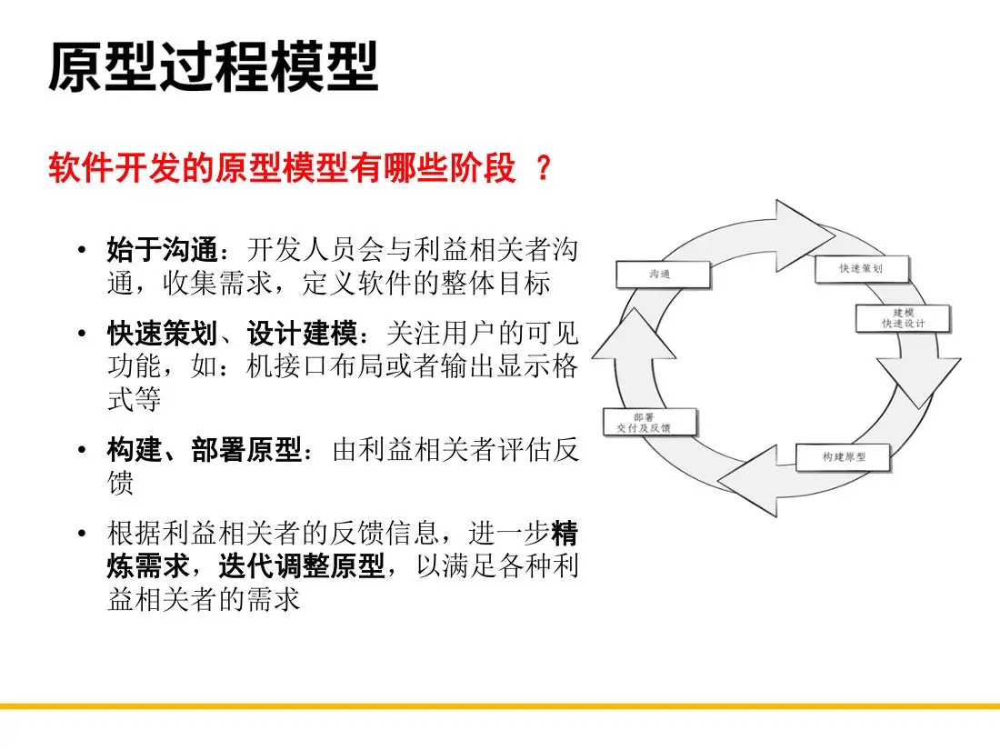

原文：

原型过程模型

软件开发的原型模型有哪些阶段 ？

• 始于沟通：开发人员会与利益相关者沟通，收集需求，定义软件的整体目标

• 快速策划、设计建模：关注用户的可见功能，如：机接口布局或者输出显示格式等

• 构建、部署原型：由利益相关者评估反 馈

• 根据利益相关者的反馈信息，进一步精炼需求，迭代调整原型，以满足各种利益相关者的需求

### 原型过程模型

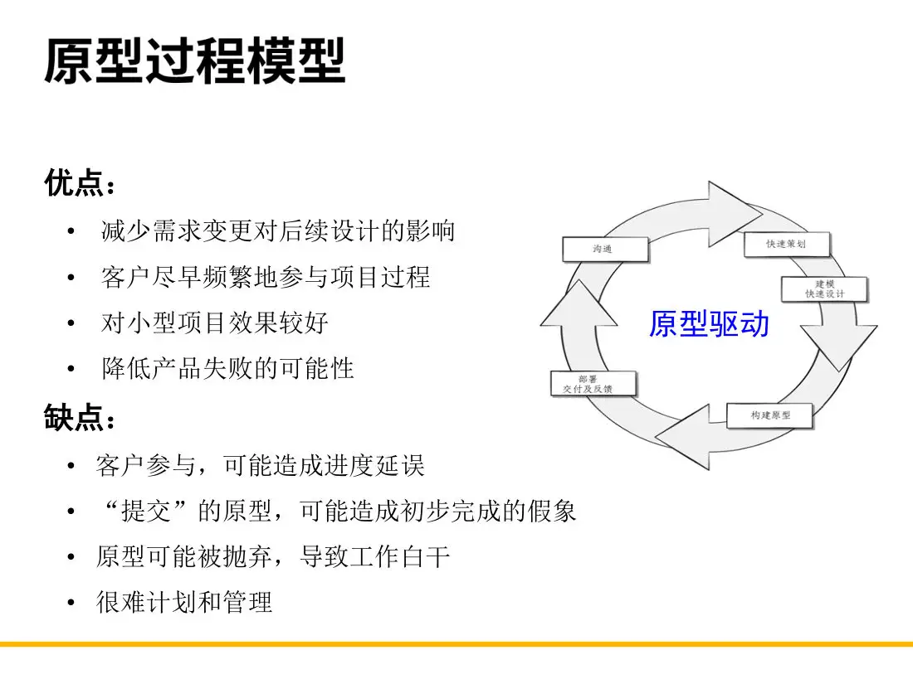

原文：

原型过程模型

优点：

• 减少需求变更对后续设计的影响

• 客户尽早频繁地参与项目过程

• 对小型项目效果较好

• 降低产品失败的可能性

缺点：

• 客户参与，可能造成进度延误

• “提交”的原型，可能造成初步完成的假象

• 原型可能被抛弃，导致工作白干

• 很难计划和管理

### 螺旋过程模型

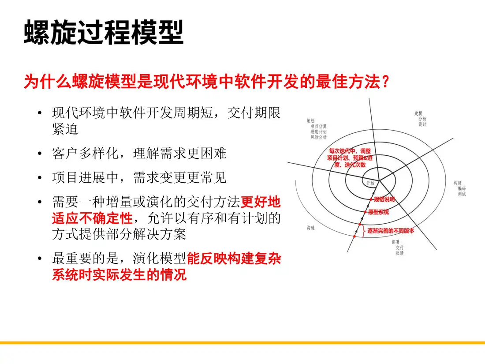

原文：

螺旋过程模型

为什么螺旋模型是现代环境中软件开发的最佳方法？

• 现代环境中软件开发周期短，交付期限紧迫

• 客户多样化，理解需求更困难

• 项目进展中，需求变更更常见

• 需要一种增量或演化的交付方法更好地适应不确定性，允许以有序和有计划的方式提供部分解决方案

• 最重要的是，演化模型能反映构建复杂系统时实际发生的情况

### 螺旋过程模型

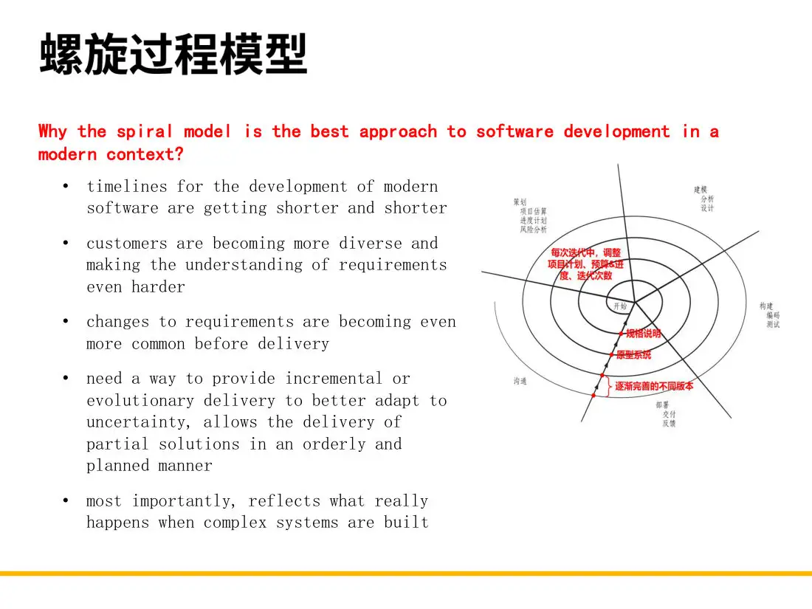

原文：

螺旋过程模型

Why the spiral model is the best approach to software development in a modern context?

• timelines for the development of modern software are getting shorter and shorter

• customers are becoming more diverse and making the understanding of requirements even harder

• changes to requirements are becoming even more common before delivery

need a way to provide incremental or evolutionary delivery to better adapt to uncertainty, allows the delivery of partial solutions in an orderly and planned manner

• most importantly, reflects what really happens when complex systems are built

### 螺旋过程模型

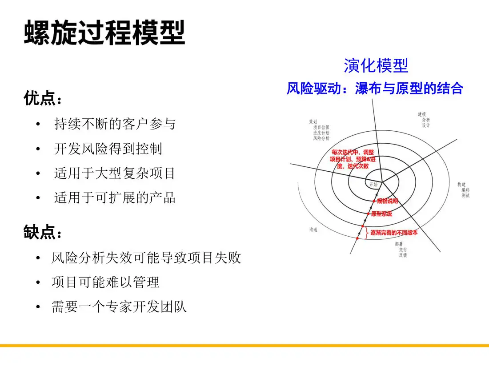

原文：

螺旋过程模型

优点：

• 持续不断的客户参与

• 开发风险得到控制

• 适用于大型复杂项目

• 适用于可扩展的产品

缺点：

• 风险分析失效可能导致项目失败

• 项目可能难以管理

• 需要一个专家开发团队

演化模型

风险驱动：瀑布与原型的结合

### 统一过程模型

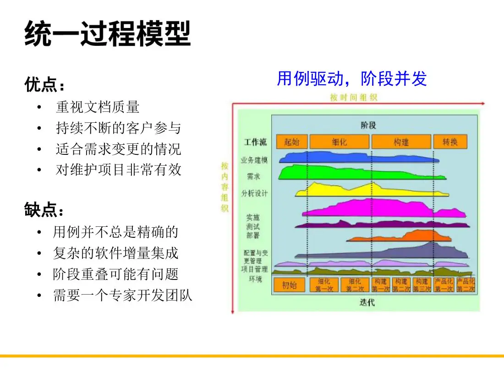

原文：

统一过程模型

优点：

• 重视文档质量

• 持续不断的客户参与

• 适合需求变更的情况

• 对维护项目非常有效

缺点：

• 用例并不总是精确的

• 复杂的软件增量集成

• 阶段重叠可能有问题

• 需要一个专家开发团队

用例驱动，阶段并发

### “敏捷” 过程模型

原文：

“敏捷” 过程模型

### 传统过程模型的缺陷

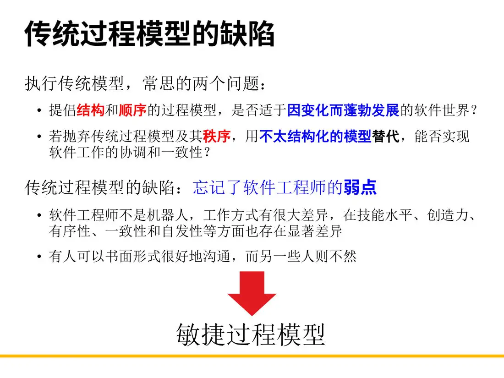

原文：

传统过程模型的缺陷

执行传统模型，常思的两个问题：

• 提倡结构和顺序的过程模型，是否适于因变化而蓬勃发展的软件世界？

• 若抛弃传统过程模型及其秩序，用不太结构化的模型替代，能否实现软件工作的协调和一致性？

传统过程模型的缺陷：忘记了软件工程师的弱点

• 软件工程师不是机器人，工作方式有很大差异，在技能水平、创造力、有序性、一致性和自发性等方面也存在显著差异

• 有人可以书面形式很好地沟通，而另一些人则不然

### 敏捷软件开发宣言

原文：

敏捷软件开发宣言

若一个模型可行，既采用一种现实机制确保过程纪律，又要“宽容”对待软件工程师

《敏捷宣言》提出了哪些折衷方案 ？

1. 个人之间的交流胜过开发过程和工具

2. 可运行软件胜过宽泛文档

3. 客户合作胜过合同谈判

4. 良好响应变更胜过按部就班地遵循计划

敏捷开发不完全对立于传统软件工程实践，可作为超越一切的哲学理念用于所有软件工作

### 什么是敏捷？

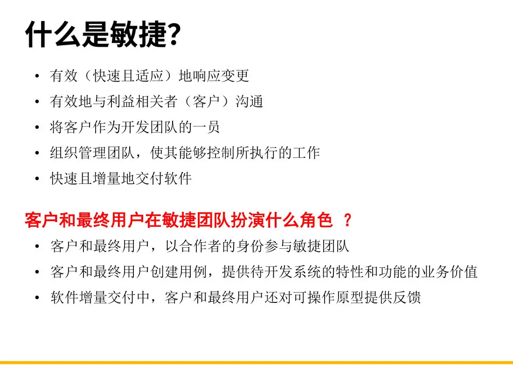

原文：

什么是敏捷？

• 有效（快速且适应）地响应变更

• 有效地与利益相关者（客户）沟通

• 将客户作为开发团队的一员

• 组织管理团队，使其能够控制所执行的工作

• 快速且增量地交付软件

客户和最终用户在敏捷团队扮演什么角色 ？

• 客户和最终用户，以合作者的身份参与敏捷团队

• 客户和最终用户创建用例，提供待开发系统的特性和功能的业务价值

• 软件增量交付中，客户和最终用户还对可操作原型提供反馈

### 敏捷及变更成本

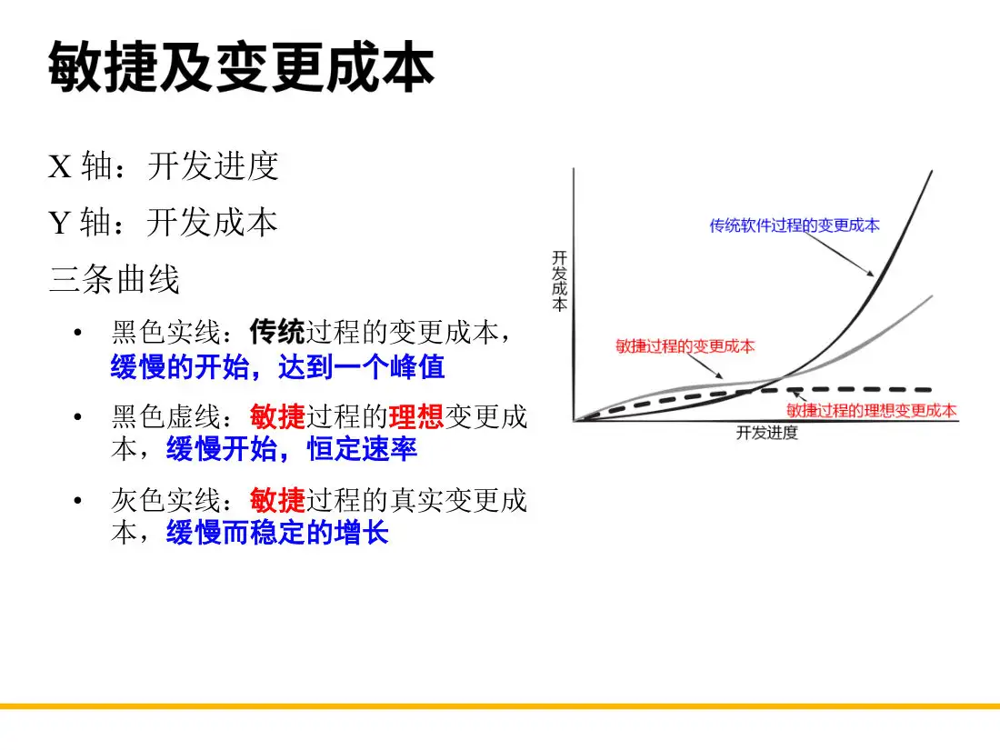

原文：

敏捷及变更成本

X 轴：开发进度

Y 轴：开发成本

三条曲线

• 黑色实线：传统过程的变更成本， 缓慢的开始，达到一个峰值

• 黑色虚线：敏捷过程的理想变更成 本，缓慢开始，恒定速率

• 灰色实线：敏捷过程的真实变更成 本，缓慢而稳定的增长

### 什么是敏捷过程？

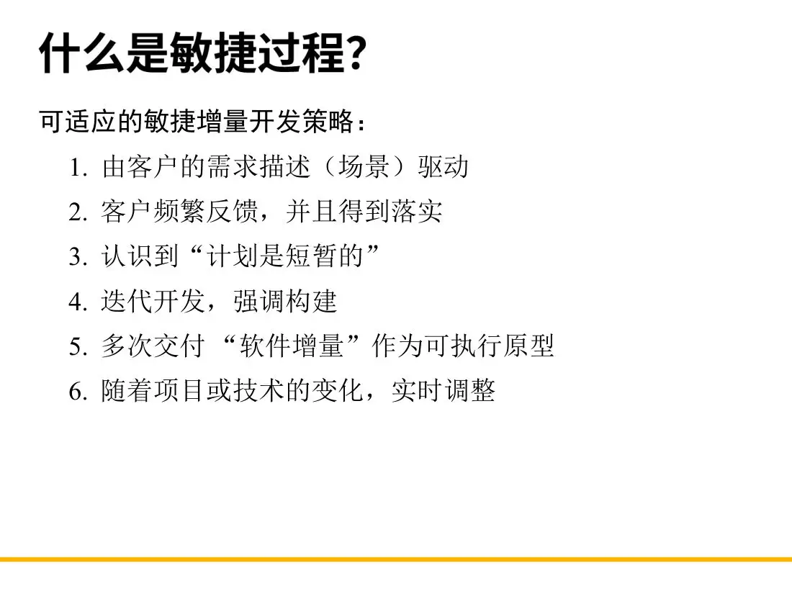

原文：

什么是敏捷过程？

可适应的敏捷增量开发策略：

1. 由客户的需求描述（场景）驱动

2. 客户频繁反馈，并且得到落实

3. 认识到“计划是短暂的”

4. 迭代开发，强调构建

5. 多次交付“软件增量”作为可执行原型

6. 随着项目或技术的变化，实时调整

### 项目的不可预测性

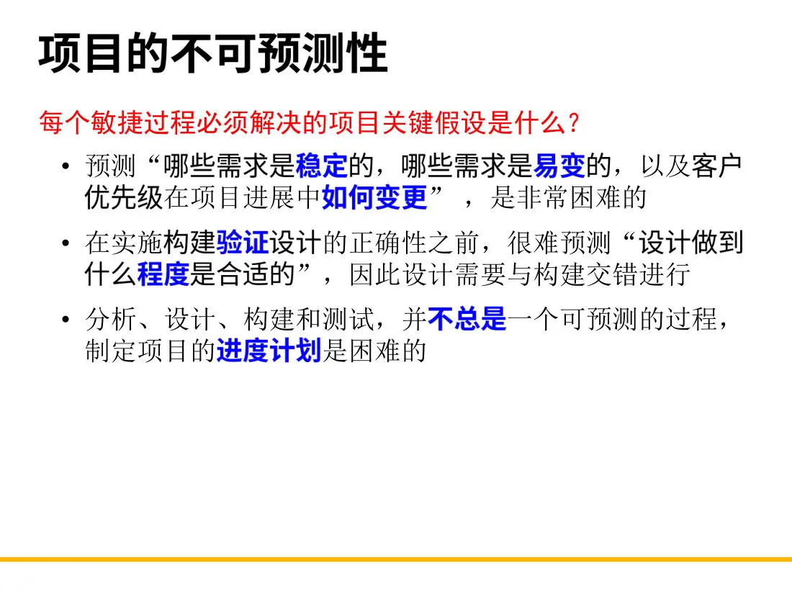

原文：

项目的不可预测性

每个敏捷过程必须解决的项目关键假设是什么？

• 预测“哪些需求是稳定的，哪些需求是易变的，以及客户优先级在项目进展中如何变更” ，是非常困难的

• 在实施构建验证设计的正确性之前，很难预测“设计做到什么程度是合适的”，因此设计需要与构建交错进行

• 分析、设计、构建和测试，并不总是一个可预测的过程，制定项目的进度计划是困难的

### Agility Principles

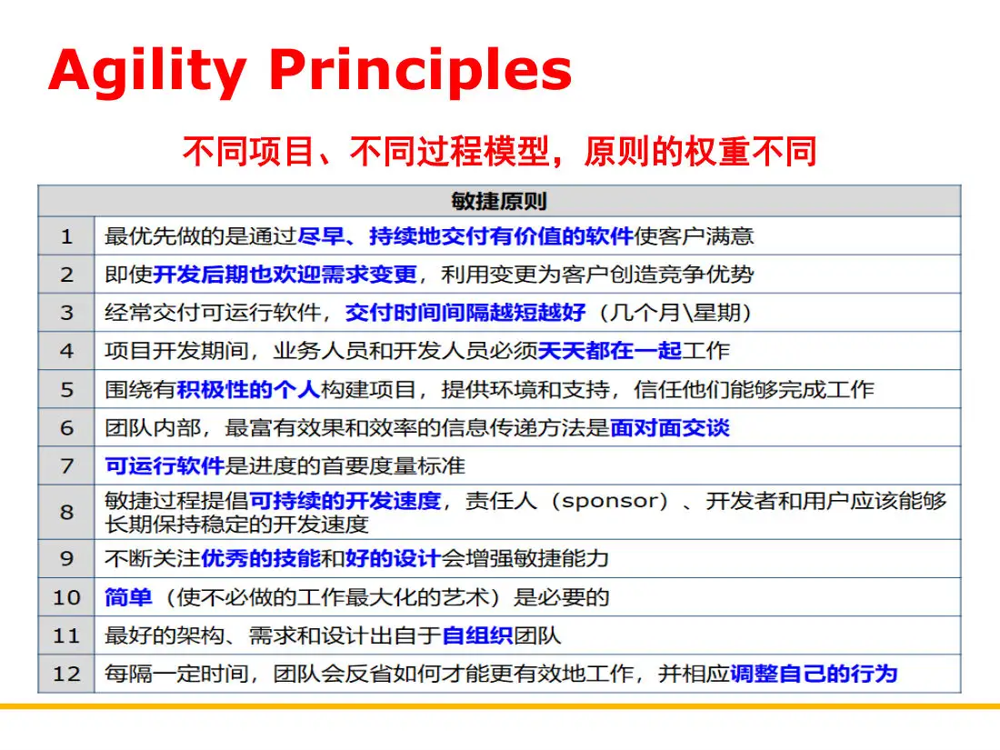

原文：

Agility Principles

不同项目、不同过程模型，原则的权重不同

<table><tr><td colspan="2">敏捷原则</td></tr><tr><td>1</td><td>最优先做的是通过尽早、持续地交付有价值的软件使客户满意</td></tr><tr><td>2</td><td>即使开发后期也欢迎需求变更,利用变更为客户创造竞争优势</td></tr><tr><td>3</td><td>经常交付可运行软件,交付时间间隔越短越好(几个月\星期)</td></tr><tr><td>4</td><td>项目开发期间,业务人员和开发人员必须天天都在一起工作</td></tr><tr><td>5</td><td>围绕有积极性的个人构建项目,提供环境和支持,信任他们能够完成工作</td></tr><tr><td>6</td><td>团队内部,最富有效果和效率的信息传递方法是面对面交谈</td></tr><tr><td>7</td><td>可运行软件是进度的首要度量标准</td></tr><tr><td>8</td><td>敏捷过程提倡可持续的开发速度,责任人(sponsor)、开发者和用户应该能够长期保持稳定的开发速度</td></tr><tr><td>9</td><td>不断关注优秀的技能和好的设计会增强敏捷能力</td></tr><tr><td>10</td><td>简单(使不必做的工作最大化的艺术)是必要的</td></tr><tr><td>11</td><td>最好的架构、需求和设计出自于自组织团队</td></tr><tr><td>12</td><td>每隔一定时间,团队会反省如何才能更有效地工作,并相应调整自己的行为</td></tr></table>

### agile philosophy

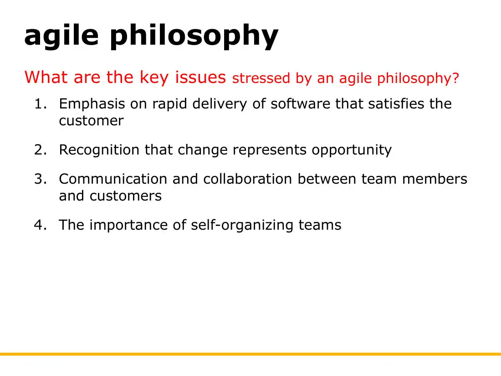

原文：

agile philosophy

What are the key issues stressed by an agile philosophy?

1. Emphasis on rapid delivery of software that satisfies the customer

2. Recognition that change represents opportunity

3. Communication and collaboration between team members and customers

4. The importance of self-organizing teams

### Scrum Framework

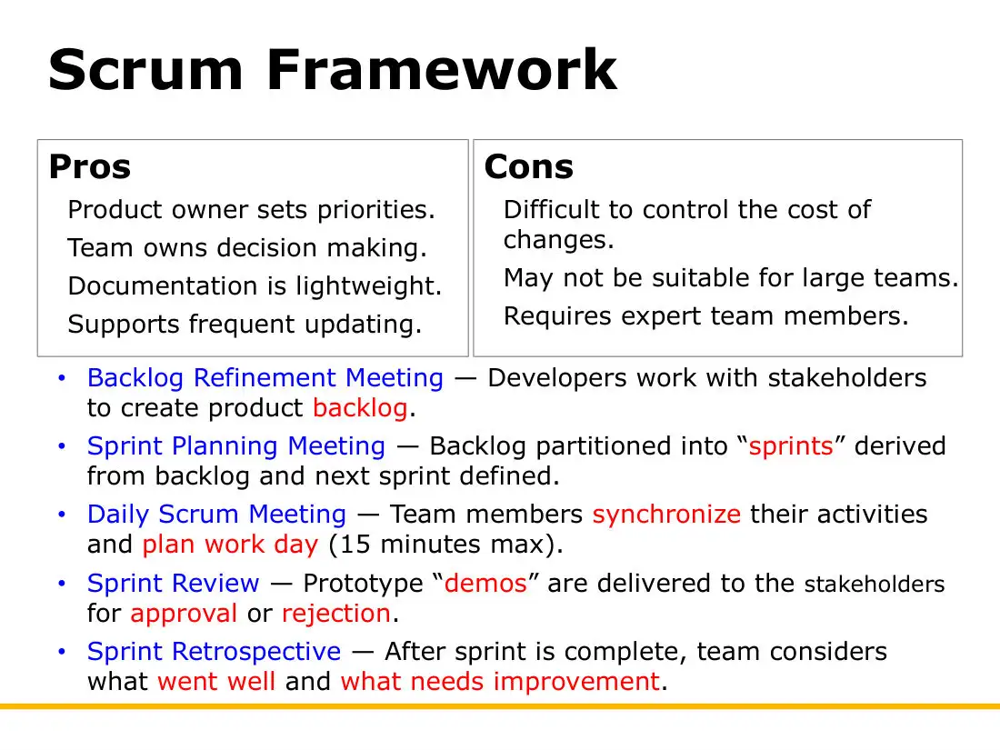

原文：

Scrum Framework

<table><tr><td>ProsProduct owner sets priorities.Team owns decision making.Documentation is lightweight.Supports frequent updating.</td><td>ConsDifficult to control the cost of changes.May not be suitable for large teams.Requires expert team members.</td></tr></table>

Backlog Refinement Meeting — Developers work with stakeholders to create product backlog.

• Sprint Planning Meeting — Backlog partitioned into “sprints” derived from backlog and next sprint defined.

Daily Scrum Meeting — Team members synchronize their activities and plan work day (15 minutes max).

• Sprint Review — Prototype “demos” are delivered to the stakeholders for approval or rejection.

Sprint Retrospective — After sprint is complete, team considers what went well and what needs improvement.

### Scrum Framework

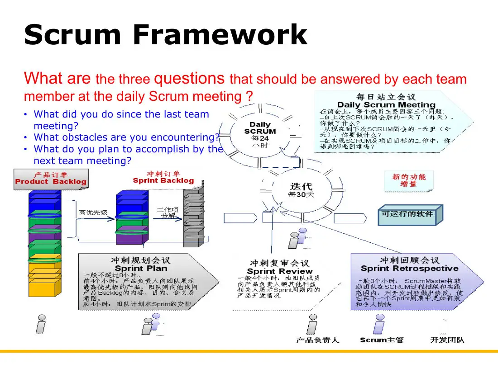

原文：

Scrum Framework

What are the three questions that should be answered by each team

member at the daily Scrum meeting ?

• What did you do since the last team meeting?

• What obstacles are you encountering?

• What do you plan to accomplish by the next team meeting?

每日站立会议 Daily Scrum Meeting

在简会上，每个成员主要回答三个问题：-自上次SCRUM简会后的一天了（昨天）你做了什么？一从现在到下次SCRUM简会的一天里（今天），你要做什么？一在实现SCRUM及项目目标的工作中，你遇到哪些困难吗？

### Extreme Programming (XP)

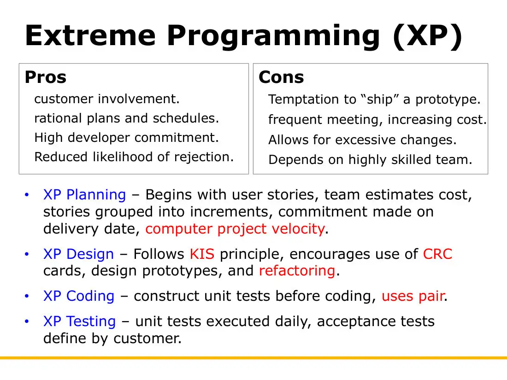

原文：

Extreme Programming (XP)

<table><tr><td>Proscustomer involvement.rational plans and schedules.High developer commitment.Reduced likelihood of rejection.</td><td>ConsTemptation to “ship” a prototype.frequent meeting, increasing cost.Allows for excessive changes.Depends on highly skilled team.</td></tr></table>

XP Planning – Begins with user stories, team estimates cost, stories grouped into increments, commitment made on delivery date, computer project velocity.

XP Design – Follows KIS principle, encourages use of CRC cards, design prototypes, and refactoring.

• XP Coding – construct unit tests before coding, uses pair.

XP Testing – unit tests executed daily, acceptance tests define by customer.

### XP 框架

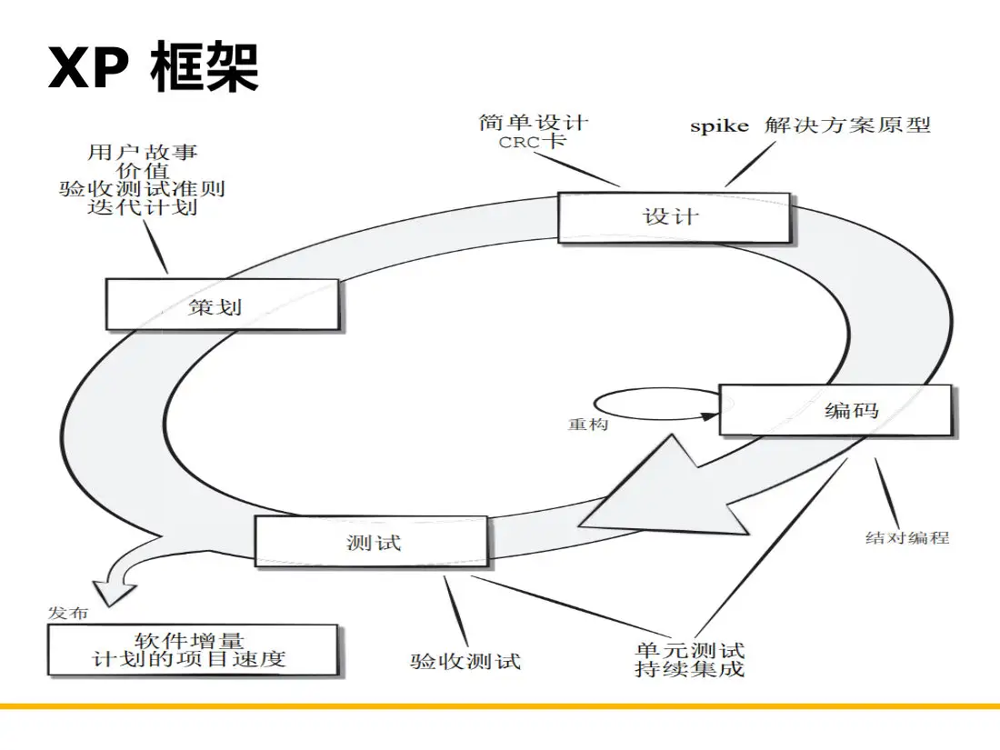

原文：

XP 框架

### CRC卡

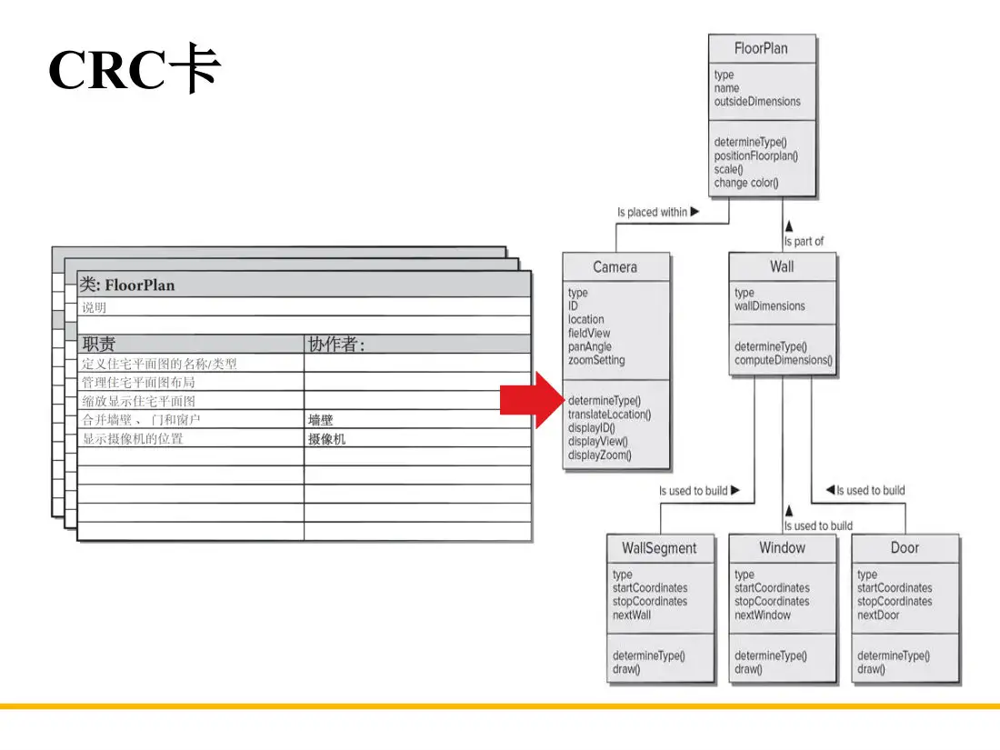

原文：

CRC卡

### Kanban: Visualizing monitor

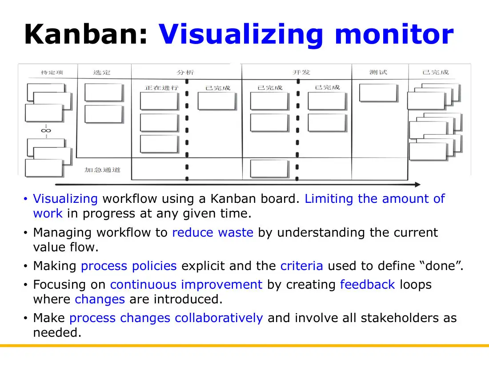

原文：

Kanban: Visualizing monitor

• Visualizing workflow using a Kanban board. Limiting the amount of work in progress at any given time.

• Managing workflow to reduce waste by understanding the current value flow.

• Making process policies explicit and the criteria used to define “done”.

• Focusing on continuous improvement by creating feedback loops where changes are introduced.

• Make process changes collaboratively and involve all stakeholders as needed.

### DevOps

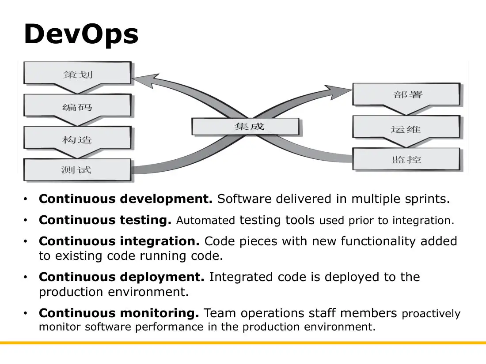

原文：

DevOps

• Continuous development. Software delivered in multiple sprints.

• Continuous testing. Automated testing tools used prior to integration.

• Continuous integration. Code pieces with new functionality added to existing code running code.

• Continuous deployment. Integrated code is deployed to the production environment.

Continuous monitoring. Team operations staff members proactively monitor software performance in the production environment.

### “Recommended” Process Models

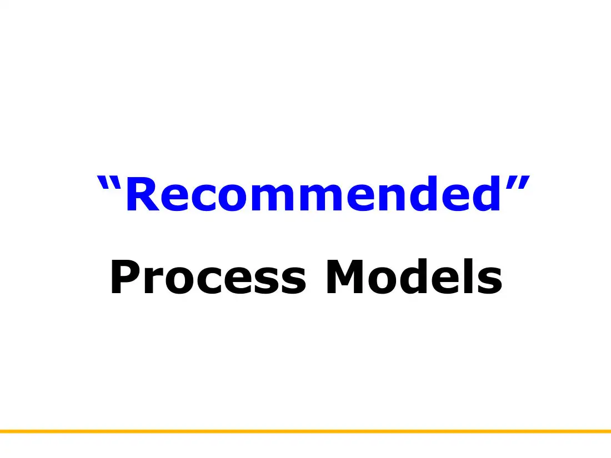

原文：

“Recommended” Process Models

### Process Adaptation

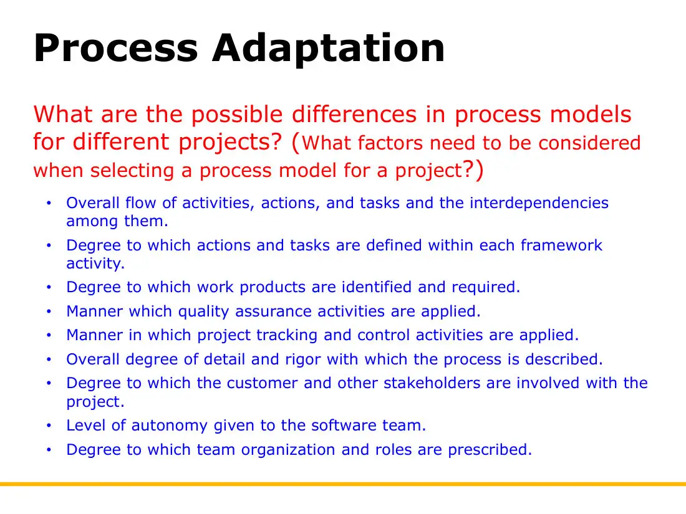

原文：

Process Adaptation

What are the possible differences in process models for different projects? (What factors need to be considered when selecting a process model for a project?)

• Overall flow of activities, actions, and tasks and the interdependencies among them.

Degree to which actions and tasks are defined within each framework activity.

• Degree to which work products are identified and required.

• Manner which quality assurance activities are applied.

• Manner in which project tracking and control activities are applied.

• Overall degree of detail and rigor with which the process is described.

Degree to which the customer and other stakeholders are involved with the project.

• Level of autonomy given to the software team.

• Degree to which team organization and roles are prescribed.

### Adapting process model

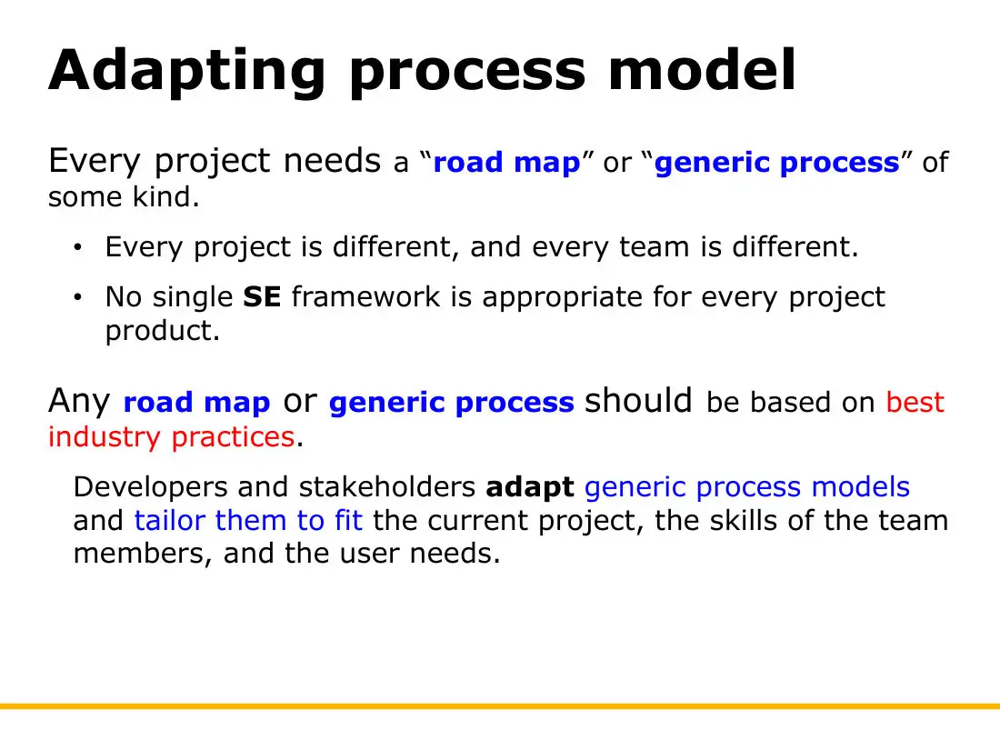

原文：

Adapting process model

Every project needs a “road map” or “generic process” of some kind.

• Every project is different, and every team is different.

• No single SE framework is appropriate for every project product.

Any road map or generic process should be based on best industry practices.

Developers and stakeholders adapt generic process models and tailor them to fit the current project, the skills of the team members, and the user needs.

### Principles for Organizing Projects Map

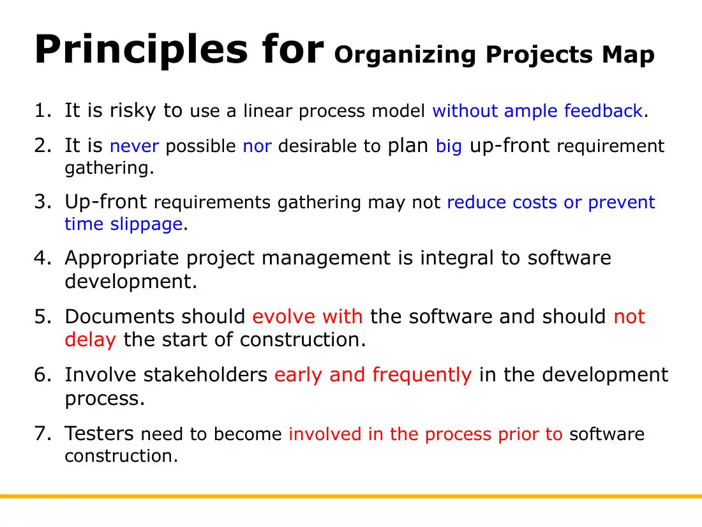

原文：

Principles for Organizing Projects Map

1. It is risky to use a linear process model without ample feedback.

2. It is never possible nor desirable to plan big up-front requirement gathering.

3. Up-front requirements gathering may not reduce costs or prevent time slippage.

4. Appropriate project management is integral to software development.

5. Documents should evolve with the software and should not delay the start of construction.

6. Involve stakeholders early and frequently in the development process.

7. Testers need to become involved in the process prior to software construction.

### Some Ideas of Adapting process model

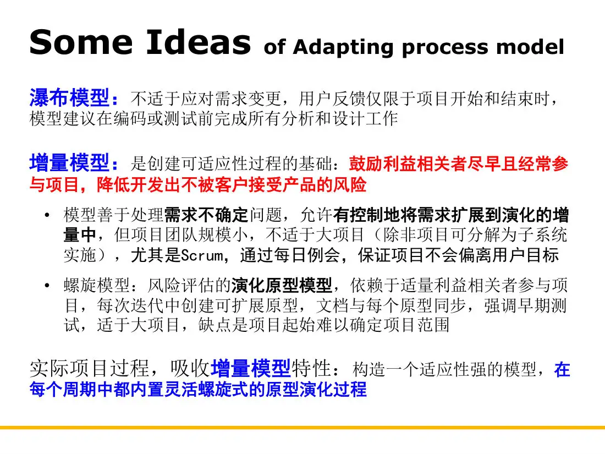

原文：

Some Ideas of Adapting process model

瀑布模型：不适于应对需求变更，用户反馈仅限于项目开始和结束时，模型建议在编码或测试前完成所有分析和设计工作

增量模型：是创建可适应性过程的基础：鼓励利益相关者尽早且经常参 与项目，降低开发出不被客户接受产品的风险

• 模型善于处理需求不确定问题，允许有控制地将需求扩展到演化的增量中，但项目团队规模小，不适于大项目（除非项目可分解为子系统实施），尤其是Scrum，通过每日例会，保证项目不会偏离用户目标

• 螺旋模型：风险评估的演化原型模型，依赖于适量利益相关者参与项目，每次迭代中创建可扩展原型，文档与每个原型同步，强调早期测试，适于大项目，缺点是项目起始难以确定项目范围

实际项目过程，吸收增量模型特性：构造一个适应性强的模型，在每个周期中都内置灵活螺旋式的原型演化过程

### Incremental Prototype Design

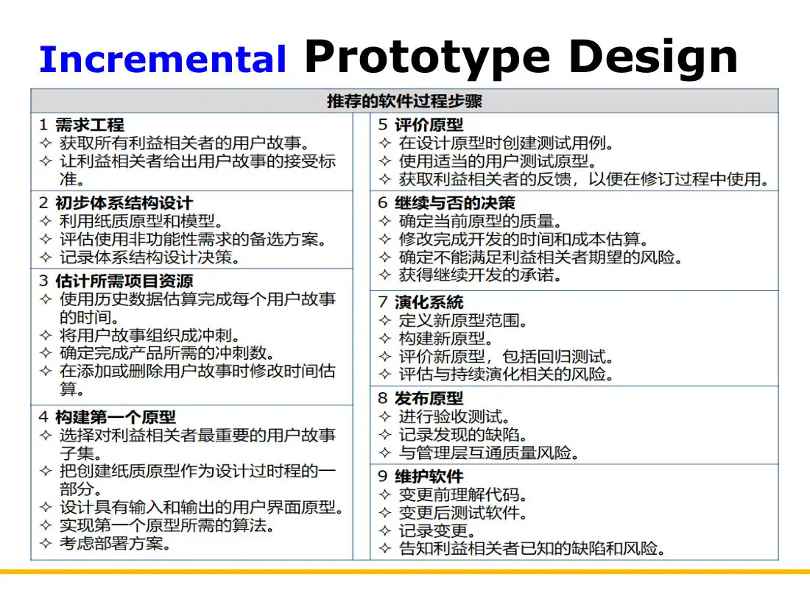

原文：

Incremental Prototype Design

推荐的软件过程步骤

1 需求工程

获取所有利益相关者的用户故事。

让利益相关者给出用户故事的接受标准。

2 初步体系结构设计

利用纸质原型和模型。

评估使用非功能性需求的备选方案。

记录体系结构设计决策。

3估计所需项目资源

使用历史数据估算完成每个用户故事的时间。

将用户故事组织成冲刺。

确定完成产品所需的冲刺数。

在添加或删除用户故事时修改时间估算。

4 构建第一个原型

选择对利益相关者最重要的用户故事子集。

把创建纸质原型作为设计过时程的一部分。

设计具有输入和输出的用户界面原型。

实现第一个原型所需的算法。

考虑部署方案。

5 评价原型

在设计原型时创建测试用例。

使用适当的用户测试原型。

获取利益相关者的反馈，以便在修订过程中使用。

6继续与否的决策

确定当前原型的质量。

修改完成开发的时间和成本估算。

确定不能满足利益相关者期望的风险。

获得继续开发的承诺。

7 演化系統

定义新原型范围。

构建新原型。

评价新原型，包括回归测试。

评估与持续演化相关的风险。

8发布原型

进行验收测试。

记录发现的缺陷。

与管理层互通质量风险。

9维护软件

变更前理解代码。

变更后测试软件。

记录变更。

告知利益相关者已知的缺陷和风险。

### Incremental Prototype Design

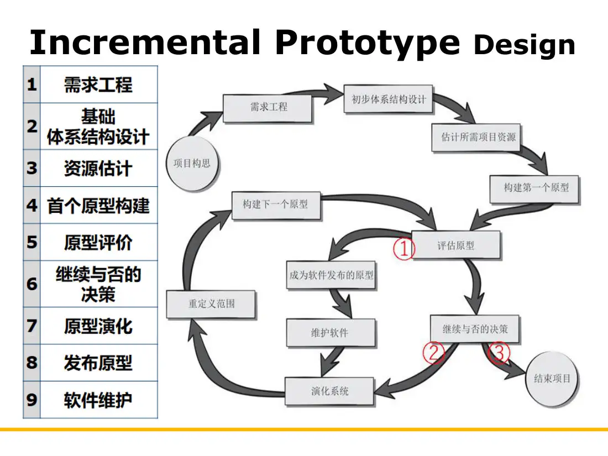

原文：

Incremental Prototype Design

<table><tr><td>1</td><td>需求工程</td></tr><tr><td>2</td><td>基础体系结构设计</td></tr><tr><td>3</td><td>资源估计</td></tr><tr><td>4</td><td>首个原型构建</td></tr><tr><td>5</td><td>原型评价</td></tr><tr><td>6</td><td>继续与否的决策</td></tr><tr><td>7</td><td>原型演化</td></tr><tr><td>8</td><td>发布原型</td></tr><tr><td>9</td><td>软件维护</td></tr></table>

### Requirements Engineering

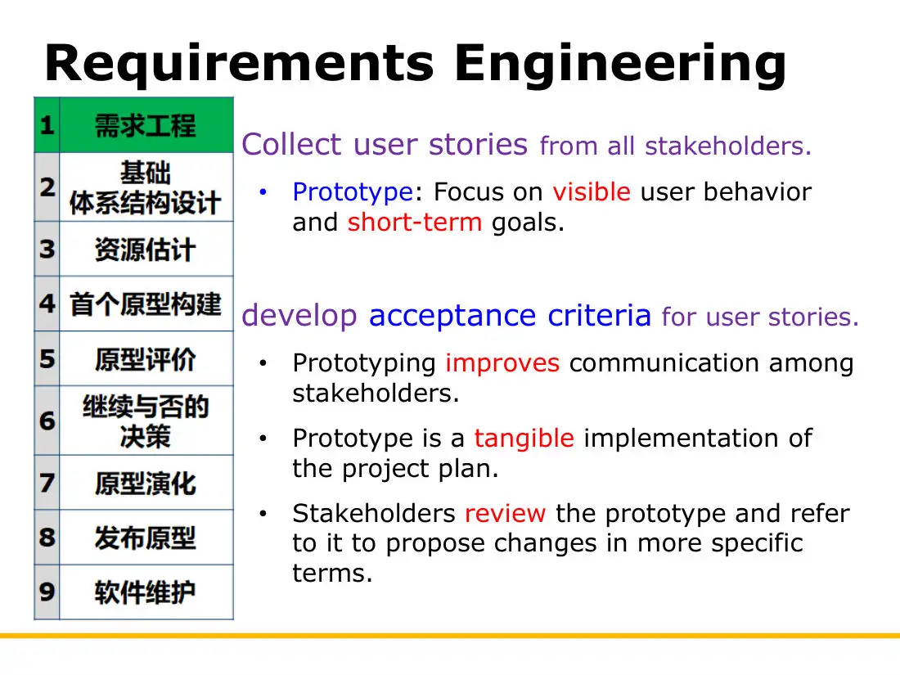

原文：

Requirements Engineering

<table><tr><td>1</td><td>需求工程</td><td>Collect user stories from all stakeholders.</td></tr><tr><td>2</td><td>基础体系结构设计</td><td rowspan="2">Prototype: Focus on visible user behavior and short-term goals.</td></tr><tr><td>3</td><td>资源估计</td></tr><tr><td>4</td><td>首个原型构建</td><td>develop acceptance criteria for user stories.</td></tr><tr><td>5</td><td>原型评价</td><td>Prototyping improves communication among stakeholders.</td></tr><tr><td>6</td><td>继续与否的决策</td><td>Prototype is a tangible implementation of the project plan.</td></tr><tr><td>7</td><td>原型演化</td><td rowspan="3">Stakeholders review the prototype and refer to it to propose changes in more specific terms.</td></tr><tr><td>8</td><td>发布原型</td></tr><tr><td>9</td><td>软件维护</td></tr></table>

### Requirements Engineering

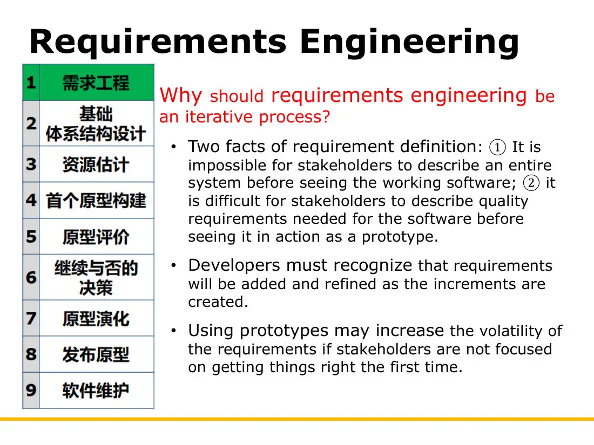

原文：

Requirements Engineering

Why should requirements engineering be an iterative process?

<table><tr><td>1</td><td>需求工程</td></tr><tr><td>2</td><td>基础体系结构设计</td></tr><tr><td>3</td><td>资源估计</td></tr><tr><td>4</td><td>首个原型构建</td></tr><tr><td>5</td><td>原型评价</td></tr><tr><td>6</td><td>继续与否的决策</td></tr><tr><td>7</td><td>原型演化</td></tr><tr><td>8</td><td>发布原型</td></tr><tr><td>9</td><td>软件维护</td></tr></table>

• Two facts of requirement definition: ① It is impossible for stakeholders to describe an entire system before seeing the working software; ② it is difficult for stakeholders to describe quality requirements needed for the software before seeing it in action as a prototype.

• Developers must recognize that requirements will be added and refined as the increments are created.

• Using prototypes may increase the volatility of the requirements if stakeholders are not focused on getting things right the first time.

### Requirements Engineering

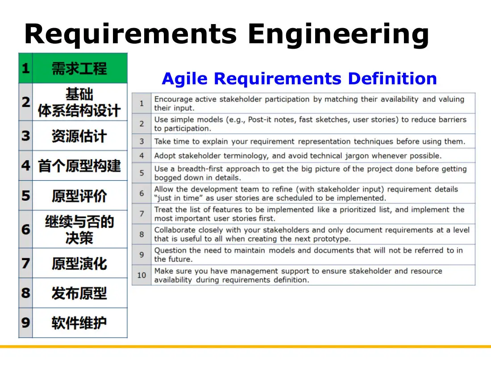

原文：

Requirements Engineering

Agile Requirements Definition

<table><tr><td>2</td><td>基础
体系结构设计</td><td>1</td><td>Encourage active stakeholder participation by matching their availability and valuing their input.</td></tr><tr><td>3</td><td>资源估计</td><td>2</td><td>Use simple models (e.g., Post-it notes, fast sketches, user stories) to reduce barriers to participation.</td></tr><tr><td>4</td><td>首个原型构建</td><td>3</td><td>Take time to explain your requirement representation techniques before using them.</td></tr><tr><td>5</td><td>原型评价</td><td>4</td><td>Adopt stakeholder terminology, and avoid technical jargon whenever possible.</td></tr><tr><td>6</td><td>继续与否的决策</td><td>5</td><td>Use a breadth-first approach to get the big picture of the project done before getting bogged down in details.</td></tr><tr><td rowspan="5">7</td><td rowspan="5">原型演化</td><td>6</td><td>Allow the development team to refine (with stakeholder input) requirement details &quot;just in time&quot; as user stories are scheduled to be implemented.</td></tr><tr><td>7</td><td>Treat the list of features to be implemented like a prioritized list, and implement the most important user stories first.</td></tr><tr><td>8</td><td>Collaborate closely with your stakeholders and only document requirements at a level that is useful to all when creating the next prototype.</td></tr><tr><td>9</td><td>Question the need to maintain models and documents that will not be referred to in the future.</td></tr><tr><td>10</td><td>Make sure you have management support to ensure stakeholder and resource availability during requirements definition.</td></tr></table>

### Protype Architectural Design

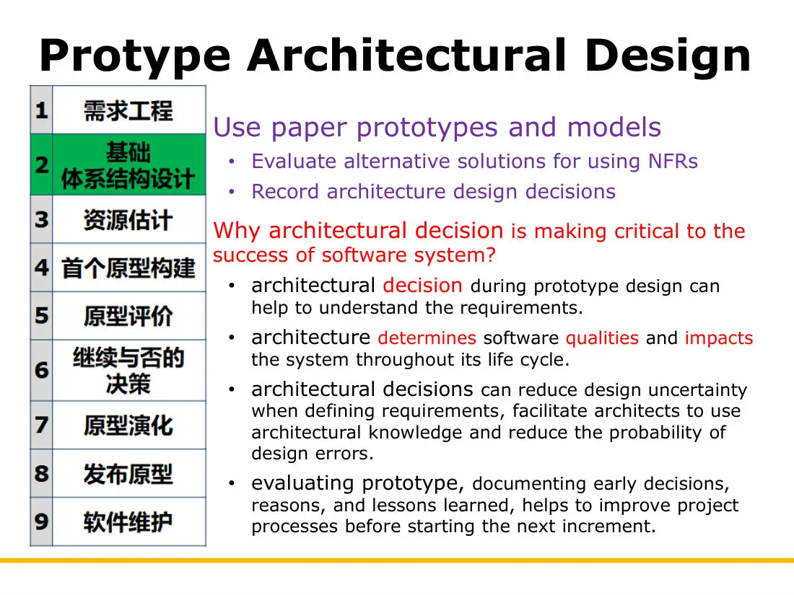

原文：

Protype Architectural Design

Use paper prototypes and models

• Evaluate alternative solutions for using NFRs

• Record architecture design decisions

<table><tr><td>1</td><td>需求工程</td></tr><tr><td>2</td><td>基础体系结构设计</td></tr><tr><td>3</td><td>资源估计</td></tr><tr><td>4</td><td>首个原型构建</td></tr><tr><td>5</td><td>原型评价</td></tr><tr><td>6</td><td>继续与否的决策</td></tr><tr><td>7</td><td>原型演化</td></tr><tr><td>8</td><td>发布原型</td></tr><tr><td>9</td><td>软件维护</td></tr></table>

Why architectural decision is making critical to the success of software system?

• architectural decision during prototype design can help to understand the requirements.

• architecture determines software qualities and impacts the system throughout its life cycle.

• architectural decisions can reduce design uncertainty when defining requirements, facilitate architects to use architectural knowledge and reduce the probability of design errors.

• evaluating prototype, documenting early decisions, reasons, and lessons learned, helps to improve project processes before starting the next increment.

### Protype Architectural Design

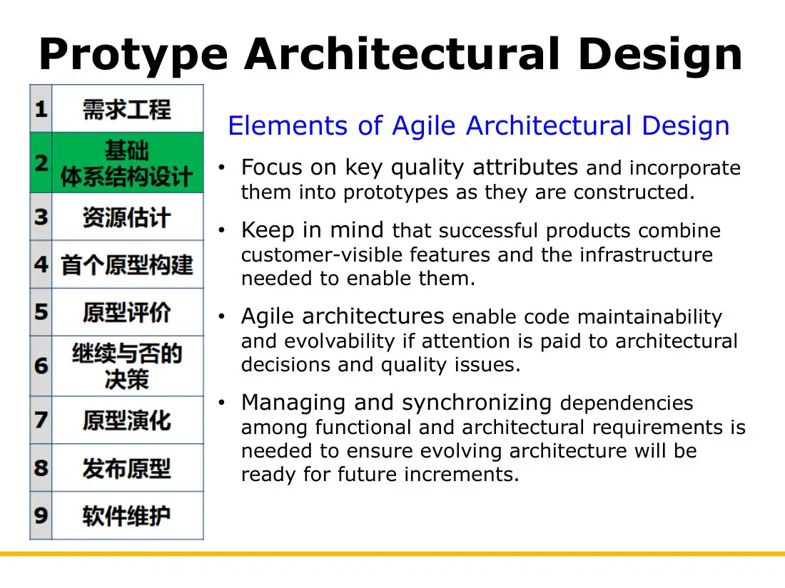

原文：

Protype Architectural Design

Elements of Agile Architectural Design

<table><tr><td>1</td><td>需求工程</td></tr><tr><td>2</td><td>基础体系结构设计</td></tr><tr><td>3</td><td>资源估计</td></tr><tr><td>4</td><td>首个原型构建</td></tr><tr><td>5</td><td>原型评价</td></tr><tr><td>6</td><td>继续与否的决策</td></tr><tr><td>7</td><td>原型演化</td></tr><tr><td>8</td><td>发布原型</td></tr><tr><td>9</td><td>软件维护</td></tr></table>

• Focus on key quality attributes and incorporate them into prototypes as they are constructed.

• Keep in mind that successful products combine customer-visible features and the infrastructure needed to enable them.

• Agile architectures enable code maintainability and evolvability if attention is paid to architectural decisions and quality issues.

Managing and synchronizing dependencies among functional and architectural requirements is needed to ensure evolving architecture will be ready for future increments.

### Resource Estimation

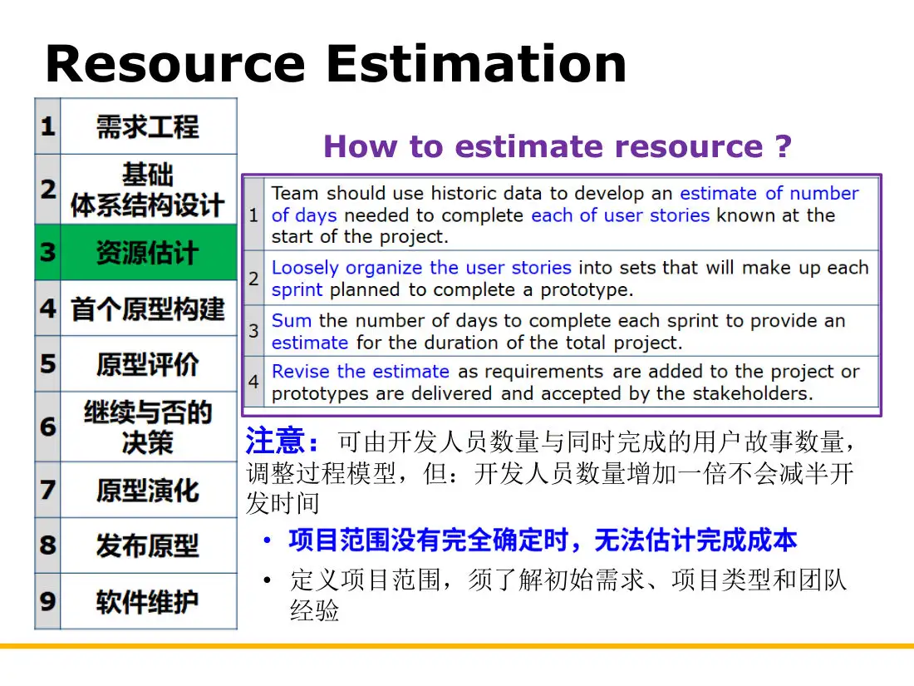

原文：

Resource Estimation

<table><tr><td>1</td><td>需求工程</td></tr><tr><td>2</td><td>基础体系结构设计</td></tr><tr><td>3</td><td>资源估计</td></tr><tr><td>4</td><td>首个原型构建</td></tr><tr><td>5</td><td>原型评价</td></tr><tr><td>6</td><td>继续与否的决策</td></tr><tr><td>7</td><td>原型演化</td></tr><tr><td>8</td><td>发布原型</td></tr><tr><td>9</td><td>软件维护</td></tr></table>

How to estimate resource ?

<table><tr><td>1</td><td>Team should use historic data to develop an estimate of number of days needed to complete each of user stories known at the start of the project.</td></tr><tr><td>2</td><td>Loosely organize the user stories into sets that will make up each sprint planned to complete a prototype.</td></tr><tr><td>3</td><td>Sum the number of days to complete each sprint to provide an estimate for the duration of the total project.</td></tr><tr><td>4</td><td>Revise the estimate as requirements are added to the project or prototypes are delivered and accepted by the stakeholders.</td></tr></table>

注意：可由开发人员数量与同时完成的用户故事数量，调整过程模型，但：开发人员数量增加一倍不会减半开发时间

• 项目范围没有完全确定时，无法估计完成成本

• 定义项目范围，须了解初始需求、项目类型和团队经验

### First Prototype Guidelines

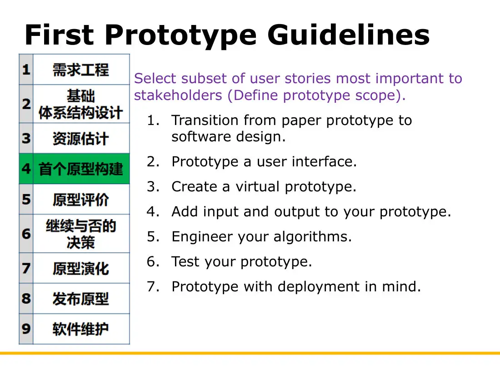

原文：

First Prototype Guidelines

<table><tr><td>1</td><td>需求工程</td></tr><tr><td>2</td><td>基础体系结构设计</td></tr><tr><td>3</td><td>资源估计</td></tr><tr><td>4</td><td>首个原型构建</td></tr><tr><td>5</td><td>原型评价</td></tr><tr><td>6</td><td>继续与否的决策</td></tr><tr><td>7</td><td>原型演化</td></tr><tr><td>8</td><td>发布原型</td></tr><tr><td>9</td><td>软件维护</td></tr></table>

Select subset of user stories most important to stakeholders (Define prototype scope).

1. Transition from paper prototype to software design.

2. Prototype a user interface.

3. Create a virtual prototype.

4. Add input and output to your prototype.

5. Engineer your algorithms.

6. Test your prototype.

7. Prototype with deployment in mind.

### First Prototype Guidelines

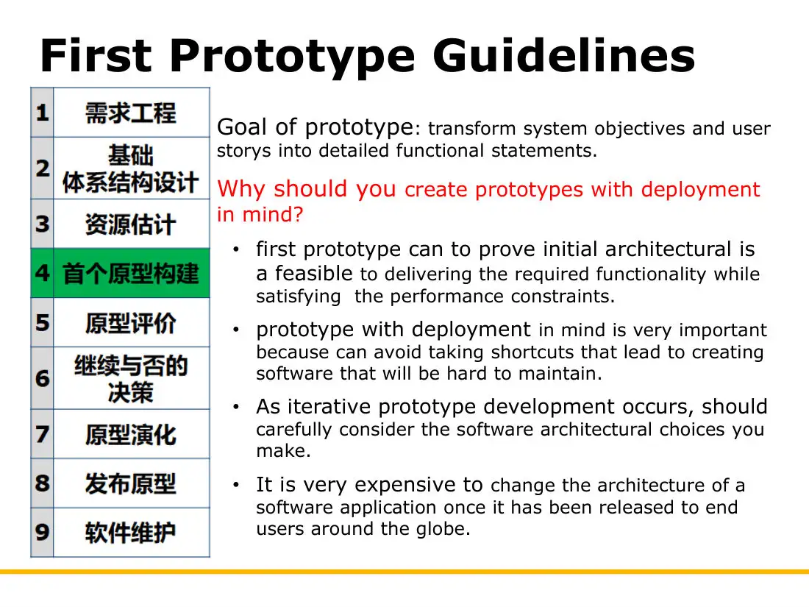

原文：

First Prototype Guidelines

Goal of prototype: transform system objectives and user storys into detailed functional statements.

<table><tr><td>1</td><td>需求工程</td></tr><tr><td>2</td><td>基础体系结构设计</td></tr><tr><td>3</td><td>资源估计</td></tr><tr><td>4</td><td>首个原型构建</td></tr><tr><td>5</td><td>原型评价</td></tr><tr><td>6</td><td>继续与否的决策</td></tr><tr><td>7</td><td>原型演化</td></tr><tr><td>8</td><td>发布原型</td></tr><tr><td>9</td><td>软件维护</td></tr></table>

Why should you create prototypes with deployment in mind?

• first prototype can to prove initial architectural is a feasible to delivering the required functionality while satisfying the performance constraints.

• prototype with deployment in mind is very important because can avoid taking shortcuts that lead to creating software that will be hard to maintain.

• As iterative prototype development occurs, should carefully consider the software architectural choices you make.

• It is very expensive to change the architecture of a software application once it has been released to end users around the globe.

### Prototype Evaluation

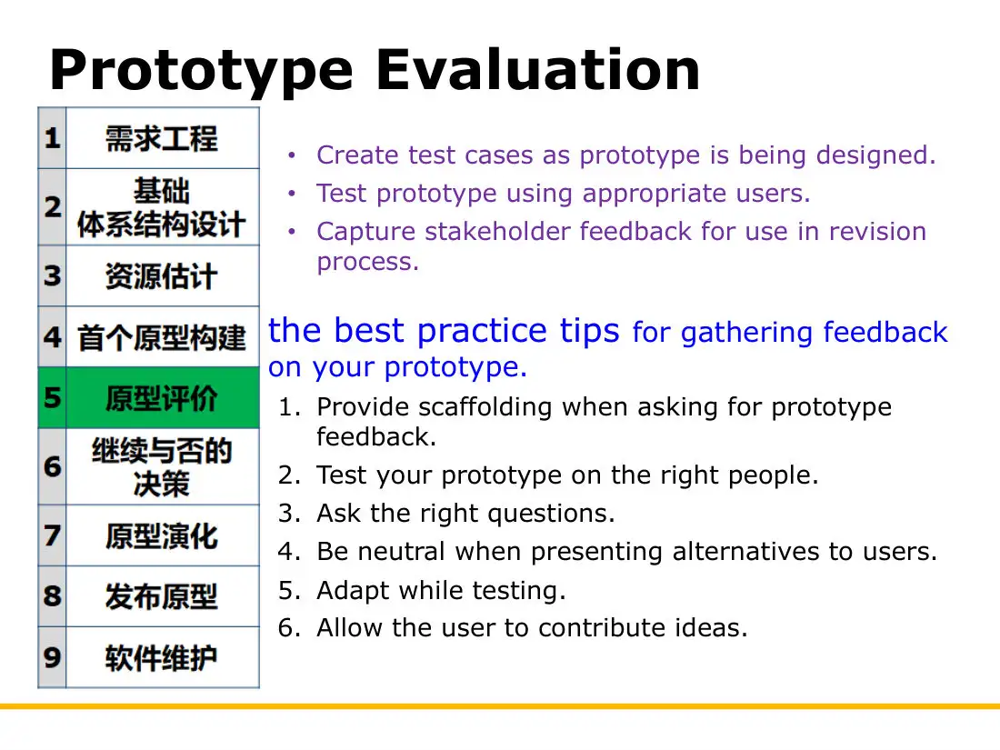

原文：

Prototype Evaluation

• Create test cases as prototype is being designed.

• Test prototype using appropriate users.

<table><tr><td>1</td><td>需求工程</td></tr><tr><td>2</td><td>基础体系结构设计</td></tr><tr><td>3</td><td>资源估计</td></tr><tr><td>4</td><td>首个原型构建</td></tr><tr><td>5</td><td>原型评价</td></tr><tr><td>6</td><td>继续与否的决策</td></tr><tr><td>7</td><td>原型演化</td></tr><tr><td>8</td><td>发布原型</td></tr><tr><td>9</td><td>软件维护</td></tr></table>

• Capture stakeholder feedback for use in revision process.

the best practice tips for gathering feedback on your prototype.

1. Provide scaffolding when asking for prototype feedback.

2. Test your prototype on the right people.

3. Ask the right questions.

4. Be neutral when presenting alternatives to users.

5. Adapt while testing.

6. Allow the user to contribute ideas.

### 原型评价

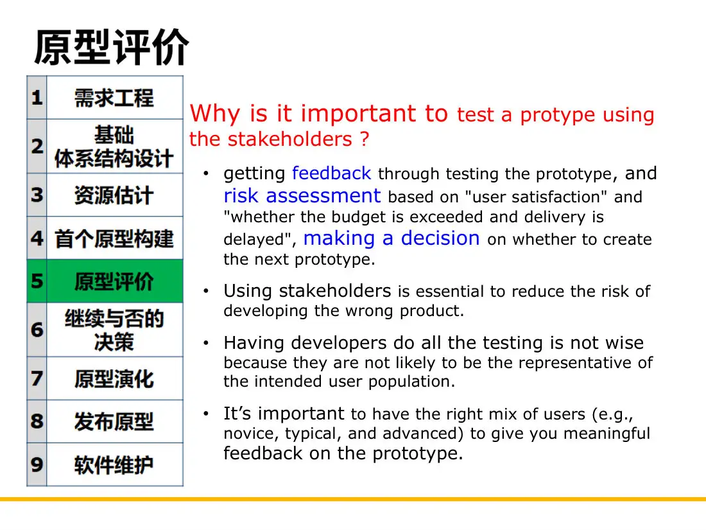

原文：

原型评价

Why is it important to test a protype using the stakeholders ?

<table><tr><td>1</td><td>需求工程</td></tr><tr><td>2</td><td>基础体系结构设计</td></tr><tr><td>3</td><td>资源估计</td></tr><tr><td>4</td><td>首个原型构建</td></tr><tr><td>5</td><td>原型评价</td></tr><tr><td>6</td><td>继续与否的决策</td></tr><tr><td>7</td><td>原型演化</td></tr><tr><td>8</td><td>发布原型</td></tr><tr><td>9</td><td>软件维护</td></tr></table>

getting feedback through testing the prototype, and risk assessment based on "user satisfaction" and "whether the budget is exceeded and delivery is delayed", making a decision on whether to create the next prototype.

• Using stakeholders is essential to reduce the risk of developing the wrong product.

• Having developers do all the testing is not wise because they are not likely to be the representative of the intended user population.

• It’s important to have the right mix of users (e.g., novice, typical, and advanced) to give you meaningful feedback on the prototype.

### Go, No-Go Decision

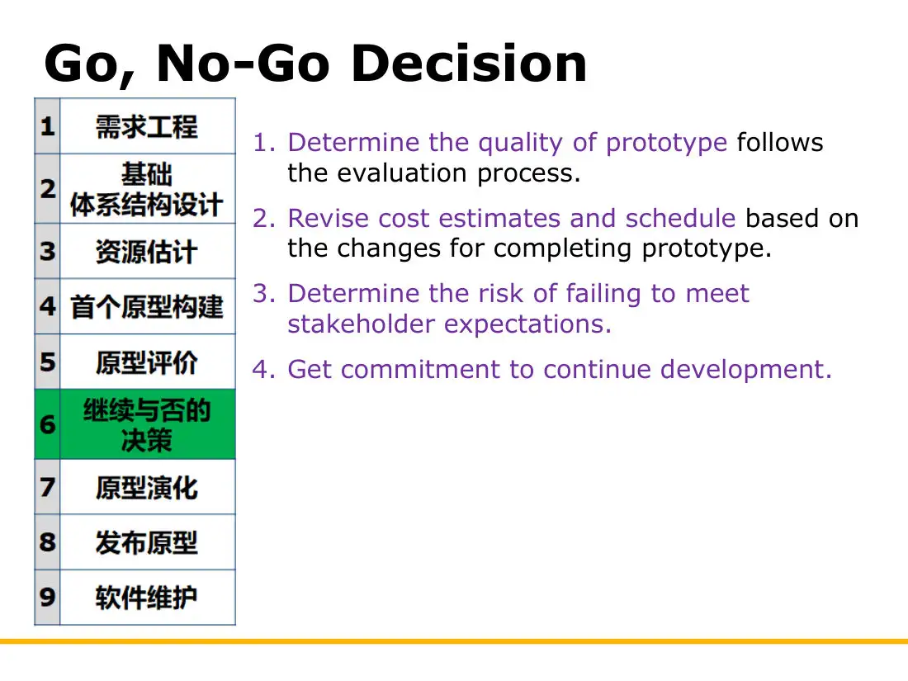

原文：

Go, No-Go Decision

<table><tr><td>1</td><td>需求工程</td></tr><tr><td>2</td><td>基础体系结构设计</td></tr><tr><td>3</td><td>资源估计</td></tr><tr><td>4</td><td>首个原型构建</td></tr><tr><td>5</td><td>原型评价</td></tr><tr><td>6</td><td>继续与否的决策</td></tr><tr><td>7</td><td>原型演化</td></tr><tr><td>8</td><td>发布原型</td></tr><tr><td>9</td><td>软件维护</td></tr></table>

1. Determine the quality of prototype follows the evaluation process.

2. Revise cost estimates and schedule based on the changes for completing prototype.

3. Determine the risk of failing to meet stakeholder expectations.

4. Get commitment to continue development.

### Prototype Evolution

原文：

Prototype Evolution

<table><tr><td>1</td><td>需求工程</td></tr><tr><td>2</td><td>基础体系结构设计</td></tr><tr><td>3</td><td>资源估计</td></tr><tr><td>4</td><td>首个原型构建</td></tr><tr><td>5</td><td>原型评价</td></tr><tr><td>6</td><td>继续与否的决策</td></tr><tr><td>7</td><td>原型演化</td></tr><tr><td>8</td><td>发布原型</td></tr><tr><td>9</td><td>软件维护</td></tr></table>

After review, the prototype may be 3 possible trends in the project：

1. Prototype becomes a system candidate

2. Evolve the prototype to the next version：

① Define new prototype scope

② Constructing new prototype

③ Evaluate new prototype and include regression testing.

④ Assess risks associated with continuing evolution.

3. Risk assessment failed, project terminated

### Prototype Evolution

原文：

Prototype Evolution

<table><tr><td>1</td><td>需求工程</td></tr><tr><td>2</td><td>基础体系结构设计</td></tr><tr><td>3</td><td>资源估计</td></tr><tr><td>4</td><td>首个原型构建</td></tr><tr><td>5</td><td>原型评价</td></tr><tr><td>6</td><td>继续与否的决策</td></tr><tr><td>7</td><td>原型演化</td></tr><tr><td>8</td><td>发布原型</td></tr><tr><td>9</td><td>软件维护</td></tr></table>

How to test a new prototype ?

• Testing should be performed using test cases created during design process before programming was completed.

Each user story has an acceptance criteria attached to it and it should guide the creation of the test cases to ensure the prototype meets customer needs.

Prototypes need to be tested for defects and performance issues.

Regression testing ensures that adding new features to evolutionary prototypes does not accidentally break features working correctly in the previous prototype.

### Release Candidates

原文：

Release Candidates

<table><tr><td>1</td><td>需求工程</td></tr><tr><td>2</td><td>基础体系结构设计</td></tr><tr><td>3</td><td>资源估计</td></tr><tr><td>4</td><td>首个原型构建</td></tr><tr><td>5</td><td>原型评价</td></tr><tr><td>6</td><td>继续与否的决策</td></tr><tr><td>7</td><td>原型演化</td></tr><tr><td>8</td><td>发布原型</td></tr><tr><td>9</td><td>软件维护</td></tr></table>

• A prototype considered as a release candidate is subjected to user acceptance testing.

• Functional testing and performance testing, and document defects identified.

Organize user feedback according to the user-visible functions via the user interface, and share quality risks with management.

基于验收标准，只能证明测试用例运行正确，不能保证产品没有错误

### Software Maintenance

原文：

Software Maintenance

<table><tr><td>1</td><td>需求工程</td></tr><tr><td>2</td><td>基础体系结构设计</td></tr><tr><td>3</td><td>资源估计</td></tr><tr><td>4</td><td>首个原型构建</td></tr><tr><td>5</td><td>原型评价</td></tr><tr><td>6</td><td>继续与否的决策</td></tr><tr><td>7</td><td>原型演化</td></tr><tr><td>8</td><td>发布原型</td></tr><tr><td>9</td><td>软件维护</td></tr></table>

What are the types of maintenance activities?

• Corrective maintenance - reactive modification to repair problems discovered after delivery.

• Adaptive maintenance - reactive modification to keep software usable in a changing context after delivery.

• Perfective maintenance - proactive modification to provide new user features, better program code structure, or improved documentation after delivery.

• Preventive maintenance – proactive modification to correct product faults before discovery by users after delivery.

<table><tr><td colspan="2">类型</td><td>功能</td><td>对比</td><td>工作量分布</td></tr><tr><td>改正性维护</td><td rowspan="2">反应性(被动)修改</td><td>修复发现的问题</td><td>不产生</td><td>21%</td></tr><tr><td>适应性维护</td><td>保持软件在不断变化的用户环境中可用</td><td>新功能</td><td>25%</td></tr><tr><td>完善性维护</td><td rowspan="2">主动性修改</td><td>提供新功能、更好代码结构或改进文档</td><td>产生新功能</td><td>4%</td></tr><tr><td>预防性维护</td><td>在用户发现故障之前,检测并纠正产品故障</td><td>可能产生新功能</td><td>50%</td></tr></table>

### Homework after class

原文：

Homework after class

1. How does software team choose the task set for a particular project ?

2. What are the phases of the prototyping model for software development?

3. Why the spiral model is the best approach to software development in a modern context?

4. What are the key issues stressed by an agile philosophy?

5. What are the tradeoffs proposed by the “Agile Manifesto” ?

6. What roles do customers and end-users play in an agile team?

7. What are the key assumptions regarding projects that each agile process must address ?

8. What are the three questions that should be answered by each team member at the daily Scrum meeting ?

9. Why should requirements engineering be an iterative process ?

10. Why is architectural decision making critical to the success of software system?

11. Why should you create prototypes with deployment in mind?

12. Why is it important to test a protype using the stakeholders?

13. What are the types of maintenance activities？
