# 《软件工程（双语）》第9章 应用程序测试（课件）

原件的每一页，下面附识别出的文字。

### UNIT 09

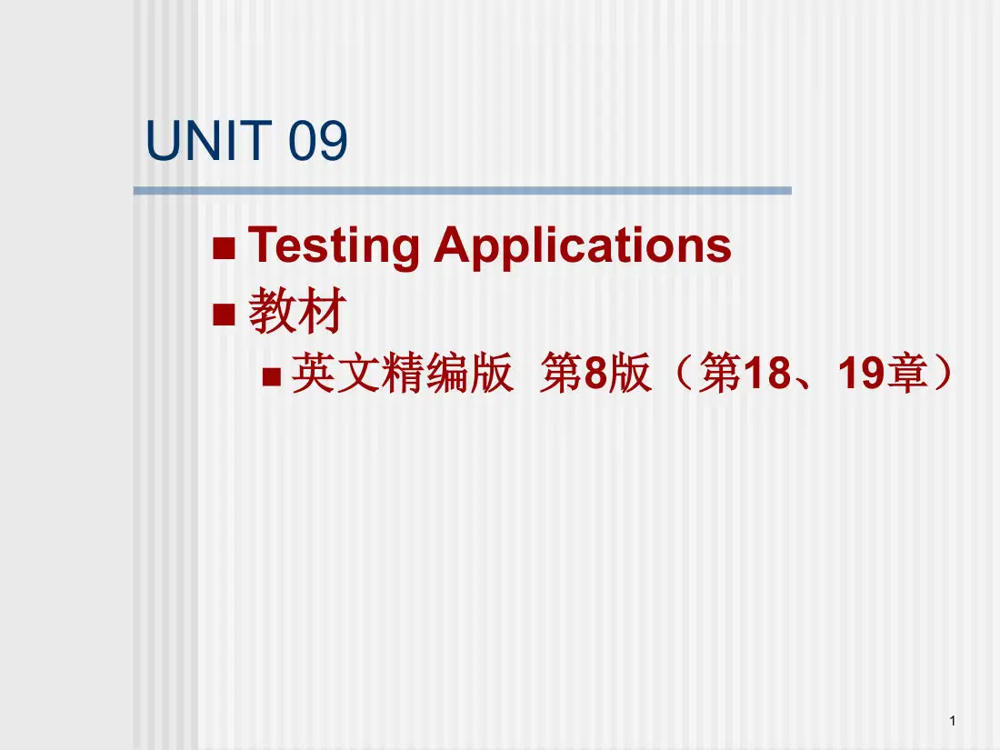

原文：

UNIT 09

◼ Testing Applications

教材

◼英文精编版 第8版（第18、19章）

1

### Contents & Requirements

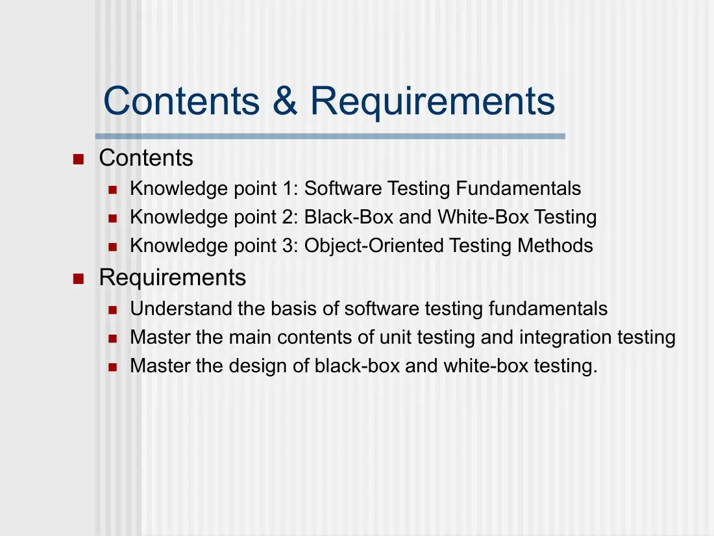

原文：

Contents & Requirements

◼ Contents

◼ Knowledge point 1: Software Testing Fundamentals

◼ Knowledge point 2: Black-Box and White-Box Testing

◼ Knowledge point 3: Object-Oriented Testing Methods

◼ Requirements

◼ Understand the basis of software testing fundamentals

◼ Master the main contents of unit testing and integration testing

◼ Master the design of black-box and white-box testing.

### The goal of testing

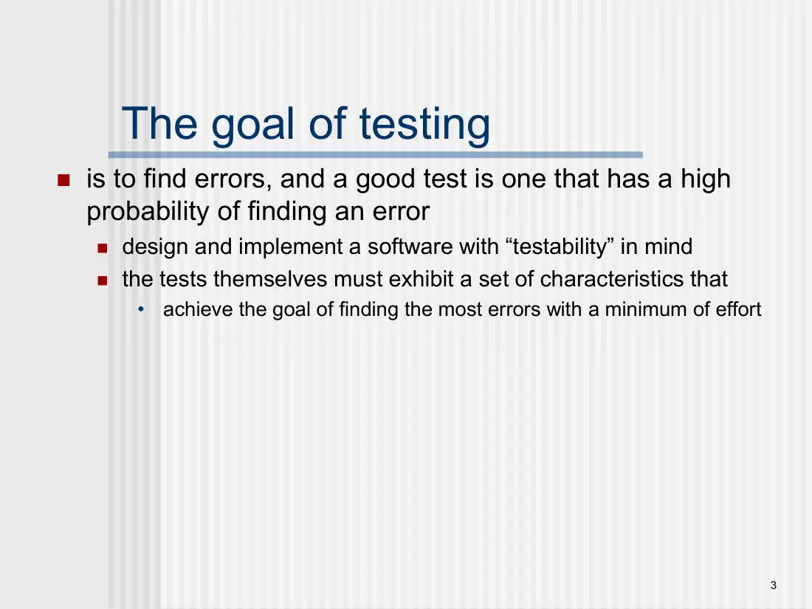

原文：

The goal of testing

◼ is to find errors, and a good test is one that has a high probability of finding an error

◼ design and implement a software with “testability” in mind

◼ the tests themselves must exhibit a set of characteristics that

• achieve the goal of finding the most errors with a minimum of effort

3

### Software testability

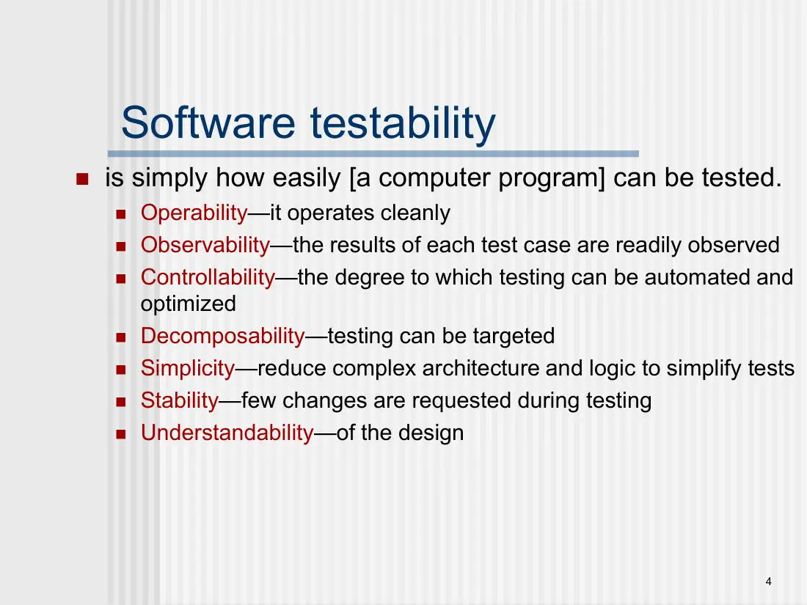

原文：

Software testability

◼ is simply how easily [a computer program] can be tested.

◼ Operability—it operates cleanly

◼ Observability—the results of each test case are readily observed

Controllability—the degree to which testing can be automated and optimized

◼ Decomposability—testing can be targeted

◼ Simplicity—reduce complex architecture and logic to simplify tests

◼ Stability—few changes are requested during testing

◼ Understandability—of the design

4

### Test Characteristics

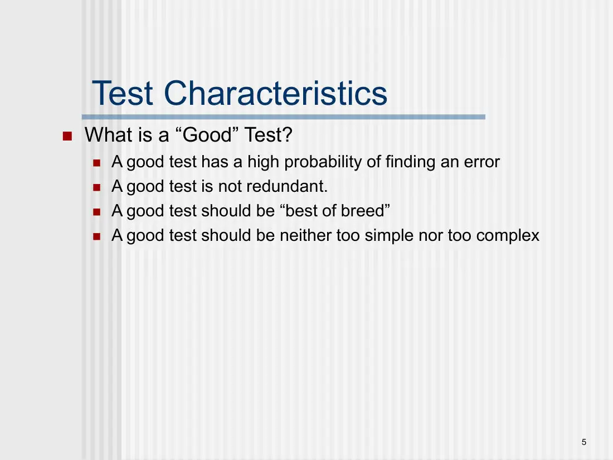

原文：

Test Characteristics

◼ What is a “Good” Test?

◼ A good test has a high probability of finding an error

◼ A good test is not redundant.

◼ A good test should be “best of breed”

◼ A good test should be neither too simple nor too complex

5

### Internal and External Views

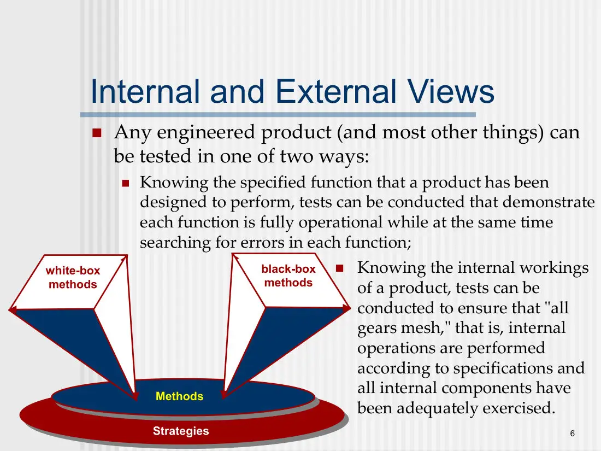

原文：

Internal and External Views

◼ Any engineered product (and most other things) can be tested in one of two ways:

Knowing the specified function that a product has been designed to perform, tests can be conducted that demonstrate each function is fully operational while at the same time searching for errors in each function;

Knowing the internal workings of a product, tests can be conducted to ensure that "all gears mesh," that is, internal operations are performed according to specifications and all internal components have been adequately exercised.

6

### Test Case Design

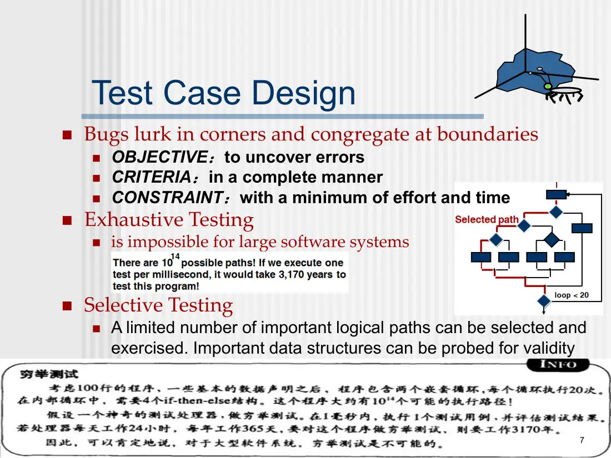

原文：

Test Case Design

Bugs lurk in corners and congregate at boundaries

◼ OBJECTIVE： to uncover errors

◼ CRITERIA： in a complete manner

◼ CONSTRAINT： with a minimum of effort and time

◼ Exhaustive Testing

◼ is impossible for large software systems

test per millisecond, it would take 3,170 years to test this program!

◼ Selective Testing

A limited number of important logical paths can be selected and exercised. Important data structures can be probed for validity

穷举测试

INFO

考虑100行的程序，一些基本的数据声明之后，程序包含两个嵌套循环，每个循环执行20次。在内部循环中，需要4个if-then-else结构。这个程序大约有1014个可能的执行路径！

假设一个神奇的测试处理器，做穷举测试。在1毫秒内，执行1个测试用例，并评估测试结果。若处理器每天工作24小时，每年工作365天，要对这个程序做穷举测试，则要工作3170年。

因此，可以肯定地说，对于大型软件系统，穷举测试是不可能的。

7

### White-Box Testing

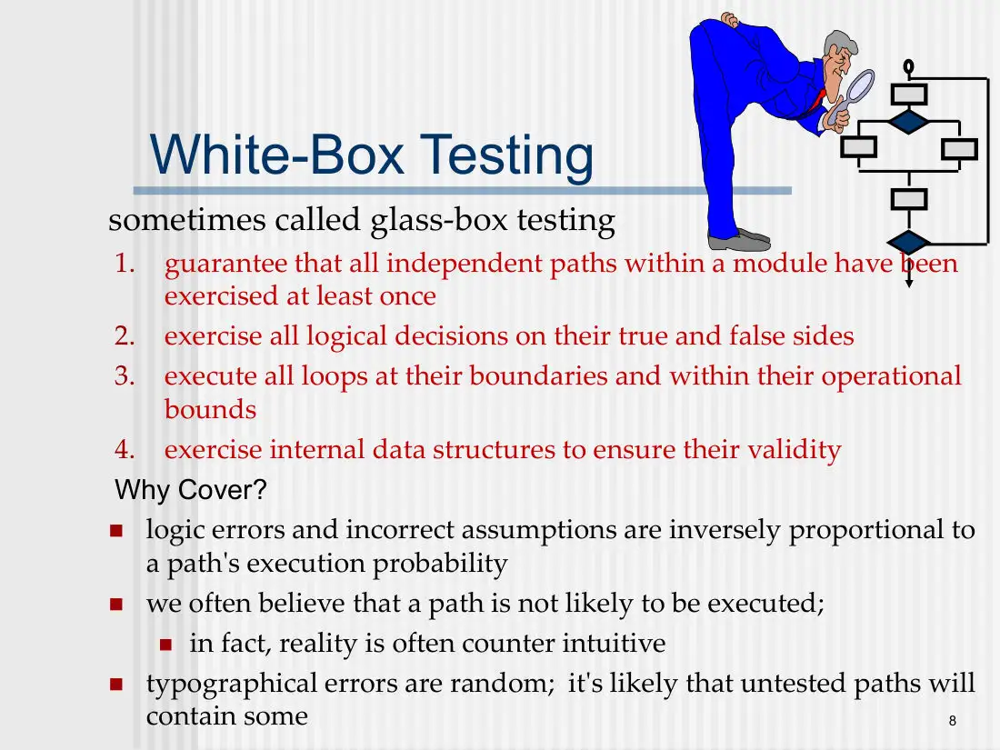

原文：

White-Box Testing

sometimes called glass-box testing

guarantee that all independent paths within a module have been exercised at least once

2. exercise all logical decisions on their true and false sides

3. execute all loops at their boundaries and within their operational bounds

4. exercise internal data structures to ensure their validity

Why Cover?

logic errors and incorrect assumptions are inversely proportional to a path's execution probability

◼ we often believe that a path is not likely to be executed;

◼ in fact, reality is often counter intuitive

◼ typographical errors are random; it's likely that untested paths will contain some 8

### Basis Path Testing

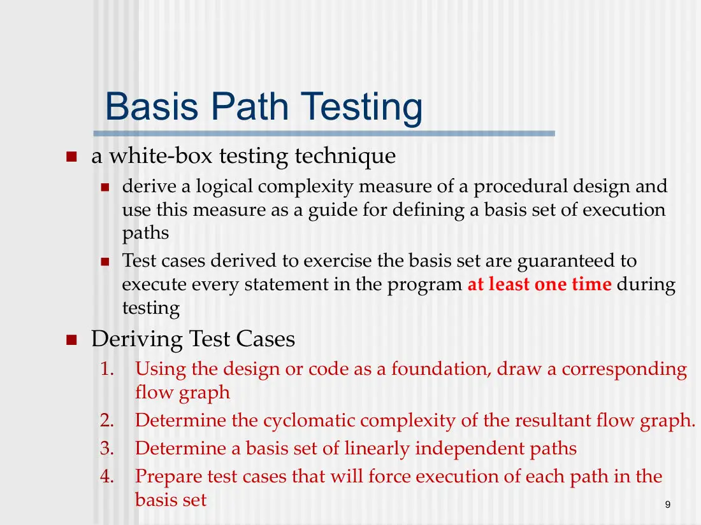

原文：

Basis Path Testing

◼ a white-box testing technique

derive a logical complexity measure of a procedural design and use this measure as a guide for defining a basis set of execution paths

Test cases derived to exercise the basis set are guaranteed to execute every statement in the program at least one time during testing

◼ Deriving Test Cases

1. Using the design or code as a foundation, draw a corresponding flow graph

2. Determine the cyclomatic complexity of the resultant flow graph.

3. Determine a basis set of linearly independent paths

4. Prepare test cases that will force execution of each path in the basis set

9

### 基本路径测试

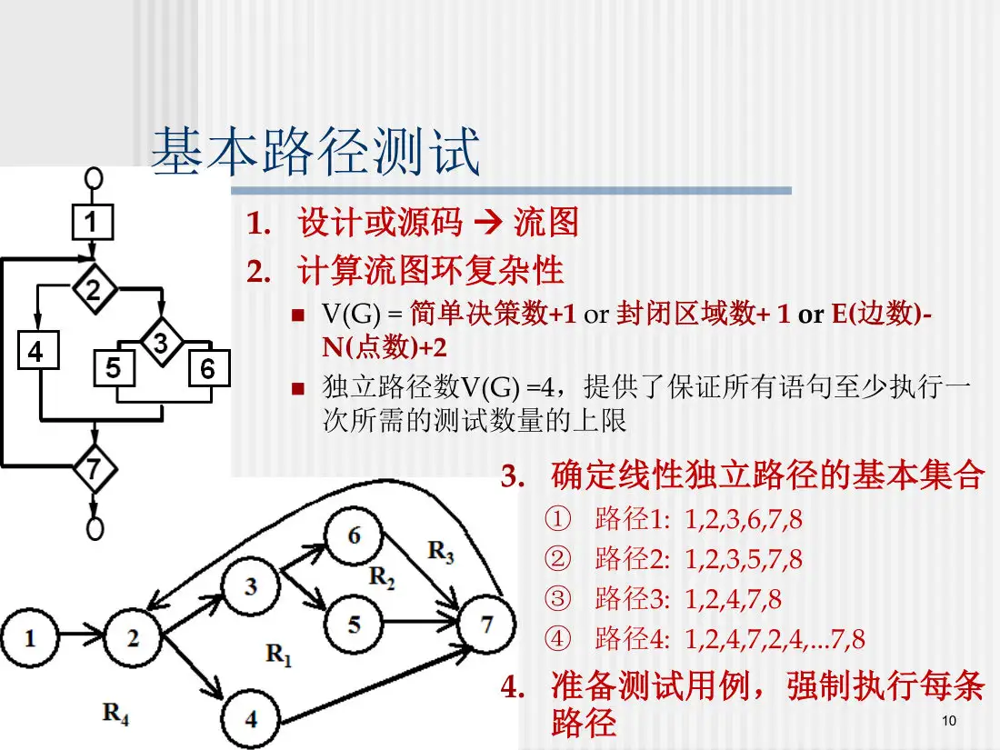

原文：

基本路径测试

1. 设计或源码 →流图

2. 计算流图环复杂性

V(G) = 简单决策数+1 or 封闭区域数+ 1 or E(边数)- N(点数)+2

独立路径数V(G) =4，提供了保证所有语句至少执行次所需的测试数量的上限

3. 确定线性独立路径的基本集合

① 路径1: 1,2,3,6,7,8

② 路径2: 1,2,3,5,7,8

③ 路径3: 1,2,4,7,8

④ 路径4: 1,2,4,7,2,4,...7,8

4. 准备测试用例，强制执行每条 路径 10

### 基本路径测试

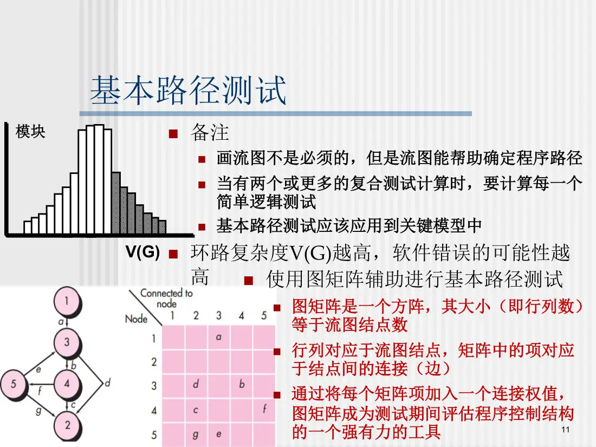

原文：

基本路径测试

◼ 画流图不是必须的，但是流图能帮助确定程序路径

当有两个或更多的复合测试计算时，要计算每一个简单逻辑测试

◼ 基本路径测试应该应用到关键模型中

◼ 环路复杂度V(G)越高，软件错误的可能性越V(G)使用图矩阵辅助进行基本路径测试

图矩阵是一个方阵，其大小（即行列数）等于流图结点数

行列对应于流图结点，矩阵中的项对应于结点间的连接（边）

通过将每个矩阵项加入一个连接权值，图矩阵成为测试期间评估程序控制结构的一个强有力的工具 11

### PROCEDURE average:

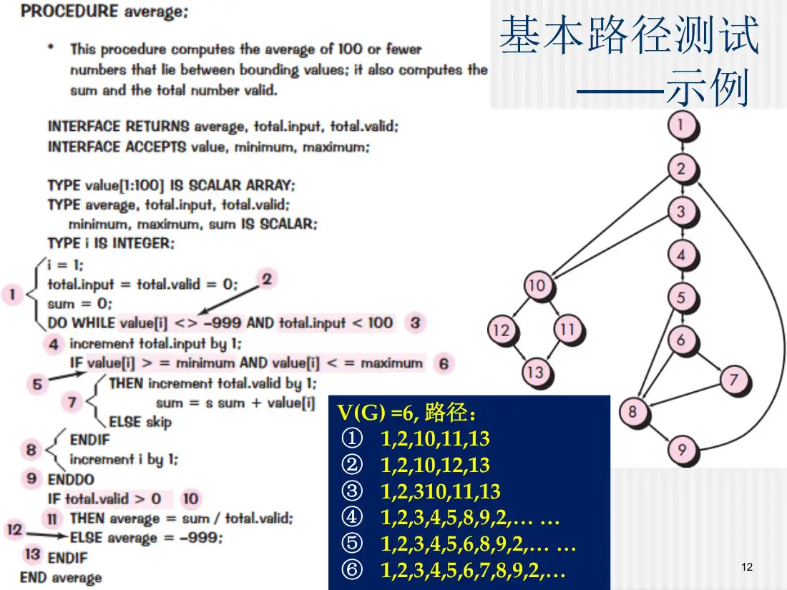

原文：

PROCEDURE average:

This procedure computes the average of 100 or fewer numbers that lie between bounding values; it also computes the sum and the total number valid.

INTERFACE RETURNS average, total.input, total.valid; INTERFACE ACCEPTS value, minimum, maximum;

基本路径测试示例

12

### Control Structure Testing

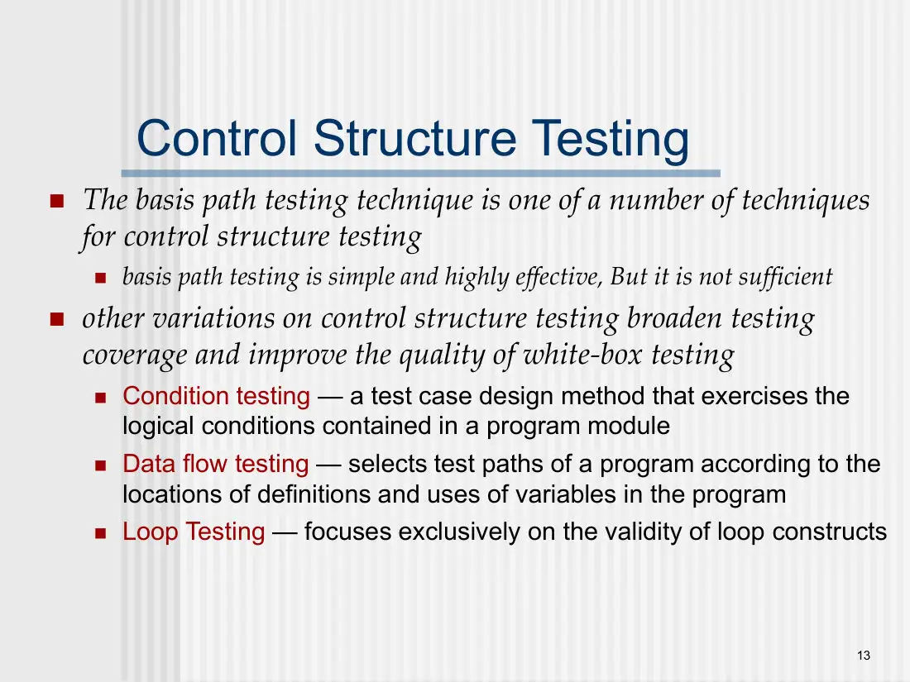

原文：

Control Structure Testing

◼ The basis path testing technique is one of a number of techniques for control structure testing

◼ basis path testing is simple and highly effective, But it is not sufficient

other variations on control structure testing broaden testing coverage and improve the quality of white-box testing

Condition testing — a test case design method that exercises the logical conditions contained in a program module

◼ Data flow testing — selects test paths of a program according to the locations of definitions and uses of variables in the program

◼ Loop Testing — focuses exclusively on the validity of loop constructs

13

### 控制结构测试— 循环测试

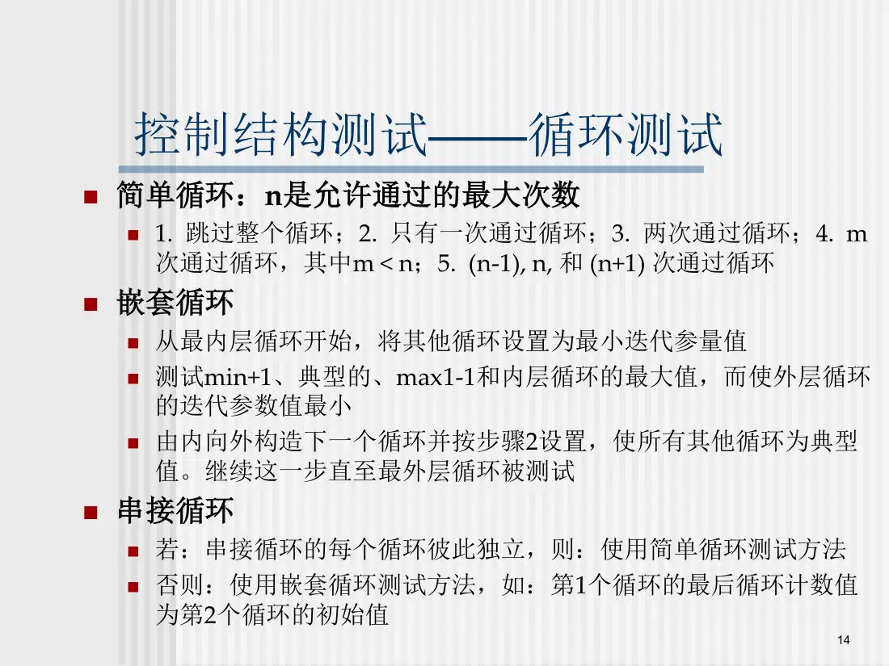

原文：

控制结构测试— 循环测试

◼ 简单循环：n是允许通过的最大次数

1. 跳过整个循环；2. 只有一次通过循环；3. 两次通过循环；4. m次通过循环，其中m < n；5. (n-1), n, 和 (n+1) 次通过循环

◼ 嵌套循环

◼ 从最内层循环开始，将其他循环设置为最小迭代参量值

测试min+1、典型的、max1-1和内层循环的最大值，而使外层循环的迭代参数值最小

由内向外构造下一个循环并按步骤2设置，使所有其他循环为典型值。继续这一步直至最外层循环被测试

◼ 串接循环

◼ 若：串接循环的每个循环彼此独立，则：使用简单循环测试方法

否则：使用嵌套循环测试方法，如：第1个循环的最后循环计数值为第2个循环的初始值

14

### 白盒测试— 综合示例

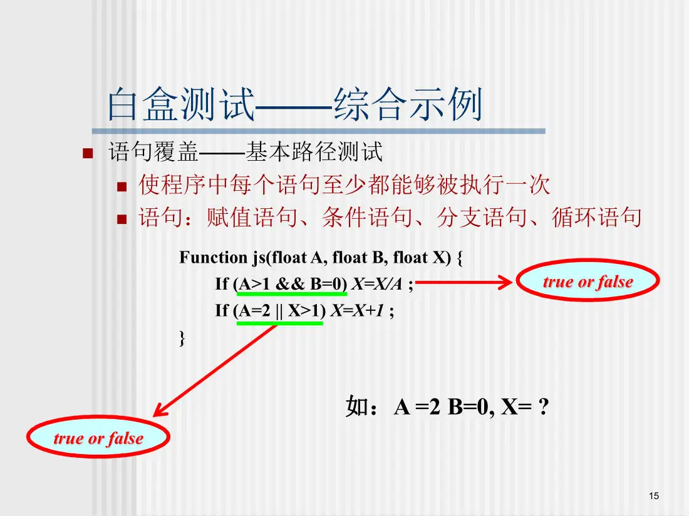

原文：

白盒测试— 综合示例

语句覆盖— 基本路径测试

◼ 使程序中每个语句至少都能够被执行一次

◼ 语句：赋值语句、条件语句、分支语句、循环语句

true or false

如：A =2 B=0, X=？

true or false

15

### 白盒测试— 综合示例

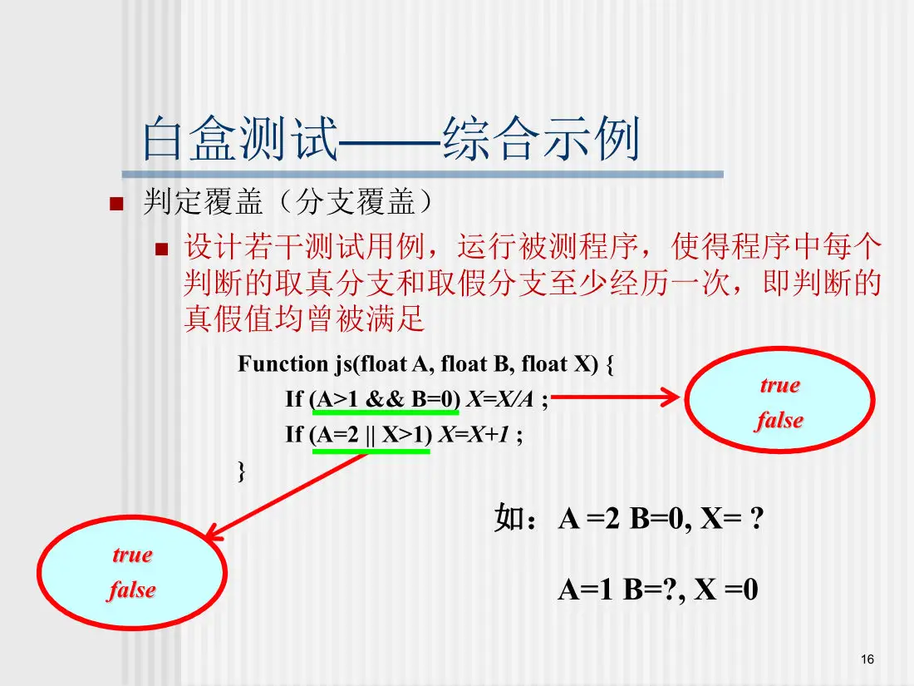

原文：

白盒测试— 综合示例

◼ 判定覆盖（分支覆盖）

设计若干测试用例，运行被测程序，使得程序中每个判断的取真分支和取假分支至少经历一次，即判断的真假值均曾被满足

Function js(float A, float B, float X) { If (A>1 && B=0) X=XA ; If (A=2∥ X>1) X=X+1 ;

true false

true false

如： $\mathbf { A } { = } 2 \ \mathbf { B } { = } \mathbf { 0 } , \mathbf { X } { = } ?$

$$
\mathbf {A} = 1 \mathbf {B} = ?, \mathbf {X} = \mathbf {0}
$$

16

### 白盒测试— 综合示例

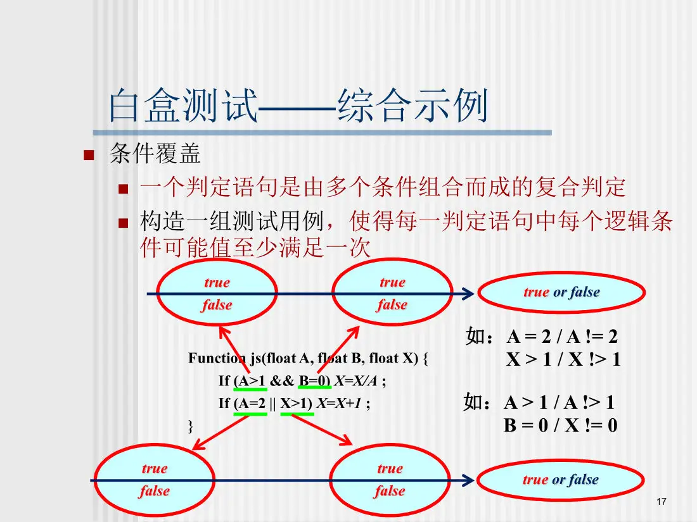

原文：

白盒测试— 综合示例

◼ 条件覆盖

一个判定语句是由多个条件组合而成的复合判定

构造一组测试用例，使得每一判定语句中每个逻辑条件可能值至少满足一次

如： $\mathbf { A } = 2 / \mathbf { A } : = 2$ X>1/X!>1

如： $\mathbf { A } > \mathbf { 1 } / \mathbf { A } ! > \mathbf { 1 }$ B=0/X!=0

true or false

17

### 白盒测试— 综合示例

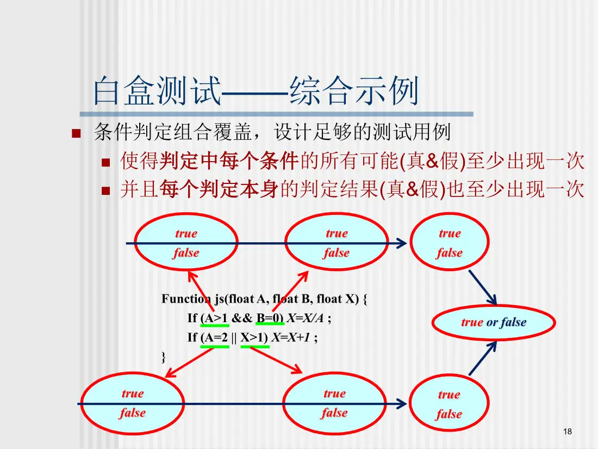

原文：

白盒测试— 综合示例

◼ 条件判定组合覆盖，设计足够的测试用例

◼ 使得判定中每个条件的所有可能(真&假)至少出现一次

◼ 并且每个判定本身的判定结果(真&假)也至少出现一次

18

### 白盒测试— 综合示例

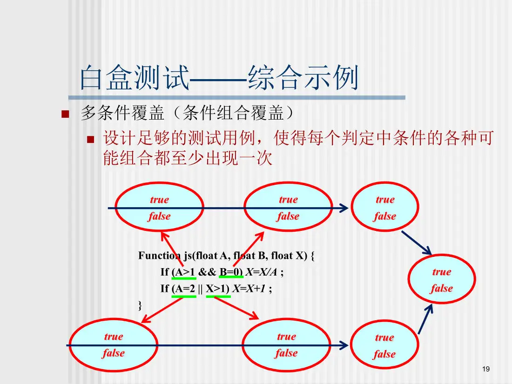

原文：

白盒测试— 综合示例

◼ 多条件覆盖（条件组合覆盖）

设计足够的测试用例，使得每个判定中条件的各种可能组合都至少出现一次

19

### Black-Box Testing behavioral testing

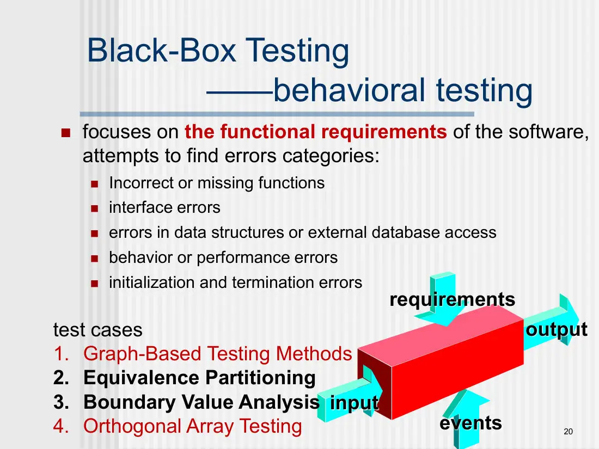

原文：

Black-Box Testing behavioral testing

◼ focuses on the functional requirements of the software, attempts to find errors categories:

◼ Incorrect or missing functions

◼ interface errors

◼ errors in data structures or external database access

◼ behavior or performance errors

◼ initialization and termination errors

test cases

1. Graph-Based Testing Methods

2. Equivalence Partitioning

input3. Boundary Value Analysis

4. Orthogonal Array Testing

requirements

20

### Black-Box Testing behavioral testing

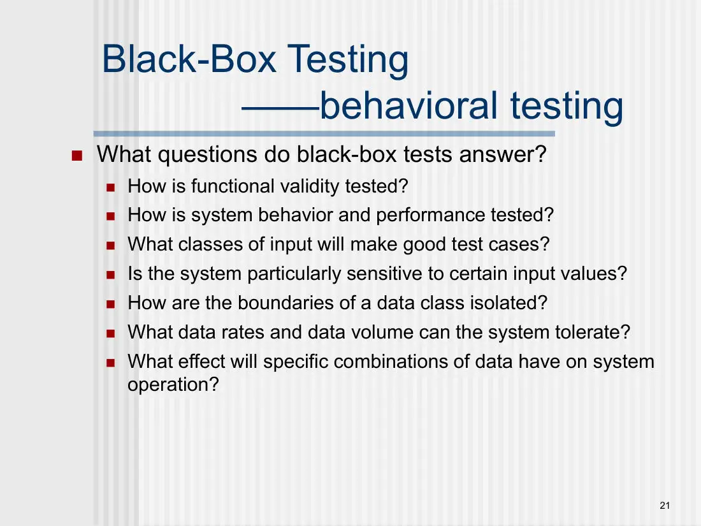

原文：

Black-Box Testing behavioral testing

◼ What questions do black-box tests answer?

◼ How is functional validity tested?

◼ How is system behavior and performance tested?

◼ What classes of input will make good test cases?

◼ Is the system particularly sensitive to certain input values?

◼ How are the boundaries of a data class isolated?

◼ What data rates and data volume can the system tolerate?

What effect will specific combinations of data have on system operation?

21

### 等价类划分

原文：

等价类划分

有效等价类— 是指对软件规格说明而言，是有意义的、合理的输入数据所组成的集合

检验程序是否实现了规格说明中预先规定的功能和性能

无效等价类— 是指对软件规格说明而言，是无意义的、不合理的输入数据所构成的集合

鉴别程序异常处理的情况，检查被测对象的功能和性能的实现是否有不符合规格说明要求的地方

◼ 等价类划分的指导原则：

1. 若输入条件指定一个范围，则可以定义1个有效和2个无效等价类

2. 若输入条件需要特定的值，则可以定义1个有效和2个无效等价类

3. 若输入条件指定集合的某个元素，则可以定义1个有效和1个无效等价类

4. 若输入条件为布尔值，则可以定义1个有效和1个无效等价类

24

### 边界值分析

原文：

边界值分析

◼ 对输入或输出的边界值进行测试的一种黑盒测试方法

通常作为对等价类划分法的补充，这种情况下，其测试用例来自等价类的边界

◼ 为什么使用边界值分析法？

无数的测试实践表明，大量的故障往往发生在输入定义域或输出值域的边界上，而不是在其内部。因此，针对各种边界情况设计测试用例，通常会取得很好的测试效果

◼ 示例：NextDate函数的边界值分析测试用例

在NextDate函数中，隐含规定了变量mouth和变量day的取值范围为1≤mouth≤12和1≤day≤31 ，并设定变量year的取值范围为 $1 9 1 2 { \leq } y { \in } { \mathsf { a r } } { \leq } 2 0 5 0$

26

### Model-Based Testing

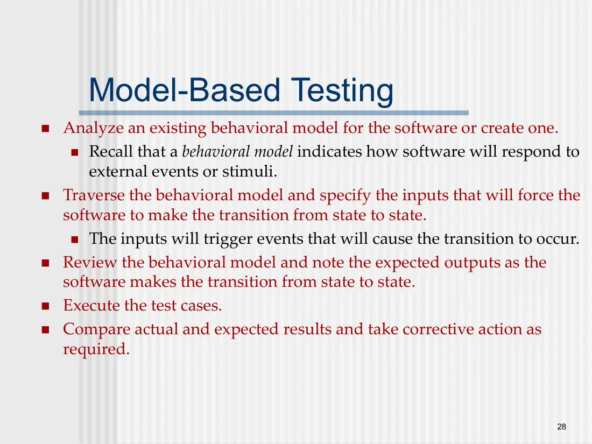

原文：

Model-Based Testing

Analyze an existing behavioral model for the software or create one.

Recall that a behavioral model indicates how software will respond to external events or stimuli.

Traverse the behavioral model and specify the inputs that will force the software to make the transition from state to state.

◼ The inputs will trigger events that will cause the transition to occur.

Review the behavioral model and note the expected outputs as the software makes the transition from state to state.

◼ Execute the test cases.

Compare actual and expected results and take corrective action as required.

28

### Software Testing Patterns

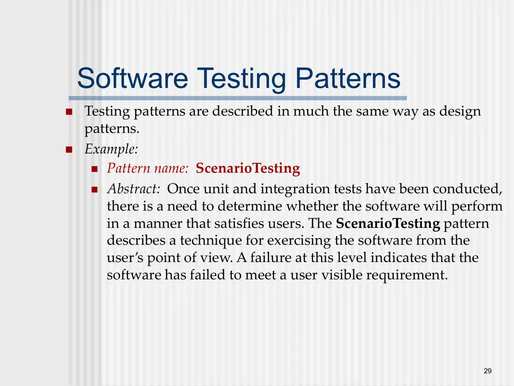

原文：

Software Testing Patterns

Testing patterns are described in much the same way as design patterns.

◼ Example:

Pattern name: ScenarioTesting

Abstract: Once unit and integration tests have been conducted, there is a need to determine whether the software will perform in a manner that satisfies users. The ScenarioTesting pattern describes a technique for exercising the software from the user’s point of view. A failure at this level indicates that the software has failed to meet a user visible requirement.

29

### OOT Methods

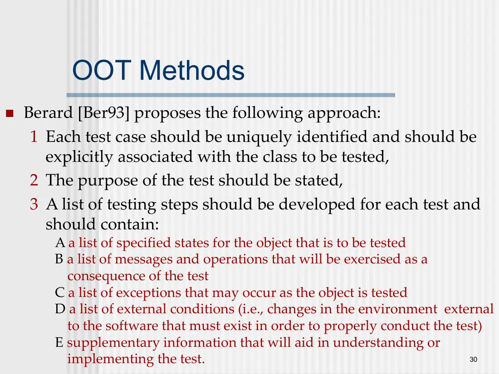

原文：

OOT Methods

◼ Berard [Ber93] proposes the following approach:

1 Each test case should be uniquely identified and should be explicitly associated with the class to be tested,

2 The purpose of the test should be stated,

3 A list of testing steps should be developed for each test and should contain:

A a list of specified states for the object that is to be tested

B a list of messages and operations that will be exercised as a consequence of the test

C a list of exceptions that may occur as the object is tested

D a list of external conditions (i.e., changes in the environment external to the software that must exist in order to properly conduct the test)

E supplementary information that will aid in understanding or implementing the test.

30

### Testing Methods

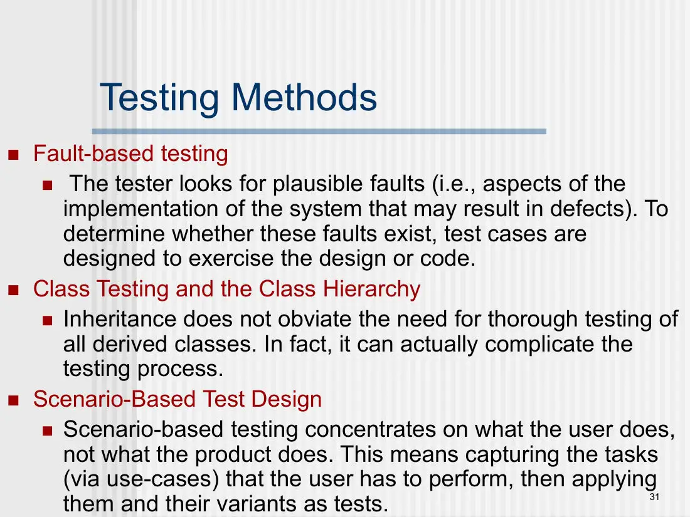

原文：

Testing Methods

◼ Fault-based testing

The tester looks for plausible faults (i.e., aspects of the implementation of the system that may result in defects). To determine whether these faults exist, test cases are designed to exercise the design or code.

◼ Class Testing and the Class Hierarchy

Inheritance does not obviate the need for thorough testing of all derived classes. In fact, it can actually complicate the testing process.

◼ Scenario-Based Test Design

Scenario-based testing concentrates on what the user does, not what the product does. This means capturing the tasks (via use-cases) that the user has to perform, then applying them and their variants as tests. 31

### OOT Methods: Random Testing

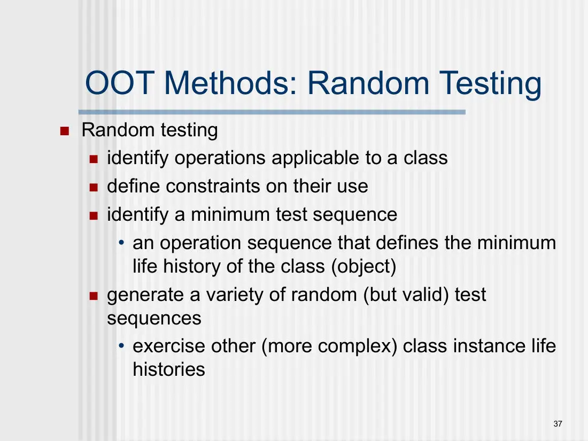

原文：

OOT Methods: Random Testing

◼ Random testing

◼ identify operations applicable to a class

◼ define constraints on their use

◼ identify a minimum test sequence

• an operation sequence that defines the minimum life history of the class (object)

generate a variety of random (but valid) test sequences

exercise other (more complex) class instance life histories

37

### OOT Methods: Partition Testing

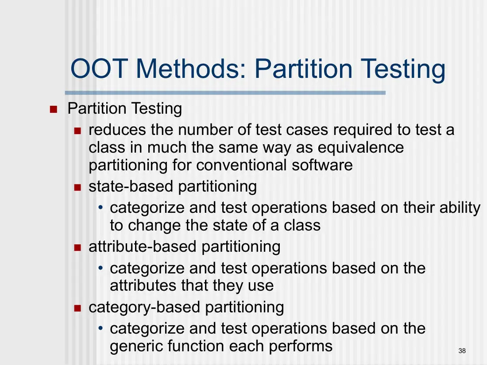

原文：

OOT Methods: Partition Testing

◼ Partition Testing

reduces the number of test cases required to test a class in much the same way as equivalence partitioning for conventional software

◼ state-based partitioning

• categorize and test operations based on their ability to change the state of a class

◼ attribute-based partitioning

categorize and test operations based on the attributes that they use

◼ category-based partitioning

categorize and test operations based on the generic function each performs

38

### OOT Methods: Inter-Class Testing

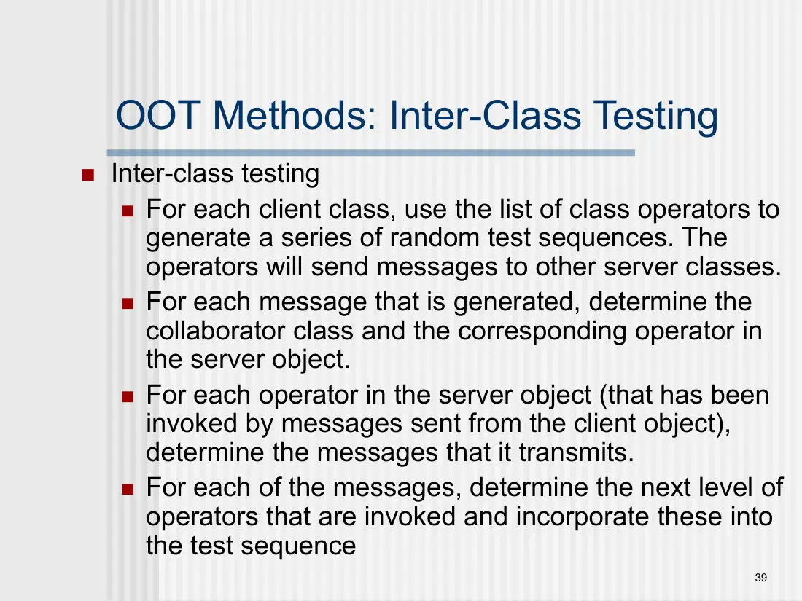

原文：

OOT Methods: Inter-Class Testing

◼ Inter-class testing

◼ For each client class, use the list of class operators to generate a series of random test sequences. The operators will send messages to other server classes.

◼ For each message that is generated, determine the collaborator class and the corresponding operator in the server object.

◼ For each operator in the server object (that has been invoked by messages sent from the client object), determine the messages that it transmits.

◼ For each of the messages, determine the next level of operators that are invoked and incorporate these into the test sequence

39

### OOT Methods: Behavior Testing

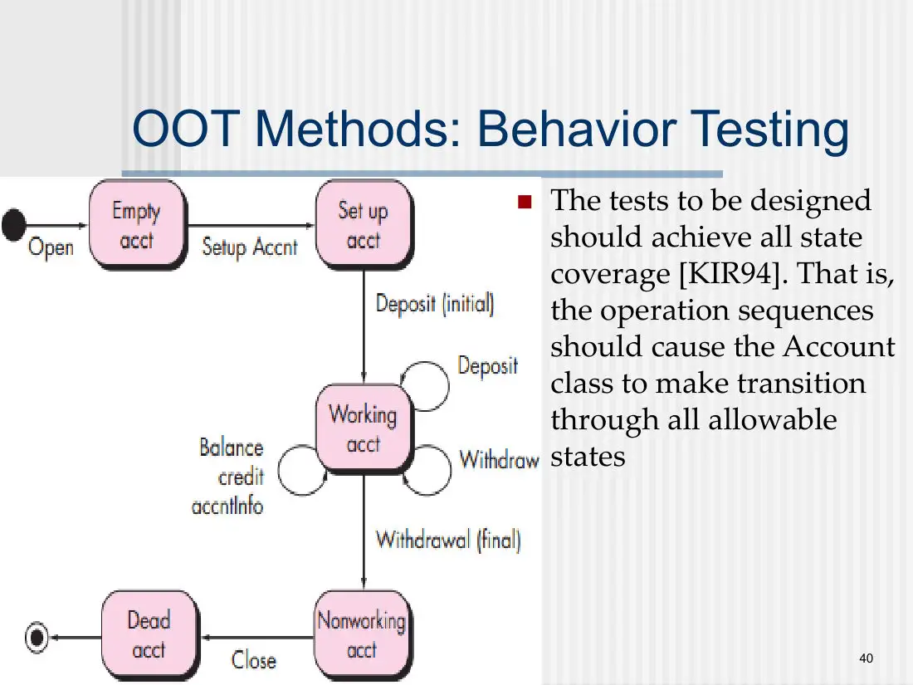

原文：

OOT Methods: Behavior Testing

The tests to be designed should achieve all state coverage [KIR94]. That is, the operation sequences should cause the Account class to make transition through all allowable states

40
