# 《软件工程（双语）》第9章 项目管理与进度计划（课件）

原件的每一页，下面附识别出的文字。

### UNIT 9

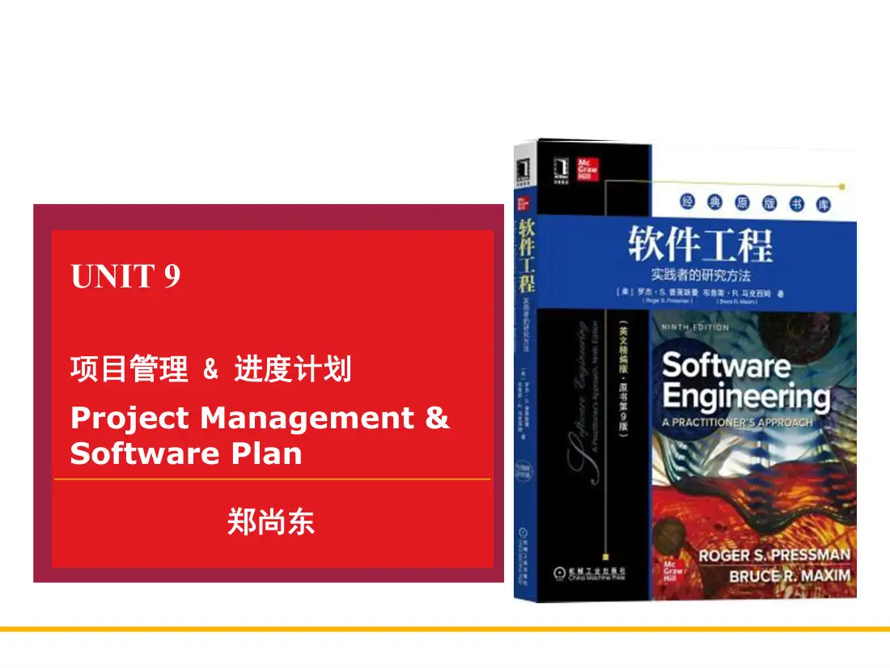

原文：

UNIT 9

项目管理 & 进度计划Project Management &Software Plan

郑尚东

软件工程

实践者的研究方法

Software Engineering PRACTITIONER'S APPROACH

工具质热

### Management Spectrum: Four P’s

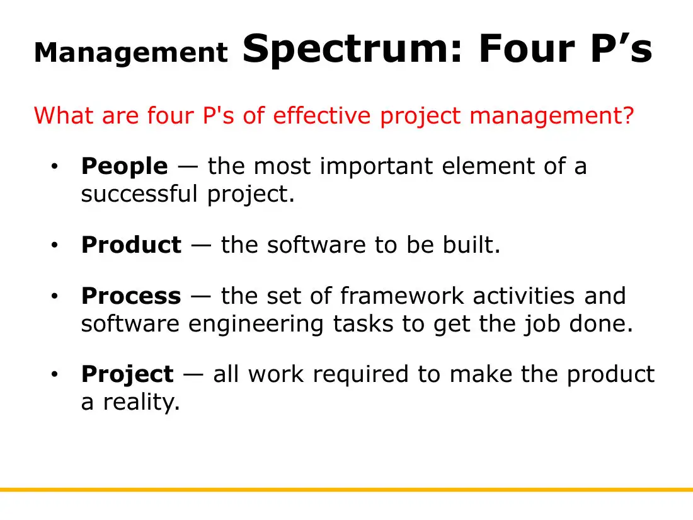

原文：

Management Spectrum: Four P’s

What are four P's of effective project management?

• People — the most important element of a successful project.

• Product — the software to be built.

Process — the set of framework activities and software engineering tasks to get the job done.

• Project — all work required to make the product a reality.

### Symptom & reason for project failure

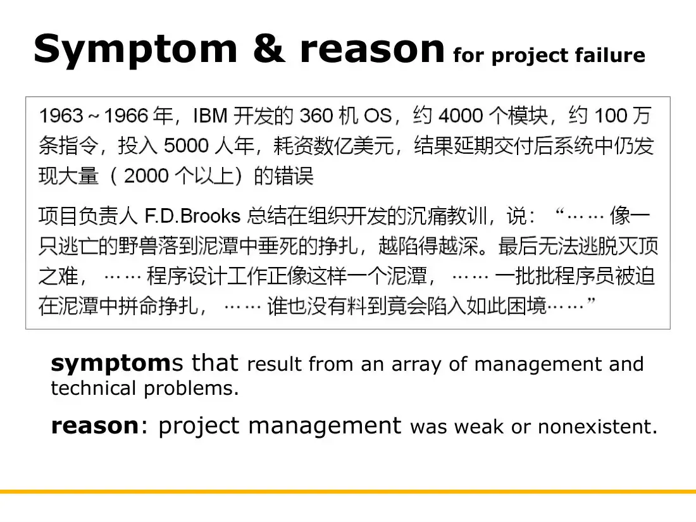

原文：

Symptom & reason for project failure

1963\~1966年，IBM开发的360机OS，约 4000 个模块，约100万条指令，投入5000人年，耗资数亿美元，结果延期交付后系统中仍发现大量（2000个以上）的错误

项目负责人F.D.Brooks 总结在组织开发的沉痛教训，说：“……像一只逃亡的野兽落到泥潭中垂死的挣扎，越陷得越深。最后无法逃脱灭顶之难，……程序设计工作正像这样一个泥潭，……一批批程序员被迫在泥潭中拼命挣扎，……谁也没有料到竟会陷入如此困境……”

symptoms that result from an array of management and technical problems.

reason: project management was weak or nonexistent.

### think deeply

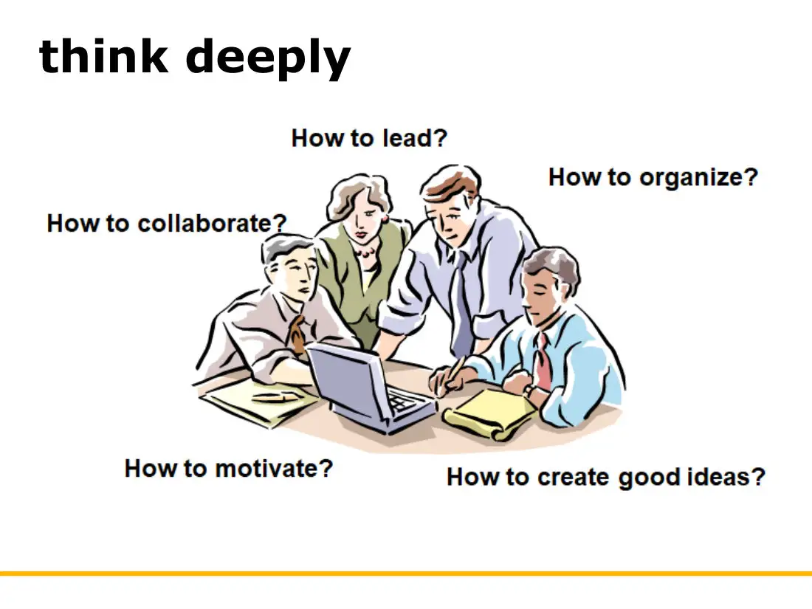

原文：

think deeply

aracteristics of

How to organize?

How to collaborate?

### People

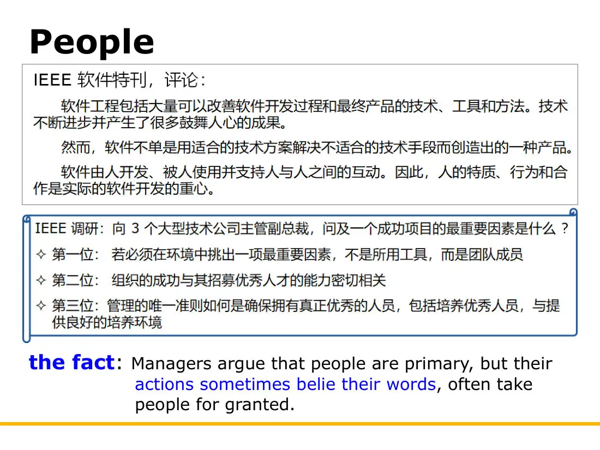

原文：

People

IEEE软件特刊，评论：

软件工程包括大量可以改善软件开发过程和最终产品的技术、工具和方法。技术不断进步并产生了很多鼓舞人心的成果。

然而，软件不单是用适合的技术方案解决不适合的技术手段而创造出的一种产品。

软件由人开发、被人使用并支持人与人之间的互动。因此，人的特质、行为和合作是实际的软件开发的重心。

IEEE调研：向3个大型技术公司主管副总裁，问及一个成功项目的最重要因素是什么？

第一位：若必须在环境中挑出一项最重要因素，不是所用工具，而是团队成员

第二位：组织的成功与其招募优秀人才的能力密切相关

第三位：管理的唯一准则如何是确保拥有真正优秀的人员，包括培养优秀人员，与提供良好的培养环境

the fact: Managers argue that people are primary, but their actions sometimes belie their words, often take people for granted.

### The Stakeholders

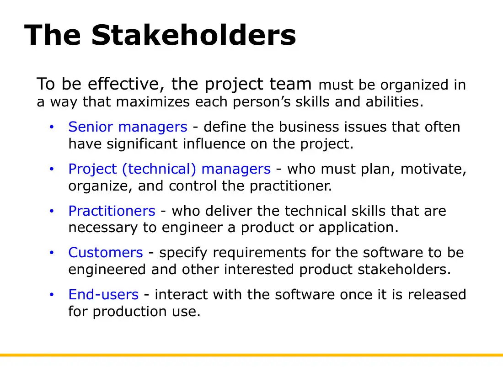

原文：

The Stakeholders

To be effective, the project team must be organized in a way that maximizes each person’s skills and abilities.

Senior managers - define the business issues that often have significant influence on the project.

Project (technical) managers - who must plan, motivate, organize, and control the practitioner.

Practitioners - who deliver the technical skills that are necessary to engineer a product or application.

Customers - specify requirements for the software to be engineered and other interested product stakeholders.

End-users - interact with the software once it is released for production use.

### Traits of Successful Software Engineers

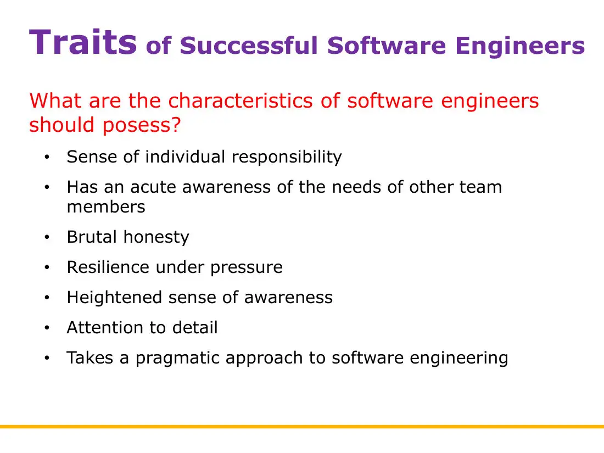

原文：

Traits of Successful Software Engineers

What are the characteristics of software engineers should posess?

• Sense of individual responsibility

• Has an acute awareness of the needs of other team members

• Brutal honesty

• Resilience under pressure

• Heightened sense of awareness

• Attention to detail

• Takes a pragmatic approach to software engineering

### Behavior Model for SE

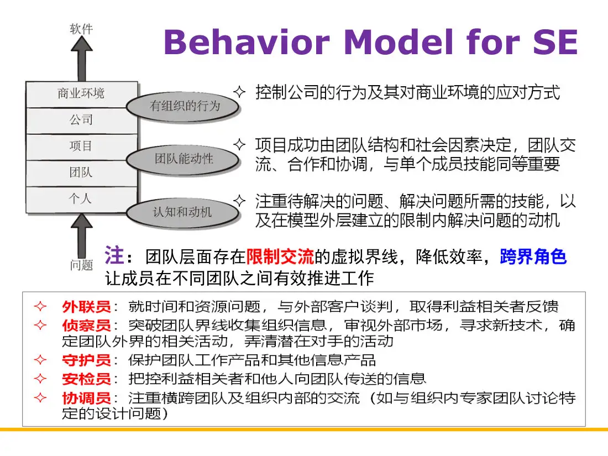

原文：

Behavior Model for SE

商业环境

有组织的行为

团队

团队能动性

认知和动机↑问题

控制公司的行为及其对商业环境的应对方式

项目成功由团队结构和社会因素决定，团队交流、合作和协调，与单个成员技能同等重要

注重待解决的问题、解决问题所需的技能，以及在模型外层建立的限制内解决问题的动机

注：团队层面存在限制交流的虚拟界线，降低效率，跨界角色让成员在不同团队之间有效推进工作

外联员：就时间和资源问题，与外部客户谈判，取得利益相关者反馈

人 侦察员：突破团队界线收集组织信息，审视外部市场，寻求新技术，确定团队外界的相关活动，弄清潜在对手的活动

守护员：保护团队工作产品和其他信息产品

人 安检员：把控利益相关者和他人向团队传送的信息

协调员：注重横跨团队及组织内部的交流（如与组织内专家团队讨论特定的设计问题)

### Team Leaders

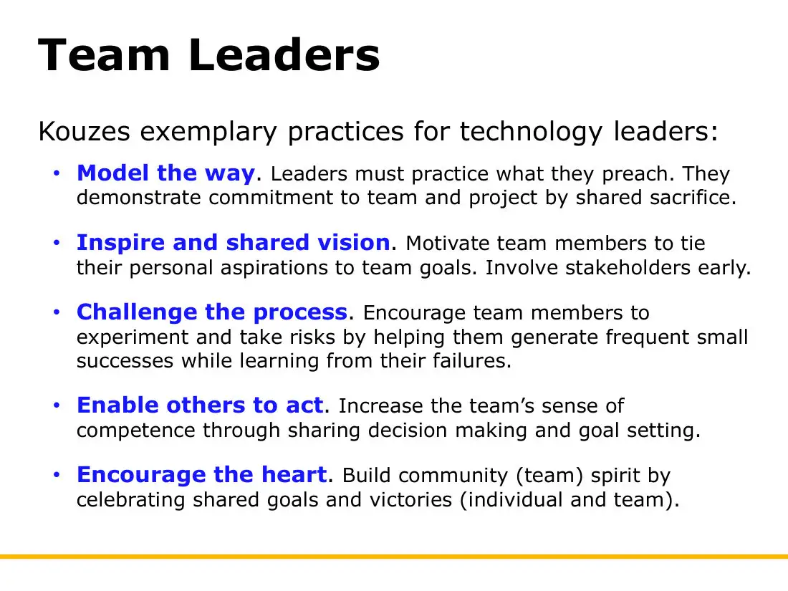

原文：

Team Leaders

Kouzes exemplary practices for technology leaders:

Model the way. Leaders must practice what they preach. They demonstrate commitment to team and project by shared sacrifice.

• Inspire and shared vision. Motivate team members to tie their personal aspirations to team goals. Involve stakeholders early.

Challenge the process. Encourage team members to experiment and take risks by helping them generate frequent small successes while learning from their failures.

Enable others to act. Increase the team’s sense of competence through sharing decision making and goal setting.

Encourage the heart. Build community (team) spirit by celebrating shared goals and victories (individual and team).

### 团队凝聚力

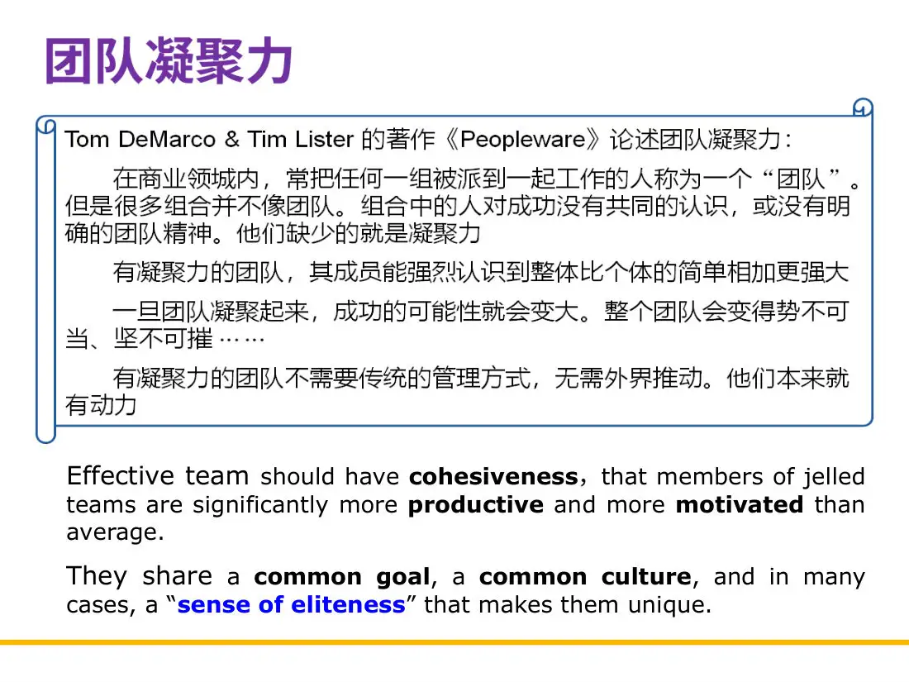

原文：

团队凝聚力

Tom DeMarco & Tim Lister的著作《Peopleware》论述团队凝聚力:

在商业领城内，常把任何一组被派到一起工作的人称为一个“团队”。但是很多组合并不像团队。组合中的人对成功没有共同的认识，或没有明确的团队精神。他们缺少的就是凝聚力

有凝聚力的团队，其成员能强烈认识到整体比个体的简单相加更强大

一旦团队凝聚起来，成功的可能性就会变大。整个团队会变得势不可当、坚不可摧……

有凝聚力的团队不需要传统的管理方式，无需外界推动。他们本来就有动力

Effective team should have cohesiveness，that members of jelled teams are significantly more productive and more motivated than average.

They share a common goal, a common culture, and in many cases, a “sense of eliteness” that makes them unique.

### Effective Team Attributes

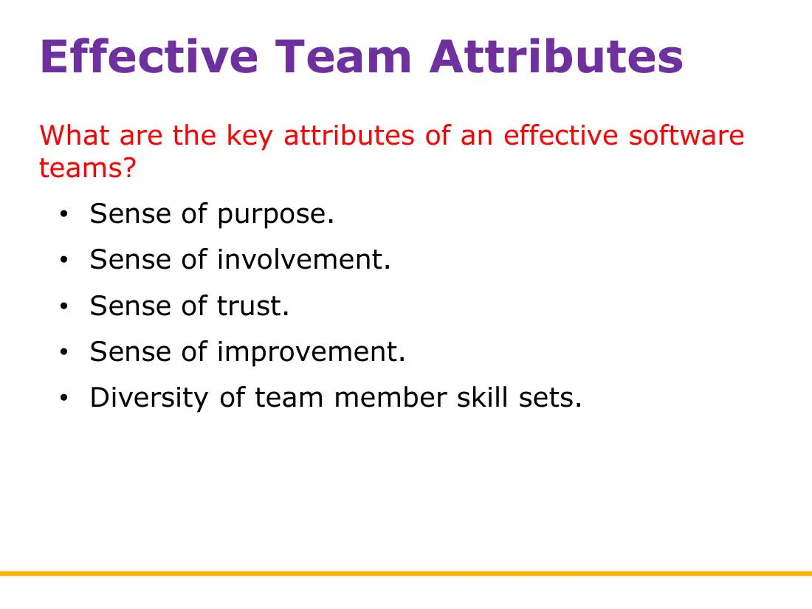

原文：

Effective Team Attributes

What are the key attributes of an effective software teams?

• Sense of purpose.

• Sense of involvement.

• Sense of trust.

• Sense of improvement.

• Diversity of team member skill sets.

### Symptoms of Team Toxicity

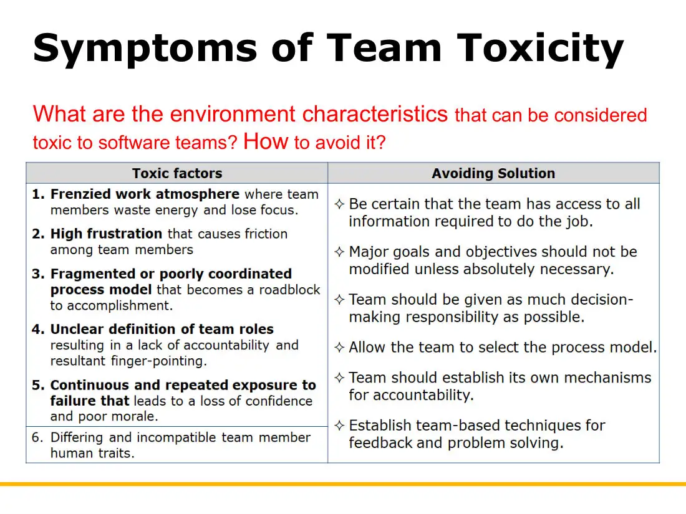

原文：

Symptoms of Team Toxicity

What are the environment characteristics that can be considered toxic to software teams? How to avoid it?

<table><tr><td>Toxic factors</td><td>Avoiding Solution</td></tr><tr><td>1. Frenzied work atmosphere where team members waste energy and lose focus.2. High frustration that causes friction among team members3. Fragmented or poorly coordinated process model that becomes a roadblock to accomplishment.4. Unclear definition of team roles resulting in a lack of accountability and resultant finger-pointing.5. Continuous and repeated exposure to failure that leads to a loss of confidence and poor morale.6. Differing and incompatible team member human traits.</td><td>✧ Be certain that the team has access to all information required to do the job.✧ Major goals and objectives should not be modified unless absolutely necessary.✧ Team should be given as much decision-making responsibility as possible.✧ Allow the team to select the process model.✧ Team should establish its own mechanisms for accountability.✧ Establish team-based techniques for feedback and problem solving.</td></tr></table>

### Team Structure of Project

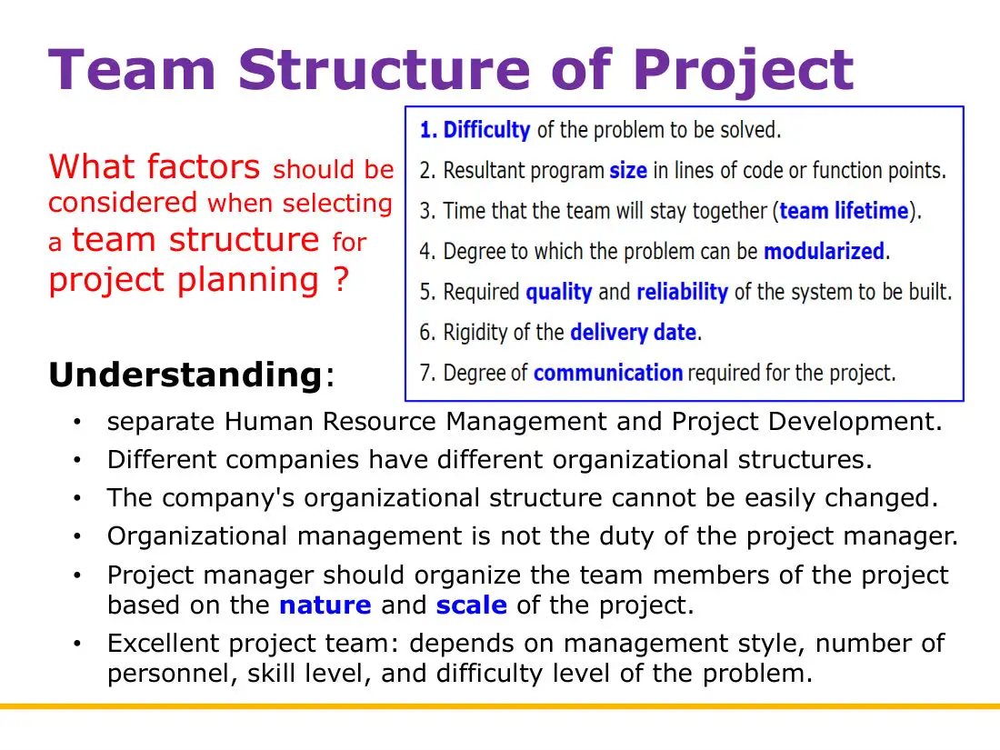

原文：

Team Structure of Project

What factors should be considered when selecting a team structure for project planning ?

1. Difficulty of the problem to be solved.

2. Resultant program size in lines of code or function points.

3. Time that the team will stay together (team lifetime)

4. Degree to which the problem can be modularized.

5. Required quality and reliability of the system to be built.

6. Rigidity of the delivery date.

Understanding:

7. Degree of communication required for the project.

• separate Human Resource Management and Project Development.

• Different companies have different organizational structures.

• The company's organizational structure cannot be easily changed.

• Organizational management is not the duty of the project manager.

• Project manager should organize the team members of the project based on the nature and scale of the project.

• Excellent project team: depends on management style, number of personnel, skill level, and difficulty level of the problem.

### Agile Team

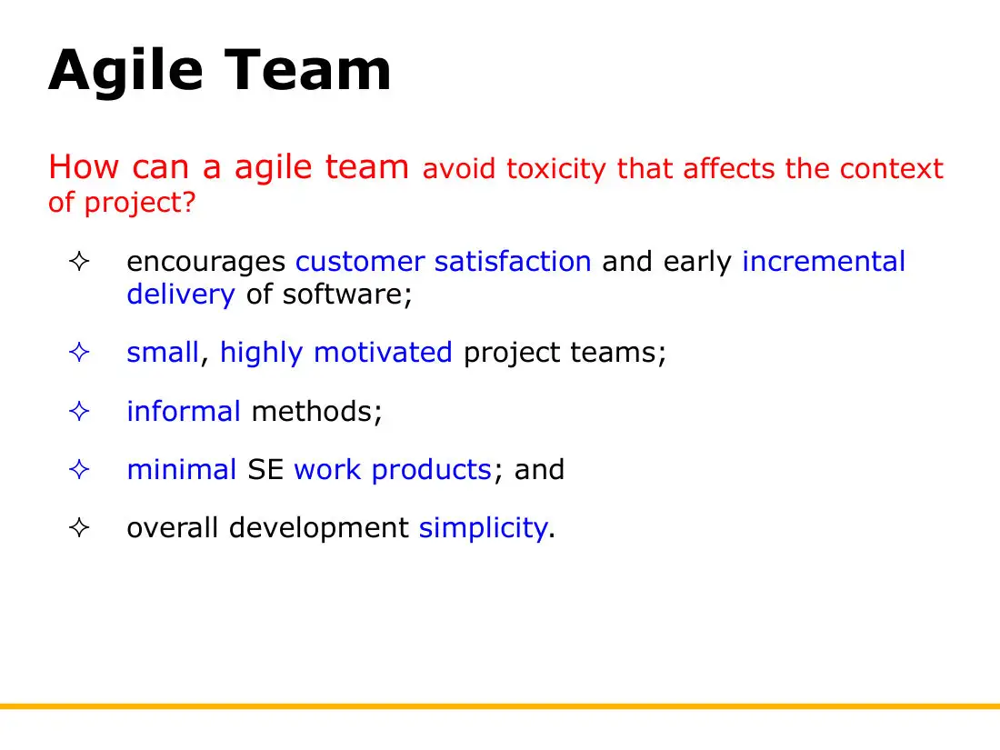

原文：

Agile Team

How can a agile team avoid toxicity that affects the context of project?

 encourages customer satisfaction and early incremental delivery of software;

 small, highly motivated project teams;

 informal methods;

 minimal SE work products; and

 overall development simplicity.

### Agile Team

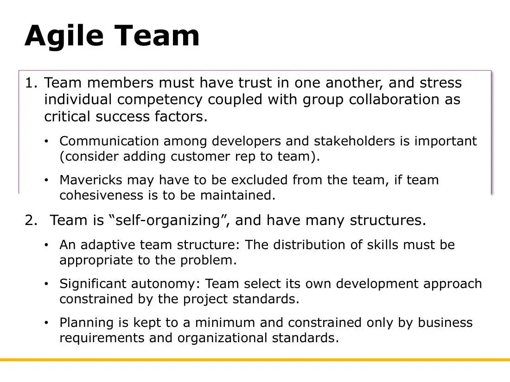

原文：

Agile Team

1. Team members must have trust in one another, and stress individual competency coupled with group collaboration as critical success factors.

• Communication among developers and stakeholders is important (consider adding customer rep to team).

• Mavericks may have to be excluded from the team, if team cohesiveness is to be maintained.

How to understand it ? 2. Team is “self-organizing”, and have many structures.

• An adaptive team structure: The distribution of skills must be appropriate to the problem.

• Significant autonomy: Team select its own development approach constrained by the project standards.

• Planning is kept to a minimum and constrained only by business requirements and organizational standards.

### Coordination & Communication

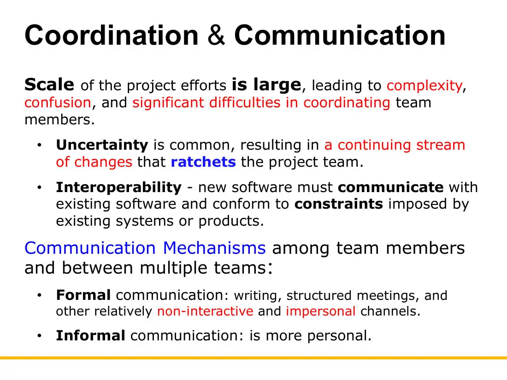

原文：

Coordination & Communication

Scale of the project efforts is large, leading to complexity, confusion, and significant difficulties in coordinating team members.

Uncertainty is common, resulting in a continuing stream of changes that ratchets the project team.

Interoperability - new software must communicate with existing software and conform to constraints imposed by existing systems or products.

Communication Mechanisms among team members and between multiple teams：

Formal communication: writing, structured meetings, and other relatively non-interactive and impersonal channels.

• Informal communication: is more personal.

### Impact of Social Media

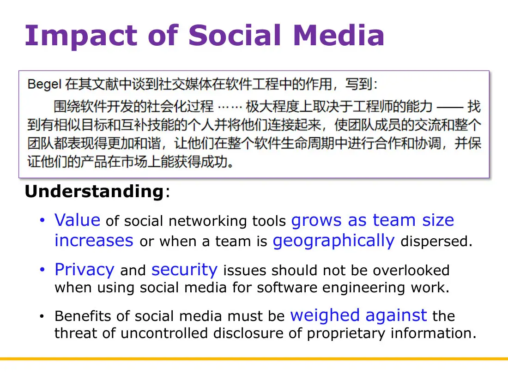

原文：

Impact of Social Media

Begel在其文献中谈到社交媒体在软件工程中的作用，写到：

围绕软件开发的社会化过程……极大程度上取决于工程师的能力找到有相似目标和互补技能的个人并将他们连接起来，使团队成员的交流和整个团队都表现得更加和谐，让他们在整个软件生命周期中进行合作和协调，并保证他们的产品在市场上能获得成功。

Understanding:

• Value of social networking tools grows as team size increases or when a team is geographically dispersed.

Privacy and security issues should not be overlooked when using social media for software engineering work.

• Benefits of social media must be weighed against the threat of uncontrolled disclosure of proprietary information.

### Global Teams

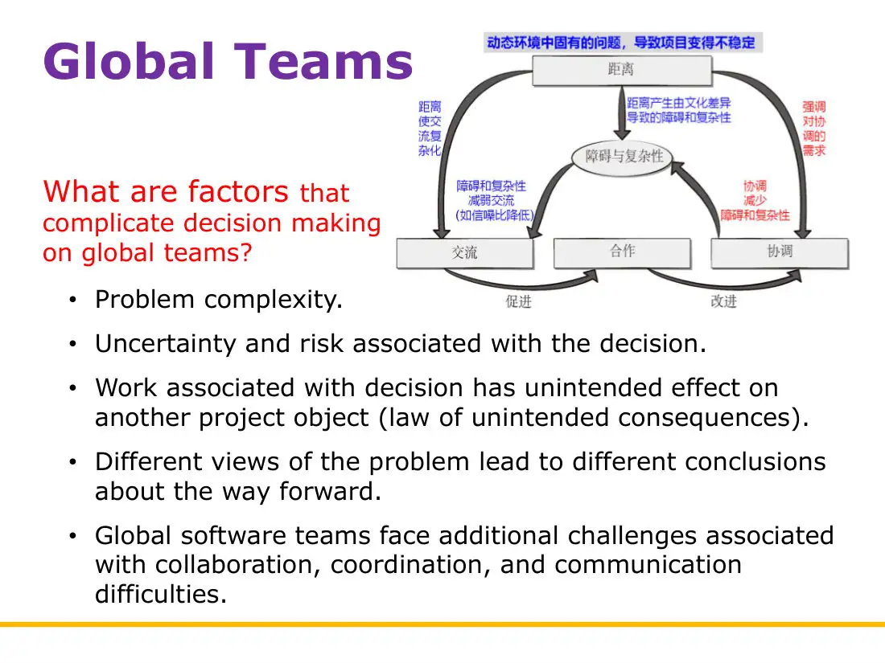

原文：

Global Teams

What are factors that complicate decision making on global teams?

• Problem complexity.

• Uncertainty and risk associated with the decision.

• Work associated with decision has unintended effect on another project object (law of unintended consequences).

• Different views of the problem lead to different conclusions about the way forward.

• Global software teams face additional challenges associated with collaboration, coordination, and communication difficulties.

### Product & Process & Project

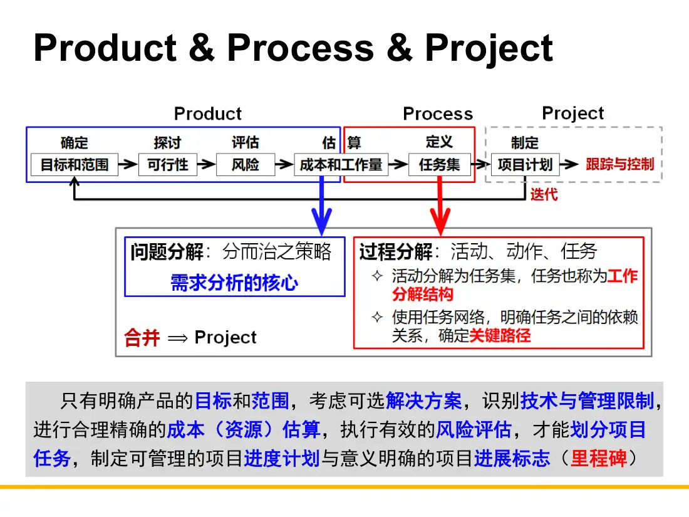

原文：

Product & Process & Project

只有明确产品的目标和范围，考虑可选解决方案，识别技术与管理限制，进行合理精确的成本（资源）估算，执行有效的风险评估，才能划分项目任务，制定可管理的项目进度计划与意义明确的项目进展标志（里程碑）

### Project Planning Task Set

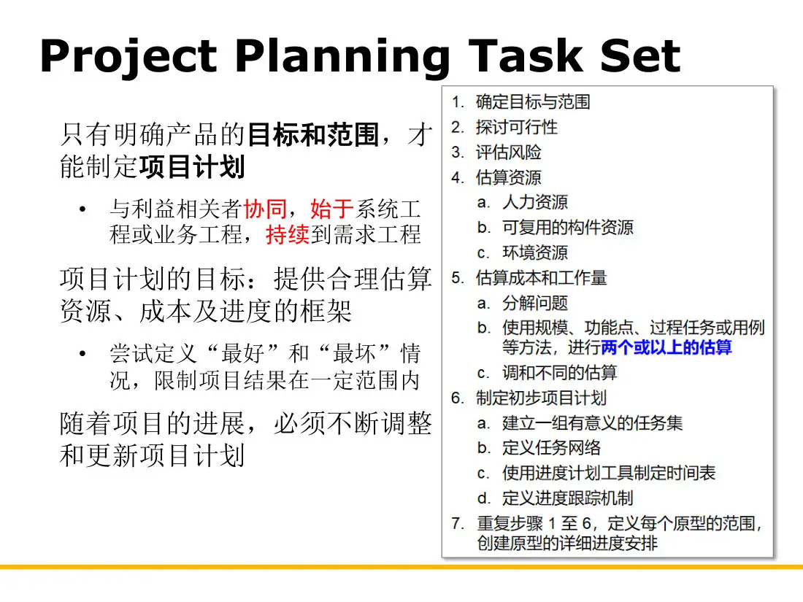

原文：

Project Planning Task Set

只有明确产品的目标和范围，才能制定项目计划

• 与利益相关者协同，始于系统工程或业务工程，持续到需求工程

项目计划的目标：提供合理估算资源、成本及进度的框架

• 尝试定义“最好”和“最坏”情况，限制项目结果在一定范围内随着项目的进展，必须不断调整和更新项目计划

1. 确定目标与范围2. 探讨可行性3. 评估风险4. 估算资源a. 人力资源b. 可复用的构件资源C. 环境资源

5. 估算成本和工作量a. 分解问题b. 使用规模、功能点、过程任务或用例等方法，进行两个或以上的估算

c. 调和不同的估算

6. 制定初步项目计划a. 建立一组有意义的任务集b. 定义任务网络c. 使用进度计划工具制定时间表d. 定义进度跟踪机制

7. 重复步骤1至6，定义每个原型的范围， 创建原型的详细进度安排

### Product: Objectives

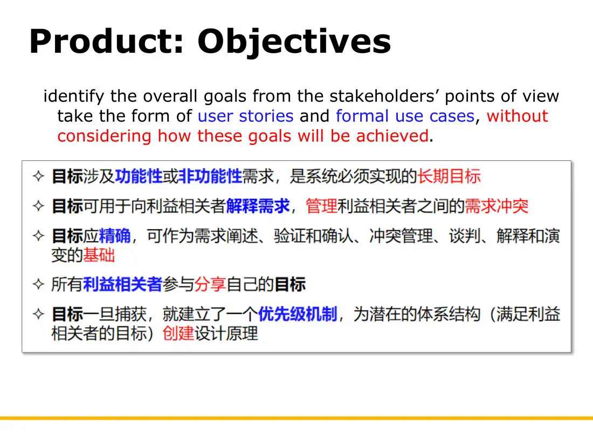

原文：

Product: Objectives

identify the overall goals from the stakeholders’ points of view take the form of user stories and formal use cases, without considering how these goals will be achieved.

目标涉及功能性或非功能性需求，是系统必须实现的长期目标

目标可用于向利益相关者解释需求，管理利益相关者之间的需求冲突

目标应精确，可作为需求阐述、验证和确认、冲突管理、谈判、解释和演变的基础

所有利益相关者参与分享自己的目标

目标一旦捕获，就建立了一个优先级机制，为潜在的体系结构（满足利益相关者的目标）创建设计原理

### Product: Scope

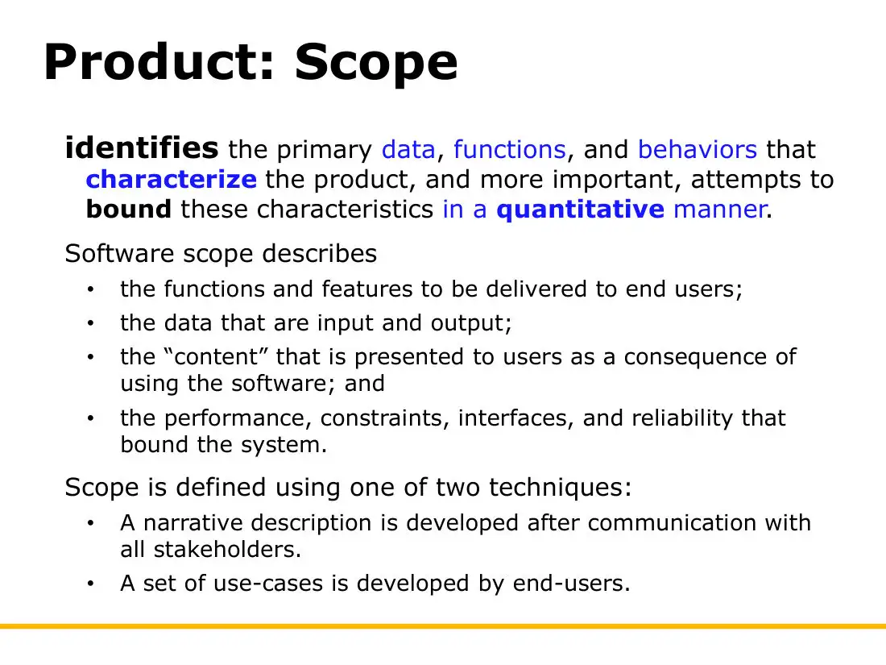

原文：

Product: Scope

identifies the primary data, functions, and behaviors that characterize the product, and more important, attempts to bound these characteristics in a quantitative manner.

Software scope describes

• the functions and features to be delivered to end users;

• the data that are input and output;

• the “content” that is presented to users as a consequence of using the software; and

• the performance, constraints, interfaces, and reliability that bound the system.

Scope is defined using one of two techniques:

• A narrative description is developed after communication with all stakeholders.

• A set of use-cases is developed by end-users.

### How is software scope defined?

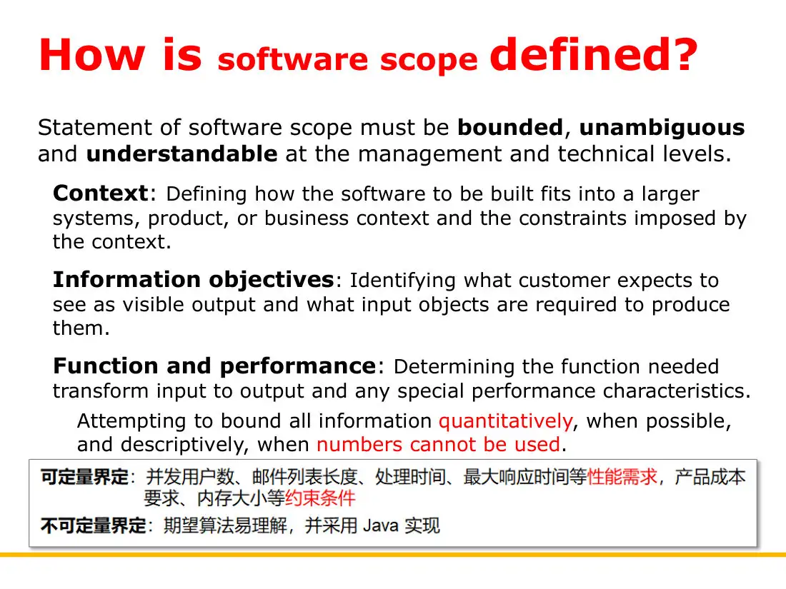

原文：

How is software scope defined?

Statement of software scope must be bounded, unambiguous and understandable at the management and technical levels.

Context: Defining how the software to be built fits into a larger systems, product, or business context and the constraints imposed by the context.

Information objectives: Identifying what customer expects to see as visible output and what input objects are required to produce them.

Function and performance: Determining the function needed transform input to output and any special performance characteristics.

Attempting to bound all information quantitatively, when possible, and descriptively, when numbers cannot be used.

可定量界定：并发用户数、邮件列表长度、处理时间、最大响应时间等性能需求，产品成本要求、内存大小等约束条件

不可定量界定：期望算法易理解，并采用Java实现

### 可行性

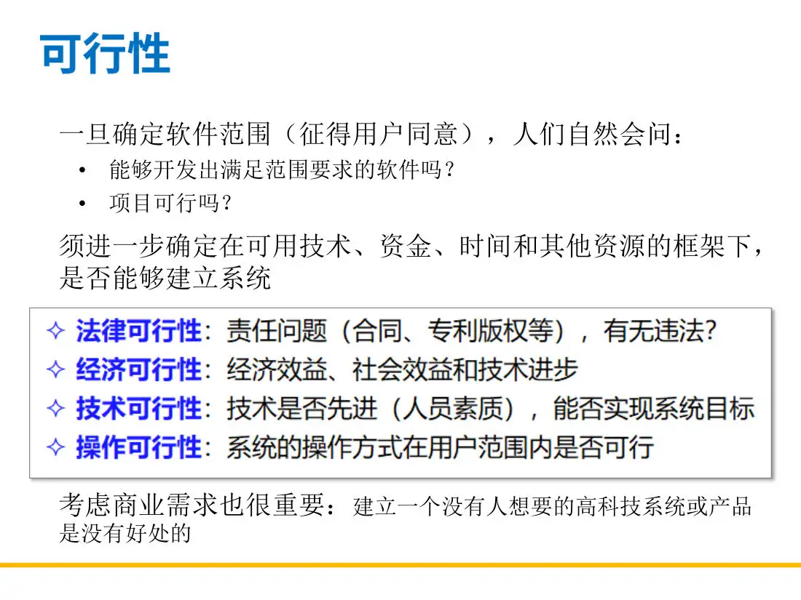

原文：

可行性

一旦确定软件范围（征得用户同意），人们自然会问：

• 能够开发出满足范围要求的软件吗？

• 项目可行吗？

须进一步确定在可用技术、资金、时间和其他资源的框架下，是否能够建立系统

法律可行性：责任问题（合同、专利版权等），有无违法？

经济可行性：经济效益、社会效益和技术进步

技术可行性：技术是否先进（人员素质），能否实现系统目标

操作可行性：系统的操作方式在用户范围内是否可行

考虑商业需求也很重要：建立一个没有人想要的高科技系统或产品是没有好处的

### 风险评估

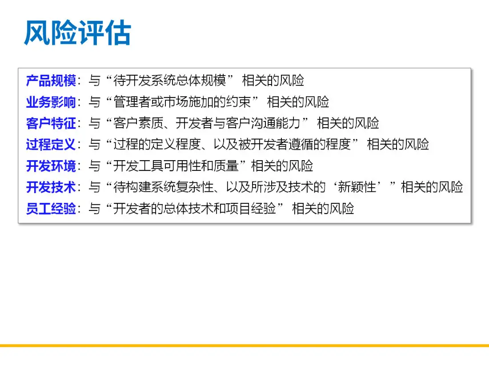

原文：

风险评估

项目进度安排的两种情况

业务影响：与“管理者或市场施加的约束”相关的风险

客户特征：与“客户素质、开发者与客户沟通能力”相关的风险

过程定义：与“过程的定义程度、以及被开发者遵循的程度”相关的风险

开发环境：与“开发工具可用性和质量”相关的风险

开发技术：与“待构建系统复杂性、以及所涉及技术的新颖性’”相关的风险

员工经验：与“开发者的总体技术和项目经验”相关的风险

### Product：Problem Decomposition

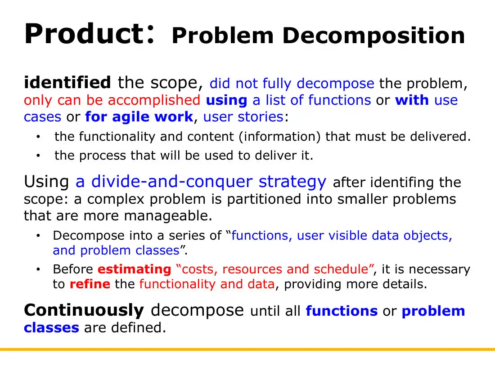

原文：

Product：Problem Decomposition

identified the scope, did not fully decompose the problem, only can be accomplished using a list of functions or with use cases or for agile work, user stories:

• the functionality and content (information) that must be delivered.

• the process that will be used to deliver it.

Using a divide-and-conquer strategy after identifing the scope: a complex problem is partitioned into smaller problems that are more manageable.

Decompose into a series of “functions, user visible data objects, and problem classes”.

Before estimating “costs, resources and schedule”, it is necessary to refine the functionality and data, providing more details.

Continuously decompose until all functions or problem classes are defined.

### 估算问题

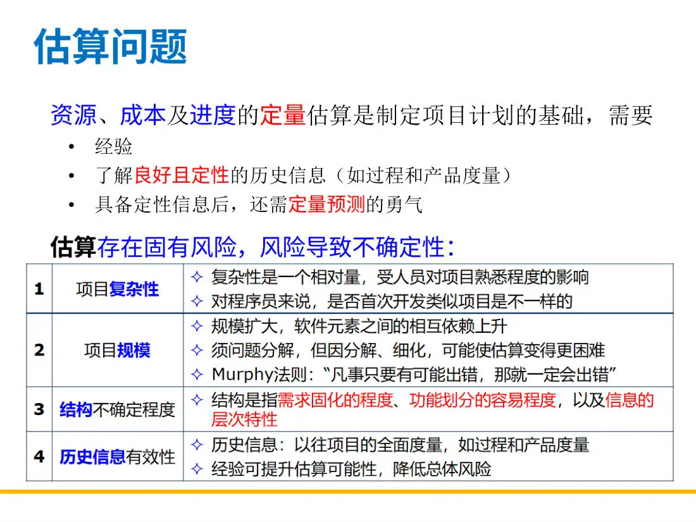

原文：

估算问题

资源、成本及进度的定量估算是制定项目计划的基础，需要

• 经验

• 了解良好且定性的历史信息（如过程和产品度量）

• 具备定性信息后，还需定量预测的勇气

估算存在固有风险，风险导致不确定性：

<table><tr><td>1</td><td>项目复杂性</td><td>✧ 复杂性是一个相对量,受人员对项目熟悉程度的影响✧ 对程序员来说,是否首次开发类似项目是不一样的</td></tr><tr><td>2</td><td>项目规模</td><td>✧ 规模扩大,软件元素之间的相互依赖上升✧ 须问题分解,但因分解、细化,可能使估算变得更困难✧ Murphy法则:“凡事只要有可能出错,那就一定会出错”</td></tr><tr><td>3</td><td>结构不确定程度</td><td>✧ 结构是指需求固化的程度、功能划分的容易程度,以及信息的层次特性</td></tr><tr><td>4</td><td>历史信息有效性</td><td>✧ 历史信息:以往项目的全面度量,如过程和产品度量✧ 经验可提升估算可能性,降低总体风险</td></tr></table>

### 资源估算

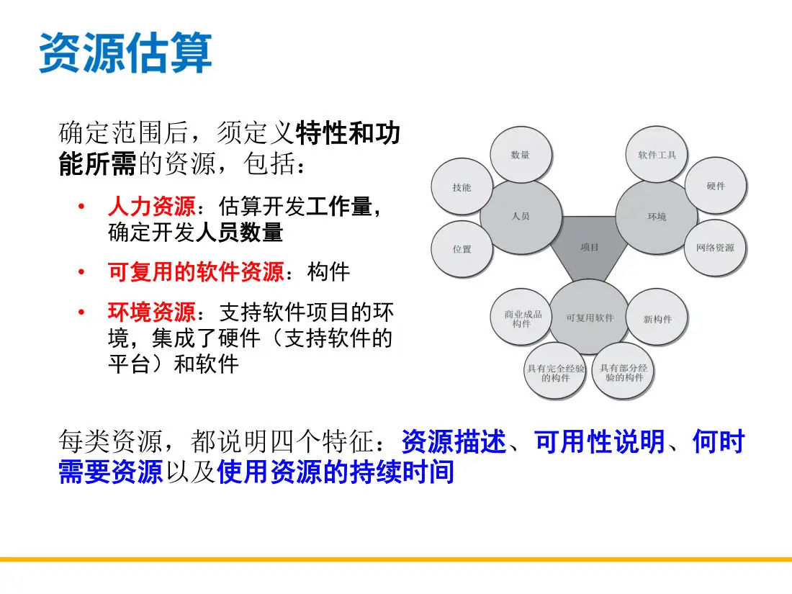

原文：

资源估算

确定范围后，须定义特性和功能所需的资源，包括：

• 人力资源：估算开发工作量，确定开发人员数量

• 可复用的软件资源：构件

• 环境资源：支持软件项目的环境，集成了硬件（支持软件的平台）和软件

每类资源，都说明四个特征：资源描述、可用性说明、何时需要资源以及使用资源的持续时间

### Process

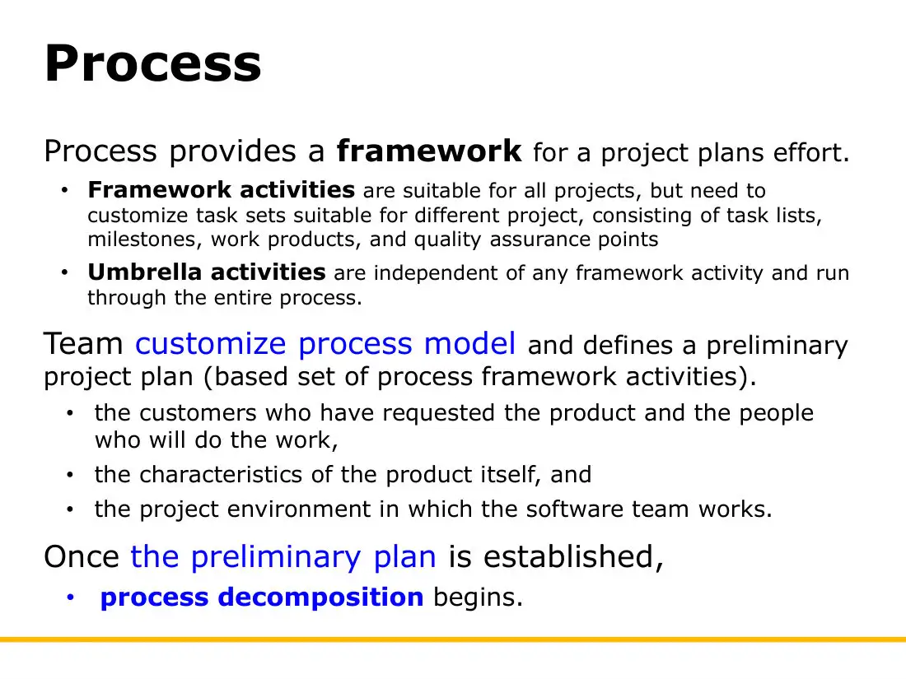

原文：

Process

Process provides a framework for a project plans effort.

• Framework activities are suitable for all projects, but need to customize task sets suitable for different project, consisting of task lists, milestones, work products, and quality assurance points

• Umbrella activities are independent of any framework activity and run through the entire process.

Team customize process model and defines a preliminary project plan (based set of process framework activities).

• the customers who have requested the product and the people who will do the work,

• the characteristics of the product itself, and

• the project environment in which the software team works.

Once the preliminary plan is established,

process decomposition begins.

### Process：合并产品和过程

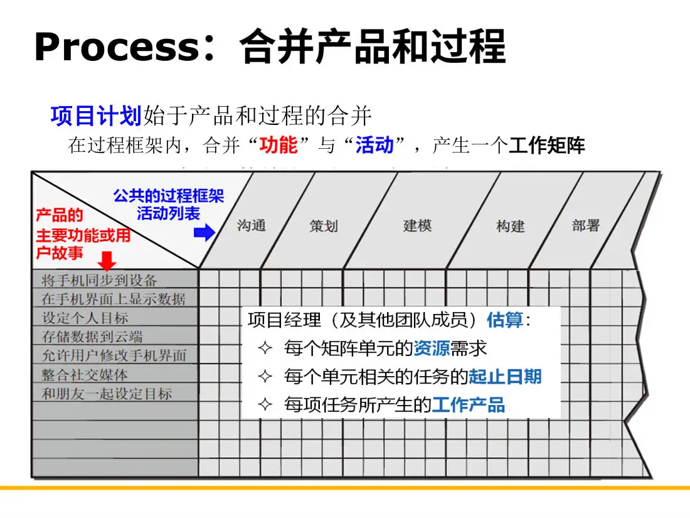

原文：

Process：合并产品和过程

项目计划始于产品和过程的合并

在过程框架内，合并“功能”与“活动”，产生一个工作矩阵

### 过程分解示例：沟通活动

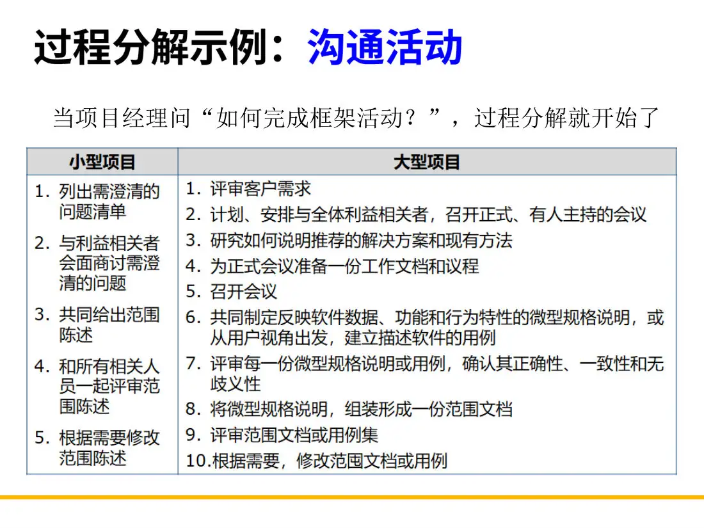

原文：

过程分解示例：沟通活动

当项目经理问“如何完成框架活动？”，过程分解就开始了

<table><tr><td>小型项目</td><td>大型项目</td></tr><tr><td>1.列出需澄清的问题清单2.与利益相关者会面商讨需澄清的问题3.共同给出范围陈述4.和所有相关人员一起评审范围陈述5.根据需要修改范围陈述</td><td>1.评审客户需求2.计划、安排与全体利益相关者,召开正式、有人主持的会议3.研究如何说明推荐的解决方案和现有方法4.为正式会议准备一份工作文档和议程5.召开会议6.共同制定反映软件数据、功能和行为特性的微型规格说明,或从用户视角出发,建立描述软件的用例7.评审每一份微型规格说明或用例,确认其正确性、一致性和无歧义性8.将微型规格说明,组装形成一份范围文档9.评审范围文档或用例集10.根据需要,修改范围文档或用例</td></tr></table>

### Project

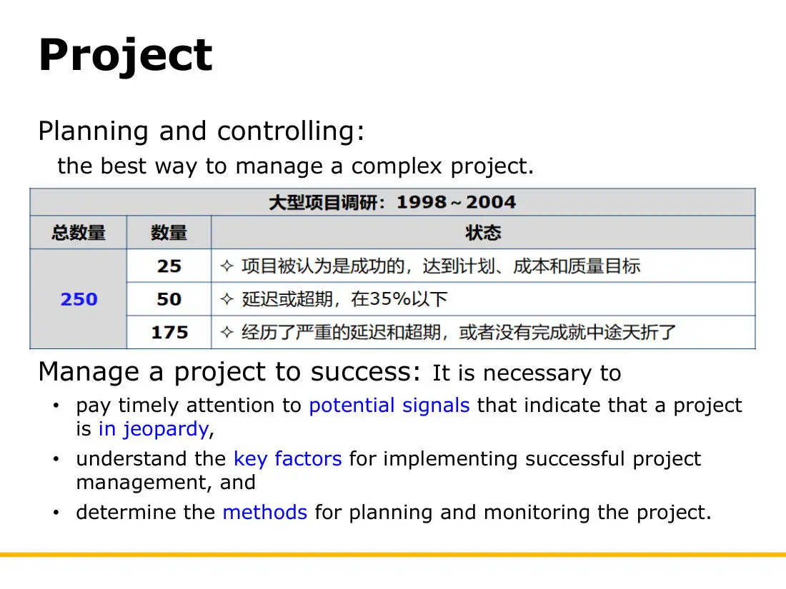

原文：

Project

Planning and controlling:

the best way to manage a complex project.

<table><tr><td colspan="3">大型项目调研:1998~2004</td></tr><tr><td>总数量</td><td>数量</td><td>状态</td></tr><tr><td rowspan="3">250</td><td>25</td><td>✧ 项目被认为是成功的,达到计划、成本和质量目标</td></tr><tr><td>50</td><td>✧ 延迟或超期,在35%以下</td></tr><tr><td>175</td><td>✧ 经历了严重的延迟和超期,或者没有完成就中途天折了</td></tr></table>

Manage a project to success: It is necessary to

• pay timely attention to potential signals that indicate that a project is in jeopardy,

• understand the key factors for implementing successful project management, and

• determine the methods for planning and monitoring the project.

### 定义任务网络

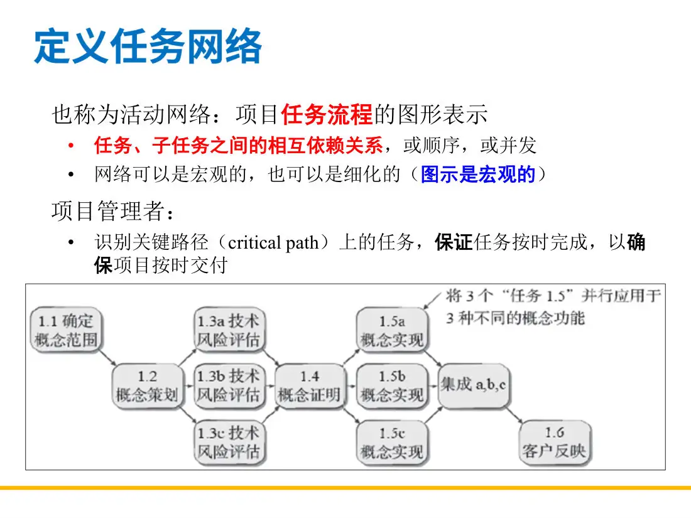

原文：

定义任务网络

也称为活动网络：项目任务流程的图形表示

• 任务、子任务之间的相互依赖关系，或顺序，或并发

• 网络可以是宏观的，也可以是细化的（图示是宏观的）

项目管理者：

• 识别关键路径（critical path）上的任务，保证任务按时完成，以确保项目按时交付

### 定义任务集

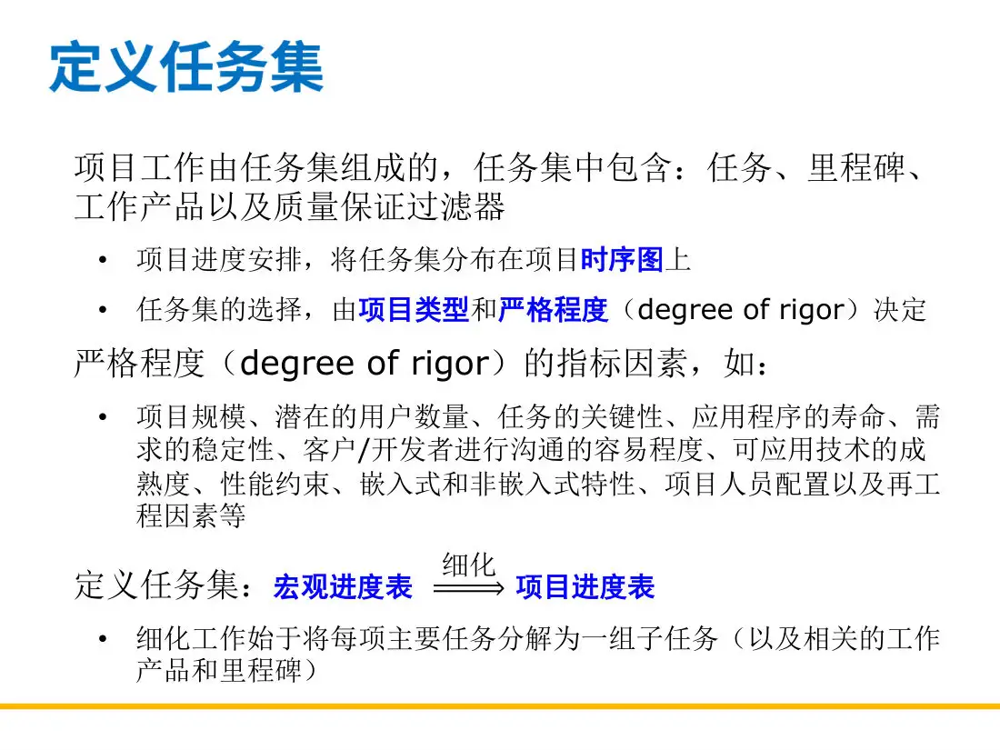

原文：

定义任务集

项目工作由任务集组成的，任务集中包含：任务、里程碑、工作产品以及质量保证过滤器

• 项目进度安排，将任务集分布在项目时序图上

• 任务集的选择，由项目类型和严格程度（degree of rigor）决定严格程度（degree of rigor）的指标因素，如：

• 项目规模、潜在的用户数量、任务的关键性、应用程序的寿命、需求的稳定性、客户/开发者进行沟通的容易程度、可应用技术的成熟度、性能约束、嵌入式和非嵌入式特性、项目人员配置以及再工程因素等

细化定义任务集：宏观进度表 项目进度表

• 细化工作始于将每项主要任务分解为一组子任务（以及相关的工作产品和里程碑）

### 示例：定义任务集

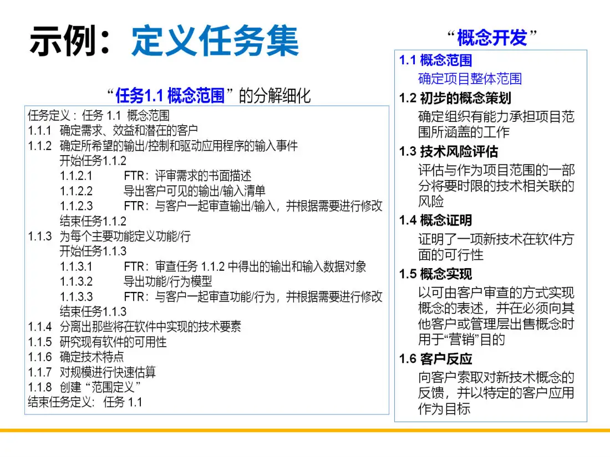

原文：

示例：定义任务集

发：探索新技术是否可

任务定义：任务 1.1 概念范围

某些利益相关者

1.1.2 确定所希望的输出/控制和驱动应用程序的输入事件开始任务1.1.2

1.1.2.1 FTR：评审需求的书面描述

制定 导出客户可见的输出/输入清单

1.1.2.3 FTR：与客户一起审查输出/输入，并根据需要进行修改结束任务1.1.2

1.1.3 为每个主要功能定义功能/行

开始任务1.1.3

1.1.3.1 FTR：审查任务1.1.2 中得出的输出和输入数据对象

1.1.3.2 导出功能/行为模型

念范 FTR：与客户一起审查功能/行为，并根据需要进行修改结束任务1.1.3

1.1.4 分离出那些将在软件中实现的技术要素

1.1.5 研究现有软件的可用性

1.1.6 确定技术特点

1.1.7 对规模进行快速估算

1.1.8 创建“范围定义” 结束任务定义：任务1.1

“概念开发”

1.1 概念范围确定项目整体范围

1.2 初步的概念策划

确定组织有能力承担项目范围所涵盖的工作

1.3 技术风险评估

评估与作为项目范围的一部分将要时限的技术相关联的风险

1.4 概念证明

证明了一项新技术在软件方面的可行性

1.5 概念实现

以可由客户审查的方式实现概念的表述，并在必须向其他客户或管理层出售概念时用于“营销”目的

1.6 客户反应

向客户索取对新技术概念的反馈，并以特定的客户应用作为目标

### 进度安排

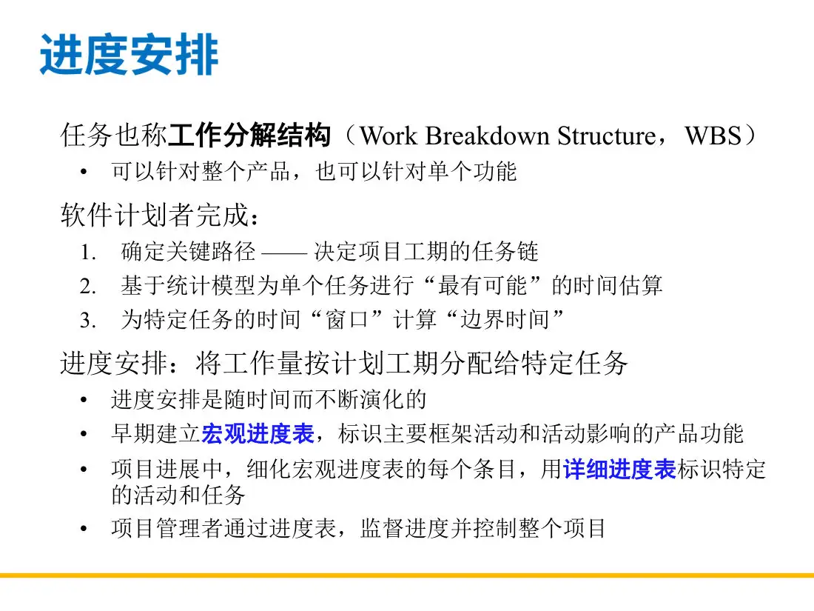

原文：

进度安排

任务也称工作分解结构（Work Breakdown Structure，WBS）• 可以针对整个产品，也可以针对单个功能

软件计划者完成：

1. 确定关键路径——决定项目工期的任务链

2. 基于统计模型为单个任务进行“最有可能”的时间估算

3. 为特定任务的时间“窗口”计算“边界时间”

进度安排：将工作量按计划工期分配给特定任务

• 进度安排是随时间而不断演化的

• 早期建立宏观进度表，标识主要框架活动和活动影响的产品功能

• 项目进展中，细化宏观进度表的每个条目，用详细进度表标识特定的活动和任务

• 项目管理者通过进度表，监督进度并控制整个项目

### 进度安排：软件延期交付的原因

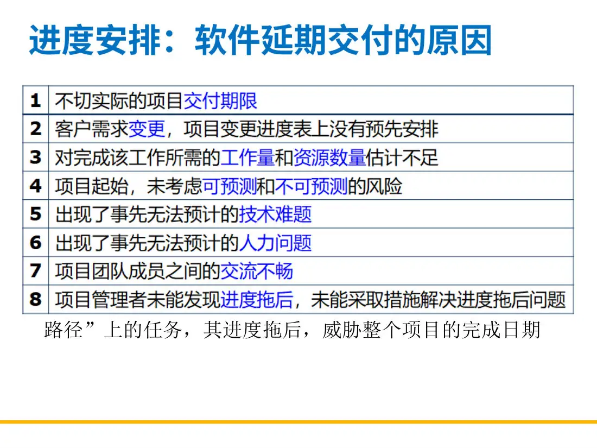

原文：

进度安排：软件延期交付的原因

<table><tr><td>1</td><td>不切实际的项目交付期限</td></tr><tr><td>2</td><td>客户需求变更,项目变更进度表上没有预先安排</td></tr><tr><td>3</td><td>对完成该工作所需的工作量和资源数量估计不足</td></tr><tr><td>4</td><td>项目起始,未考虑可预测和不可预测的风险</td></tr><tr><td>5</td><td>出现了事先无法预计的技术难题</td></tr><tr><td>6</td><td>出现了事先无法预计的人力问题</td></tr><tr><td>7</td><td>项目团队成员之间的交流不畅</td></tr><tr><td>8</td><td>项目管理者未能发现进度拖后,未能采取措施解决进度拖后问题</td></tr></table>

路径”上的任务，其进度拖后，威胁整个项目的完成日期

### 进度安排的基本原则

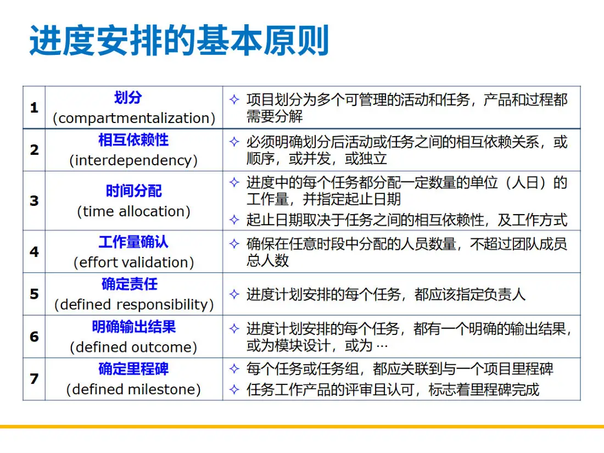

原文：

进度安排的基本原则

<table><tr><td>1</td><td>划分(compartmentalization)</td><td>✧项目划分为多个可管理的活动和任务,产品和过程都需要分解</td></tr><tr><td>2</td><td>相互依赖性(interdependency)</td><td>✧必须明确划分后活动或任务之间的相互依赖关系,或顺序,或并发,或独立</td></tr><tr><td>3</td><td>时间分配(time allocation)</td><td>✧进度中的每个任务都分配一定数量的单位(人日)的工作量,并指定起止日期✧起止日期取决于任务之间的相互依赖性,及工作方式</td></tr><tr><td>4</td><td>工作量确认(effort validation)</td><td>✧确保在任意时段中分配的人员数量,不超过团队成员总人数</td></tr><tr><td>5</td><td>确定责任(defined responsibility)</td><td>✧进度计划安排的每个任务,都应该指定负责人</td></tr><tr><td>6</td><td>明确输出结果(defined outcome)</td><td>✧进度计划安排的每个任务,都有一个明确的输出结果,或为模块设计,或为...</td></tr><tr><td>7</td><td>确定里程碑(defined milestone)</td><td>✧每个任务或任务组,都应关联到与一个项目里程碑✧任务工作产品的评审且认可,标志着里程碑完成</td></tr></table>

### 人员和工作量之间的关系

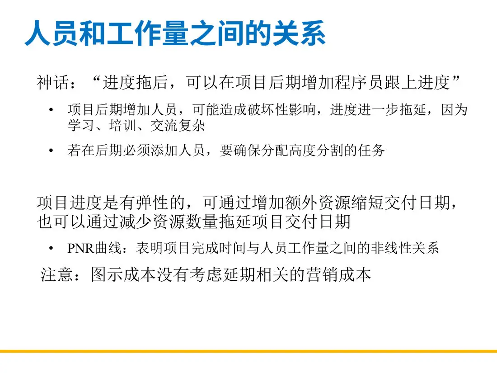

原文：

人员和工作量之间的关系

神话：“进度拖后，可以在项目后期增加程序员跟上进度”

• 项目后期增加人员，可能造成破坏性影响，进度进一步拖延，因为学习、培训、交流复杂

• 若在后期必须添加人员，要确保分配高度分割的任务

项目进度是有弹性的，可通过增加额外资源缩短交付日期，也可以通过减少资源数量拖延项目交付日期

• PNR曲线：表明项目完成时间与人员工作量之间的非线性关系

注意：图示成本没有考虑延期相关的营销成本

### 人员和工作量之间的关系

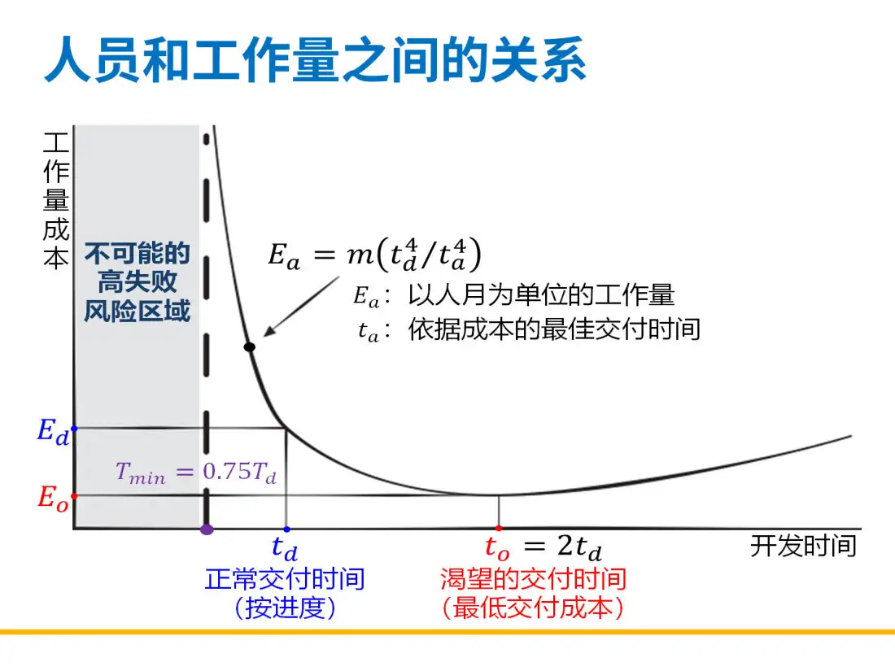

原文：

人员和工作量之间的关系

### 进度安排：时序图 & 项目表

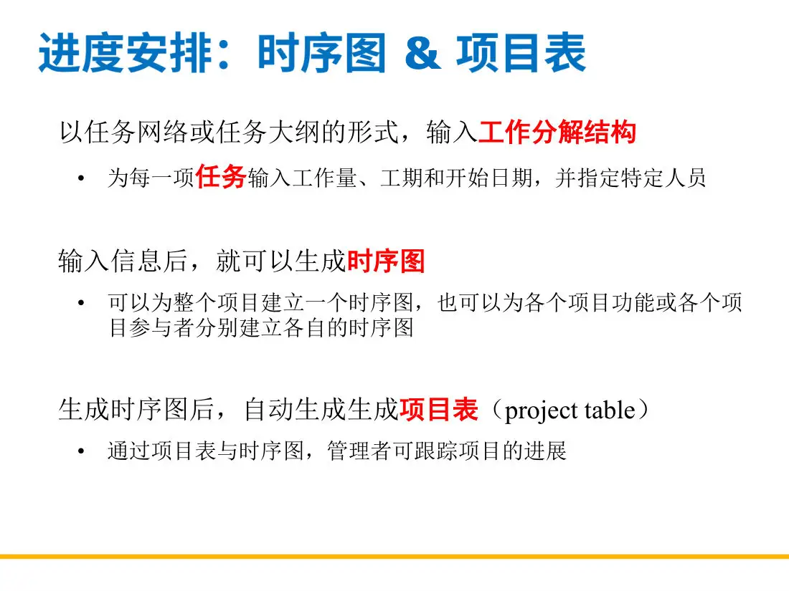

原文：

进度安排：时序图 & 项目表

以任务网络或任务大纲的形式，输入工作分解结构

• 为每一项任务输入工作量、工期和开始日期，并指定特定人员

输入信息后，就可以生成时序图

• 可以为整个项目建立一个时序图，也可以为各个项目功能或各个项目参与者分别建立各自的时序图

生成时序图后，自动生成生成项目表（project table）

• 通过项目表与时序图，管理者可跟踪项目的进展

### 进度安排：时序图

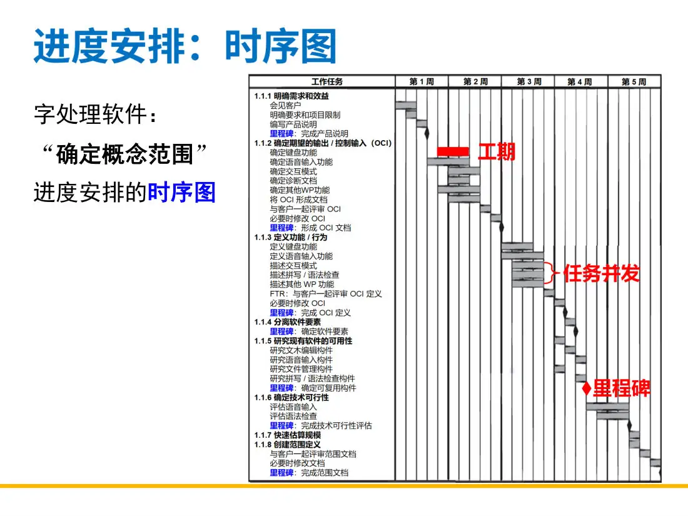

原文：

进度安排：时序图

字处理软件：“确定概念范围”进度安排的时序图

### 进度安排：项目表

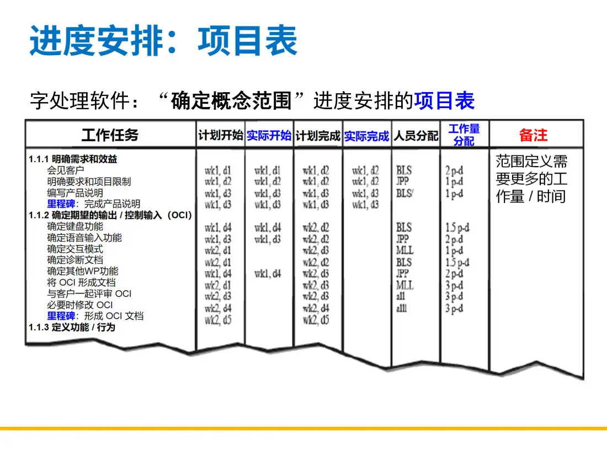

原文：

进度安排：项目表

字处理软件：“确定概念范围”进度安排的项目表

<table><tr><td>工作任务</td><td>计划开始</td><td>实际开始</td><td>计划完成</td><td>实际完成</td><td>人员分配</td><td>工作量分配</td><td>备注</td><td></td><td></td><td></td></tr><tr><td>1.1.1 明确需求和效益会见客户明确要求和项目限制编写产品说明里程碑:完成产品说明1.1.2 确定期望的输出 / 控制输入 (OCI)确定键盘功能确定语音输入功能确定交互模式确定诊断文档确定其他WP功能将 OCI 形成文档与客户一起评审 OCI必要时修改 OCI里程碑:形成 OCI 文档1.1.3 定义功能 / 行为</td><td>wk1, d1wk1, d2wk1, d3wk1, d3wk1, d4wk1, d3wk2, d1wk2, d1wk1, d4wk2, d1wk2, d3wk2, d4wk2, d5</td><td>wk1, d1wk1, d2wk1, d3wk1, d3wk1, d4wk1, d3wk1, d4wk1, d3wk1, d4wk1, d3wk1, d3wk1, d4wk1, d3wk1, d3wk1, d4wk1, d3wk1, d3wk1, d3wk1, d3wk1, d3wk1, d3wk1, d3wk1, d3wk1, d3wk1, d3wk1, d3wk1, d3wk1, d3wk1, d3wk1, d3wk1, d3wk1, d3wk1, d3wk1, d3wk1, d3wk1, d4wk1, d4wk1, d4wk1, d4wk1, d4wk1, d4wk1, d4wk1, d4wk1, d4wk1, d4wk1, d4wk1, d4wk1, d4wk1, d4wk1, d4wk1, d4wk1, d4wk1, d4wk1, d4wk1, d4wk1, d3wk1, d3wk1, d3wk1, d3wk1, d3wk1, d3wk1, d3wk1, d3wk1, d3wk1, d3wk1, d3wk1, d3wk1, d3wk1, d3wk1, d3wk1, d3wk1, d3wk1, d3wk1, d4wk1, d3wk1, d3wk1, d3wk1, d3wk1, d3wk1, d3wk1, d3wk1, d3wk1, d3wk1, d3wk1, d3wk1, d3wk1, d3wk1, d3wk1, d3wk1, d3wk1, d4wk1, d3wk1, d3wk1, d4wk1, d3wk1, d3wk1, d3wk1, d3wk1, d3wk1, d3wk1, d3wk1, d3wk1, d3wk1, d3wk1, d3wk1, d3wk1, d3wk1, d4wk1, d3wk1, d3wk1, d3wk1, d3wk1, d3wk1, d4wk1, d3wk1, d3wk1, d3wk1, d3wk1, d3wk1, d3wk1, d3wk1, d3wk1, d3wk1, d3wk1, d3wk1, d3wk1, d3wk1, d4wk1, d3wk1, d3wk1, d4wk1, d3wk1, d3wk1, d4wk1, d3wk1, d3wk1, d3wk1, d3wk1, d3wk1, d3wk1, d4wk1, d3wk1, d3wk1, d3wk1, d3wk1, d3wk1, d3wk1, d3wk1, d3wk1, d4wk1, d3wk1, d3wk1, d3wk1, d3wk1, d3wk1, d3wk1, d3wk1, d3wk1, d3wk1, d4wk1, d3wk1, d3wk1, d3wk1, d3wk1, d3wk1, d3wk1, d3wk1, d3wk1, d3wk1, d4wk1, d4wk1, d3wk1, d3wk1, d3wk1, d3wk1, d3wk1, d3wk1, d3wk1, d3wk1, d4wk1, d4wk1, d3wk1, d3wk1, d3wk1, d3wk1, d3wk1, d3wk1, d3wk1, d4wk1, d4wk1, d3wk1, d3wk1, d3wk1, d3wk1, d3wk1, d3wk1, d3wk1, d4wk1, d4wk1, d3wk1, d4wk1, d3wk1, d3wk1, d3wk1, d3wk1, d3wk1, d4wk1, d4wk1, d3wk1, d3wk1, d3wk1, d3wk1, d3wk1, d3wk1, d3wk1, d4wk1, d4wk1, d3wk1, d3wk1, d3wk1, d4wk1, d4wk1, d3wk1, d3wk1, d3wk1, d3wk1, d3wk1, d3wk1, d3wk1, d4wk1, d4wk1, d3wk1, d3wk1, d3wk1, d3wk1, d3wk1, d4wk1, d4wk1, d3wk1, d3wk1, d3wk1, d3wk1, d3wk1, d3wk1, d4wk1, d4wk1, d3wk1, d3wk1, d3wk1, d3wk1, d3wk1, d3wk1, d3wk1, d4wk1, d4wk1, d3wk1, d3wk1, d4wk1, d4wk1, d3wk1, d3wk1, d3wk1, d3wk1, d3wk1, d4wk1, d4wk1, d3wk1, d3wk1, d3wk1, d3wk1, d3wk1, d4wk1, d4wk1, d3wk1, d3wk1, d3wk1, d3wk1, d3wk1, d4wk1, d4wk1, d3wk1, d4wk1, d3wk1, d3wk1, d3wk1, d3wk1, d4wk1, d4wk1, d3wk1, d3wk1, d3wk1, d3wk1, d3wk1, d4wk1, d4wk1, d3wk1, d3wk1, d3wk1, d3wk1, d4wk1, d4wk1, d3wk1, d3wk1, d3wk1, d3wk1, d4wk1, d4wk1, d3wk1, d3wk1, d3wk1, d3wk1, d4wk1, d4wk1, d3wk1, d4wk1, d3wk1, d3wk1, d3wk1, d4wk1, d4wk1, d3wk1, d3wk1, d3wk1, d3wk1, d4wk1, d4wk1, d3wk1, d3wk1, d3wk1, d3wk1, d4wk1, d4wk1, d3wk1, d3wk1, d4wk1, d4wk1, d3wk1, d3wk1, d3wk1, d3wk1, d4wk1, d4wk1, d3wk1, d3wk1, d3wk1, d3wk1, d3wk1, d4wk1, d4wk1, d3wk1, d3wk1, d3wk1, d3wk1, d3wk1, d4wk1, d5wk2, d5</td><td>wk1, d2wk1, d2wk1, d2wk1, d3wk1, d3wk1, d3wk1, d3wk1, d3wk1, d3wk1, d3wk1, d3wk1, d3wk1, d3wk1, d3wk1, d3wk1, d3wk1, d3wk1, d3wk1, d3wk1, d3wk1, d3wk1, d3wk1, d5wk2, d2wk2, d2wk2, d2wk2, d2wk2, d2wk2, d2wk2, d2wk2, d2wk2, d2wk2, d2wk2, d2wk2, d2wk2, d2wk2, d2wk2, d2wk2, d2wk2, d2wk2, d2wk2, d2wk2, d2wk2, d5wk2, d5wk2, d5wk2, d5wk2, d5wk2, d5wk2, d5wk2, d5wk2, d5wk2, d5wk2, d5wk2, d5wk2, d5wk2, d5wk2, d5wk2, d5wk2, d5wk2, d5wk2, d5wk2, d5wk2, d4wk2, d5wk2, d5wk2, d5wk2, d5wk2, d5wk2, d5wk2, d5wk2, d5wk2, d5wk2, d5wk2, d5wk2, d5wk2, d5wk2, d5wk2, d5wk2, d5wk2, d5wk2, d5wk2, d5wk2, d8wk2, d8wk2, d8wk2, d8wk2, d8wk2, d8wk2, d8wk2, d8wk2, d8wk2, d8wk2, d8wk2, d8wk2, d8wk2, d8wk2, d8wk2, d8wk2, d8wk2, d8wk2, d8wk2, d8wk2, d9wk2, d9wk2, d9wk2, d9wk2, d9wk2, d9wk2, d9wk2, d9wk2, d9wk2, d9wk2, d9wk2, d9wk2, d9wk2, d9wk2, d9wk2, d9wk2, d9wk2, d9wk2, d9wk2, d9wk2, d10wk2, d10wk2, d10wk2, d10wk2, d10wk2, d10wk2, d10wk2, d10wk2, d10wk2, d10wk2, d10wk2, d10wk2, d10wk2, d10wk2, d10wk2, d10wk2, d10wk2, D4wk2, D4wk2, D4wk2, D4wk2, D4wk2, D4wk2, D4wk2, D4wk2, D4wk2, D4wk2, D4wk2, D4wk2, D4wk2, D4wk2, D4wk2, D4wk2, D4wk2, D4wk2, D4wk2, D4wk2, D5wk2, D5wk2, D5wk2, D5wk2, D5wk2, D5wk2, D5wk2, D5wk2, D5wk2, D5wk2, D5wk2, D5wk2, D5wk2, D5wk2, D5wk2, D5wk2, D5wk2, D5wk2, D5wk2, D5wk2, D6wk2, D6wk2, D6wk2, D6wk2, D6wk2, D6wk2, D6wk2, D6wk2, D6wk2, D6wk2, D6wk2, D6wk2, D6wk2, D6wk2, D6wk2, D7wk2, D7wk2, D7wk2, D7wk2, D7wk2, D7wk2, D7wk2, D7wk2, D7wk2, D7wk2, D7wk2, D7wk2, D7wk2, D7wk2, D7wk2, D7wk2, D7wk2, D7wk2, D7wk2, D7wk2, D8wk2, D8wk2, D8wk2, D8wk2, D8wk2, D8wk2, D8wk2, D8wk2, D8wk2, D8wk2, D8wk2, D8wk2, D8wk2, D8wk2, D8wk2, D8wk2, D8wk2, D8wk2, D8wk2, D8wk2, D9wk2, D9wk2, D9wk2, D9wk2, D9wk2, D9wk2, D9wk2, D9wk2, D9wk2, D9wk2, D9wk2, D9wk2, D9wk2, D9wk2, D9wk2, D9wk2, D9wk2, D9wk2, D9wk2, D9wk2, D10wk2, D10wk2, D10wk2, D10wk2, D10wk2, D10wk2, D10wk2, D10wk2, D10wk2, D10wk2, D10wk2, D10wk2, D10wk2, D10wk2, D10wk2, D10wk2, D10wk2,D 4 wk 4 wk 4 wk 4 wk 4 wk 4 wk 4 wk 4 wk 4 wk 4 wk 4 wk 4 wk 4 wk 4 wk 4 wk 4 wk 4 wk 4 wk 4 wk 4 wk 4 wk 4 wk 4 wk 4 wk 4 wk 4 wk 4 wk 4 wk 4 wk 4 wk 4 wk 4 wk 4 wk 4 wk</td><td></td><td></td><td></td><td></td><td></td><td></td><td></td></tr></table>

### 进度跟踪

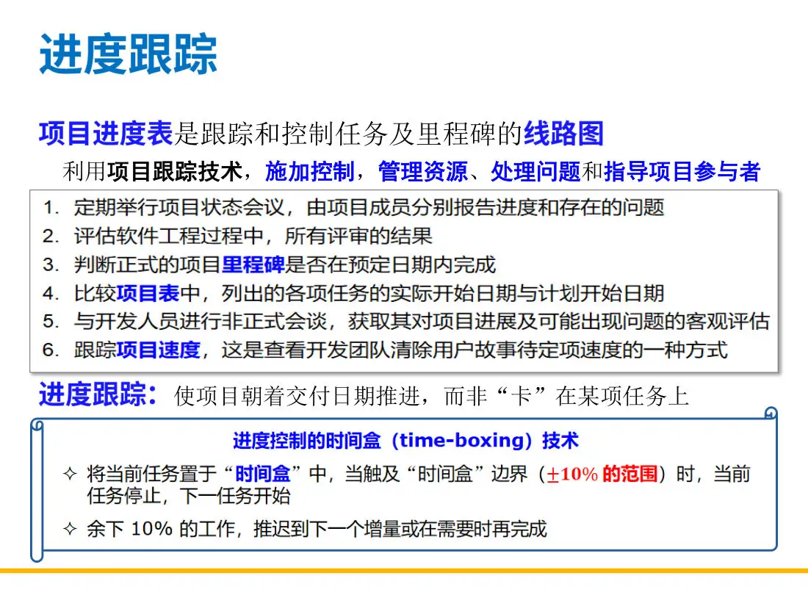

原文：

进度跟踪

项目进度表是跟踪和控制任务及里程碑的线路图

利用项目跟踪技术，施加控制，管理资源、处理问题和指导项目参与者

• 若一切顺利，则几乎不必施加控制

项目在预算范围内按进度进行，评

3. 判断正式的项目里程碑是否在预定日期内完成

若出现问题，就必须施加控制，以便尽快解决问题

5. 与开发人员进行非正式会谈，获取其对项目进展及可能出现问题的客观评估

6. 跟踪项目速度，这是查看开发团队清除用户故事待定项速度的一种方式

进度跟踪：使项目朝着交付日期推进，而非“卡”在某项任务上

进度控制的时间盒（time-boxing）技术

将当前任务置于“时间盒”中，当触及“时间盒”边界（±10%的范围）时，当前任务停止，下一任务开始

余下10%的工作，推迟到下一个增量或在需要时再完成

### Successful Project Characteristics

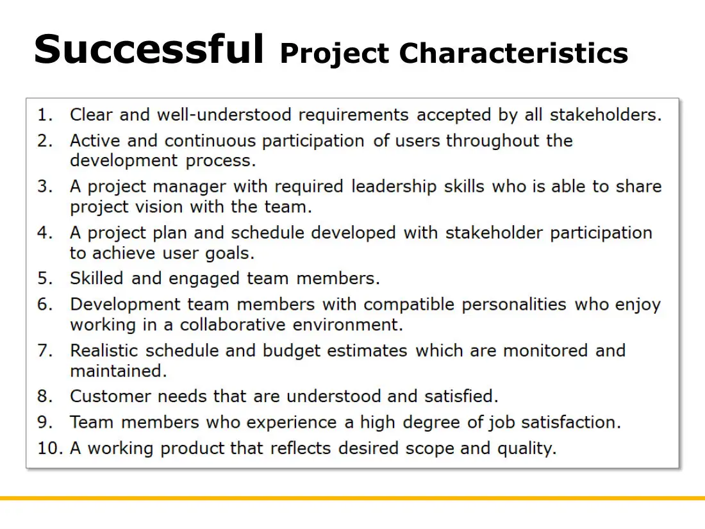

原文：

Successful Project Characteristics

1. Clear and well-understood requirements accepted by all stakeholders.

2. Active and continuous participation of users throughout the development process.

3. A project manager with required leadership skills who is able to share project vision with the team.

4. A project plan and schedule developed with stakeholder participation to achieve user goals.

5. Skilled and engaged team members.

6. Development team members with compatible personalities who enjoy working in a collaborative environment.

7. Realistic schedule and budget estimates which are monitored and maintained.

8. Customer needs that are understood and satisfied.

9. Team members who experience a high degree of job satisfaction.

10. A working product that reflects desired scope and quality.

### project's jeopardy signals

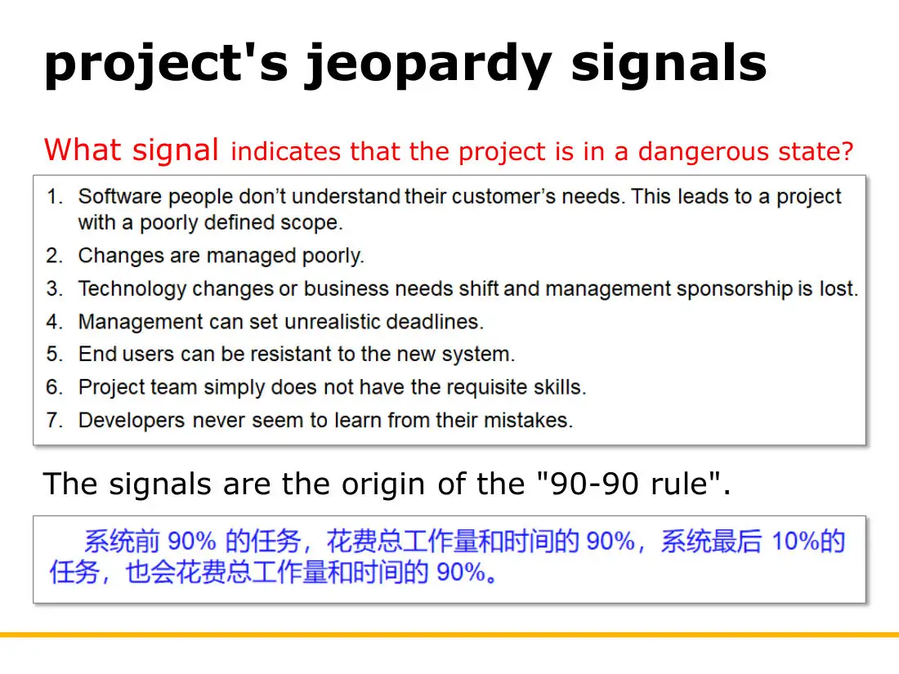

原文：

project's jeopardy signals

What signal indicates that the project is in a dangerous state?

1. Software people don't understand their customer's needs. This leads to a project with a poorly defined scope.

2. Changes are managed poorly.

3. Technology changes or business needs shift and management sponsorship is lost.

4. Management can set unrealistic deadlines.

5. End users can be resistant to the new system.

6. Project team simply does not have the requisite skills.

7. Developers never seem to learn from their mistakes.

The signals are the origin of the "90-90 rule".

系统前90%的任务，花费总工作量和时间的90%，系统最后10%的任务，也会花费总工作量和时间的90%。

### W5H2 Principle

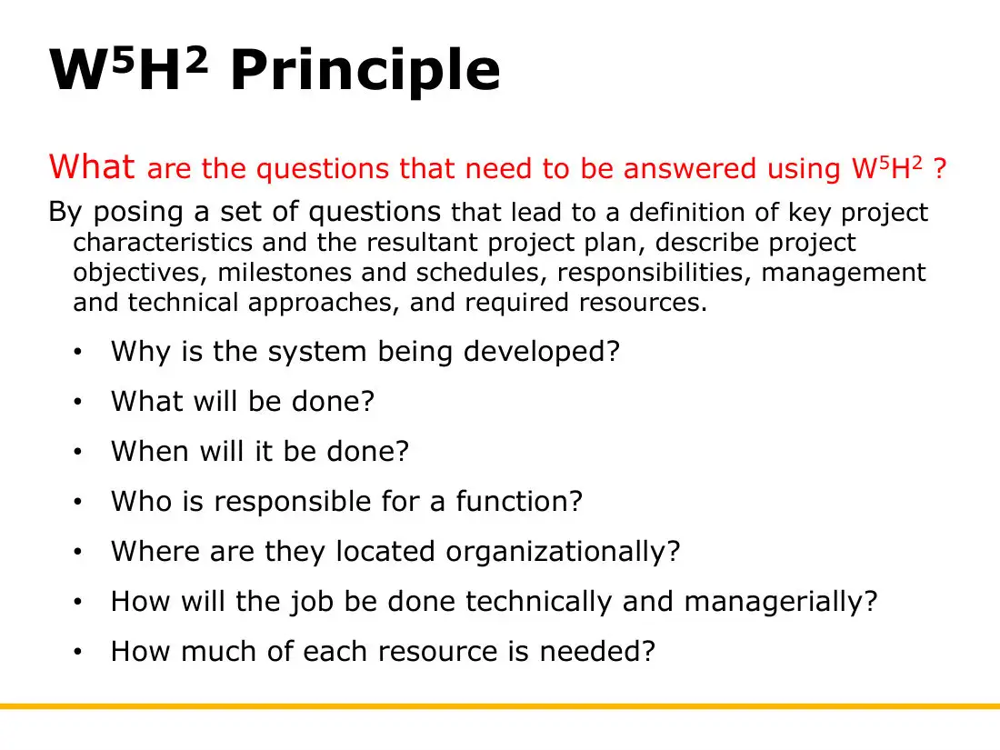

原文：

W5H2 Principle

What are the questions that need to be answered using W5H2 ?

By posing a set of questions that lead to a definition of key project characteristics and the resultant project plan, describe project objectives, milestones and schedules, responsibilities, management and technical approaches, and required resources.

• Why is the system being developed?

• What will be done?

• When will it be done?

• Who is responsible for a function?

• Where are they located organizationally?

• How will the job be done technically and managerially?

• How much of each resource is needed?

### Homework after class

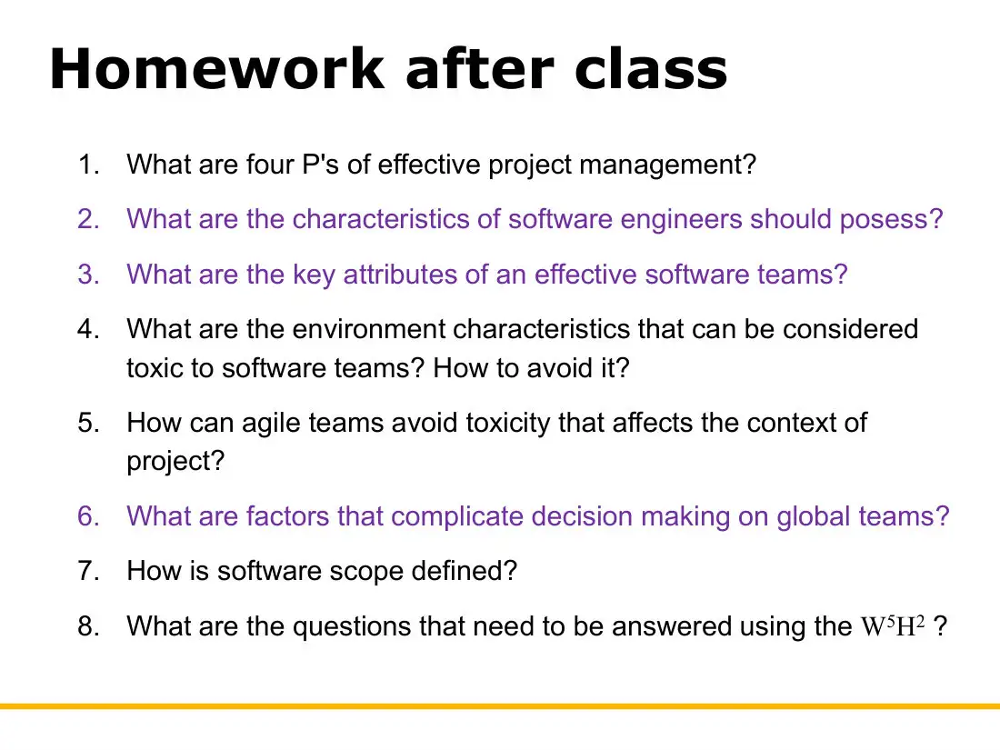

原文：

Homework after class

1. What are four P's of effective project management?

2. What are the characteristics of software engineers should posess?

3. What are the key attributes of an effective software teams?

4. What are the environment characteristics that can be considered toxic to software teams? How to avoid it?

5. How can agile teams avoid toxicity that affects the context of project?

6. What are factors that complicate decision making on global teams?

7. How is software scope defined?

8. What are the questions that need to be answered using the W5H2 ?
