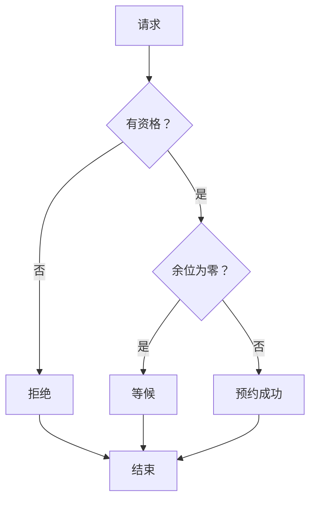

# 《软件工程（双语）》历史考试说明导读

这份 2024—2025 学年第二学期的原件是考试说明，不含试题或原答案。历史口径中，期末和平时各占总评一半，期末采用纸质资料开卷，不使用电子设备。期末卷分判断、问题分析、理解沟通和设计开发四类，分值为 10、30、30、30；这不是对下一场考试的承诺。下面以图书馆预约系统为自编案例，贯穿原件所列的六个复习范围。

## 软件与过程：什么时候应该让使用者看到可运行的东西

软件不会像机械零件那样物理磨损，仍可能在需求和运行环境变化后失去适用性，或因连续改动引入缺陷。方法描述怎样分析设计，工具帮助执行，过程说明何时产出什么和怎样反馈。选择过程模型不是比口号：若接口、约束稳定且要逐阶段验收，可以按顺序压实交付节点；需求难定时先用[原型法](../../../topics/软件工程/原型法.md)澄清问题；若要先交可用预约、后交排队提醒，可考虑[增量模型](../../../topics/软件工程/增量模型.md)。[敏捷](../../../topics/软件工程/敏捷思想与原则.md)依靠短反馈周期修正计划，不等于不作计划或不保留验收记录。参看[软件本质](../../../topics/软件工程/软件的本质与定义.md)和[通用过程框架](../../../topics/软件工程/通用过程框架活动.md)。

## 需求：先把判断规则问清楚，再决定画哪张图

预约规则里最容易遗漏的是异常分支：身份无效、无余位、重复提交，分别应该发生什么？把这些规则拿给读者、馆员和运维确认，而不是由开发者猜测。原件所列[需求工程任务](../../../topics/软件工程/需求工程任务.md)可用启动、获取、细化、协商、规格说明、确认、管理七项活动串联；它们不必只按一次固定顺序做，在需求变化后常要回到前面重新确认。明确干系人、系统边界、目标和约束，是讨论需求前的基础。

| 现在要回答什么 | 选什么表征 | 不该从这里推出什么 |
| --- | --- | --- |
| 外部实体输入什么，数据由谁处理和保存？ | [数据流图](../../../topics/软件工程/面向流的建模DFD.md)，再用数据字典消除名词歧义 | 箭头是数据流，不是执行的严格先后 |
| 谁为哪个目标发起一次操作，成功和失败怎样结束？ | [用例](../../../topics/软件工程/用例开发.md)与[活动图](../../../topics/软件工程/活动图补充用例.md)，泳道标职责 | 步骤发生在某角色，不等于该角色就是某个类 |
| 对象之间怎样关联，谁长期保存规则担保？ | [类图与类关系](../../../topics/软件工程/UML类图与类关系.md) | 静态对象关系没有给出消息到达的时间顺序 |
| 预约状态可以怎样改变，一次调用中消息怎样往返？ | 状态机描述单个预约的生命周期，顺序图描述一条交互轨迹 | 一张正常流程的顺序图不证明所有状态转换合法 |

## 设计：把同一条需求放到合适的构件

设计不止是类图。先选体系结构边界，再定接口契约、持久化结构与部署安排，最后到构件内部行为，见[设计模型](../../../topics/软件工程/设计模型元素.md)与[构件级设计](../../../topics/软件工程/实施构件级设计.md)。例如页面组件只收集信息和展示结果，预约服务执行“余位不足则等候”，持久层负责数据原子性。界面、服务、数据分层是一种结构；怎样处理同一职责里的对象协作，是另一层设计问题。选风格时要比较质量目标，选模式时要明确要反复解决的设计问题。

**补充（自编）**：若只把读余位、减余位分别做成两个请求，两个使用者都可能读到最后一个空位。将“检查并占用”放在同一持久化边界内，或使用数据库支持的原子条件更新，然后用并发测试确认最多一人占位。强调[内聚](../../../topics/软件工程/内聚.md)是把同一条规则放在一起，并不是让每个构件都依赖数据库。

## 测试：路径、输入边界与集成失败是三回事

**补充（自编）**：先从一个简化的预约服务做基本路径测试。未获资格即拒绝；只有获得资格才检查剩余座位；剩余为零则等候，正数则预约成功。系统内部余位按非负整数建模。

**参考解答**：控制流图有两个判定结点，一个连通入口和出口。此处环路复杂度为 $2+1=3$，也可数图中的 $E=8$、$N=7$，得 $E-N+2=3$。用未获资格、获资格且余位为 $0$、获资格且余位为 $1$ 各走一次。这个用例集也碰到了余位的合法转折，但[黑盒边界](../../../topics/软件工程/黑盒测试.md)关注输入规范：若余位来自外部接口，负数是另一个非法等价类，应在边界验证中单测，不可贸然塞进只允许非负数的内部流程。

构件内的路径跑通，不证明服务与仓库的事务行为可靠。自顶向下集成时用桩代替尚未接入的仓库，自底向上时用驱动模拟调用者；面向对象测试还要覆盖对象状态和协作。对照[白盒测试](../../../topics/软件工程/白盒测试.md)、[黑盒测试](../../../topics/软件工程/黑盒测试.md)、[集成测试](../../../topics/软件工程/集成测试.md)和[面向对象测试](../../../topics/软件工程/面向对象测试.md)。

## 配置管理：允许变更，不允许每个人理解不同

假设业务改成“余位为零时，优先给订阅提醒的人排队”。需求条目、接口契约、迁移、测试和部署配置是可追踪的[配置项](../../../topics/软件工程/基线与配置项.md)；通过审查并固定的版本组合才是基线。提出并记录影响，审查后修改，跑回归，用记录关联新旧版本。把文件存在版本库不自动使它成为基线，基线也不是从此不许改动。见[变更控制](../../../topics/软件工程/变更控制.md)。

## 项目管理：把风险和估算落到行动

按[四个 P](../../../topics/软件工程/四个P.md)把人员、产品、过程、项目条件分开，再用 [W5HH](../../../topics/软件工程/W5HH原则.md)落实为什么做、做什么、何时、谁负责、组织归属、怎样做、需要多少资源。估算迁移要单列数据清洗与回滚演练，而不是只数页面。预约高峰故障应记录触发条件、影响、负责人和缓解方案；不能用“高风险”替代可检查的条件。跨时区团队要安排异步交接、明确谁负责确认需求，敏捷团队也需要同一份验收口径和可见的风险状态。
