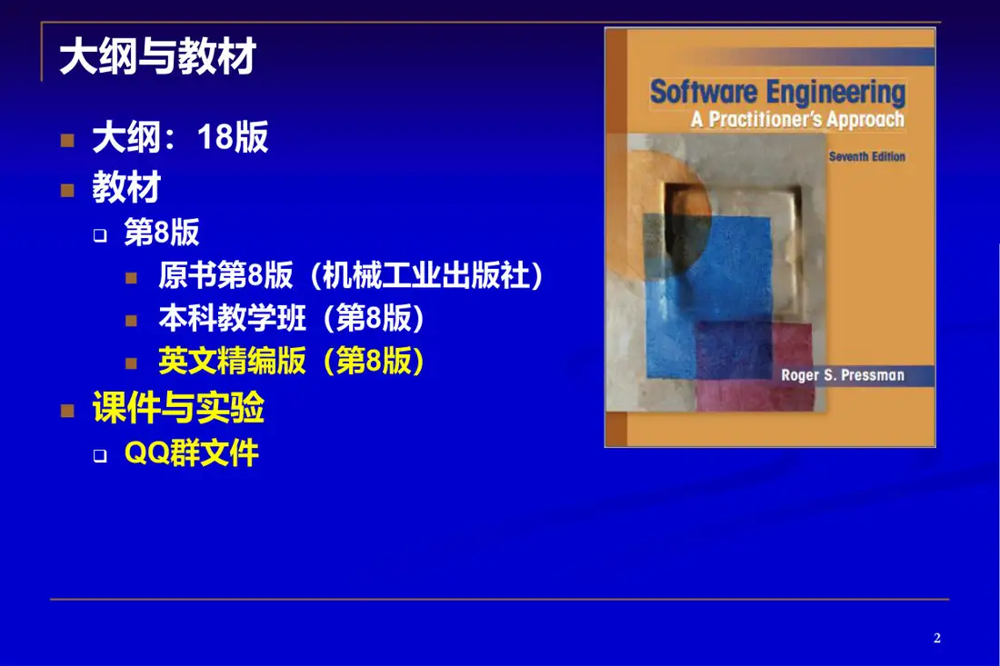
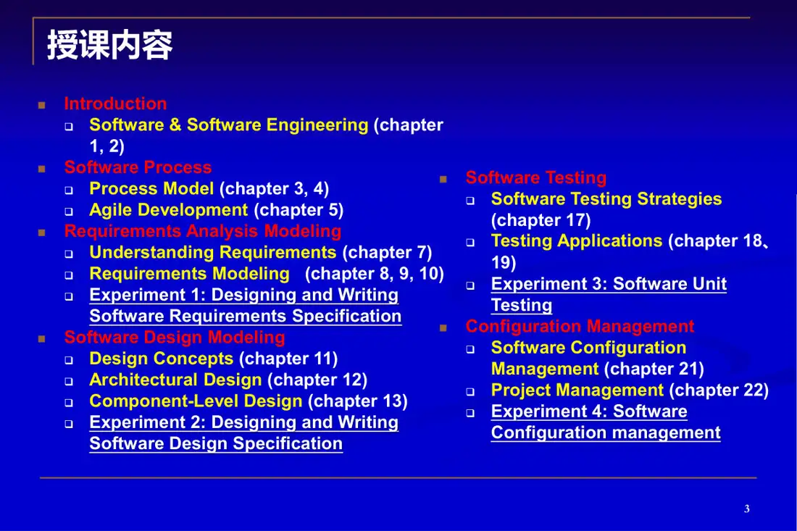
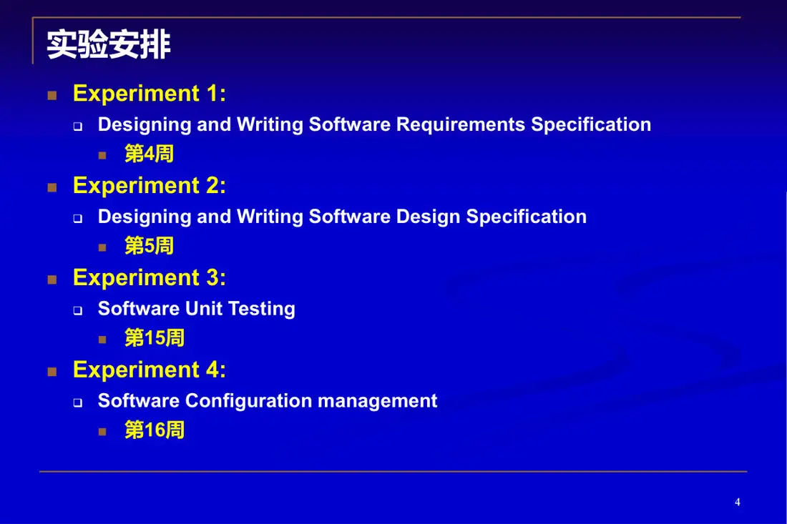
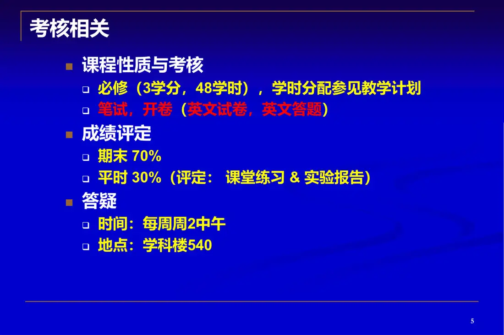
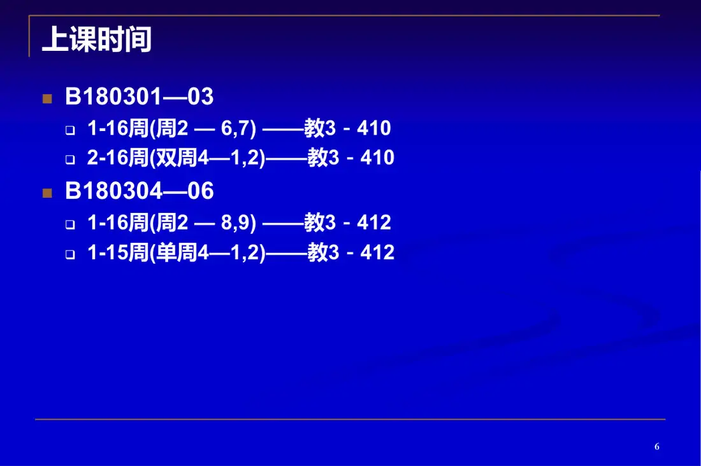

# 《软件工程（双语）》课程简介（课件）

原件的每一页，下面附识别出的文字。

### 课程简介

原文：

课程简介

王传栋(chdwang@njupt.edu.cn)南京邮电大学计算机学院

### 大纲与教材

原文：

大纲与教材

◼ 大纲：18版

教材

❑ 第8版

原书第8版（机械工业出版社）

◼ 本科教学班（第8版）

英文精编版（第8版）

课件与实验

❑ QQ群文件

Software Engineering A Practitioner's Approach

Seventh Edition

Roger S. Pressman

2

### 授课内容

原文：

授课内容

◼ Introduction

❑ Software & Software Engineering (chapter 1, 2)

◼ Software Process

❑ Process Model (chapter 3, 4)

❑ Agile Development (chapter 5)

Requirements Analysis Modeling

❑ Understanding Requirements (chapter 7)

❑ Requirements Modeling (chapter 8, 9, 10)

Experiment 1: Designing and Writing Software Requirements Specification

◼ Software Design Modeling

❑ Design Concepts (chapter 11)

❑ Architectural Design (chapter 12)

❑ Component-Level Design (chapter 13)

Experiment 2: Designing and Writing Software Design Specification

◼ Software Testing

❑ Software Testing Strategies (chapter 17)

❑ Testing Applications (chapter 18、 19)

❑ Experiment 3: Software Unit Testing

Configuration Management

Software Configuration Management (chapter 21)

❑ Project Management (chapter 22)

❑ Experiment 4: Software

Configuration management

3

### 实验安排

原文：

实验安排

◼ Experiment 1:

❑ Designing and Writing Software Requirements Specification ◼ 第4周

◼ Experiment 2:

❑ Designing and Writing Software Design Specification ◼ 第5周

◼ Experiment 3:

❑ Software Unit Testing

◼ 第15周

◼ Experiment 4:

❑ Software Configuration management

第16周

4

### 考核相关

原文：

考核相关

课程性质与考核

❑ 必修（3学分，48学时），学时分配参见教学计划

❑ 笔试，开卷（英文试卷，英文答题）

◼ 成绩评定

❑ 期末 70%

❑ 平时 30%（评定： 课堂练习 & 实验报告）

答疑

❑ 时间：每周周2中午

❑ 地点：学科楼540

5

### 上课时间

原文：

上课时间

B180301—03

❑ 1-16周(周2 — 6,7) ——教3－410

❑ 2-16周(双周4—1,2)— 教3－410

◼ B180304—06

❑ 1-16周(周2 — 8,9) ——教3－412

❑ 1-15周(单周4—1,2)——教3－412

6
