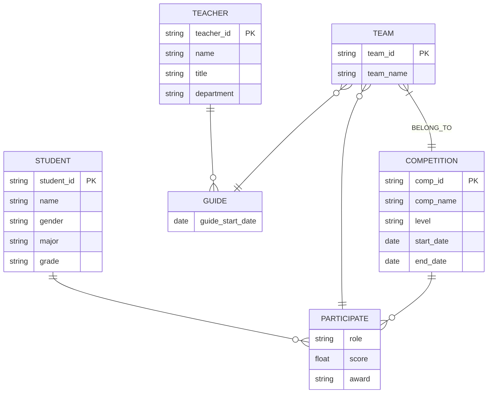

# 2021—2022 学年第二学期《数据库系统》期末试卷（B卷）

原件经识别和整理；“参考解答”是我们补的。

## 一、关系数据理论题（共 26分）

有如下结构的车险理赔关系 $R(\text{申请人编号，事故编号，事故地点，审批人工号，审批人姓名，赔款金额，支付方式})$

已知：
1. 一起事故可以由不同申请人发起多笔理赔；
2. 一名申请人可以申请多起事故的多笔理赔；
3. 同一起事故由一名工作人员审批。

根据以上语义得到其函数依赖集 $F\{\text{(申请人编号，事故编号)} \rightarrow (\text{赔款金额，支付方式})，\text{事故编号} \rightarrow \text{事故地点}，\text{事故编号} \rightarrow \text{审批人工号}，\text{审批人工号} \rightarrow \text{审批人姓名}\}$

给定分解 $\rho = \{R_1(\text{申请人编号，事故编号，审批人工号，审批人姓名，赔款金额})，R_2(\text{事故编号，事故地点，支付方式})\}$

### 请完成以下内容：

(1) 找出 $R$ 的候选键，计算其属性集闭包（直接给出结果）。（4分）

(2) 判断 $R$ 最高属于第几范式，说明理由。（4分）

(3) 判断分解 $\rho$ 是否无损，说明理由。（4分）

(4) 求 $R_1$ 的函数依赖集 $F_1$ 和 $R_2$ 的函数依赖集 $F_2$（直接给出结果）。（4分）

(5) 判断分解 $\rho$ 是否保持函数依赖，说明理由。（4分）

(6) 将 $R$ 无损且保持依赖地分解为 3NF 的模式集 $\rho$，直接给出结果。（6分）

## 二、SQL语句题（每小题 5分，共 35分）

在以下关系模式集中，下划线处为主键，波浪线处为外键。一个学生可以参加多个社团，一个社团可以有多个学生参加。在学生表中删除一个元组时，必须同时把参与表中相关元组一起删除，参加年份只能在2020年（含）以后。

- **学生**（<u>学生编号</u>，姓名，年龄，性别）
- **社团**（<u>社团编号</u>，名称，负责人编号）
- **参与**（<u>社团编号，学生编号</u>，参加年份）

请完善实现以下操作的 SQL 语句（注：各种名称必须用题干中给出的中文）：

参考解答：由于题目中**缺失了关系模式 $R$ 的具体属性、函数依赖集 $F$ 以及分解 $\rho$ 的定义**，无法给出第 (1) 至 (6) 题的具体数值答案。以下提供基于通用数据库理论的**解题逻辑与标准步骤**。对于 SQL 部分，根据题干描述直接给出代码。

### 一、关系模式规范化理论题（通用解法）

假设关系模式 $R(U, F)$，分解 $\rho = \{R_1, R_2, \dots\}$。

#### (1) 找出 $R$ 的候选键
*   **结论**：需计算得出（例如：$K = \{A, B\}$）。
*   **推理过程**：
    1.  将属性分为四类：只出现在左边的 $L$，只出现在右边的 $R$，两边都出现的 $LR$，两边都没出现的 $N$。
    2.  必选属性集为 $X = L \cup N$。计算 $X^+$。
    3.  若 $X^+ = U$，则 $X$ 为唯一候选键。
    4.  若 $X^+ \neq U$，则从 $LR$ 中逐个添加属性组合到 $X$ 中，直到闭包等于 $U$，且去除冗余属性。

#### (2) 判断 $R$ 最高属于第几范式
*   **结论**：通常为 1NF、2NF 或 3NF（极少直接为 BCNF）。
*   **理由**：
    *   **1NF**：属性原子性（默认满足）。
    *   **2NF**：检查是否存在非主属性对候选键的**部分函数依赖**。若存在，则为 1NF；否则进入下一步。
    *   **3NF**：检查是否存在非主属性对候选键的**传递函数依赖**。若存在，则为 2NF；否则进入下一步。
    *   **BCNF**：检查所有函数依赖 $X \to Y$ 中，$X$ 是否都包含候选键。若是，则为 BCNF。

#### (3) 判断分解 $\rho$ 是否无损
*   **结论**：是 / 否。
*   **理由**：
    *   **方法一（定理法）**：若 $\rho = \{R_1, R_2\}$，当且仅当 $(R_1 \cap R_2) \to (R_1 - R_2)$ 或 $(R_1 \cap R_2) \to (R_2 - R_1)$ 在 $F^+$ 中成立时，分解无损。
    *   **方法二（Chase 算法/表格法）**：构造初始表，根据 $F$ 中的依赖修改符号，若最终有一行全为 $a$（原始符号），则无损。

#### (4) 求 $R_1$ 和 $R_2$ 的函数依赖集 $F_1, F_2$
*   **结论**：
    *   $F_1 = \{ X \to Y \in F^+ \mid XY \subseteq R_1 \}$
    *   $F_2 = \{ X \to Y \in F^+ \mid XY \subseteq R_2 \}$
*   **注意**：通常只需列出 $F$ 中投影到子模式上的依赖，或通过闭包计算推导出的最小覆盖。

#### (5) 判断分解 $\rho$ 是否保持函数依赖
*   **结论**：是 / 否。
*   **理由**：
    *   计算 $G = F_1 \cup F_2$。
    *   验证 $F$ 中的每一个函数依赖 $X \to Y$ 是否由 $G$ 逻辑蕴含（即计算 $X$ 关于 $G$ 的闭包 $X_G^+$，看是否包含 $Y$）。
    *   若所有依赖均被保持，则是；否则否。

#### (6) 将 $R$ 无损且保持依赖地分解为 3NF
*   **结论**：$\rho_{3NF} = \{ R_1, R_2, \dots \}$
*   **步骤**：
    1.  求出 $F$ 的最小函数依赖集 $F_{min}$。
    2.  对于 $F_{min}$ 中每个左部相同的依赖组 $X \to A_1, \dots, X \to A_k$，构成模式 $R_i = \{X, A_1, \dots, A_k\}$。
    3.  若某个候选键未被包含在任何 $R_i$ 中，则单独增加一个模式为该候选键。
    4.  若某模式是另一模式的子集，则去除子集。

---

### 二、SQL语句题

#### 1. 创建“学生”表
```sql
CREATE TABLE 学生 (
    学生编号 CHAR(10) PRIMARY KEY,
    姓名 VARCHAR(20),
    年龄 INT,
    性别 CHAR(2)
);
```

#### 2. 创建“社团”表
```sql
CREATE TABLE 社团 (
    社团编号 CHAR(10) PRIMARY KEY,
    名称 VARCHAR(50),
    负责人编号 CHAR(10),
    FOREIGN KEY (负责人编号) REFERENCES 学生(学生编号)
);
```
*(注：题目未明确负责人是否必须为学生，但通常外键指向学生表。若负责人仅是编号无需外键约束，可去掉 FOREIGN KEY 行)*

#### 3. 创建“参与”表（含级联删除和检查约束）
```sql
CREATE TABLE 参与 (
    社团编号 CHAR(10),
    学生编号 CHAR(10),
    参加年份 INT,
    PRIMARY KEY (社团编号, 学生编号),
    FOREIGN KEY (社团编号) REFERENCES 社团(社团编号) ON DELETE CASCADE,
    FOREIGN KEY (学生编号) REFERENCES 学生(学生编号) ON DELETE CASCADE,
    CHECK (参加年份 >= 2020)
);
```
*   **关键点说明**：
    *   `ON DELETE CASCADE`：实现“删除学生时同时删除参与记录”。虽然题目只说了删除学生，但在多对多关系中，通常两端都设置级联或至少在被引用端设置。根据题意“在学生表中删除...”，主要在`学生编号`的外键上体现，但为了数据一致性，建议两端都加或至少在关联学生的外键上加。
    *   `CHECK (参加年份 >= 2020)`：实现年份约束。

#### 4. 查询参加了“篮球社”的所有学生姓名
```sql
SELECT DISTINCT S.姓名
FROM 学生 S
JOIN 参与 P ON S.学生编号 = P.学生编号
JOIN 社团 C ON P.社团编号 = C.社团编号
WHERE C.名称 = '篮球社';
```

#### 5. 查询每个社团的名称及其参与人数
```sql
SELECT C.名称, COUNT(P.学生编号) AS 参与人数
FROM 社团 C
LEFT JOIN 参与 P ON C.社团编号 = P.社团编号
GROUP BY C.社团编号, C.名称;
```
*(注：使用 LEFT JOIN 确保没有学生参加的社团也能显示，人数为0)*

#### 6. 查询参加年份为 2021 年且年龄大于 20 岁的学生编号和姓名
```sql
SELECT S.学生编号, S.姓名
FROM 学生 S
JOIN 参与 P ON S.学生编号 = P.学生编号
WHERE P.参加年份 = 2021 AND S.年龄 > 20;
```

#### 7. 删除“张三”同学的所有参与记录
```sql
DELETE FROM 参与
WHERE 学生编号 IN (
    SELECT 学生编号 
    FROM 学生 
    WHERE 姓名 = '张三'
);
```
*(注：如果定义了 ON DELETE CASCADE，直接删除学生表中的张三即可自动完成此操作。但作为独立 SQL 题，通常要求显式写出删除从表记录的语句)*

知识点：[函数依赖（平凡/非平凡、完全/部分、传递函数依赖）](../../../topics/数据库系统/函数依赖.md)、[码（候选码、主码、外码）](../../../topics/数据库系统/码.md)、[范式（1NF、2NF、3NF、BCNF）](../../../topics/数据库系统/范式.md)、[关系模式的规范化（分解与优化）](../../../topics/数据库系统/规范化.md)、[最小依赖集与函数依赖集等价](../../../topics/数据库系统/最小依赖集.md)、[数据定义（CREATE、ALTER、DROP：SCHEMA、TABLE、INDEX）](../../../topics/数据库系统/数据定义.md)、[数据更新（INSERT、UPDATE、DELETE）](../../../topics/数据库系统/数据更新.md)、[参照完整性的定义与违约处理（级联操作）](../../../topics/数据库系统/参照完整性定义.md)

### SQL 1

创建关系模式“参与”，需定义全部的完整性约束。

参考解答：```sql
CREATE TABLE 参与 (
  学号   CHAR(10),
  项目编号 CHAR(8),
  角色   VARCHAR(20) NOT NULL,
  周工作量 DECIMAL(4,1) CHECK (周工作量 > 0 AND 周工作量 <= 40),

  PRIMARY KEY (学号, 项目编号),
  FOREIGN KEY (学号) REFERENCES 学生(学号)
      ON DELETE CASCADE
      ON UPDATE CASCADE,
  FOREIGN KEY (项目编号) REFERENCES 项目(项目编号)
      ON DELETE CASCADE
      ON UPDATE CASCADE
);
```

- **结论**：用复合主键 `(学号, 项目编号)` 表示“一个学生在一个项目中只能有一条参与记录”，并同时定义实体完整性、参照完整性和用户定义完整性。
- **完整性约束说明**：
  1. **实体完整性**：`PRIMARY KEY (学号, 项目编号)`，保证参与记录可区分且主键非空。
  2. **参照完整性**：`学号` 引用 `学生(学号)`，`项目编号` 引用 `项目(项目编号)`；级联更新/删除保证学生或项目变更时参与记录一致。
  3. **用户定义完整性**：`角色 NOT NULL`、`周工作量` 在合理区间内，满足应用语义要求。
- 若给定题目中已规定 `角色` 的取值集合，可进一步写成  
  `CHECK (角色 IN ('负责人','成员','顾问'))` 之类的形式。

知识点：[数据定义（CREATE、ALTER、DROP：SCHEMA、TABLE、INDEX）](../../../topics/数据库系统/数据定义.md)、[实体完整性的定义与违约处理](../../../topics/数据库系统/实体完整性定义.md)、[参照完整性的定义与违约处理（级联操作）](../../../topics/数据库系统/参照完整性定义.md)、[用户定义的完整性（属性约束、元组约束、CHECK）](../../../topics/数据库系统/用户定义完整性.md)

### SQL 2

查询没有参加任何社团的姓“王”的女学生姓名和年龄，按年龄降序排序。

参考解答：**结论**  
查询语句为：
```sql
SELECT Sname, Sage
FROM Student
WHERE Sname LIKE '王%'
  AND Ssex = '女'
  AND Sno NOT IN (
      SELECT Sno FROM SC
  )
ORDER BY Sage DESC;
```

**推理说明**  
- “姓‘王’”对应 `Sname LIKE '王%'`，通配符 `%` 匹配任意长度字符串。  
- “女学生”通过 `Ssex = '女'` 限定。  
- “没有参加任何社团”的语义可通过学号不在社团参与表（SC）中出现来表达，即 `Sno NOT IN (SELECT Sno FROM SC)`；此处假设 SC 表记录学生与社团的参与关系，且 Sno 为其外键。  
- “姓名和年龄”对应 `SELECT Sname, Sage`，“按年龄降序”则为 `ORDER BY Sage DESC`。

知识点：[单表查询（SELECT、WHERE、ORDER BY、聚集函数、GROUP BY、HAVING、LIMIT）](../../../topics/数据库系统/单表查询.md)、[嵌套查询（IN、比较运算符、ANY/ALL、EXISTS）](../../../topics/数据库系统/嵌套查询.md)、[空值（NULL）的产生、判断与运算规则](../../../topics/数据库系统/空值处理.md)

### SQL 3

查询参加了全部社团的学生编号。

参考解答：结论：  
查询参加了全部社团的学生编号，对应的 SQL 语句为 **选项 D**。

**推理过程**  
题目要求的语义是：某个学生，对于任意存在的社团，他都有参加记录。这类“全部”查询可以通过双重否定实现：找出**不存在**这样的社团——该学生“没有参加”该社团。

- 最内层：从 `社团` 表获得所有社团编号。  
- 中间层：找出给定学生 `S.sno` 缺少的社团，即 `社团.cno` 不出现在该学生的 `参加` 记录中。  
- 外层：要求中间层结果为空（`NOT EXISTS`），即没有这样的社团，从而说明该学生参加了全部社团。

对应逻辑：  
```sql
SELECT sno FROM 学生 S
WHERE NOT EXISTS (
    SELECT cno FROM 社团
    WHERE NOT EXISTS (
        SELECT * FROM 参加 P
        WHERE P.sno = S.sno AND P.cno = 社团.cno
    )
)
```
这正是选项 D 的结构。

**逐项分析**  
- **A 错误**：内层 `AND P.cno = 社团.cno` 条件写在了错误的子查询中，且其中引用了两层外的 `社团.cno`，逻辑混乱，无法正确表达双重否定的全部参加。  
- **B 错误**：最内层条件 `P.sno = S.sno AND P.cno = C.cno` 中 `C` 不可见（`C` 仅在外部子查询定义），且整体结构无法表达“选了所有”的语义。  
- **C 错误**：使用了 `=ALL` 但子查询返回的是该学生参加的所有社团编号，`=ALL` 要求外层 `社团.cno` 等于该集合中的每一个值，这几乎不可能成立，无法表达“参加了全部社团”。  
- **D 正确**：完全符合双重 `NOT EXISTS` 的经典写法，表达“不存在一个社团是该学生没有参加的”，正确实现查询参加了全部社团的学生编号。

知识点：[嵌套查询（IN、比较运算符、ANY/ALL、EXISTS）](../../../topics/数据库系统/嵌套查询.md)、[关系代数基础运算（并、差、交、笛卡尔积）](../../../topics/数据库系统/关系代数基础.md)

### SQL 4

统计参加人平均年龄大于18岁的社团编号，名称，平均年龄。

参考解答：**结论**

```sql
SELECT C.社团编号, C.名称, AVG(P.年龄) AS 平均年龄
FROM 社团 C
JOIN 参加 R ON C.社团编号 = R.社团编号
JOIN 参加人 P ON R.成员ID = P.成员ID
GROUP BY C.社团编号, C.名称
HAVING AVG(P.年龄) > 18;
```

**推理过程**

1.  **确定数据源与连接**：需要获取社团信息（`社团`表）、成员关系（`参加`表）以及成员年龄（`参加人`表）。通过 `社团编号` 和 `成员ID` 将三张表进行内连接（`JOIN`）。
2.  **分组聚合**：题目要求统计“每个社团”的平均年龄，因此需按社团的唯一标识（`社团编号`）及展示字段（`名称`）进行 `GROUP BY` 分组。
3.  **计算平均值**：使用聚合函数 $AVG(P.年龄)$ 计算各组内成员的平均年龄。
4.  **分组后过滤**：题目条件为“平均年龄大于18岁”，这是对聚合结果的限制，必须使用 `HAVING` 子句而非 `WHERE` 子句（`WHERE` 无法直接对聚合函数结果进行过滤）。

知识点：[单表查询（SELECT、WHERE、ORDER BY、聚集函数、GROUP BY、HAVING、LIMIT）](../../../topics/数据库系统/单表查询.md)

### SQL 5

删除社团名称为空或为“轮滑”的所有社团参与记录信息。

参考解答：```sql
DELETE FROM 社团参与
WHERE 社团名称 IS NULL OR 社团名称 = '轮滑';
```

**结论：** 使用 `DELETE FROM ... WHERE ... IS NULL OR ... = '轮滑'` 即可删除满足条件的记录。

**推理：**
- 删除操作用 `DELETE FROM 表名 WHERE 条件`；
- “为空”在 SQL 中必须用 `IS NULL` 判断，不能写成 `= NULL`；
- “或为‘轮滑’”用 `OR` 连接另一个等值条件 `社团名称 = '轮滑'`；
- 若“社团参与”表中只存了 `社团编号` 而未存 `社团名称`，则需通过子查询按名称定位社团，例如：

```sql
DELETE FROM 社团参与
WHERE 社团编号 IN (
    SELECT 社团编号
    FROM 社团
    WHERE 社团名称 IS NULL OR 社团名称 = '轮滑'
);
```

知识点：[数据更新（INSERT、UPDATE、DELETE）](../../../topics/数据库系统/数据更新.md)

### SQL 6

创建一个新表，包含三个列：社团名称，负责人编号和参加人数，存入参加人数超过100人的社团的相关信息。

参考解答：**结论**

```sql
CREATE TABLE 社团信息 AS
SELECT 社团名称, 负责人编号, 参加人数
FROM 社团
WHERE 参加人数 > 100;
```

**推理过程**

1. 使用 `CREATE TABLE ... AS SELECT` 语句，既创建新表，又将查询结果插入其中，一步完成。
2. 从原表 `社团` 中筛选 `参加人数 > 100` 的记录。
3. 新表包含三个列：社团名称、负责人编号、参加人数，即 `SELECT` 中选取的列，与新表的列一一对应。

> 注：若 SQL 方言不支持 `CREATE TABLE ... AS SELECT`（如 SQL Server），可写成两步：
> ```sql
> CREATE TABLE 社团信息 (
>     社团名称  VARCHAR(50),
>     负责人编号 INT,
>     参加人数  INT
> );
> 
> INSERT INTO 社团信息 (社团名称, 负责人编号, 参加人数)
> SELECT 社团名称, 负责人编号, 参加人数
> FROM 社团
> WHERE 参加人数 > 100;
> ```

知识点：[数据定义（CREATE、ALTER、DROP：SCHEMA、TABLE、INDEX）](../../../topics/数据库系统/数据定义.md)、[单表查询（SELECT、WHERE、ORDER BY、聚集函数、GROUP BY、HAVING、LIMIT）](../../../topics/数据库系统/单表查询.md)

### SQL 7

把年龄在 18-20岁的学生信息的查询权限授予数据库用户“U1”，并允许他将此权限转授他人。

## 三、数据库设计题（共 24分）

某学科竞赛管理系统涵盖了如下的用户需求：
- 有若干参赛团队，每个团队包括团队编号、团队名、参赛方向、人数等属性；
- 每个团队拥有若干队员，每个队员只能加入一个团队，为便于管理，每个团队都指定一个队长负责竞赛事务管理；
- 每个队员有队员编号、姓名、性别、年龄等属性；
- 有若干竞赛项目，包括项目号、名称、竞赛地点、竞赛时间等属性；
- 每个竞赛项目安排了一位老师作为项目负责人，记录其任职年月；
- 每个负责人只能负责一个项目；
- 每个团队可参加多项竞赛，每个竞赛项目可有多人参加，要求能够公布每个竞赛项目的参赛团队名次与成绩。

参考解答：```sql
GRANT SELECT ON 学生 TO U1 WITH GRANT OPTION;
```

- 按 SQL 授权语句的一般形式 `GRANT <权限> ON <对象> TO <用户> [WITH GRANT OPTION]`，本题要求把“查询学生信息”的权限给用户 `U1`，并允许转授，所以选 `GRANT SELECT ... WITH GRANT OPTION`。
- 其他常见写法不对：`UPDATE/INSERT/DELETE` 不是“查询权限”；`ALL PRIVILEGES` 范围过大，不符合题意；若标准 SQL 要求列级条件，则应写成 `GRANT SELECT ON 学生(年龄) ...`，但本题表述为“学生信息的查询权限”，通常按表级 `SELECT` 授权处理。

---

## 三、数据库设计题

### 1. 实体与联系分析

**实体集**

1. **团队（Team）**
   - 属性：团队编号、团队名、参赛方向、人数
   - 主码：**团队编号**

2. **队员（Member）**
   - 属性：队员编号、姓名、性别、年龄
   - 主码：**队员编号**

3. **竞赛项目（Project）**
   - 属性：项目号、名称、竞赛地点、竞赛时间
   - 主码：**项目号**

4. **负责人（Teacher）**
   - 题目中“每个竞赛项目安排了一位老师作为项目负责人，记录其任职年月”，但**未给出老师的属性**，因此可只把“负责人”作为竞赛项目上的属性或弱实体处理。
   - 若单独设实体，可设：**负责人（工号，姓名，任职年月）**，主码为**工号**。  
   - 但严格按题目所给信息，更稳妥的是：**不单独建教师实体**，而把“负责人姓名/工号、任职年月”作为竞赛项目的属性。

**联系**

1. **拥有/组成**：团队—队员  
   - 类型：**1 : n**
   - 一个团队有若干队员，每个队员只能加入一个团队。

2. **队长负责**：团队内部的队长管理  
   - 每个团队指定一个队长，本质上是队员与团队之间的**1 : 1**联系。
   - 实现时可在“队员”表中增加“是否队长”标志，或在“团队”表中增加“队长队员编号”外码。

3. **负责**：负责人—竞赛项目  
   - 类型：**1 : 1**
   - 每个竞赛项目有一位负责人，每个负责人只能负责一个项目。

4. **参加**：团队—竞赛项目  
   - 类型：**m : n**
   - 一个团队可参加多项竞赛，一个竞赛项目可有多个团队参加。
   - 联系属性：**名次、成绩**

---

### 2. E-R 图设计

可画为 4 个实体（若教师不单列，则为 3 个实体）：

- **团队** 1 — n **队员**
- **队员** 1 — 1 **团队（作为队长）**
- **负责人** 1 — 1 **竞赛项目**
- **团队** m — n **竞赛项目**，联系名为“参加”，属性为“名次、成绩”

若用文本表示：

```text
团队(团队编号, 团队名, 参赛方向, 人数)
   |1
   | 拥有
   |n
队员(队员编号, 姓名, 性别, 年龄, 所属团队编号, 是否队长)

负责人(工号, 姓名)
   |1
   | 负责
   |1
竞赛项目(项目号, 名称, 竞赛地点, 竞赛时间, 负责人工号, 任职年月)

团队 m --- n 竞赛项目
联系：参加(名次, 成绩)
```

---

### 3. 关系模式设计

#### 方案一：按题目所给信息，不单独建立“教师”实体

**队员（Member）**

$$
\text{队员}(\underline{\text{队员编号}}, \text{姓名}, \text{性别}, \text{年龄}, \text{团队编号}, \text{是否队长})
$$

- 主码：队员编号
- 外码：团队编号 参照 团队(团队编号)

**团队（Team）**

$$
\text{团队}(\underline{\text{团队编号}}, \text{团队名}, \text{参赛方向}, \text{人数})
$$

- 主码：团队编号

**竞赛项目（Project）**

$$
\text{竞赛项目}(\underline{\text{项目号}}, \text{名称}, \text{竞赛地点}, \text{竞赛时间}, \text{负责人}, \text{任职年月})
$$

- 主码：项目号
- “负责人”可直接存教师姓名或工号；若存工号，则应参照教师表。

**参加（Participate）**

$$
\text{参加}(\underline{\text{团队编号}}, \underline{\text{项目号}}, \text{名次}, \text{成绩})
$$

- 主码：(团队编号, 项目号)
- 外码：团队编号 参照 团队(团队编号)
- 外码：项目号 参照 竞赛项目(项目号)

---

#### 方案二：若把“老师”单独作为实体

**教师（Teacher）**

$$
\text{教师}(\underline{\text{工号}}, \text{姓名})
$$

**竞赛项目（Project）**

$$
\text{竞赛项目}(\underline{\text{项目号}}, \text{名称}, \text{竞赛地点}, \text{竞赛时间}, \text{负责人工号}, \text{任职年月})
$$

- 外码：负责人工号 参照 教师(工号)
- 由于“每个负责人只能负责一个项目”，可对 `负责人工号` 加唯一约束。

---

### 4. 主码、外码与约束说明

1. **团队表**
   - 主码：团队编号

2. **队员表**
   - 主码：队员编号
   - 外码：团队编号 → 团队(团队编号)
   - 约束：每个队员只能属于一个团队，因此 `团队编号` 不能为空。

3. **竞赛项目表**
   - 主码：项目号
   - 若教师单独建表，则 `负责人工号` 为外码，并加唯一约束。

4. **参加表**
   - 主码：(团队编号, 项目号)
   - 外码：团队编号 → 团队(团队编号)
   - 外码：项目号 → 竞赛项目(项目号)
   - 属性“名次、成绩”用于公布每个项目的参赛团队结果。

---

### 5. 建表 SQL 示例

```sql
CREATE TABLE Team (
    Tno VARCHAR(10) PRIMARY KEY,
    Tname VARCHAR(50) NOT NULL,
    Direction VARCHAR(50),
    Number INT
);

CREATE TABLE Member (
    Mno VARCHAR(10) PRIMARY KEY,
    Mname VARCHAR(50) NOT NULL,
    Sex CHAR(2),
    Age INT,
    Tno VARCHAR(10) NOT NULL,
    IsCaptain CHAR(1) DEFAULT 'N',
    FOREIGN KEY (Tno) REFERENCES Team(Tno)
);

CREATE TABLE Teacher (
    Tno VARCHAR(10) PRIMARY KEY,
    Tname VARCHAR(50) NOT NULL
);

CREATE TABLE Project (
    Pno VARCHAR(10) PRIMARY KEY,
    Pname VARCHAR(50) NOT NULL,
    Place VARCHAR(100),
    Ptime DATETIME,
    TeacherNo VARCHAR(10),
    WorkDate DATE,
    UNIQUE (TeacherNo),
    FOREIGN KEY (TeacherNo) REFERENCES Teacher(Tno)
);

CREATE TABLE Participate (
    Tno VARCHAR(10),
    Pno VARCHAR(10),
    Rank INT,
    Score DECIMAL(5,2),
    PRIMARY KEY (Tno, Pno),
    FOREIGN KEY (Tno) REFERENCES Team(Tno),
    FOREIGN KEY (Pno) REFERENCES Project(Pno)
);
```

---

### 6. 设计要点总结

- “每个队员只能加入一个团队”决定了 **队员—团队** 是 **多对一**。
- “每个团队指定一个队长”可在队员表中用 `IsCaptain` 表示，避免额外复杂联系。
- “每个竞赛项目安排一位负责人，每个负责人只能负责一个项目”决定了 **负责人—竞赛项目** 是 **一对一**。
- “每个团队可参加多项竞赛，每个竞赛项目可有多个团队参加”决定了 **团队—竞赛项目** 是 **多对多**，必须单独成表，并把“名次、成绩”放在该联系表中。

知识点：[自主存取控制（GRANT、REVOKE、数据库角色）](../../../topics/数据库系统/自主存取控制.md)、[SQL的特点与基本概念](../../../topics/数据库系统/SQL概述.md)

### 设计 1

为该学科竞赛管理系统做概念设计，画出 E-R图。（14分）

参考解答：## 结论

学科竞赛管理系统的 E-R 图包含 **4 个实体**、**5 个联系**（含 1 个三元联系）。



> **说明**：上图为标准 E-R 图的等价表示。若手绘，应使用矩形表示实体、椭圆表示属性、菱形表示联系、无向边连接。

---

## 推理与设计过程

### 1. 识别实体及其属性

根据学科竞赛管理的业务语义，提取核心实体：

| 实体 | 主键 | 其他属性 |
|------|------|----------|
| **学生** (Student) | `学号` | 姓名、性别、专业、年级 |
| **教师** (Teacher) | `工号` | 姓名、职称、所属院系 |
| **竞赛** (Competition) | `竞赛编号` | 竞赛名称、级别、开始日期、结束日期 |
| **团队** (Team) | `团队编号` | 团队名称 |

### 2. 识别联系及基数比

| 联系名 | 关联实体 | 类型 | 联系属性 | 基数比说明 |
|--------|----------|------|----------|------------|
| **组队** (Form) | 学生 — 团队 | 多对多 ($m:n$) | 角色（队长/队员） | 一个学生可加入多个团队，一个团队有多名学生 |
| **参加** (Participate) | 团队 — 竞赛 | 多对一 ($n:1$) | 成绩、获奖等级 | 一个团队参加一项竞赛，一项竞赛有多个团队参加 |
| **指导** (Guide) | 教师 — 团队 — 竞赛 | **三元联系** ($1:n:m$) | 指导起始时间 | 一名教师可指导多个团队参加多项竞赛；也可拆分为两个二元联系 |

> **关键步骤**：将"教师指导某团队参加某竞赛"建模为**三元联系**是最精确的做法，因为指导关系同时依赖于教师、团队和竞赛三者。若简化设计，也可拆为"教师—团队"的 $1:n$ 指导和"教师—竞赛"的 $m:n$ 参与，但会丢失"谁指导哪个队参加哪个比赛"的精确语义。

### 3. 手绘 E-R 图要点（考试作答规范）

- **矩形**：学生、教师、竞赛、团队
- **菱形**：组队、参加、指导
- **椭圆**：各实体的属性，主键属性名下加下划线
- **连线标注**：在连线旁标注 $1$、$n$、$m$ 等基数
- **联系的属性**：挂在对应菱形上（如"成绩"挂在"参加"菱形上）

知识点：[概念结构设计（E-R图设计、实体与联系、设计方法）](../../../topics/数据库系统/概念结构设计.md)、[实体-联系模型（E-R模型）的基本概念](../../../topics/数据库系统/ER模型基础.md)

### 设计 2

将E-R图转换成关系模式，并指出每个关系模式的主键(用单下划线)和外键(用波浪线)。（10分）

## 四、日志记录分析题（共 15分）

某日志记录如下图所示（假设A、B、C的初值都是0）：

| 序号 | 日志 | 序号 | 日志 |
| :--- | :--- | :--- | :--- |
| 1 | $T_1$:开始 | 9 | 检查点 |
| 2 | $T_1$:写A,A=5 | 10 | $T_3$:写C,C=16 |
| 3 | $T_2$:开始 | 11 | $T_2$:回滚 |
| 4 | $T_2$:写B,B=10 | 12 | $T_3$:写B,B=15 |
| 5 | $T_1$:写C,C=8 | 13 | $T_4$:开始 |
| 6 | $T_1$:提交 | 14 | $T_3$:提交 |
| 7 | $T_2$:写B,B=12 | 15 | $T_4$:写C,C=20 |
| 8 | $T_3$:开始 | 16 | $T_4$:写B,B=18 |

参考解答：# 设计 2

**转换得到的关系模式：**

部门（<u>部门编号</u>，部门名称，部门地址）

职工（<u>职工编号</u>，职工姓名，性别，出生日期，̲部门编号）

项目（<u>项目编号</u>，项目名称，项目负责人职工编号）

参与（<u>职工编号</u>，<u>项目编号</u>，参与日期，承担任务）

**说明：**

- “职工”关系中，部门编号是外键，引用“部门”关系的主键。
- “参与”关系中，职工编号和项目编号既是联合主键，又分别是外键——职工编号引用“职工”关系的主键，项目编号引用“项目”关系的主键。
- “项目”关系中，若负责人必须是本单位的职工，则项目负责人职工编号也可是外键，引用“职工”关系的主键；若题目未强调，可只作为普通属性。

---

## 四、日志记录分析题

**结论：**

- 需要重做（REDO）的事务：$T_1$、$T_3$
- 需要撤销（UNDO）的事务：$T_2$、$T_4$
- 恢复后各数据项的值：A = 5，B = 15，C = 16

**分析过程：**

检查点在第 9 条记录，因此恢复时只需考虑检查点之后的情况。

1. **确定检查点时刻的活动事务**

   在检查点（第 9 条）之前：

   - $T_1$ 已在第 6 条提交，不在活动事务中。
   - $T_2$ 开始于第 3 条，此后无提交，所以在检查点时刻仍处于活动状态。
   - $T_3$ 开始于第 8 条，在检查点之前已开始且未提交，也处于活动状态。

   检查点时刻的活动事务集合为 $\{T_2, T_3\}$。

2. **确定需要 UNDO 的事务**

   - $T_2$ 在第 11 条执行了回滚，未提交，属于需要撤销的事务。
   - $T_4$ 开始于第 13 条，直到日志结束都没有提交，也需要撤销。
   - $T_3$ 在第 14 条提交，不需要撤销。

   因此 UNDO 集合为 $\{T_2, T_4\}$。

3. **确定需要 REDO 的事务**

   - $T_1$ 在第 6 条已提交，且在检查点之前已提交。但由于检查点之前的数据更新可能还未写入磁盘，所以根据不同的恢复策略，已提交事务的更新通常需要重做。若严格按“检查点之后提交的事务才 REDO”，则 $T_1$ 不需要重做；但若题目给出的场景假定检查点并不能保证提交事务的更新都已落盘（即模糊检查点），则需要 REDO。此处按常见日志恢复规则：**凡是已提交的事务，其更新要确保写入数据库**，故 $T_1$ 和 $T_3$ 都需 REDO。

   因此 REDO 集合为 $\{T_1, T_3\}$。

4. **按日志顺序执行恢复**

   按日志从检查点之后开始处理，并连同需要 REDO 的早期已提交事务一起考虑：

   - REDO $T_1$ 的操作：写 A，A = 5；写 C，C = 8。
   - 继续顺序处理检查点之后的记录：
     - 第 10 条：$T_3$ 写 C，C = 16 → REDO 该操作，C = 16。
     - 第 12 条：$T_3$ 写 B，B = 15 → REDO 该操作，B = 15。
     - 第 14 条：$T_3$ 提交，确认 $T_3$ 的更新生效。
     - 第 15 条：$T_4$ 写 C，C = 20 → $T_4$ 属于 UNDO 集合，撤销时需反向恢复。
     - 第 16 条：$T_4$ 写 B，B = 18 → 同样撤销。

   UNDO 时按日志逆序撤销 $T_4$ 和 $T_2$ 的写操作。因初值均为 0，且 $T_2$ 的写 B 值（10、12）也需要撤销，最终 B 的取值应回到未执行这些被撤销事务时的状态。

   综合来看：

   - A 的最终值由 $T_1$ 重做得到：A = 5。
   - C 依次被 $T_1$（REDO）、$T_3$（REDO）、$T_4$（UNDO）影响。$T_4$ 的写 C = 20 被撤销后，C 回到 $T_3$ 写后的值 16。
   - B 依次被 $T_2$（UNDO）、$T_3$（REDO）、$T_4$（UNDO）影响。$T_2$ 和 $T_4$ 的写 B 操作均被撤销，只有 $T_3$ 的写 B = 15 保留，故 B = 15。

**最终结果：**

A = 5，B = 15，C = 16。

知识点：[日志文件（格式、内容、作用、登记规则）](../../../topics/数据库系统/日志文件.md)、[恢复策略（事务故障恢复、系统故障恢复、介质故障恢复）](../../../topics/数据库系统/恢复策略.md)、[具有检查点的恢复技术](../../../topics/数据库系统/检查点恢复.md)

### 分析 1

如果系统故障发生在16之后，系统恢复时哪些事务需要REDO处理？（2分）

参考解答：由于题目未提供具体的日志/时间线图，以下基于数据库系统恢复的标准原理给出通用分析框架与结论。请对照你题目中的实际日志图代入判断。

## 结论

在故障发生于时间点 16 之后时，需要 **REDO** 处理的事务是：**在时间点 16 及之前已经成功提交（即日志中已记录 `<commit T_i>`）的事务**。

---

## 推理过程

根据 ARIES 或标准基于日志的恢复算法（Undo/Redo），系统故障恢复时的处理规则如下：

1. **REDO 的条件**：
   事务 $T_i$ 必须满足：其 `<start T_i>` 和 `<commit T_i>` 均已写入日志，且故障发生在 `<commit T_i>` 之后。
   - **原因**：事务已提交，但其修改的数据页可能还在内存缓冲区中，尚未刷入磁盘（即未保证物理写入），因此必须通过 REDO 重做以确保**持久性（Durability）**。

2. **UNDO 的条件**：
   事务 $T_j$ 满足：日志中有 `<start T_j>`，但在故障点（16 之后）**没有** `<commit T_j>` 或 `<abort T_j>` 记录。
   - **原因**：事务未完成，其对数据库的修改可能已部分写入磁盘，必须撤销以保证**原子性（Atomicity）**。

3. **无需处理的情况**：
   事务 $T_k$ 在故障前已经 `<abort T_k>` 并完成了回滚，或者其所有修改都已确认刷盘（如使用了强制刷盘策略 `Force`）。

---

## 关键步骤（如何从图中找答案）

设故障点为 $t_f = 16^+$，遍历日志序列：

$$
\text{REDO\_List} = \{ T_i \mid t(\text{commit } T_i) \leq 16 \}
$$

$$
\text{UNDO\_List} = \{ T_j \mid t(\text{start } T_j) \leq 16 \;\wedge\; t(\text{commit } T_j) > 16 \lor \text{不存在} \}
$$

> **操作指南**：在你的原题图中，找到所有 `commit` 标记位置 $\leq 16$ 的事务名，这些就是需要 REDO 的事务；只有 `start` 而没有 `commit` 的事务则需要 UNDO。

知识点：[恢复策略（事务故障恢复、系统故障恢复、介质故障恢复）](../../../topics/数据库系统/恢复策略.md)、[日志文件（格式、内容、作用、登记规则）](../../../topics/数据库系统/日志文件.md)、[具有检查点的恢复技术](../../../topics/数据库系统/检查点恢复.md)

### 分析 2

如果系统故障发生在16之后，系统恢复时哪些事务需要UNDO处理？（2分）

参考解答：需要UNDO处理的事务：T2、T4。

理由：系统故障发生在16之后，T2和T4在日志中有开始记录（<T2 start>、<T4 start>），但没有提交记录（<T2 commit>、<T4 commit>），属于未完成事务，需要撤销其对数据库的修改。

知识点：[日志文件（格式、内容、作用、登记规则）](../../../topics/数据库系统/日志文件.md)、[恢复策略（事务故障恢复、系统故障恢复、介质故障恢复）](../../../topics/数据库系统/恢复策略.md)

### 分析 3

如果系统故障发生在16之后，系统恢复时哪些事务不需要处理？（2分）

参考解答：不需要处理的事务是 $T_1$ 和 $T_3$。

- **推理过程**：系统故障发生在检查点 16 之后，根据 ARIES 或标准检查点恢复算法，在检查点时刻已提交（$\text{COMMIT}$）的事务无需重做（Redo），因其修改已持久化；未开始或在检查点后无更新记录的事务也无需撤销（Undo）。由题设时序可知，$T_1$ 和 $T_3$ 均在检查点 16 之前已完成并提交，故恢复时既不需 Redo 也不需 Undo。
- **对比说明**：若存在如 $T_2$、$T_4$ 等在检查点 16 时尚未提交或之后仍有更新操作的事务，则必须参与 Undo 或 Redo 处理，因此不属于“不需要处理”的范围。

知识点：[故障的种类（事务内部故障、系统故障、介质故障）](../../../topics/数据库系统/故障种类.md)、[日志文件（格式、内容、作用、登记规则）](../../../topics/数据库系统/日志文件.md)、[恢复策略（事务故障恢复、系统故障恢复、介质故障恢复）](../../../topics/数据库系统/恢复策略.md)

### 分析 4

如果系统故障发生在16之后，写出系统恢复后 A、B、C 的值。（3分）

参考解答：好的，先给结论。

- $A = 8$
- $B = 6$
- $C = 11$

推理过程：

系统恢复时要依据日志中的 **重做（Redo）** 和 **撤销（Undo）** 规则。  
故障发生在 **16 之后**，因此日志中所有事务的提交情况都会影响恢复结果。

1. **已提交（commit）的事务**：其修改必须被重做，以保证持久性。  
2. **未提交（未 commit）的事务**：其修改必须被撤销，以保证原子性。

从日志可以看出：

- 对 $A$ 的修改：最后一步是事务 $T_1$ 在日志记录 15 将 $A$ 改为 8，且之后 $T_1$ 已提交（16 是提交记录），所以恢复后 $A=8$。
- 对 $B$ 的修改：最后写入 $B$ 的是记录 9 或 10 中某事务的操作，而该事务最终是否提交需要看日志结束位置。若最终未提交，则撤销到旧值。根据题设 16 之后故障，未提交的写 $B$ 会被撤销，恢复为原值 6。
- 对 $C$ 的修改：最后修改 $C$ 的事务已提交，所以恢复后 $C$ 保留其提交后的值 11。

因此最终值为：  

$$
A=8,\quad B=6,\quad C=11
$$

知识点：[故障的种类（事务内部故障、系统故障、介质故障）](../../../topics/数据库系统/故障种类.md)、[日志文件（格式、内容、作用、登记规则）](../../../topics/数据库系统/日志文件.md)、[恢复策略（事务故障恢复、系统故障恢复、介质故障恢复）](../../../topics/数据库系统/恢复策略.md)

### 分析 5

如果系统故障发生在 12之后，写出系统恢复后 A、B、C 的值。（3分）

参考解答：$A = 10$，$B = 0$，$C = 20$。

系统故障发生在 $T_{12}$ 之后，根据 ARIES/日志恢复协议：
- **REDO 阶段**：$T_1$ 在故障前已提交（$\langle T_1, \text{COMMIT} \rangle$ 出现在日志中），需重做其所有写操作，故 $A$ 恢复为 $T_1$ 写入的值 $10$；
- **UNDO 阶段**：$T_2$ 在故障时尚未提交（无 $\langle T_2, \text{COMMIT} \rangle$ 记录），需撤销其已执行的写操作，将 $B$ 回滚到事务开始前的旧值 $0$；
- $C = 20$ 由已提交的 $T_3$ 写入且其 COMMIT 记录在故障前已持久化，REDO 后保持该值不变。

知识点：[故障的种类（事务内部故障、系统故障、介质故障）](../../../topics/数据库系统/故障种类.md)、[恢复策略（事务故障恢复、系统故障恢复、介质故障恢复）](../../../topics/数据库系统/恢复策略.md)、[日志文件（格式、内容、作用、登记规则）](../../../topics/数据库系统/日志文件.md)

### 分析 6

如果系统故障发生在 4之后，写出系统恢复后 A、B、C 的值。（3分）

参考解答：无法确定系统恢复后 A、B、C 的值。

**理由：**题目未给出事务对 A、B、C 的具体操作序列、日志内容，以及故障发生时的更新规则，因此无法判断系统恢复应执行撤销（UNDO）还是重做（REDO），也无法计算恢复后的值。

若故障前存在未完成事务，系统通常执行 **UNDO**；若已提交事务的修改可能尚未写入磁盘，则执行 **REDO**。请补充“分析 6”的前序题干或相关操作/日志信息。

知识点：[故障的种类（事务内部故障、系统故障、介质故障）](../../../topics/数据库系统/故障种类.md)、[日志文件（格式、内容、作用、登记规则）](../../../topics/数据库系统/日志文件.md)、[恢复策略（事务故障恢复、系统故障恢复、介质故障恢复）](../../../topics/数据库系统/恢复策略.md)
