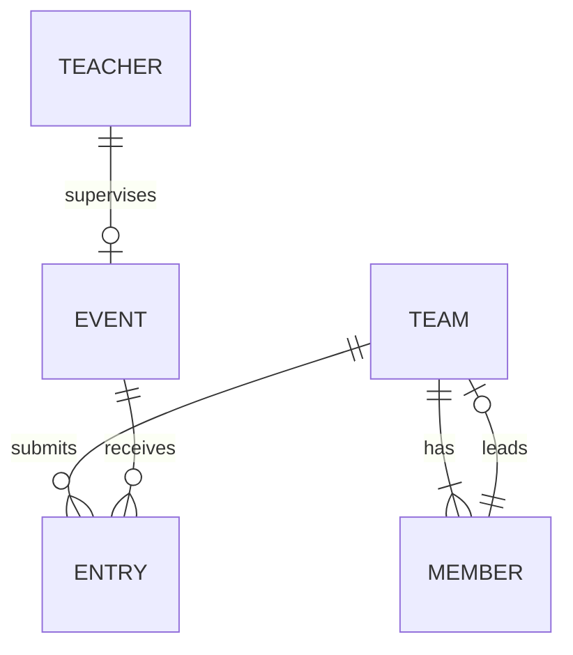

# 2021—2022 学年第二学期《数据库系统》期末试卷（B卷）

原卷四页，共 100 分，未附答案。下面简述原题，并单列独立编写的**参考解答**；原始题面和分值见页首来源。本文不是同卷的答题纸，也不把历史考试条件当作当前安排。

## 一、关系数据理论（26 分）

**题意：**车险理赔记录包含申请人编号 $X$、事故编号 $Y$、事故地点 $L$、审批人工号 $E$、审批人姓名 $N$、赔款金额 $M$ 和支付方式 $P$。一次事故可涉及多个申请人，一人也可申请多个事故，同一起事故由一个工作人员审批。按题给函数依赖 $XY\to MP$、$Y\to L$、$Y\to E$、$E\to N$，考查候选键、范式与分解。待判定的分解是 $R_1(X,Y,E,N,M)$ 和 $R_2(Y,L,P)$。

**参考解答：**

1. 唯一候选键是 $XY$，闭包含全部七个属性。$X$ 和 $Y$ 都不能从其他属性推出，任一键必须同时包含二者。
2. 假定各列原子，最高为 **1NF**。候选键的真子集 $Y$ 决定非主属性 $L,E$，已违反 2NF。
3. **有损。**交集只有 $Y$，而 $Y^+=\{Y,L,E,N\}$，既不能决定 $R_1$ 的 $X,M$，也不能决定 $R_2$ 的 $P$。如果同一事故的两条申请采用不同的支付方式，自然连接会把一人的金额搭配到另一人的支付方式，产生伪元组。
4. 用最小生成式写投影依赖：$F_1=\{XY\to M,Y\to E,E\to N\}$、$F_2=\{Y\to L\}$。例如 $Y\to N$ 仍由 $F_1$ 推出，无须重复写入生成式。
5. **不保持全部依赖。**用 $F_1,F_2$ 求 $XY$ 的闭包无法得到 $P$，故推不出原来的 $XY\to P$。
6. 可拆成 $(X,Y,M,P)$、$(Y,L,E)$、$(E,N)$，主键依次为 $XY$、$Y$、$E$。先沿 $E\to N$ 拆出审批人，再沿 $Y\to LE$ 拆出事故；两步都由交集决定其中一侧，故无损，且原依赖都可在单一子模式中检查。三个模式在给定依赖下也满足 BCNF。

> [!TIP]
> ==能无损还原关系==与==能分别检查约束==是两件事。前者看连接会不会增生伪元组，后者看投影依赖的并集能不能推出原依赖。

参见 [函数依赖](../../../topics/数据库系统/函数依赖.md)、[候选码](../../../topics/数据库系统/码.md)、[范式](../../../topics/数据库系统/范式.md)、[规范化](../../../topics/数据库系统/规范化.md)。

## 二、SQL（7 题，共 35 分）

**题意：**学生表有学生编号、姓名、年龄、性别；社团表有社团编号、名称、负责人编号。参与表以社团编号、学生编号为组合主键，两列分别引用社团和学生，另有参加年份。删学生须级联删除其参与记录，参加年份不得早于 2020。原题要求沿用中文标识符。下列答案用 PostgreSQL 风格，假设两个编号的类型与被引用列同为整数。

### 1. 建立参与表及完整性约束

**参考解答：**年份除了 CHECK 还须禁止 NULL；题目只指定学生端的级联。

```sql
CREATE TABLE "参与" (
  "社团编号" INTEGER,
  "学生编号" INTEGER,
  "参加年份" INTEGER NOT NULL CHECK ("参加年份" >= 2020),
  PRIMARY KEY ("社团编号", "学生编号"),
  FOREIGN KEY ("社团编号") REFERENCES "社团" ("社团编号"),
  FOREIGN KEY ("学生编号") REFERENCES "学生" ("学生编号") ON DELETE CASCADE
);
```

### 2. 查询未加入任何社团的王姓女学生

**参考解答：**输出姓名和年龄，按年龄降序；对每个人用学生编号检查是否存在参与记录。

```sql
SELECT s."姓名", s."年龄" FROM "学生" AS s
WHERE s."姓名" LIKE '王%' AND s."性别" = '女'
  AND NOT EXISTS (
    SELECT 1 FROM "参与" AS p WHERE p."学生编号" = s."学生编号"
  )
ORDER BY s."年龄" DESC;
```

### 3. 查询参加全部社团的学生编号

**参考解答：**“参加全部”是“不存在没有参加的社团”。社团表为空时，所有学生都满足这一全称条件。

```sql
SELECT s."学生编号" FROM "学生" AS s
WHERE NOT EXISTS (
  SELECT 1 FROM "社团" AS c
  WHERE NOT EXISTS (
    SELECT 1 FROM "参与" AS p
    WHERE p."社团编号" = c."社团编号" AND p."学生编号" = s."学生编号"
  )
);
```

### 4. 统计平均年龄大于 18 的社团

**参考解答：**只统计真实参与者，把组条件写在 HAVING 中。平均年龄恰为 18 的组不入选。

```sql
SELECT c."社团编号", c."名称", AVG(s."年龄") AS "平均年龄"
FROM "社团" AS c
JOIN "参与" AS p ON p."社团编号" = c."社团编号"
JOIN "学生" AS s ON s."学生编号" = p."学生编号"
GROUP BY c."社团编号", c."名称"
HAVING AVG(s."年龄") > 18;
```

### 5. 删除名称为空或为“轮滑”的社团参与记录

**参考解答：**删参与表的记录，不删社团。这里把“为空”同时覆盖 NULL 和空字符串；如果题中约定只指 NULL，可去掉空字符串条件。

```sql
DELETE FROM "参与"
WHERE "社团编号" IN (
  SELECT c."社团编号" FROM "社团" AS c
  WHERE c."名称" IS NULL OR c."名称" = '' OR c."名称" = '轮滑'
);
```

### 6. 保存参加人数超过 100 的社团信息

**参考解答：**按社团编号分组，防止同名社团被合并。参与表的主键防止一人重复计入同一社团；结果是新表，不是会随原数据更新的视图。

```sql
CREATE TABLE "百人以上社团" AS
SELECT c."名称" AS "社团名称", c."负责人编号", COUNT(*) AS "参加人数"
FROM "社团" AS c
JOIN "参与" AS p ON p."社团编号" = c."社团编号"
GROUP BY c."社团编号", c."名称", c."负责人编号"
HAVING COUNT(*) > 100;
```

### 7. 授予 U1 查询 18 至 20 岁学生的权限，允许转授

**参考解答：**先以视图限定可见行，再只给视图的查询权限；不要把底表的查询权限也授过去。假定角色确实以区分大小写的名称 "U1" 创建，授权由有权发布视图查询权限的所有者完成。可核对 [PostgreSQL 的视图权限](https://www.postgresql.org/docs/current/sql-createview.html)和 [GRANT 语法](https://www.postgresql.org/docs/current/sql-grant.html)。

```sql
CREATE VIEW "十八至二十岁学生" AS
SELECT "学生编号", "姓名", "年龄", "性别"
FROM "学生" WHERE "年龄" BETWEEN 18 AND 20;

GRANT SELECT ON "十八至二十岁学生" TO "U1" WITH GRANT OPTION;
```

参见 [参照完整性](../../../topics/数据库系统/参照完整性定义.md)、[嵌套查询](../../../topics/数据库系统/嵌套查询.md)、[查询和分组](../../../topics/数据库系统/单表查询.md)、[授权与转授](../../../topics/数据库系统/自主存取控制.md)。

## 三、学科竞赛数据库设计（24 分）

**题意：**存团队及其队员（每人只进一队）；每队指定一名队长。每个竞赛项目指定一位老师，记录任职年月；每位老师最多负责一个项目。每队可参加多项竞赛，系统须公布各项目的团队名次和成绩。画 E-R 图，再转换为关系并标主外键。原题有“每个竞赛项目可有多人参加”的表述；按公布团队成绩的需求，以下以队为参赛成绩的粒度。如还要记录各队员在哪些项目实际出场，可另加队员参赛关系。

**参考解答（概念模型）：**队与队员是一对多，队长是队员角色；老师与项目是带可选端的一对一，每个项目必须有负责老师。队与项目的多对多由参赛记录连接；成绩、名次属于这次参赛，而非团队自身的属性。任职年月属于负责人任命。



领导边只表示数量，不能独自保证队长是本队队员。**参考解答（关系模式）：**表中下划线是主键，外键栏给出引用位置。

| 关系 | 属性 | 外键与约束 |
| --- | --- | --- |
| 团队 | <u>团队编号</u>，团队名，参赛方向，人数，队长编号 | 队长编号非空；(团队编号,队长编号) 组合引用队员表的 (团队编号,队员编号)，保证同队 |
| 队员 | <u>队员编号</u>，姓名，性别，年龄，团队编号 | 团队编号非空且引用团队；(团队编号,队员编号) 声明为唯一以供组合引用 |
| 老师 | <u>教师编号</u> | 教师编号为新增的稳定标识 |
| 项目 | <u>项目号</u>，名称，地点，时间，负责教师编号，任职年月 | 负责教师编号非空、唯一且引用老师，表达一名老师最多负责一个项目 |
| 参赛 | <u>团队编号，项目号</u>，成绩，名次 | 两列分别引用团队和项目；若允许并列，不设 (项目号,名次) 唯一 |

人数可以由队员表派生，若存储为列则须和明细保持一致。团队与队员互相引用，非空组合外键可用延迟约束在同一事务末一次检查，从而允许先建团队再建队员。参见 [概念结构设计](../../../topics/数据库系统/概念结构设计.md)、[关系转换](../../../topics/数据库系统/逻辑结构设计.md)。

## 四、日志恢复（15 分）

**题意：**初始 $A=B=C=0$。原卷记录如下；分别判断故障发生在 16 后的重做、撤销和不处理事务及恢复值，再求 12 后和 4 后的恢复值。

| 序号 | 日志 | 序号 | 日志 |
| --- | --- | --- | --- |
| 1 | $T_1$ 开始 | 9 | 检查点 |
| 2 | $T_1$ 写 $A=5$ | 10 | $T_3$ 写 $C=16$ |
| 3 | $T_2$ 开始 | 11 | $T_2$ 回滚 |
| 4 | $T_2$ 写 $B=10$ | 12 | $T_3$ 写 $B=15$ |
| 5 | $T_1$ 写 $C=8$ | 13 | $T_4$ 开始 |
| 6 | $T_1$ 提交 | 14 | $T_3$ 提交 |
| 7 | $T_2$ 写 $B=12$ | 15 | $T_4$ 写 $C=20$ |
| 8 | $T_3$ 开始 | 16 | $T_4$ 写 $B=18$ |

**参考解答：**按课程的简化模型理解：检查点已覆盖此前提交的持久结果，“回滚”表示回滚已完成。实际系统若是模糊检查点或只有回滚起始标记，不能据此跳过必要恢复。

| 故障时点 | 判断 | 恢复后的 $(A,B,C)$ |
| --- | --- | --- |
| 16 后 | 重做 $T_3$；撤销 $T_4$；已在检查点前提交的 $T_1$ 和已回滚的 $T_2$ 不另处理 | $(5,15,16)$ |
| 12 后 | 保留 $T_1$ 提交的 A、C；$T_2$ 已回滚，撤销尚未提交的 $T_3$；$T_4$ 未开始 | $(5,0,8)$ |
| 4 后 | 尚无提交，撤销两笔未提交事务留下的更新 | $(0,0,0)$ |

**独立验算：**第 6 条提交让 $A=5,C=8$ 可见，第 11 条完成撤销 $T_2$，第 14 条提交以 $B=15,C=16$ 更新可见状态。$T_4$ 最后的数值没有提交。若实际撤销包含同一事务对 B 的多次写，应用前像的次序须与原写入相反。参见 [日志文件](../../../topics/数据库系统/日志文件.md)、[恢复策略](../../../topics/数据库系统/恢复策略.md)、[检查点恢复](../../../topics/数据库系统/检查点恢复.md)。
