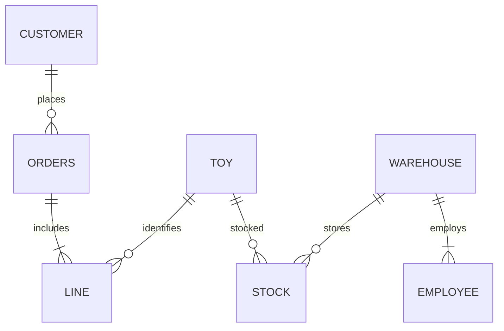

# 南京邮电大学 2022—2023 学年第二学期《数据库系统》期末试卷（B）

原 PDF 有两张扫描图，每张并排两页纸面试卷，共四大题、100 分，未见附答。以下按原题的四部分整理题意，**参考解答**另行编写。扫描中的划线和手写标记不作为官方答案。

## 一、玩具销售系统设计（30 分）

**题意：**玩具有编号、名称和价格；客户有编号、姓名、电话和地址，一位客户能产生多张订单。订单记录编号和购物日期，明细记录明细编号、玩具编号及订货数量。仓库记录编号、地址、电话和面积；玩具与仓库多对多，需记录各仓库的库存数量。每位职工只在一个仓库工作，记录编号、姓名和年龄。要求画 E-R 图并转成含主外键的关系模式。

**参考解答：**明细把订单与玩具连接起来，订货量属于某张订单中的某条明细；库存量则属于仓库与玩具的组合，两者不可互换。下图中 CUSTOMER、ORDERS、LINE、TOY、WAREHOUSE、STOCK、EMPLOYEE 分别是客户、订单、明细、玩具、仓库、库存和职工。



| 关系 | 字段（主键下划线） | 外键 |
| --- | --- | --- |
| 玩具 | <u>玩具编号</u>，名称，价格 | 无 |
| 客户 | <u>客户编号</u>，姓名，电话，地址 | 无 |
| 订单 | <u>订单编号</u>，购物日期，客户编号 | 客户编号引用客户 |
| 订单明细 | <u>订单编号，明细编号</u>，玩具编号，订货数量 | 订单编号引用订单；玩具编号引用玩具 |
| 仓库 | <u>仓库编号</u>，地址，电话，面积 | 无 |
| 库存 | <u>仓库编号，玩具编号</u>，库存数量 | 两列分别引用仓库、玩具 |
| 职工 | <u>职工编号</u>，姓名，年龄，仓库编号 | 仓库编号非空且引用仓库 |

上表按“明细编号在同一张订单内唯一”设计；若业务保证它全局唯一，则可单独做主键。外键保证明细引用已存在的订单，却不能单独保证每张订单提交时至少有一条明细，这一端的最小基数需要业务事务或额外约束来保证。参见 [概念结构设计](../../../topics/数据库系统/概念结构设计.md)、[关系模式映射](../../../topics/数据库系统/逻辑结构设计.md)。

## 二、运动会 SQL（七题，共 35 分）

**题设：**学生（学生编号、姓名、性别、身高、体重）；项目（项目编号、项目名称、裁判长）；比赛（项目编号、学生编号、得分）。比赛两号联合为主键，也各自引用对应父表，编号为长度 6 的字符型。得分为 0–10 的非空短整数；删除学生须同时删除其比赛记录。以下用 PostgreSQL 风格，身高以米计，性别字段用“男”表示男学生。

### 1. 创建比赛表

**参考解答：**

```sql
CREATE TABLE "比赛" (
  "项目编号" CHAR(6),
  "学生编号" CHAR(6),
  "得分" SMALLINT NOT NULL CHECK ("得分" BETWEEN 0 AND 10),
  PRIMARY KEY ("项目编号","学生编号"),
  FOREIGN KEY ("项目编号") REFERENCES "项目" ("项目编号"),
  FOREIGN KEY ("学生编号") REFERENCES "学生" ("学生编号") ON DELETE CASCADE
);
```

### 2. 查询刘姓学生的姓名、身高、体重

**参考解答：**姓“刘”要求首字匹配，结果按身高降序。

```sql
SELECT "姓名","身高","体重" FROM "学生"
WHERE "姓名" LIKE '刘%' ORDER BY "身高" DESC;
```

### 3. 查询得分超过所在项目平均分的比赛记录

**参考解答：**相关子查询用外层的项目编号限定范围；等于平均分的记录不选。

```sql
SELECT b.* FROM "比赛" AS b
WHERE b."得分" > (
  SELECT AVG(x."得分") FROM "比赛" AS x WHERE x."项目编号" = b."项目编号"
);
```

### 4. 统计男生平均身高超过 1.7 米的项目

**参考解答：**先筛选男参赛者，再按项目聚合；不能在计算完男女平均后再筛选性别。

```sql
SELECT p."项目编号",p."项目名称",AVG(s."身高") AS "平均身高"
FROM "项目" AS p
JOIN "比赛" AS b ON b."项目编号" = p."项目编号"
JOIN "学生" AS s ON s."学生编号" = b."学生编号"
WHERE s."性别" = '男'
GROUP BY p."项目编号",p."项目名称"
HAVING AVG(s."身高") > 1.7;
```

### 5. 统计参赛者超过三人的项目

**参考解答：**一位学生在同一项目最多一行，故次数就是人数；先按人数升序，人数相等时再按项目编号降序。

```sql
SELECT "项目编号",COUNT(*) AS "参加人数"
FROM "比赛" GROUP BY "项目编号"
HAVING COUNT(*) > 3
ORDER BY "参加人数" ASC,"项目编号" DESC;
```

### 6. 删除名称为空或为立定跳远的比赛记录

**参考解答：**只删子表比赛记录，不删项目本身。下面兼容 NULL 和空串两种录入约定。

```sql
DELETE FROM "比赛"
WHERE "项目编号" IN (
  SELECT "项目编号" FROM "项目"
  WHERE "项目名称" IS NULL OR "项目名称" = '' OR "项目名称" = '立定跳远'
);
```

### 7. 将高个子视图的查询权和身高修改权授予 U1

**参考解答：**按“1.8 以上”含 1.8；若教师明确采用严格“大于”，修改比较符即可。视图只使用一个基表、可做列修改；WITH CHECK OPTION 保证从该视图改出的行依然满足视图范围。授权由有权的所有者给出，假定用户实际角色名称为区分大小写的 U1。

```sql
CREATE VIEW "高个子学生信息" AS
SELECT "学生编号","姓名","性别","身高","体重" FROM "学生"
WHERE "身高" >= 1.8
WITH CHECK OPTION;

GRANT SELECT, UPDATE ("身高") ON "高个子学生信息" TO "U1" WITH GRANT OPTION;
```

只给视图的 SELECT 和身高列的 UPDATE，不给底表权限或其他列的 UPDATE。在 PostgreSQL 中可参见 [视图与检查选项](https://www.postgresql.org/docs/current/sql-createview.html)、[列级授权与转授](https://www.postgresql.org/docs/current/sql-grant.html)。参见 [外键](../../../topics/数据库系统/参照完整性定义.md)、[分组查询](../../../topics/数据库系统/单表查询.md)、[视图](../../../topics/数据库系统/视图.md)、[授权](../../../topics/数据库系统/自主存取控制.md)。

## 三、会议管理关系的依赖与分解（20 分）

**题意：**依次用 $M,H,T,R,E,D$ 代称会议名、主持人、时间、会议室、工号、职务。每个会议有一位主持人；同一时间同一会议室只有一个会议；同一时间主持人或职工只处于一个会议室；一个职工在同一会议中只有一个职务。考查最小依赖集、候选键、范式、分解 $(M,H,T,R)$ 与 $(M,E,D)$，以及无损且保持依赖的 3NF 分解。题设没有说会议名决定时间及会议室，下文不额外添加这条约束。

**参考解答：**

1. 最小函数依赖集为 $\{M\to H,\ TR\to M,\ TH\to R,\ TE\to R,\ ME\to D\}$。右部已是单属性；各左部不能再删字母，删任一条也不能由余下依赖推出。
2. 唯一候选键为 $TE$，闭包含全部六列：先得 $R$，由 $TR$ 得 $M$，再得 $H$ 和 $D$。$T,E$ 不出现在依赖的右部，任何键都必须包含。
3. 列值原子时最高 **2NF**：$T$、$E$ 的单列闭包都没给出非主属性，不存在对候选键真子集的部分依赖；$M\to H$ 的 $M$ 不是超键，$H$ 又不是主属性，违反 3NF。
4. 给定分解**有损且不保持全部依赖**。交集是 $M$，$M^+=\{M,H\}$，既不能确定第一侧的时间和会议室，也不能确定第二侧的工号和职务。两侧投影分别用 $\{M\to H,TR\to M,TH\to R\}$ 与 $\{ME\to D\}$ 生成，其并集不能从 $TE$ 推出 $R$。
5. 一组解是 $(M,H)$、$(T,R,M)$、$(T,H,R)$、$(T,E,R)$、$(M,E,D)$。每条最小依赖在同一个子模式中；其中 $(T,E,R)$ 含原关系的候选键 $TE$，满足 3NF 综合法的无损条件。用原名即（会议名，主持人）、（时间，会议室，会议名）、（时间，主持人，会议室）、（时间，工号，会议室）、（会议名，工号，职务）。

> [!TIP]
> 最早应锁定==从别的属性推不出来的列==，不是先猜“名称肯定是主键”。判二元分解无损时，看交集的闭包能否覆盖一侧；判保持依赖要另算投影闭包。

参见 [最小依赖集](../../../topics/数据库系统/最小依赖集.md)、[属性集闭包](../../../topics/数据库系统/属性集闭包.md)、[范式](../../../topics/数据库系统/范式.md)、[无损与保持依赖](../../../topics/数据库系统/规范化.md)。

## 四、日志记录分析（15 分）

**题意：**A、B、C 初始为 0。求在第 19 条后哪些事务重做、撤销或不处理，再求第 19、11、9 条后三种恢复值。

| 序号 | 日志 | 序号 | 日志 |
| ---: | --- | ---: | --- |
| 1 | $T_1$ 开始 | 11 | 检查点 |
| 2 | $T_1$ 写 $A=4$ | 12 | $T_4$ 开始 |
| 3 | $T_2$ 开始 | 13 | $T_4$ 读 B |
| 4 | $T_2$ 写 $B=5$ | 14 | $T_4$ 写 $A=B+5$ |
| 5 | $T_1$ 写 $C=10$ | 15 | $T_3$ 读 A |
| 6 | $T_2$ 读 A | 16 | $T_3$ 写 $B=A+3$ |
| 7 | $T_2$ 写 $C=A+4$ | 17 | $T_3$ 回滚 |
| 8 | $T_3$ 开始 | 18 | $T_1$ 写 $B=6$ |
| 9 | $T_3$ 写 $C=12$ | 19 | $T_4$ 提交 |
| 10 | $T_2$ 提交 | | |

**参考解答（按课内简化模型）：**按表的顺序计算已经执行的读写，重放时使用已确定的写入值，不在恢复后的数据库上重新计算表达式。假定读到最近写入值，故第 6 条 $T_2$ 读得 $A=4$，它在第 7 条写入的 $C$ 为 8；第 13 条 $T_4$ 读得 $B=5$，第 14 条写入的 $A$ 为 10。检查点前已提交的效果视为有持久恢复依据，“回滚”视为回滚完成。

| 故障时点 | 事务判断 | 恢复后的 $(A,B,C)$ |
| --- | --- | --- |
| 第 19 条后 | 重做检查点后提交的 $T_4$；撤销未提交的 $T_1$；已在检查点前提交的 $T_2$、已回滚的 $T_3$ 不另处理 | $(10,5,8)$ |
| 第 11 条后 | 保留 $T_2$ 已提交的 B、C；撤去尚未提交的 $T_1,T_3$ 的影响 | $(0,5,8)$ |
| 第 9 条后 | 尚无提交，A、B、C 的变化均不保留 | $(0,0,0)$ |

**边界说明：**这段日志给的是教学算例，不是一份满足可恢复调度的生产日志：$T_2$ 读了未提交的 $T_1$ 的 A，随后先于 $T_1$ 提交，构成脏读后提前提交；一些位置还有脏写。因此不能把“在磁盘上盲目反向覆盖所有旧映像”套进这题，否则可能把已经归属 $T_2$ 的 C 或 $T_4$ 的 A 覆盖掉。在防止脏读的隔离模型下，第 6 条也不一定读到 4；上表把读值假设明确写出，避免把题解当成真实系统的恢复保证。参见 [检查点](../../../topics/数据库系统/检查点恢复.md)、[恢复策略](../../../topics/数据库系统/恢复策略.md)、[隔离级别](../../../topics/数据库系统/事务隔离级别.md)。
