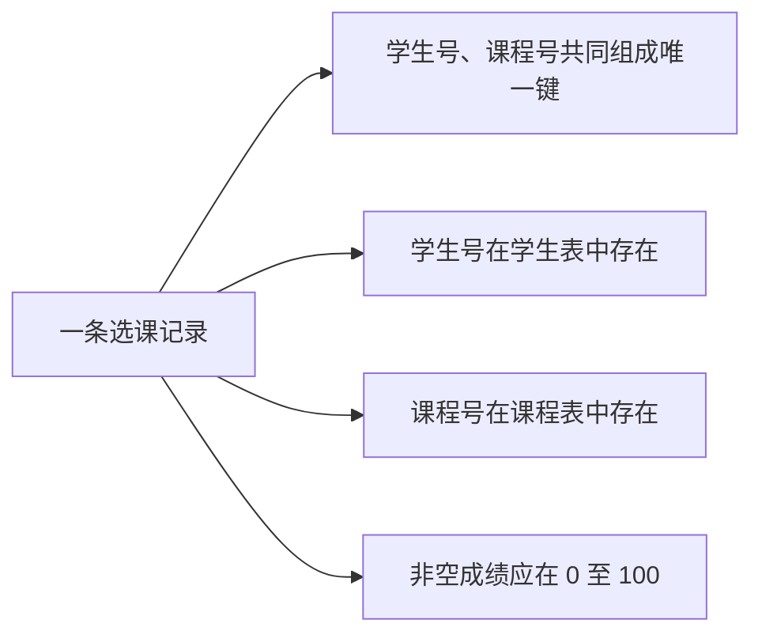

# 《数据库系统》SQL课堂练习（含答案）

原件第 1 页是完整题面，第 2 页是原附答案。这里保留题面行号，区分原答要点、订正和额外说明。题设展示的是一份**待检查的数据样本**，不是已经按约束成功导入数据库的三张表。

## 题设

S 存学生，C 存课程，SC 存选课。原题明确给了全部三个建表语句；课程名是 CHAR(18)，不是 CHAR(20)。将原版排印引号规范成 SQL 单引号，约束不变：

```sql
CREATE TABLE S (
    SNO CHAR(3),
    SNAME CHAR(8) NOT NULL,
    AGE INTEGER,
    SEX CHAR(1) DEFAULT 'M',
    PRIMARY KEY (SNO)
);

CREATE TABLE C (
    CNO CHAR(3),
    CNAME CHAR(18) NOT NULL,
    Credit INTEGER,
    CHours INTEGER,
    PRIMARY KEY (CNO)
);

CREATE TABLE SC (
    SNO CHAR(3),
    CNO CHAR(3),
    GRADE INTEGER,
    PRIMARY KEY (SNO, CNO),
    FOREIGN KEY (SNO) REFERENCES S(SNO),
    FOREIGN KEY (CNO) REFERENCES C(CNO),
    CHECK (GRADE BETWEEN 0 AND 100)
);
```

**S 表：**

| 原卷行号 | SNO | SNAME | AGE | SEX |
| ---: | --- | --- | ---: | --- |
| 1 | S1 | WANG | 20 | M |
| 2 | S2 | ZHAO | 18 | F |
| 3 | S3 | HU | 17 | M |
| 4 | NULL | XIA | 19 | F |

**C 表：**

| 原卷行号 | CNO | CNAME | Credit | CHours |
| ---: | --- | --- | ---: | ---: |
| 5 | C1 | Math | 3 | 48 |
| 6 | C2 | NULL | 4 | 64 |
| 7 | C3 | PM | 2 | 32 |
| 8 | C4 | DB | 3 | 48 |

**SC 表：**

| 原卷行号 | SNO | CNO | GRADE |
| ---: | --- | --- | ---: |
| 9 | S1 | C2 | 80 |
| 10 | S1 | C3 | 70 |
| 11 | S1 | C4 | 115 |
| 12 | S2 | C1 | 60 |
| 13 | S2 | C2 | 75 |
| 14 | S2 | C2 | 90 |
| 15 | S2 | C4 | 80 |
| 16 | S3 | C1 | 85 |
| 17 | S3 | C2 | 80 |
| 18 | S3 | C4 | 85 |
| 19 | S4 | C4 | 75 |

找出五处错误，并分别说明原因。

## 原附答案的五处错误与核对

| 原卷位置 | 违反的约束 | 理由 |
| --- | --- | --- |
| S 第 4 行 | S 的主键 | 主键 SNO 不能取 NULL。 |
| C 第 6 行 | CNAME 的 NOT NULL | 课程号 C2 本身有值，但课程名没有值；原题在 C 的 DDL 中明确声明非空。 |
| SC 第 11 行 | SC.GRADE 的 CHECK | 115 大于 100。**订正：**原附答案把约束的归属写作 C 表；实际上成绩列和 CHECK 均在 SC。 |
| SC 第 13、14 行 | SC 的组合主键 | 两行都有 (S2,C2)；75 与 90 不同也不能使二者成为两个不同的键。不知道哪条对应真实成绩，不能仅因录入次序就判定要改哪条。 |
| SC 第 19 行 | SC.SNO 的外键 | S 表没有 S4；C4 是存在的课程号，错误在学生一端。 |

> [!TIP]
> 看到==组合主键==按整组列查重；看到==外键==才沿引用去找父表。某个学生可以报多门课，某门课也可被多人选；只要不是同一个学生与课程的组合，重复单列并不构成这一主键的冲突。

**补充：**样本中 C2 课程行的名称错误，与 SC 中引用 C2 的那些行不是同一种错误。对照题给样本，C2 这个编号存在；正确修复是先补课程名，再导入选课数据。若实际装载 C 表时拒绝了整条 C2 记录，后来再插入引用它的 SC 行可能产生连带外键报错，但不能把这种失败次序重复算作原题额外错误。题目也没有禁止年龄 17，SEX 的 DEFAULT 不是只允许值 M。GRADE 的 CHECK 没有声明 NOT NULL；若业务要求每条选课已出分，必须再设非空约束。



参见 [主键与实体完整性](../../../topics/数据库系统/实体完整性定义.md)、[外键与参照完整性](../../../topics/数据库系统/参照完整性定义.md)、[CHECK 与非空约束](../../../topics/数据库系统/用户定义完整性.md)、[三类完整性约束](../../../topics/数据库系统/关系完整性.md)。
