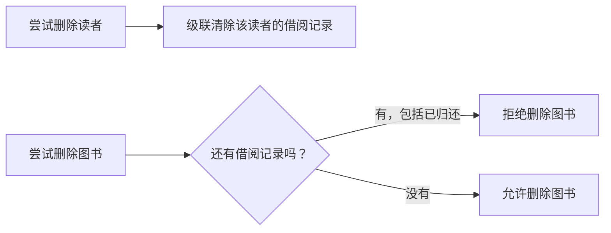

# 《数据库系统》图书管理系统课堂练习

原件一页，列出基表和 14 道练习，没有答案。下面先给题设公用模式，各 SQL 代码块均为**参考解答**，不是原件答案；写法采用 PostgreSQL 风格。这里只讨论命令语义，不需要在真实数据库中执行。

| 基表 | 字段 | 按原题标识的主键 |
| --- | --- | --- |
| 图书 | 图书编号、分类号、书名、作者、出版单位、单价 | 图书编号 |
| 读者 | 借书证号、姓名、单位、职称 | 借书证号 |
| 借阅 | 借书证号、图书编号、借期、还期 | (借书证号, 图书编号) |

原题还要求：还期可为空；已还时还期须严格晚于借期；删除读者要清除其借阅记录；一本书只要还存在任何借阅记录，就不能删除。按现有组合主键，同一个读者和图书组合最多一条记录；若未来要保留同一人重复借同一本书的历史，须另加能区分一笔借阅的键，不能偷偷把这当成原题。

## 一、简答

### 简答 1

写出定义基表借阅的 DDL 语句，并正确定义完整性。

外键列与被引用列的类型要一致。以下证号和图书编号长度按示例假定；编号保留前导零，不能随便改成数字。还期等于借期不能通过检查。

```sql
CREATE TABLE 借阅 (
    借书证号 CHAR(8) NOT NULL,
    图书编号 CHAR(4) NOT NULL,
    借期 DATE NOT NULL,
    还期 DATE,
    PRIMARY KEY (借书证号, 图书编号),
    FOREIGN KEY (借书证号) REFERENCES 读者(借书证号)
        ON DELETE CASCADE,
    FOREIGN KEY (图书编号) REFERENCES 图书(图书编号)
        ON DELETE RESTRICT,
    CHECK (还期 IS NULL OR 还期 > 借期)
);
```

知识点：[数据定义（CREATE、ALTER、DROP：SCHEMA、TABLE、INDEX）](../../../topics/数据库系统/数据定义.md)、[关系的三类完整性约束（实体完整性、参照完整性、用户定义的完整性）](../../../topics/数据库系统/关系完整性.md)

### 简答 2

建立各读者当前借阅图书情况的视图 RB，视图中包括借书证号、姓名、书名。

```sql
CREATE VIEW RB AS
SELECT 读者.借书证号, 读者.姓名, 图书.书名
FROM 读者, 借阅, 图书
WHERE 读者.借书证号 = 借阅.借书证号
  AND 借阅.图书编号 = 图书.图书编号
  AND 借阅.还期 IS NULL;
```

知识点：[视图（建立、查询、更新、删除视图）](../../../topics/数据库系统/视图.md)、[连接查询（等值连接、自然连接、自身连接、外连接、多表连接）](../../../topics/数据库系统/连接查询.md)、[空值（NULL）的产生、判断与运算规则](../../../topics/数据库系统/空值处理.md)

### 简答 3

为基表图书建立一个基于图书编号的降序的唯一索引 B_I。

原题要求显式建立。由于图书编号已是主键，实际数据库通常已有可用于唯一性检查的索引；查询结果要保证降序，仍应写 ORDER BY。

```sql
CREATE UNIQUE INDEX B_I ON 图书(图书编号 DESC);
```

知识点：[数据定义（CREATE、ALTER、DROP：SCHEMA、TABLE、INDEX）](../../../topics/数据库系统/数据定义.md)

### 简答 4

新进了由高等教育出版社出版的图书“云计算”，编号 0001，分类号 TP31，作者李勇，单价 35 元，在相应基表中插入该书的信息。

```sql
INSERT INTO 图书 (图书编号, 分类号, 书名, 作者, 出版单位, 单价)
VALUES ('0001', 'TP31', '云计算', '李勇', '高等教育出版社', 35);
```

知识点：[数据更新（INSERT、UPDATE、DELETE）](../../../topics/数据库系统/数据更新.md)

### 简答 5

将电子工业出版社的图书单价上调 5％。

```sql
UPDATE 图书
SET 单价 = 单价 * 1.05
WHERE 出版单位 = '电子工业出版社';
```

知识点：[数据更新（INSERT、UPDATE、DELETE）](../../../topics/数据库系统/数据更新.md)

### 简答 6

删除单位为“机关”的所有读者信息和借阅信息。

先有第 1 题的级联外键，才可用这条语句同时清除相应借阅；如果没有级联，须在同一事务内先删子表，再删父表。

```sql
DELETE FROM 读者
WHERE 单位 = '机关';
```

知识点：[数据更新（INSERT、UPDATE、DELETE）](../../../topics/数据库系统/数据更新.md)、[单表查询（SELECT、WHERE、ORDER BY、聚集函数、GROUP BY、HAVING、LIMIT）](../../../topics/数据库系统/单表查询.md)

### 简答 7

列出书名包含“数据库”的图书的信息。

```sql
SELECT *
FROM 图书
WHERE 书名 LIKE '%数据库%';
```

知识点：[单表查询（SELECT、WHERE、ORDER BY、聚集函数、GROUP BY、HAVING、LIMIT）](../../../topics/数据库系统/单表查询.md)

### 简答 8

查询工厂所有借阅了图书的读者姓名和职称。

用存在性筛选，每位读者至多贡献一行；只按姓名与职称做 DISTINCT 会把恰好同名同职称的两个不同读者也合并。

```sql
SELECT r.姓名, r.职称
FROM 读者 AS r
WHERE r.单位 = '工厂'
  AND EXISTS (SELECT 1 FROM 借阅 AS b WHERE b.借书证号 = r.借书证号);
```

知识点：[单表查询（SELECT、WHERE、ORDER BY、聚集函数、GROUP BY、HAVING、LIMIT）](../../../topics/数据库系统/单表查询.md)、[连接查询（等值连接、自然连接、自身连接、外连接、多表连接）](../../../topics/数据库系统/连接查询.md)

### 简答 9

查询没有借阅 0002 号图书的读者姓名。

按题目没有“当前”一词，已归还的借阅也算借过。若只问目前没有借着这一册，把还期为空的条件加进子查询。

```sql
SELECT r.姓名
FROM 读者 AS r
WHERE NOT EXISTS (
    SELECT 1 FROM 借阅 AS b
    WHERE b.借书证号 = r.借书证号 AND b.图书编号 = '0002'
);
```

知识点：[嵌套查询（IN、比较运算符、ANY/ALL、EXISTS）](../../../topics/数据库系统/嵌套查询.md)、[空值（NULL）的产生、判断与运算规则](../../../topics/数据库系统/空值处理.md)、[单表查询（SELECT、WHERE、ORDER BY、聚集函数、GROUP BY、HAVING、LIMIT）](../../../topics/数据库系统/单表查询.md)

### 简答 10

查询还期暂缺的借阅记录。

```sql
SELECT *
FROM 借阅
WHERE 还期 IS NULL;
```

知识点：[单表查询（SELECT、WHERE、ORDER BY、聚集函数、GROUP BY、HAVING、LIMIT）](../../../topics/数据库系统/单表查询.md)、[空值（NULL）的产生、判断与运算规则](../../../topics/数据库系统/空值处理.md)

### 简答 11

查询各出版社图书的最高价、最低价、平均价和总价。

```sql
SELECT 出版单位, MAX(单价) AS 最高价, MIN(单价) AS 最低价,
       AVG(单价) AS 平均价, SUM(单价) AS 总价
FROM 图书
GROUP BY 出版单位;
```

知识点：[单表查询（SELECT、WHERE、ORDER BY、聚集函数、GROUP BY、HAVING、LIMIT）](../../../topics/数据库系统/单表查询.md)

### 简答 12

统计借书证号以 6 结尾的每位读者借阅图书的数量，少于 5 本的不予统计，显示读者姓名，借阅数量，结果按数量降序排列，数量相同的按姓名升序排列。

按借书证号和姓名分组，不能按姓名合并同名读者；门槛是至少 5 本，用 HAVING COUNT(*) >= 5。

```sql
SELECT 读者.姓名, COUNT(*) AS 借阅数量
FROM 读者, 借阅
WHERE 读者.借书证号 = 借阅.借书证号
  AND 读者.借书证号 LIKE '%6'
GROUP BY 读者.借书证号, 读者.姓名
HAVING COUNT(*) >= 5
ORDER BY 借阅数量 DESC, 读者.姓名 ASC;
```

知识点：[单表查询（SELECT、WHERE、ORDER BY、聚集函数、GROUP BY、HAVING、LIMIT）](../../../topics/数据库系统/单表查询.md)、[连接查询（等值连接、自然连接、自身连接、外连接、多表连接）](../../../topics/数据库系统/连接查询.md)

### 简答 13

查询全部读者都借阅了的图书编号。

> [!TIP]
> ==每位读者都借过==等价于==找不到一位没借过的读者==。外层从图书表枚举全部候选，读者表为空时每本书都满足这个全称命题；仅从借阅表分组会漏掉这种边界。

```sql
SELECT g.图书编号
FROM 图书 AS g
WHERE NOT EXISTS (
    SELECT 1 FROM 读者 AS r
    WHERE NOT EXISTS (
        SELECT 1 FROM 借阅 AS b
        WHERE b.借书证号 = r.借书证号 AND b.图书编号 = g.图书编号
    )
);
```

知识点：[嵌套查询（IN、比较运算符、ANY/ALL、EXISTS）](../../../topics/数据库系统/嵌套查询.md)、[单表查询（SELECT、WHERE、ORDER BY、聚集函数、GROUP BY、HAVING、LIMIT）](../../../topics/数据库系统/单表查询.md)

### 简答 14

使用户 U1 拥有查询各出版社图书的最高价、最低价和平均价的权限，并能将这些权限转授给别人。

**参考解答：**建立只包含被要求统计量的视图，不授予底表的单价列，也不把第 11 题的总价放进这个视图。直接授权查询底表的出版单位和单价会让用户看到明细，权限超过题意；这是先前解法的重要区别。假定由视图所有者授权、目标用户名确为区分大小写的 "U1"。

```sql
CREATE VIEW 出版社统计 AS
SELECT 出版单位, MAX(单价) AS 最高价, MIN(单价) AS 最低价, AVG(单价) AS 平均价
FROM 图书
GROUP BY 出版单位;

GRANT SELECT ON 出版社统计 TO "U1" WITH GRANT OPTION;
```

参见 [自主存取控制](../../../topics/数据库系统/自主存取控制.md)、[视图](../../../topics/数据库系统/视图.md)和 [PostgreSQL 的 GRANT 语法](https://www.postgresql.org/docs/current/sql-grant.html)。

## 补充：两条删除策略为何不同


