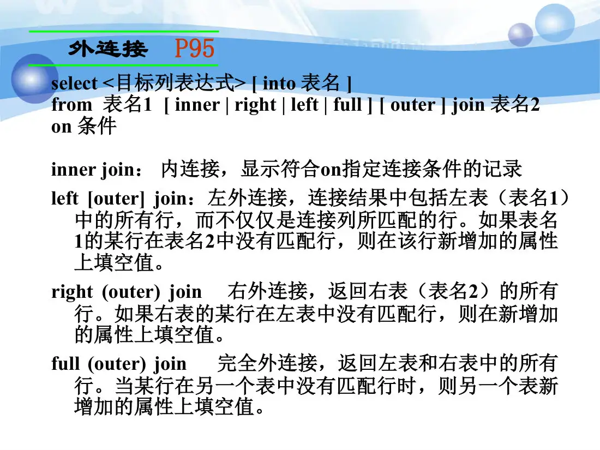
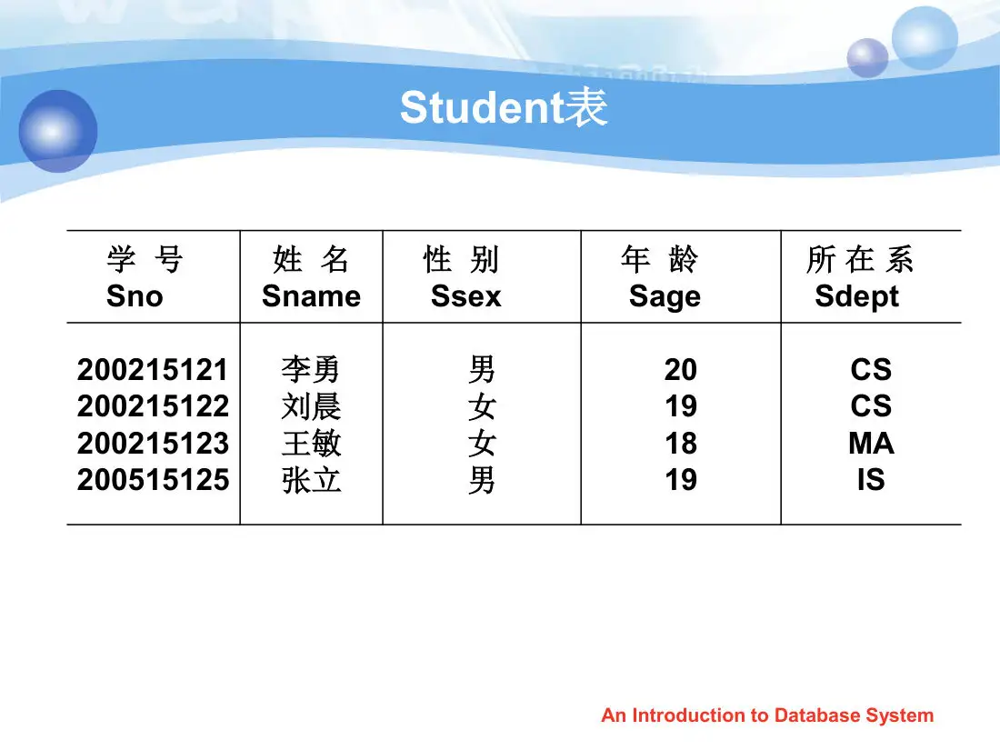
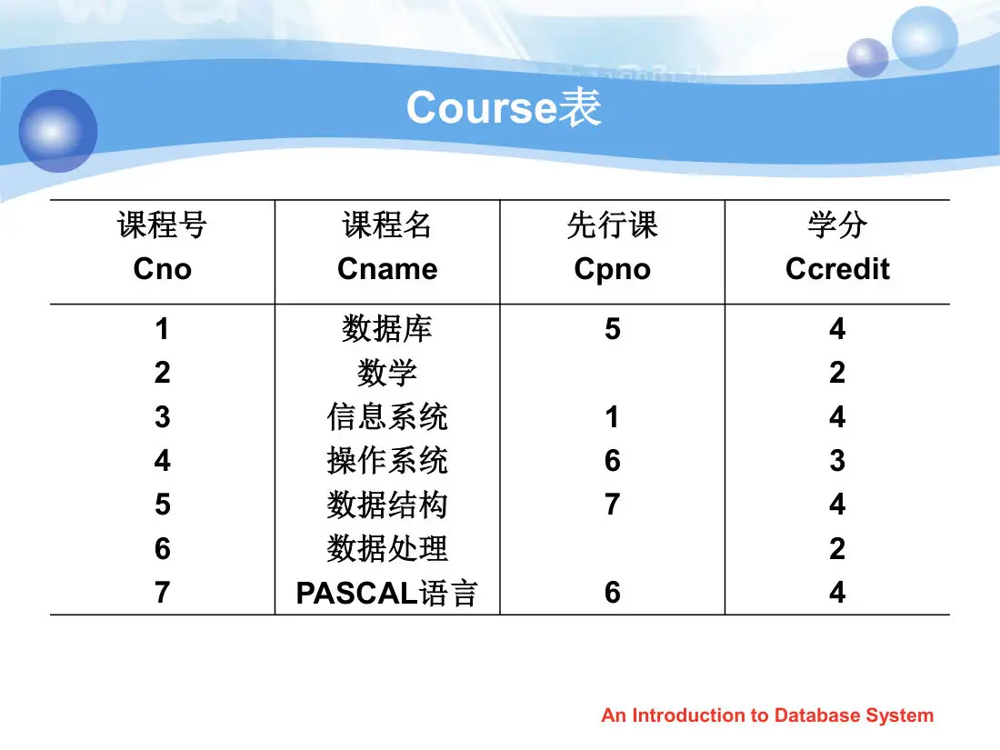
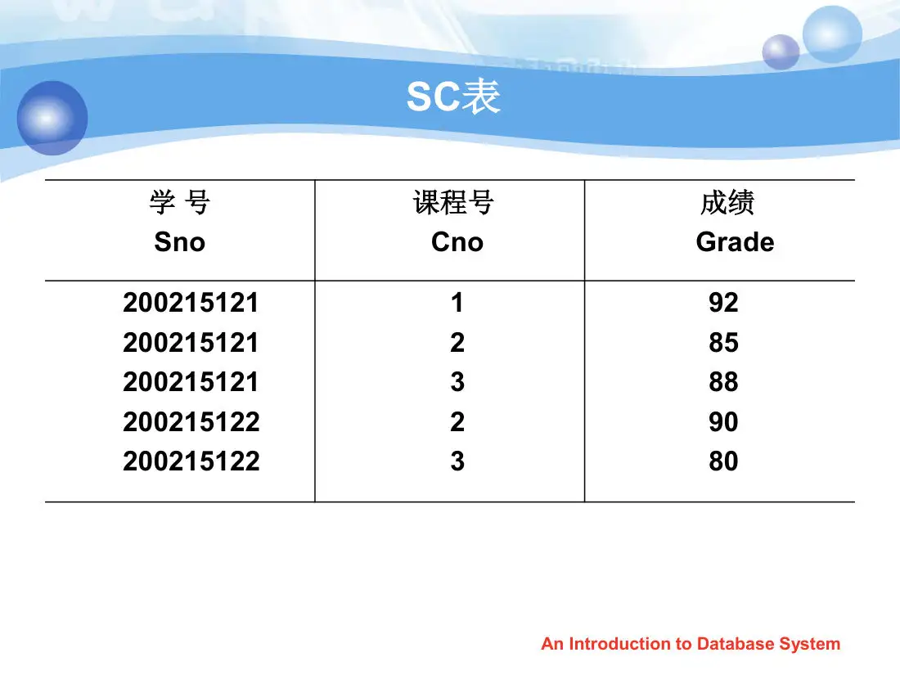
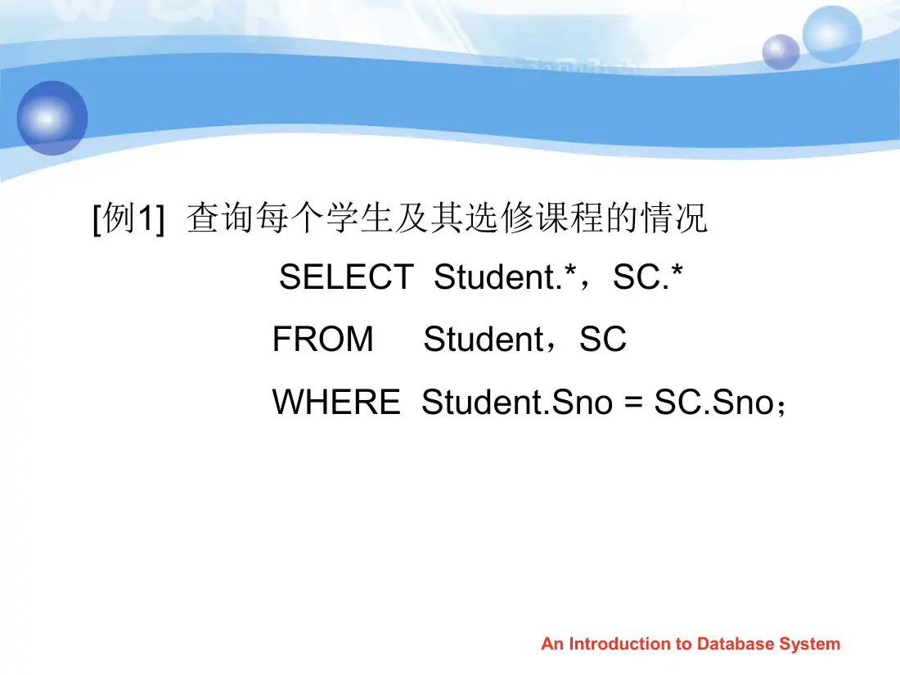
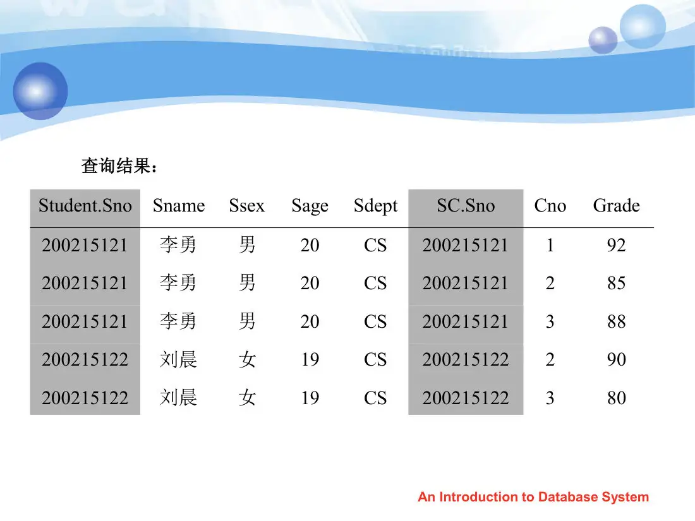
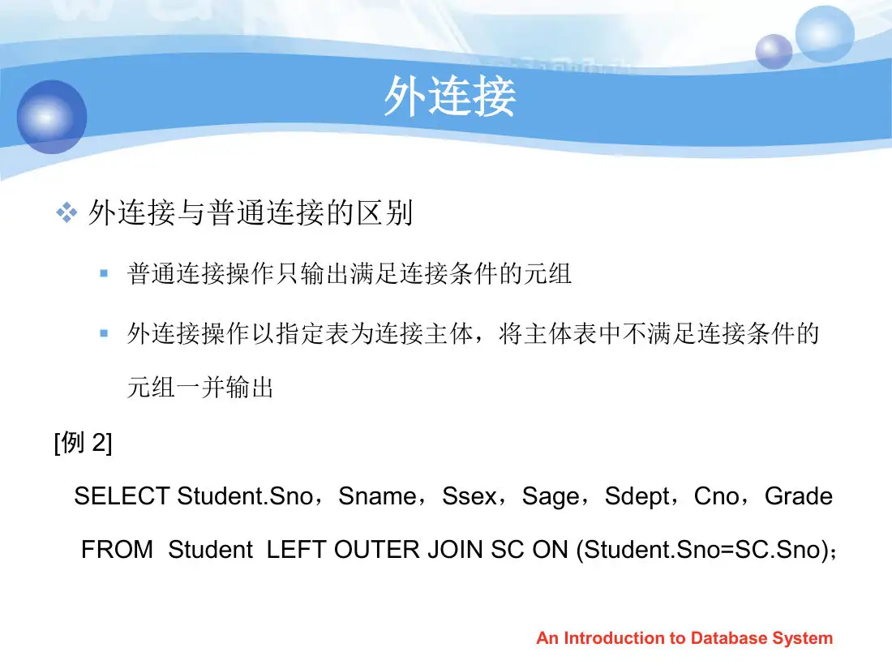
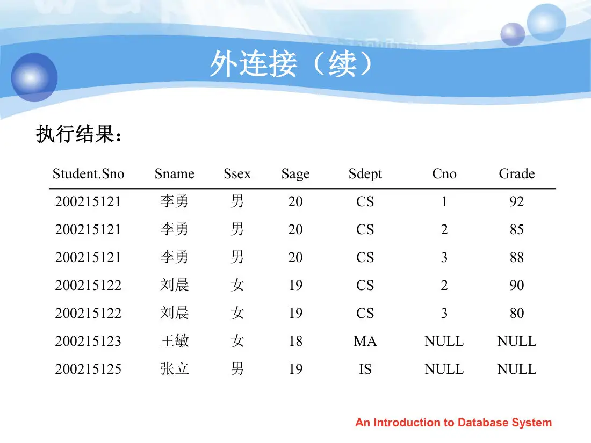
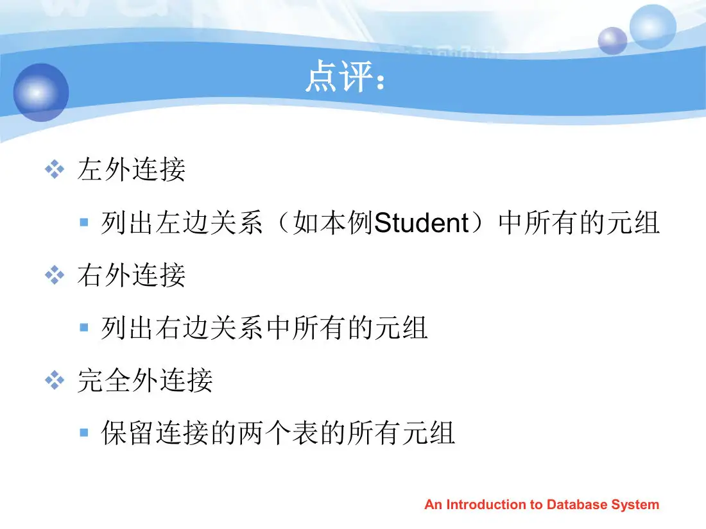

# 《数据库系统》外连接（课件）

原件的每一页，下面附识别出的文字。

### 外连接 P95

原文：

外连接 P95

select <目标列表达式> [ into 表名 ]

from 表名1 [ inner | right | left | full ] [ outer ] join 表名2 on 条件

inner join： 内连接，显示符合on指定连接条件的记录

left [outer] join：左外连接，连接结果中包括左表（表名1）中的所有行，而不仅仅是连接列所匹配的行。如果表名1的某行在表名2中没有匹配行，则在该行新增加的属性上填空值。

right (outer) join 右外连接，返回右表（表名2）的所有行。如果右表的某行在左表中没有匹配行，则在新增加的属性上填空值。

full (outer) join 完全外连接，返回左表和右表中的所有行。当某行在另一个表中没有匹配行时，则另一个表新增加的属性上填空值。

### Student表

原文：

Student表

<table><tr><td>学号Sno</td><td>姓名Sname</td><td>性别Ssex</td><td>年龄Sage</td><td>所在系Sdept</td></tr><tr><td>200215121</td><td>李勇</td><td>男</td><td>20</td><td>CS</td></tr><tr><td>200215122</td><td>刘晨</td><td>女</td><td>19</td><td>CS</td></tr><tr><td>200215123</td><td>王敏</td><td>女</td><td>18</td><td>MA</td></tr><tr><td>200515125</td><td>张立</td><td>男</td><td>19</td><td>IS</td></tr></table>

An Introduction to Database System

### Course表

原文：

Course表

<table><tr><td>课程号Cno</td><td>课程名Cname</td><td>先行课Cpno</td><td>学分Ccredit</td></tr><tr><td>1</td><td>数据库</td><td>5</td><td>4</td></tr><tr><td>2</td><td>数学</td><td></td><td>2</td></tr><tr><td>3</td><td>信息系统</td><td>1</td><td>4</td></tr><tr><td>4</td><td>操作系统</td><td>6</td><td>3</td></tr><tr><td>5</td><td>数据结构</td><td>7</td><td>4</td></tr><tr><td>6</td><td>数据处理</td><td></td><td>2</td></tr><tr><td>7</td><td>PASCAL语言</td><td>6</td><td>4</td></tr></table>

An Introduction to Database System

### SC表

原文：

SC表

<table><tr><td>学号Sno</td><td>课程号Cno</td><td>成绩Grade</td></tr><tr><td>200215121</td><td>1</td><td>92</td></tr><tr><td>200215121</td><td>2</td><td>85</td></tr><tr><td>200215121</td><td>3</td><td>88</td></tr><tr><td>200215122</td><td>2</td><td>90</td></tr><tr><td>200215122</td><td>3</td><td>80</td></tr></table>

An Introduction to Database System

### An Introduction to Database System

原文：

[例1] 查询每个学生及其选修课程的情况SELECT Student.\*，SC.\*FROM Student，SCWHERE Student.Sno = SC.Sno；

An Introduction to Database System

### 查询结果：

原文：

查询结果：

<table><tr><td>Student.Sno</td><td>Sname</td><td>Ssex</td><td>Sage</td><td>Sdept</td><td>SC.Sno</td><td>Cno</td><td>Grade</td></tr><tr><td>200215121</td><td>李勇</td><td>男</td><td>20</td><td>CS</td><td>200215121</td><td>1</td><td>92</td></tr><tr><td>200215121</td><td>李勇</td><td>男</td><td>20</td><td>CS</td><td>200215121</td><td>2</td><td>85</td></tr><tr><td>200215121</td><td>李勇</td><td>男</td><td>20</td><td>CS</td><td>200215121</td><td>3</td><td>88</td></tr><tr><td>200215122</td><td>刘晨</td><td>女</td><td>19</td><td>CS</td><td>200215122</td><td>2</td><td>90</td></tr><tr><td>200215122</td><td>刘晨</td><td>女</td><td>19</td><td>CS</td><td>200215122</td><td>3</td><td>80</td></tr></table>

An Introduction to Database System

### 外连接

原文：

外连接

外连接与普通连接的区别

▪ 普通连接操作只输出满足连接条件的元组

外连接操作以指定表为连接主体，将主体表中不满足连接条件的元组一并输出

[例 2]

SELECT Student.Sno，Sname，Ssex，Sage，Sdept，Cno，Grade FROM Student LEFT OUTER JOIN SC ON (Student.Sno=SC.Sno)；

An Introduction to Database System

### 执行结果：

原文：

执行结果：

<table><tr><td>Student.Sno</td><td>Sname</td><td>Ssex</td><td>Sage</td><td>Sdept</td><td>Cno</td><td>Grade</td></tr><tr><td>200215121</td><td>李勇</td><td>男</td><td>20</td><td>CS</td><td>1</td><td>92</td></tr><tr><td>200215121</td><td>李勇</td><td>男</td><td>20</td><td>CS</td><td>2</td><td>85</td></tr><tr><td>200215121</td><td>李勇</td><td>男</td><td>20</td><td>CS</td><td>3</td><td>88</td></tr><tr><td>200215122</td><td>刘晨</td><td>女</td><td>19</td><td>CS</td><td>2</td><td>90</td></tr><tr><td>200215122</td><td>刘晨</td><td>女</td><td>19</td><td>CS</td><td>3</td><td>80</td></tr><tr><td>200215123</td><td>王敏</td><td>女</td><td>18</td><td>MA</td><td>NULL</td><td>NULL</td></tr><tr><td>200215125</td><td>张立</td><td>男</td><td>19</td><td>IS</td><td>NULL</td><td>NULL</td></tr></table>

O

外连接（续）

An Introduction to Database System

### 点评：

原文：

点评：

左外连接

▪ 列出左边关系（如本例Student）中所有的元组

右外连接

▪ 列出右边关系中所有的元组

完全外连接

▪ 保留连接的两个表的所有元组

An Introduction to Database System
