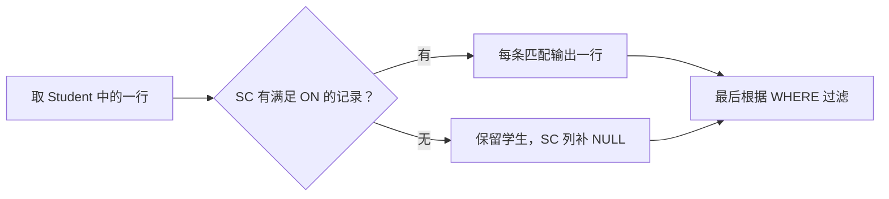

# 《数据库系统》外连接（课件）

原件 9 页：第 1 页解释连接类型，第 2–4 页给三张例表，第 5–6 页演示内连接，第 7–8 页演示左外连接，第 9 页比较保留范围。以下按原示例重算，学生用甲、乙、丙、丁依次代称，未复制课件版面。

## 先问要保留谁

如果目标是为每位学生做选课清单，没选课的学生也必须出现；如果只关心已实际发生的报名，找不到选课记录的学生就不应进入结果。连接条件相同，答案却不同，因为要保留的不是同一批行。

| 连接 | 条件匹配 | 没匹配的左行 | 没匹配的右行 |
| --- | --- | --- | --- |
| INNER JOIN | 输出每个匹配组合 | 不保留 | 不保留 |
| LEFT OUTER JOIN | 输出每个匹配组合 | 保留，补右侧 NULL | 不保留 |
| RIGHT OUTER JOIN | 输出每个匹配组合 | 不保留 | 保留，补左侧 NULL |
| FULL OUTER JOIN | 输出每个匹配组合 | 保留，补右侧 NULL | 保留，补左侧 NULL |

“保留全部”并不意味着每个输入恰好一行：左表同一行如果匹配三条右行，会输出三个组合；只在完全不匹配时才补一行。交叉连接没有 ON 匹配限制，不能当成这里的内连接写法。参见 [连接查询](../../../topics/数据库系统/连接查询.md)、[外连接](../../../topics/数据库系统/自然连接与外连接.md)。

## 用课件的三张表还原两张结果表

Student 有四个学生；Course 列出 1–7 号课，其中成绩记录只涉及 1、2、3 号；例 1、2 都只连接 Student 与 SC，暂不连接 Course。SC 中甲选 1、2、3 号课，成绩 92、85、88；乙选 2、3 号课，成绩 90、80；丙、丁无记录。

### 例 1：只有选课匹配才输出

将原课件逗号连接加 WHERE 的写法改成等价的 INNER JOIN，把条件的位置显式写出来。若要显示和原图相同的两份学号，可分别选择 Student.Sno 与 SC.Sno；这里避免输出两个同名列。

```sql
SELECT s.Sno, s.Sname, s.Ssex, s.Sage, s.Sdept, sc.Cno, sc.Grade
FROM Student AS s
INNER JOIN SC AS sc ON s.Sno = sc.Sno;
```

结果为 **5 行**，即甲的 3 行与乙的 2 行。两张输入表的相同标识字段不是两份不同学生。要让“每个学生”按字面覆盖没选课的人，就不能停在这个内连接上。

### 例 2：即使没有成绩记录，也保留学生

```sql
SELECT s.Sno, s.Sname, s.Ssex, s.Sage, s.Sdept, sc.Cno, sc.Grade
FROM Student AS s
LEFT JOIN SC AS sc ON s.Sno = sc.Sno;
```

| 学生（代称） | 课程号 | 成绩 | 出现的理由 |
| --- | ---: | ---: | --- |
| 甲 | 1 | 92 | 匹配 |
| 甲 | 2 | 85 | 匹配 |
| 甲 | 3 | 88 | 匹配 |
| 乙 | 2 | 90 | 匹配 |
| 乙 | 3 | 80 | 匹配 |
| 丙 | NULL | NULL | 左侧保留 |
| 丁 | NULL | NULL | 左侧保留 |

**订正：**原件第 8 页结果中丁的学号与第 2 页 Student 源表不一致。左连接不会改写左表学号，应以 Student 原表为准。表中行序只为方便对照；实际 SQL 若需稳定展示顺序，须显式写 ORDER BY。若再查课程名，应让 SC 到 Course 的这一步也用左连接，才不会把前一步补行的学生重新过滤掉。

## 同一个条件写在 ON 和 WHERE，为何人数不同

**补充：**报告要保留所有学生，同时只列至少 90 分的选课记录，可把成绩条件加到 ON。它限制哪些选课能与学生匹配，但不取消对学生行的保留。

```sql
SELECT s.Sno, sc.Cno, sc.Grade
FROM Student AS s
LEFT JOIN SC AS sc ON s.Sno = sc.Sno AND sc.Grade >= 90;
```

对照写法是先按学号连接，再在 WHERE 写 sc.Grade >= 90。它作用在已补完 NULL 的结果上：NULL 与 90 比较不是真，丙、丁也被去掉。用课件数据验算：条件在 ON 时是 4 行（甲 92、乙 90、丙补空、丁补空），在 WHERE 时是 2 行（甲 92、乙 90）。如果另有一个只拿了 85 分的学生，条件在 ON 时仍会为他保留一条补空记录，而写在 WHERE 则不会。

> [!TIP]
> 问==只改变右侧哪些行算匹配==，优先考虑 ON；问==最终输出哪些行==，考虑 WHERE。补出的 NULL 不等于成绩为 0，也不等于真实选课记录的成绩尚未录入。

**补充验算：**按学生分组统计选课时，应该数右表确有记录的非空键（例如 COUNT(sc.Sno)）。对甲、乙、丙、丁分别得 3、2、0、0。若用 COUNT(*)，补行也被计数，会错成 3、2、1、1。若一位学生确有选课记录而成绩尚为空，数 Grade 也会少一门；应数稳定的右侧键。参见 [NULL 的判断](../../../topics/数据库系统/空值处理.md)、[聚集与分组](../../../topics/数据库系统/单表查询.md)。


