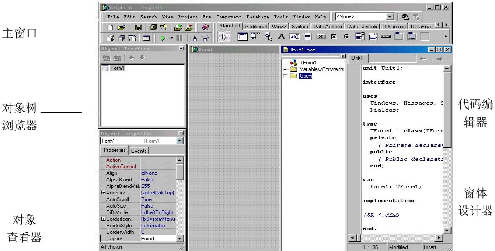
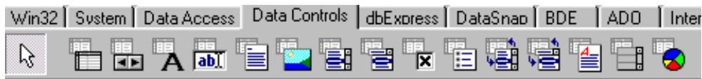
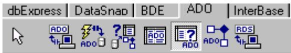
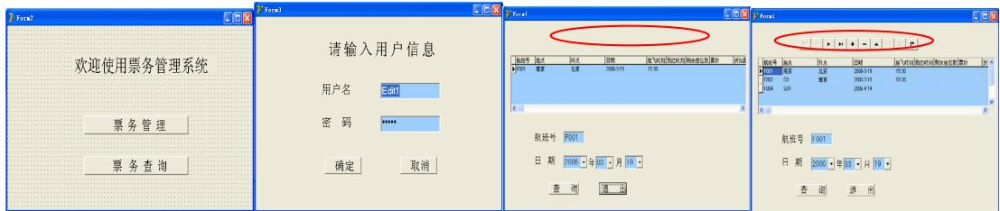
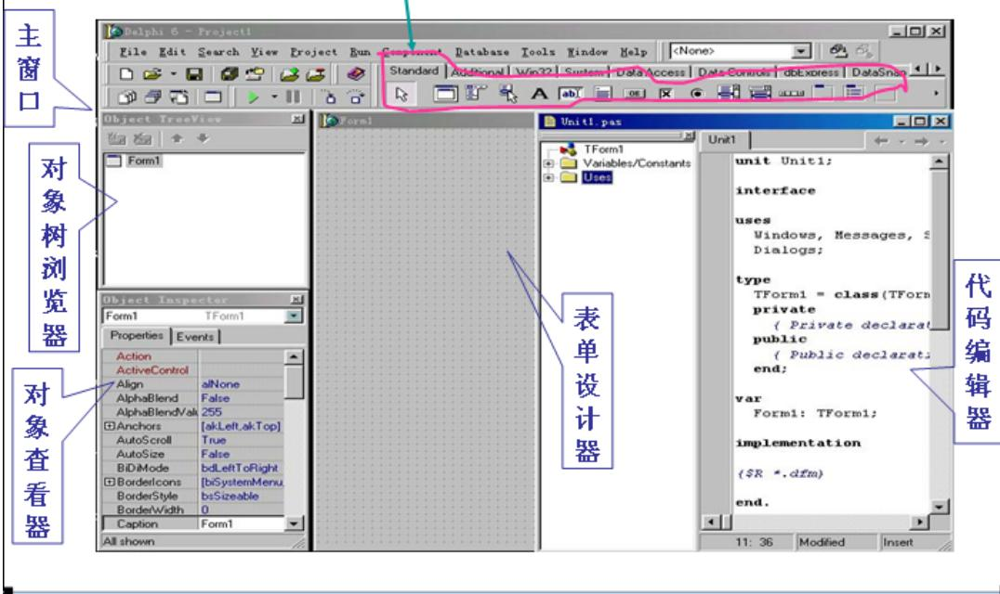
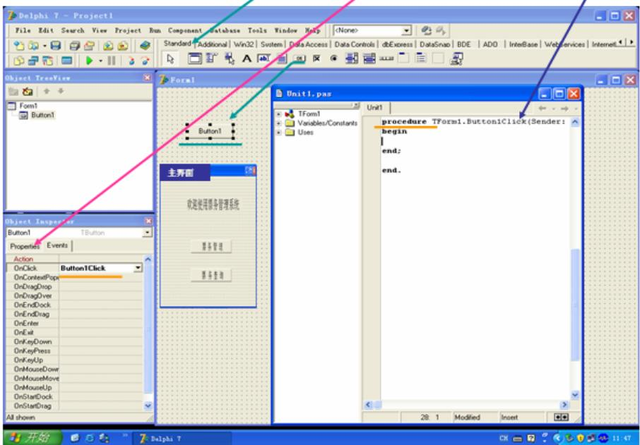
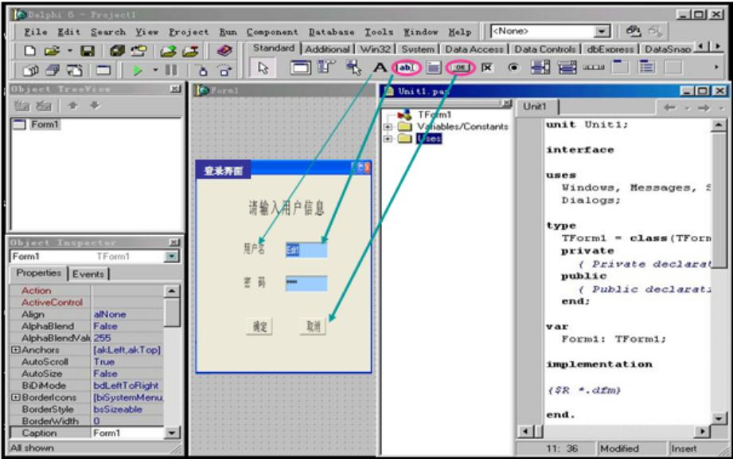
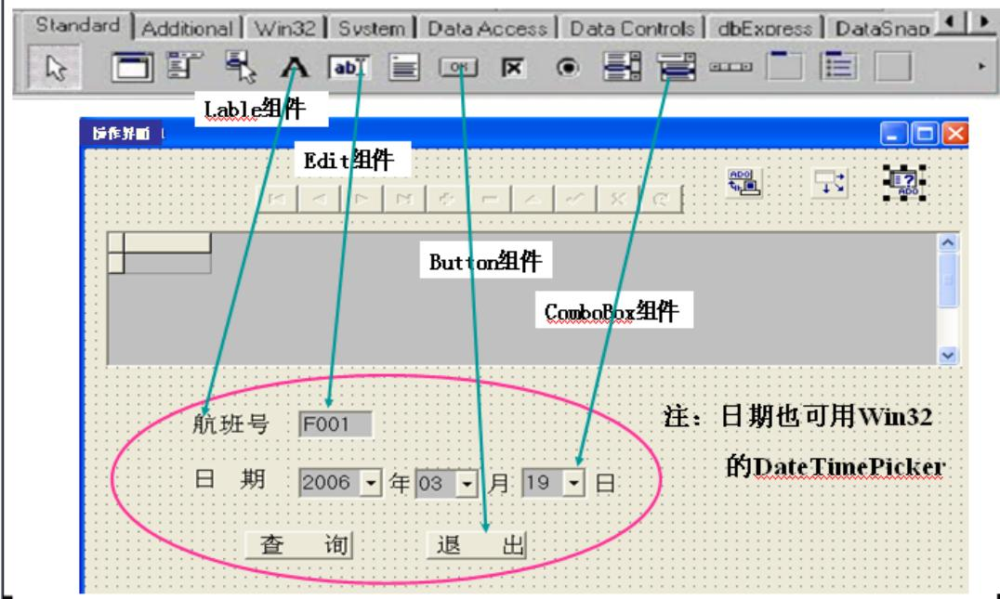
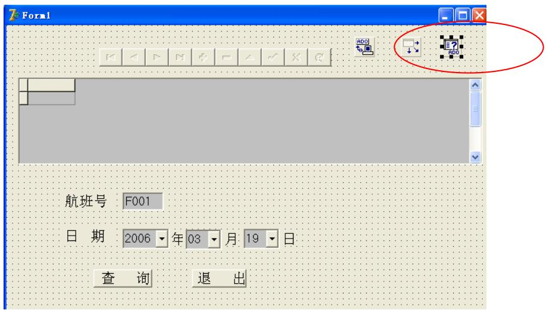
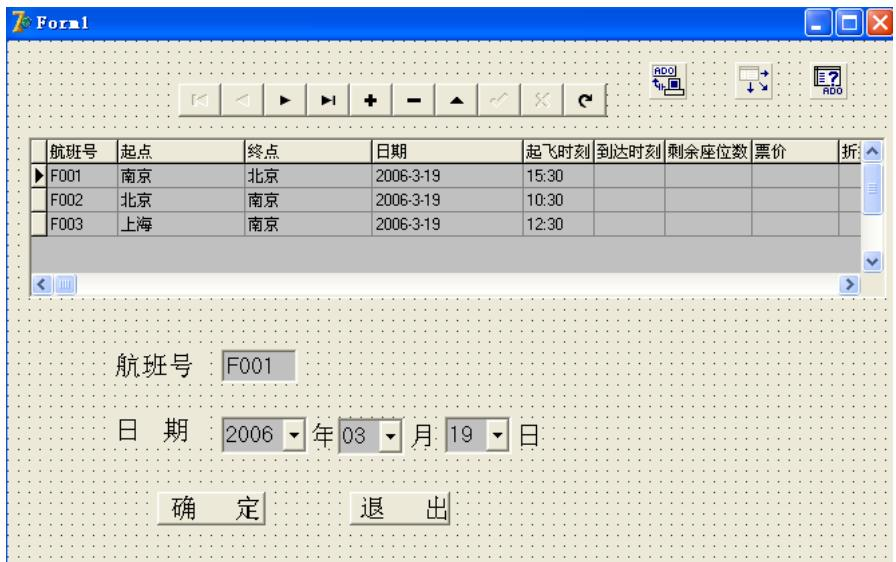

# 《数据库系统》实验指导书

原件经识别和整理；“参考解答”是我们补的。

## 第一章 实验环境简介

### 1.1 SQL\*Plus 环境使用方法简介

#### 一、进入 SQL\*Plus 的方法

“开始——程序——oradb10g_home1——应用程序开发——SQL PLUS”。

#### 二、以数据库管理员的身份登录到 Oracle 的 SQL\*Plus 的方法

系统弹出登录对话框后，在用户名处输入 `system`，口令处输入 `ORACLE`，击“确认”。此后可以在出现的提示符 `SQL>` 下输入各种 SQL 语句以及 SQL\*Plus 的命令。

注：Oracle 数据库有三类用户：一般数据库用户（connect）、具有支配部分数据库资源特权的数据库用户（resource）和具有数据库管理员特权的数据库用户（DBA），只有 DBA 具有创建用户的权力。

`system/ORACLE` 是 Oracle 默认的 DBA 帐户之一。

`scott/tiger` 是 Oracle 默认的 resource 级帐户。

#### 三、在 SQL\*Plus 中执行 SQL 语句的方法

(1) SQL\*Plus 是一个交互式操作环境，可在提示符 `SQL>` 下键入 SQL 语句。

注：所有 SQL 语句中的符号都应在西文半角状态下输入。

每个 SQL 语句都要以 `;` 结束，再敲回车键可使系统执行并返回结果。

(2) 也可以在操作系统提供的文本编辑器（例如 Windows 的 notepad）下先输入多条语句（语句之后要加 `;` 号），并在保存文件时将文件后缀名改为 `.sql`。需要使用这些语句时，只需在 `SQL>` 下键入文件名，再回车。

#### 四、语句输错时的修改方法

可敲回车，待出现新的提示符 `SQL>` 后，键入 `edit`（或 `ed`）命令以便使用 Windows 的编辑器来编辑语句。

注意：编辑器中语句结束处不要输入分号 `;`。

编辑结束时，关闭编辑器，并保存结果，再在提示符 `SQL>` 下键入 `/` 即可执行语句。

#### 五、创建用户并授予其系统权限的方法

\*创建用户并授予系统权限的工作只能由 DBA 来做。

\*相关命令如下：

① 创建用户

```sql
SQL> create user 用户名 identified by 口令;
```

注意：口令要以字母开头；SQL 语句要以 `;` 结束。

② 授系统权限

```sql
SQL> grant DBA to 用户名;
```

或

```sql
SQL> grant DBA, resource, connect to 用户名;
```

注：系统权限有 connect、resource、DBA，后者兼有前者。

#### 六、向用户授予对象操作权限的方法

授予所有操作权：

```sql
SQL> grant all privileges on 对象名 to 用户名;
```

授予某个操作权：

```sql
SQL> grant delete on 对象名 to 用户名;
```

授予某些操作权：

```sql
SQL> grant select, delete on 对象名 to 用户名;
```

注：① 常用的操作权限有 select、insert、update(列名)、delete 等。

② 这项授权操作通常由对象的拥有者进行。

例如：要授予用户 U1 对用户 scott 的表 emp 的所有操作权，则执行以下步骤：

(a) 以 scott 的身份进入 SQL\*Plus

(b) 在 `SQL>` 下键入语句：`grant all privileges on emp to U1;`

#### 七、以自己的用户身份连接到数据库的方法

```sql
SQL> connect 用户名/口令
```

注意：该用户必须具有 connect 或更高的系统权限，connect 命令不需要以 `;` 结束。

#### 八、ORACLE 的 SQL 语句与标准 SQL 的差异

① 常用数据类型

| 数据类型 | 说明符 | 备注 |
| --- | --- | --- |
| 整数 | integer | |
| 数值型 | number(m,n) | m 为总位数（不包括小数点），n 为小数位 |
| 定长字符串 | char(n) | |
| 变长字符串 | varchar2(n) | |
| 日期 | date | |

② 录入日期型字段值时要用 `TO_DATE()` 函数。例如：

```sql
insert into 借阅 values('T201', '0001', to_date('2006-09-10', 'yyyy-mm-dd'), null)
```

该语句向基表借阅（借书证号、图书编号、借阅日期）插入了一条记录，其中的字段“借阅日期”是 date 类型。

③ 标准 SQL 中的缺省选项在 ORACLE 的 SQL 语句中不要写出，例如：`on delete restrict` 不被 ORACLE 支持，不写此分句有等同效果。

#### 十、常用的 SQL\*Plus 命令

ORACLE 提供了一些 SQL\*Plus 命令，实验中用到的有：

① 编辑命令：`SQL> edit`（或 `ed`）

② 查看基表模式的命令：`SQL> DESC 表名`

也可用此命令查看一个表是否存在。

注意：使用此命令时，可以以被查看对象的拥有者的身份进入 SQL\*Plus，也可以以有权使用被查看对象的用户身份进入 SQL\*Plus，此时需在表名前加“拥有者.”。

③ 设置事务提交方式的命令：`SQL> set auto off`（或 `on`）

如果发出 `set auto on` 命令，则此后 ORACLE 把每条语句看作一个事务，在该语句后敲回车则意味着事务自动提交。如果发出 `set auto off` 命令，则此后 ORACLE 以用户输入的 `commit`（成功结束）命令或 `rollback`（回滚）命令为事务结束的标志。

### 1.2 Delphi 简介

#### 一、Delphi 的外貌

图 1 给出了 Delphi 的外貌。其中：

窗体 FORM 是在应用程序中显示的界面。窗体设计器的初始状态是一个空白的窗口。在程序设计阶段，通过向窗体中添加组件以及更改窗体以及其中组件的大小、位置等来完成窗体的设计。应用程序的实现是用事件的形式将窗体及其中的组件的属性与程序代码结合起来。可以通过选择菜单 file-new-forms 创建新 FORM。

对象查看器的功能是实现对象（尤其是组件）的属性设置。一个对象查看器中由两个部件组成：一个是顶部的组合框即对象列表，包含了当前窗体上的所有组件；另一个是组合框下面的多页组件，它显示当前组件的属性和事件。多页组件又分为两页：Properties 和 Events，即属性页和事件页。可以通过选择菜单 view-object inspector 打开对象查看器。

代码编辑器又称作单元窗口，是编写程序代码的地方。代码编辑器分为两个相互联系的窗口：单元管理器和代码编辑窗口。可以通过双击对象打开代码编辑器。

对象树浏览器可以以树状图的形式显示窗体、数据模块或窗体上的可视组件和非可视组件间的逻辑关系。

工程管理器则通过工程组进行管理，列出反映各工程之间联系的树状表，直观地显示各工程的联系，方便地将相互联系的工程中共同使用的动态链接库文件与可执行文件组织在一起。



#### 二、Delphi 的数据库特性及功能

Delphi 通过 BDE 或 ADO 提供与数据库的连接。在 Delphi 部件板上有三页数据库组件：



(1) 数据集组件：BDE 和 ADO

该组件集负责与实际的数据库表联系，并从中获取数据信息。该组件说明有关的数据库的信息，比如：要访问（连接）的数据库，要访问的数据库中的具体的表或视图，以及要访问表中哪些字段等。

① ADO 相关组件：ADODataSet、ADOTable、ADOQuery、ADOConnection。



ADOTable 与 ADOQuery 都是使用 ConnectionString 属性来设置对数据库连接，差别是：ADOQuery 可对数据库下命令（设置 SQL 属性值）。

ADODataSet 组件同样可以独立地连接数据库，另外，数据库连接设置完成后，还可以通过 CommandType 属性来设置使用数据库的方式，其中 cmbTable 类型就是以表为操作主体，而 comText 就是使用 SQL 命令。

如数据库程序操作的对象是数据库内单一的表，直接使用 ADODataSet、ADOTable、ADOQuery 是最好的选择，若要存取同一数据库内不同表的内容还是使用 ADOConnection 进行连接比较有效。

② BDE 相关组件：TTable、TQuery、TStoreProc、TDataSource。

TDataSource 组件的 DataSet 属性用来指明与当前数据源相联系的数据集组件对象的名字。

TTable 组件是表达数据库表中的数据和结构的组件。它通过 BDE 从一个数据库表格中取得数据并通过 TDataSource 组件将数据传递给一个或多个数据控制组件。并且，将从数据控制组件处得到的信息传回给数据库。

TQuery 组件 SQL 是一个使用 SQL 语句对数据库中的数据进行查询并返回数据集的组件。它有两个重要属性：DatabaseName 属性，用于指定数据库名；另一个是 SQL 属性，用于指定查询用的 SQL 语句。

(2) 数据访问（Data Access）组件页

包括 dataSource 等。

dataSource 的 DataSet 属性用来配置与之相关的数据集组件。

(3) 数据控制（Data Controls）组件页

DBGrid 组件以网格的形式显示指定数据库表中的全部记录的所有字段信息。

DBNavigator 组件主要用于在数据集中进行记录导航和为用户操纵数据集中的记录提供一组简明的控制按钮（如下图所示）。用户可通过单击相应按钮（从左到右）实现以下功能：移动记录指针到第一条、移动记录指针到上一条、移动记录指针到下一条、移动记录指针到最后一条、插入记录、删除记录、修改记录、提交对记录的修改、取消修改、刷新记录显示。

数据控制组件具有一些共同的属性，其中的 DataSource 属性用于指明与数据控制组件链接的数据访问（Data Access）组件。

#### 三、制作用户界面的方法及组件

Delphi 中，窗体就是窗口和对话框，进行可视化程序设计一般是从窗体开始并在窗体中完成的。可以根据任务需要在窗体上放置各种组件，设置其属性并编写相应的事件和单元文件中的程序处理代码。

(1) 组件的公共属性和事件

属性：Action、Align、Autosize、Caption、Color、Cursor、Font、Height、Width、ShowHint、Left、Top、Name、Text、Visible

事件：OnClick、OnDblClick、OnEnter、OnExit、OnMouseDown、OnMouseUp、OnMouseMove、OnKeyDown 等。

(2) 按钮组件的使用

Button 组件位于组件面板的 Standard 标签页上，主要用来响应鼠标的单击事件。在程序运行时当用户用鼠标单击窗体中的该组件对象时，该组件对象的单击事件处理过程就被执行。

BitBtn 组件也是一个按钮对象，它在 Additional 标签页上，作用与 Button 基本相似，只是它在组件上显示了一个图标，使窗口界面看起来更美观。

CheckBox 组件位于组件面板的 Standard 标签页上，主要用来决定是否选取某项内容。

RadioButton 组件也位于 Standard 标签页上，通常将多个这样的组件作为一组，在同一组中，同一时刻只能选中一个按钮，其余按钮自动处于非选中状态。

(3) 文本组件的使用

Label 组件位于组件面板的 Standard 标签页上。通常用来在窗体上显示静态文本，如标题、说明等。

Edit 组件位于 Standard 标签页上。用它可以显示、编辑单独的一行文本。

Memo 组件位于 Standard 标签页上。用于显示和编辑多行文本。

MaskEdit 组件位于 Standard 标签页上。类似 Edit，它可以显示和编辑具有指定格式的文本，如特定格式的时间、号码等。

StringGrid 组件位于 Additional 标签页上。以表格形式显示或编辑字符串。用它编辑字符串时，每一格相当于一个 Edit 组件。

(4) 列表组件的使用

ListBox 组件位于 Standard 标签页上。以滚动列表的形式显示一列或多列文本项供用户选择。

ComboBox 组件位于 Standard 标签页上。由一个编辑框和一个下拉式列表框组成，

# 数据库系统实验指导书（第 2 部分）

## 第二章 实验一 SQL 语言

### 2.1 实验目的

(1) 通过上机实践，熟悉 Oracle 的 SQL*Plus 环境及使用方法。
(2) 掌握 SQL 语言，能熟练运用 SQL 语言进行数据定义和数据操纵。
(3) 加深对关系数据模型的数据结构和约束的理解。

### 2.2 相关章节

第二章、第三章。

### 2.3 实验内容及要求

#### 一. 了解并掌握 SQL*Plus 环境的使用

#### 二. 用 SQL 的 DDL 语句为图书管理系统创建基表

图书管理系统有三个基表，基表模式如下（下划线处为主键，两个斜体处为两个外键）：

- **图书**（<u>图书编号</u>、分类号、书名、作者、出版单位、单价）
- **读者**（<u>借书证号</u>、姓名、单位、职称）
- **借阅**（<u>借书证号</u>、<u>图书编号</u>、借阅日期、备注）

注意：要求定义列完整性、实体完整性、引用完整性。

#### 三. 为基表“读者”补充定义：职称只能取初级、中级、高级之一

#### 四. 用 SQL 的 DML 语句向上述基表中增加、修改和删除数据

##### (1) 向三个基表中插入如下数据

**图书表中数据:**

| 图书编号 | 分类号 | 书名 | 作者 | 出版单位 | 单价 |
| :--- | :--- | :--- | :--- | :--- | :--- |
| 0001 | TP31 | 计算机基础 | WANG | 高等教育 | 17.00 |
| 0002 | TP32 | 数据库原理 | | | 16.50 |
| 0003 | TN31 | 并行计算机 | YANG | 清华大学 | 12.80 |

**读者表中数据:**

| 借书证号 | 姓名 | 单位 | 职称 |
| :--- | :--- | :--- | :--- |
| T201 | LIXIN | 计算机系 | 中级 |
| S981 | WANG | 通信系 | 高级 |
| Z003 | CHEN | 工厂 | 初级 |

**借阅表中数据:**

| 借书证号 | 图书编号 | 借阅日期 |
| :--- | :--- | :--- |
| T201 | 0001 | 2001-3-10 |
| T201 | 0003 | 2001-4-1 |
| S981 | 0002 | 2001-2-20 |
| Z003 | 0001 | 2001-3-3 |

##### (2) 数据的修改和删除

① 为编号为 `0002` 的图书填上作者和出版单位。
② 将所有图书单价上调 5%（即：原值 $\times$ 1.05）。
③ 将书名包含‘计算机’的书的分类号改为 `'TP38'`。
④ 删除借书证号以 `S` 开头的所有读者信息和借阅信息。

#### 五. 用 SQL 的 QL 语句完成以下查询

(1) 列出图书馆中所有藏书的书名及出版单位。
(2) 查询工厂所有借阅了图书的读者姓名和职称。
(3) 查询藏书中比高等教育出版社所有图书单价更高的书籍。
(4) 查询各出版社图书的最高价、最低价和平均价格。
(5) 列出当前至少借阅了 5 本图书的读者及所在单位。

#### 六. 用 SQL 的 DDL 语句创建视图、索引

(1) 建立各单位当前借阅图书情况的简单统计视图，视图中包括单位名称，借书人数和借阅人次。
(2) 对该视图进行查询。
(3) 按出版社为图书表建立一个降序索引。

#### 七. 为自己创建一张结构与 scott 用户的员工表 emp 相同的员工表。

### 2.4 实验环境

- **硬件**: 微机
- **软件**: ORACLE 10G

### 2.5 实验指导

#### 一. 相关概念

##### (1) 基表和视图

① 基表是实际存在的表，其数据显式存放在数据库中。
② 视图是虚表，只存储其定义，不存数据。
③ 对视图可以查询，但其它操作有一定的限制。

##### (2) 完整性约束

关系数据模型提供 3 类完整性约束规则：实体完整性规则、参照完整性规则和用户定义的完整性规则。其中实体完整性是对主键的约束，参照完整性是对外键的约束。标准 SQL 支持上述完整性约束，同时提供对列的约束，也允许用 `check` 子句来对属性值进行显式约束。

##### (3) SQL 按功能可以分为四大部分：DDL、DML、QL 和 DCL

**① DDL（数据定义语言）：** 定义、撤销、修改关系模式。
常用语句有（适用于 ORACLE 的）:

```sql
-- 创建基表
create table 表名 (
    属性 1 类型 (长度) 约束,
    属性 2 类型 (长度) 约束,
    Primary key (属性列表), 
    Foreign key (属性名) references 主表名 on delete cascade | set null, 
    check (属性值的约束条件)
);

-- 复制某表结构及其记录的命令
create table 新表名 as select * from 被复制表名;

-- 只复制表结构
create table 新表名 as select * from 被复制表名 where 1=2;

-- 为基表补充定义约束
-- 修改基表的列
alter table 表名 modify 原列名 新类型;
-- 增加新列
alter table 表名 add (新列名 1..., 新列名 2..., ...);
-- 删除基表的列
alter table 表名 drop column 列名 1, 列名 2...
-- 撤销基表模式
drop table 表名;

-- 创建视图
create view 名 (列名表) as select 对应列 from ....;
-- 撤销视图
drop 视图名;

-- 创建索引
CREATE [UNIQUE] INDEX 索引名
ON 基表名 (<列名> [ASC | DESC] [{ , <列名> [ASC | DESC ] }]);
-- 撤销索引
drop 索引名;
```

**② DML（数据操纵语言）：** 增加、删除、修改数据，详见教材第三章及课件。
- 插入：`insert into ...`
- 删除：`Delete from ....`
- 修改：`Update ....`

**③ QL（查询语言）：** 用于查询数据，`Select — from — where`，详见教材第三章及课件。

#### 二. 实验步骤及注意事项

1. 阅读 § 1.1 完成 § 2.3 的第一步。
2. 在进行 § 2.3 的第二步之前，以 DBA 身份进入 SQL*PLUS，创建对应于自己的用户，并授予其 DBA 权限。再以自己的用户身份连接到数据库。具体方法参见 § 1.1。
3. 选用合适的 `create table` 语句完成 §2.3 的第二步，可参见 §2.4 的第一部分。

> [!NOTE]
> - 定义外键时，`on delete restrict` 是缺省项，Oracle 中不需写出。
> - 应参照要插入的数据来确定属性的类型与宽度。
> - 可以在 `SQL>` 提示符下键入 `DESC 表名` 命令来查看已创建的基表模式。

4. 选用合适的 `alter table` 语句完成 §2.3 的第三步，可参见 §2.4 的第一部分。
5. 选用合适的 DML 语句完成 §2.3 的第四步，可参见 §2.4 的第一部分。

**使用 insert 语句时要注意:**
- 该语句一次只能插入一个元组。
- `values` 中的属性个数、顺序、值要与被插入的基表定义一致或与该语句中的属性列表一致。
- 对于未定义缺省值的属性，都要在 `values` 中给出值。
- 向表中添加数据时，要注意类型的匹配和定界符的使用。
- 向表中录入日期型数据时，注意 ORACLE 的 SQL 语句与标准 SQL 的差异。
- 插入的外键值要符合引用完整性的要求，即只能是主键已有的值或 `null`（当外键是该基表的主属性时，不能为 `null`）。
- 可以在 `SQL>` 提示符下键入 `select ...` 语句来查看已插入的数据。

**使用 update 语句时要注意:**
- 该语句一次可以修改多个属性和多个元组。
- 修改数据时，要注意类型的匹配。
- 对值为 `null` 的列的修改，不用 `set 列名 = 列名 + 目标值`，而用 `set 列名 = 目标值`。
- 注意通配符 `%` 和 `_` 的使用，应该用 `like` 做比较符。
- 可以在 `SQL>` 提示符下键入 `select ...` 语句来查看已修改的数据。

**使用 delete 语句时要注意:**
- 该语句一次只能从一张表中删除若干元组。
- 删除操作受表定义中 `on delete` 选项的约束。
    - `Restrict`（即，在 Oracle 中无 `on delete` 选项时）：要求先删除从表中的元组，才能删除主表中的元组。
    - `cascade`: 删除主表的元组时，系统就自动删除从表的相应元组。
    - `set null`: 删除主表的元组时，系统就自动将从表的外键值置为 `null`。
- 可以在 `SQL>` 提示符下键入 `select ...` 语句来查看删除后的表的值。

6. 选用合适的 QL 语句完成 §2.3 的第五步，可参见第三章的例题与习题。

> [!WARNING]
> 注意：
> - 有 `group by` 子句时，要注意与 `select` 子句中目标项的对应关系，`select` 子句中出现的单列名，只能是 `group by` 子句中出现的单列名。
> - `where` 子句中不支持聚集函数，可以借助 `having` 子句来实现查询需求。
> - 应清楚各聚集函数的含义。

7. 选用合适的 `create` 语句和 `select` 语句完成 §2.3 的第六步，可参见 §2.4 的第一部分。
> [!TIP]
> 注意：使用 `create view` 语句时，注意视图中出现的列名的设计及其与查询产生的列或计算结果的对应关系。

8. 在进行 §2.3 的第七步之前，先以 Scott 身份进入 SQL*PLUS，在 `SQL>` 提示符下键入 `DESC emp` 命令（或 `select * from emp;`）命令来了解用户 scott 拥有的表 emp 的结构；使用 `grant` 语句向自己的用户授予对表 emp 的所有操作权限制（具体方法参见 §1.1）；再以自己的用户身份连接到数据库（具体方法参见 §1.1）。再选用合适的 `create` 语句和 `select` 语句完成 §2.3 的第七步，可参见 §2.4 的第一部分。

> [!CAUTION]
> 注意：在使用"create table 新表名 as select * from 其它表名”来创建表时，必须在属于其它用户的其它表名前加拥有者标识：拥有者。例如：`scott.emp`。

### 2.6 实验报告要求

实验报告的内容包括:

(1) 实验名称
(2) 实验目的
(3) 实验内容
(4) 实验环境
(5) 实验过程，列出主要的 SQL 语句
(6) 实验结果、分析与体会：包括实验结果分析，实验过程中所遇到的问题和解决的办法，解决问题的过程中得到的经验和体会。

## 第三章 实验二 DBMS 的数据库保护

### 3.1 实验目的

(1) 巩固事务的概念。
(2) 正确理解并发及锁机制。
(3) 熟悉 DBMS 的安全控制。

### 3.2 相关章节

第七章。

### 3.3 实验内容及要求

#### 一. 创建用户 U1 和 U2

#### 二. 对系统中 scott 用户的员工 (emp) 表，用授权机制完成以下存取控制

(1) 所有用户具有对员工编号 `empno`、姓名 `ename` 和所在部门 `deptno` 的查询权限。
(2) 使用用户 U1 拥有对表 emp 的删除权限和对奖金（`comm`）的修改权限，并具备转授这些权限的权力。
(3) 用户 U1 授予用户 U2 对员工表的删除权限。
(4) 回收用户 U1 和用户 U2 对员工表的删除权限。

#### 三. 为自己的用户授予对 scott 用户的员工表 EMP 的所有操作权

#### 四. 观察多事务并发时的数据库保护

(1) 分别以 scott 和自己的用户名登录到 SQL PLUS，并分别输入命令 `set auto off`。
(2) scott 将 emp 表中 10 号部门所有员工工资 (`sal`) 增加 200 元，此即事务 1。
(3) 自己的用户将 emp 表中工号以 77 开头的员工工资增加 300 元，此即事务 2。
(4) 观察发生什么现象，分析为什么，找出解决办法。
(5) scott 分别输入 `commit` 和 `rollback` 命令时，观察两个 SQL*Plus 界面的信息及变化，并用 `select` 语句查看将 emp 表中的 `sal` 属性的值的变化。

### 3.4 实验环境

硬件：微机

软件：ORACLE 8i 或 9i

### 3.5 实验指导

## 一、相关概念

### （1）DBMS 的数据库保护功能

DBMS 的数据库保护功能包括：安全控制、完整性控制、并发控制、备份与恢复等。后两项都属于事务管理。安全控制防止非法用户对数据库的访问和破坏；完整性控制防止合法用户错误地操作数据库；事务是 DBMS 的最小执行单位，由有限的操作序列组成，事务的执行和调度要满足 ACID（原子性、一致性、隔离性和持久性）准则；并发控制使得 ACID 在多事务并发时仍得到满足；备份与恢复使得 ACID 在故障时仍得到满足。完整性控制已在实验一中体现，本实验重点体会安全控制和并发控制。

### （2）安全控制中的访问控制机制

用户和权限是访问控制机制的两个主要概念。

Oracle 有三类用户：一般数据库用户（connect）、具有支配部分数据库资源特权的数据库用户（resource）和具有数据库管理员特权的数据库用户（DBA），只有 DBA 具有创建用户的权力。

Oracle 有两大类权限：系统权限和对象权限。系统权限由 DBA 授予；对象权限是对数据对象的操作权，由 DBA 或对象的拥有者授予。

授权语句：权限的授予（GRANT）、转授（WITH GRANT OPTION）、回收（REVOKE）。详见参见 §1.1 的六、教材第七章、课件。

### （3）事务的提交与回滚

参见 §1.1 的十。

### （4）并发控制的锁机制

并发控制的锁机制：先加锁，后操作；常用的锁类型：X（排他型）、S（共享型）。

当某事务拥有某个数据的 S 锁期间，允许其它事务读（select）此数据，不允许任何更新。

## 二、实验步骤及注意事项

1. 参见 §1.1 完成 §3.3 的第一步。

2. 在进行 §3.3 的第二步之前，应以 scott 身份进入 SQL\*PLUS，再参见 §1.1 中的授权语句，§3.3 的第二步的各项授权。

   注意：

   - scott 的口令是：tiger
   - "所有用户"用 public 表示
   - 在进行 §3.3 的第二步的（1）时，由于 Oracle 不支持授予对部分属性的查询权限的功能，因此需先创建查询对 empno、ename 和 deptno 的视图，再将对该视图的查询权授给所有用户（即 Oracle 中的 public）
   - Oracle 支持连锁回收，转授的权限随转授者相应权限的回收而自动回收
   - 完成上述的每一项授权后，可以以被授权用户的身份尝试使用该权限

3. 参见 §1.1 的六完成 §3.3 的第三步。

4. 完成 §3.3 的第四步。

   注意：

   - 第四步的（1）中"分别以 scott 和自己的用户名登录到数据库"是指分别以这两个用户共两次进入 SQL\*Plus，各自具有一个 SQL\*Plus 界面。
   - `set auto off` 是将事务的提交置为手工方式（参见 §1.1）。
   - 第四步的（2）应在 scott 的 SQL\*Plus 界面完成，键入语句并回车后，该 SQL\*Plus 界面上会显示已更新的记录数。此时用 `select` 语句查看将 emp 表中的 sal 属性的值的变化。
   - 第四步的（3）应在 scott 的 SQL\*Plus 界面完成，键入语句并回车后，该 SQL\*Plus 界面会无任何反应。对于上述现象的解释，需要回顾并发控制的锁机制中锁类型、申请锁、加锁、操作数据对象、释放锁的时机和条件（参见 §3.5 的第一部分）。对于上述问题的解决，需要回顾事务显式结束的方式（提交或回滚）（参见 §3.5 的第一部分），再结合锁机制，在合适的 SQL\*Plus 界面输入合适的事务结束命令。
   - 在第四步的（5）中，当 scott 输入 `commit` 时意味着成功提交事务，输入 `rollback` 命令时意味着撤销事务，两者都会释放已拥有的锁，但是对数据库中数据的影响不同。

## 3.6 实验报告要求

实验报告的内容包括：

（1）实验名称

（2）实验目的

（3）实验内容

（4）实验环境

（5）实验过程，列出主要的 SQL 语句

（6）实验结果、分析与体会：包括实验结果分析（要重点描述 §3.3 的第四步中（2）～（5）的直观结果和分析的结论），实验过程中所遇到的问题和解决的办法，解决问题的过程中得到的经验和体会。

# 第四章 实验三 小型 MIS 的开发

### 4.1 实验目的

（1）了解 C/S 结构的 DBS 的开发思路和过程

（2）理解 ODBC 的作用

（3）学习 Delphi 的数据库访问方法和表单 Form 的制作方法

### 4.2 相关章节

第八章

### 4.3 实验内容及要求

按照软件工程的规范，以 SQL Server 2000 或 ORACLE 为后台数据库，以 Delphi 为前端开发工具，设计并实现一个民航票务管理系统。要求该系统具有票务管理（录入、修改、删除各航班机票信息）的功能和查询各航班信息的功能，其中票务管理功能只能由管理员进行。此外，系统界面要美观、简捷，操作结果要准确。

### 4.4 需求描述

该系统具有录入、修改、删除和查询各航班机票信息的功能。

需录入的信息如下：航班号、起点、终点、日期、起飞时刻、到达时刻、票价、折扣票数、剩余座位数、航班所属航空公司。

录入、修改、删除只能由管理员进行。

### 4.5 实验指导

以下以一个完整的例子作为实验指导，学生可以根据自己的设计来完成本实验，不必拘于本指导给出的系统。完成本实验时可以参考课件的第八章中的相关内容。

## 一、界面风格示例



## 二、实验步骤

实验的基本步骤如下：

需求分析→数据库设计与实现→数据库连接→用户界面及应用功能设计与实现

### （一）数据库设计与实现

若用 MS SQL Server 2000 做后台数据库，则方法与步骤如下：

- 打开程序→Microsoft SQL SERVER→服务管理器，将服务器名选为 local，服务选为 SQL Server，然后刷新服务，即激活本地服务器。
- 打开程序→Microsoft SQL SERVER→企业管理器，在本地服务器上创建一个数据库 sxn，即打开 Microsoft SQL SERVER→SQL Server 组→(local)(Windows NT)→数据库，右键"数据库"后就可以创建数据库。
- 在数据库 sxn 中，右键"表"，创建一个数据表 flight，如图一所示，"航班号"和"日期"是该表的主键。

| 列名 | 数据类型 | 长度 | 允许空 |
| --- | --- | --- | --- |
| 航班号 | char | 8 |  |
| 起点 | varchar | 15 | √ |
| 终点 | varchar | 15 | √ |
| 日期 | datetime | 8 |  |
| 起飞时刻 | char | 6 | √ |
| 到达时刻 | char | 6 | √ |
| 剩余座位数 | int | 4 | √ |
| 票价 | float | 8 | √ |
| 折扣票数 | float | 8 | √ |
| 折扣率 | float | 8 | √ |
| 航班所属航空公司 | varchar | 20 | √ |

若用 Oracle 做后台数据库，则方法与步骤参见实验一。

### （二）各应用界面及程序的设计与实现

#### 1. 创建系统主界面

基本步骤：建新表单 Form → 拖放控件 → 设置控件属性 → 编写事件代码。详细过程见以下图示：





#### 2. 创建管理员登录界面

基本步骤：建新表单 Form → 拖放控件 → 设置控件属性 → 编写事件代码。详细过程见以下图示：

File → New → Form → Form2 中拖放组件 → 设置组件属性 → 编写事件代码



#### 3. 创建操作界面

基本步骤：建新表单 Form → 拖放控件 → 设置控件属性（连接数据库）→ 编写事件代码。详细过程见以下图示：

① 建新表单 Form3，拖放控件，过程见下图。



② 连接数据库

若用 MS SQL Server 2000 做后台数据库，通过 ADO 访问数据库，则方法与步骤如下：

a) 打开 Delphi 后，将一些控件拖到 FORM 中（如下图所示）。其中 ADOConnection 控件和 ADOQuery 控件在 ADO 数据集组件中，DataSource 在 Data Access 数据访问组件中，DBNavigator 和 DBGrid 在 Data Control 数据控制组件中。



b) 修改 ADOConnection 控件的 Connection String 属性，点击该属性后的"..."，在弹出的对话框中点击"Build"，选择希望连接的数据"Microsoft OLE DB Provider for SQL Server"，点击"下一步"后，如图 5 所示，其中服务器名称可以选为"local"（复制本机的 SQL SERVER 服务器名），数据库选为事先在 SQL SERVER 中设计好的数据库 sxn。点击"测试连接"，如果"测试连接成功"则点击"确定"后完成对 ADOConnection 控件的配置，否则就要返回检查。

c) 修改 ADOQuery 控件属性。将 Connection 属性值改为 ADOConnection1；将 SQL 属性值改为 `select * from flight;`。

d) 修改 DataSource 控件的 DataSet 属性。将该属性值改为：ADOQuery1 即可。

e) 修改 DBNavigator 控件属性。将 DataSource 属性值设置为 DataSource1。

f) 修改 DBGrid 控件属性。将 DataSource 属性值设置为 DataSource1。

g) 最后将 ADOQuery 控件的 Active 属性值改为 TRUE。至此，DBGrid 控件中应有数据显示；并且 DBNavigator 控件中也应部分按钮被激活，如下图所示：



若用 Oracle 做后台数据库，通过 BDE 访问数据库，则方法与步骤如下：

a. 打开 oracle for windowsNT→oracle net8 easy config。

b. 输入 New Service Name，点击 Next。

c. 选择 IPC 或 database，点击 Next。

d. 点击 Test Service。

e. 在 Database Login Information 处输入：

   Username：

   Password：（注：用户名和口令应该在此前就已经用 oracle 的 SQL PLUS 建好）

   点击 Test→点击 Done→点击 Next→点击 finish。

f. 在 windows 下打开控制面板 $\rightarrow$ 双击"ODBC 数据源" $\rightarrow$ 在"系统 DSN"标签页选择"添加"按钮，在驱动程序栏里选择 Microsoft ODBC for Oracle $\rightarrow$ 点击"完成" $\rightarrow$ 在弹出对话框中，按照提示给数据源起名（如 bdedb）并选择本机安装的服务器（如 ZHB），下一步，选择"使用用户输入登录 ID 和密码的验证"方式并输入口令，即完成了系统中数据源的添加。

g. 拖放 Ttable 控件并设置相关属性 $\rightarrow$ TdataSource 控件并设置相关属性（此后可以将 TDBGrid 与之联系）。

若用 Oracle 做后台数据库，通过 ADO 访问数据库，则方法与步骤如下：

用 TADOConnection 连接 Oracle 数据库：配置 TADOConnection 的 ConnectionString 属性——Build——输入 Server Name（用在 Easy Config 中配置好的服务名，如本地用 Beq-local.world）、UserName、Password——Test。

③ 并添加实现应用功能的代码

# 4.6 实验报告要求

本部分为《数据库系统》实验指导书第 4 部分的整理内容，主要规定实验报告的撰写规范。

## 一、实验报告内容要求

### 基本要素

- (1) 实验名称
- (2) 实验目的
- (3) 实验内容
- (4) 实验环境

### 实验过程

- (5) 实验过程：需给出系统设计结果，包括以下内容：
    - 数据库设计结果
    - 数据库连接方法
    - 主要的程序框图等

### 实验结果与分析

- (6) 实验结果、分析与体会：包括以下内容：
    - 实验结果分析
    - 实验过程中所遇到的问题和解决的办法
    - 解决问题的过程中得到的经验和体会
