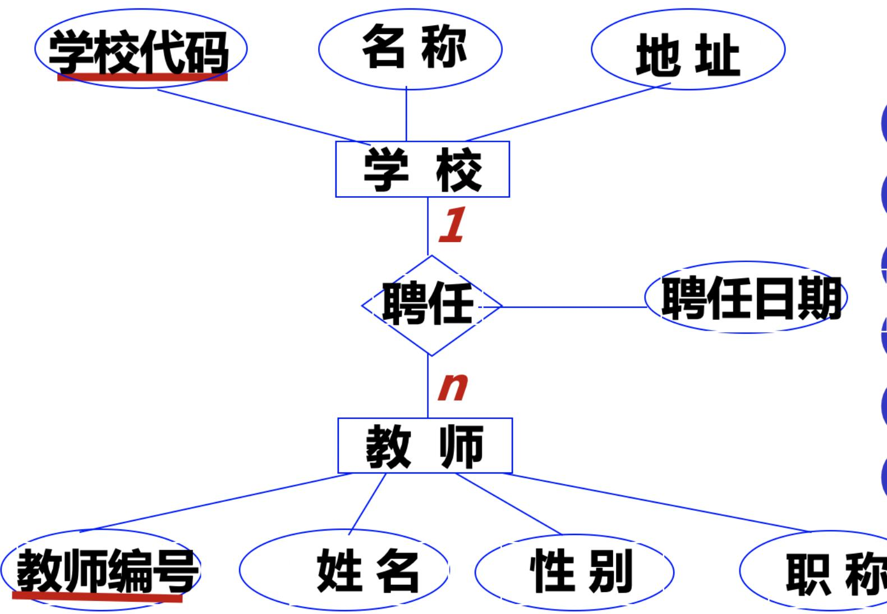
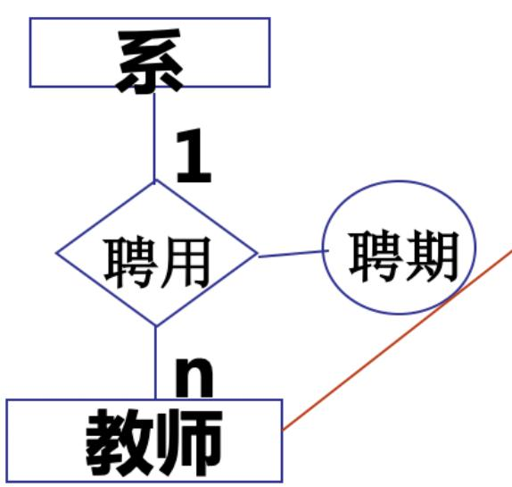

# 《数据库系统》期末复习（2021—2022学年第二学期，原闭卷版）

原件经识别和整理；“参考解答”是我们补的。

## 题型及分值

- 一、判断题（每题 1 分，共 15 分）
- 二、选择题（每题 1 分，共 10 分）
- 三、填空题（每题 1 分，共 5 分）
- 四、关系数据理论题（共 10 分）
- 五、SQL 语句题（每题 5 分，共 35 分）
- 六、数据库设计题（共 25 分）
- 考试时间：待定

## 课程目标

- 课程目标 1：使学生理解数据库系统的基本概念，掌握关系数据库的基础知识以及数据库管理系统的主要功能与实现技术，培养学生对数据库系统的逻辑架构能力，能够将数据库系统的相关知识用于复杂软件工程问题解决方案的比较、评价和改进。
- 课程目标 2：使学生掌握关系数据库的规范化理论知识以及数据库设计的步骤与方法，具有利用专业知识结合应用环境和现实世界的具体情况合理设计关系模式的能力。
- 课程目标 3：使学生掌握关系数据库的标准语言 SQL，熟悉主流数据库管理系统产品，配置实验环境、开展实验，具有熟练运用 SQL 语言分析和解决数据管理工程问题的能力。
- 课程目标 4：使学生掌握数据库应用系统开发方法，能够针对复杂软件工程问题，根据用户需求，合理使用现代信息技术工具设计数据库应用系统的开发方案，培养学生对信息管理问题进行分析、设计以及实现的能力。

## 课程目标与毕业要求的关系

| 毕业要求 | 指标点 | 课程目标 |
| --- | --- | --- |
| 1、工程知识 | 1-4-H 掌握计算机科学与技术的专业知识，能将专业知识用于分析和解决计算机及应用领域内的复杂工程问题。 | 1 |
| 3、设计/开发解决方案 | 3-2-M 能够根据用户需求，选取适当的研究方法和技术手段，确定复杂工程问题的解决方案。 | 2 |
| 4、研究 | 4-2-M 能够根据实验方案，配置实验环境、开展实验，使用定性或定量分析方法进行数据分析与处理，综合实验结果以获得合理有效的结论。 | 3 |
| 5、使用现代工具 | 5-1-M 能够合理使用计算机专业涉及的现代仪器、软硬件平台、开发测试工具、配置管理工具、信息检索工具等现代信息技术工具。 | 4 |

## 课程目标与知识单元的关系

| 课程内容\课程目标 | 课程目标 1 | 课程目标 2 | 课程目标 3 | 课程目标 4 |
| --- | --- | --- | --- | --- |
| 知识单元一 |  |  |  |  |
| 知识单元二 |  |  |  |  |
| 知识单元三 |  |  |  |  |
| 知识单元四 |  |  |  |  |
| 知识单元五 |  |  |  |  |
| 知识单元六 |  |  |  |  |
| 知识单元七 |  |  |  |  |

## 知识单元与教材章节的关系

| 知识单元 | 章节 | 大约分值分布 |
| --- | --- | --- |
| 知识单元一：数据库系统概述 | 第一章 | 7 分 |
| 知识单元二：关系数据模型 | 第二章 | 8 分 |
| 知识单元三：关系数据库语言 SQL | 第三（主要）、四、五章 | 35 分 |
| 知识单元四：关系数据库的规范化设计 | 第六章 | 10 分 |
| 知识单元五：数据库设计 | 第七章 | 25 分 |
| 知识单元六：系统实现技术 | 第四、五、十、十一章 | 10 分 |
| 知识单元七：数据库应用系统开发 | 第七章、实验 | 5 分 |

## 知识单元一：数据库系统概述

### 一、数据库的 4 个基本概念

- 数据是数据库中存储的基本对象。
  - 定义：描述事物的符号记录。
- 数据库（DB）是长期储存在计算机内、有组织的、可共享的大量数据的集合。概括地讲，数据库数据具有永久存储、有组织、可共享三个基本特点。
- 数据库系统（DBS）是指在计算机系统中引入数据库后的系统构成。
  - 由数据库、DBMS、应用开发工具、应用程序和 DBA 组成。
- 数据库管理系统（DBMS）位于用户应用与操作系统之间的一层数据管理软件。

知识点：[数据与数据库的基本概念](../../../topics/数据库系统/数据与数据库.md)、[数据库系统（DBS）的组成与特点](../../../topics/数据库系统/数据库系统.md)、[数据库管理系统（DBMS）的主要功能](../../../topics/数据库系统/数据库管理系统.md)

### 数据库管理系统的主要功能

- 数据定义
- 数据组织、存储和管理
- 数据操纵
- 数据库的事务管理和运行管理
  - 数据的安全性、完整性、并发控制、恢复
- 数据库的建立和维护
- 其他功能

知识点：[数据库管理系统（DBMS）的主要功能](../../../topics/数据库系统/数据库管理系统.md)

### 数据库系统的特点

- 数据结构化：数据的整体结构化是数据库的主要特征之一
- 数据的共享性高，冗余度低且易扩充
- 数据独立性高
- 数据由数据库管理系统统一管理和控制
  - 数据的安全性保护
  - 数据的完整性保护
  - 并发控制
  - 数据库恢复

知识点：[数据库系统（DBS）的组成与特点](../../../topics/数据库系统/数据库系统.md)、[数据库管理系统（DBMS）的主要功能](../../../topics/数据库系统/数据库管理系统.md)、[数据管理技术的产生和发展（人工管理、文件系统、数据库系统）](../../../topics/数据库系统/数据管理三阶段.md)

### 二、数据模型

- 概念模型（信息模型），如：E-R 模型
- 逻辑模型，如：层次模型、网状模型、关系模型、面向对象模型……
- 物理模型

知识点：[数据模型（概念模型与逻辑模型）](../../../topics/数据库系统/数据模型.md)、[实体-联系模型（E-R模型）的基本概念](../../../topics/数据库系统/ER模型基础.md)、[关系模型的数据结构、操作与完整性约束](../../../topics/数据库系统/关系模型.md)

### 三、数据库系统的三级模式结构

- 外模式（子模式或用户模式）
- 模式（逻辑模式）
- 内模式（存储模式）
- 外模式/模式映像
- 模式/内模式映像
- 数据独立性（物理独立性、逻辑独立性）由数据库管理系统的二级映像功能来保证。
- 关系模式是静态的、稳定的，而关系（实例）是动态的、随时间而不断变化的。

## 知识单元二：关系数据模型

知识点：[数据库系统的三级模式结构（模式、外模式、内模式）](../../../topics/数据库系统/三级模式结构.md)、[数据库的两级映像与数据独立性（逻辑独立性与物理独立性）](../../../topics/数据库系统/两级映像与数据独立性.md)、[关系模式与关系数据库](../../../topics/数据库系统/关系模式.md)

### 一、关系（数据结构）

- 在用户看来，关系是一张扁平的二维表。
- 码（候选键、全键、超键、主键、外键）
- 主属性：候选键中的属性；非主属性
- 基本关系的性质：
  1. 列是同质的，即每一列中的分量是同一类型的数据，来自同一个域
  2. 不同的列可出自同一个域（域是一组具有相同数据类型的值的集合）
  3. 列的顺序无所谓，列的次序可以任意交换
  4. 任意两个元组的候选码不能相同
  5. 行的顺序无所谓，行的次序可以任意交换
  6. 分量必须取原子值（规范化）

知识点：[关系的数据结构（域、笛卡尔积、关系、分量）](../../../topics/数据库系统/关系数据结构.md)、[关系模型的数据结构、操作与完整性约束](../../../topics/数据库系统/关系模型.md)、[码（候选码、主码、外码）](../../../topics/数据库系统/码.md)

### 二、关系操作（数据操作）

- 关系代数（关系表达式的书写和理解）
  - 集合运算：并、差、交、笛卡儿积
  - 关系运算：选择（行）、投影（列）、连接（行列）、除（行列）
- 自然连接是一种特殊的等值连接。
- 基本运算：并、差、选择、投影、笛卡尔积
- SQL 语句对应的关系代数表达式

知识点：[关系代数基础运算（并、差、交、笛卡尔积）](../../../topics/数据库系统/关系代数基础.md)、[关系代数专门运算（选择、投影、连接、除）](../../../topics/数据库系统/关系代数专门运算.md)、[自然连接、悬浮元组与外连接（左外连接、右外连接、全外连接）](../../../topics/数据库系统/自然连接与外连接.md)

### 三、关系完整性约束条件

- 实体完整性
  - 现实含义：事物（元组）可区分、是唯一的
  - 实现：主键
  - 内容：主属性不能取空值（或：主键值唯一、非空）
  - SQL 实现：Primary Key
- 参照完整性
  - 现实含义：不能引用不存在的事物
  - 实现：外键
  - 内容：外键值或者等于一个已经存在的主键值，或取空值
  - SQL 实现：Foreign Key
- 用户定义的完整性
  - 现实含义：某一具体应用所涉及的数据必须满足的语义要求
  - 实现：第五章的完整性实现方法
  - SQL 实现：Check()、Assertion，……

## 知识单元三：关系数据库语言 SQL

| SQL 功能 | 动词 |
| --- | --- |
| 数据查询 | SELECT |
| 数据定义 | CREATE, DROP, ALTER |
| 数据操纵 | INSERT, UPDATE, DELETE |
| 数据控制 | GRANT, REVOKE |

知识点：[关系的三类完整性约束（实体完整性、参照完整性、用户定义的完整性）](../../../topics/数据库系统/关系完整性.md)、[数据定义（CREATE、ALTER、DROP：SCHEMA、TABLE、INDEX）](../../../topics/数据库系统/数据定义.md)、[自主存取控制（GRANT、REVOKE、数据库角色）](../../../topics/数据库系统/自主存取控制.md)

### 基本表 CREATE TABLE

- 数据类型（char、int、date）
- PRIMARY KEY
- FOREIGN KEY…REFERENCES…ON DELETE CASCADE
- 用户自定义完整性（CHECK）
- 视图
  - 与第五章的完整性结合
  - CREATE VIEW
  - 对视图的操作（查询、更新）

知识点：[数据定义（CREATE、ALTER、DROP：SCHEMA、TABLE、INDEX）](../../../topics/数据库系统/数据定义.md)、[关系的三类完整性约束（实体完整性、参照完整性、用户定义的完整性）](../../../topics/数据库系统/关系完整性.md)、[视图（建立、查询、更新、删除视图）](../../../topics/数据库系统/视图.md)

### 数据查询 SELECT

- 完整语法：SELECT … FROM … WHERE … GROUP BY … ORDER BY …
- SELECT：`*`、DISTINCT、聚集函数 AVG、SUM、MAX
- WHERE 条件
  - 比较、IS NULL、LIKE 和字符串通配符、BETWEEN … AND …、AND、OR、NOT
- GROUP BY：HAVING
- ORDER BY、DESC
- 连接：WHERE 中连接条件
- 子查询：IN、NOT IN

知识点：[单表查询（SELECT、WHERE、ORDER BY、聚集函数、GROUP BY、HAVING、LIMIT）](../../../topics/数据库系统/单表查询.md)、[连接查询（等值连接、自然连接、自身连接、外连接、多表连接）](../../../topics/数据库系统/连接查询.md)、[嵌套查询（IN、比较运算符、ANY/ALL、EXISTS）](../../../topics/数据库系统/嵌套查询.md)

### 数据更新

- INSERT INTO… VALUES …
- DELETE FROM … WHERE …
- 空值的处理：查询条件、更新、聚集函数

| 查询条件 | 谓词 |
| --- | --- |
| 比较 | `=`、`>`、`<`、`>=`、`<=`、`!=`、`<>`、`!>`、`!<`；NOT + 上述比较运算符 |
| 确定范围 | BETWEEN AND、NOT BETWEEN AND |
| 确定集合 | IN、NOT IN |
| 字符匹配 | LIKE、NOT LIKE |
| 空值 | IS NULL、IS NOT NULL |
| 多重条件（逻辑运算） | AND、OR、NOT |

## 知识单元四：关系数据库的规范化设计

- 规范化涉及的基本概念
- 各级范式的定义（1NF、2NF、3NF、BCNF）
- FD 的推理规则
- 属性集闭包定义及算法
- 判断无损分解、保持函数依赖
- 无损分解和保持函数依赖分解方法：1NF 消除非主属性对键的部分函数依赖 → 2NF 消除非主属性对键的传递函数依赖 → 3NF 消除主属性对键的部分和传递函数依赖 → BCNF

## 知识单元五：数据库设计

知识点：[数据更新（INSERT、UPDATE、DELETE）](../../../topics/数据库系统/数据更新.md)、[空值（NULL）的产生、判断与运算规则](../../../topics/数据库系统/空值处理.md)

### 1、E-R 图表示方法

- 实体集 → 矩形框，框中标明实体集名
- 联系 → 菱形框，框内标明联系名
- 属性 → 椭圆
- 相关图形间用无向边连接，在联系与实体集的连线上要标明联系类型（如：1:n 等），在实体标识符下划线

#### 例 1：用 E-R 图描述学校与教师实体集及其联系

(1) 画出实体
(2) 画出联系
(3) 写出属性
(4) 连线
(5) 标出联系类型
(6) 标出实体键

知识点：[实体-联系模型（E-R模型）的基本概念](../../../topics/数据库系统/ER模型基础.md)、[概念结构设计（E-R图设计、实体与联系、设计方法）](../../../topics/数据库系统/概念结构设计.md)

### 2、E-R 模型向关系模型的转换

- 目标：把 E-R 图转换为关系模式的集合
- 规则：
  - 实体集：
    - 每个实体集转换成一个关系模式
    - 实体集的属性即为关系模式的属性
    - 实体键即为关系模式的键
  - 联系集：
    - 1:1 的联系集
    - 1:n 的联系集
    - m:n 的联系集

#### 例：校长

例如：

- $R_1$（职工号，姓名，年龄，…）
- $R_3$（学校代号，校名，…）

在 $R_3$ 中引入“任职年月”属性，$R_3$ 引用校长的“职工号”：

$R_3$（学校代号，校名，校长职工号，任职年月，…）

$R_3$ 与 $R_1$ 通过校长的“校长职工号”（外键）关联。

教师：

- $R_2$（系号，系名，地址，…）
- $R_1$（职工号，姓名，性别，聘期，系号，…）

在 $R_2$ 中引入“聘期”属性，$R_1$ 与 $R_2$ 通过外键“系号”关联。

学生 STUDENT（学号，姓名，性别，出生日期，籍贯）

选课成绩关系 SC（学号，课程号，成绩）

COURSE（课程名，课程号，学分，开课时间，先修课号）

## 知识单元六：系统实现技术

知识点：[逻辑结构设计（E-R图向关系模型的转换）](../../../topics/数据库系统/逻辑结构设计.md)、[实体-联系模型（E-R模型）的基本概念](../../../topics/数据库系统/ER模型基础.md)、[关系模式与关系数据库](../../../topics/数据库系统/关系模式.md)

### 一、数据库安全性控制

- DBMS 的安全性控制机制：用户身份鉴别、存取控制、视图、审计、数据加密等
- 自主存取控制机制组成
  - 授权和回收
  - SQL 的 GRANT/REVOKE
- 数据库角色
- 创建视图的命令

知识点：[数据库不安全因素与安全性控制层次](../../../topics/数据库系统/数据库安全性概述.md)、[自主存取控制（GRANT、REVOKE、数据库角色）](../../../topics/数据库系统/自主存取控制.md)、[视图机制、审计与数据加密](../../../topics/数据库系统/视图与审计.md)

### 二、数据库完整性控制

- 数据的完整性和安全性是两个不同概念
  - 数据库完整性是阻止合法用户通过合法操作向数据库中加入不正确的数据
  - 数据库安全性防范的是非法用户通过非法操作存取数据库中的正确数据
- 实体完整性、参照完整性、用户自定义完整性的实现
  - Foreign Key … On Delete/Update [No Action | Cascade | Set Null]

知识点：[数据库不安全因素与安全性控制层次](../../../topics/数据库系统/数据库安全性概述.md)、[实体完整性的定义与违约处理](../../../topics/数据库系统/实体完整性定义.md)、[参照完整性的定义与违约处理（级联操作）](../../../topics/数据库系统/参照完整性定义.md)

### 三、事务

- 事务 ACID 的基本概念
  - 原子性（Atomicity）
    - 事务中包括的诸操作要么都做，要么都不做
  - 一致性（Consistency）
    - 事务执行的结果必须是使数据库从一个一致性状态变到另一个一致性状态
  - 隔离性（Isolation）
    - 一个事务的执行不能被其他事务干扰
  - 持续性（Durability，永久性）
    - 一个事务一旦提交，它对数据库中数据的改变就应该是永久性的
- 事务的结束：COMMIT、ROLLBACK

## 知识单元六：系统实现技术

知识点：[事务的基本概念与ACID特性（原子性、一致性、隔离性、持续性）](../../../topics/数据库系统/事务.md)

### 数据库恢复技术

- 故障的种类及其恢复
- 事务内部的故障（UNDO）
- 系统故障（UNDO+REDO）
- 介质故障（REDO）
- \*计算机病毒
- 具有检查点的恢复技术可以改善恢复效率
- 日志文件是用来记录事务对数据库的更新操作的文件，不同的系统采用的日志文件格式并不完全一样
- 数据转储是数据库恢复中采用的基本技术，但不能频繁进行。

知识点：[故障的种类（事务内部故障、系统故障、介质故障）](../../../topics/数据库系统/故障种类.md)、[恢复策略（事务故障恢复、系统故障恢复、介质故障恢复）](../../../topics/数据库系统/恢复策略.md)、[具有检查点的恢复技术](../../../topics/数据库系统/检查点恢复.md)

### 并发控制

- 在单处理机系统中，事务的并发执行其实是多个事务轮流交叉执行
- 并发操作带来的数据不一致
- 封锁、封锁协议
- 封锁的问题
- 可串行化调度
- 串行调度

| 封锁协议 | 丢失修改 | 读“脏”数据 | 不可重复读 |
| --- | --- | --- | --- |
| 一级封锁协议 | × |  |  |
| 二级封锁协议 | × | × |  |
| 三级封锁协议 | × | × | × |

- 并发事务正确调度的准则
- 封锁的粒度与系统的并发度和并发控制的开销密切相关。

## 知识单元七：数据库应用系统开发

数据库设计：定义 p206

- 数据库设计的 6 个基本步骤：需求分析、概念结构设计、逻辑结构设计、物理结构设计、数据库实施、数据库运行和维护。
- 需求分析：调查的重点是数据和处理、结构化方法是自顶向下、数据字典（元数据）
- 概念设计：
  - E-R 模型：实体、属性、联系
  - 两个实体型之间的联系可以分为三种：一对一、一对多和多对多联系
  - 各子系统之间的冲突主要有三类：属性冲突、命名冲突和结构冲突

数据库设计：

- 逻辑设计：将 E-R 图转换成具体的数据库产品支持的数据模型如关系模型，形成数据库的逻辑模式。
- 逻辑模式的优化：规范化
- 物理设计：为一个给定的逻辑数据模型选取一个最适合应用要求的物理结构的过程
- 数据库实施阶段包括两项重要的工作：数据的载入，应用程序的编码和调试。
- 数据库运行阶段，对数据库的维护工作主要由数据库管理员完成。

知识点：[并发控制概述（丢失修改、脏读、不可重复读、幻读）](../../../topics/数据库系统/并发控制概述.md)、[封锁协议（一级、二级、三级封锁协议）](../../../topics/数据库系统/封锁协议.md)、[并发调度的可串行性（可串行化调度、冲突可串行化）](../../../topics/数据库系统/可串行化调度.md)
