# 《数据库系统》期末复习PPT（2024-2025-1）

原件的每一页，下面附识别出的文字。

### 数据库系统概论

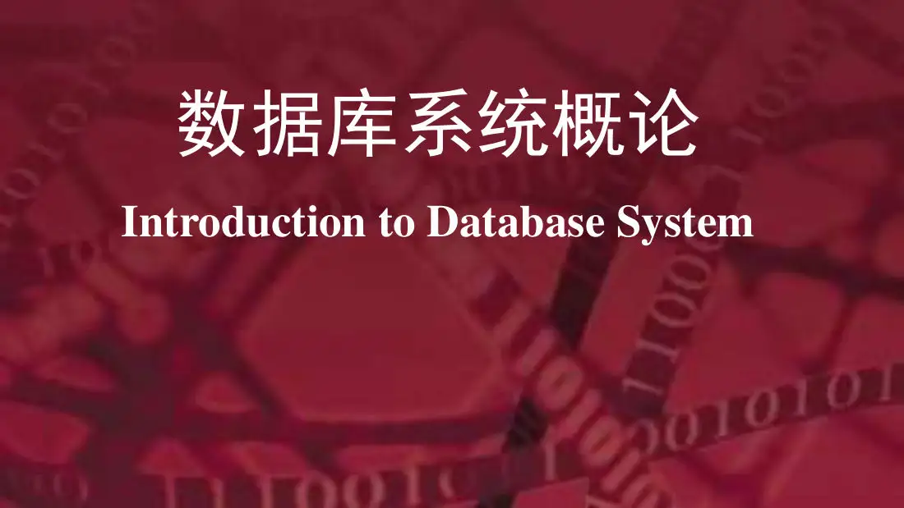

原文：

数据库系统概论

Introduction to Database System

### 总学时：48学时（40+8）

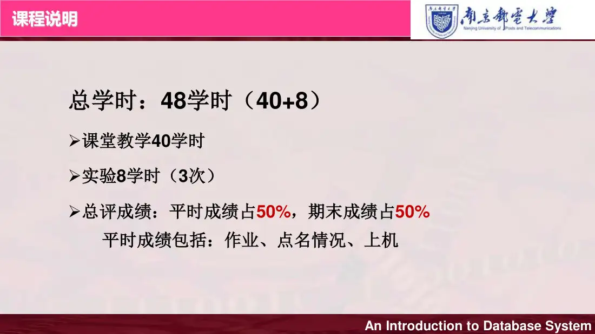

原文：

总学时：48学时（40+8）

▶课堂教学40学时

实验8学时（3次）

总评成绩：平时成绩占50%，期末成绩占50%

平时成绩包括：作业、点名情况、上机

课程说明

南京邮电大学
Nanjing University of Posts and Telecommunications

An Introduction to Database System

### 数据库系统概论

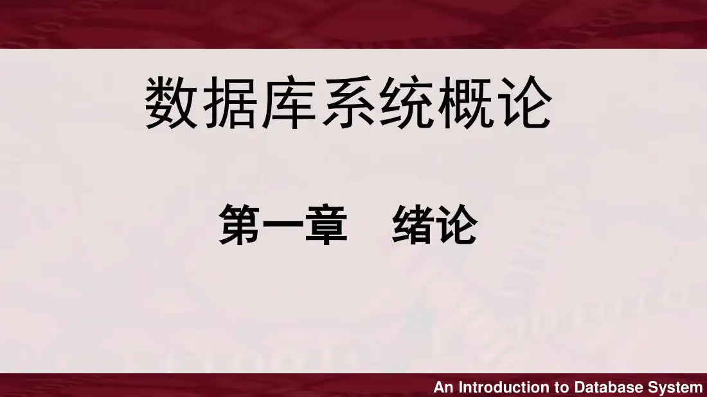

原文：

数据库系统概论

第一章 绪论

An Introduction to Database System

### 数据库的4个基本概念

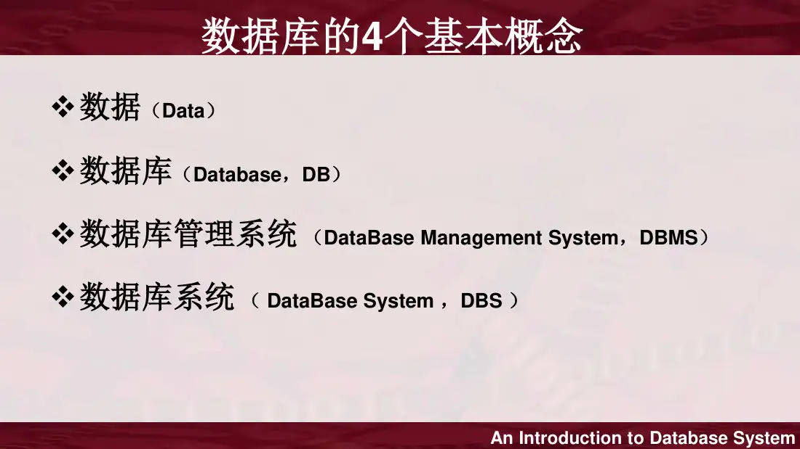

原文：

数据库的4个基本概念

数据（Data）

数据库（Database，DB）

数据库管理系统（DataBase Management System，DBMS）

数据库系统（DataBase System，DBS）

An Introduction to Database System

### 1. 数据

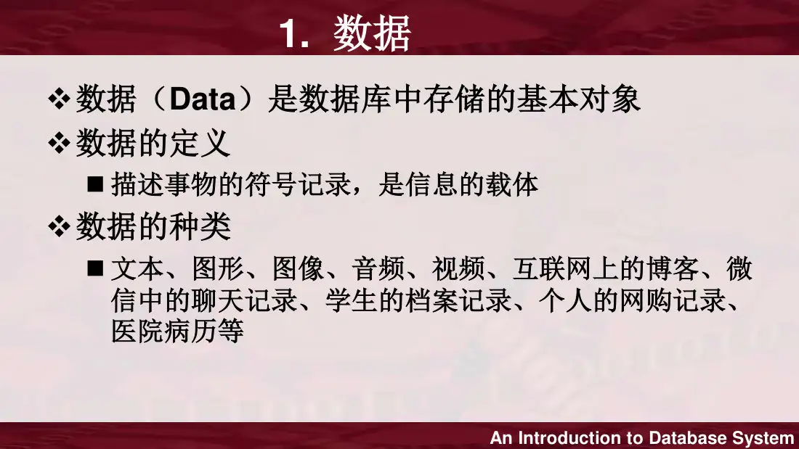

原文：

1. 数据

✿ 数据（Data）是数据库中存储的基本对象

◆ 数据的定义

■ 描述事物的符号记录，是信息的载体

◆ 数据的种类

■ 文本、图形、图像、音频、视频、互联网上的博客、微信中的聊天记录、学生的档案记录、个人的网购记录、医院病历等

An Introduction to Database System

### 2. 数据库

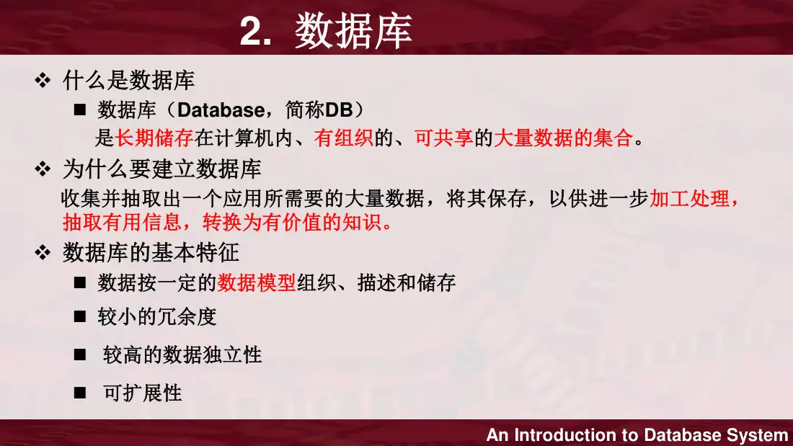

原文：

2. 数据库

什么是数据库

■ 数据库（Database，简称DB）

是长期储存在计算机内、有组织的、可共享的大量数据的集合。

为什么要建立数据库

收集并抽取出一个应用所需要的大量数据，将其保存，以供进一步加工处理，抽取有用信息，转换为有价值的知识。

数据库的基本特征

■ 数据按一定的数据模型组织、描述和储存

■ 较小的冗余度

■ 较高的数据独立性

■ 可扩展性

An Introduction to Database System

### 3. 数据库管理系统

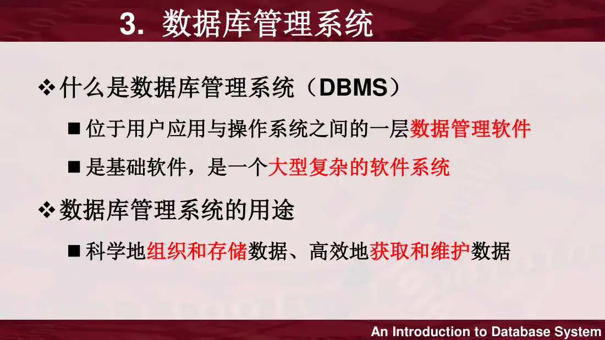

原文：

3. 数据库管理系统

什么是数据库管理系统（DBMS）

■ 位于用户应用与操作系统之间的一层数据管理软件

■ 是基础软件，是一个大型复杂的软件系统

数据库管理系统的用途

■ 科学地组织和存储数据、高效地获取和维护数据

An Introduction to Database System

### 4.数据库系统

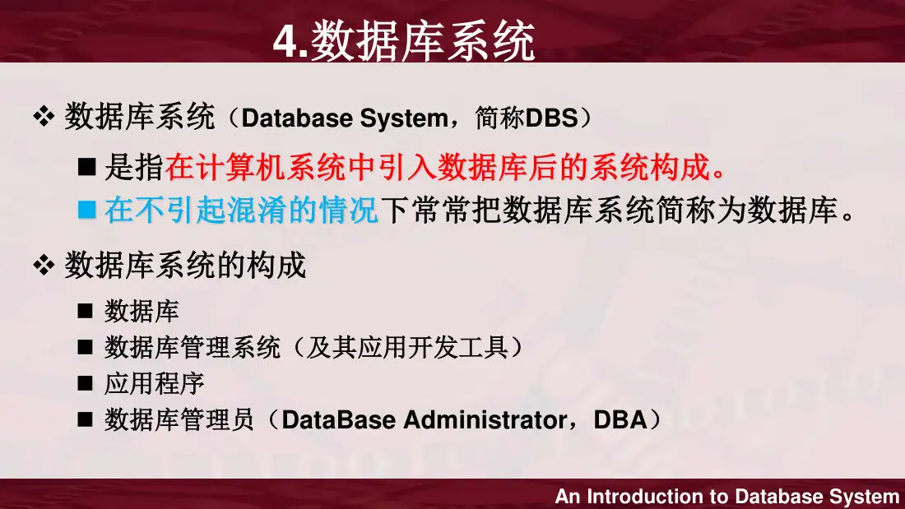

原文：

4.数据库系统

数据库系统（Database System，简称DBS）

■ 是指在计算机系统中引入数据库后的系统构成。

■ 在不引起混淆的情况下常常把数据库系统简称为数据库。

数据库系统的构成

■ 数据库

■ 数据库管理系统（及其应用开发工具）

■ 应用程序

■ 数据库管理员（DataBase Administrator，DBA）

An Introduction to Database System

### 数据管理技术的产生和发展

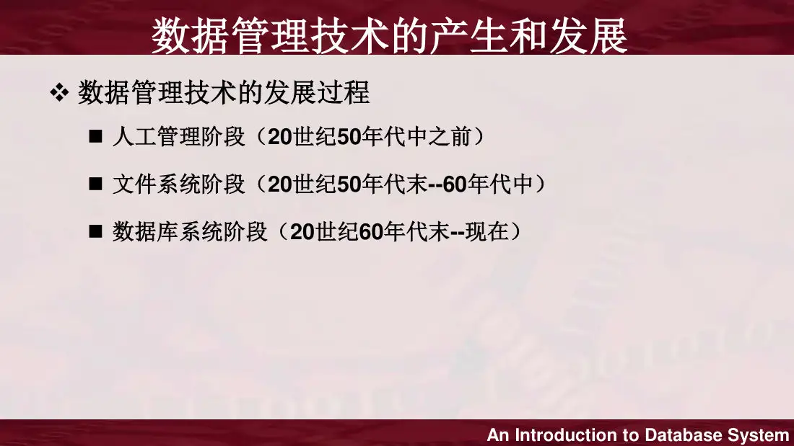

原文：

数据管理技术的产生和发展

✿ 数据管理技术的发展过程

■ 人工管理阶段（20世纪50年代中之前）

■ 文件系统阶段（20世纪50年代末--60年代中）

■ 数据库系统阶段（20世纪60年代末--现在）

An Introduction to Database System

### 表1.1 数据管理3个阶段的比较 P.7

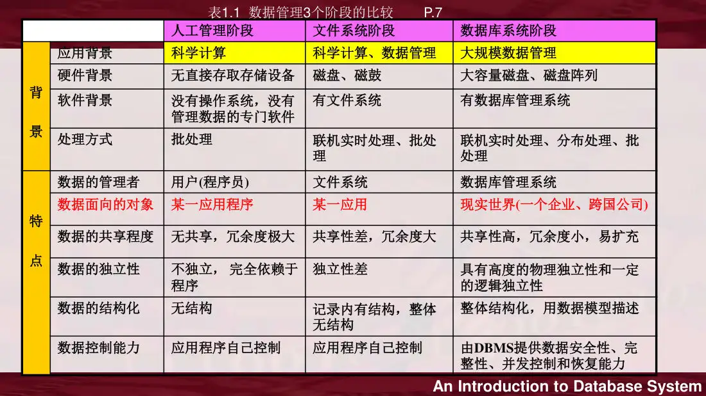

原文：

表1.1 数据管理3个阶段的比较 P.7
<table><tr><td colspan="2"></td><td>人工管理阶段</td><td>文件系统阶段</td><td>数据库系统阶段</td></tr><tr><td rowspan="4">背景</td><td>应用背景</td><td>科学计算</td><td>科学计算、数据管理</td><td>大规模数据管理</td></tr><tr><td>硬件背景</td><td>无直接存取存储设备</td><td>磁盘、磁鼓</td><td>大容量磁盘、磁盘阵列</td></tr><tr><td>软件背景</td><td>没有操作系统,没有管理数据的专门软件</td><td>有文件系统</td><td>有数据库管理系统</td></tr><tr><td>处理方式</td><td>批处理</td><td>联机实时处理、批处理</td><td>联机实时处理、分布处理、批处理</td></tr><tr><td rowspan="6">特点</td><td>数据的管理者</td><td>用户(程序员)</td><td>文件系统</td><td>数据库管理系统</td></tr><tr><td>数据面向的对象</td><td>某一应用程序</td><td>某一应用</td><td>现实世界(一个企业、跨国公司)</td></tr><tr><td>数据的共享程度</td><td>无共享,冗余度极大</td><td>共享性差,冗余度大</td><td>共享性高,冗余度小,易扩充</td></tr><tr><td>数据的独立性</td><td>不独立,完全依赖于程序</td><td>独立性差</td><td>具有高度的物理独立性和一定的逻辑独立性</td></tr><tr><td>数据的结构化</td><td>无结构</td><td>记录内有结构,整体无结构</td><td>整体结构化,用数据模型描述</td></tr><tr><td>数据控制能力</td><td>应用程序自己控制</td><td>应用程序自己控制</td><td>由DBMS提供数据安全性、完整性、并发控制和恢复能力</td></tr></table>

An Introduction to Database System

### 1.2.1 数据建模

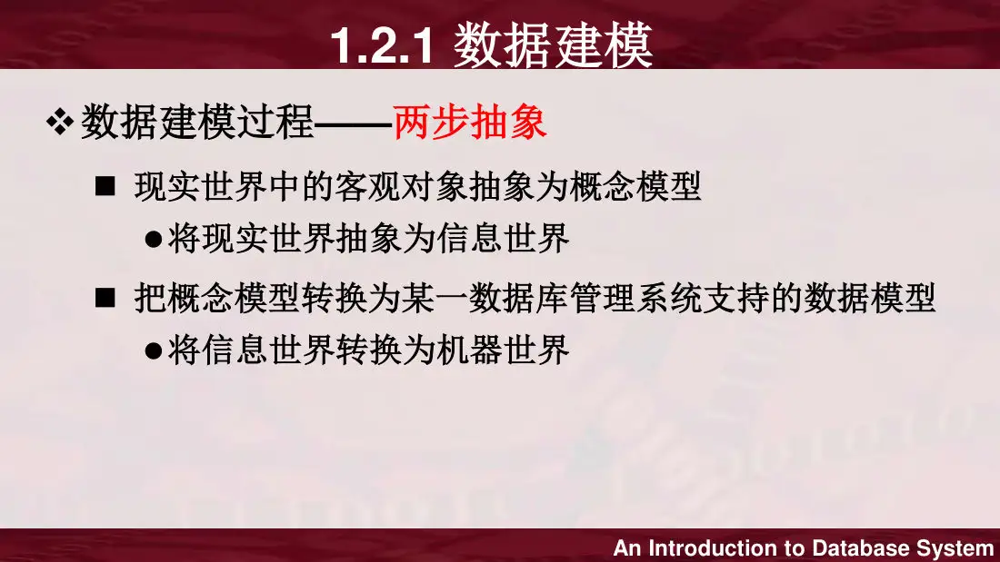

原文：

1.2.1 数据建模

✿ 数据建模过程——两步抽象

■ 现实世界中的客观对象抽象为概念模型

● 将现实世界抽象为信息世界

■ 把概念模型转换为某一数据库管理系统支持的数据模型

\- 将信息世界转换为机器世界

An Introduction to Database System

### 数据建模

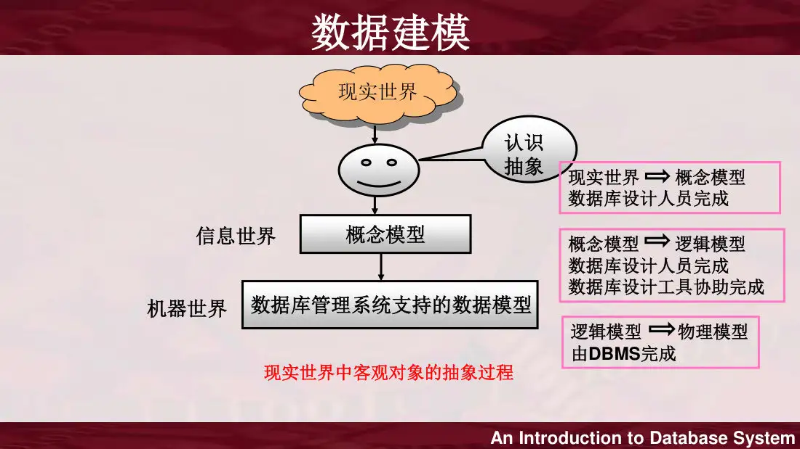

原文：

数据建模

概念模型 $\Rightarrow$ 逻辑模型数据库设计人员完成数据库设计工具协助完成

逻辑模型 $\Rightarrow$ 物理模型由DBMS完成

An Introduction to Database System

### 关系模型的操纵与完整性约束（续）

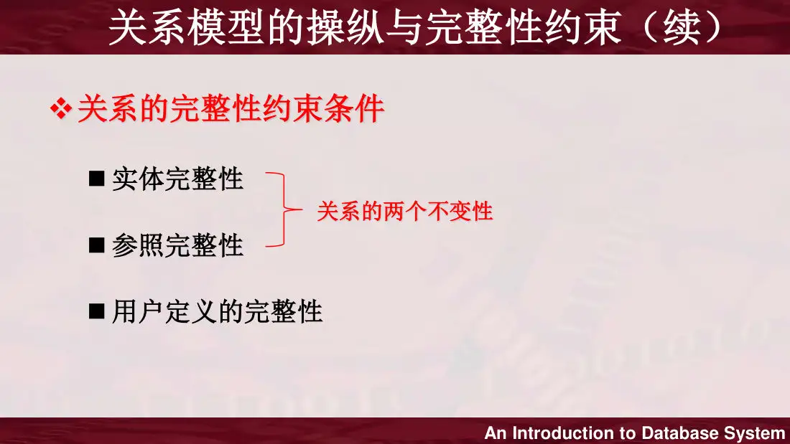

原文：

关系模型的操纵与完整性约束（续）

关系的完整性约束条件

■实体完整性

关系的两个不变性

■ 参照完整性

■ 用户定义的完整性

An Introduction to Database System

### 1.3.2 数据库系统的三级模式结构

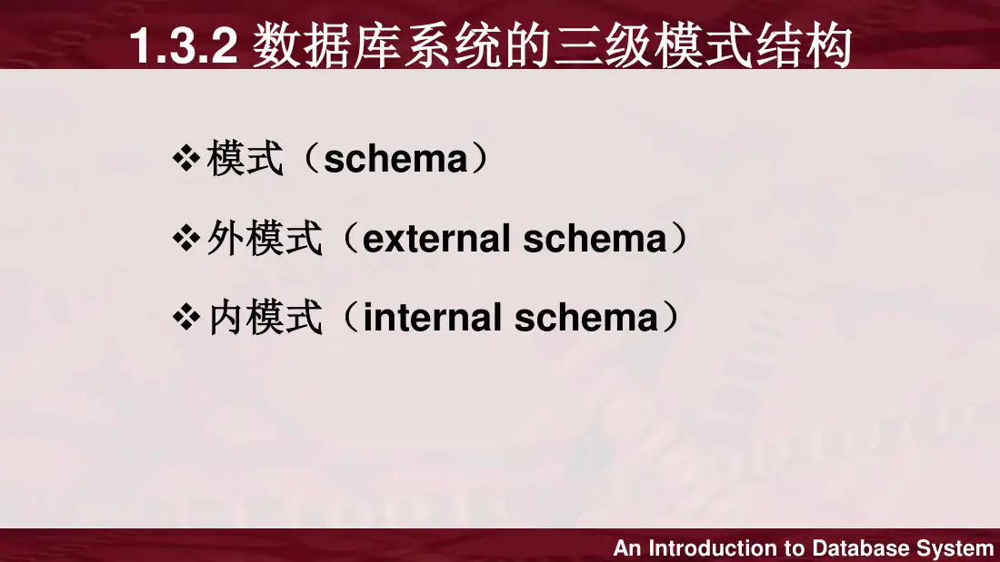

原文：

1.3.2 数据库系统的三级模式结构

❖模式（schema）

✿ 外模式（external schema）

❖ 内模式（internal schema）

An Introduction to Database System

### 数据库系统的三级模式结构（续）

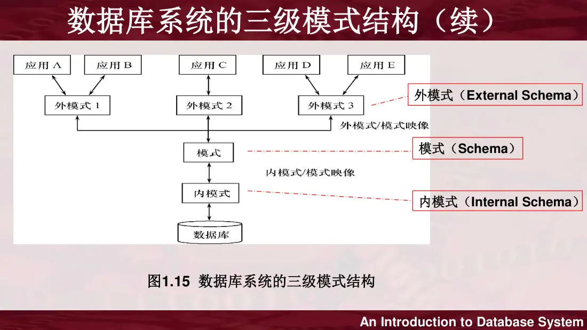

原文：

数据库系统的三级模式结构（续）

An Introduction to Database System

### 数据库的两级映像与数据独立性

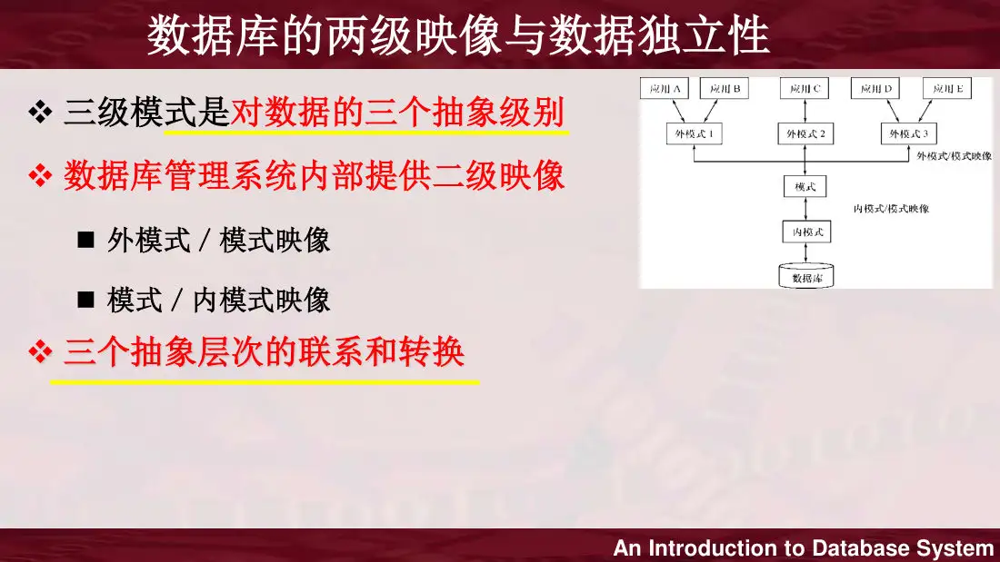

原文：

数据库的两级映像与数据独立性

三级模式是对数据的三个抽象级别

数据库管理系统内部提供二级映像

■ 外模式 / 模式映像

■ 模式 / 内模式映像

三个抽象层次的联系和转换

An Introduction to Database System

### 数据库系统概论

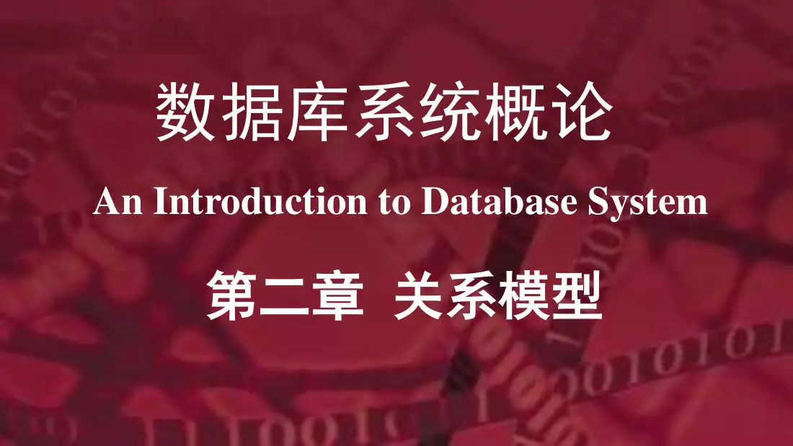

原文：

数据库系统概论

An Introduction to Database System

第二章 关系模型

### 关系（续）

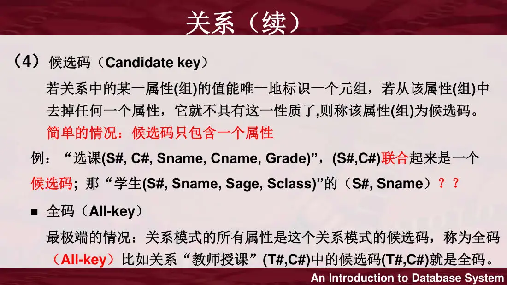

原文：

关系（续）

(4) 候选码（Candidate key）

若关系中的某一属性(组)的值能唯一地标识一个元组，若从该属性(组)中去掉任何一个属性，它就不具有这一性质了,则称该属性(组)为候选码。

简单的情况：候选码只包含一个属性

例：“选课(S#, C#, Sname, Cname, Grade)”, (S#, C#)联合起来是一个候选码；那“学生(S#, Sname, Sage, Sclass)”的（S#, Sname）？？

■ 全码（All-key）

最极端的情况：关系模式的所有属性是这个关系模式的候选码，称为全码（All-key）比如关系“教师授课”(T#,C#)中的候选码(T#,C#)就是全码。

An Introduction to Database System

### 关系（续）

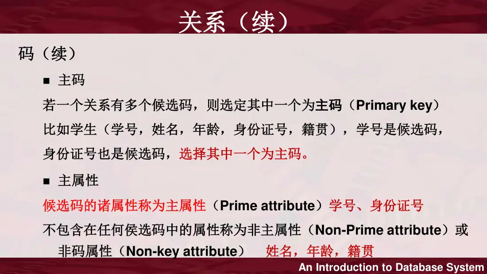

原文：

关系（续）

码（续）

■ 主码

若一个关系有多个候选码，则选定其中一个为主码（Primary key）比如学生（学号，姓名，年龄，身份证号，籍贯），学号是候选码，身份证号也是候选码，选择其中一个为主码。

■ 主属性

候选码的诸属性称为主属性（Prime attribute）学号、身份证号

不包含在任何侯选码中的属性称为非主属性（Non-Prime attribute）或

非码属性（Non-key attribute） 姓名，年龄，籍贯

An Introduction to Database System

### 2.4 关系代数

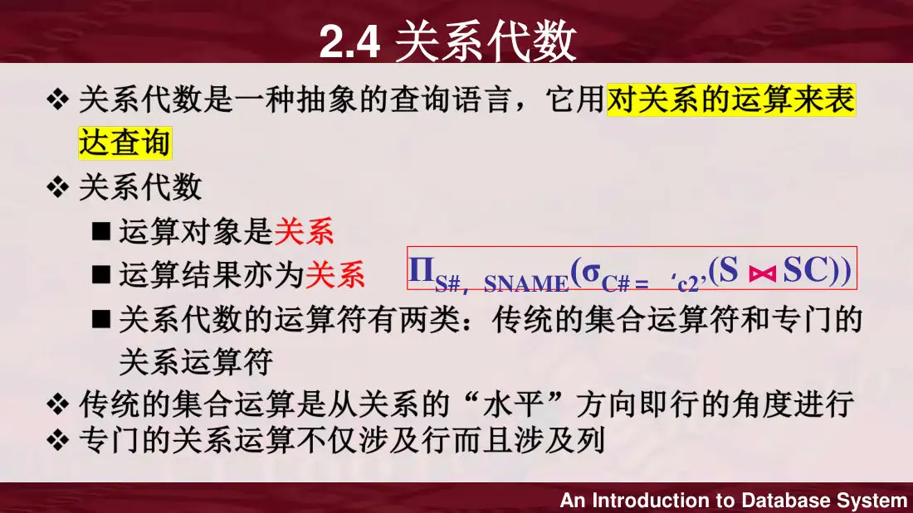

原文：

2.4 关系代数

关系代数是一种抽象的查询语言，它用对关系的运算来表达查询

关系代数

■ 运算对象是关系

■运算结果亦为关系 $\Pi_{\mathrm{S}\# ,\mathrm{SNAME}}(\sigma_{\mathrm{C}\# = 'c2},(\mathrm{S}\bowtie \mathrm{SC}))$

■ 关系代数的运算符有两类：传统的集合运算符和专门的关系运算符

◆ 传统的集合运算是从关系的“水平”方向即行的角度进行

◆ 专门的关系运算不仅涉及行而且涉及列

An Introduction to Database System

### 关系代数运算符

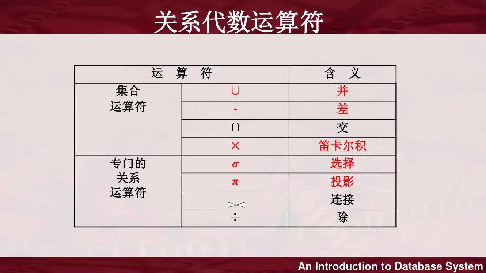

原文：

关系代数运算符

<table><tr><td colspan="2">运算符</td><td>含义</td></tr><tr><td rowspan="4">集合运算符</td><td>U</td><td>并</td></tr><tr><td>-</td><td>差</td></tr><tr><td>∩</td><td>交</td></tr><tr><td>×</td><td>笛卡尔积</td></tr><tr><td rowspan="4">专门的关系运算符</td><td>σ</td><td>选择</td></tr><tr><td>π</td><td>投影</td></tr><tr><td>⊗</td><td>连接</td></tr><tr><td>÷</td><td>除</td></tr></table>

An Introduction to Database System

### 数据库系统概论

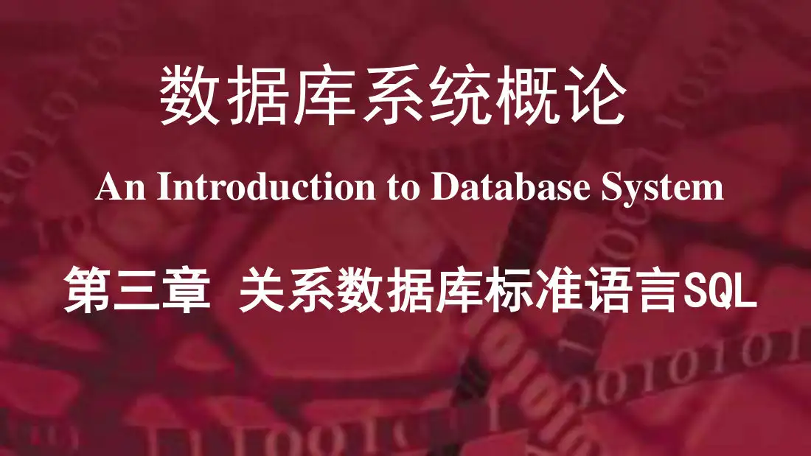

原文：

数据库系统概论

An Introduction to Database System

第三章 关系数据库标准语言SQL

### 第四章 数据库安全性

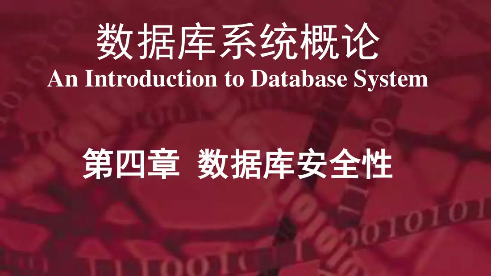

原文：

数据库系统概论 An Introduction to Database System

第四章 数据库安全性

### 第四章 数据库安全性

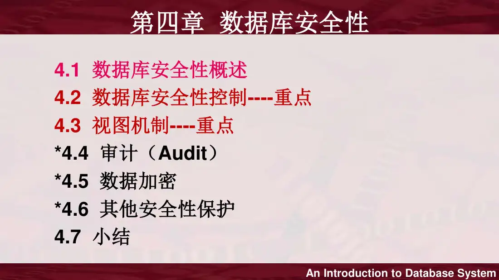

原文：

第四章 数据库安全性

4.1 数据库安全性概述
4.2 数据库安全性控制----重点
4.3 视图机制----重点
\*4.4 审计（Audit）
\*4.5 数据加密
\*4.6 其他安全性保护
4.7 小结

An Introduction to Database System

### 数据库安全性控制（续）

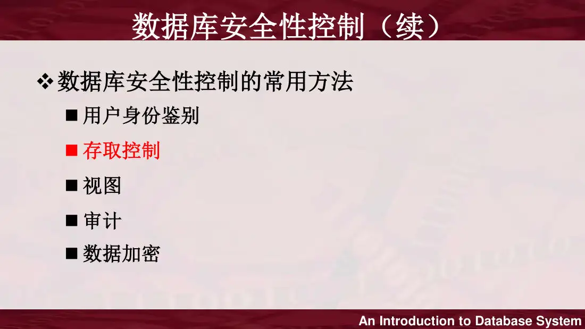

原文：

数据库安全性控制（续）

数据库安全性控制的常用方法

■ 用户身份鉴别

■ 存取控制

■视图

■ 审计

■ 数据加密

An Introduction to Database System

### 4.2.2 存取控制

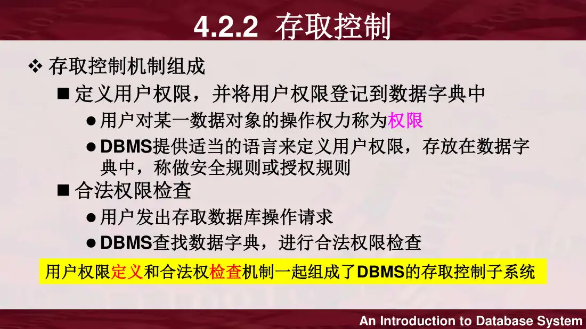

原文：

4.2.2 存取控制

◆ 存取控制机制组成

■ 定义用户权限，并将用户权限登记到数据字典中

\- 用户对某一数据对象的操作权力称为权限

\- DBMS提供适当的语言来定义用户权限，存放在数据字典中，称做安全规则或授权规则

■ 合法权限检查

\- 用户发出存取数据库操作请求

\- DBMS查找数据字典，进行合法权限检查

用户权限定义和合法权检查机制一起组成了DBMS的存取控制子系统

An Introduction to Database System

### 存取控制（续）

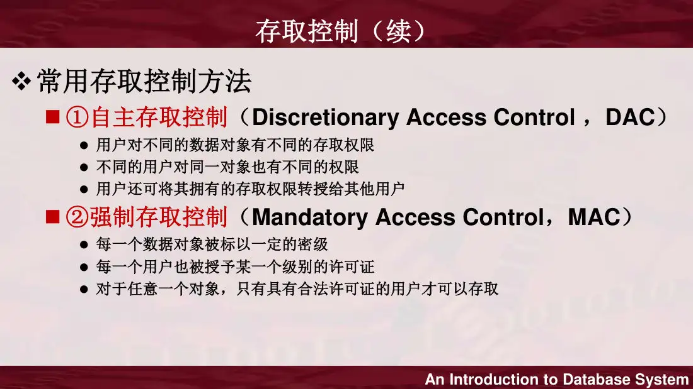

原文：

存取控制（续）

✿ 常用存取控制方法

■①自主存取控制（Discretionary Access Control，DAC）

\- 用户对不同的数据对象有不同的存取权限

\- 不同的用户对同一对象也有不同的权限

\- 用户还可将其拥有的存取权限转授给其他用户

■②强制存取控制（Mandatory Access Control, MAC）

\- 每一个数据对象被标以一定的密级

\- 每一个用户也被授予某一个级别的许可证

\- 对于任意一个对象，只有具有合法许可证的用户才可以存取

An Introduction to Database System

### 4.2.3 自主存取控制方法

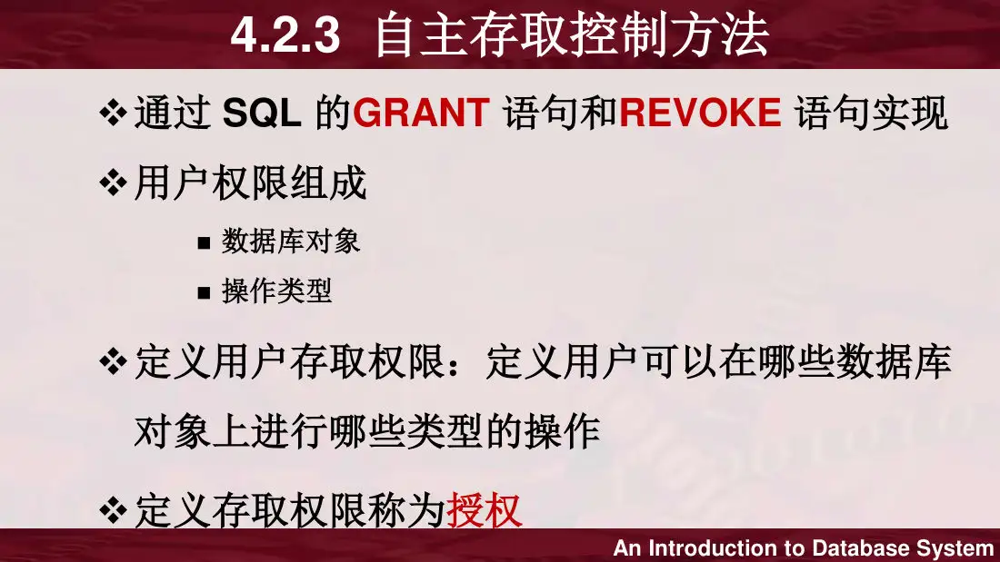

原文：

4.2.3 自主存取控制方法

通过 SQL 的GRANT 语句和REVOKE 语句实现

◆ 用户权限组成

■ 数据库对象

■ 操作类型

定义用户存取权限：定义用户可以在哪些数据库对象上进行哪些类型的操作

定义存取权限称为授权

An Introduction to Database System

### 1. 权限授予：GRANT

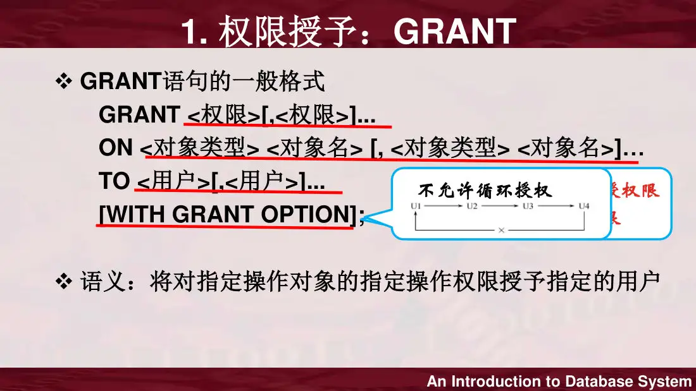

原文：

1. 权限授予：GRANT

✿ GRANT语句的一般格式
GRANT <权限>[,<权限>]...
ON <对象类型><对象名>[,<对象类型><对象名>]...
TO <用户>[,<用户>]...
[WITH GRANT OPTION]; 不允许循环授权
U1 → U2 → U3 → U4 受权限

✿ 语义：将对指定操作对象的指定操作权限授予指定的用户

An Introduction to Database System

### GRANT（续）

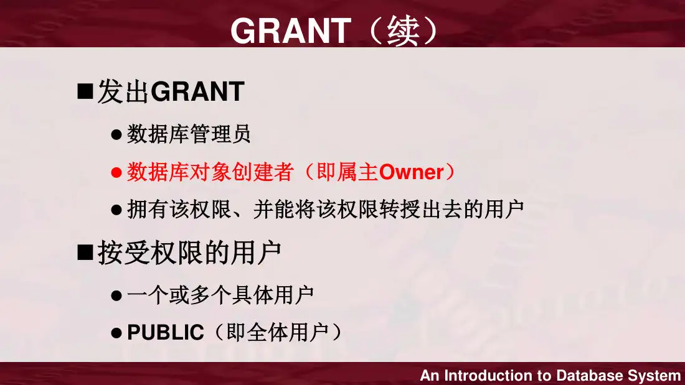

原文：

GRANT（续）

■发出GRANT

\- 数据库管理员

● 数据库对象创建者（即属主Owner）

● 拥有该权限、并能将该权限转授出去的用户

■按受权限的用户

\- 一个或多个具体用户

\- PUBLIC（即全体用户）

An Introduction to Database System

### 2. 权限回收: REVOKE

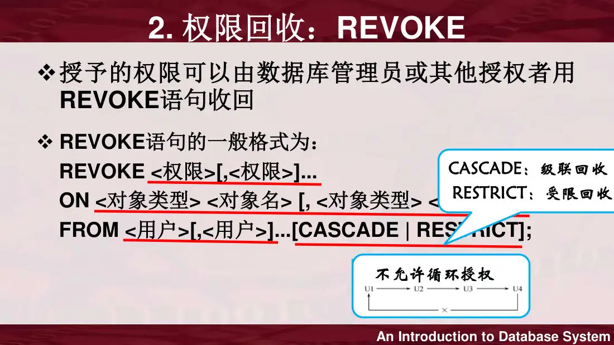

原文：

2. 权限回收: REVOKE

✿授予的权限可以由数据库管理员或其他授权者用REVOKE语句收回

✿ REVOKE语句的一般格式为:

REVOKE <权限>[,<权限>]...

CASCADE：级联回收
RESTRICT：受限回收

ON <对象类型> <对象名> [, <对象类型>

FROM <用户>[,<用户>]...[CASCADE | RESTRICT];

An Introduction to Database System

### 例题

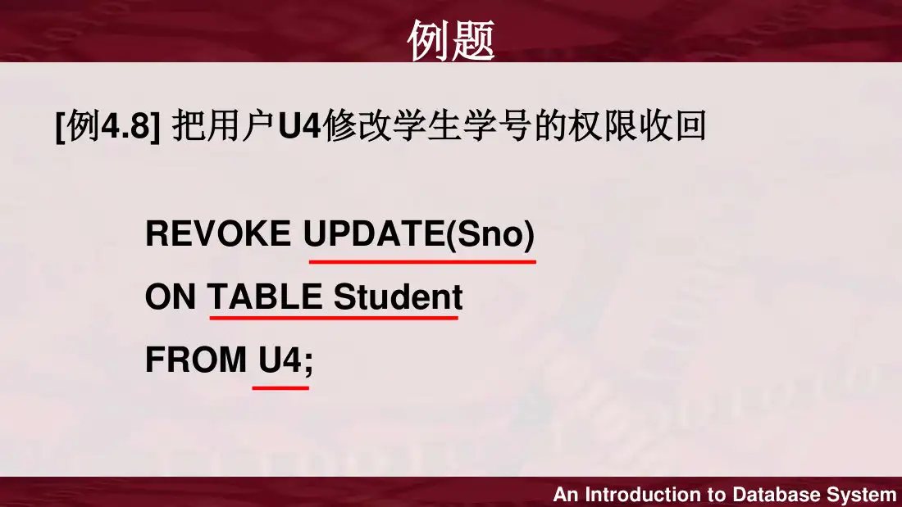

原文：

例题

[例4.8] 把用户U4修改学生学号的权限收回

REVOKE UPDATE(Sno)

ON TABLE Student

FROM U4;

An Introduction to Database System

### 使用角色管理数据库权限

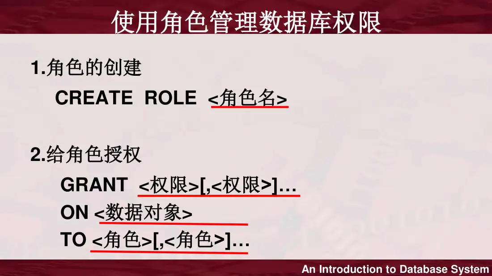

原文：

使用角色管理数据库权限

1.角色的创建

CREATE ROLE <角色名>

2. 给角色授权

GRANT <权限>[,<权限>]...

ON <数据对象>

TO <角色>[,<角色>] $\cdots$

An Introduction to Database System

### 使用角色管理数据库权限（续）

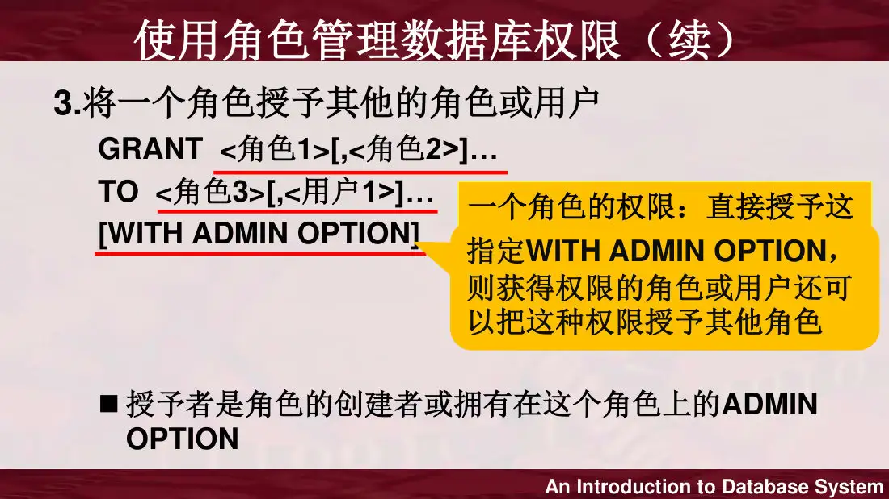

原文：

使用角色管理数据库权限（续）

3. 将一个角色授予其他的角色或用户 GRANT <角色1>[,<角色2>]...

TO <角色3>[,<用户1>]...
[WITH ADMIN OPTION]一个角色的权限：直接授予这指定WITH ADMIN OPTION，则获得权限的角色或用户还可以把这种权限授予其他角色

■ 授予者是角色的创建者或拥有在这个角色上的ADMIN OPTION

An Introduction to Database System

### 使用角色管理数据库权限（续）

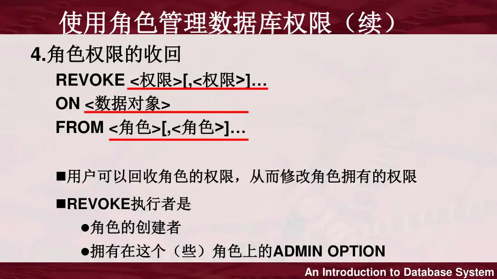

原文：

使用角色管理数据库权限（续）

4.角色权限的收回

REVOKE <权限>[,<权限>]...

ON <数据对象>

FROM <角色>[,<角色>]...

■用户可以回收角色的权限，从而修改角色拥有的权限

■REVOKE执行者是

\- 角色的创建者

●拥有在这个（些）角色上的ADMIN OPTION

An Introduction to Database System

### 4.2.6 强制存取控制方法

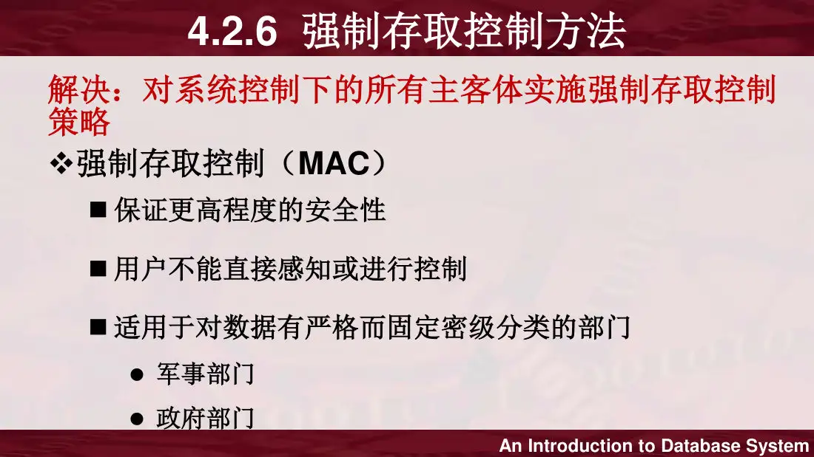

原文：

4.2.6 强制存取控制方法

解决：对系统控制下的所有主客体实施强制存取控制策略

◆强制存取控制（MAC）

■ 保证更高程度的安全性

■ 用户不能直接感知或进行控制

■适用于对数据有严格而固定密级分类的部门

\- 军事部门

\- 政府部门

An Introduction to Database System

### 强制存取控制方法（续）

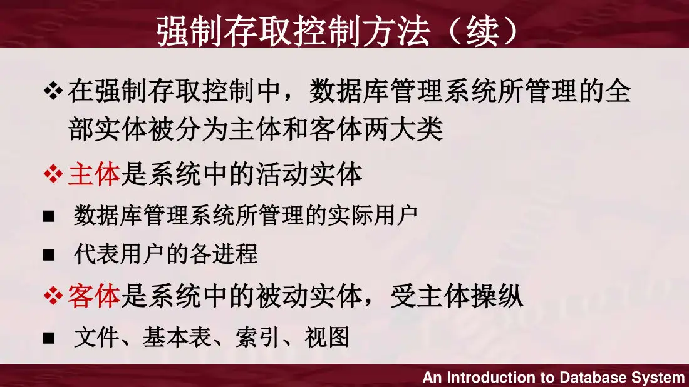

原文：

强制存取控制方法（续）

✿ 在强制存取控制中，数据库管理系统所管理的全部实体被分为主体和客体两大类

主体是系统中的活动实体

■ 数据库管理系统所管理的实际用户

■ 代表用户的各进程

客体是系统中的被动实体，受主体操纵

■ 文件、基本表、索引、视图

An Introduction to Database System

### 强制存取控制方法（续）

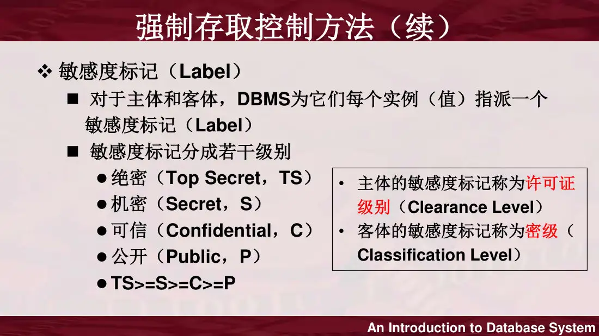

原文：

强制存取控制方法（续）

◆ 敏感度标记（Label）

■ 对于主体和客体，DBMS为它们每个实例（值）指派一个敏感度标记（Label）

■ 敏感度标记分成若干级别

\- 绝密（Top Secret，TS）

\- 机密（Secret，S）

\- 可信（Confidential，C）

\- 公开（Public，P）

\- TS>=S>=C>=P- 主体的敏感度标记称为许可证级别（Clearance Level）

\- 客体的敏感度标记称为密级（Classification Level）

An Introduction to Database System

### 强制存取控制方法（续）

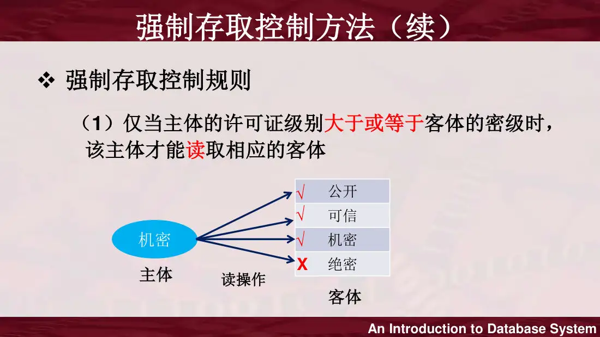

原文：

强制存取控制方法（续）

◆ 强制存取控制规则

(1) 仅当主体的许可证级别大于或等于客体的密级时,该主体才能读取相应的客体

机密

An Introduction to Database System

### 强制存取控制方法（续）

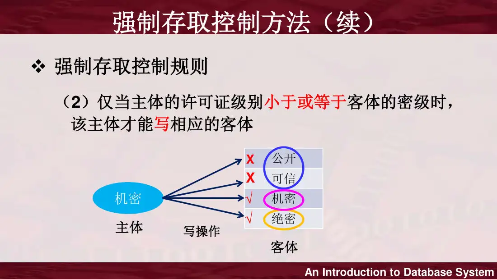

原文：

强制存取控制方法（续）

◆ 强制存取控制规则

(2) 仅当主体的许可证级别小于或等于客体的密级时,该主体才能写相应的客体

机密

An Introduction to Database System

### 第五章 数据库完整性

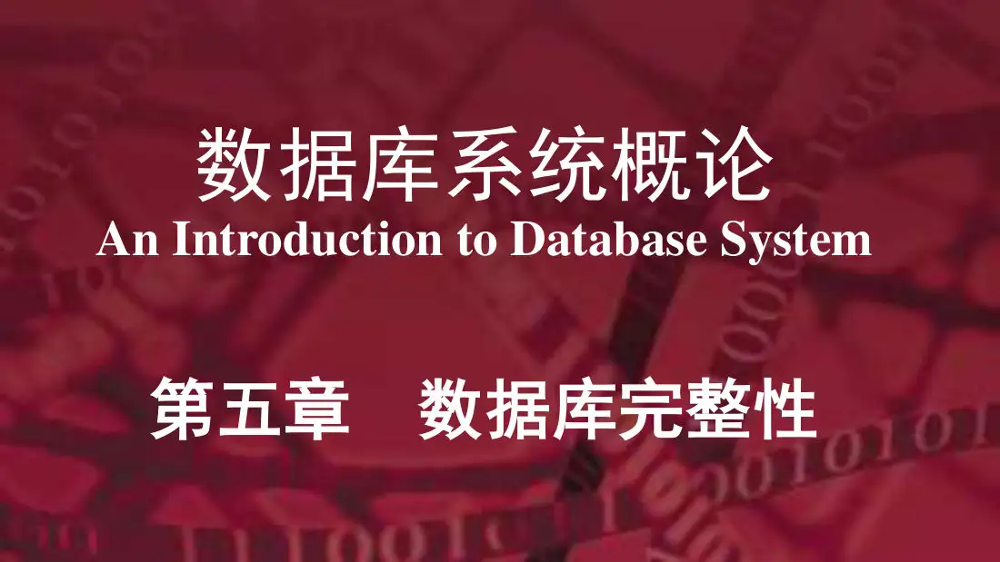

原文：

数据库系统概论 An Introduction to Database System

第五章 数据库完整性

### 数据库完整性概述（续）

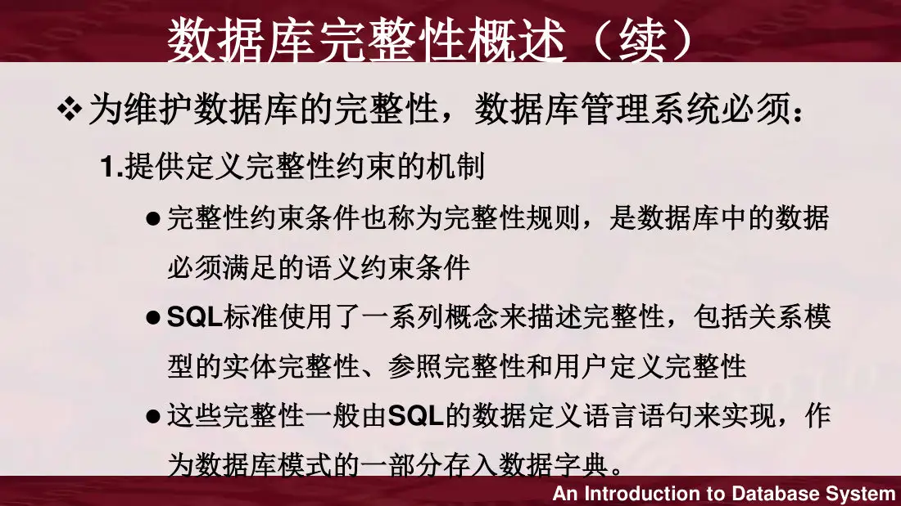

原文：

数据库完整性概述（续）

✿为维护数据库的完整性，数据库管理系统必须：

1. 提供定义完整性约束的机制

\- 完整性约束条件也称为完整性规则，是数据库中的数据必须满足的语义约束条件

\- SQL标准使用了一系列概念来描述完整性，包括关系模型的实体完整性、参照完整性和用户定义完整性

\- 这些完整性一般由SQL的数据定义语言语句来实现，作为数据库模式的一部分存入数据字典。

An Introduction to Database System

### 数据库完整性概述（续）

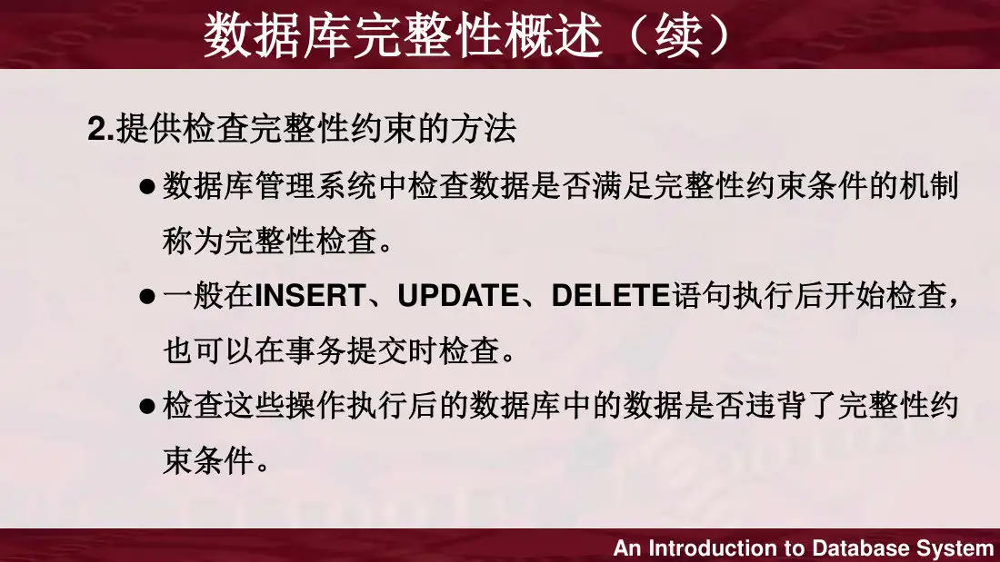

原文：

数据库完整性概述（续）

2. 提供检查完整性约束的方法

\- 数据库管理系统中检查数据是否满足完整性约束条件的机制称为完整性检查。

\- 一般在INSERT、UPDATE、DELETE语句执行后开始检查，也可以在事务提交时检查。

\- 检查这些操作执行后的数据库中的数据是否违背了完整性约束条件。

An Introduction to Database System

### 数据库完整性概述（续）

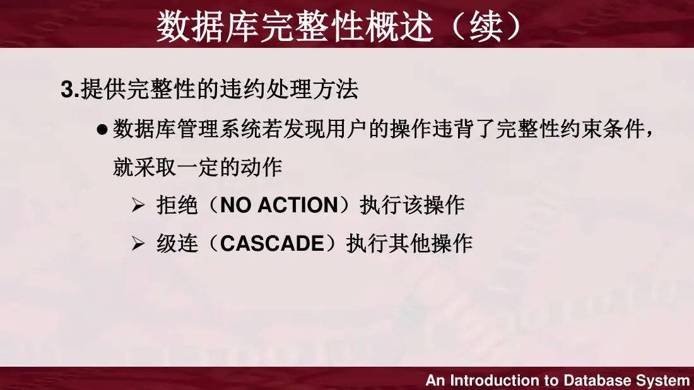

原文：

数据库完整性概述（续）

3. 提供完整性的违约处理方法

\- 数据库管理系统若发现用户的操作违背了完整性约束条件，就采取一定的动作

➢ 拒绝（NO ACTION）执行该操作

级连（CASCADE）执行其他操作

An Introduction to Database System

### 数据库完整性概述（续）

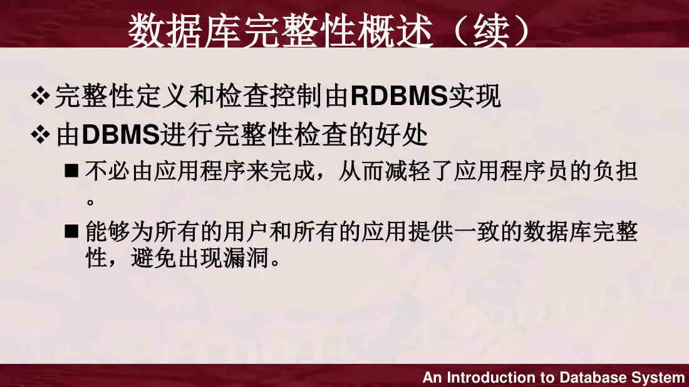

原文：

数据库完整性概述（续）

◆ 完整性定义和检查控制由RDBMS实现

由DBMS进行完整性检查的好处

■ 不必由应用程序来完成，从而减轻了应用程序员的负担。

■能够为所有的用户和所有的应用提供一致的数据库完整性，避免出现漏洞。

An Introduction to Database System

### 5.2.1定义实体完整性

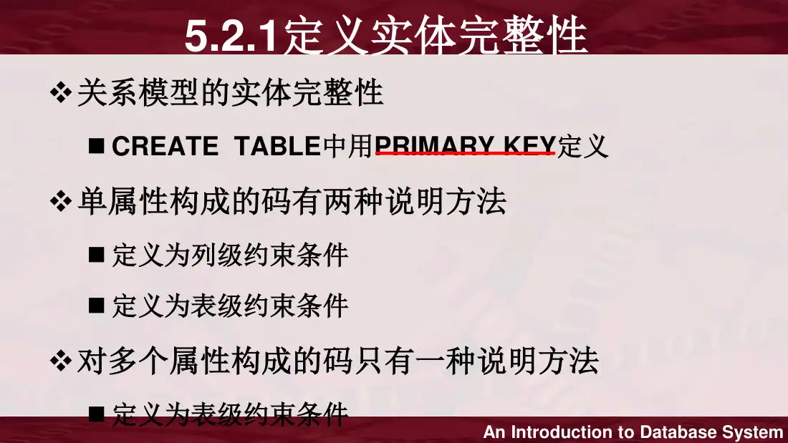

原文：

5.2.1定义实体完整性

关系模型的实体完整性

■ CREATE TABLE中用PRIMARY KEY定义

单属性构成的码有两种说明方法

■ 定义为列级约束条件

■ 定义为表级约束条件

✿对多个属性构成的码只有一种说明方法

■ 定义为表级约束条件

An Introduction to Database System

### 定义实体完整性（续）

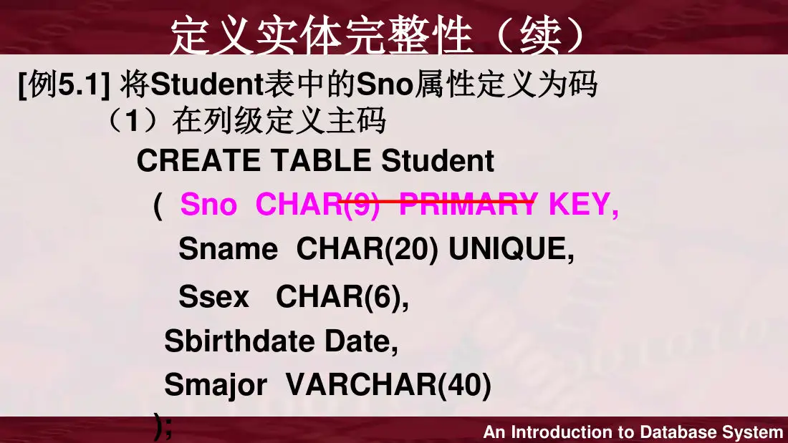

原文：

定义实体完整性（续）

[例5.1] 将Student表中的Sno属性定义为码

(1) 在列级定义主码

CREATE TABLE Student

( Sno CHAR(9) PRIMARY KEY,

Sname CHAR(20) UNIQUE,

Ssex CHAR(6),

Sbirthdate Date,

Smajor VARCHAR(40)

An Introduction to Database System

### 定义实体完整性（续）

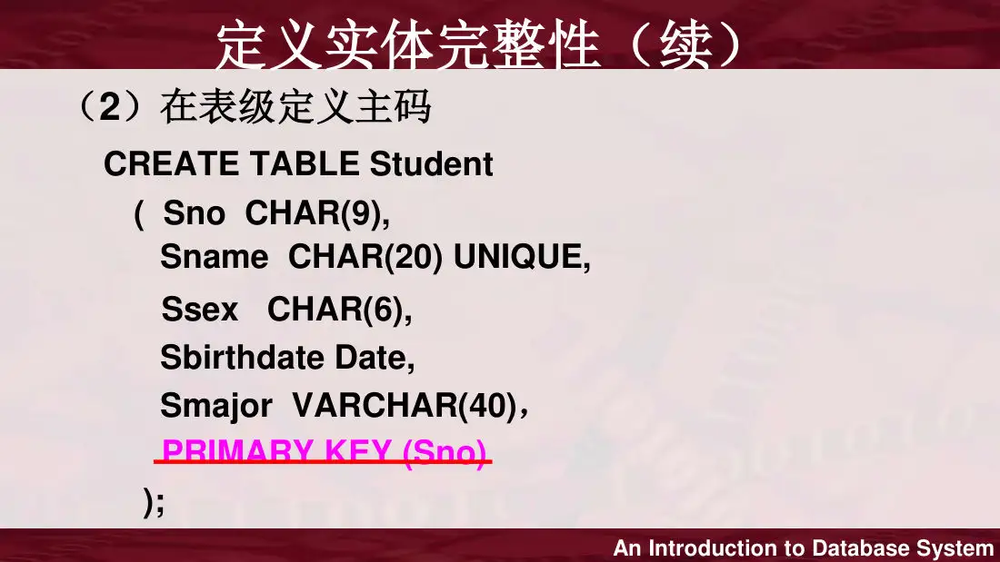

原文：

定义实体完整性（续）

(2) 在表级定义主码
CREATE TABLE Student
(Sno CHAR(9),
Sname CHAR(20) UNIQUE,
Ssex CHAR(6),
Sbirthdate Date,
Smajor VARCHAR(40),
PRIMARY KEY (Sno)
);

An Introduction to Database System

### 5.2 实体完整性

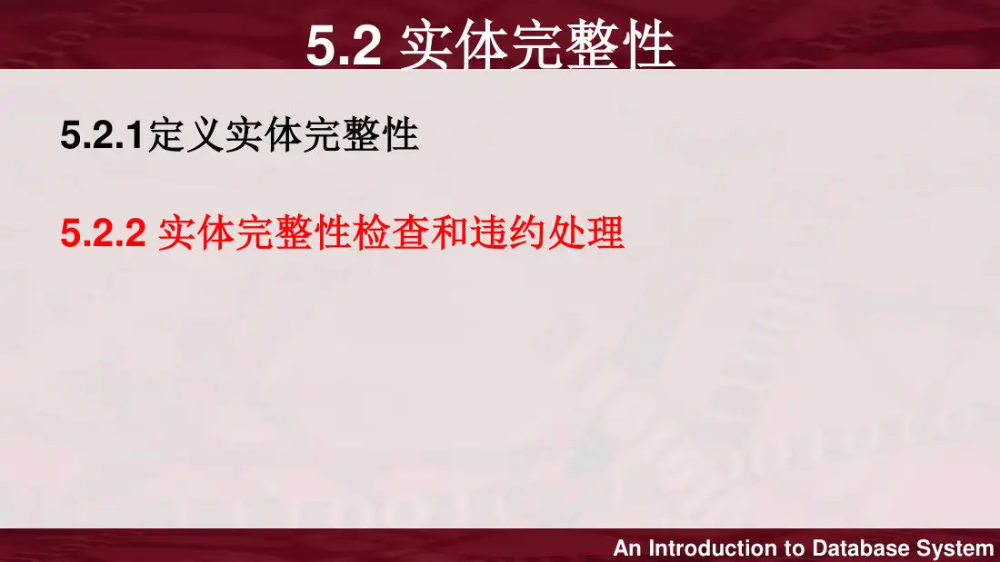

原文：

5.2 实体完整性

5.2.1 定义实体完整性

5.2.2 实体完整性检查和违约处理

An Introduction to Database System

### 5.2.2 实体完整性检查和违约处理

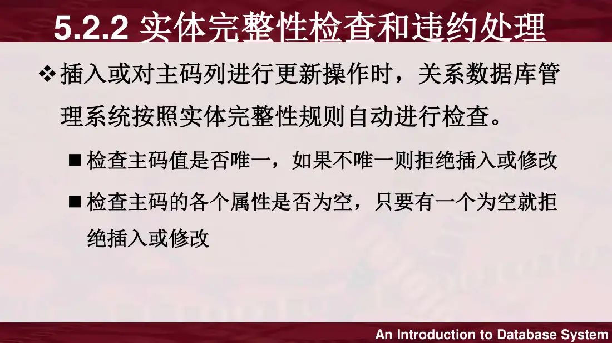

原文：

5.2.2 实体完整性检查和违约处理

❖ 插入或对主码列进行更新操作时，关系数据库管理系统按照实体完整性规则自动进行检查。

■ 检查主码值是否唯一，如果不唯一则拒绝插入或修改

■ 检查主码的各个属性是否为空，只要有一个为空就拒绝插入或修改

An Introduction to Database System

### 参照完整性规则

原文：

参照完整性规则

若属性（或属性组） $F$ 是基本关系 $R$ 的外码它与基本关系 $S$ 的主码 $K_{s}$ 相对应（基本关系 $R$ 和 $S$ 可以是相同或不同的关系），则对于 $R$ 中每个元组在 $F$ 上的值必须为：

■ 或者取空值

■ 或者等于S中某个元组的主码值

An Introduction to Database System

### 5.3.1 定义参照完整性

原文：

5.3.1 定义参照完整性

关系模型的参照完整性定义

■ 在CREATE TABLE中用FOREIGN KEY短语定义哪些列为外码

■ 用REFERENCES短语指明这些外码参照哪些表的主码

An Introduction to Database System

### 定义参照完整性（续）

原文：

定义参照完整性（续）

例：Student表的Smajor属性是外码，参照DEPT表的主码Deptname

);

An Introduction to Database System

### 参照完整性检查和违约处理（续）

原文：

参照完整性检查和违约处理（续）

参照完整性违约处理

(1) 拒绝（NO ACTION）执行

\- 不允许该操作执行。该策略一般设置为默认策略

(2) 级联（CASCADE）操作

\- 当删除或修改被参照表（Student）的一个元组造成了与参照表（SC）的不一致，则删除或修改参照表中的所有造成不一致的元组

(3) 设置为空值 (SET-NULL)

\- 当删除或修改被参照表的一个元组时造成了不一致，则将参照表中的所有造成不一致的元组的对应属性设置为空值。

An Introduction to Database System

### 5.4 用户定义的完整性

原文：

5.4 用户定义的完整性

◆ 用户定义的完整性是：针对某一具体应用的数据必须满足的语义要求

关系数据库管理系统提供了定义和检验用户定义
完整性的机制，不必由应用程序承担

An Introduction to Database System

### 小结

原文：

小结

<table><tr><td></td><td>实体完整性</td><td>参照完整性</td><td>用户定义的完整性</td></tr><tr><td>定义方法</td><td>CREATE TABLE</td><td>CREATE TABLE</td><td>CREATE TABLE</td></tr><tr><td>检查时机</td><td>执行插入修改操作</td><td>参照表:插入/修改被参照表:删除/修改</td><td>执行插入修改操作</td></tr><tr><td>违约处理</td><td>拒绝执行</td><td>拒绝执行/级联操作/设置为空值</td><td>拒绝执行</td></tr></table>

An Introduction to Database System

### 第六章 关系数据理论

原文：

第六章 关系数据理论

An Introduction to Database System

### 什么是数据依赖

原文：

什么是数据依赖

1. 数据依赖

■ 是通过一个关系中属性间值的相等与否体现出来的数据间的相互关系

■是现实世界属性间相互联系的抽象

■ 是数据内在的性质

■ 是语义的体现，数据库模式设计的关键

An Introduction to Database System

### 什么是数据依赖

原文：

什么是数据依赖

2. 数据依赖的主要类型

■ 函数依赖(Functional Dependency，简记为FD)

■ 多值依赖(Multivalued Dependency，简记为MVD)

■ 连接依赖

3. 数据依赖对关系模式的影响

■ 不合适的数据依赖，造成插入异常、删除异常、更新异常和数据冗余问题

An Introduction to Database System

### 1. 函数依赖

原文：

1. 函数依赖

定义6.1

设R(U)是一个属性集U上的关系模式，X和Y是U的子集。若对于R(U)的任意一个可能的关系r，r中不可能存在两个元组在X上的属性值相等，而在Y上的属性值不等则称“X函数确定Y”或“Y函数依赖于X”，记作X→Y。

X称为这个函数依赖的决定属性组，也称为决定因素(Determinant)。

若Y不函数依赖于X, 则记为 $X \nrightarrow Y$ 。

An Introduction to Database System

### 2. 平凡函数依赖与非平凡函数依赖

原文：

2. 平凡函数依赖与非平凡函数依赖

✿ X→Y，Y∉X，则称X→Y是非平凡的函数依赖。

✿ X→Y，但Y⊆X，则称X→Y是平凡的函数依赖。

例：在关系SC(Sno, Cno, Grade)中，

非平凡函数依赖: (Sno, Cno) → Grade

平凡函数依赖: (Sno, Cno) → Sno

$$
(\mathrm{Sno}, \mathrm{Cno}) \rightarrow \mathrm{Cno}
$$

对于任一关系模式，平凡函数依赖都是必然成立的，它不反映新的语义，因此若不特别声明，我们总是讨论非平凡函数依赖。

An Introduction to Database System

### 3. 完全函数依赖与部分函数依赖

原文：

3. 完全函数依赖与部分函数依赖

定义6.2

在关系模式R(U)中，如果X→Y，并且对于X的任何一个真子集X'，都有X'→Y，则称Y完全函数依赖于X，记作X $\xrightarrow{F}$ Y。若X→Y，但Y不完全函数依赖于X，则称Y部分函数依赖于X，记作X $\xrightarrow{P}$ Y。

[例] 在关系 STUDENT（Sno, Sdept, Mname, Cno, Grade）中，

(Sno, Cno) $\xrightarrow{E}$ Grade 是完全函数依赖

(Sno, Cno) $\xrightarrow{P}$ Sdept 是部分函数依赖，因为Sno $\rightarrow$ Sdept,

An Introduction to Database System

### 4. 传递函数依赖

原文：

4. 传递函数依赖

定义6.3

在R（U）中，如果X→Y，（Y∉X），Y≠X，Y→Z，则称Z对X传递函数依赖（transitive functional dependency）。记为：X $\xrightarrow{传递}$ Z。

注意: 如果Y→X, 即X←→Y, 则Z直接依赖于X。

[例] 在关系 STUDENT（Sno, Sdept, Mname, Cno, Grade）中，Sno → Sdept, Sdept → Mname, Sno $^{传递}$ → Mname

An Introduction to Database System

### 6.2.2 码

原文：

6.2.2 码

定义6.4 设K为关系模式R<U,F>中的属性或属性组合。若K $\rightarrow$ U，则K称为R的一个候选码(Candidate Key)。

■ 如果U部分函数依赖于K，即 $K \xrightarrow{P} U$ ，则K称为超码（Surpkey）

■ 候选码是最小的超码，即K的任意一个真子集都不是候选码

若关系模式R有多个候选码，则选定其中的一个做为主码(Primary key)。

[例] S(Sno, Sname, Sdept, Sage)，假设学生无重名Sno、Sname是候选码，选择Sno为主码。

An Introduction to Database System

### 6.2.2 码

原文：

6.2.2 码

主属性与非主属性

■ 包含在任何一个候选码中的属性，称为主属性（Prime attribute）

■ 不包含在任何码中的属性称为非主属性（Nonprime attribute）或非码属性（Non-key attribute）

[例] S(Sno, Sdept, Sage), Sno是码, Sno是主属性, Sdept, Sage是非主属性。SC(Sno, Cno, Grade)中，(Sno, Cno)是码，Sno, Cno是主属性，Grade是非主属性

全码：整个属性组是码，称为全码（All-key）

[例] 关系模式 R（P，W，A） P：演奏者 W：作品 A：听众

语义：一个演奏者可以演奏多个作品，某一作品可被多个演奏者演奏，听众可以欣赏不同演奏者的不同作品

R（P，W，A）码为(P，W，A)，即全码，All-Key。

An Introduction to Database System

### 6.2.2 码：外部码——外码

原文：

6.2.2 码：外部码——外码

定义6.5

关系模式 R<U,F>，U中属性或属性组X并非R的码，但X是另一个关系模式的码，则称X是R的外部码（Foreign key）也称外码。

SC（Sno，Cno，Grade）中，Sno不是码，但Sno是关系模式S（Sno，Sdept，Sage）的码，则Sno是关系模式SC的外部码

主码与外部码一起提供了表示关系间联系的手段

An Introduction to Database System

### 范式（续）

原文：

范式（续）

◆ 各种范式之间存在联系:

■ 某一关系模式R为第n范式，可简记为 $R \in nNF$ 。

一个低一级范式的关系模式，通过模式分解（schema decomposition）可以转换为若干个高一级范式的关系模式的集合，这种过程就叫规范化（normalization）。

An Introduction to Database System

### 规范化小结（续）

原文：

规范化小结（续）

关系模式规范化的基本步骤

An Introduction to Database System

### 第七章 数据库设计

原文：

第七章 数据库设计

An Introduction to Database System

### 7.1.3 数据库设计的基本步骤

原文：

7.1.3 数据库设计的基本步骤

数据库设计分6个阶段

■需求分析

■ 概念结构设计

■ 逻辑结构设计

■ 物理结构设计

■ 数据库实施

独立于任何数据库管理系统

与选用的数据库管理系统密切相关

■ 数据库运行和维护

An Introduction to Database System

### 7.2.3 数据字典

原文：

7.2.3 数据字典

什么是数据字典？

数据字典是关于数据库中数据的描述，称为元数据。

它不是数据本身，而是数据的数据。

✿ 数据字典在需求分析阶段建立，在数据库设计过程中不断修改、充实、完善。

✿ 数据字典是进行详细的数据收集和分析所获得的主要结果。

An Introduction to Database System

### 数据字典（续）

原文：

数据字典（续）

✿ 数据字典的内容

■ 数据项

■ 数据结构

■ 数据流

■ 数据存储

■ 处理过程

◆ 数据项是数据的最小组成单位

若干个数据项可以组成一个数据结构

✿ 通过对数据项和数据结构的定义来描述数据流、数据存储的逻辑内容

An Introduction to Database System

### 回顾：1.2.2 概念模型

原文：

回顾：1.2.2 概念模型

概念模型的用途

■ 概念模型用于信息世界的建模

■ 是现实世界到机器世界的一个中间层次

■ 是数据库设计的有力工具

■ 数据库设计人员和用户之间进行交流的语言

例：工厂物质管理的概念模型

对概念模型的基本要求

■ 较强的语义表达能力

■ 简单、清晰、易于用户理解

An Introduction to Database System

### 回顾：信息世界中的基本概念

原文：

回顾：信息世界中的基本概念

(1) 实体 (Entity)

客观存在并可相互区别的事物称为实体。可以是具体的人、事、物或抽象的概念。

(2) 属性（Attribute）

实体所具有的某一特性称为属性。一个实体可以由若干个属性来刻画。

(3) 码 (Key)

唯一标识实体的属性集称为码。

(4) 实体型 (Entity Type)

用实体名及其属性名集合来抽象和刻画同类实体称为实体型

(5) 实体集 (Entity Set)

同一类型实体的集合称为实体集

An Introduction to Database System

### (a)1:1联系

原文：

(a)1:1联系

回顾：信息世界中的基本概念（续）

(6) 联系（Relationship）

■ 现实世界中事物内部以及事物之间的联系在信息世界中反映为实体（型）内部的联系和实体（型）之间的联系。

■ 实体内部的联系: 是指组成实体的各属性之间的联系

■ 实体之间的联系: 通常是指不同实体集之间的联系

实体之间的联系有一对一（1:1）、一对多（1:m）和多对多（m:n）等多种类型

An Introduction to Database System

### 回顾：实体-联系方法

原文：

回顾：实体-联系方法

概念模型的一种表示方法:

实体-联系方法（Entity-Relationship Approach）

■ 用E-R图来描述现实世界的概念模型

■ E-R方法也称为E-R模型

An Introduction to Database System

### 7.3.2 E-R模型

原文：

7.3.2 E-R模型

1. 实体之间的联系

(1) 两个实体型之间的联系, 可以分为三种:

■ 一对一联系（1：1）

■ 一对多联系（1:n）

■ 多对多联系（m:n）

An Introduction to Database System

### 7.3.5 用E-R图进行概念结构设计

原文：

7.3.5 用E-R图进行概念结构设计

1. 实体与属性的划分原则

■为了简化E-R图的处置，现实世界的事物能作为属性对待的，尽量作为属性对待

■ 两条准则:

(1) 属性不能再具有需要描述的性质。即属性必须是不可分的数据项，不能包含其他属性

(2) 属性不能与其他实体具有联系, 即 E-R 图中所表示的联系是实体之间的联系

An Introduction to Database System

### 用E-R图进行概念结构设计（续）

原文：

用E-R图进行概念结构设计（续）

2. E-R图的集成

■ E-R图的集成一般需要分两步

\- 合并。解决各分E-R图之间的冲突，将分E-R图合并起来生成初步E-R图

\- 修改和重构。消除不必要的冗余，生成基本E-R图

An Introduction to Database System

### 用E-R图进行概念结构设计（续）

原文：

用E-R图进行概念结构设计（续）

(1) 合并E-R图，生成初步E-R图

\- 各个局部应用所面向的问题不同，各个子系统的E-R图之间必定会存在许多不一致的地方，称之为“冲突”。

\- 子系统E-R图之间的冲突主要有三类:

①属性冲突

②命名冲突

③结构冲突

An Introduction to Database System

### E-R图向关系模型的转换（续）

原文：

E-R图向关系模型的转换（续）

转换原则

1. 一个实体型转换为一个关系模式。

■关系的属性：实体的属性

■关系的码：实体的码

An Introduction to Database System

### E-R图向关系模型的转换原则

原文：

E-R图向关系模型的转换原则

1. 实体型的转换：一个实体型转换为一个关系模式

■ 关系模式的属性：实体的属性

■ 关系模式的码：实体的码

学生（学号，姓名，出生日期，所在系，年级，平均成绩）

An Introduction to Database System

### E-R图向关系模型的转换原则

原文：

E-R图向关系模型的转换原则

3. 实体型间的1:n联系:

■转换为一个独立的关系模式

关系模式的属性：与该联系相连的各实体的码 + 联系本身的属性

关系模式的码：n端的实体的码

■与n端对应的关系模式合并—建议

作为外码

合并后关系模式的属性：在n端关系模式中 + 1端关系的码 + 联系本身的属性

▶合并后关系模式的码：不变

可以减少系统模式中的关系个数，一般情况下更倾向于采用这种方法

An Introduction to Database System

### E-R图向关系模型的转换原则

原文：

E-R图向关系模型的转换原则

[例]“组成”联系为1:n联系。

将其转换为关系模式的两种方法:

(1)使其成为一个独立的关系模式: 组成（学号，班级号）

(2)将其与“学生”合并:
学生（学号，姓名，出生日期，
所在系，年级，班级号，
平均成绩）

学生管理子系统基本E-R图

An Introduction to Database System

### E-R图向关系模型的转换（续）

原文：

E-R图向关系模型的转换（续）

(3) 一个多对多联系转换为一个关系模式

\- 关系的属性：与该联系相连的各实体的码以及联系本身的属性

\- 关系的码或关系码的一部分：各实体码的组合

An Introduction to Database System

### E-R图向关系模型的转换（续）

原文：

E-R图向关系模型的转换（续）

(4) 三个或三个以上实体间的一个多元联系转换为一个关系模式。

➢关系模式的属性：与该多元联系相连的各实体的码（分别作为外码）+ 联系本身的属性

关系模式的码：各实体码的组合

An Introduction to Database System

### E-R图向关系模型的转换（续）

原文：

E-R图向关系模型的转换（续）

(5) 具有相同码的关系模式可合并

\- 目的：减少系统中的关系个数

\- 合并方法:

将其中一个关系模式的全部属性加入到另一个关系模式中

➢ 然后去掉其中的同义属性（可能同名也可能不同名）

适当调整属性的次序

An Introduction to Database System

### 第11章 数据库恢复技术

原文：

数据库系统概论 An Introduction to Database System

第11章 数据库恢复技术

### 1.事务

原文：

1.事务

✿ 事务(Transaction)是用户定义的一个数据库操作序列，这些操作要么全做，要么全不做，是一个不可分割的工作单位。

✿ 在关系数据库中，一个事务可以是一条SQL语句，一组SQL语句或整个程序。

事务和程序是两个概念，一个事务可以是整个程序，而一个程序通常包含多个事务。

✿ 事务是数据库应用程序的基本逻辑单元，是恢复和并发控制的基本单位

An Introduction to Database System

### 定义事务

原文：

定义事务

◆ 显式定义方式

BEGIN TRANSACTION

SQL 语句1

SQL 语句2

○ ○ ○ ○ ○

COMMIT

BEGIN TRANSACTION

SQL 语句1

SQL 语句2

○ ○ ○ ○ ○

ROLLBACK

An Introduction to Database System

### 2. 事务的特性（ACID特性）

原文：

2. 事务的特性（ACID特性）

事务的ACID特性:

❖ 原子性（Atomicity）

◆ 一致性（Consistency）

隔离性（Isolation）

❖ 持续性（Durability）

An Introduction to Database System

### 故障的种类

原文：

故障的种类

1.事务内部的故障

2.系统故障

3.介质故障

An Introduction to Database System

### 11.4 恢复的实现技术

原文：

11.4 恢复的实现技术

恢复机制涉及的关键问题

1. 如何建立冗余数据

■数据转储（dump）

■登记日志文件（logging）

2. 如何利用这些冗余数据实施数据库恢复

An Introduction to Database System

### (3) 转储方法小结

原文：

(3) 转储方法小结

转储方法分类

<table><tr><td rowspan="2">转储方式</td><td colspan="2">转储状态</td></tr><tr><td>动态转储</td><td>静态转储</td></tr><tr><td>海量转储</td><td>动态海量转储</td><td>静态海量转储</td></tr><tr><td>增量转储</td><td>动态增量转储</td><td>静态增量转储</td></tr></table>

在数据转储效率、数据库运行效率、故障恢复效率三个方面各有利弊

DBA通常会根据数据库使用情况，确定一个适当的转储周期，并配合使用这类4类方法

An Introduction to Database System

### 日志文件的格式和内容（续）

原文：

日志文件的格式和内容（续）

以记录为单位的日志文件内容

■ 各个事务的开始标记(BEGIN TRANSACTION)

■ 各个事务的结束标记(COMMIT或ROLLBACK)

■ 各个事务的所有更新操作

以上均作为日志文件中的一个日志记录 (log record)

An Introduction to Database System

### 日志文件的格式和内容（续）

原文：

日志文件的格式和内容（续）

◆ 记录事务开始标记的日志记录

■ 事务标志+ BEGIN TRANSACTION

例: T1 BEGIN TRANSACTION

An Introduction to Database System

### 日志文件的格式和内容（续）

原文：

日志文件的格式和内容（续）

◆ 记录事务结束标记的日志记录

■ 事务标志+ COMMIT

■ 事务标志+ ROLLBACK

例: T1 COMMIT

T2 ROLLBACK

An Introduction to Database System

### 日志文件的格式和内容（续）

原文：

日志文件的格式和内容（续）

以记录事务更新操作的日志记录的内容

■ 事务标识（标明是哪个事务）

■ 操作类型（插入、删除或修改）

■ 操作对象（记录ID、Block NO.）

■ 更新前数据的旧值（对插入操作而言，此项为空值）

■ 更新后数据的新值（对删除操作而言，此项为空值）

示意性例子:

T1 U AA 18 20
T1 I TU 1
T1 D TV 20

An Introduction to Database System

### 1. 事务故障的恢复

原文：

1. 事务故障的恢复

事务故障：事务在运行至正常终止点前被终止

恢复方法

■ 由恢复子系统利用日志文件撤消（UNDO）此事务已对数据库进行的修改

✿ 事务故障的恢复由系统自动完成，对用户是透明的，不需要用户干预

An Introduction to Database System

### 事务故障的恢复步骤

原文：

事务故障的恢复步骤

(1) 反向扫描文件日志（即从最后向前扫描日志文件），查找该事务的更新操作。

(2) 对该事务的更新操作执行逆操作。即将日志记录中“更新前的值”写入数据库。

■ 插入操作，“更新前的值”为空，则相当于做删除操作

■ 删除操作，则相当于做插入操作

■ 若是修改操作，则相当于用修改前值代替修改后值

(3) 继续反向扫描日志文件，查找该事务的其他更新操作，并做同样处理。

(4) 如此处理下去, 直至读到此事务的开始标记, 事务故障恢复就完成了。

An Introduction to Database System

### 1. 事务故障的恢复

原文：

1. 事务故障的恢复

事务故障：事务在运行至正常终止点前被终止

恢复方法

■ 由恢复子系统利用日志文件撤消（UNDO）此事务已对数据库进行的修改

✿ 事务故障的恢复由系统自动完成，对用户是透明的，不需要用户干预

An Introduction to Database System

### 事务故障的恢复步骤

原文：

事务故障的恢复步骤

(1) 反向扫描文件日志（即从最后向前扫描日志文件），查找该事务的更新操作。

(2) 对该事务的更新操作执行逆操作。即将日志记录中“更新前的值”写入数据库。

■ 插入操作，“更新前的值”为空，则相当于做删除操作

■ 删除操作，则相当于做插入操作

■ 若是修改操作，则相当于用修改前值代替修改后值

(3) 继续反向扫描日志文件，查找该事务的其他更新操作，并做同样处理。

(4) 如此处理下去, 直至读到此事务的开始标记, 事务故障恢复就完成了。

An Introduction to Database System

### 2. 系统故障的恢复

原文：

2. 系统故障的恢复

系统故障造成数据库不一致状态的原因

■ 未完成事务对数据库的更新可能已写入数据库

■ 已提交事务对数据库的更新可能还留在缓冲区没来得及写入数据库

恢复方法

1. Undo 故障发生时未完成的事务

2. Redo 已完成的事务

系统故障的恢复由系统在重新启动时自动完成，不需要用户干预

An Introduction to Database System

### 系统故障的恢复步骤

原文：

系统故障的恢复步骤

(1) 正向扫描日志文件（即从头扫描日志文件）

■ 重做(REDO) 队列: 在故障发生前已经提交的事务
- 这些事务既有BEGIN TRANSACTION记录，也有 COMMIT记录

■ 撤销 (UNDO)队列:故障发生时尚未完成的事务

\- 这些事务只有BEGIN TRANSACTION记录，无相应的COMMIT记录

An Introduction to Database System

### 系统故障的恢复步骤（续）

原文：

系统故障的恢复步骤（续）

(2) 对撤销(UNDO)队列事务进行撤销(UNDO)处理

■ 反向扫描日志文件，对每个撤销事务的更新操作执行逆操作

■即将日志记录中“更新前的值”写入数据库

(3) 对重做(REDO)队列事务进行重做(REDO)处理

■ 正向扫描日志文件，对每个重做事务重新执行登记的操作

■ 即将日志记录中“更新后的值”写入数据库

An Introduction to Database System

### 3. 介质故障的恢复

原文：

3. 介质故障的恢复

1. 重装数据库

2.重做已完成的事务

An Introduction to Database System

### 介质故障的恢复（续）

原文：

介质故障的恢复（续）

恢复步骤

(1) 装入最新的后备数据库副本(离故障发生时刻最近的转储副本)，使数据库恢复到最近一次转储时的一致性状态。

■ 对于静态转储的数据库副本，装入后数据库即处于一致性状态

■ 对于动态转储的数据库副本，还须同时装入转储时刻的日志文件副本，利用恢复系统故障的方法（即REDO+UNDO），才能将数据库恢复到一致性状态。

An Introduction to Database System

### 介质故障的恢复（续）

原文：

介质故障的恢复（续）

(2) 装入有关的日志文件副本(转储结束时刻的日志文件副本)，重做已完成的事务。

■ 首先扫描日志文件，找出故障发生时已提交的事务的标识，将其记入重做队列。

■ 然后正向扫描日志文件，对重做队列中的所有事务进行重做处理。即将日志记录中“更新后的值”写入数据库。

An Introduction to Database System

### 介质故障的恢复（续）

原文：

介质故障的恢复（续）

介质故障的恢复需要数据库管理员介入

数据库管理员的工作

■ 重装最近转储的数据库副本和有关的各日志文件副本

■执行系统提供的恢复命令

具体的恢复操作仍由数据库管理系统完成

An Introduction to Database System

### 利用检查点的恢复策略（续）

原文：

利用检查点的恢复策略（续）

系统出现故障时，恢复子系统将根据事务的不同状态采取不同的恢复策略

An Introduction to Database System

### 利用检查点的恢复策略（续）

原文：

利用检查点的恢复策略（续）

(1) 从重新开始文件中找到最后一个检查点记录在日志文件中的地址，由该地址在日志文件中找到最后一个检查点记录

(2) 由该检查点记录得到检查点建立时刻所有正在执行的事务清单ACTIVE-LIST

■ 建立两个事务队列

\- UNDO-LIST

\- REDO-LIST

■ 把ACTIVE-LIST暂时放入UNDO-LIST队列，REDO队列暂为空。

An Introduction to Database System

### 利用检查点的恢复策略（续）

原文：

利用检查点的恢复策略（续）

(3) 从检查点开始正向扫描日志文件, 直到日志文件结束

■ 如有新开始的事务 $T_{i}$ ，把 $T_{i}$ 暂时放入UNDO-LIST队列

■ 如有提交的事务 $T_{j}$ ，把 $T_{j}$ 从 UNDO-LIST 队列移到 REDO-LIST 队列；直到日志文件结束

(4) 对UNDO-LIST中的每个事务执行UNDO操作
对REDO-LIST中的每个事务执行REDO操作，REDO操作的起始点可以是 $T_{c}$ 时刻

An Introduction to Database System

### 第12章 并发控制

原文：

数据库系统概论 An Introduction to Database System

第12章 并发控制

### 并发控制概述（续）

原文：

并发控制概述（续）

✿ 并发操作带来的数据不一致性

1.丢失修改

2. 脏读（dirty read）

3.不可重复读

\*4.幻读（phantom row）

记号

■R(x): 读数据x

■W(x): 写数据x

An Introduction to Database System

### 1. 丢失修改

原文：

1. 丢失修改

两个事务 $T_{1}$ 和 $T_{2}$ 读入同一数据并修改， $T_{2}$ 的提交结果破坏了 $T_{1}$ 提交的结果，导致 $T_{1}$ 的修改被丢失。

<table><tr><td>T1</td><td>T2</td></tr><tr><td>1 R(A)=16</td><td></td></tr><tr><td>2</td><td>R(A)=16</td></tr><tr><td>3 A←A-1</td><td></td></tr><tr><td>W(A)=15</td><td></td></tr><tr><td>4</td><td>A←A-3</td></tr><tr><td></td><td>W(A)=13</td></tr></table>
丢失修改

An Introduction to Database System

### 2. 脏读（dirty read）

原文：

2. 脏读（dirty read）

也称读“脏”数据，指：

■事务T1修改某一数据，并将其写回磁盘

■事务 $\mathsf{T}_{2}$ 读取同一数据后， $\mathsf{T}_{1}$ 由于某种原因被撤销

■这时 $\mathsf{T}_{1}$ 已修改过的数据恢复原值， $\mathsf{T}_{2}$ 读到的数据就与数据库中的数据不一致

■ $T_{2}$ 读到的数据就为“脏”数据，即不正确的数据

An Introduction to Database System

### 读“脏”数据

原文：

读“脏”数据

脏读（dirty read）（续）

例如:

■ $\mathrm{T}_{1}$ 将C值修改为200

■ $\mathrm{T}_{2}$ 读到C为200

■ $\mathrm{T}_{1}$ 由于某种原因撤销，其修改作废，C恢复原值100。

这时 $\mathrm{T}_{2}$ 读到的C为200，与数据库内容不一致，就是“脏”数据

An Introduction to Database System

### 3. 不可重复读

原文：

3. 不可重复读

不可重复读是指事务 $T_{1}$ 读取数据后，事务 $T_{2}$ 执行更新操作，使 $T_{1}$ 无法再现前一次读取结果。

读一更新

An Introduction to Database System

### 不可重复读（续）

原文：

不可重复读（续）

例如:

■ $\mathrm{T}_{1}$ 读取B=100进行运算

■ $T_{2}$ 读取同一数据B，对其进行修改后将B=200写回数据库。

■ $T_{1}$ 为了对读取值校对重读B，B已为200，与第一次读取值不一致

An Introduction to Database System

### 基本封锁类型

原文：

基本封锁类型

◆一个事务对某个数据对象加锁后究竟拥有什么样的控制由封锁的类型决定。

基本封锁类型

■ 排它锁（Exclusive Locks，简记为X锁）

■ 共享锁（Share Locks，简记为S锁）

An Introduction to Database System

### 排它锁

原文：

排它锁

✿ 排它锁又称为写锁，X锁

✿ 若事务T对数据对象A加上X锁，则只允许T读取和修改A，其它任何事务都不能再对A加任何类型的锁，直到T释放A上的锁

保证其他事务在T释放A上的锁之前不能再读取和修改A

An Introduction to Database System

### 共享锁

原文：

共享锁

共享锁又称为读锁，S锁

✿ 若事务T对数据对象A加上S锁，则事务T可以读A但不能修改A，其它事务只能再对A加S锁，而不能加X锁，直到T释放A上的S锁

保证其他事务可以读A，但在T释放A上的S锁之前不能对A做任何修改

An Introduction to Database System

### 锁的相容矩阵

原文：

锁的相容矩阵

<table><tr><td> $T_1$  $T_2$ </td><td>X</td><td>S</td><td>-</td></tr><tr><td>X</td><td>N</td><td>N</td><td>Y</td></tr><tr><td>S</td><td>N</td><td>Y</td><td>Y</td></tr><tr><td>-</td><td>Y</td><td>Y</td><td>Y</td></tr></table>
$\mathbf{Y} = \mathbf{Y}\mathbf{e}\mathbf{s}$ ，相容的请求 N=No，不相容的请求

An Introduction to Database System

### 保持数据一致性的常用封锁协议

原文：

保持数据一致性的常用封锁协议

三级封锁协议

1. 一级封锁协议

2.二级封锁协议

3.三级封锁协议

An Introduction to Database System

### 1. 一级封锁协议

原文：

1. 一级封锁协议

◆ 一级封锁协议

■事务T在修改数据R之前必须先对其加X锁，直到事务结束才释放。

\- 正常结束（COMMIT）

\- 非正常结束（ROLLBACK）

一级封锁协议可防止丢失修改，并保证事务T是可恢复的。

An Introduction to Database System

### 2. 二级封锁协议

原文：

2. 二级封锁协议

◆ 二级封锁协议

■ 一级封锁协议基础上，增加事务T在读取数据R之前必须先对其加S锁，读完后即可释放S锁。

◆ 二级封锁协议可以防止丢失修改和读“脏”数据。

An Introduction to Database System

### 3. 三级封锁协议

原文：

3. 三级封锁协议

三级封锁协议

■ 一级封锁协议基础上，增加事务T在读取数据R之前必须先对其加S锁，直到事务结束才释放。

三级封锁协议可防止丢失修改、读脏数据和不可重复读。

An Introduction to Database System

### 12.5 活锁和死锁

原文：

12.5 活锁和死锁

◆封锁技术可以有效地解决并行操作的一致性问题，但也带来一些新的问题

■死锁：事务永远不能结束的情况

■ 活锁：事务永远等待

An Introduction to Database System

### 2. 死锁的诊断与解除

原文：

2. 死锁的诊断与解除

死锁的诊断

(1) 超时法

(2) 等待图法

An Introduction to Database System

### 12.6 并发调度的可串行性

原文：

12.6 并发调度的可串行性

12.6.1 可串行化调度

12.6.2 冲突可串行化调度

An Introduction to Database System

### 12.6.1 可串行化调度

原文：

12.6.1 可串行化调度

✿ 可串行化(Serializable)调度

■ 多个事务的并发执行是正确的，当且仅当其结果与按某一次序串行地执行这些事务时的结果相同

✿ 可串行性(Serializability)

■ 是并发事务正确调度的准则

■一个给定的并发调度，当且仅当它是可串行化的，才认为是正确调度

An Introduction to Database System

### 12.6.2 冲突可串行化调度

原文：

12.6.2 冲突可串行化调度

冲突可串行化

■ 一个比可串行化更严格的条件

冲突操作：指不同的事务对同一数据的读写操作和写写操作：

$R_{i}(x)$ 与 $W_{j}(x)$ /\*事务 $T_{i}$ 读x， $T_{j}$ 写x，其中 $i\neq j^{*}/$

$W_{i}(x)$ 与 $W_{j}(x)$ /\*事务 $T_{i}$ 写x， $T_{j}$ 写x，其中 $i\neq j^{*}/$

涉及同一个数据库元素, 并且至少有一个是写操作

An Introduction to Database System

### 冲突可串行化

原文：

冲突可串行化

◆ 一个调度 $S_{c}$ 在保证冲突操作的次序不变的情况下，通过交换两个事务不冲突操作的次序得到另一个调度 $S_{c}'$ ，如果 $S_{c}'$ 是串行的，称调度 $S_{c}$ 是冲突可串行化的调度

若一个调度是冲突可串行化，则一定是可串行化的调度

✿ 可用这种方法判断一个调度是否是冲突可串行化的

An Introduction to Database System

### 12.7 两段锁协议

原文：

12.7 两段锁协议

✿ 数据库管理系统普遍采用两段锁协议（two-phase lock，2PL）的方法实现并发调度的可串行性，从而保证调度的正确性

◆两段锁协议

指所有事务必须分两个阶段对数据项加锁和解锁

■ 在对任何数据进行读、写操作之前，事务首先要获得对该数据的封锁

■ 在释放一个封锁之后，事务不再申请和获得任何其他封锁

An Introduction to Database System

### 两段锁协议（续）

原文：

两段锁协议（续）

“两段”锁的含义

事务分为两个阶段

■ 第一阶段是获得封锁，也称为扩展阶段

● 事务可以申请获得任何数据项上的任何类型的锁，但是不能释放任何锁

■ 第二阶段是释放封锁，也称为收缩阶段

● 事务可以释放任何数据项上的任何类型的锁，但是不能再申请任何锁

An Introduction to Database System
