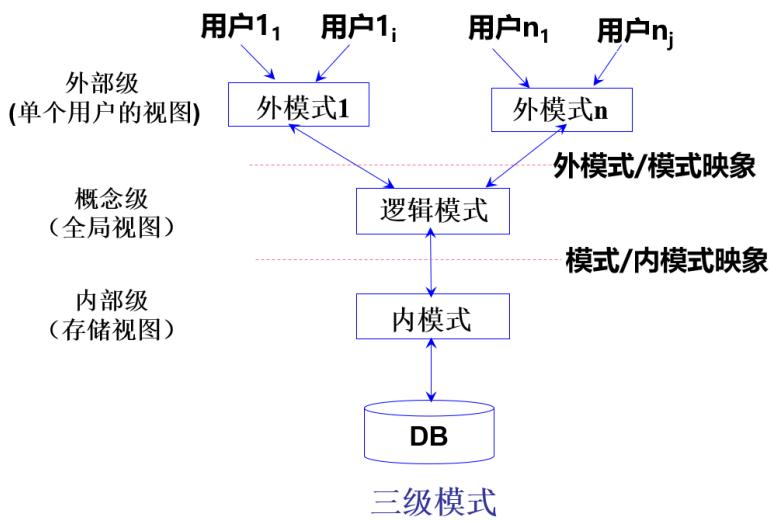
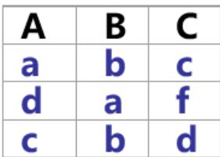
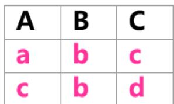
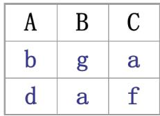
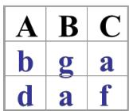
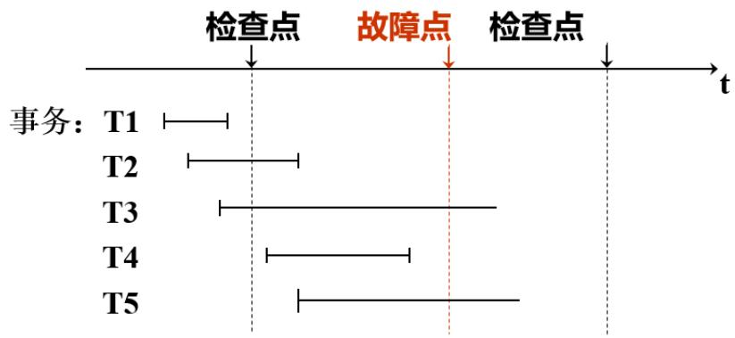

# 《数据库系统》期末复习文档

原件经识别和整理；“参考解答”是我们补的。

### 数据库系统

## 第一章 数据库概论

知识点：[数据与数据库的基本概念](../../../topics/数据库系统/数据与数据库.md)、[数据库管理系统（DBMS）的主要功能](../../../topics/数据库系统/数据库管理系统.md)、[数据库系统（DBS）的组成与特点](../../../topics/数据库系统/数据库系统.md)

### DBS 有关概念

#### 1. 数据库(DB)

长期存储在计算机内、有组织的、统一管理的相关数据的集合。DB 能为各种用户共享，具有较小冗余度、数据间联系紧密而又有较高的数据独立性等特点。

#### 2. 数据库管理系统(DBMS)

是位于用户与操作系统之间的一层数据管理软件，它通过调用 OS 为用户或应用程序提供访问 DB 的方法。

#### 3. DBMS 主要功能

- 数据库的定义(DDL)
- 数据库的操纵(DML)
- 数据库的保护(恢复，并发控制，完整性控制，安全性控制)
- 数据库的维护
- 数据字典(DD, 存放三层结构定义的数据库)

#### 4. DD 的特点、作用

由 DBMS 创建、管理，存放 DB 的模式、安全性、完整性的定义等。

#### 5. 数据库系统(DBS)

是实现有组织地、动态地存储大量关联数据、方便多用户访问的计算机软、硬件和数据资源组成的系统，即它是采用数据库技术的计算机系统。

#### 6. 数据库阶段的数据管理

采用数据模型表示复杂的数据结构。

#### 7. 数据库系统的组成

数据库、DBMS、用户、DBA。

#### 8. 数据库系统各组成部分之间的关系

数据库存放数据，DBMS 是数据库系统的核心，DBA 借助 DBMS 来完成其职责，DBA 实施的各种操作都是在 DBMS 的控制下实现。

#### 9. 开发 DBS 的人员

DBA、系统分析员、程序设计员、用户。

知识点：[数据与数据库的基本概念](../../../topics/数据库系统/数据与数据库.md)、[数据库管理系统（DBMS）的主要功能](../../../topics/数据库系统/数据库管理系统.md)、[数据库系统（DBS）的组成与特点](../../../topics/数据库系统/数据库系统.md)

### 数据模型

#### 1. 概念

能表示实体类型及实体间联系的模型。

#### 2. 数据库设计的三个阶段

概念设计，逻辑设计，物理设计。

#### 3. 概念模型

表达数据的整体逻辑结构；面向客观世界，面向用户；独立于计算机系统；与 DBMS 无关的数据模型。例如：E-R 模型。

#### 4. 逻辑模型

表达 DB 的整体逻辑结构；从数据库实现出发；独立于硬件，依赖于软件，与 DBMS 有关；面向用户&面向实现。

#### 5. 三个传统的逻辑模型

层次、网状、关系。

概念级：逻辑模式或模式（全局视图）、关系模式，基本表。

#### 6. 关系模型与层次模型、网状模型的最大差别

用关键码而不是指针导航数据。

#### 7. 逻辑数据模型三要素

数据结构、数据操作、约束条件。

#### 8. 物理模型

描述数据的存储结构；与硬件、OS、DBMS 有关。

#### 9. 数据库的三级体系结构

(结合关系模型的三级结构、SQL 数据库体系结构)

一个数据库结构从逻辑上划分为三个层次：外模式，逻辑模式，内模式。



**a) 逻辑模式(模式)**

i. 用逻辑模型对数据库中全局数据的整体逻辑结构的描述。

ii. 由概念记录组成，也包括：记录间的联系/完整性/安全性。

iii. 是 DB 所有用户的公共数据视图，是装配数据的结构框架。

iv. 不涉及物理存储、硬件环境、应用程序、程序设计语言。

v. 一个数据库只有一个逻辑模式。

vi. 由 DBMS 提供的模式定义语言（模式 DDL）来定义和描述：

```sql
create table ....
```

**b) 外模式(用户模式/子模式)**

i. 是用逻辑数据模型对用户用到的数据的描述。

ii. 是用户与数据库系统的接口。

iii. 是数据库的用户视图，用户与 DB 的接口。

iv. 一个数据库可以有多个外模式。

v. 由逻辑模式或其一逻辑子集推导而来。

vi. 作用：

- 简化用户接口
- 保证数据独立性
- 有利于数据共享
- 有利于数据安全和保密

vii. 由 DBMS 提供的外模式定义语言来定义和描述。

**c) 内模式(存储模式)**

i. 是对数据的物理结构和存储方式的描述。

ii. 定义所有的物理记录类型、索引和文件的组织方式，以及数据控制方面的细节。

iii. 一个数据库只有一个内部模式。

iv. 对一般的数据库用户透明。

v. 内模式的设计直接影响数据库的性能。

vi. 由 DBMS 提供的内模式定义语言(内模式 DDL)来定义和描述：

```sql
create index (etc.) ....
```

#### 10. 两级映像

**模式/内模式映像** —— 用于定义逻辑模式和内模式之间的对应性。在概念级和内部级之间；一般在内模式中描述。

**外模式/模式映像** —— 用于定义外模式与逻辑模式之间的对应性。在概念级和外部级之间；一般在外模式中描述。

#### 11. 两级数据独立性

**数据独立性**：应用程序和数据库的数据结构之间互相独立，不受影响。

**逻辑数据独立性**：应用程序独立于逻辑模式的变化（用户数据独立于全局逻辑数据的特性）。

当需要改变逻辑模式时（增加新的关系、属性等），由 DBA 对各个外部模式/逻辑模式映像作相应改变以保持外部模式不变，从而不必修改或重写应用程序。

**物理数据独立性**：应用程序独立于内模式的变化（全局逻辑数据独立于物理数据的特性）。

当需要改变内部模式（比如选用了另一种存储结构）时，可由 DBA 对逻辑模式/内部模式映像作相应改变，使逻辑模式保持不变，从而外模式不变，应用程序也不变。

#### 12. 补充

a) 逻辑模式独立于数据库的内/外模式。

b) 内模式依赖于逻辑模式，独立于具体存储设备。

c) 外模式依赖于逻辑模式，以逻辑模式为基础。

d) 内模式与外模式相互独立，逻辑模式提供了连接这两级的中间观点。

e) 数据按外模式的描述提供给用户，按内模式的描述存储在磁盘上 → 物理数据库。

f) 应用程序是在外模式描述的逻辑结构上编写的。

g) 特定的应用程序仅依赖于特定的外模式。

h) 两级映像提供了两级独立性。

i) 用户对数据库操作时：DBMS 将操作带入外 → 逻辑 → 内三级，再通过 OS 操纵物理数据库中的数据。

j) 三级模式的定义都存在数据字典中。

k) 数据模式与实例的关系：同一模式下可以有很多值（实例），实例相对变动。

l) 数据模式是数据库的一种结构描述，是框架，不是数据库本身。

知识点：[数据模型（概念模型与逻辑模型）](../../../topics/数据库系统/数据模型.md)、[数据库系统的三级模式结构（模式、外模式、内模式）](../../../topics/数据库系统/三级模式结构.md)、[数据库的两级映像与数据独立性（逻辑独立性与物理独立性）](../../../topics/数据库系统/两级映像与数据独立性.md)

### E-R 图的画法（结合第五章）

1. 图形符号：
   - 矩形框：实体类型
   - 菱形框：联系类型
   - 椭圆形框：实体类型和联系类型的属性

2. 标注实体键。

3. 二元联系：1:1；多元联系：1:N；自反联系：M:N。

## 第二章 关系模型和关系运算理论

知识点：[实体-联系模型（E-R模型）的基本概念](../../../topics/数据库系统/ER模型基础.md)、[关系的数据结构（域、笛卡尔积、关系、分量）](../../../topics/数据库系统/关系数据结构.md)

### 关系数据模型的有关概念

#### 1. 关系模型

用二维表格表示实体集，用关键码表示实体之间联系的数据模型。关系模型属于逻辑模型，有三要素：数据结构，数据操作，约束条件。

#### 2. 关系模型的数据结构

- **元组**对应行，**属性**对应列
- **属性域**：属性的取值范围
- **关系模式**：关系名及其各属性名；$R(U)$，$R(A_1, A_2, \ldots, A_n)$
- **元数/目**：属性的个数
- **基数**：元组的个数
- **超键**：在关系中能唯一标识元组的属性或属性集
- **候选键**：不含多余属性的超键（若再删除属性，候选键将不是键了）
- **主键**：用户选作元组标识的候选键
- **候补键**：主键之外的候选键
- **外键**：如果模式 R 中的属性 K 是其它模式的主键，那么 K 在模式 R 中称为外键。

#### 3. 关系的定义与性质

**定义**：属性数目相同的元组的集合。

**关系的性质**：

- 关系中每一个属性值都不可再分解
- 关系模型中属性无序
- 关系模型中元组无序
- 同一关系中不允许有相同元组

#### 4. 关系模型的约束条件

- **语法上**：每个元组属性都取属性域内的值
- **语义上**：完整性规则

在对 DB 进行更新（I/D/U）操作时检查，保证数据与现实世界的一致性。

#### 5. 关系模型的完整性规则

- **实体完整性规则**（关系内）：主键值唯一，组成主键的属性上不能为 NULL
- **参照完整性规则**（同一/不同关系内元组间）：外键取值只有 NULL 和某关系主键值 2 种可能
- **用户定义的完整性规则**（数据）：显式说明的数据约束（CHECK()，触发器，断言，过程……）

#### 6. 关系模型的三层体系结构

(结合第一章数据库的三级体系结构)

- 子模式 → 外模式
- 关系模式 → 逻辑模式
- 存储模式 → 内模式

#### 7. 关系模型的数据操作

**a) 五个基本操作**

**i. 选择操作(σ)** —— SQL 中对应 `where`

水平分割；全部属性，部分元组。

表示：

$$\sigma_{\mathrm{F}}(\mathrm{R}) \equiv \{\mathrm{t} \mid \mathrm{t} \in \mathrm{R} \land \mathrm{F}(\mathrm{t}) = \text{true}\}$$

$F$ 为命题公式、布尔表达式、条件表达式。

交换律：

$$\sigma_{\mathrm{F}1}(\sigma_{\mathrm{F}2}(\mathrm{R})) \equiv \sigma_{\mathrm{F}2}(\sigma_{\mathrm{F}1}(\mathrm{R}))$$

合取律：

$$\sigma_{\mathrm{F}1}\sigma_{\mathrm{F}2}(\ldots(\sigma_{\mathrm{Fn}}(\mathrm{R}))) \equiv \sigma_{\mathrm{F}1 \wedge \mathrm{F}2 \wedge \ldots \wedge \mathrm{Fn}}(\mathrm{R})$$



**关系 R：**



示例：$\sigma_{B = 'b'}(R)$ 或 $\sigma_{2 = 'b'}(R)$

**ii. 投影操作(Π)** —— SQL 中对应 `select`

垂直分割；部分属性，全部元组。

表示：

$$\pi_{i1, \ldots, im}(R) \equiv \{t \mid t = \langle t_{i1}, \ldots, t_{im} \rangle \wedge \langle t_{1}, \ldots, t_{k} \rangle \in R\}$$

# 数据库系统期末复习文档（第2部分）

本部分整理自《数据库系统》期末复习文档第 6–9 页，涵盖关系代数基本操作、组合操作、优化规则及 SQL 语言基础。

## 二、关系代数基本运算

知识点：[关系模型的数据结构、操作与完整性约束](../../../topics/数据库系统/关系模型.md)、[关系的三类完整性约束（实体完整性、参照完整性、用户定义的完整性）](../../../topics/数据库系统/关系完整性.md)、[关系代数基础运算（并、差、交、笛卡尔积）](../../../topics/数据库系统/关系代数基础.md)

### 选择 (σ)

前提：无特殊限制，针对元组进行筛选。

$$
\sigma_F(R) \equiv \{ t \mid t \in R \land F(t) = \text{true} \}
$$

属于 R 且满足条件 F 的元组集合。

**示例：**

关系 R

| A | B | C |
|---|---|---|
| a | b | c |
| d | a | f |
| c | b | d |

$\Pi_{A,C}(R)$ （注：此处原文标记为选择符号但内容为投影，根据上下文及公式 $\Pi$ 应为投影操作，若按原文标题“选择”则需对应具体条件，此处保留原文结构，通常 $\sigma$ 为选择，$\Pi$ 为投影。原文此处文字描述缺失，仅给出表格和公式。根据常规复习要点，此处应补充说明。）

*修正说明：原文此处标题为“i 为属性表”，随后直接给出表格和 $\Pi$ 公式，疑似排版错位或省略了具体的选择条件示例。鉴于要求不编造，仅整理现有内容。*

关系 R

| A | C |
|---|---|
| a | c |
| d | f |
| c | d |

$$
\Pi_{A,C}(R)
$$

知识点：[关系代数专门运算（选择、投影、连接、除）](../../../topics/数据库系统/关系代数专门运算.md)

### iii. 并 (∪)

前提：并兼容（两关系具有相同的目，对应属性域相同，属性排列顺序相同）。

$$
R \cup S \equiv \{ t \mid t \in R \lor t \in S \}
$$

属于 R 或者属于 S 的元组集合。

**示例：**

关系 R

| A | B | C |
|---|---|---|
| a | b | c |
| d | a | f |
| c | b | d |



$R \cup S$

| A | B | C |
|---|---|---|
| a | b | c |
| d | a | f |
| c | b | d |
| b | g | a |

知识点：[关系代数基础运算（并、差、交、笛卡尔积）](../../../topics/数据库系统/关系代数基础.md)

### iv. 差 (-)

前提：并兼容。

$$
R - S = \{ t \mid t \in R \land t \notin S \}
$$

属于 R 但不属于 S 的元组集合。

**示例：**

关系 R

| A | B | C |
|---|---|---|
| a | b | c |
| d | a | f |
| c | b | d |

关系 S

| A | B | C |
|---|---|---|
| b | g | a |
| d | a | f |

$R - S$

| A | B | C |
|---|---|---|
| a | b | c |
| c | b | d |

知识点：[关系代数基础运算（并、差、交、笛卡尔积）](../../../topics/数据库系统/关系代数基础.md)

### v. 笛卡儿积 (×)

$$
R \times S = \{ < t^r, t^s > \mid t^r \in R \land t^s \in S \}
$$

结果：目为 $r + s$ 的元组的集合。

**示例：**

关系 R

| A | B | C |
|---|---|---|
| a | b | c |
| d | a | f |
| c | b | d |



$R \times S$

| R.A | R.B | R.C | S.A | S.B | S.C |
|---|---|---|---|---|---|
| a | b | c | b | g | a |
| a | b | c | d | a | f |
| d | a | f | b | g | a |
| d | a | f | d | a | f |
| c | b | d | b | g | a |
| c | b | d | d | a | f |

## 三、组合操作

知识点：[关系代数基础运算（并、差、交、笛卡尔积）](../../../topics/数据库系统/关系代数基础.md)、[关系的数据结构（域、笛卡尔积、关系、分量）](../../../topics/数据库系统/关系数据结构.md)

### i. 交 (∩)

$$
R \cap S \equiv \{ t \mid t \in R \land t \in S \}
$$

**示例：**

关系 R

| A | B | C |
|---|---|---|
| a | b | c |
| d | a | f |
| c | b | d |

关系 S

| A | B | C |
|---|---|---|
| b | g | a |
| d | a | f |

$R \cap S$

| A | B | C |
|---|---|---|
| d | a | f |

知识点：[关系代数基础运算（并、差、交、笛卡尔积）](../../../topics/数据库系统/关系代数基础.md)、[关系模型的数据结构、操作与完整性约束](../../../topics/数据库系统/关系模型.md)

### ii. 连接 ($\bowtie_F, \bowtie_\theta$)

$$
R \bowtie_{<连接条件F>} S = \sigma_{<连接条件>} (R \times S)
$$

#### θ 连接

**(a) 关系 R**

| A | B | C |
|---|---|---|
| 1 | 2 | 3 |
| 4 | 5 | 6 |
| 7 | 8 | 9 |

**(b) 关系 S**

| D | E |
|---|---|
| 3 | 1 |
| 6 | 2 |

**(c) $R \bowtie_{R.B < S.D} S$**

| A | B | C | D | E |
|---|---|---|---|---|
| 1 | 2 | 3 | 3 | 1 |
| 1 | 2 | 3 | 6 | 2 |
| 4 | 5 | 6 | 6 | 2 |

#### F 连接 (等值连接示例)

**(a) 关系 R**

| A | B | C |
|---|---|---|
| 1 | 2 | 3 |
| 4 | 5 | 6 |
| 7 | 8 | 9 |

**(b) 关系 S**

| D | E |
|---|---|
| 3 | 1 |
| 6 | 2 |

**(d) $R \bowtie_{(R.B < S.D) \wedge (R.A = S.E)} S$**

| A | B | C | D | E |
|---|---|---|---|---|
| 1 | 2 | 3 | 3 | 1 |
| 4 | 5 | 6 | 6 | 2 |

知识点：[关系代数专门运算（选择、投影、连接、除）](../../../topics/数据库系统/关系代数专门运算.md)、[自然连接、悬浮元组与外连接（左外连接、右外连接、全外连接）](../../../topics/数据库系统/自然连接与外连接.md)

### iii. 自然连接 (⋈)

$$
R \bowtie S = \pi_{i_1, \dots, i_m} (\sigma_{R.A_1 = S.A_1 \land \dots \land R.A_k = S.A_k} (R \times S))
$$

在 R 和 S 的公共属性上的等值连接，消除冗余属性。

知识点：[自然连接、悬浮元组与外连接（左外连接、右外连接、全外连接）](../../../topics/数据库系统/自然连接与外连接.md)、[关系代数专门运算（选择、投影、连接、除）](../../../topics/数据库系统/关系代数专门运算.md)

### iv. 除 (÷)

前提：R 中的属性包含 S 中的属性。设 $R(X, Y)$，$S(Y)$。

结果：

$R$

| A | B | C | D |
|---|---|---|---|
| a | b | c | d |
| a | b | e | f |
| a | b | d | e |
| b | c | e | f |
| e | d | c | d |
| e | d | e | f |

$R \div S$

*(注：原文此处未给出除法的具体结果表格，仅列出被除数 R。根据标准定义，需结合除数 S 计算，因原文缺失 S 及结果，此处仅保留原文呈现的 R 表。)*

## 四、其他考点

知识点：[关系代数专门运算（选择、投影、连接、除）](../../../topics/数据库系统/关系代数专门运算.md)、[关系的数据结构（域、笛卡尔积、关系、分量）](../../../topics/数据库系统/关系数据结构.md)

### 8. 理解关系操作所构成的表达式的含义

*   **作业要求**：重点掌握复杂关系代数表达式的语义解析。

知识点：[关系代数基础运算（并、差、交、笛卡尔积）](../../../topics/数据库系统/关系代数基础.md)、[关系代数专门运算（选择、投影、连接、除）](../../../topics/数据库系统/关系代数专门运算.md)、[自然连接、悬浮元组与外连接（左外连接、右外连接、全外连接）](../../../topics/数据库系统/自然连接与外连接.md)

### 9. 关系代数表达式的启发式优化规则

1.  尽早地执行选择操作 ($\sigma$)。
2.  尽早地执行投影操作，但选择先于投影为好。
3.  避免直接做笛卡尔积，把笛卡尔积及其后所做的选择结合为连接运算。

知识点：[关系代数专门运算（选择、投影、连接、除）](../../../topics/数据库系统/关系代数专门运算.md)、[关系模型的数据结构、操作与完整性约束](../../../topics/数据库系统/关系模型.md)

### 10. SQL 转换

*   根据给出的关系代数表达式，理解其反映的查询需求。
*   写出与之等价的 SQL 语句。

## 五、第三章 关系数据库语言 SQL

知识点：[关系代数专门运算（选择、投影、连接、除）](../../../topics/数据库系统/关系代数专门运算.md)、[SQL的特点与基本概念](../../../topics/数据库系统/SQL概述.md)、[连接查询（等值连接、自然连接、自身连接、外连接、多表连接）](../../../topics/数据库系统/连接查询.md)

### ◆ SQL 数据库体系结构的要点

1.  **视图**（子模式/用户模式），**基本表**（关系模式/逻辑模式），**存储文件**（内模式/存储模式）。
2.  一个 SQL 模式是表和约束的集合。
3.  **表类型**:
    *   **基本表**: 实际存储数据。
    *   **视图**: 虚表，由其他基表或视图导出；由若干基本表或其他视图构成的表的定义。
    *   **导出表**: 执行查询时产生的表。
4.  基本表与存储文件是 M:N 联系。
5.  存储文件与外部存储器的物理文件是一一对应的。
6.  SQL 用户可以是应用程序，也可以是终端用户。
7.  SQL 的两种使用方式：交互式和嵌入式。
8.  **SQL 的四大功能**:
    *   **数据定义语言 (DDL)**: 定义 SQL 模式、基本表、视图、索引等结构。
    *   **数据操控语言 (DML)**: 数据查询，数据更新（插入、删除、修改）。
    *   **嵌入式 SQL 语言**。
    *   **数据控制语言 (DCL)**: 授权、完整性规则的描述、事务控制等。
9.  **视图的作用**：独立性，安全性，方便使用。
10. **视图的更新**：一般只能对“行列子集视图”进行更新。
11. **行列子集视图**：定义在单个基本表上；定义时仅使用了选择、投影操作；包含了基本表的候选键和所有的非空字段。

知识点：[数据库系统的三级模式结构（模式、外模式、内模式）](../../../topics/数据库系统/三级模式结构.md)、[SQL的特点与基本概念](../../../topics/数据库系统/SQL概述.md)、[视图（建立、查询、更新、删除视图）](../../../topics/数据库系统/视图.md)

### ◆ 根据需求写出相关语句

#### 1. DDL 语句：三级模式的定义语句，基表定义中的完整性

**a) 基本表定义**

```sql
CREATE TABLE <表名> (
    <列名><类型>[列级完整性约束条件(NOT NULL)],
    <表级完整性约束条件(主键，外键，CHECK)>
);

ALTER TABLE <表名> ADD/MODIFY <列名><类型>;

ALTER TABLE <表名> DROP <列名>[CASCADE/RESTRICT];
```

*   **CASCADE**: 引用该列的视图和约束一并删除。
*   **RESTRICT**: 没有视图或约束引用该列时才可以删除，否则拒绝操作。

**b) 索引定义**

```sql
CREATE [UNIQUE] INDEX <索引名> ON <表名>(<列名>[ASC/DESC]);
```

*   **ASC**: 升序排列; **DESC**: 降序排列。(默认升序)

```sql
DROP INDEX <索引名>
```

**c) 视图定义**

```sql
CREATE VIEW <视图名> [列名] AS <SELECT 查询语句>;
DROP VIEW <视图名>
```

*   **视图更新**：一般只能对“行列子集视图”进行更新。
*   **行列子集视图**：定义在单个基本表上；定义时仅使用了选择、投影操作；包含了基本表的候选键和所有的非空字段。
*   在定义时加上 `WITH CHECK OPTION` 以确保更新符合视图定义。

#### 2. DML 语句 (SELECT)

```sql
SELECT <列名/列表达式>
FROM <基表名、视图名、导出表的列表>
[WHERE <行条件表达式>]       -- 行条件子句
[GROUP BY <列名表>]           -- 分组子句
[HAVING <组条件表达式>]       -- 组条件子句
[ORDER BY <列名/序号> [ASC/DESC]]; -- 排序子句
```

**常用聚合函数**:
*   `MAX`, `MIN`, `COUNT`, `AVG`(数值型值), `SUM`(数值型值)

**注意事项**:
*   遇到空值时，除了 `COUNT(*)` 外，都跳过空值而去处理非空值。
*   `DISTINCT`: 去除重复值。
*   `AS`: 重命名查询项，可省略。

# 数据库系统期末复习文档（第3部分）

本部分内容源自《数据库系统》期末复习文档，主要涵盖SQL语句执行流程、DML/DCL操作、关系数据库规范化理论、数据库设计阶段及事务与并发控制等核心知识点。

## 第四章 关系数据库的规范化设计

知识点：[数据定义（CREATE、ALTER、DROP：SCHEMA、TABLE、INDEX）](../../../topics/数据库系统/数据定义.md)、[单表查询（SELECT、WHERE、ORDER BY、聚集函数、GROUP BY、HAVING、LIMIT）](../../../topics/数据库系统/单表查询.md)、[视图（建立、查询、更新、删除视图）](../../../topics/数据库系统/视图.md)

### 4.1 SQL语句基础

#### SELECT 语句执行过程

SELECT 函数不能直接出现在 WHERE 子句中，但可以在 SELECT 和 HAVING 子句中使用。

SELECT 语句的执行过程如下：

1. 读取 FROM 子句中基本表、视图的数据，执行笛卡尔积操作；
2. 选取满足 WHERE 子句中给出的条件表达式的元组；
3. 按 GROUP BY 子句中指定列的值分组，同时提取满足 HAVING 子句中组条件表达式的那些组；
4. 按 SELECT 子句中给出的列名或列表达式求值输出；
5. ORDER BY 子句对输出的目标表进行排序，附加说明 ASC/DESC。

知识点：[单表查询（SELECT、WHERE、ORDER BY、聚集函数、GROUP BY、HAVING、LIMIT）](../../../topics/数据库系统/单表查询.md)、[SQL的特点与基本概念](../../../topics/数据库系统/SQL概述.md)、[关系代数基础运算（并、差、交、笛卡尔积）](../../../topics/数据库系统/关系代数基础.md)

### 4.2 DML 语句

- **插入**：`INSERT INTO <表名>[(列名表)] VALUES <(数据项集)>;`
    - 注：VALUES 子句是要插入的元组值；当列名表缺省时，各属性值的次序和数据类型应与表的定义一致；当列名表不缺省时，列的个数和次序需与 VALUES 子句对应。
- **删除**：`DELETE FROM [表创建者.]<表名> [WHERE <条件表达式>]`
- **修改**：`UPDATE [表创建者.] <表名> SET <列名=值表达式>[ {，<列名=值表达式>}][WHERE <条件表达式>];`

**几点注意：**
1. 一次只能对一个表进行操作。
2. DML 操作受关系完整性约束的制约：
    - **数据类型**
    - **实体完整性**：主键值唯一，非空。
    - **参照完整性**：外键值的约束，不允许引用不存在的实体。
    - **用户自定义的完整性**。

知识点：[数据更新（INSERT、UPDATE、DELETE）](../../../topics/数据库系统/数据更新.md)、[关系的三类完整性约束（实体完整性、参照完整性、用户定义的完整性）](../../../topics/数据库系统/关系完整性.md)、[单表查询（SELECT、WHERE、ORDER BY、聚集函数、GROUP BY、HAVING、LIMIT）](../../../topics/数据库系统/单表查询.md)

### 4.3 DCL 语句

#### 事务控制

设置事务提交方式的命令：`SQL> set auto off (或 on)`

- 如果发出 `set auto on` 命令，则此后 ORACLE 把每条语句看作一个事务，在该语句后敲回车则意味着事务自动提交。
- 如果发出 `set auto off` 命令，则此后 ORACLE 以用户输入的 `commit` (成功结束)命令或 `rollback` (回滚)命令为事务结束的标志。

#### 授权

```sql
GRANT <权限> ON <数据库元素> TO <用户名表> [WITH GRANT OPTION]
```

- **<权限>**: SELECT, INSERT, DELETE, UPDATE, REFERENCES, USAGE, ALL PRIVILEGE
- **WITH GRANT OPTION**: 表示可以转授权限。

#### 回收权限

```sql
REVOKE <权限> ON <数据库元素> FROM <用户名表> [RESTRICT/CASCADE]
```

- **CASCADE**: 连锁回收。

#### 回收转授权

```sql
REVOKE GRANT OPTION FOR <> ON <数据库元素> FROM <用户名表>
```

知识点：[自主存取控制（GRANT、REVOKE、数据库角色）](../../../topics/数据库系统/自主存取控制.md)、[事务的基本概念与ACID特性（原子性、一致性、隔离性、持续性）](../../../topics/数据库系统/事务.md)、[SQL的特点与基本概念](../../../topics/数据库系统/SQL概述.md)

### 4.4 关系模式基础

1. **内涵与外延**：
    - **内涵**：对数据及完整性约束的定义 $\rightarrow$ 关系模式 R，与时间独立。
    - **外延**：关系的值或实例(元组集) $\rightarrow$ 关系、表 r，随时间变化。
    - 关系模式定义了：静态约束（数据依赖、值域等）和动态约束（操作对值的影响）。
    - 关系模式设计的问题：冗余、异常。

2. **函数依赖 (FD)**：属性之间的联系。
    - 函数依赖是基于整个关系模式的，而不是关系模式的特定实例(或值)。

3. **平凡 FD**：对于 FD: $X \to Y$，如果 $Y$ 包含于 $X$，则称 $X \to Y$ 为平凡 FD。

4. **FD 推理规则**：
    - A1. 如果 $Y \subseteq X$，则 $X \to Y$。例：$A \to \emptyset$
    - A2. 如果 $X \to Y$，则 $XZ \to YZ$；($Z \subseteq W$，则 $XW \to YZ$) *注：原文此处表述可能有误，标准Armstrong公理通常为增广律：若 $X \to Y$，则 $XZ \to YZ$*
    - A3. 如果 $X \to Y$ 且 $Y \to Z$，则 $X \to Z$ (传递律)
    - A4. $X \to Y \land X \to Z \Rightarrow X \to YZ$ (合并律)
    - A5. $X \to Y \land Z \subseteq Y \Rightarrow X \to Z$ (伪传递律/分解律)
    - A6. $$ X \to Y \land WY \to Z \Rightarrow XW \to Z $$
    - A7. $$ X \to Y \land W \to Z \Rightarrow XW \to YZ $$
    - A8. $$ X \to Y \land W \to Z \Rightarrow X \cup (W - Y) \to YZ $$

5. **属性集闭包**：
    - **用途**：确定关系模式的候选键。
    - **定义**：设 $R(U, F)$，$U=\{A_{1},A_{2},\ldots,A_{n}\}$，X 是 U 的子集，称所有从 F 使用推理规则推出的函数依赖 $X \to A_{i}(i=1,2,\ldots,n)$ 中 $A_{i}$ 的集合为 X 的属性闭包，记为 $X_F^+$。
    - **定理**：函数依赖 $X \to Y$ 能从 F 推出的充分必要条件是 $Y \subseteq X_F^+$。
    - **算法**：
        1. 令 $X^{(0)} = X$，$i = 0$；
        2. 对 F 中的每一个函数依赖 $Y \to Z$，若 $Y \subseteq X^{(i)}$，令 $X^{(i+1)} = X^{(i)} \cup Z$。
        3. 若 $X^{(i+1)} \neq X^{(i)}$，则用 $i+1$ 代替 i，转步骤 2；
        4. 若 $X^{(i+1)} = X^{(i)}$，则 $X^{(i)}$ 即为 $X_F^+$，算法终止。

知识点：[关系模式与关系数据库](../../../topics/数据库系统/关系模式.md)、[函数依赖（平凡/非平凡、完全/部分、传递函数依赖）](../../../topics/数据库系统/函数依赖.md)、[求属性集X关于F的闭包X_F^+](../../../topics/数据库系统/属性集闭包.md)

### 4.5 最小依赖集

- **函数依赖集的等价**：设 F 和 G 是函数依赖集，若 $F^+ = G^+$，则称 F 和 G 等价，记为 $F=G$。
- **最小函数依赖集 $F_{min}$** 满足：
    1. $F_{min}^+ = F^+$
    2. 其中每一个函数依赖的右部都是单个属性。
    3. 无冗余 FD，即无 $X \to Y$ 使 $F-\{X \to Y\}$ 与 F 等价。
    4. 每个 FD 的左边无冗余属性，即无函数依赖 $X \to Y$，使 $\{F-(X \to Y)\} \cup \{Z \to Y\}$ 与 F 等价，其中 $Z \in X$。

知识点：[函数依赖（平凡/非平凡、完全/部分、传递函数依赖）](../../../topics/数据库系统/函数依赖.md)、[最小依赖集与函数依赖集等价](../../../topics/数据库系统/最小依赖集.md)、[Armstrong公理系统与函数依赖闭包](../../../topics/数据库系统/Armstrong公理.md)

### 4.6 关系模式的分解特性

- **无损分解**：r 在投影、连接以后仍然可以恢复成 r。
- **损失分解**：r 在投影、连接以后比原先 r 的元组多且原信息有丢失。
- **数据等价**（无损分解）：两个数据库实例表示同样的信息内容，用“无损分解”衡量。
- **依赖等价**（保持依赖）：两个数据库模式有相同的依赖集团包，用“保持依赖”衡量。

**特殊情况**：分解仅由 2 个模式组成。

- **定理 4.6**：设 $R(U,F)$，有 $\rho=\{R_{1},R_{2}\}$，则对于 F，$\rho$ 相对于 F 是无损分解的充分必要条件是：
    $$ R_1 \cap R_2 \to R_1 - R_2 \in F^+ $$
    或
    $$ R_1 \cap R_2 \to R_2 - R_1 \in F^+ $$

- **定理 4.7**：设 $R(U,F)$，$X \to Y$ 在模式 R 上成立，且 $X \cap Y = \varnothing$，则 $\rho=\{R-Y, XY\}$ 是无损分解。

知识点：[函数依赖（平凡/非平凡、完全/部分、传递函数依赖）](../../../topics/数据库系统/函数依赖.md)、[关系模式的规范化（分解与优化）](../../../topics/数据库系统/规范化.md)

### 4.7 范式定义与分解算法

8. 对于 FD $W \to A$，如果存在 $X$ 包含于 $W$ 有 $X \to A$ 成立，则称 $W \to A$ 为**局部依赖**，否则为**完全依赖**。

9. 如果 A 是关系模式 R 的候选键中的属性，则称 A 是 R 的**主属性**。

10. **第一范式 (1NF)**：关系模式 R 的每一个关系 r 的属性值都是不可分的原子值。

11. **第二范式 (2NF)**：如果关系模式 $R \in 1NF$，且它的任一非主属性都**完全**依赖于任一候选键。

    **算法 4.4：将关系模式 R 分解为 2NF 模式集**
    
    设有关系模式 R(U)，主键是 W，R 上还存在 FD $X \to Z$，其中 Z 是非主属性，$X \subset W$，则 $W \to Z$ 就是一个局部依赖。此时应把 R 分解为两个模式：
    - R1(XZ)，主键是 X；
    - R2(Y)，Y=U-Z，主键是 W，外键是 X。
    
    如果 R1 和 R2 还不是 2NF，重复上述过程。

12. **第三范式 (3NF)**：如果关系模式 $R \in 2NF$，且每一个非主属性**不传递**依赖于任一候选键，则 $R \in 3NF$。

    **算法 4.5：将关系模式 R 分解为 3NF 模式集**
    
    设有关系模式 R(U)，主键是 W，R 上还存在 FD $X \to Z$，其中 Z 是非主属性，$Z \not\subseteq X$ 且 X 不是候选键，则 $W \to Z$ 就是一个传递依赖。此时应把 R 分解为两个模式：
    - R1(XZ)，主键是 X；
    - R2(Y)，Y=U-Z，主键是 W，外键是 X。
    
    如果 R1 和 R2 还不是 3NF，重复上述过程。

13. **BCNF**：设关系模式 R 是 1NF，且每个属性都不传递依赖于 R 的候选键，则 $R \in BCNF$。（注：更严格的定义通常指对于每个非平凡函数依赖 $X \to Y$，X 必须是超键）。

14. **判断范式总结**：
    - 属性都是原子数据的关系模式满足第一范式，记为 $R \in 1NF$。
    - 如果关系模式 $R \in 1NF$，且它的任一非主属性都完全函数依赖于任一候选键，则称 R 满足第二范式，记为 $R \in 2NF$。
    - 对于 F 中的每个非平凡的 FD $X \to Y$，都有 X 是 R 的超键，或者 Y 的每个属性都是主属性，记为 $R \in 3NF$。
    - 设 F 是关系模式 R 的 FD 集，如果对 F 中每个非平凡的 FD: $X \to Y$，都有 X 是 R 的超键，则 $R \in BCNF$。

| 范式 | 消除依赖类型 |
| :--- | :--- |
| 1NF | 消除非主属性对键的部分函数依赖 (注：通常1NF定义为原子性，2NF消除部分依赖，3NF消除传递依赖，BCNF消除主属性对键的部分和传递依赖。此处依据原文表格整理，但需注意原文描述可能存在概念混淆，标准理论中：1NF原子性，2NF消除非主属性的部分依赖，3NF消除非主属性的传递依赖，BCNF消除任何属性（包括主属性）对候选键的传递和部分依赖) |
| 2NF | 消除非主属性对键的部分函数依赖 |
| 3NF | 消除非主属性对键的传递函数依赖 |
| BCNF | 消除主属性对键的部分和传递函数依赖 (注：标准定义更广泛) |

## 第五章 数据库设计与 ER 模型

知识点：[范式（1NF、2NF、3NF、BCNF）](../../../topics/数据库系统/范式.md)、[关系模式的规范化（分解与优化）](../../../topics/数据库系统/规范化.md)、[函数依赖（平凡/非平凡、完全/部分、传递函数依赖）](../../../topics/数据库系统/函数依赖.md)

### 5.1 数据库生命周期

1. **数据库生命周期的各阶段**：
    - 规划
    - 需求分析
    - 概念设计
    - 逻辑设计
    - 物理设计
    - 数据库实现
    - 数据库运行和维护

知识点：[数据库设计的特点、方法与基本步骤](../../../topics/数据库系统/数据库设计概述.md)、[需求分析（数据字典：数据项、数据结构、数据流、数据存储、处理过程）](../../../topics/数据库系统/需求分析.md)、[概念结构设计（E-R图设计、实体与联系、设计方法）](../../../topics/数据库系统/概念结构设计.md)

### 5.2 静态设计与三级模式

2. **数据库静态设计各个阶段的次序、结果，与三级模式的对应关系**：
    - (1) **需求分析**：整理出需求说明书。
    - (2) **概念设计**：产生 ER 图。
    - (3) **逻辑设计**：设计逻辑结构（逻辑模式、外模式）。
    - (4) **物理设计**：设计内模式。

知识点：[数据库系统的三级模式结构（模式、外模式、内模式）](../../../topics/数据库系统/三级模式结构.md)、[数据库设计的特点、方法与基本步骤](../../../topics/数据库系统/数据库设计概述.md)、[逻辑结构设计（E-R图向关系模型的转换）](../../../topics/数据库系统/逻辑结构设计.md)

### 5.3 物理设计

3. **物理设计的启发式规则（索引、簇集）**：
    - **确定数据库的存储结构**：位置、分区、参数配置。
    - **确定数据库的存取方法**：索引法、簇集、HASH 法。

知识点：[数据库设计的特点、方法与基本步骤](../../../topics/数据库系统/数据库设计概述.md)

### 5.4 E-R 图集成

4. **自底向上的设计方法中**：
    - 局部 E-R 图的范围。
    - 局部 E-R 图集成过程中解决冲突、消除冗余。

## 第七章 系统实现技术

知识点：[实体-联系模型（E-R模型）的基本概念](../../../topics/数据库系统/ER模型基础.md)、[概念结构设计（E-R图设计、实体与联系、设计方法）](../../../topics/数据库系统/概念结构设计.md)、[数据库设计的特点、方法与基本步骤](../../../topics/数据库系统/数据库设计概述.md)

### 7.1 事务概念与特性

1. **事务概念**：DBMS 执行的工作单位，由有限的数据库操作序列组成，是一组不可分割的数据操作序列的一次单独执行过程。

2. **事务特性 (ACID)**：
    - **A** 原子性（不可分割）
    - **C** 一致性
    - **I** 隔离性（多个事务并发执行时，保证与单独执行时结果一样）
    - **D** 持久性（事务完成操作后，更新应永远反映在数据库内）

知识点：[事务的基本概念与ACID特性（原子性、一致性、隔离性、持续性）](../../../topics/数据库系统/事务.md)、[并发控制概述（丢失修改、脏读、不可重复读、幻读）](../../../topics/数据库系统/并发控制概述.md)

### 7.2 数据库保护

3. **数据库保护的四个方面**：
    - 数据库的恢复
    - 并发控制
    - 完整性控制
    - 安全性保护

知识点：[数据库完整性概述](../../../topics/数据库系统/完整性概述.md)、[数据库不安全因素与安全性控制层次](../../../topics/数据库系统/数据库安全性概述.md)、[恢复策略（事务故障恢复、系统故障恢复、介质故障恢复）](../../../topics/数据库系统/恢复策略.md)

### 7.3 数据库的恢复

4. **数据库的恢复**：
    - **基本原则**：数据冗余（重复存储）。
    - **恢复过程**：
        - **前像 (Before Image, BI)**：事务所涉及的物理块更新前的映像(旧值)。前像可以使数据库恢复到更新前的状态。对应的操作是撤销(undo)更新 $\rightarrow$ 回滚(rollback)。
        - **后像 (After Image, AI)**：事务所涉及的物理块更新后的映像(新值)。后像可以使数据库恢复到更新后的状态(更新丢失时)。对应的操作是重做(redo)一次更新 $\rightarrow$ 提交(commit)。
    
    - **检查点技术**：
        
        
        **恢复处理示例**：
        - T1 不必恢复
        - T2 和 T4 必须 REDO
        - T3 和 T5 必须 UNDO
        
    - 数据库的恢复机制保证了事务的原子性和持久性。

知识点：[恢复策略（事务故障恢复、系统故障恢复、介质故障恢复）](../../../topics/数据库系统/恢复策略.md)、[具有检查点的恢复技术](../../../topics/数据库系统/检查点恢复.md)、[日志文件（格式、内容、作用、登记规则）](../../../topics/数据库系统/日志文件.md)

### 7.4 并发控制

5. **并发控制**：
    - **三个问题**：丢失更新、读脏数据、不可重复读。
    - **封锁技术**：
        - **X 锁（排他性封锁）**：一个事务对数据对象加锁之后到释放之前，其它事务不能再对其加锁。
        - **S 锁（共享性封锁）**：一个事务对数据对象加 S 锁之后，允许其它事务加 S 锁，但不能加 X 锁。
    - **封锁问题**：活锁、饿死、死锁。

#### 一、“活锁”问题

- **定义**：系统可能使某个事务永远处于等待状态，得不到封锁的机会，这种现象称为“活锁”。
- **原因**：事务有优先级，低级的始终等待。
- **解决**：应遵守先申请先服务(FCFS)原则。

#### 二、“饿死”问题

- **定义**：因频繁申请 S 锁而使 X 锁不可得的现象。
- **解决**：
    - 事务 T 申请对数据项 Q 加 S 锁时，授权加锁的条件是：
        1. 不存在在数据项 Q 上持有 X 锁的其它事务；
        2. 不存在等待对数据项 Q 加锁且先于 T 申请加锁的事务。
    - 先来先服务 FCFS。

6. **封锁的粒度与系统的并发度以及系统开销的关系**：
    - 封锁的粒度越大，并发度也就越小，但系统的开销也就越小。
    - 封锁的粒度越小，并发度也就越高，但系统开销也就越大。

知识点：[并发控制概述（丢失修改、脏读、不可重复读、幻读）](../../../topics/数据库系统/并发控制概述.md)、[活锁与死锁（死锁预防、诊断与解除）](../../../topics/数据库系统/活锁与死锁.md)、[封锁粒度（多粒度封锁、意向锁）](../../../topics/数据库系统/封锁粒度.md)

### 7.5 三级封锁协议

7. **三级封锁协议的内容和优缺点**：

| 级别 | 内容 | 优点 | 缺点 |
| :--- | :--- | :--- | :--- |
| 一级封锁协议 | 事务在修改数据之前，必须先对该数据加 X 锁，直到事务结束时才释放。<br>但只读数据的事务可以不加锁。 | 防止“丢失修改” | 不加锁的事务，可能“读脏数据”，也可能“不可重复读” |
| 二级封锁协议 | 其他事务在读数据之前必需先加 S 锁。<br>读完数据后即可释放 S 锁。 | 防止“丢失修改”<br>防止“读脏数据” | 对加 S 锁的事务，可能“不可重复读” |
| 三级封锁协议 | 直到事务结束时才释放 S 锁。 | 防止“丢失修改”<br>防止“读脏数据”<br>防止“不可重复读” | (无) |

知识点：[封锁协议（一级、二级、三级封锁协议）](../../../topics/数据库系统/封锁协议.md)、[并发控制概述（丢失修改、脏读、不可重复读、幻读）](../../../topics/数据库系统/并发控制概述.md)、[事务的基本概念与ACID特性（原子性、一致性、隔离性、持续性）](../../../topics/数据库系统/事务.md)

### 7.6 并发调度的正确性准则

8. **并发调度的正确性准则：(冲突)可串行化的调度**：
    - 每个事务中，语句的先后执行顺序在各种调度中保持一致。在这个前提下，如果一个并发调度的执行结果与某一串行调度的执行结果等价，则称这个并发调度为“可串行化的调度”。

知识点：[并发调度的可串行性（可串行化调度、冲突可串行化）](../../../topics/数据库系统/可串行化调度.md)、[并发控制概述（丢失修改、脏读、不可重复读、幻读）](../../../topics/数据库系统/并发控制概述.md)

### 7.7 事务的隔离级别

9. **事务的四种隔离级别的特点**（由高到低）：

- **Serializable (可串行化)**：允许事务与其他事务并发执行。
- **Repeatable Read (可重复读)**：只允许事务读已提交的数据，并在两次读同一数据时不允许其他事务修改此数据。（MySQL 默认）
- **Read Committed (读提交数据)**：允许事务读已提交的数据，但不要求“可重复读”。(Oracle 默认)
- **Read Uncommitted (可以读未提交数据)**：允许事务读已提交或未提交的数据。

## 10. 数据库的完整性

概念：数据的正确性（数据的合法性）、有效性、相容性，防止错误的数据进入数据库。

完整性约束机制的功能：定义、检查、保护。

定义方法：域约束、基本表约束、检查子句、断言、触发器

## 11. 数据库的安全性

定义：保护数据库，防止不合法的使用，以免数据的泄露、更改或破坏。

## 第八章 对象数据库

知识点：[事务的隔离级别（读未提交、读已提交、可重复读、可串行化）](../../../topics/数据库系统/事务隔离级别.md)、[数据库完整性概述](../../../topics/数据库系统/完整性概述.md)、[数据库不安全因素与安全性控制层次](../../../topics/数据库系统/数据库安全性概述.md)

### 1. DBS 结构类型

C/S 结构：功能分布于前端（客户）和后端（服务器）

1. 特点：三级——表示层/业务逻辑层/数据层
   浏览器—Web服务器—数据库服务器

2. 访问数据库的方式：

   中间件访问数据库

B/S 结构：

客户端直接访问数据库

2. 最主要的 DB 专用中间件——ODBC

3. ODBC 的 4 层体系结构：

   应用程序、驱动程序管理器、DB 驱动程序、数据源（DSN）

4. ODBC 句柄：应用程序变量，存储应用程序的信息和对象

   环境句柄：存储数据库环境

   连接句柄：定义一个数据库连接

   语句句柄：定义一条 SQL 语句

   一个环境句柄可以与多个连接句柄相连，一个连接句柄可以与多个语句句柄相连，但一个应用程序只有一个环境句柄

知识点：[数据库系统（DBS）的组成与特点](../../../topics/数据库系统/数据库系统.md)

### 5. 开发 MIS 的基本步骤

数据库设计→应用功能设计→数据库实现→数据库连接→应用功能实现

知识点：[数据库设计的特点、方法与基本步骤](../../../topics/数据库系统/数据库设计概述.md)、[数据库设计的特点、方法与基本步骤](../../../topics/数据库系统/数据库设计概述.md)、[需求分析（数据字典：数据项、数据结构、数据流、数据存储、处理过程）](../../../topics/数据库系统/需求分析.md)

### 6. Delphi 提供的三页数据库组件

① ADO：连接和存取数据库
ADOConnection、ADOQuery、ADOTable

② 数据控制组：供用户浏览和编辑数据的界面
DBGird、DBNavigator

③ 数据访问组：DataSource 组件

三者的关系：用户 $\rightarrow$ ② $\rightarrow$ ③ $\rightarrow$ ① $\rightarrow$ DB

## 实验

知识点：[数据库系统（DBS）的组成与特点](../../../topics/数据库系统/数据库系统.md)

### 1. 在 Oracle 中连接 SQL PLUS 的命令

connect

知识点：[单表查询（SELECT、WHERE、ORDER BY、聚集函数、GROUP BY、HAVING、LIMIT）](../../../topics/数据库系统/单表查询.md)

### 2. Oracle 的 SQL 语句与标准 SQL 的差异

① 标准 SQL 中的缺省选项在 ORACLE 的 SQL 语句中不要写出；

② 录入日期型字段值时要用 `TO_DATE()` 函数。

知识点：[数据定义（CREATE、ALTER、DROP：SCHEMA、TABLE、INDEX）](../../../topics/数据库系统/数据定义.md)、[单表查询（SELECT、WHERE、ORDER BY、聚集函数、GROUP BY、HAVING、LIMIT）](../../../topics/数据库系统/单表查询.md)

### 3. Delphi 的 ADO 的作用和有关属性

Delphi 提供的三页数据库组件：

① ADO：连接和存取数据库
ADOConnection、ADOQuery、ADOTable

② 数据控制组：供用户浏览和编辑数据的界面
DBGird、DBNavigator

③ 数据访问组：DataSource 组件

三者的关系：用户→②→③→①→DB

知识点：[JDBC工作原理与API基础](../../../topics/数据库系统/JDBC工作原理.md)、[使用JDBC操纵数据库的工作流程](../../../topics/数据库系统/JDBC工作流程.md)

### 4. ORACLE 默认的隔离级别

READ COMMITTED

√：可能出现　×：不会出现

| 隔离级别 | 脏读 | 不可重复读 | 幻读 |
| --- | --- | --- | --- |
| Read uncommitted | √ | √ | √ |
| Read committed——Sql Server, Oracle | × | √ | √ |
| Repeatable read——MySQL | × | × | √ |
| Serializable | × | × | × |

知识点：[事务的隔离级别（读未提交、读已提交、可重复读、可串行化）](../../../topics/数据库系统/事务隔离级别.md)、[并发控制概述（丢失修改、脏读、不可重复读、幻读）](../../../topics/数据库系统/并发控制概述.md)

### 5. 用 ADO 连接数据库的方法

b) 修改 ADOConnection 控件的 Connection String 属性，点击该属性后的“...”，在弹出的对话框中点击“Build”，选择希望连接的数据“Microsoft-OLE-DB-Provider-for-SQL-Server”，点击“下一步”后，如图 5 所示，其中服务器名称可以选为“local”（复制本机的 SQL-SERVER 服务器名），数据库选为事先在 SQL-SERVER 中设计好的数据库 sxn。点击“测试连接”，如果“测试连接成功”则点击“确定”后完成对 ADOConnection 控件的配置，否则就要返回检查。

c) 修改 ADOQuery 控件属性。将 Connection 属性值改为 ADOConnection1；将 SQL 属性值改为“select * from flight;”。

d) 修改 DataSource 控件的 DataSet 属性。将该属性值改为：ADOQuery1 即可。

e) 修改 DBNavigator 控件属性。将 DataSource 属性值设置为 DataSource1。

f) 修改 DBGrid 控件属性。将 DataSource 属性值设置为 DataSource1。

g) 最后将 ADOQuery 控件的 Active 属性值改为 TRUE。至此，DBGrid 控件中应有数据显示；并且 DBNavigator 控件中也应部分按钮被激活，如下图所示：

知识点：[JDBC工作原理与API基础](../../../topics/数据库系统/JDBC工作原理.md)、[SQL的特点与基本概念](../../../topics/数据库系统/SQL概述.md)、[单表查询（SELECT、WHERE、ORDER BY、聚集函数、GROUP BY、HAVING、LIMIT）](../../../topics/数据库系统/单表查询.md)
