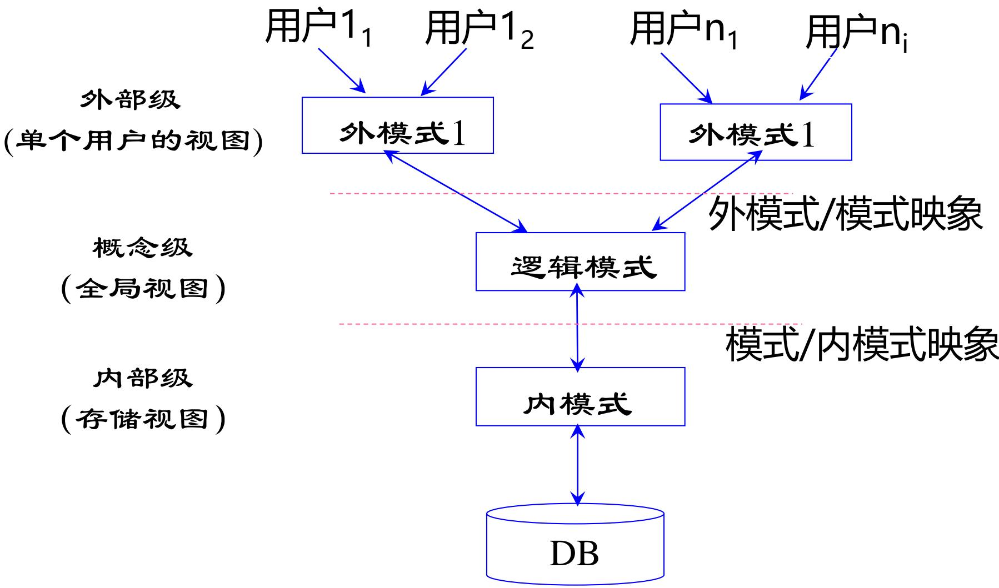
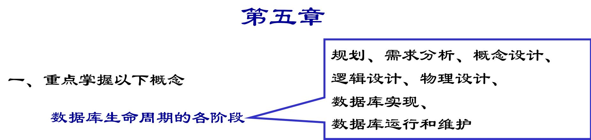
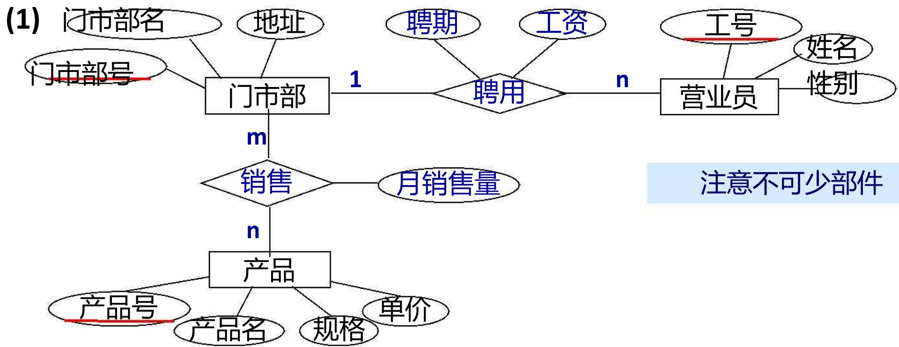

# 《数据库系统》期末复习要点（2017-2018学年）

原件经识别和整理；“参考解答”是我们补的。

本资料为2017-2018学年《数据库系统》课程期末复习要点，涵盖题型分布、各章重点考点、实验相关原理及具体知识点梳理。

## 一、考试题型及分值分布

### 总体说明

- **选择题**：15分
- **判断题**：15分
- **SQL语句题**：35分
- **数据库设计题**：35分

**特别说明：**
1. 实验内容约占10分，分布在选择题和判断题中。
2. 关系代数表达式包含在“判断题”或“选择题”中。
3. 考试形式为闭卷。

## 二、各章核心考点概览

知识点：[单表查询（SELECT、WHERE、ORDER BY、聚集函数、GROUP BY、HAVING、LIMIT）](../../../topics/数据库系统/单表查询.md)、[连接查询（等值连接、自然连接、自身连接、外连接、多表连接）](../../../topics/数据库系统/连接查询.md)、[嵌套查询（IN、比较运算符、ANY/ALL、EXISTS）](../../../topics/数据库系统/嵌套查询.md)、[数据更新（INSERT、UPDATE、DELETE）](../../../topics/数据库系统/数据更新.md)、[概念结构设计（E-R图设计、实体与联系、设计方法）](../../../topics/数据库系统/概念结构设计.md)、[逻辑结构设计（E-R图向关系模型的转换）](../../../topics/数据库系统/逻辑结构设计.md)

### 第一章 数据库系统概论

**重点内容：**
- DBS有关概念。
- 数据模型概念。
- E-R图的画法。

知识点：[数据库系统（DBS）的组成与特点](../../../topics/数据库系统/数据库系统.md)、[数据模型（概念模型与逻辑模型）](../../../topics/数据库系统/数据模型.md)

### 第二章 关系数据模型

**重点内容：**
- 关系数据模型的有关概念。
- 理解给定关系代数表达式的含义。

知识点：[关系模式与关系数据库](../../../topics/数据库系统/关系模式.md)、[关系的数据结构（域、笛卡尔积、关系、分量）](../../../topics/数据库系统/关系数据结构.md)、[关系的三类完整性约束（实体完整性、参照完整性、用户定义的完整性）](../../../topics/数据库系统/关系完整性.md)、[关系代数基础运算（并、差、交、笛卡尔积）](../../../topics/数据库系统/关系代数基础.md)、[关系代数专门运算（选择、投影、连接、除）](../../../topics/数据库系统/关系代数专门运算.md)

### 第三章 SQL语言

**整章均为重点。**

**重点内容：**
- **DDL**：三级模式的定义语句，基表定义中的完整性约束。
- **DQL**：完整句法都要会运用。熟悉习题和实验涉及的查询需求类型。多表查询至少会用连接法和 `IN`、`NOT IN`。
- **DML**：增删改各种语句的运用，包括完整性定义对操作的影响。

知识点：[数据定义（CREATE、ALTER、DROP：SCHEMA、TABLE、INDEX）](../../../topics/数据库系统/数据定义.md)、[单表查询（SELECT、WHERE、ORDER BY、聚集函数、GROUP BY、HAVING、LIMIT）](../../../topics/数据库系统/单表查询.md)、[数据更新（INSERT、UPDATE、DELETE）](../../../topics/数据库系统/数据更新.md)、[SQL的特点与基本概念](../../../topics/数据库系统/SQL概述.md)、[自主存取控制（GRANT、REVOKE、数据库角色）](../../../topics/数据库系统/自主存取控制.md)、[连接查询（等值连接、自然连接、自身连接、外连接、多表连接）](../../../topics/数据库系统/连接查询.md)、[嵌套查询（IN、比较运算符、ANY/ALL、EXISTS）](../../../topics/数据库系统/嵌套查询.md)

### 第四章 关系数据库理论

**重点内容：**
- 函数依赖集的分析。
- 候选键的推导。
- 范式的判断（含范式的定义）。
- 各种算法的运用：
    - 属性集闭包算法。
    - 分解为2个模式时的无损测试算法。
    - 保持依赖的测试算法。
    - 无损且保持依赖地分解为3NF的算法。

知识点：[函数依赖（平凡/非平凡、完全/部分、传递函数依赖）](../../../topics/数据库系统/函数依赖.md)、[求属性集X关于F的闭包X_F^+](../../../topics/数据库系统/属性集闭包.md)、[范式（1NF、2NF、3NF、BCNF）](../../../topics/数据库系统/范式.md)

### 第五章 数据库设计

**重点内容：**
- 数据库设计的步骤和各阶段的结果。
- E-R图到关系模式的转换。

知识点：[数据库设计的特点、方法与基本步骤](../../../topics/数据库系统/数据库设计概述.md)、[概念结构设计（E-R图设计、实体与联系、设计方法）](../../../topics/数据库系统/概念结构设计.md)、[逻辑结构设计（E-R图向关系模型的转换）](../../../topics/数据库系统/逻辑结构设计.md)

### 第七章 数据库保护

**重点内容：**
- 含数据库保护概念及实验现象对应的原理。
- **事务的概念**：如 ACID 特性。
- **数据库保护的四个方面**：各自对应的措施。
- **实验二有关的存取控制(权限)与并发控制的体现**。
- **DCL**：实验二涉及的语句要会。

知识点：[事务的基本概念与ACID特性（原子性、一致性、隔离性、持续性）](../../../topics/数据库系统/事务.md)、[并发控制概述（丢失修改、脏读、不可重复读、幻读）](../../../topics/数据库系统/并发控制概述.md)、[封锁协议（一级、二级、三级封锁协议）](../../../topics/数据库系统/封锁协议.md)

### 第八章 数据库新技术

**重点内容：**
- DBS结构类型、中间件等概念。
- 实验三中用 ADO 连接数据库的方法。

## 三、实验相关内容

知识点：[数据库系统（DBS）的组成与特点](../../../topics/数据库系统/数据库系统.md)、[数据库系统的三级模式结构（模式、外模式、内模式）](../../../topics/数据库系统/三级模式结构.md)、[数据库管理系统（DBMS）的主要功能](../../../topics/数据库系统/数据库管理系统.md)

### 一、操作有关的内容

#### Oracle用户级别和账号

- Oracle自带的用户级别和账号：`system/manager`、`system/oracle`、`scott/tiger`。

#### 连接命令

- 在Oracle中连接SQL PLUS的命令：`connect`。

#### SQL差异

- Oracle的SQL语句与标准SQL的差异（缺省项、日期型处理）。

#### Delphi ADO组件

- **ADOConnection**：作用：访问数据库。
- **ADOQuery**：作用：执行SQL语句。
- **DataSource**：作用：连接数据集与控制组件。
- **DBGird**：作用：显示数据。
- **DBNavigator**：作用：导航记录。
- *注：具体属性见实验三指导书。*

知识点：[JDBC工作原理与API基础](../../../topics/数据库系统/JDBC工作原理.md)、[数据库设计的特点、方法与基本步骤](../../../topics/数据库系统/数据库设计概述.md)

### 二、原理及分析有关的内容

#### 实验二的数据库保护现象、原因及结果

**并发控制的现象及锁的作用：**
- `set auto on` 和 `set auto off` 的含义。
- `commit`、`rollback` 的作用（对更新操作的影响）。
- ORACLE默认的隔离级别。

**存取控制：**
- 能创建用户的是 DBA。
- 用户的口令：字母开头。
- 使用别的用户的对象，要得到权限，并加拥有者前缀（如 `owner.table_name`）。
- 授操作权时，select部分属性时的处理（借助视图）。

## 四、详细知识点梳理

知识点：[并发控制概述（丢失修改、脏读、不可重复读、幻读）](../../../topics/数据库系统/并发控制概述.md)、[封锁（排它锁X、共享锁S、锁相容矩阵）](../../../topics/数据库系统/封锁.md)、[事务的隔离级别（读未提交、读已提交、可重复读、可串行化）](../../../topics/数据库系统/事务隔离级别.md)

### 第一章 数据库系统概论

#### 几个重要的概念

**➢ 数据库（DB）**
长期存储在计算机内、有组织的、统一管理的相关数据的集合。DB 能为各种用户共享，具有冗余度较小、数据间联系紧密、数据独立性较高等特点。

**➢ 数据库管理系统（DBMS）**
是位于用户与操作系统之间的一层数据管理软件，它为用户或应用程序提供访问DB的方法。

**➢ 数据库系统（DBS）**
是实现有组织地、动态地存储大量关联数据、方便多用户访问的计算机软、硬件和数据资源组成的系统，即它是采用数据库技术的计算机系统。
- **组成**：数据库、DBMS、用户、DBA。
- **关系**：数据库存放数据，DBMS是数据库系统的核心，DBA借助DBMS来完成其职责，DBA实施的各种操作都是在DBMS的控制下实现。
- **特点**：数据库阶段的数据管理采用数据模型表示复杂的数据结构。

#### 数据模型

**简单定义**：能表示实体类型及实体间联系的模型。

**三个级别**：
1.  **概念数据模型**：面向客观世界，面向用户，独立于计算机系统，与DBMS无关的数据模型。例如：E-R模型。
2.  **逻辑数据模型**：也称之为结构数据模型，反映数据的逻辑结构，与DBMS有关，既面向用户又面向实现。
    - 三个传统的逻辑模型：关系、网状、层次。
    - 关系模型与其他两种模型的最大差别是用关键码而不是指针导航数据。
3.  **物理数据模型**：反映数据存储结构（物理块、指针、索引等）的数据模型，与DBMS、操作系统和硬件有关的模型。

#### 概念数据模型的E-R图表达

复习要结合第5章知识点。

**正确绘画ER图的几点说明：**
- 正确的图形符号。
- 标注联系类型。
- 标注实体键。
- 无冗余、无冲突。

**ER图涉及到的相关概念：**
- **实体**：客观存在的且可以相互区别的事物。
- **实体集**：具有相同性质的实体的集合。
- **联系**：实体集之间的相互关系。
    - 二元联系：只有两个实体集参与的联系。
    - 多元联系：参与联系的实体集的个数≥3的联系。
    - 自反联系：同一实体集内两部分实体之间的联系。
    - 基数描述：1:1, 1:N, M:N。
- **属性**：实体或联系所具有的特征。
- **实体键**：标识实体集中某一实体的属性或属性组。

#### 数据库的三级体系结构



**几点说明：**
- 要结合关系模型的三级体系结构以及SQL数据库体系结构加强理解。
- **外部级**：外模式（用户的视图），也称子模式、用户模式、视图。
- **概念级**：逻辑模式或模式（全局视图），也称关系模式、基本表。
- **内部级**：内模式（存储视图），也称存储模式，涉及Index、存储文件等。

**两级映像与两级数据独立性概念的表达要做到“举1反3”。**
- 数据库的三层模式结构和两级映像结构称为“数据库的体系结构”，有时也称为“三级模式结构”或“数据抽象的三个级别”。

#### 数据库管理系统

**主要功能：**
- **数据字典**：存放三级结构定义的数据库。

知识点：[数据库系统（DBS）的组成与特点](../../../topics/数据库系统/数据库系统.md)、[数据模型（概念模型与逻辑模型）](../../../topics/数据库系统/数据模型.md)

### 第二章 关系数据模型

#### 一、重点掌握以下概念

**关系数据模型的数据结构：**
- 二维表。
- **关系模式**：$R(U_1, U_2, \dots, U_n)$。
- **目（元数）**：属性的个数。
- **基数**：元组的个数。
- **候选键(关键码)**：能唯一标识元组的属性或属性组。
- **主键**：选定的候选键。
- **外键**：另一个关系模式的主键。
- **超键**：包含候选键的键。

**数据约束三类：**
1.  **实体完整性规则**：主键值唯一，组成主键的属性上不能为NULL。
2.  **参照完整性规则**：外键取值只有NULL和某关系主键值2种可能。
3.  **用户定义的完整性规则**：显式说明的数据约束。

**数据操作：**
- **关系运算的完备集**：$\{\sigma, \Pi, \cup, -, \times \}$，理解所构成的表达式的含义。

#### 二、会根据给出的关系代数表达式理解反映的查询需求以及与之等价的SQL语句

知识点：[关系模式与关系数据库](../../../topics/数据库系统/关系模式.md)、[关系的数据结构（域、笛卡尔积、关系、分量）](../../../topics/数据库系统/关系数据结构.md)、[关系的三类完整性约束（实体完整性、参照完整性、用户定义的完整性）](../../../topics/数据库系统/关系完整性.md)、[关系代数基础运算（并、差、交、笛卡尔积）](../../../topics/数据库系统/关系代数基础.md)、[关系代数专门运算（选择、投影、连接、除）](../../../topics/数据库系统/关系代数专门运算.md)

### 第三章 SQL语言

#### 一、重点掌握以下概念

**SQL数据库体系结构的要点：**
- **基本表**：实际存储数据。
- **视图**：虚表，由其它基表或视图导出，不实际存储数据（除物化视图外）。
- **导出表**：通过查询生成的表。

**SQL的四大功能(组成)：**
- DDL（数据定义语言）
- DQL（数据查询语言）
- DML（数据操纵语言）
- DCL（数据控制语言）

#### 二、会根据需求写出相关语句

**1. DDL：基表及其完整性、视图、索引的定义**

- **定义基表：**
```sql
CREATE TABLE <表名> (
    <列名> <类型> [列级完整性约束条件],
    [<列名> <类型> [列级完整性约束条件]],
    [<表级完整性约束条件>]
);
```
- **定义主键、定义外键、Check子句**：需熟练掌握语法。

**2. DQL：单表、多表(连接、用IN的嵌套)都应熟练**

**SELECT语句结构：**
```sql
SELECT <目标表的列名或列表达式>
FROM <基表名、视图名、导出表的列表>
[WHERE <行条件表达式>]       -- 行条件子句
[GROUP BY <列名表>]           -- 分组子句
[HAVING <组条件表达式>]       -- 组条件子句
[ORDER BY <列名或序号>[ASC|DESC]]; -- 排序子句
```

**聚合函数：** MAX、MIN、AVG、COUNT、SUM。
- 注意列的类型；遇到空值时，除了 `COUNT(*)` 外，都跳过空值而去处理非空值。

**几点注意：**
1.  SELECT子句指明查询项，用 `DISTINCT` 去掉重复值，用 `AS` 重命名查询项，`AS` 可省。
2.  聚合函数不能直接出现在 WHERE 子句，但 SELECT 和 HAVING 子句可以。
3.  完整的 SELECT 语句的执行过程。

**语义对应关系：**
$$
\text{SELECT } A_1, \dots, A_n \\
\text{FROM } R_1, \dots, R_n \\
\text{WHERE } F;
$$
对应关系代数：
$$
\Pi_{A_1, \dots, A_n} (\sigma_F (R_1 \times \dots \times R_n))
$$

**3. DML**

- **插入**：
```sql
INSERT INTO <表名> [(列名表)] VALUES <(数据项集)>;
```
    - 注：VALUES子句是要插入的元组值；当列名表缺省时，各属性值的次序和域应与表的定义一致；当列名表不缺省时，列的个数和次序需与VALUES子句对应。

- **删除**：
```sql
DELETE FROM [表创建者.]<表名> [WHERE <条件表达式>];
```

- **修改**：
```sql
UPDATE [表创建者.]<表名>
SET <列名=值表达式> [{,<列名=值表达式>}]
[WHERE <条件表达式>];
```

- **几点注意**：
    1.  一次只能对一个表进行操作。
    2.  DML操作受关系完整性约束的制约：
        - 数据类型。
        - 实体完整性：主键值唯一，非空。
        - 参照完整性：外键值的约束，不允许引用不存在的实体。
        - 用户自定义的完整性。

**4. DCL**

- **事务控制**：`Set Auto`、`COMMIT`、`ROLLBACK`。
- **授权**：`GRANT`、`REVOKE`、转授、连锁回收。
- 与实验二结合加深理解。典型例子：实验一、实验二 P244-245、SQL示例。

知识点：[数据定义（CREATE、ALTER、DROP：SCHEMA、TABLE、INDEX）](../../../topics/数据库系统/数据定义.md)、[单表查询（SELECT、WHERE、ORDER BY、聚集函数、GROUP BY、HAVING、LIMIT）](../../../topics/数据库系统/单表查询.md)、[数据更新（INSERT、UPDATE、DELETE）](../../../topics/数据库系统/数据更新.md)、[SQL的特点与基本概念](../../../topics/数据库系统/SQL概述.md)、[自主存取控制（GRANT、REVOKE、数据库角色）](../../../topics/数据库系统/自主存取控制.md)、[连接查询（等值连接、自然连接、自身连接、外连接、多表连接）](../../../topics/数据库系统/连接查询.md)、[嵌套查询（IN、比较运算符、ANY/ALL、EXISTS）](../../../topics/数据库系统/嵌套查询.md)

### 第四章 关系数据库理论

#### 1．规范化涉及的基本概念

- **关系模式设计的问题**：P116~117。
- **函数依赖FD**：P119。
    - 平凡FD与非平凡FD。
    - 完全FD与部分FD：P131。
    - 传递FD：P132。
- **FD的推理规则**（3+5）：P120~121。
- **属性集闭包定义及算法**：P122。
- **最小依赖集的概念**：P123。
- **各级范式的定义**：P131~134。
    - 1NF、2NF、3NF、BCNF。
- **无损分解和保持函数依赖分解的概念**。

#### 属性集闭包与最小函数依赖集

**➢ 属性集闭包**
- P122，算法4.1。
- **用途**：确定关系模式的候选键。

**➢ 最小函数依赖集的概念**
- P123。
- **关系模式的分解特性**：
    - 数据等价和依赖等价。
    - 分解中数据是否等价用“无损分解”来衡量。
    - 依赖是否等价或者说语义是否等价用“保持依赖”来衡量。P124~125。

#### 二、能熟练解决以下问题

1.  根据描述推出函数依赖集F，熟练计算属性集闭包。
2.  确定候选键或主键：推理、属性集闭包（不在F中的属性应列入候选键中）。
3.  分析函数依赖类型、判断模式分解特性。
4.  判别范式：
    - 单个模式的，整个分解的（每个模式都达到）。
    - （对给定的分解 $\rho$ 中的模式 $R_i$ 需先投影出 $F_i$，再对 $R_i$ 做判断，$\rho$ 所达范式是其中每个模式都达到的范式级别，即最低的）。
5.  按给定要求无损、保持依赖分解模式到3NF。
    - P128 定理4.6
    - P135 算法4.7



知识点：[函数依赖（平凡/非平凡、完全/部分、传递函数依赖）](../../../topics/数据库系统/函数依赖.md)、[求属性集X关于F的闭包X_F^+](../../../topics/数据库系统/属性集闭包.md)、[范式（1NF、2NF、3NF、BCNF）](../../../topics/数据库系统/范式.md)

### 第五章 数据库设计

**数据库设计步骤：**
规划、需求分析、概念设计、逻辑设计、物理设计、数据库实现、数据库运行和维护。

#### 二、会按需求描述，进行数据库的设计和结构定义

**1. 概念设计**
- 从个别用户的需求出发，为每个用户或者每个对数据的观点与使用方式相似的用户建立一个相应的局部概念结构。
- 局部E-R图集成过程中→解决冲突、消除冗余。
- 会抽取：实体、联系(类型)、属性。
- **注意**：需求描述给出中文，就用中文；需求描述给出中文，就用中文；改名扣分。

**2. 逻辑设计**
- **E-R图转换成关系模式**：转换规则P168-169。
- **转换规则**：
    - **实体**：实体→关系模式(可以重命名)；实体属性→关系模式的属性；实体键→关系模式的键。
    - **二元联系**：
        - m:n的联系集→用联系集的属性和两个实体集的键构成一个关系，其键由两个实体集的键组合而成。
        - 1:n的联系集→联系集的属性归入n方关系模式中，并在n方引用1方关系中的键。
    - **一元和三元联系**的转换规则类似。
- **规范化处理**。
- **外模式设计**。

**3. 物理设计**
- 确定数据库的存储结构：位置、分区、参数配置。
- 确定数据库的存取方法：索引法、簇集、HASH法。

**4. 实现**
- DDL创建数据库结构、载入数据、应用程序的设计与调试、数据库的试运行。

**5. 运行和维护**

**三、典型例子**
- 习题5.14以及复习资料中的两个相关文档。

知识点：[数据库设计的特点、方法与基本步骤](../../../topics/数据库系统/数据库设计概述.md)、[概念结构设计（E-R图设计、实体与联系、设计方法）](../../../topics/数据库系统/概念结构设计.md)、[逻辑结构设计（E-R图向关系模型的转换）](../../../topics/数据库系统/逻辑结构设计.md)

### 第七章 数据库保护

#### 一、重点掌握以下概念

**1. 事务**
- **概念**：DBMS执行的工作单位，由有限的数据库操作序列组成，是一组不可分割的数据操作序列的一次单独执行过程。
- **特性**：ACID四个特性，理解定义。
    - 原子性，一致性，隔离性，持久性。
- **事务的结束**：`COMMIT`、`ROLLBACK`。能与实验二结合。

**2. 数据库的恢复**
- **基本原则**：数据冗余（后备副本、日志文件）。
- **恢复过程**：REDO、UNDO、前像BI、后像AI。

**检查点技术**—P223
- 能理解图7.4中与检查点和系统故障有关的事务的可能状态。
- 数据库的恢复机制保证了事务的原子性和持久性。

**3. 并发控制：**
- **三个问题**：丢失更新、读脏数据、不可重复读。
- **封锁技术**：S、X锁的原理。能与实验二结合。
- **封锁的问题**：活锁、饿死、死锁。
- **封锁的粒度与系统的并发度以及系统开销的关系**：P229。
- **三级封锁协议的内容和优缺点**：P229 表7.1。
- **并发调度的正确性准则**：(冲突)可串行化的调度。
- **事务的四种隔离级别的特点**：P232。
    - ORACLE 级别 3
    - MySQL 级别 2

**4. 完整性：**
- **概念**：数据的正确性、有效性、相容性，防止不合语义的数据进入DB。
- **完整性约束机制的功能**：定义、检查、保护。
- **定义方法**：域约束、基本表约束、检查子句、断言…

**5. 安全性**：能与实验二结合
- **定义**：保护数据库，防止不合法的使用，以免数据的泄露、更改或破坏。
- **权限**：授予、回收，相关语句 P244 例7.17/18。
- **SQL中的安全性机制**：视图、存取控制、角色、审计等。

#### 二、会按需求写出

- **完整性约束语句**：会使用基本表约束、检查子句。
- **理解执行更新操作时所受到的完整性制约**。

#### 三、典型例子

- 基表定义中的列级约束、表级约束、检查子句约束、实验二。

知识点：[事务的基本概念与ACID特性（原子性、一致性、隔离性、持续性）](../../../topics/数据库系统/事务.md)、[并发控制概述（丢失修改、脏读、不可重复读、幻读）](../../../topics/数据库系统/并发控制概述.md)、[封锁协议（一级、二级、三级封锁协议）](../../../topics/数据库系统/封锁协议.md)

### 第八章 数据库新技术

- **DBS的结构类型**中的C/S结构、B/S结构的概念P32-33。
- **ODBC的4层体系结构**：P330
    - 应用程序、驱动程序管理器、DB驱动程序、数据源(DSN)。
- **开发MIS的基本步骤**：
    - 数据库设计→应用功能设计→数据库实现→数据库连接→应用功能实现。
- **Delphi 提供的三页数据库组件**：
    1.  **① ADO**：连接和存取数据库
        - `ADOConnection`、`ADOQuery`(实现与数据库的连接)、`ADOTable`
    2.  **② 数据控制组**：供用户浏览和编辑数据的界面
        - `DBGird`，`DBNavigator`
    3.  **③ 数据访问组**：`DataSource`组件
    - **三者的关系**：用户 → ② ③ → ① → DB

## 第一章 概念

- DBS 的组成：数据库、DBMS、用户、DBA
- 开发 DBS 的人员：DBA、系统分析员、程序设计员、用户
- DBMS 的基本功能：数据库的定义、数据库的操纵、数据库保护、数据库的维护、数据字典
- 数据字典的特点、作用：由 DBMS 创建、管理，存放数据库的模式、安全性、完整性的定义等

数据模型三级别：概念模型（与 DBMS 无关）、逻辑模型、物理模型

逻辑数据模型三要素：数据结构、数据操作、约束条件

三级模式及其在 SQL 中的体现：

- 概念模式或模式：table（基表）
- 外模式：view（视图）
- 内模式：index（索引）等

数据独立性：应用程序独立于数据结构的变化（逻辑、物理两级）

## 第二章 概念

- 关系数据模型是一种逻辑数据模型，有三要素
- 关系数据模型的数据结构：关系（二维表）、各种键及数量
  - 候选键（n）、主键（1）、外键（n）、超键（n）、全键（1）
- 数据约束：实体完整性、参照完整性、用户定义的完整性
- 数据操作：关系代数（关系运算的完备集 $\{\sigma, \pi, \cup, -, \times\}$ 中各操作的含义，表达式的含义，与 SQL 的对应）

## 第三章 概念

- SQL 的三类表：基表、视图（虚表）、导出表
- SQL 的两种使用方式：交互式、嵌入式
- SQL 的四大功能（组成）：DDL、DML、QL、DCL
- 视图的作用：独立性、安全性、方便使用

视图的更新：一般只能对“行列子集视图”进行更新（增、删、改）

行列子集视图的定义——P101

## 第四章 概念

- 函数依赖（类型）：一个或一组属性的值可以决定其它属性的值。是最基本的数据依赖、平凡、非平凡（完全、局部、传递）
- 最小函数依赖集的概念
- 各级范式的定义、判断技巧

## 第五章 概念

规划、需求分析、概念设计、逻辑设计（对应的模式）、物理设计、数据库实现、数据库运行和维护

- 数据库全过程（生命周期）包含的各阶段
- 数据库静态设计各个阶段的次序、结果，与三级模式的对应关系
- 物理设计的启发式规则（索引、簇集）
- 自底向上的设计方法中：局部 E-R 图的范围、局部 E-R 图集成过程中→解决冲突、消除冗余

## 第七章 概念

- 事务的 ACID 性质（原子性、一致性、隔离性、持久性）
- 事务的结束方式：commit、rollback
- 数据库恢复的有关概念：后备副本、日志、REDO、UNDO、前像 BI、后像 AI、检查点
- 安全性控制的防范对象：非法用户

SQL 中的安全性机制：用户标识与鉴别、存取控制、视图、审计、加密等

数据库中的用户级别：DBA、RESOURCE、CONNECT

DBA 特有的功能：创建用户和授系统权限

grant、revoke 的作用、拥有者

- 并发控制的有关概念（能与实验二结合）

封锁技术：S、X 锁的原理、锁的等待和释放、封锁的粒度

封锁的问题：活锁、饿死、死锁

- 并发调度的正确性准则：（冲突）可串行化

SQL 中的完整性约束：域约束、基表约束、检查子句、断言、触发器

## 第八章 概念

- DBS 的结构类型中的 C/S 结构、B/S 结构的概念
- 最主要的 DB 专用中间件——ODBC
- ODBC 的 4 层体系结构：应用程序、驱动程序管理器、DB 驱动程序、数据源（DSN）
- 开发 MIS 的基本步骤：数据库设计→应用功能设计→数据库实现→数据库连接→应用功能实现
- Delphi 使用 ADO 访问数据库的方法（主要控件及属性）——实验三

## 选择题示例

知识点：[数据库系统（DBS）的组成与特点](../../../topics/数据库系统/数据库系统.md)、[数据库系统的三级模式结构（模式、外模式、内模式）](../../../topics/数据库系统/三级模式结构.md)、[数据库管理系统（DBMS）的主要功能](../../../topics/数据库系统/数据库管理系统.md)

### 选择 1

事务的各个操作要么全做，要么全都不做的特性是（　）。

- A. 一致性
- B. 原子性
- C. 隔离性
- D. 持久性

答案：B。

## 判断题示例

知识点：[事务的基本概念与ACID特性（原子性、一致性、隔离性、持续性）](../../../topics/数据库系统/事务.md)

### 判断 1

事务的一致性要求各个操作要么全做，要么全都不做。（　）

答案：F。

## 题型三：SQL 语句

1. DDL 语句：典型例子为实验一中借阅表、索引、视图的创建；另外会根据需求，合理运用 on delete、check。
2. QL 语句：典型例子为习题 3.2（除⑦、⑧ 外）、习题 3.7。
3. DML 语句：典型例子为实验一的数据修改和删除、习题 3.12 的①、③。
4. DCL 语句：典型例子为实验二的授权与回收语句。

知识点：[事务的基本概念与ACID特性（原子性、一致性、隔离性、持续性）](../../../topics/数据库系统/事务.md)

### 综合 1

图书管理系统有三个基表，基表模式如下：

图书（图书编号，分类号，书名，作者，出版单位，单价）

读者（借书证号，姓名，单位，职称）

借阅（借书证号，图书编号，借期，还期）

其中还期为空或者大于借期，删除读者信息时，其借阅信息也跟随删除，有借阅记录的图书信息不得删除。

#### 简答 1

写出定义基表借阅的 DDL 语句，并正确定义完整性。

```sql
CREATE TABLE 借阅
( 借书证号 CHAR(4) NOT NULL,
  图书编号 CHAR(4) NOT NULL,
  借期 DATE NOT NULL,
  还期 DATE,
  PRIMARY KEY(借书证号, 图书编号),
  FOREIGN KEY(借书证号) REFERENCES 读者 ON DELETE CASCADE,
  FOREIGN KEY(图书编号) REFERENCES 图书,
  CHECK((还期 IS NULL) OR (还期 > 借期)) );
```

句法：`CREATE TABLE <表名> (<列名> <类型> [列级完整性约束条件][,<列名> <类型> [列级完整性约束条件]] [,<表级完整性约束条件>])；`

#### 简答 2

建立各读者当前借阅图书情况的视图 RB，视图中包括借书证号、姓名、书名。

```sql
CREATE VIEW BR(借书证号, 姓名, 书名) AS
SELECT 读者.借书证号, 姓名, 书名
FROM 读者, 借阅, 图书
WHERE 读者.借书证号 = 借阅.借书证号 AND 借阅.图书编号 = 图书.图书编号;
```

句法：`CREATE VIEW <视图名> [列名表] AS <查询语句>`

#### 简答 3

为基表图书建立一个基于图书编号的降序的唯一索引 B_I。

```sql
CREATE UNIQUE INDEX B_I ON 图书(图书编号 DESC);
```

句法：`CREATE [UNIQUE] INDEX 索引名 ON 基表名(<列名> [ASC|DESC][, 列名 [ASC|DESC]]…)；`

#### 简答 7

列出书名包含“数据库”的图书的信息。

```sql
SELECT * FROM 图书 WHERE 书名 LIKE '%数据库%';
```

- 分析元组条件（显式的、隐含的）：Where
- 分析需要的属性：Select
- 分析操作的数据库对象（单表、多表）：From
- 条件涉及其它表可用嵌套查询：Where 中子查询
- 被查属性所在的表：From

#### 简答 8

查询工厂所有借阅了图书的读者姓名和职称。

```sql
SELECT DISTINCT 姓名, 职称
FROM 读者, 借阅
WHERE 读者.借书证号 = 借阅.借书证号 AND 单位 = '工厂';
```

或

```sql
SELECT 姓名, 职称
FROM 读者
WHERE 借书证号 IN (SELECT 借书证号 FROM 借阅) AND 单位 = '工厂';
```

注意：QL 的有关限定：各个子句内、子句之间。

#### 简答 12

统计借书证号以 6 结尾的每位读者借阅图书的数量，少于 5 本的不予统计，结果按数量降序排列，数量相同的按借书证号升序排列。

```sql
SELECT 借书证号, COUNT(*)
FROM 借阅
WHERE 借书证号 LIKE '%6'
GROUP BY 借书证号
HAVING COUNT(*) >= 5
ORDER BY 2 DESC, 借书证号;
```

#### 简答 14

使用户 U1 拥有查询各出版社图书的最高价、最低价、平均价的权力，并具备转授这些权限的权力。

```sql
CREATE VIEW 出版社分类 AS
SELECT 出版单位, MAX(单价) 最高价, MIN(单价) 最低价, AVG(单价) 平均价
FROM 图书
GROUP BY 出版单位;

GRANT SELECT ON 出版社分类 TO U1 WITH GRANT OPTION;
```

## 题型四：概念设计与逻辑设计

1. 概念设计典型例子：习题 5.14
2. 逻辑设计典型例子：习题 5.14、习题 4.24（除分解成 BCNF 部分）、习题 4.28（会判断最高达到几范式、会用算法 4.7 分解到 3NF）、习题 4.30 ②（另外，会判断整个分解的范式级别）、P135 例 4.17

知识点：[实体-联系模型（E-R模型）的基本概念](../../../topics/数据库系统/ER模型基础.md)、[概念结构设计（E-R图设计、实体与联系、设计方法）](../../../topics/数据库系统/概念结构设计.md)、[逻辑结构设计（E-R图向关系模型的转换）](../../../topics/数据库系统/逻辑结构设计.md)

### 综合 1

某自产自销企业，生产多种产品，有多个门市部。每种产品可以在多个门市部销售，每个门市部可以销售多种产品，每种产品在每个门市部都有月销售量；每个门市部聘用多名营业员，每位营业员只能在一个门市部工作；门市部聘用营业员有聘期和工资。产品有产品号、产品名、规格、单价等属性；门市部有门市部号、门市部名、地址等属性；营业员有工号、姓名、性别等属性。该企业拟建立一个能管理产品、门市部和营业员相关信息的“产品与销售管理系统”，请（所有名称用题干给出的中文名）：

#### 简答 1

为该系统做概念设计，画出 E-R 图。



#### 简答 2

在概念设计的基础上，为该系统做逻辑设计（即将 E-R 图转换成关系模式），写出各个关系模式，用单下划线标出主键，用波浪线标出外键。

门市部（<u>门市部号</u>，门市部名，地址）

营业员（<u>工号</u>，姓名，性别，聘期，工资，<u>门市部号</u>）

产品（<u>产品号</u>，产品名，规格，单价）

销售（<u>产品号</u>，<u>门市部号</u>，月销售量）

补充：

1. 1:N 联系的抽取规则，不可多模式和少属性
2. M:N 联系对应一个新模式
3. 要用规定的方式标出主键和外键

（需复习 E-R 模型到关系模式的转换规则）

E-R 模型到关系模式的转换规则：

实体集：

- 每个实体集转换成一个关系模式
- 实体集的属性即为关系模式的属性
- 实体键即为关系模式的键

1:1 的联系集→联系集的属性归入两个关系模式的任一之中，并在该关系模式中引用另一个关系的键（公共属性，成为该关系的外键）

1:n 的联系集→联系集的属性归入 n 方关系模式中（消除联系集），在 n 方的关系模式中引用 1 方关系中的键（公共属性，成为该关系的外键）

m:n 的联系集→用联系集的属性和两个实体集的键单独构成一个新关系，新关系键由两个实体集的键组合而成（两个实体集的键分别是新关系的外键）

知识点：[实体-联系模型（E-R模型）的基本概念](../../../topics/数据库系统/ER模型基础.md)、[概念结构设计（E-R图设计、实体与联系、设计方法）](../../../topics/数据库系统/概念结构设计.md)、[逻辑结构设计（E-R图向关系模型的转换）](../../../topics/数据库系统/逻辑结构设计.md)

### 综合 2

设有关系模式 R(A, B, C, D, E)，其基本的函数依赖集为：$F = \{A \to B, C \to D, AC \to E\}$，有分解 ρ={R1(ACE), R2(ABCD)}。请：

#### 简答 1

推出 R 的候选键，直接给出结果。

解：AC。

如果有属性不在 F 中，需要将其并入。

求候选键的经验：

先求只在左边的属性集的闭包，若含全部属性，则是唯一候选键；否则，将既左又右的属性逐一并到只左的集中，多次求闭包。

求属性集闭包的算法：

方法：

① 令 $X^{(0)} = X$，$i = 0$；

② 对 F 中的每一个函数依赖 $Y \to Z$，若 $Y \subseteq X^{(i)}$，令 $X^{(i+1)} = X^{(i)} \cup Z$；

③ 若 $X^{(i+1)} \neq X^{(i)}$，则用 $i+1$ 代替 $i$，转②；

④ 若 $X^{(i+1)} = X^{(i)}$，则 $X^{(i)}$ 即为 $X$ 的闭包，算法终止。

#### 简答 2

判断 R 最高属于第几范式，说明理由。

解：最高属于 1NF，存在非主属性对候选键的局部依赖，例如 $A \to B$，B 部分依赖于候选键 AC。

需复习课件和教材中 4.2 的函数依赖类型和 4.4 的各级范式的定义。

判断范式级别的步骤与方法：函数依赖集→分析键→分析函数依赖类型或依据定义→判断范式级别（模式集：每个模式都达到的范式级别）

- 属性都是原子数据的关系模式满足第一范式，记为 $R \in 1NF$。
- 如果关系模式 $R \in 1NF$，且它的任一非主属性都完全函数依赖于任一候选键，则称 R 满足第二范式，记为 $R \in 2NF$。
- 对于 F 中的每个非平凡的 FD $X \to Y$，都有 X 是 R 的超键，或者 Y 的每个属性都是主属性，记为 $R \in 3NF$。
- 设 F 是关系模式 R 的 FD 集，如果对 F 中每个非平凡的 FD：$X \to Y$，都有 X 是 R 的超键，则称 R 是 BCNF 模式。

#### 简答 3

判断 ρ 是否无损，说明理由。

$$R1 \cap R2 = AC,\quad R1 - R2 = E$$

$$\because AC \to E \in F$$

∴ ρ 无损

$$R1 \cap R2 \to R1 - R2$$

需复习课件和教材中 4.3 的定理 4.6。

$R_1 \cap R_2 \to R_1 - R_2 \in F^+$（属性的交集和差集）或 $R_1 \cap R_2 \to R_2 - R_1 \in F^+$

#### 简答 4

求 R1 的函数依赖集 F1 和 R2 的函数依赖集 F2，直接给出结果。

#### 简答 5

判断 ρ 是否保持函数依赖，说明理由。

#### 简答 6

如果 R 未达到 3NF，将 R 无损且保持依赖地分解为 3NF 的模式集，直接给出结果。

## 一、数据库规范化理论（续）

知识点：[函数依赖（平凡/非平凡、完全/部分、传递函数依赖）](../../../topics/数据库系统/函数依赖.md)、[码（候选码、主码、外码）](../../../topics/数据库系统/码.md)、[范式（1NF、2NF、3NF、BCNF）](../../../topics/数据库系统/范式.md)、[关系模式的规范化（分解与优化）](../../../topics/数据库系统/规范化.md)

### 综合 4

已知关系模式 $R(A, B, C, D, E)$，函数依赖集 $F = \{ A \to B, C \to D, AC \to E \}$，分解 $\rho = \{ R_1(ACE), R_2(ABCD) \}$。

求 $R_1$ 的函数依赖集 $F_1$ 和 $R_2$ 的函数依赖集 $F_2$，直接给出结果。

解：
$$ F_1 = \{ AC \to E \}, \quad F_2 = \{ A \to B, C \to D \} $$

需复习课件和教材中 4.3 的定义 4.11。

**知识点：** 函数依赖的投影
原函数依赖集的闭包中全部属性都包含在 $R_i$ 中的函数依赖被投影到 $F_i$ 中。

知识点：[函数依赖（平凡/非平凡、完全/部分、传递函数依赖）](../../../topics/数据库系统/函数依赖.md)、[求属性集X关于F的闭包X_F^+](../../../topics/数据库系统/属性集闭包.md)

### 综合 5

判断 $\rho$ 是否保持函数依赖，说明理由。

解：
因为 $(F_1 \cup F_2)^+ = F^+$，所以 $\rho$ 保持函数依赖。

需复习课件和教材中 4.3 的定义 4.12：$(\bigcup \Pi_{R_i}(F))^+ = F^+$ 则保持依赖。

知识点：[关系模式与关系数据库](../../../topics/数据库系统/关系模式.md)、[函数依赖（平凡/非平凡、完全/部分、传递函数依赖）](../../../topics/数据库系统/函数依赖.md)、[关系模式的规范化（分解与优化）](../../../topics/数据库系统/规范化.md)

### 综合 6

如果 $R$ 未达到 3NF，将 $R$ 无损且保持依赖地分解为 3NF 的模式集 $\tau$，直接给出结果。

解：
$$ \tau = \{ AB, CD, ACE \} $$

需复习课件和教材中 4.4 的算法 4.7：
1. 先求出 $F$ 的最小依赖集，然后把最小依赖集中那些左部相同的 FD 合并；
2. 每个 FD $X \to Y$ 构成一个模式 $XY$；
3. 在构成的模式集中，如果每个模式都不包含 $R$ 的候选键，把候选键作为一个模式放入模式集中。

知识点：[范式（1NF、2NF、3NF、BCNF）](../../../topics/数据库系统/范式.md)、[函数依赖（平凡/非平凡、完全/部分、传递函数依赖）](../../../topics/数据库系统/函数依赖.md)、[关系模式的规范化（分解与优化）](../../../topics/数据库系统/规范化.md)

### 注意事项与技巧

#### (1) 书写规范
- 多属性构成候选键：用 $(A_1, A_2)$ 表示。
- 函数依赖集应该用 $F$ 表示。
- 决定子为多属性时要用 $(A_1, A_2) \to A_3$ 表示。

#### (2) 概念明确
- **函数依赖的投影**是基于 $F^+$ 进行的。
- **BCNF 的定义**：$F$ 中包含全体属性，且所有的函数依赖的决定子都为（或含）候选键。

#### (3) 解题技巧
- 不出现在函数依赖集中的属性必须列入候选键。
- 没有非平凡函数依赖的模式的候选键是全键，达 BCNF。
- $F$ 包含全部属性，且只有 1 个函数依赖的关系，候选键为决定子。
- $F$ 包含全部属性，且只有一个函数依赖的模式达 BCNF。
- 用属性闭包求候选键，只在左边的属性不成功，需要尝试多次。
- 只含 2 个模式的分解，判断无损用定理 4.6 和 4.7，否则用算法 4.3。

知识点：[函数依赖（平凡/非平凡、完全/部分、传递函数依赖）](../../../topics/数据库系统/函数依赖.md)、[码（候选码、主码、外码）](../../../topics/数据库系统/码.md)、[范式（1NF、2NF、3NF、BCNF）](../../../topics/数据库系统/范式.md)
