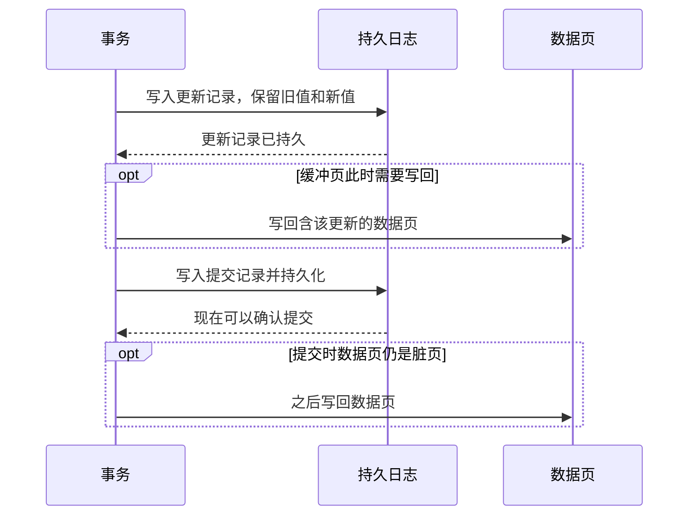

# 数据库恢复技术：从磁盘上留下了什么开始推理

本文是第 11 章授课幻灯片的整理与补充。页码均指原 PDF 页码，完整课件见上方原件链接。先记住这条判据：==磁盘上的页回答“发生了什么写入”，持久日志回答“应该留下谁的写入”。== 两个答案不一定相同，这就是系统崩溃后既可能需要撤销、也可能需要重做的原因。

## 事务：先决定什么算一个完整动作（原件第 3–15、22 页）

从 A 向 B 转 30 元，两个余额修改是同一项业务；合理的完成状态要么是 A 少 30、B 多 30，要么是两边均未改。把这两个操作装进一个[事务](../../../topics/数据库系统/事务.md)，数据库才能把它们作为一个整体提交或回滚。课件以 `BEGIN TRANSACTION`、`COMMIT`、`ROLLBACK` 表示事务边界；隐式事务何时开始以及是否自动提交，要按数据库和客户端设置判断。

| 性质 | 对同一笔转账分别问什么 |
| --- | --- |
| 原子性 | 只扣了 A、还没加 B 就失败，能不能撤掉扣款？ |
| 一致性 | 事务完成后，余额非负、总额守恒等规则还成立吗？这也依赖业务逻辑与约束写对。 |
| 隔离性 | 并发事务会不会读到不该看见的中间状态，或者覆盖彼此的更新？ |
| 持续性 | 已确认提交后立即断电，重启还能不能找回结果？ |

原件第 13 页的两笔款项分别减 1、减 3；两事务都读到 16，依次覆盖成 15 和 13，串行结果却应是 $16-1-3=12$。这叫丢失更新：没有断电，恢复模块也不该被期待把 13 修成 12。要通过正确的更新语句、并发控制与[事务隔离级别](../../../topics/数据库系统/事务隔离级别.md)处理。

> [!WARNING]
> **订正（原件第 22 页）**：原示例算出了账户 A 的新余额，但成功分支只展示了把 B 的余额写回数据库。作为完整转账伪代码，还必须写回 A；两次更新都成功才提交。A 余额不足、B 不存在或更新不成功时回滚，不能把本地变量赋值当作账户已扣款。

## 失败范围决定恢复入口（原件第 17–42 页）

| [故障种类](../../../topics/数据库系统/故障种类.md) | 哪些东西还在？ | 校正方式 |
| --- | --- | --- |
| 事务故障：余额不足、约束失败等 | 数据库仍可运行，同批其他事务不必一并撤销 | 找到该事务的更新，按逆序恢复旧值 |
| 系统故障：宕机、断电 | 假设外存未损坏，内存缓冲区丢失 | 撤销已落盘的未提交更新；补上未落盘的已提交更新 |
| 介质故障：数据文件所在磁盘损坏 | 原数据页不可再作为恢复起点 | 从独立备份恢复物理基础，再依恢复所需的日志恢复到一致目标点 |

为什么不能定时复制一次磁盘就算万无一失？两次备份之间可能有已确认的更新；而运行中的备份可能先复制 A 所在页，再复制 B 所在页，中间正好经过一笔转账。前一种问题需要连续日志弥补时间缺口，后一种问题需要能说明备份一致性的机制和相应日志，而非假设每一页都在同一时刻取样。

[数据转储](../../../topics/数据库系统/数据转储.md)有两条互相独立的分类轴：静态／动态回答“转储期间能否继续运行写事务”；海量（全量）／增量回答“这次复制全部数据还是只复制上次以来的改动”。题目说==可边写边备份==，只能推出动态；题目说==只复制变动==，只能推出增量。恢复增量备份时要确定基础全量副本和所需的增量链；动态备份还要确保所需日志没有缺段。

## 日志先行：为什么两处都需要先等日志（原件第 43–54 页）

[日志文件](../../../topics/数据库系统/日志文件.md)里，开始和结束记录帮助恢复时识别事务阶段；更新记录能按事务及数据对象定位修改，必要时保留修改前后的值。更新用旧值做 UNDO、用新值做 REDO；对插入来说“旧值”是对象原本不存在，对删除来说“新值”是对象已不存在，这与某列值为 SQL `NULL` 不同。课件也介绍以整个数据块为单位记录的形式，代价是单条日志通常更大。

> [!IMPORTANT]
> 日志先行约束的是**持久化顺序**，不是“先改内存还是先组装日志”。脏页写盘前，其对应的更新日志必须已持久；向调用方确认提交前，提交日志及其依赖的更新日志必须已持久。并不要求每个数据页在提交时立刻写回。

**补充**：若页先写盘、更新日志尚未落盘便宕机，旧值可能无处可找；若提交已确认但日志和脏页都没有持久化，承诺的结果无从重做。这两个反例分别解释了图中的两道边界。

## 用提交证据选事务，用前后镜像定方向（原件第 56–65 页）

按本章的简化[恢复策略](../../../topics/数据库系统/恢复策略.md)，先识别有持久提交记录的事务及故障时仍未完成的事务。后者的更新按日志逆序撤销，前者的更新按日志顺序重做。正在回滚与已经完成回滚不等价；题目若提供中止记录，先辨认其具体语义。这里采用课件的记录级前后镜像与隔离假设，不把教材给出的步骤次序当作所有数据库的实现顺序。

同一个对象在一笔事务中依次 $30\to31\to32$。若顺序用旧值覆盖，会先写 30、再写 31，留下错误的中间状态；逆序才会把 32 还回 31、再还回 30。同理，重做若倒着覆盖，最终只剩 31。介质损坏时则先重装备份，再按可用备份和日志链重放；动态备份尤其不能机械地只拿“备份结束以后”的日志，备份窗口内的写入也可能是重建一致性所必需的。

> [!TIP]
> 看到==日志记录的先后次序==，先按事务标出提交证据，再给每条更新标“前镜像／后镜像”。看到“页上已经有最新值”也不要跳过事务判断：那可能恰好是一个必须撤掉的未提交值。

## 检查点不是所有事务的起跑线（原件第 67–77 页）

没有[检查点恢复](../../../topics/数据库系统/检查点恢复.md)时，历史日志越长，为了找活动事务就越可能从远处开始扫描。课件采用**完成后会保证此前脏页已经写盘**的简化检查点：先将已有日志写盘，写入带活动事务及其最近日志位置的检查点记录，把相关脏页写盘，然后发布可以作为重启入口的位置。崩溃打断检查点时，不能使用尚未完成的入口跳过必需记录；真实引擎也可能采用不要求同步刷全脏页的不同机制。

原件第 75 页画了五条事务时间线：检查点前提交者不重做；跨检查点后提交和检查点后开启并提交者重做；未完成的两类事务都撤销。以下数值是**补充算例**，沿用该页的时间位置，便于验证：

| 事务 | 检查点 $T_c$ 前 | 检查点后至系统故障 | 恢复动作 |
| --- | --- | --- | --- |
| T1 | A：$10\to11$，提交 | 无 | 不用重做 |
| T2 | B：$20\to21$，仍活动 | B：$21\to22$，提交 | 只重做检查点后的更新 |
| T3 | C：$30\to31$，仍活动 | C：$31\to32$，未提交 | 撤销两次，包括检查点前那次 |
| T4 | 无 | D：$40\to44$，提交 | 重做 |
| T5 | 无 | E：$50\to55$，未提交 | 撤销 |

设检查点写盘的五个值依次为 $(11,21,31,40,50)$。取故障时 C、E 的新值已经写盘而 B、D 的尚未写盘，磁盘就是 $(11,21,32,40,55)$。

**参考解答**（对应上述补充算例）：若检查点后 C 的更新先于 E，撤销时先将 E 写回 50，再将 C 写回 31，随后沿 T3 的事务日志链跨回检查点之前，将 C 写回 30。接着按原顺序重做，把 B 写成 22、D 写成 44。最终 $(11,22,30,44,50)$：正好保留 T1、T2、T4 的结果。注意重做写的是记录的新值，不是在当前页上再加一次 1 或 4。

> [!CAUTION]
> ==检查点之前已经写盘==不等于==检查点之前已经提交==。若把“重做从哪里开始读”误套为“撤销也在这里截断”，上例 C 会错留为 31；若把磁盘现值当事务状态，C、E 的未提交结果甚至可能被直接保留。

## 镜像缩短中断，不替代历史副本（原件第 78–83 页）

[数据库镜像](../../../topics/数据库系统/数据库镜像.md)把同一数据维护在另一份介质上，可以在一侧故障时用另一侧维持服务，但要付出额外存储和同步代价。镜像回答“这份当前状态还有一份能用吗”；可恢复的备份和归档日志回答“能否回到误操作发生前”。例如误删数据之后，两份镜像可能忠实地同步了同一删除，只有足够早的可用副本和日志链才能有机会恢复到删除前。读镜像是否读到最新值也取决于复制和故障切换的条件，不能从“双份数据”本身直接推出。
