# 《数据库系统》第11章 数据库恢复技术（课件）

原件的每一页，下面附识别出的文字。

### 第11章 数据库恢复技术

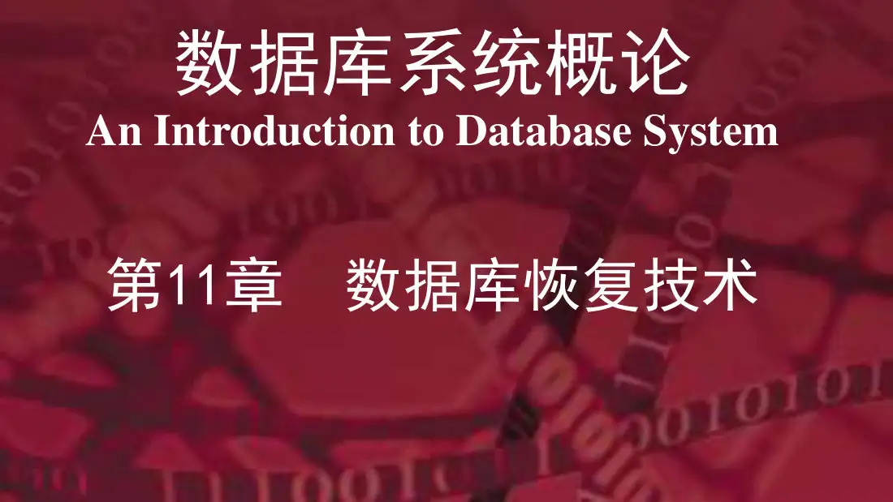

原文：

数据库系统概论 An Introduction to Database System

第11章 数据库恢复技术

### 第11章 数据库恢复技术

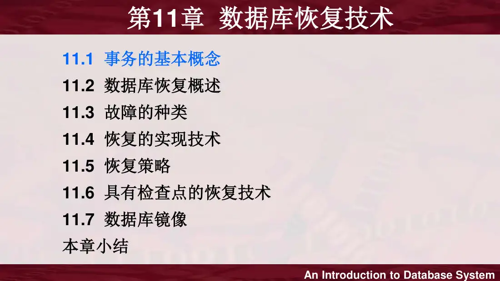

原文：

第11章 数据库恢复技术

11.1 事务的基本概念
11.2 数据库恢复概述
11.3 故障的种类
11.4 恢复的实现技术
11.5 恢复策略
11.6 具有检查点的恢复技术
11.7 数据库镜像
本章小结

An Introduction to Database System

### 11.1 事务的基本概念

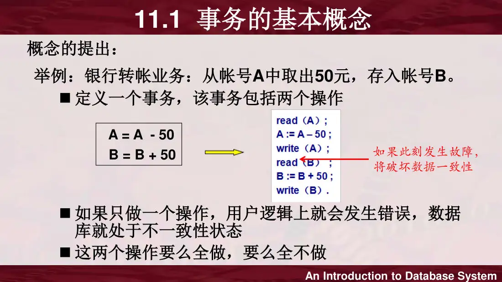

原文：

11.1 事务的基本概念

概念的提出:

举例：银行转帐业务：从帐号A中取出50元，存入帐号B。

■ 定义一个事务，该事务包括两个操作

$$
\begin{array}{l} \mathrm{A=A-50} \\ \mathrm {B = B + 50} \end{array}
$$

$$
\begin{array}{l} \text { read(A); } \\ \text { A:=A - 50; } \\ \text { write(A); } \\ \text { read(B); } \\ \text { B:=B+50; } \\ \text { write(B). } \end{array}
$$

如果此刻发生故障，
将破坏数据一致性

■ 如果只做一个操作，用户逻辑上就会发生错误，数据库就处于不一致性状态

■ 这两个操作要么全做，要么全不做

An Introduction to Database System

### 11.1 事务的基本概念

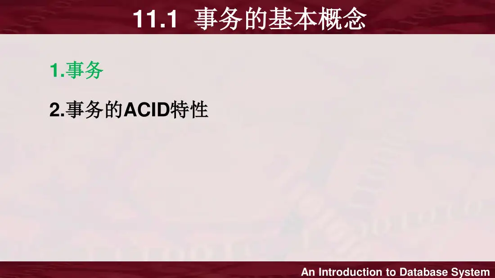

原文：

11.1 事务的基本概念

1. 事务

2.事务的ACID特性

An Introduction to Database System

### 1.事务

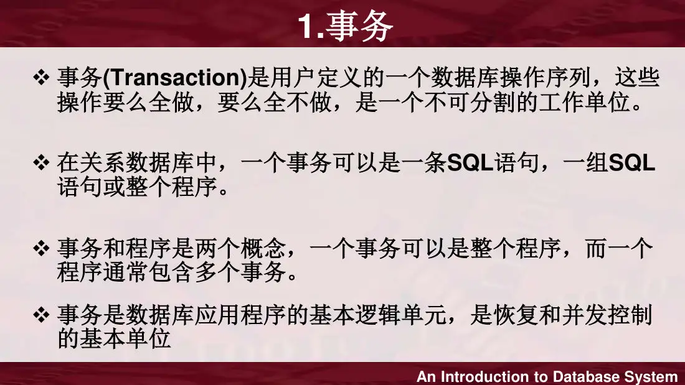

原文：

1.事务

✿ 事务(Transaction)是用户定义的一个数据库操作序列，这些操作要么全做，要么全不做，是一个不可分割的工作单位。

✿ 在关系数据库中，一个事务可以是一条SQL语句，一组SQL语句或整个程序。

事务和程序是两个概念，一个事务可以是整个程序，而一个程序通常包含多个事务。

✿ 事务是数据库应用程序的基本逻辑单元，是恢复和并发控制的基本单位

An Introduction to Database System

### 定义事务

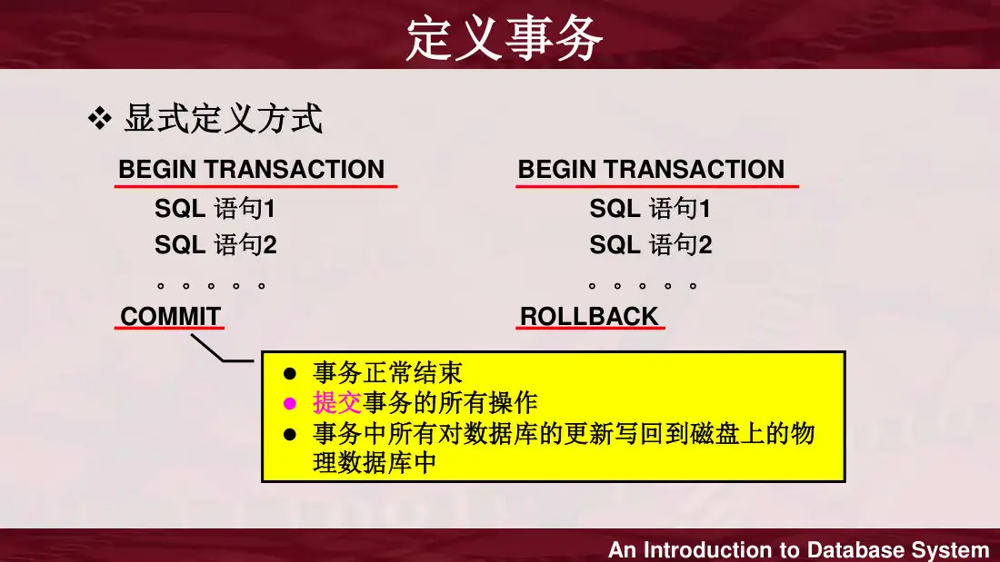

原文：

定义事务

◆ 显式定义方式

BEGIN TRANSACTION

SQL 语句1

SQL 语句2

BEGIN TRANSACTION

SQL 语句1

SQL 语句2

COMMIT

ROLLBACK

\- 事务正常结束

\- 提交事务的所有操作

\- 事务中所有对数据库的更新写回到磁盘上的物理数据库中

An Introduction to Database System

### 定义事务

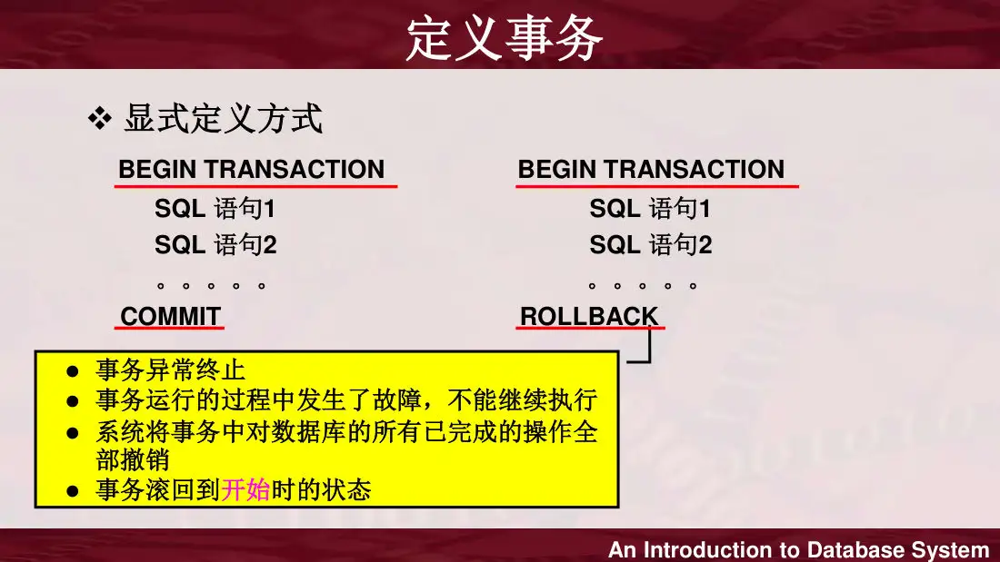

原文：

定义事务

◆ 显式定义方式

BEGIN TRANSACTION

SQL 语句1

SQL 语句2

BEGIN TRANSACTION

SQL 语句1

SQL 语句2

COMMIT

ROLLBACK

\- 事务异常终止

\- 事务运行的过程中发生了故障，不能继续执行

\- 系统将事务中对数据库的所有已完成的操作全部撤销

\- 事务滚回到开始时的状态

An Introduction to Database System

### 事务结束

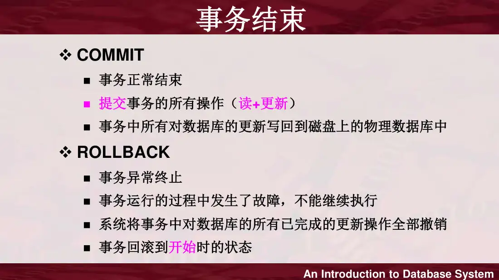

原文：

事务结束

COMMIT

■ 事务正常结束

■ 提交事务的所有操作（读+更新）

■ 事务中所有对数据库的更新写回到磁盘上的物理数据库中

ROLLBACK

■ 事务异常终止

■ 事务运行的过程中发生了故障，不能继续执行

■ 系统将事务中对数据库的所有已完成的更新操作全部撤销

■ 事务回滚到开始时的状态

An Introduction to Database System

### 2. 事务的特性（ACID特性）

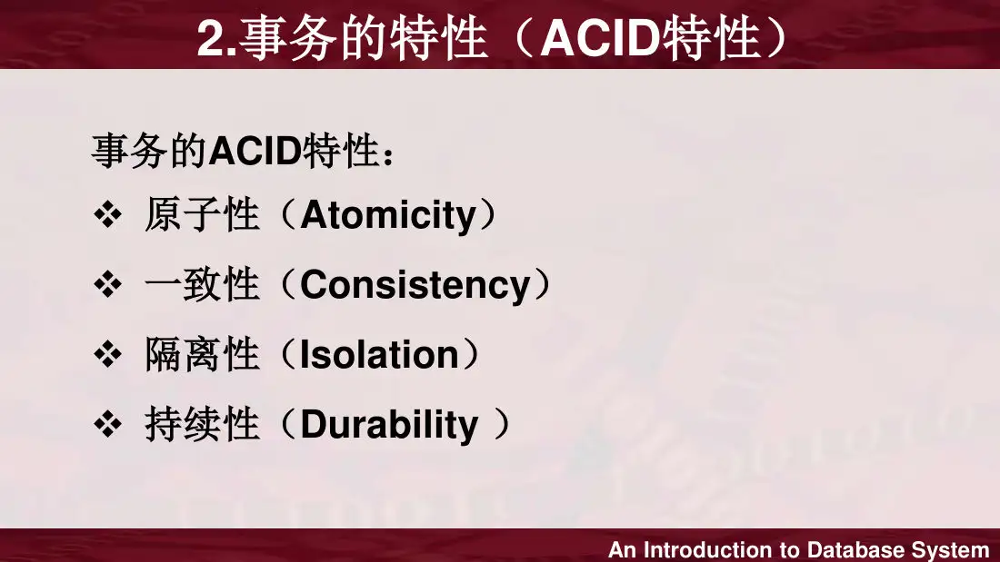

原文：

2. 事务的特性（ACID特性）

事务的ACID特性:

❖ 原子性（Atomicity）

◆ 一致性（Consistency）

✿ 隔离性（Isolation）

❖ 持续性（Durability）

An Introduction to Database System

### (1) 原子性

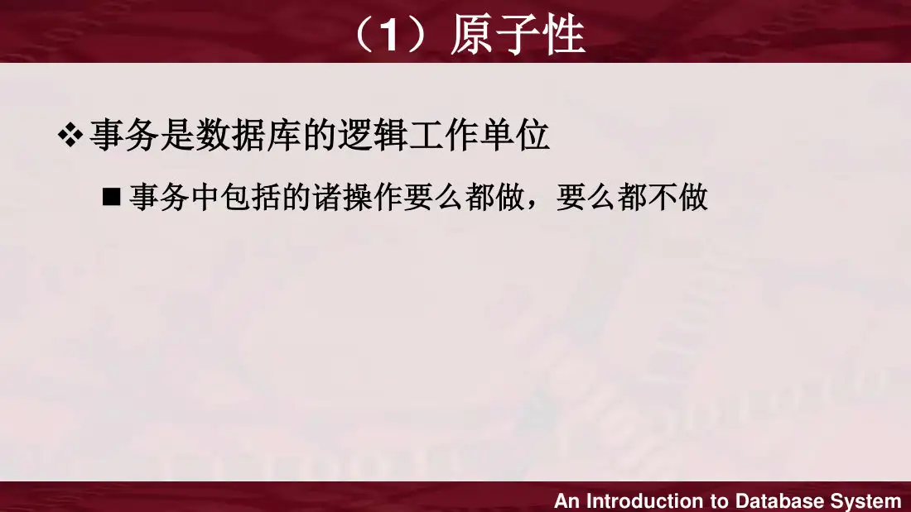

原文：

(1) 原子性

事务是数据库的逻辑工作单位

■事务中包括的诸操作要么都做，要么都不做

An Introduction to Database System

### (2) 一致性

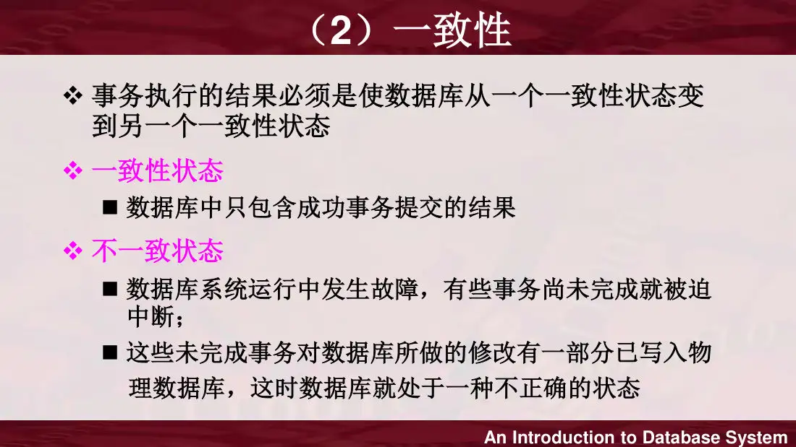

原文：

(2) 一致性

事务执行的结果必须是使数据库从一个一致性状态变到另一个一致性状态

一致性状态

■ 数据库中只包含成功事务提交的结果

不一致状态

■ 数据库系统运行中发生故障，有些事务尚未完成就被迫中断；

■ 这些未完成事务对数据库所做的修改有一部分已写入物理数据库，这时数据库就处于一种不正确的状态

An Introduction to Database System

### 一致性与原子性

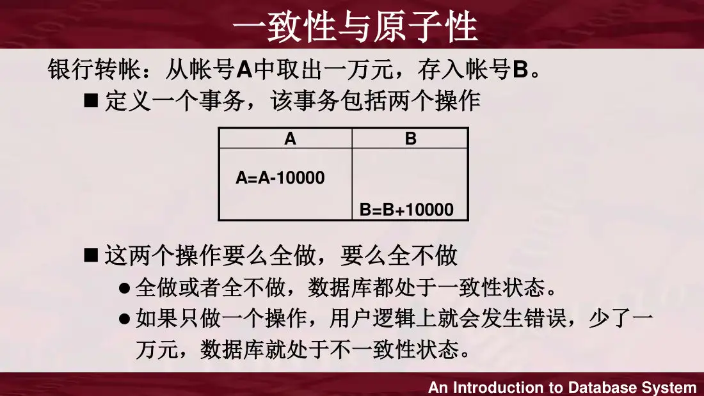

原文：

一致性与原子性

银行转帐：从帐号A中取出一万元，存入帐号B。

■ 定义一个事务，该事务包括两个操作

<table><tr><td>A</td><td>B</td></tr><tr><td>A=A-10000</td><td>B=B+10000</td></tr></table>

■ 这两个操作要么全做，要么全不做

\- 全做或者全不做，数据库都处于一致性状态。

\- 如果只做一个操作，用户逻辑上就会发生错误，少了一万元，数据库就处于不一致性状态。

An Introduction to Database System

### (3) 隔离性

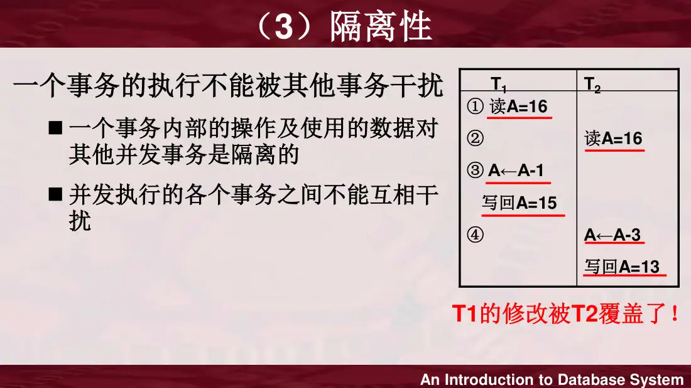

原文：

(3) 隔离性

一个事务的执行不能被其他事务干扰

■ 一个事务内部的操作及使用的数据对其他并发事务是隔离的

■ 并发执行的各个事务之间不能互相干扰

<table><tr><td>T1</td><td>T2</td></tr><tr><td>1读A=16</td><td></td></tr><tr><td>2</td><td>读A=16</td></tr><tr><td>3A←A-1</td><td></td></tr><tr><td>写回A=15</td><td></td></tr><tr><td>4</td><td>A←A-3写回A=13</td></tr></table>

T1的修改被T2覆盖了！

An Introduction to Database System

### (4) 持续性

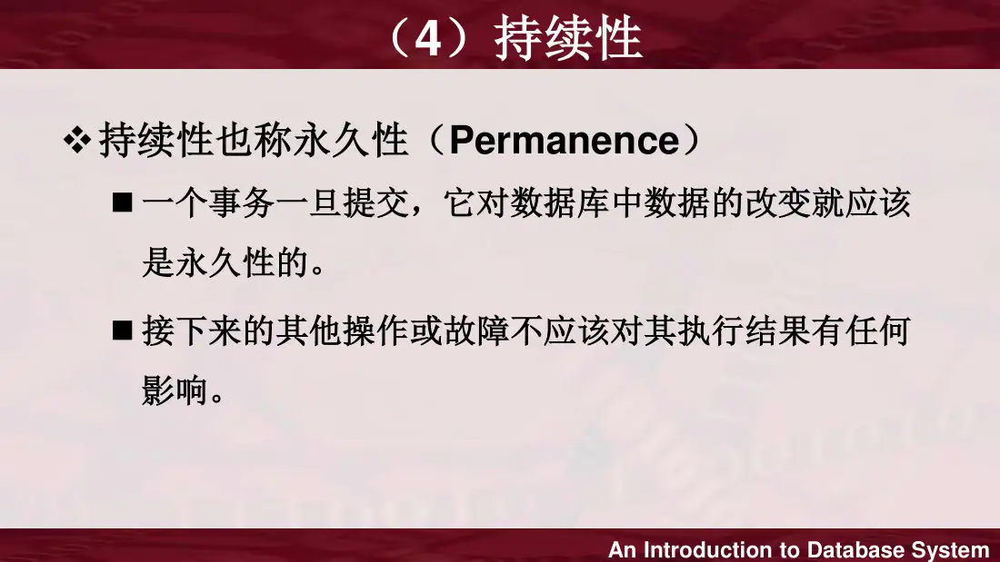

原文：

(4) 持续性

❖持续性也称永久性（Permanence）

■一个事务一旦提交，它对数据库中数据的改变就应该是永久性的。

■接下来的其他操作或故障不应该对其执行结果有任何影响。

An Introduction to Database System

### 事务的特性

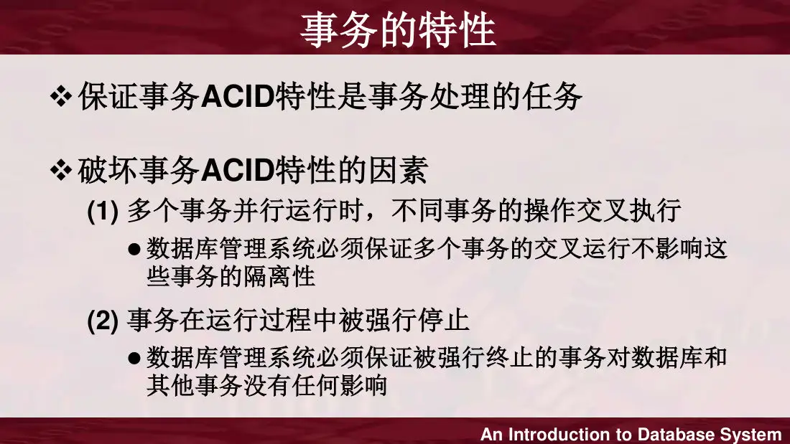

原文：

事务的特性

保证事务ACID特性是事务处理的任务

◆ 破坏事务ACID特性的因素

(1) 多个事务并行运行时，不同事务的操作交叉执行

\- 数据库管理系统必须保证多个事务的交叉运行不影响这些事务的隔离性

(2) 事务在运行过程中被强行停止

\- 数据库管理系统必须保证被强行终止的事务对数据库和其他事务没有任何影响

An Introduction to Database System

### 第11章 数据库恢复技术

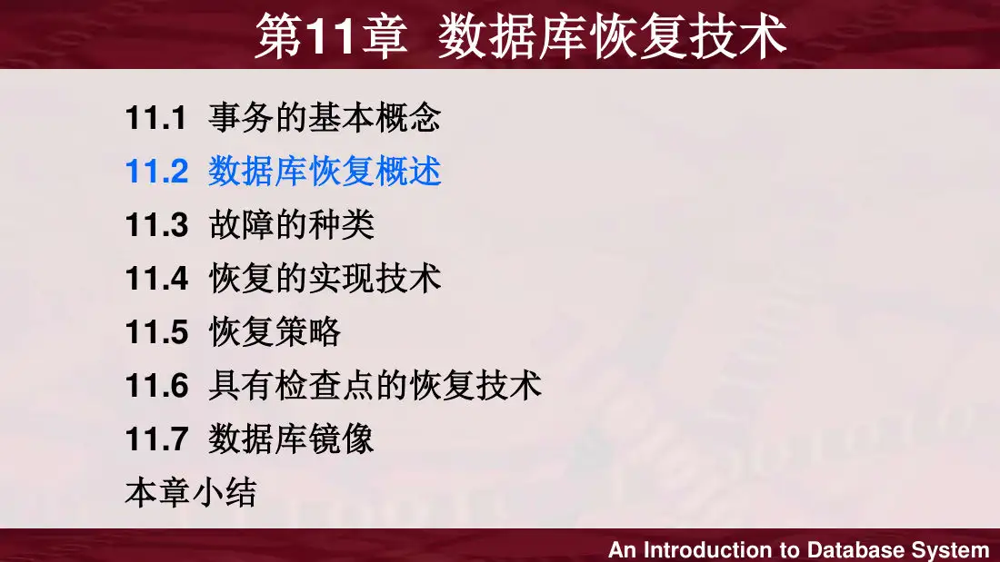

原文：

第11章 数据库恢复技术

11.1 事务的基本概念
11.2 数据库恢复概述
11.3 故障的种类
11.4 恢复的实现技术
11.5 恢复策略
11.6 具有检查点的恢复技术
11.7 数据库镜像
本章小结

An Introduction to Database System

### 11.2 数据库恢复概述

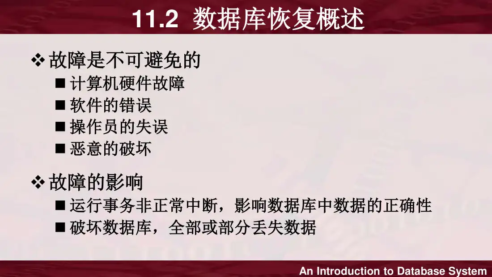

原文：

11.2 数据库恢复概述

◆故障是不可避免的

■ 计算机硬件故障

■ 软件的错误

■操作员的失误

■ 恶意的破坏

◆故障的影响

■ 运行事务非正常中断，影响数据库中数据的正确性

■ 破坏数据库，全部或部分丢失数据

An Introduction to Database System

### 数据库恢复概述（续）

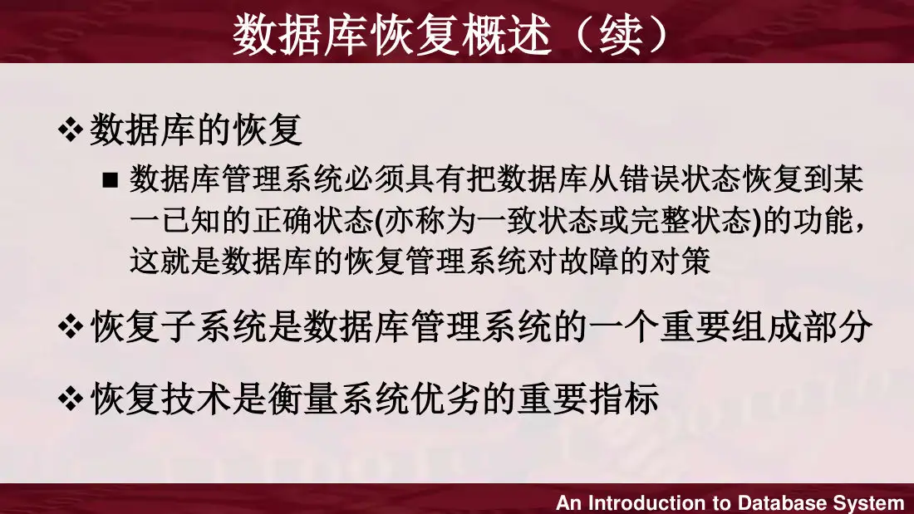

原文：

数据库恢复概述（续）

数据库的恢复

■ 数据库管理系统必须具有把数据库从错误状态恢复到某一已知的正确状态(亦称为一致状态或完整状态)的功能,这就是数据库的恢复管理系统对故障的对策

❖ 恢复子系统是数据库管理系统的一个重要组成部分

❖ 恢复技术是衡量系统优劣的重要指标

An Introduction to Database System

### 11.1 事务的基本概念

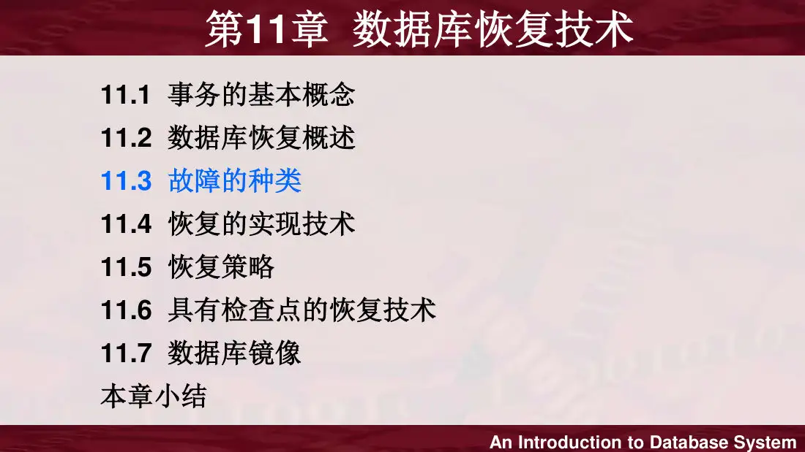

原文：

11.1 事务的基本概念
11.2 数据库恢复概述
11.3 故障的种类
11.4 恢复的实现技术
11.5 恢复策略
11.6 具有检查点的恢复技术
11.7 数据库镜像
本章小结

第11章 数据库恢复技术

An Introduction to Database System

### 故障的种类

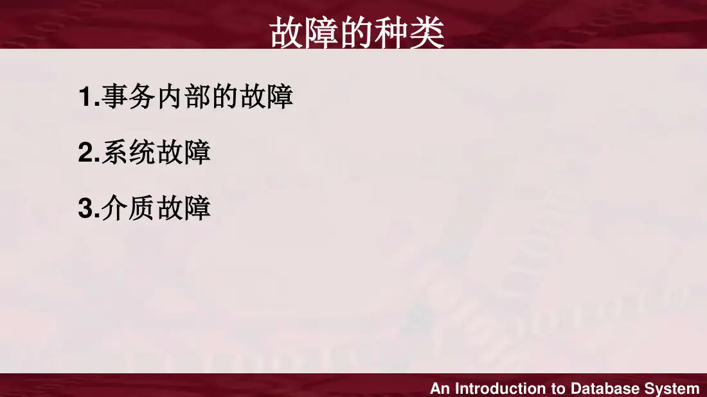

原文：

故障的种类

1.事务内部的故障

2.系统故障

3.介质故障

An Introduction to Database System

### 1.事务内部的故障

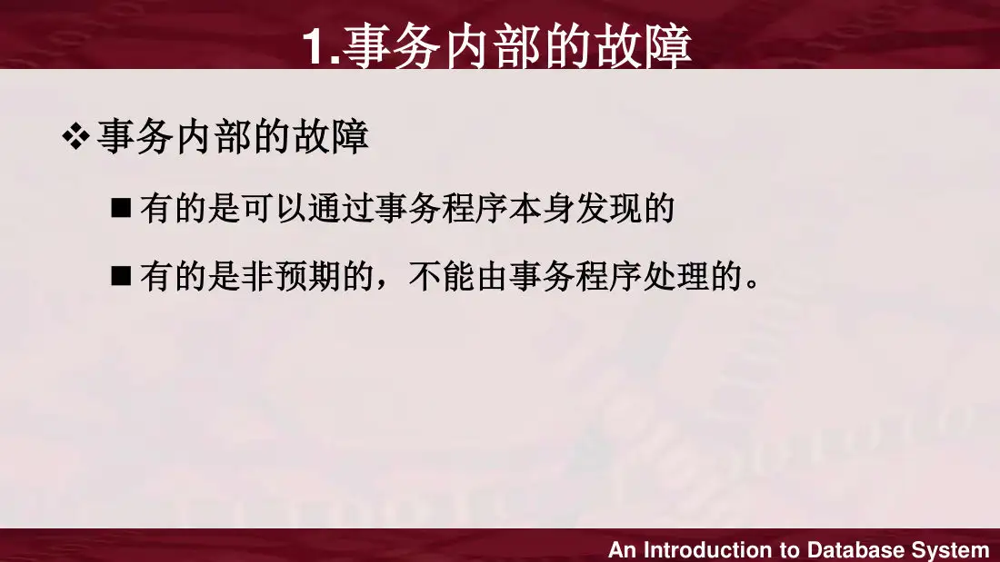

原文：

1.事务内部的故障

事务内部的故障

■ 有的是可以通过事务程序本身发现的

■有的是非预期的，不能由事务程序处理的。

An Introduction to Database System

### 通过事务程序本身发现的事务故障

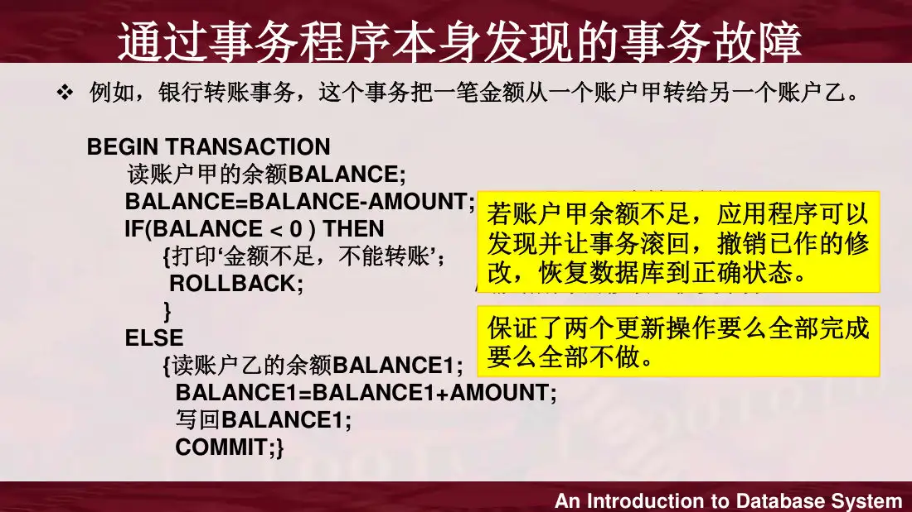

原文：

通过事务程序本身发现的事务故障

例如，银行转账事务，这个事务把一笔金额从一个账户甲转给另一个账户乙。

BEGIN TRANSACTION

若账户甲余额不足，应用程序可以发现并让事务滚回，撤销已作的修改，恢复数据库到正确状态。

ELSE

{读账户乙的余额BALANCE1;

保证了两个更新操作要么全部完成要么全部不做。

An Introduction to Database System

### 非预期的事务故障

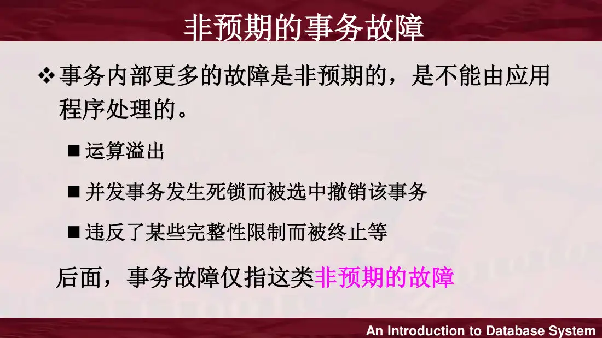

原文：

非预期的事务故障

事务内部更多的故障是非预期的，是不能由应用程序处理的。

■运算溢出

■ 并发事务发生死锁而被选中撤销该事务

■ 违反了某些完整性限制而被终止等

后面，事务故障仅指这类非预期的故障

An Introduction to Database System

### 事务内部故障的恢复

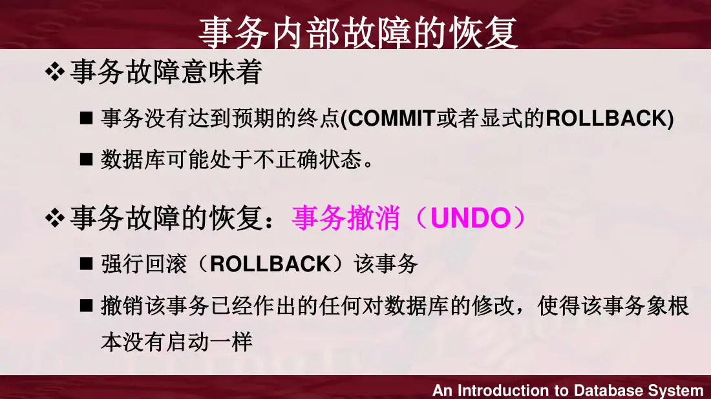

原文：

事务内部故障的恢复

事务故障意味着

■ 事务没有达到预期的终点(COMMIT或者显式的ROLLBACK)

■ 数据库可能处于不正确状态。

事务故障的恢复：事务撤消（UNDO）

■ 强行回滚（ROLLBACK）该事务

■ 撤销该事务已经作出的任何对数据库的修改，使得该事务象根本没有启动一样

An Introduction to Database System

### 2.系统故障

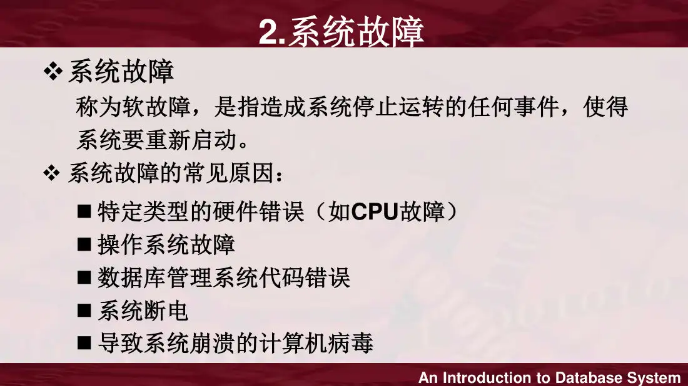

原文：

2.系统故障

系统故障

称为软故障，是指造成系统停止运转的任何事件，使得系统要重新启动。

系统故障的常见原因：

■ 特定类型的硬件错误（如CPU故障）

■ 操作系统故障

■ 数据库管理系统代码错误

■ 系统断电

■ 导致系统崩溃的计算机病毒

An Introduction to Database System

### 系统故障（续）

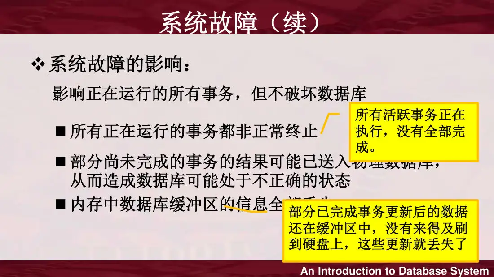

原文：

系统故障（续）

系统故障的影响:

影响正在运行的所有事务，但不破坏数据库

■ 所有正在运行的事务都非正常终止

所有活跃事务正在执行，没有全部完成。

■ 部分尚未完成的事务的结果可能已送入物理数据库，从而造成数据库可能处于不正确的状态

■内存中数据库缓冲区的信息全部分已完成事务更新后的数据还在缓冲区中，没有来得及刷到硬盘上，这些更新就丢失了

An Introduction to Database System

### 系统故障的恢复

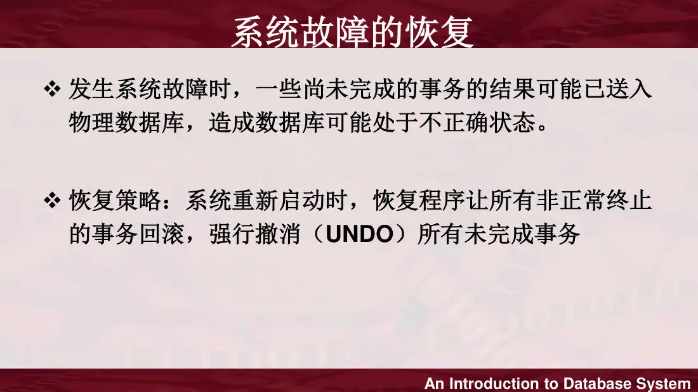

原文：

系统故障的恢复

✿ 发生系统故障时，一些尚未完成的事务的结果可能已送入物理数据库，造成数据库可能处于不正确状态。

❖ 恢复策略：系统重新启动时，恢复程序让所有非正常终止的事务回滚，强行撤消（UNDO）所有未完成事务

An Introduction to Database System

### 系统故障的恢复

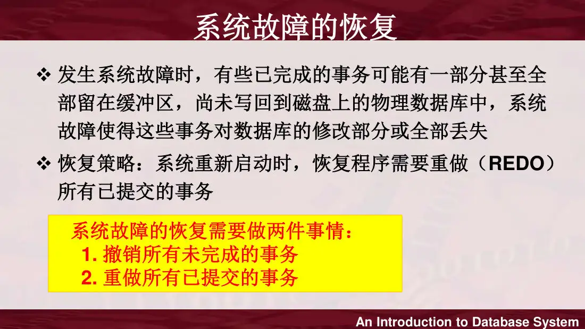

原文：

系统故障的恢复

✿ 发生系统故障时，有些已完成的事务可能有一部分甚至全部留在缓冲区，尚未写回到磁盘上的物理数据库中，系统故障使得这些事务对数据库的修改部分或全部丢失

❖ 恢复策略：系统重新启动时，恢复程序需要重做（REDO）所有已提交的事务

系统故障的恢复需要做两件事情：

1. 撤销所有未完成的事务

2. 重做所有已提交的事务

An Introduction to Database System

### 3.介质故障

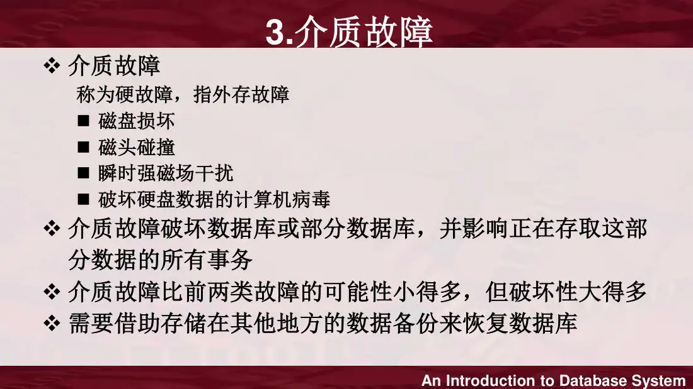

原文：

3.介质故障

介质故障

称为硬故障，指外存故障

■ 磁盘损坏

■ 磁头碰撞

■ 瞬时强磁场干扰

■ 破坏硬盘数据的计算机病毒

介质故障破坏数据库或部分数据库，并影响正在存取这部分数据的所有事务

介质故障比前两类故障的可能性小得多，但破坏性大得多

◆ 需要借助存储在其他地方的数据备份来恢复数据库

An Introduction to Database System

### 故障小结

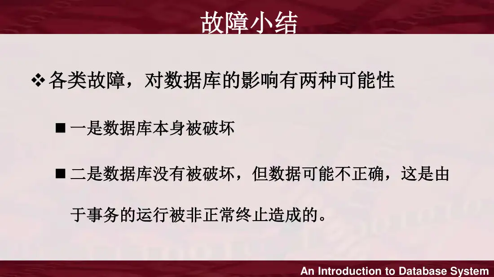

原文：

故障小结

✿ 各类故障，对数据库的影响有两种可能性

■ 一是数据库本身被破坏

■ 二是数据库没有被破坏，但数据可能不正确，这是由

于事务的运行被非正常终止造成的。

An Introduction to Database System

### 恢复

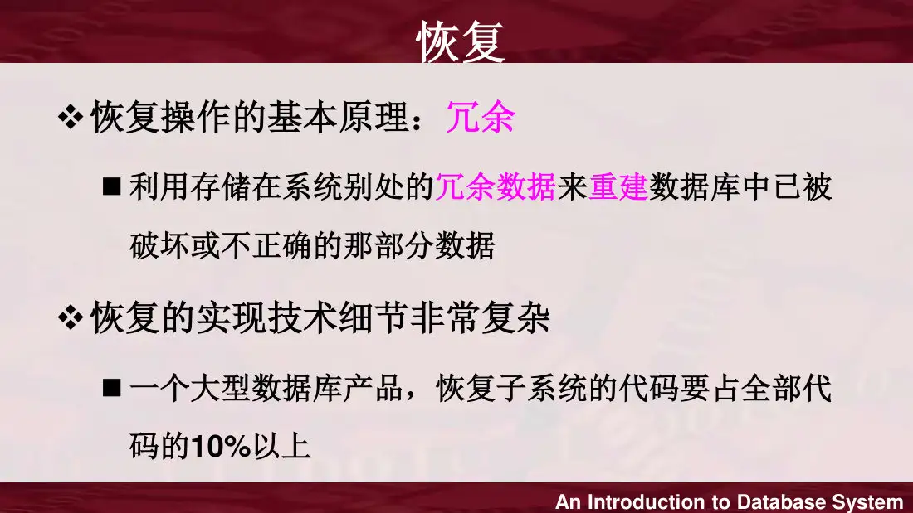

原文：

恢复

❖ 恢复操作的基本原理：冗余

■ 利用存储在系统别处的冗余数据来重建数据库中已被破坏或不正确的那部分数据

❖ 恢复的实现技术细节非常复杂

■一个大型数据库产品，恢复子系统的代码要占全部代码的10%以上

An Introduction to Database System

### 第11章 数据库恢复技术

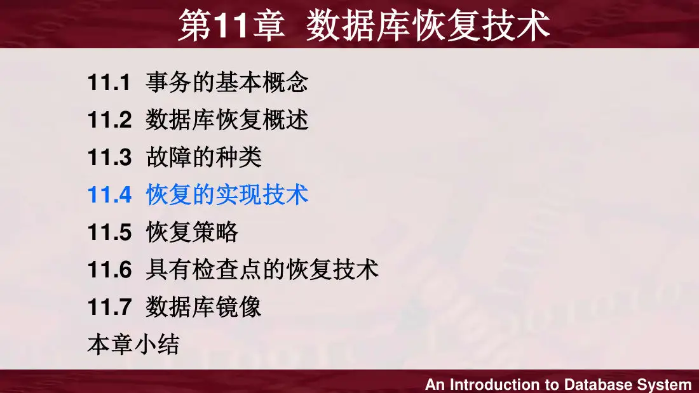

原文：

第11章 数据库恢复技术

11.1 事务的基本概念
11.2 数据库恢复概述
11.3 故障的种类
11.4 恢复的实现技术
11.5 恢复策略
11.6 具有检查点的恢复技术
11.7 数据库镜像
本章小结

An Introduction to Database System

### 11.4 恢复的实现技术

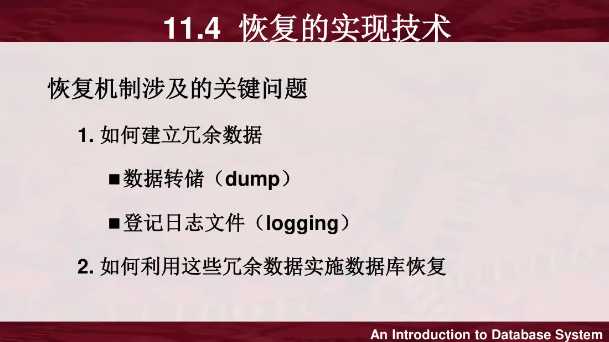

原文：

11.4 恢复的实现技术

恢复机制涉及的关键问题

1. 如何建立冗余数据

■数据转储（dump）

■登记日志文件（logging）

2. 如何利用这些冗余数据实施数据库恢复

An Introduction to Database System

### 11.4.1 数据转储

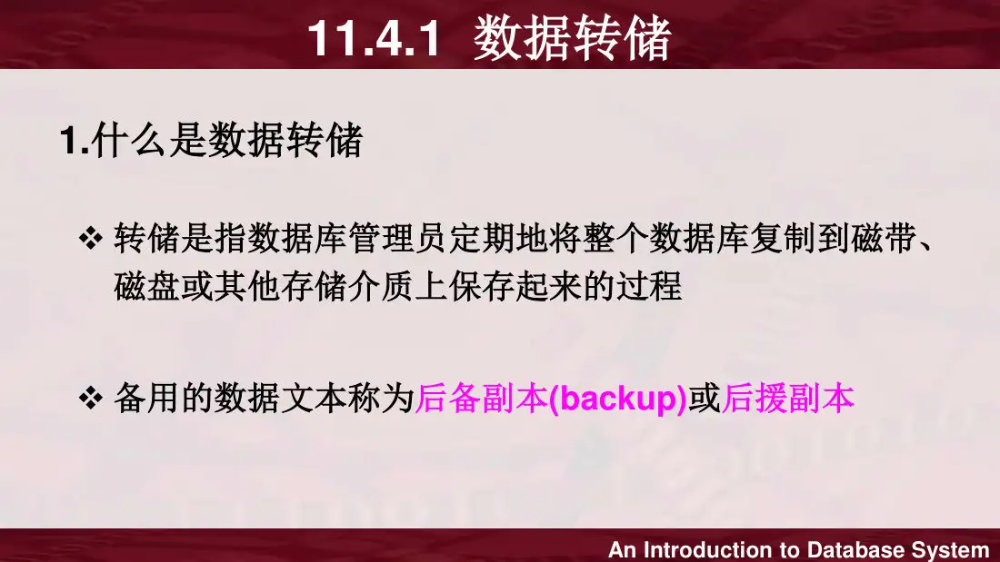

原文：

11.4.1 数据转储

1. 什么是数据转储

✿ 转储是指数据库管理员定期地将整个数据库复制到磁带、磁盘或其他存储介质上保存起来的过程

◆ 备用的数据文本称为后备副本(backup)或后援副本

An Introduction to Database System

### 数据转储（续）

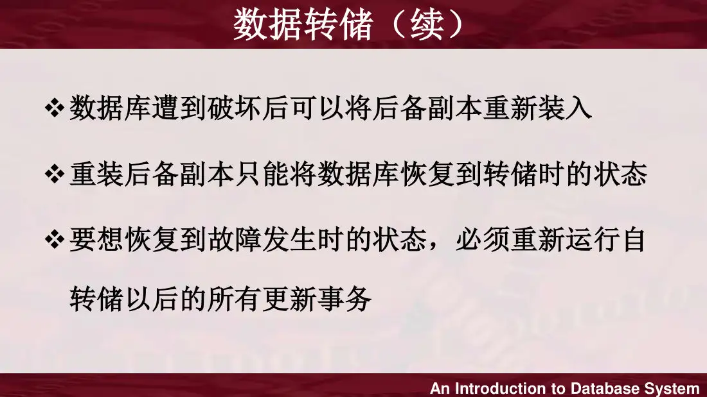

原文：

数据转储（续）

数据库遭到破坏后可以将后备副本重新装入

✿ 重装后备副本只能将数据库恢复到转储时的状态

要想恢复到故障发生时的状态，必须重新运行自转储以后的所有更新事务

An Introduction to Database System

### 数据转储（续）

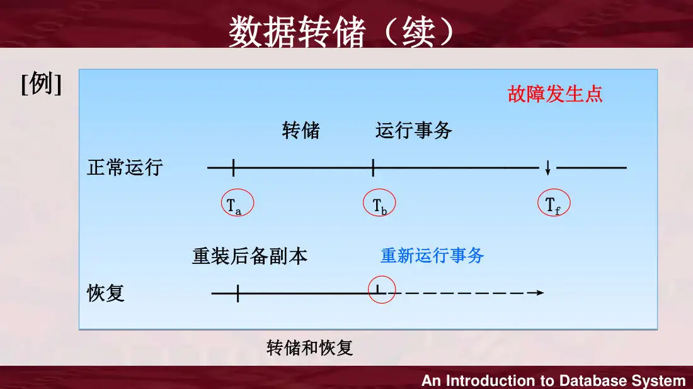

原文：

数据转储（续）

[例]

故障发生点

An Introduction to Database System

### 2.转储方法

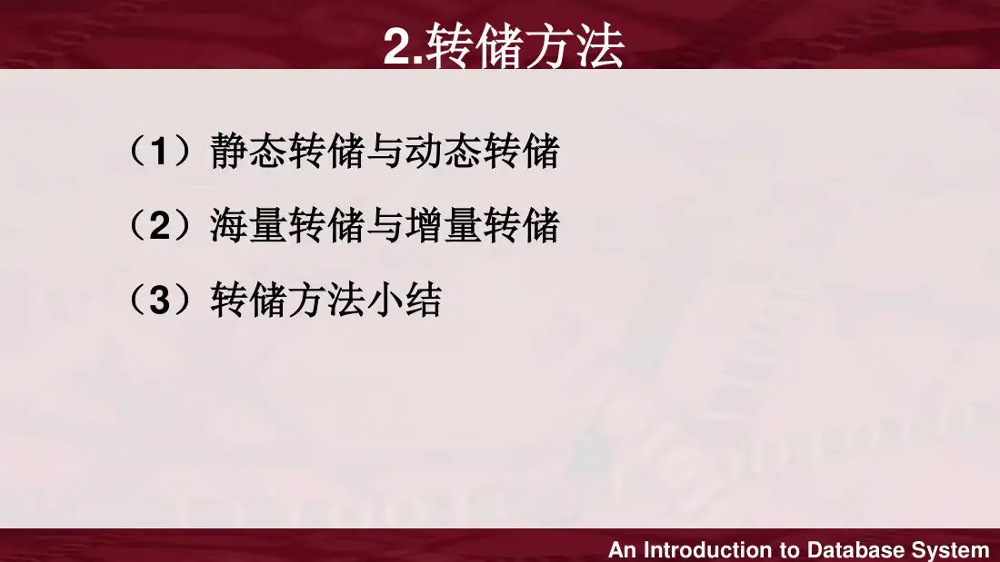

原文：

2.转储方法

(1) 静态转储与动态转储

(2) 海量转储与增量转储

(3) 转储方法小结

An Introduction to Database System

### (1) 静态转储与动态转储

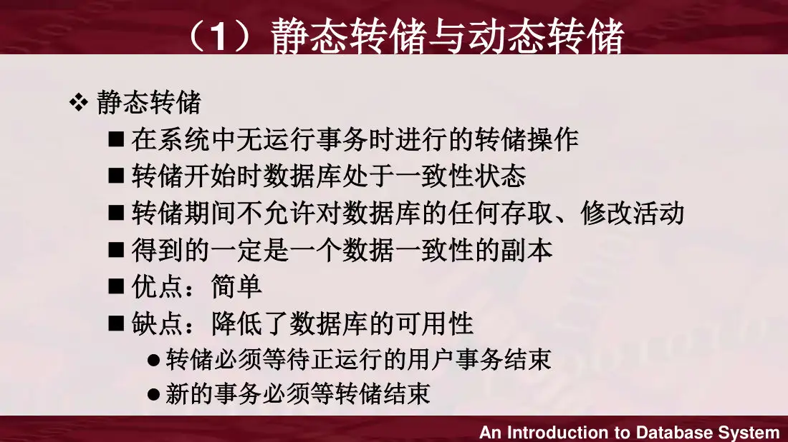

原文：

(1) 静态转储与动态转储

静态转储

■ 在系统中无运行事务时进行的转储操作

■转储开始时数据库处于一致性状态

■转储期间不允许对数据库的任何存取、修改活动

■得到的一定是一个数据一致性的副本

■优点：简单

■ 缺点：降低了数据库的可用性

● 转储必须等待正运行的用户事务结束

\- 新的事务必须等转储结束

An Introduction to Database System

### 静态转储与动态转储（续）

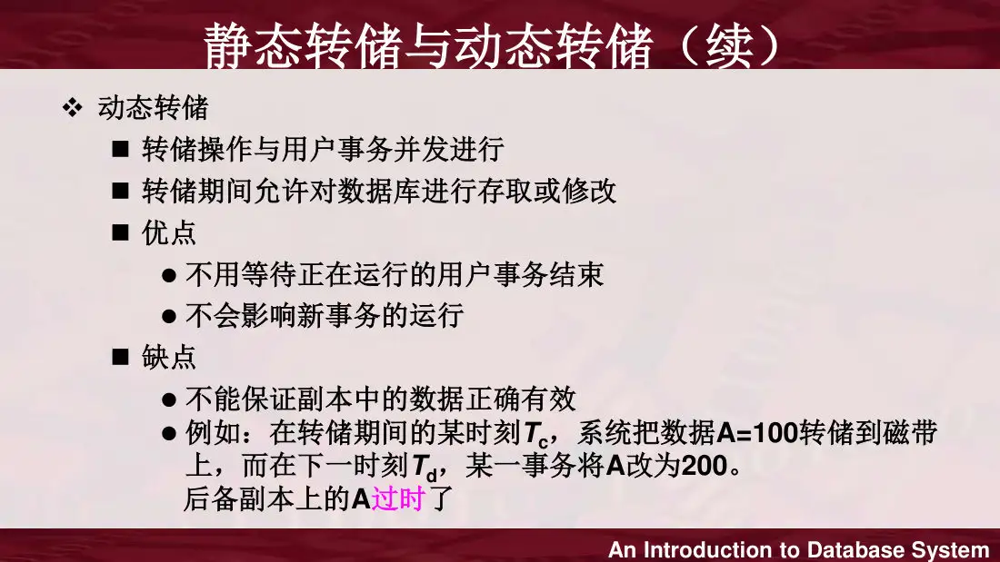

原文：

静态转储与动态转储（续）

动态转储

■ 转储操作与用户事务并发进行

■ 转储期间允许对数据库进行存取或修改

■ 优点

\- 不用等待正在运行的用户事务结束

\- 不会影响新事务的运行

■ 缺点

\- 不能保证副本中的数据正确有效

● 例如：在转储期间的某时刻 $T_{c}$ ，系统把数据A=100转储到磁带上，而在下一时刻 $T_{d}$ ，某一事务将A改为200。后备副本上的A过时了

An Introduction to Database System

### 静态转储与动态转储（续）

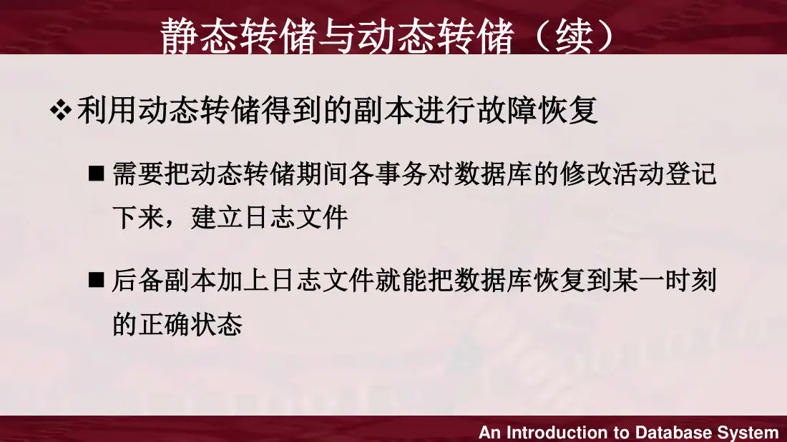

原文：

静态转储与动态转储（续）

◆ 利用动态转储得到的副本进行故障恢复

■ 需要把动态转储期间各事务对数据库的修改活动登记下来，建立日志文件

■ 后备副本加上日志文件就能把数据库恢复到某一时刻的正确状态

An Introduction to Database System

### (2) 海量转储与增量转储

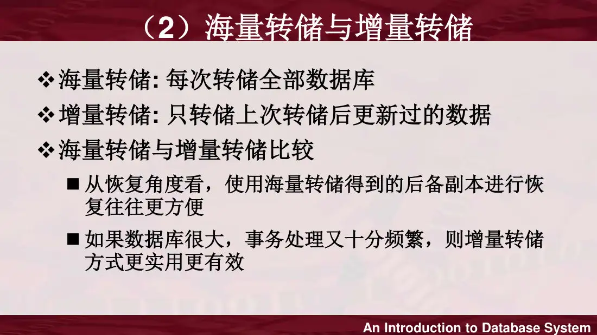

原文：

(2) 海量转储与增量转储

✿海量转储: 每次转储全部数据库

✿增量转储: 只转储上次转储后更新过的数据

✿海量转储与增量转储比较

■从恢复角度看，使用海量转储得到的后备副本进行恢复往往更方便

■ 如果数据库很大，事务处理又十分频繁，则增量转储方式更实用更有效

An Introduction to Database System

### (3) 转储方法小结

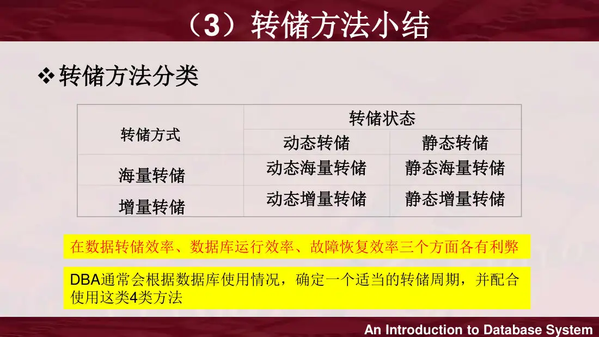

原文：

(3) 转储方法小结

转储方法分类

<table><tr><td rowspan="2">转储方式</td><td colspan="2">转储状态</td></tr><tr><td>动态转储</td><td>静态转储</td></tr><tr><td>海量转储</td><td>动态海量转储</td><td>静态海量转储</td></tr><tr><td>增量转储</td><td>动态增量转储</td><td>静态增量转储</td></tr></table>

在数据转储效率、数据库运行效率、故障恢复效率三个方面各有利弊

DBA通常会根据数据库使用情况，确定一个适当的转储周期，并配合使用这类4类方法

An Introduction to Database System

### 11.4.2 登记日志文件

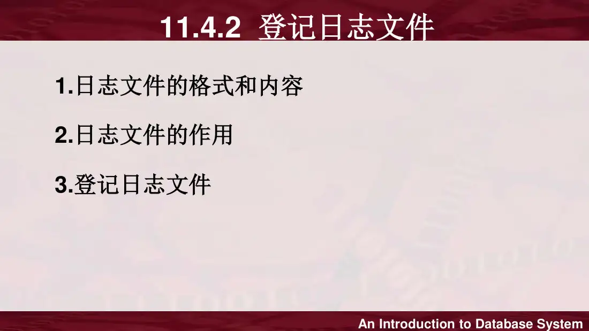

原文：

11.4.2 登记日志文件

1. 日志文件的格式和内容

2. 日志文件的作用

3. 登记日志文件

An Introduction to Database System

### 1. 日志文件的格式和内容

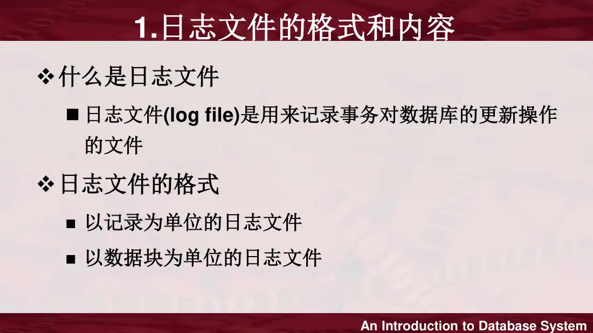

原文：

1. 日志文件的格式和内容

什么是日志文件

■ 日志文件(log file)是用来记录事务对数据库的更新操作的文件

✿ 日志文件的格式

■ 以记录为单位的日志文件

■ 以数据块为单位的日志文件

An Introduction to Database System

### 日志文件的格式和内容（续）

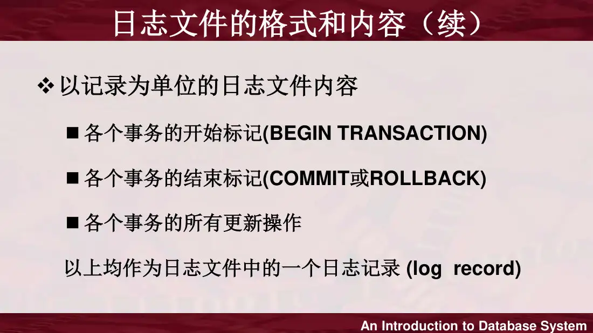

原文：

日志文件的格式和内容（续）

以记录为单位的日志文件内容

■ 各个事务的开始标记(BEGIN TRANSACTION)

■ 各个事务的结束标记(COMMIT或ROLLBACK)

■ 各个事务的所有更新操作

以上均作为日志文件中的一个日志记录 (log record)

An Introduction to Database System

### 日志文件的格式和内容（续）

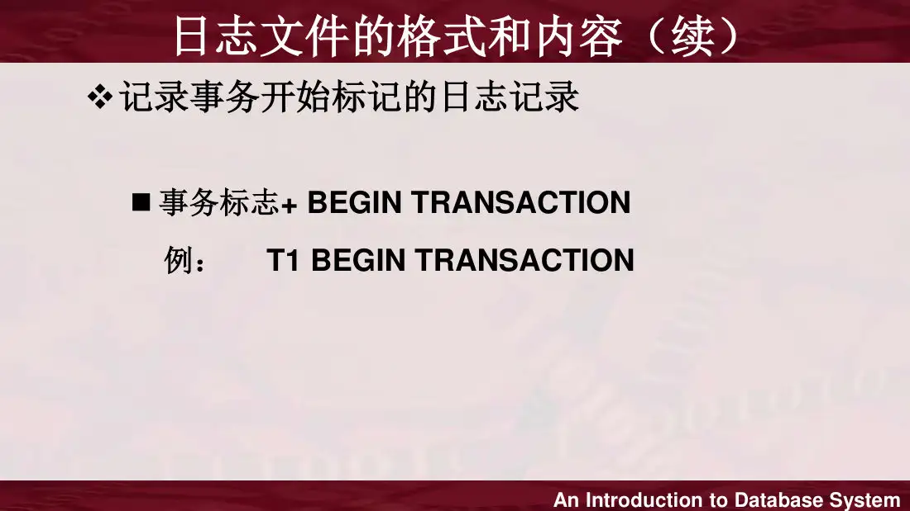

原文：

日志文件的格式和内容（续）

◆ 记录事务开始标记的日志记录

■ 事务标志+ BEGIN TRANSACTION

例: T1 BEGIN TRANSACTION

An Introduction to Database System

### 日志文件的格式和内容（续）

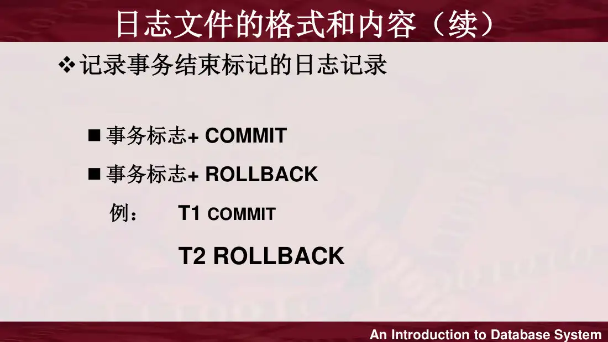

原文：

日志文件的格式和内容（续）

◆ 记录事务结束标记的日志记录

■ 事务标志+ COMMIT

■ 事务标志+ ROLLBACK

例: T1 COMMIT

T2 ROLLBACK

An Introduction to Database System

### 日志文件的格式和内容（续）

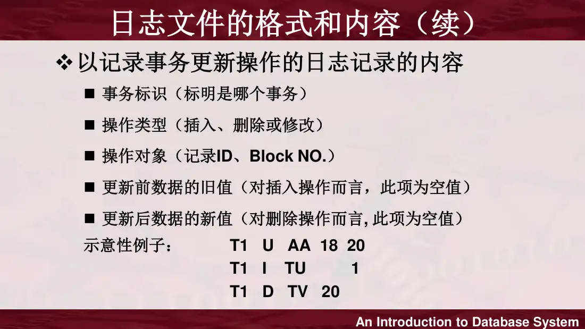

原文：

日志文件的格式和内容（续）

以记录事务更新操作的日志记录的内容

■ 事务标识（标明是哪个事务）

■ 操作类型（插入、删除或修改）

■ 操作对象（记录ID、Block NO.）

■ 更新前数据的旧值（对插入操作而言，此项为空值）

■ 更新后数据的新值（对删除操作而言，此项为空值）

示意性例子:

T1 U AA 18 20
T1 I TU 1
T1 D TV 20

An Introduction to Database System

### 日志文件的格式和内容（续）

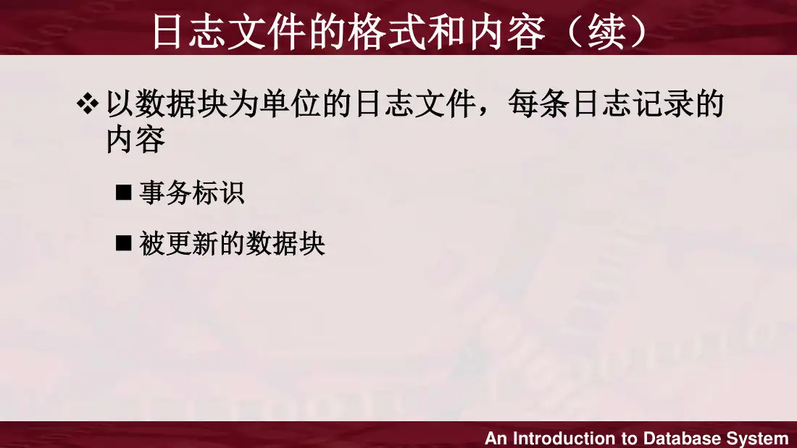

原文：

日志文件的格式和内容（续）

✿ 以数据块为单位的日志文件，每条日志记录的内容

■事务标识

■ 被更新的数据块

An Introduction to Database System

### 2. 日志文件的作用

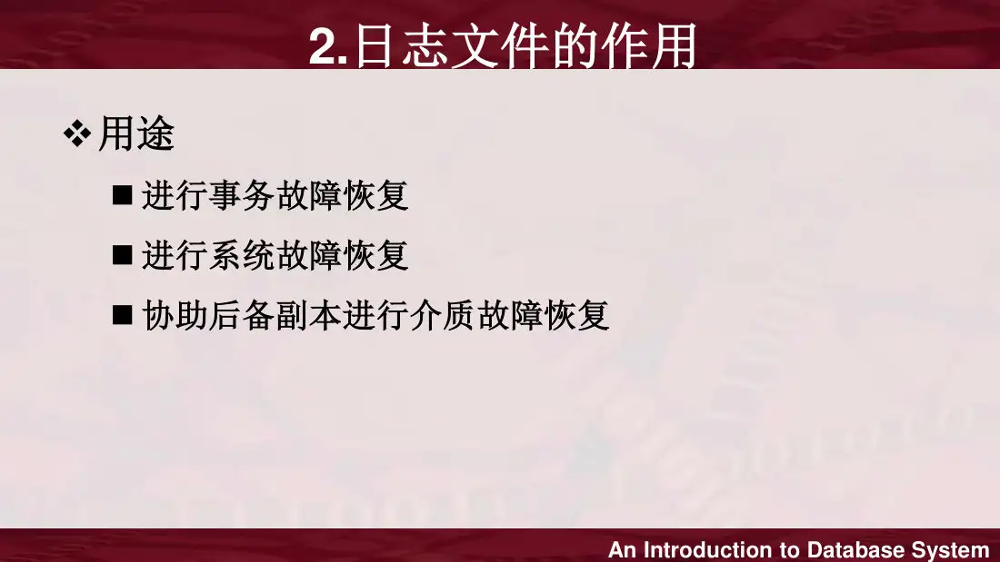

原文：

2. 日志文件的作用

用途

■ 进行事务故障恢复

■ 进行系统故障恢复

■协助后备副本进行介质故障恢复

An Introduction to Database System

### 日志文件的作用（续）

原文：

日志文件的作用（续）

具体作用

■ 事务故障恢复和系统故障恢复必须用日志文件。

■ 在动态转储方式中必须建立日志文件，后备副本和日志文件结合起来才能有效地恢复数据库。

■ 在静态转储方式中，也可以建立日志文件。

\- 故障恢复时重新装入后援副本把数据库恢复到转储时刻的正确状态

\- 利用日志文件，重做已完成事务

\- 对故障发生时尚未完成的事务进行撤销处理

An Introduction to Database System

### 日志文件的作用（续）

原文：

日志文件的作用（续）

An Introduction to Database System

### 3. 登记日志文件

原文：

3. 登记日志文件

✿ 为保证数据库是可恢复的，登记日志文件时必须遵循两条原则

■ 登记的次序严格按并发事务执行的时间次序

■ 必须先写日志文件，后写数据库

\- 写日志文件操作：把表示这个修改的日志记录写到日志文件中

\- 写数据库操作：把对数据的修改写到数据库中

An Introduction to Database System

### 登记日志文件（续）

原文：

登记日志文件（续）

为什么要先写日志文件

■ 写数据库和写日志文件是两个不同的操作

■ 在这两个操作之间可能发生故障

■ 如果先写了数据库修改，而在日志文件中没有登记下这个修改，则以后就无法恢复这个修改了

■ 如果先写日志，但没有修改数据库，按日志文件恢复时只不过是多执行一次不必要的UNDO操作，并不会影响数据库的正确性

An Introduction to Database System

### 第11章 数据库恢复技术

原文：

第11章 数据库恢复技术

11.1 事务的基本概念
11.2 数据库恢复概述
11.3 故障的种类
11.4 恢复的实现技术
11.5 恢复策略
11.6 具有检查点的恢复技术
11.7 数据库镜像
本章小结

An Introduction to Database System

### 11.5 恢复策略

原文：

11.5 恢复策略

1 事务故障的恢复

2 系统故障的恢复

3 介质故障的恢复

An Introduction to Database System

### 1. 事务故障的恢复

原文：

1. 事务故障的恢复

事务故障：事务在运行至正常终止点前被终止

恢复方法

■ 由恢复子系统利用日志文件撤消（UNDO）此事务已对数据库进行的修改

✿ 事务故障的恢复由系统自动完成，对用户是透明的，不需要用户干预

An Introduction to Database System

### 事务故障的恢复步骤

原文：

事务故障的恢复步骤

(1) 反向扫描文件日志（即从最后向前扫描日志文件），查找该事务的更新操作。

(2) 对该事务的更新操作执行逆操作。即将日志记录中“更新前的值”写入数据库。

■ 插入操作，“更新前的值”为空，则相当于做删除操作

■ 删除操作，则相当于做插入操作

■ 若是修改操作，则相当于用修改前值代替修改后值

(3) 继续反向扫描日志文件，查找该事务的其他更新操作，并做同样处理。

(4) 如此处理下去, 直至读到此事务的开始标记, 事务故障恢复就完成了。

An Introduction to Database System

### 2. 系统故障的恢复

原文：

2. 系统故障的恢复

系统故障造成数据库不一致状态的原因

■ 未完成事务对数据库的更新可能已写入数据库

■ 已提交事务对数据库的更新可能还留在缓冲区没来得及写入数据库

恢复方法

1. Undo 故障发生时未完成的事务

2. Redo 已完成的事务

系统故障的恢复由系统在重新启动时自动完成，不需要用户干预

An Introduction to Database System

### 系统故障的恢复步骤

原文：

系统故障的恢复步骤

(1) 正向扫描日志文件（即从头扫描日志文件）

■ 重做(REDO) 队列: 在故障发生前已经提交的事务
- 这些事务既有BEGIN TRANSACTION记录，也有 COMMIT记录

■ 撤销 (UNDO)队列:故障发生时尚未完成的事务

\- 这些事务只有BEGIN TRANSACTION记录，无相应的COMMIT记录

An Introduction to Database System

### 系统故障的恢复步骤（续）

原文：

系统故障的恢复步骤（续）

(2) 对撤销(UNDO)队列事务进行撤销(UNDO)处理

■ 反向扫描日志文件，对每个撤销事务的更新操作执行逆操作

■即将日志记录中“更新前的值”写入数据库

(3) 对重做(REDO)队列事务进行重做(REDO)处理

■ 正向扫描日志文件，对每个重做事务重新执行登记的操作

■ 即将日志记录中“更新后的值”写入数据库

An Introduction to Database System

### 3. 介质故障的恢复

原文：

3. 介质故障的恢复

1. 重装数据库

2.重做已完成的事务

An Introduction to Database System

### 介质故障的恢复（续）

原文：

介质故障的恢复（续）

恢复步骤

(1) 装入最新的后备数据库副本(离故障发生时刻最近的转储副本)，使数据库恢复到最近一次转储时的一致性状态。

■ 对于静态转储的数据库副本，装入后数据库即处于一致性状态

■ 对于动态转储的数据库副本，还须同时装入转储时刻的日志文件副本，利用恢复系统故障的方法（即REDO+UNDO），才能将数据库恢复到一致性状态。

An Introduction to Database System

### 介质故障的恢复（续）

原文：

介质故障的恢复（续）

(2) 装入有关的日志文件副本(转储结束时刻的日志文件副本)，重做已完成的事务。

■ 首先扫描日志文件，找出故障发生时已提交的事务的标识，将其记入重做队列。

■ 然后正向扫描日志文件，对重做队列中的所有事务进行重做处理。即将日志记录中“更新后的值”写入数据库。

An Introduction to Database System

### 介质故障的恢复（续）

原文：

介质故障的恢复（续）

介质故障的恢复需要数据库管理员介入

数据库管理员的工作

■ 重装最近转储的数据库副本和有关的各日志文件副本

■执行系统提供的恢复命令

具体的恢复操作仍由数据库管理系统完成

An Introduction to Database System

### 第11章 数据库恢复技术

原文：

第11章 数据库恢复技术

11.1 事务的基本概念
11.2 数据库恢复概述
11.3 故障的种类
11.4 恢复的实现技术
11.5 恢复策略
11.6 具有检查点的恢复技术
11.7 数据库镜像
本章小结

An Introduction to Database System

### 11.6 具有检查点的恢复技术

原文：

11.6 具有检查点的恢复技术

1. 检查点记录

2.重新开始文件

3.动态维护日志文件

4. 恢复子系统的恢复策略

An Introduction to Database System

### 问题的提出

原文：

问题的提出

◆ 两个问题

■搜索整个日志将耗费大量的时间

■ 重做处理：重新执行，浪费了大量时间

An Introduction to Database System

### 解决方案

原文：

解决方案

具有检查点（checkpoint）的恢复技术

■ 在日志文件中增加检查点记录（checkpoint）

■ 增加重新开始文件

■ 恢复子系统在登录日志文件期间动态地维护日志

An Introduction to Database System

### 1. 检查点记录

原文：

1. 检查点记录

✿ 检查点记录的内容

■ 建立检查点时刻所有正在执行的事务清单

■这些事务最近一个日志记录的地址

重新开始文件的内容

■ 记录各个检查点记录在日志文件中的地址

An Introduction to Database System

### 2.重新开始文件

原文：

2.重新开始文件

重新开始文件的内容

■ 记录各个检查点记录在日志文件中的地址

An Introduction to Database System

### 3. 动态维护日志文件

原文：

3. 动态维护日志文件

动态维护日志文件的方法

周期性地执行如下操作：建立检查点，保存数据库状态。

具体步骤是:

(1) 将当前日志缓冲区中的所有日志记录写入磁盘的日志文件上

(2) 在日志文件中写入一个检查点记录

(3) 将当前数据缓冲区的所有数据记录写入磁盘的数据库中

(4) 把检查点记录在日志文件中的地址写入一个重新开始文件

An Introduction to Database System

### 4. 恢复子系统的恢复策略

原文：

4. 恢复子系统的恢复策略

❖ 恢复子系统可以定期或不定期地建立检查点,保存数据库状态

■ 定期

\- 按照预定的一个时间间隔，如每隔一小时建立一个检查点

■ 不定期

\- 按照某种规则，如日志文件已写满一半建立一个检查点

An Introduction to Database System

### 恢复子系统的恢复策略（续）

原文：

恢复子系统的恢复策略（续）

◆ 使用检查点方法可以改善恢复效率

■ 当事务T在一个检查点之前提交

\- T对数据库所做的修改已写入数据库

\- 写入时间是在这个检查点建立之前或在这个检查点建立之时

\- 在进行恢复处理时，没有必要对事务T执行重做操作

■ 当事务T在检查点时还没有完成

\- T对数据库所做的修改已写入数据库

\- 在进行恢复处理时，如果需要重做T，重做的起始点是检查点。

An Introduction to Database System

### 利用检查点的恢复策略（续）

原文：

利用检查点的恢复策略（续）

系统出现故障时，恢复子系统将根据事务的不同状态采取不同的恢复策略

An Introduction to Database System

### 利用检查点的恢复策略（续）

原文：

利用检查点的恢复策略（续）

(1) 从重新开始文件中找到最后一个检查点记录在日志文件中的地址，由该地址在日志文件中找到最后一个检查点记录

(2) 由该检查点记录得到检查点建立时刻所有正在执行的事务清单ACTIVE-LIST

■ 建立两个事务队列

\- UNDO-LIST

\- REDO-LIST

■ 把ACTIVE-LIST暂时放入UNDO-LIST队列，REDO队列暂为空。

An Introduction to Database System

### 利用检查点的恢复策略（续）

原文：

利用检查点的恢复策略（续）

(3) 从检查点开始正向扫描日志文件, 直到日志文件结束

■ 如有新开始的事务 $T_{i}$ ，把 $T_{i}$ 暂时放入 UNDO-LIST 队列

■ 如有提交的事务 $T_{j}$ ，把 $T_{j}$ 从 UNDO-LIST 队列移到 REDO-LIST 队列；直到日志文件结束

(4) 对UNDO-LIST中的每个事务执行UNDO操作
对REDO-LIST中的每个事务执行REDO操作，REDO操作的起始点可以是 $T_{c}$ 时刻

An Introduction to Database System

### 11.1 事务的基本概念

原文：

11.1 事务的基本概念
11.2 数据库恢复概述
11.3 故障的种类
11.4 恢复的实现技术
11.5 恢复策略
11.6 具有检查点的恢复技术
11.7 数据库镜像
本章小结

第11章 数据库恢复技术

An Introduction to Database System

### 11.7 数据库镜像

原文：

11.7 数据库镜像

介质故障是对系统影响最为严重的一种故障，严重影响数据库的可用性

■ 介质故障恢复比较费时

■为预防介质故障，数据库管理员必须周期性地转储数据库

◆ 提高数据库可用性的解决方案

■ 数据库镜像（Mirror）

An Introduction to Database System

### 数据库镜像（续）

原文：

数据库镜像（续）

数据库镜像

■ 数据库管理系统自动把整个数据库或其中的关键数据复制到另一个磁盘上

■ 数据库管理系统自动保证镜像数据与主数据的一致性每当主数据库更新时，数据库管理系统自动把更新后的数据复制过去

An Introduction to Database System

### 数据库镜像的用途

原文：

数据库镜像的用途

出现介质故障时

■ 可由镜像磁盘继续提供使用

■ 同时数据库管理系统自动利用镜像磁盘数据进行数据库的恢复

■ 不需要关闭系统和重装数据库副本

An Introduction to Database System

### 数据库镜像（续）

原文：

数据库镜像（续）

没有出现故障时

■ 可用于并发操作

■ 一个用户对数据加排他锁修改数据，其他用户可以读镜像数据库上的数据，而不必等待该用户释放锁

An Introduction to Database System

### 数据库镜像（续）

原文：

数据库镜像（续）

◆频繁地复制数据自然会降低系统运行效率

✿ 在实际应用中用户往往只选择对关键数据和日志文件镜像。而不是对整个数据库进行镜像

An Introduction to Database System

### 本章小结

原文：

本章小结

事务的概念和性质

■事务是数据库的逻辑工作单位

■数据库管理系统保证系统中一切事务的原子性、一致性、隔离性和持续性，就保证了数据库处于一致状态

An Introduction to Database System

### 本章小结（续）

原文：

本章小结（续）

✿ 故障的种类
■ 事务故障
■ 系统故障
■ 介质故障

An Introduction to Database System

### 本章小结（续）

原文：

本章小结（续）

❖ 恢复中最经常使用的技术

■ 数据库转储

■ 登记日志文件

❖ 恢复的基本原理

■ 利用存储在后备副本、日志文件和数据库镜像中的冗余数据来重建数据库

An Introduction to Database System

### 本章小结（续）

原文：

本章小结（续）

恢复策略

■ 事务故障的恢复

UNDO

■ 系统故障的恢复

UNDO + REDO

■ 介质故障的恢复

➢重装备份并恢复到一致性状态 + REDO

An Introduction to Database System

### 本章小结（续）

原文：

本章小结（续）

◆ 提高恢复效率的技术

■检查点技术

可以提高系统故障的恢复效率

■镜像技术

镜像技术可以改善介质故障的恢复效率

An Introduction to Database System

### 本章小结（续）

原文：

本章小结（续）

本章目标

■ 掌握事务的基本概念。

■ 掌握数据库运行中可能产生的故障类型及其恢复技术

本章重点

■牢固掌握事务的性质、具有检查点的恢复技术。

■举一反三：恢复的基本原理，针对不同故障的恢复策略

事务

■ 不仅是恢复的基本单位

■ 也是并发控制的基本单位

An Introduction to Database System
