# 《数据库系统》第12章 并发控制（课件）

原件的每一页，下面附识别出的文字。

### 第12章 并发控制

原文：

数据库系统概论 An Introduction to Database System

第12章 并发控制

### 并发控制

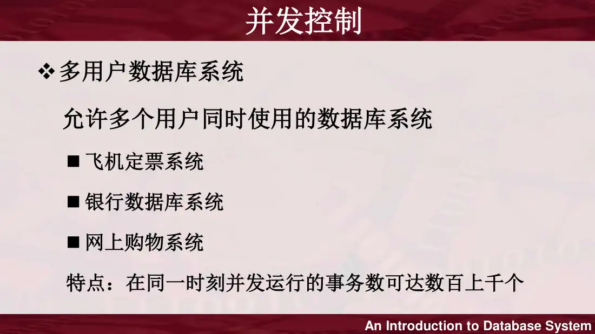

原文：

并发控制

◆ 多用户数据库系统

允许多个用户同时使用的数据库系统

■ 飞机定票系统

■ 银行数据库系统

■ 网上购物系统

特点：在同一时刻并发运行的事务数可达数百上千个

An Introduction to Database System

### 并发控制（续）

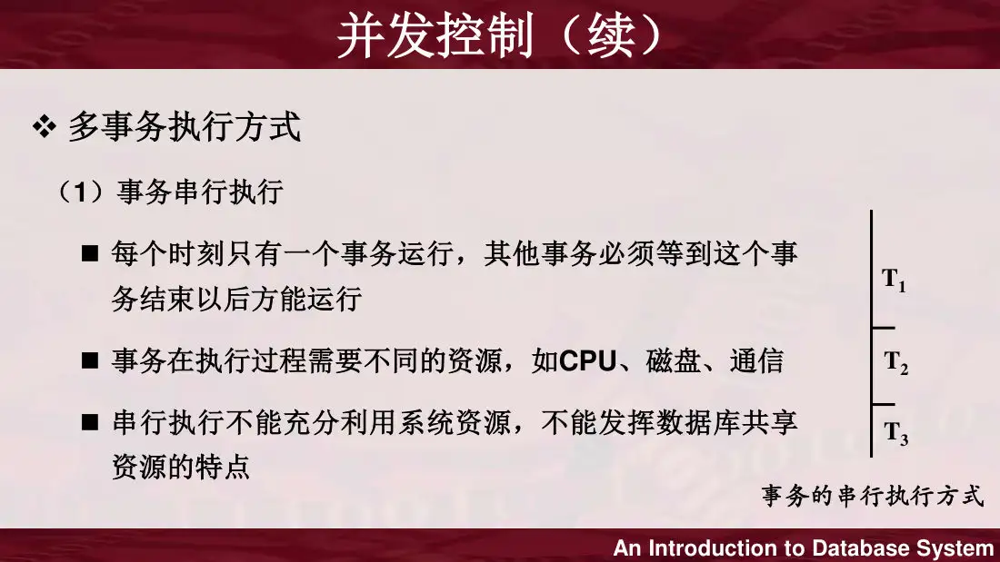

原文：

并发控制（续）

多事务执行方式

(1) 事务串行执行

■ 每个时刻只有一个事务运行，其他事务必须等到这个事务结束以后方能运行

■ 事务在执行过程需要不同的资源，如CPU、磁盘、通信

■ 串行执行不能充分利用系统资源，不能发挥数据库共享资源的特点

事务的串行执行方式

An Introduction to Database System

### 并发控制（续）

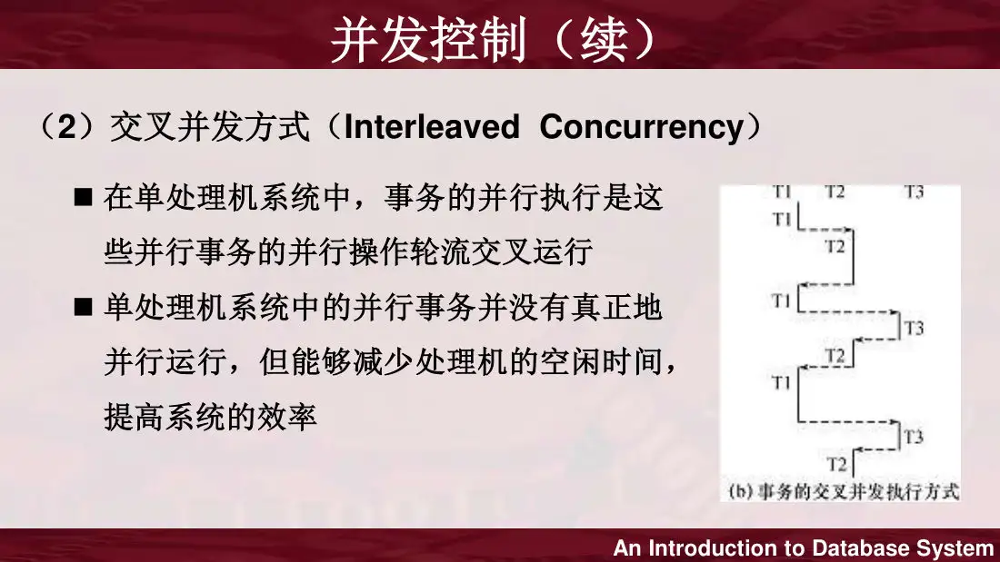

原文：

并发控制（续）

(2) 交叉并发方式（Interleaved Concurrency）

■ 在单处理机系统中，事务的并行执行是这些并行事务的并行操作轮流交叉运行

■ 单处理机系统中的并行事务并没有真正地并行运行，但能够减少处理机的空闲时间，提高系统的效率

An Introduction to Database System

### 并发控制（续）

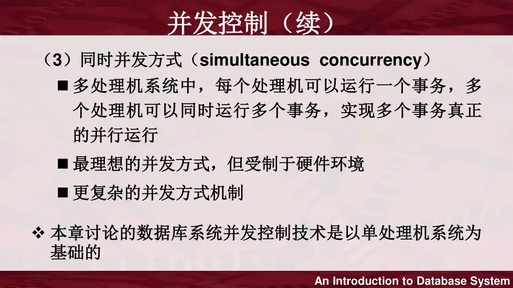

原文：

并发控制（续）

(3) 同时并发方式（simultaneous concurrency）

■ 多处理机系统中，每个处理机可以运行一个事务，多个处理机可以同时运行多个事务，实现多个事务真正的并行运行

■最理想的并发方式，但受制于硬件环境

■ 更复杂的并发方式机制

✿ 本章讨论的数据库系统并发控制技术是以单处理机系统为基础的

An Introduction to Database System

### 并发控制（续）

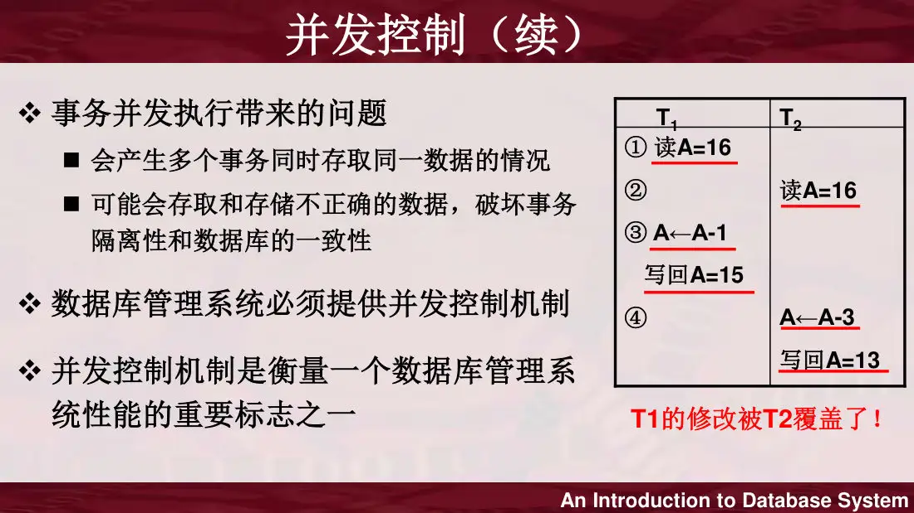

原文：

并发控制（续）

事务并发执行带来的问题

■ 会产生多个事务同时存取同一数据的情况

■ 可能会存取和存储不正确的数据，破坏事务隔离性和数据库的一致性

数据库管理系统必须提供并发控制机制

✿ 并发控制机制是衡量一个数据库管理系统性能的重要标志之一

<table><tr><td>T1</td><td>T2</td></tr><tr><td>1读A=16</td><td></td></tr><tr><td>2</td><td>读A=16</td></tr><tr><td>3A←A-1写回A=15</td><td></td></tr><tr><td>4</td><td>A←A-3写回A=13</td></tr></table>

T1的修改被T2覆盖了！

An Introduction to Database System

### 第12章 并发控制

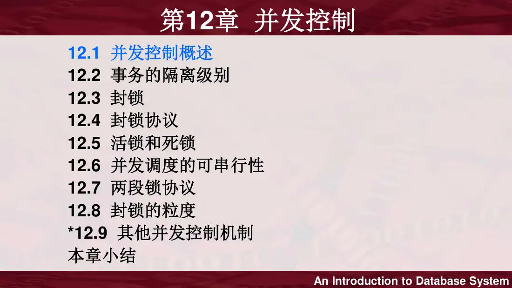

原文：

第12章 并发控制

12.1 并发控制概述
12.2 事务的隔离级别
12.3 封锁
12.4 封锁协议
12.5 活锁和死锁
12.6 并发调度的可串行性
12.7 两段锁协议
12.8 封锁的粒度
\*12.9 其他并发控制机制
本章小结

An Introduction to Database System

### 12.1 并发控制概述

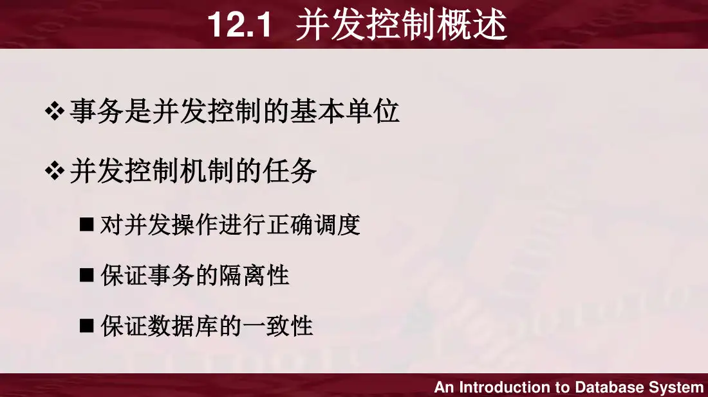

原文：

12.1 并发控制概述

事务是并发控制的基本单位

✿ 并发控制机制的任务

■ 对并发操作进行正确调度

■ 保证事务的隔离性

■ 保证数据库的一致性

An Introduction to Database System

### 并发控制概述（续）

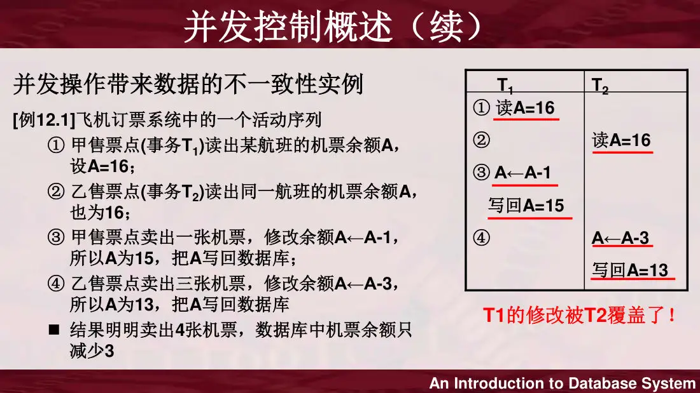

原文：

并发控制概述（续）

并发操作带来数据的不一致性实例

[例12.1]飞机订票系统中的一个活动序列

① 甲售票点(事务 $T_{1}$ )读出某航班的机票余额A, 设A=16;

② 乙售票点(事务 $T_{2}$ )读出同一航班的机票余额A,也为16;

③ 甲售票点卖出一张机票，修改余额A←A-1，所以A为15，把A写回数据库；

④ 乙售票点卖出三张机票，修改余额A←A-3，所以A为13，把A写回数据库

■ 结果明明卖出4张机票，数据库中机票余额只减少3

T1的修改被T2覆盖了！

An Introduction to Database System

### 并发控制概述（续）

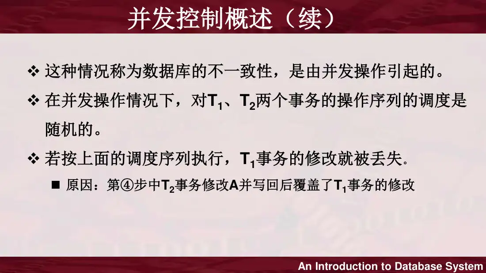

原文：

并发控制概述（续）

这种情况称为数据库的不一致性，是由并发操作引起的。

✿ 在并发操作情况下，对 $T_{1}$ 、 $T_{2}$ 两个事务的操作序列的调度是随机的。

✿ 若按上面的调度序列执行， $T_{1}$ 事务的修改就被丢失。

■ 原因：第④步中 $\mathsf{T}_2$ 事务修改A并写回后覆盖了 $\mathsf{T}_1$ 事务的修改

An Introduction to Database System

### 并发控制概述（续）

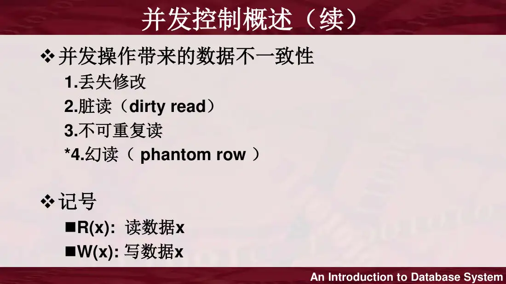

原文：

并发控制概述（续）

✿ 并发操作带来的数据不一致性

1.丢失修改

2. 脏读（dirty read）

3.不可重复读

\*4.幻读（phantom row）

记号

■R(x): 读数据x

■W(x): 写数据x

An Introduction to Database System

### 1. 丢失修改

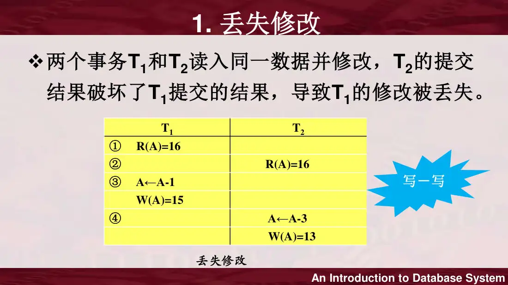

原文：

1. 丢失修改

两个事务 $T_{1}$ 和 $T_{2}$ 读入同一数据并修改， $T_{2}$ 的提交结果破坏了 $T_{1}$ 提交的结果，导致 $T_{1}$ 的修改被丢失。

<table><tr><td>T1</td><td>T2</td></tr><tr><td>1 R(A)=16</td><td></td></tr><tr><td>2</td><td>R(A)=16</td></tr><tr><td>3 A←A-1</td><td></td></tr><tr><td>W(A)=15</td><td></td></tr><tr><td>4</td><td>A←A-3</td></tr><tr><td></td><td>W(A)=13</td></tr></table>
丢失修改

An Introduction to Database System

### 2. 脏读（dirty read）

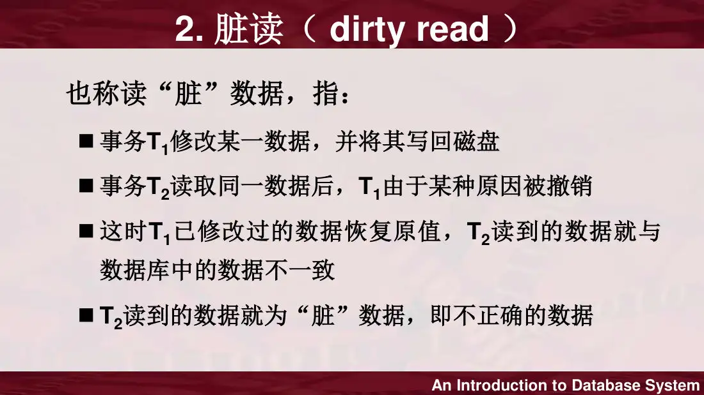

原文：

2. 脏读（dirty read）

也称读“脏”数据，指：

■事务T1修改某一数据，并将其写回磁盘

■事务 $\mathsf{T}_{2}$ 读取同一数据后， $\mathsf{T}_{1}$ 由于某种原因被撤销

■这时 $\mathsf{T}_{1}$ 已修改过的数据恢复原值， $\mathsf{T}_{2}$ 读到的数据就与数据库中的数据不一致

■ $T_{2}$ 读到的数据就为“脏”数据，即不正确的数据

An Introduction to Database System

### 脏读（dirty read）（续）

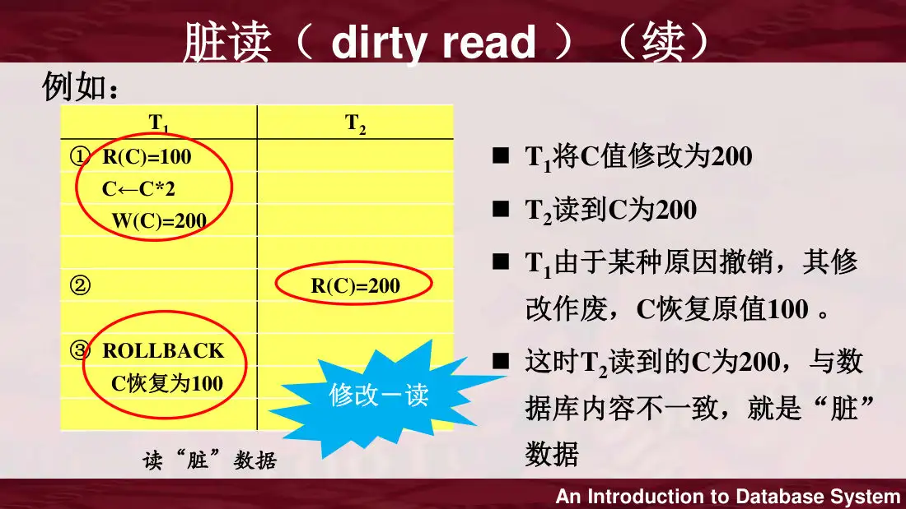

原文：

脏读（dirty read）（续）

例如:

■ $\mathrm{T}_{1}$ 将C值修改为200

■ $\mathrm{T}_{2}$ 读到C为200

■ $\mathrm{T}_{1}$ 由于某种原因撤销，其修改作废，C恢复原值100。

这时 $\mathrm{T}_{2}$ 读到的C为200，与数据库内容不一致，就是“脏”数据

An Introduction to Database System

### 3. 不可重复读

原文：

3. 不可重复读

不可重复读是指事务 $T_{1}$ 读取数据后，事务 $T_{2}$ 执行更新操作，使 $T_{1}$ 无法再现前一次读取结果。

读一更新

An Introduction to Database System

### 不可重复读（续）

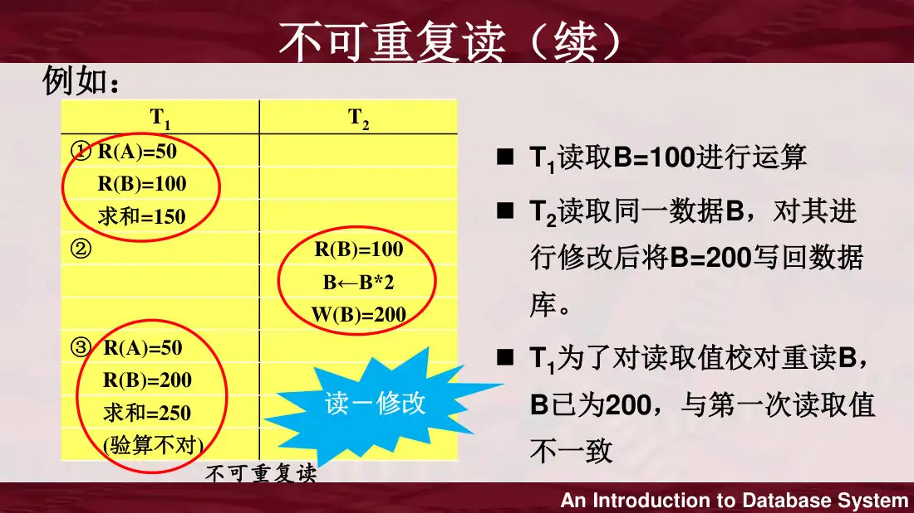

原文：

不可重复读（续）

例如:

■ $\mathrm{T}_{1}$ 读取B=100进行运算

■ $T_{2}$ 读取同一数据B，对其进行修改后将B=200写回数据库。

■ $T_{1}$ 为了对读取值校对重读B，B已为200，与第一次读取值不一致

An Introduction to Database System

### \*4. 幻读（phantom row

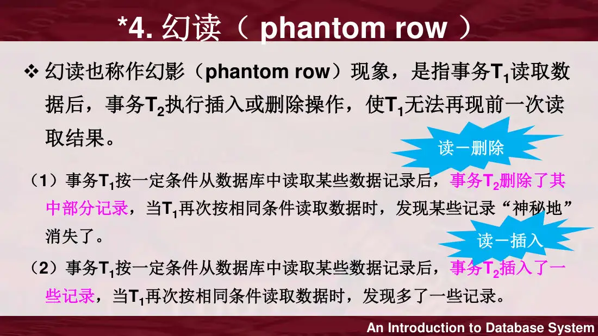

原文：

\*4. 幻读（phantom row

◆ 幻读也称作幻影（phantom row）现象，是指事务 $T_{1}$ 读取数据后，事务 $T_{2}$ 执行插入或删除操作，使 $T_{1}$ 无法再现前一次读取结果。

读一删除

(1) 事务 $\mathsf{T}_{1}$ 按一定条件从数据库中读取某些数据记录后, 事务 $\mathsf{T}_{2}$ 删除了其中部分记录, 当 $\mathsf{T}_{1}$ 再次按相同条件读取数据时, 发现某些记录 “神秘地”消失了。

(2) 事务 $\mathsf{T}_{1}$ 按一定条件从数据库中读取某些数据记录后, 事务 $\mathsf{T}_{2}$ 插入了一些记录, 当 $\mathsf{T}_{1}$ 再次按相同条件读取数据时, 发现多了一些记录。

An Introduction to Database System

### 并发控制概述（续）

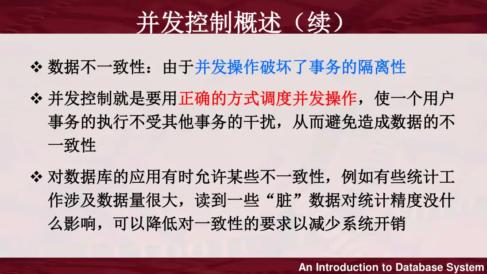

原文：

并发控制概述（续）

✿ 数据不一致性：由于并发操作破坏了事务的隔离性

✿ 并发控制就是要用正确的方式调度并发操作，使一个用户事务的执行不受其他事务的干扰，从而避免造成数据的不一致性

对数据库的应用有时允许某些不一致性，例如有些统计工作涉及数据量很大，读到一些“脏”数据对统计精度没什么影响，可以降低对一致性的要求以减少系统开销

An Introduction to Database System

### ✿并发控制的主要技术

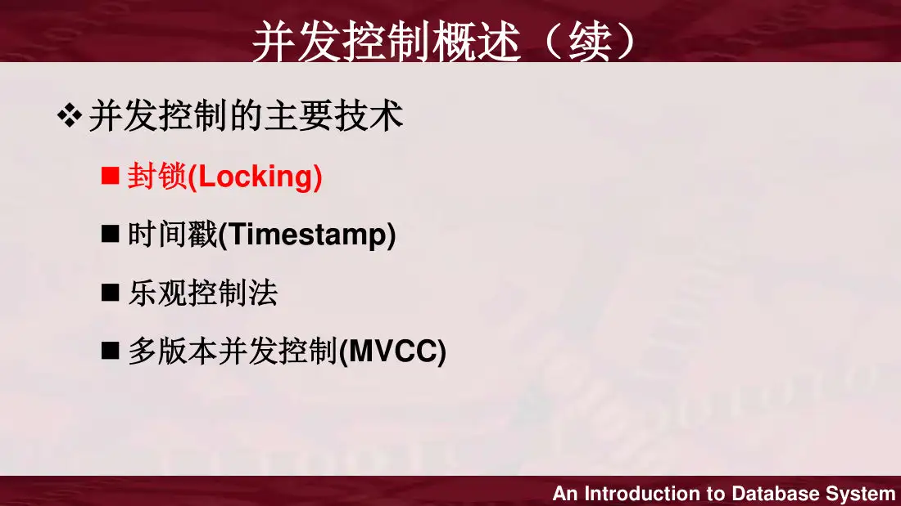

原文：

✿并发控制的主要技术
■封锁(Locking)
■时间戳(Timestamp)
■乐观控制法
■多版本并发控制(MVCC)

并发控制概述（续）

An Introduction to Database System

### 第12章 并发控制

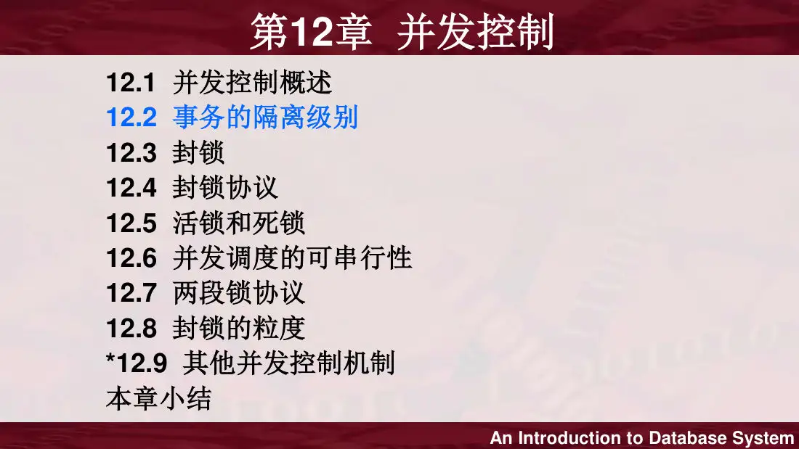

原文：

第12章 并发控制

12.1 并发控制概述
12.2 事务的隔离级别
12.3 封锁
12.4 封锁协议
12.5 活锁和死锁
12.6 并发调度的可串行性
12.7 两段锁协议
12.8 封锁的粒度
\*12.9 其他并发控制机制
本章小结

An Introduction to Database System

### 12.2 事务的隔离级别

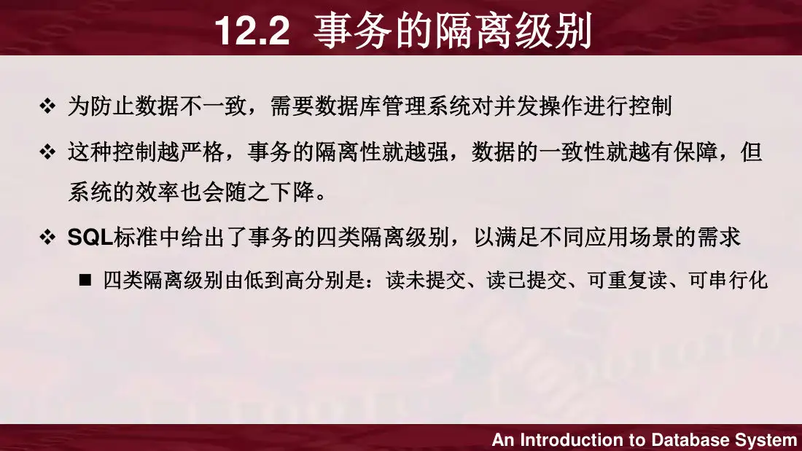

原文：

12.2 事务的隔离级别

✿ 为防止数据不一致，需要数据库管理系统对并发操作进行控制

这种控制越严格，事务的隔离性就越强，数据的一致性就越有保障，但系统的效率也会随之下降。

SQL标准中给出了事务的四类隔离级别，以满足不同应用场景的需求

■ 四类隔离级别由低到高分别是：读未提交、读已提交、可重复读、可串行化

An Introduction to Database System

### 1. 读未提交

原文：

1. 读未提交

“读未提交”是允许一个事务可以读取另一个未提交事务正在修改的数据。它可能出现脏读、不可重复读和幻读的情形。

An Introduction to Database System

### 2.读已提交

原文：

2.读已提交

“读已提交”是只允许一个事务读其他事务已提交的数据。显然，“读已提交”可以有效避免脏读，但是它不能保证可重复读和不幻读。

An Introduction to Database System

### 3.可重复读

原文：

3.可重复读

“可重复读”是一个事务开始读取数据后，其他事务就不能再对该数据执行UPDATE操作了。

“可重复读”杜绝了脏读和不可重复读

不能保证不幻读

An Introduction to Database System

### 4.可串行化

原文：

4.可串行化

“可串行化”是最高的事务隔离级别

事务执行顺序是可串行化的，可以避免丢失修改、脏读、不可重复读和幻读

An Introduction to Database System

### 事务隔离级别与数据不一致性的关系

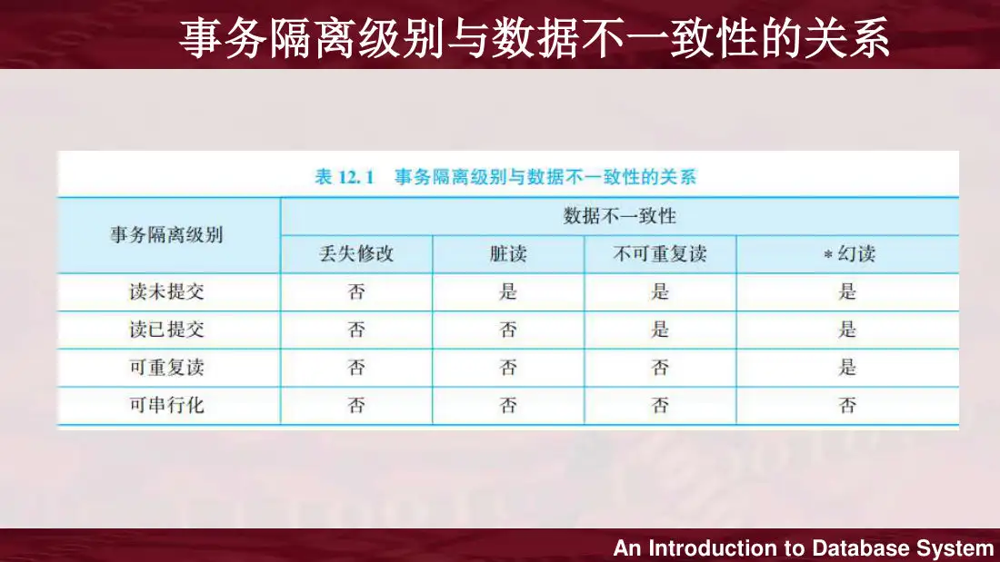

原文：

事务隔离级别与数据不一致性的关系

表 12.1 事务隔离级别与数据不一致性的关系
<table><tr><td rowspan="2">事务隔离级别</td><td colspan="4">数据不一致性</td></tr><tr><td>丢失修改</td><td>脏读</td><td>不可重复读</td><td>*幻读</td></tr><tr><td>读未提交</td><td>否</td><td>是</td><td>是</td><td>是</td></tr><tr><td>读已提交</td><td>否</td><td>否</td><td>是</td><td>是</td></tr><tr><td>可重复读</td><td>否</td><td>否</td><td>否</td><td>是</td></tr><tr><td>可串行化</td><td>否</td><td>否</td><td>否</td><td>否</td></tr></table>

An Introduction to Database System

### 事务隔离级别与数据一致性以及系统代价的关系

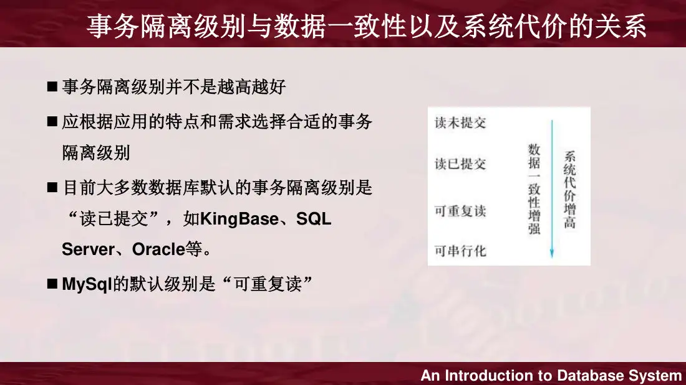

原文：

事务隔离级别与数据一致性以及系统代价的关系

■ 事务隔离级别并不是越高越好

■ 应根据应用的特点和需求选择合适的事务隔离级别

■ 目前大多数数据库默认的事务隔离级别是“读已提交”，如KingBase、SQL Server、Oracle等。

■ MySQL的默认级别是“可重复读”

<table><tr><td>读未提交</td><td rowspan="4">数据一致性增强</td><td rowspan="4">系统代价增高</td></tr><tr><td>读已提交</td></tr><tr><td>可重复读</td></tr><tr><td>可串行化</td></tr></table>

An Introduction to Database System

### 第12章 并发控制

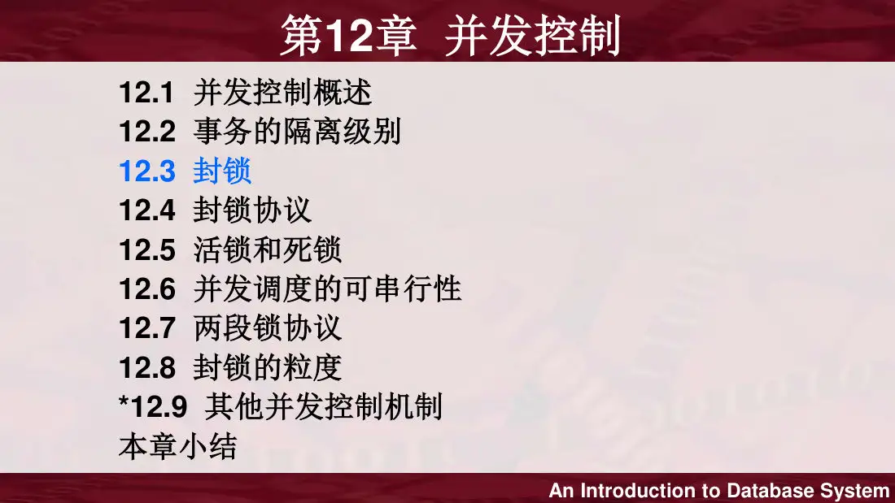

原文：

第12章 并发控制

12.1 并发控制概述
12.2 事务的隔离级别
12.3 封锁
12.4 封锁协议
12.5 活锁和死锁
12.6 并发调度的可串行性
12.7 两段锁协议
12.8 封锁的粒度
\*12.9 其他并发控制机制
本章小结

An Introduction to Database System

### 12.3 封锁

原文：

12.3 封锁

什么是封锁

基本封锁类型

◆锁的相容矩阵

An Introduction to Database System

### 什么是封锁

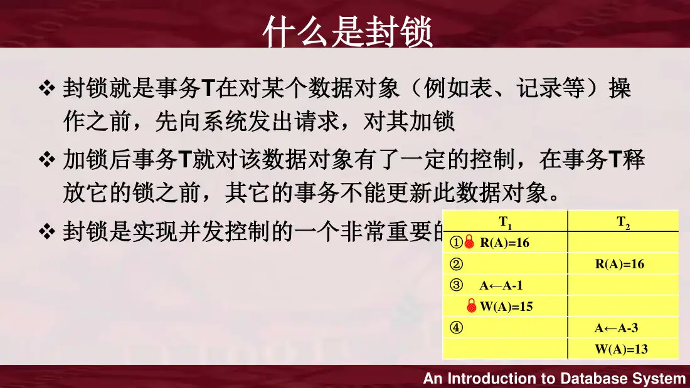

原文：

什么是封锁

◆ 封锁就是事务T在对某个数据对象（例如表、记录等）操作之前，先向系统发出请求，对其加锁

✿ 加锁后事务T就对该数据对象有了一定的控制，在事务T释放它的锁之前，其它的事务不能更新此数据对象。

◆ 封锁是实现并发控制的一个非常重要的

<table><tr><td>T1</td><td>T2</td></tr><tr><td>1 R(A)=16</td><td></td></tr><tr><td>2</td><td>R(A)=16</td></tr><tr><td>3 A←A-1</td><td></td></tr><tr><td>W(A)=15</td><td></td></tr><tr><td>4</td><td>A←A-3</td></tr><tr><td></td><td>W(A)=13</td></tr></table>

An Introduction to Database System

### 基本封锁类型

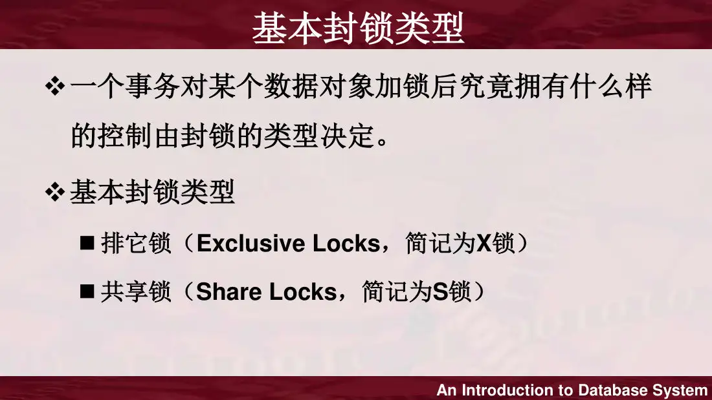

原文：

基本封锁类型

◆一个事务对某个数据对象加锁后究竟拥有什么样的控制由封锁的类型决定。

基本封锁类型

■ 排它锁（Exclusive Locks，简记为X锁）

■ 共享锁（Share Locks，简记为S锁）

An Introduction to Database System

### 排它锁

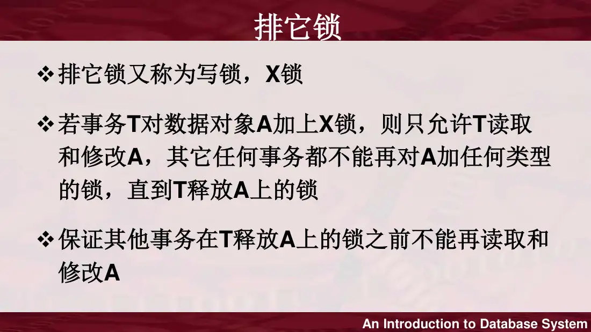

原文：

排它锁

✿ 排它锁又称为写锁，X锁

✿ 若事务T对数据对象A加上X锁，则只允许T读取和修改A，其它任何事务都不能再对A加任何类型的锁，直到T释放A上的锁

保证其他事务在T释放A上的锁之前不能再读取和修改A

An Introduction to Database System

### 共享锁

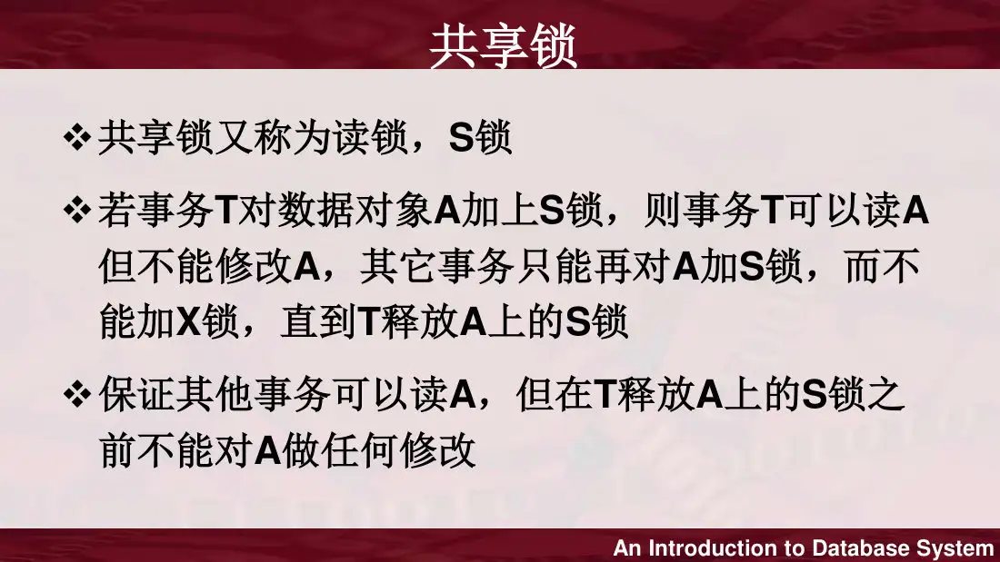

原文：

共享锁

共享锁又称为读锁，S锁

✿ 若事务T对数据对象A加上S锁，则事务T可以读A但不能修改A，其它事务只能再对A加S锁，而不能加X锁，直到T释放A上的S锁

保证其他事务可以读A，但在T释放A上的S锁之前不能对A做任何修改

An Introduction to Database System

### 锁的相容矩阵

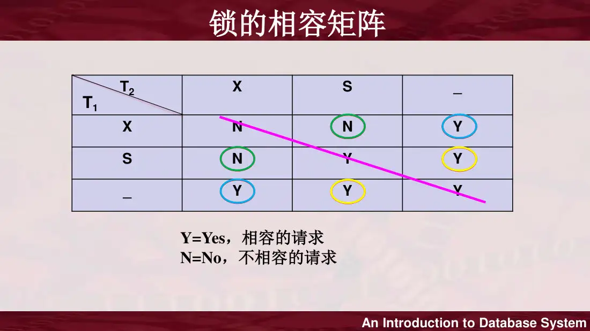

原文：

锁的相容矩阵

<table><tr><td> $T_1$  $T_2$ </td><td>X</td><td>S</td><td>-</td></tr><tr><td>X</td><td>N</td><td>N</td><td>Y</td></tr><tr><td>S</td><td>N</td><td>Y</td><td>Y</td></tr><tr><td>-</td><td>Y</td><td>Y</td><td>Y</td></tr></table>
$\mathbf{Y} = \mathbf{Yes}$ ，相容的请求 N=No，不相容的请求

An Introduction to Database System

### 第12章 并发控制

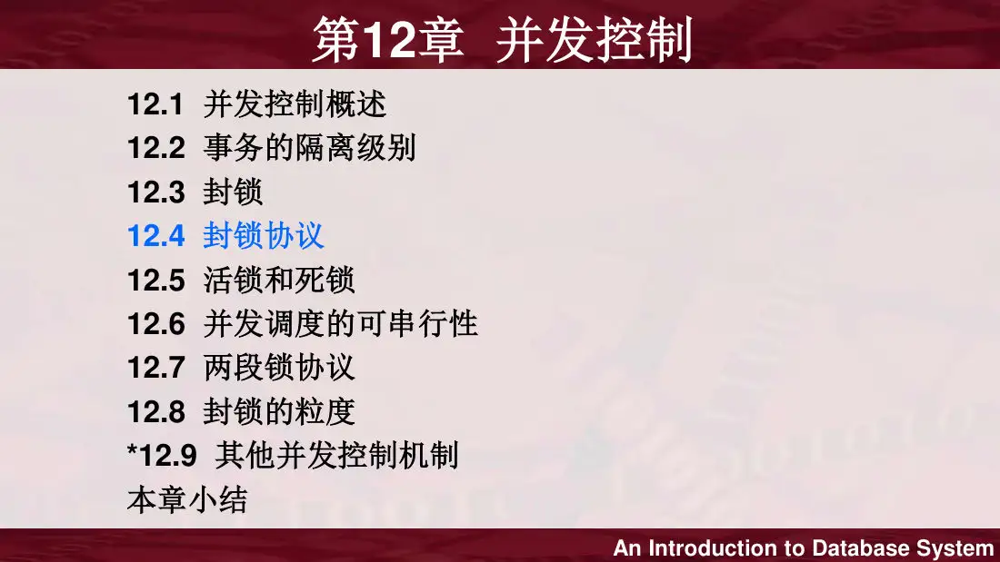

原文：

第12章 并发控制

12.1 并发控制概述
12.2 事务的隔离级别
12.3 封锁
12.4 封锁协议
12.5 活锁和死锁
12.6 并发调度的可串行性
12.7 两段锁协议
12.8 封锁的粒度
\*12.9 其他并发控制机制
本章小结

An Introduction to Database System

### 12.4 封锁协议

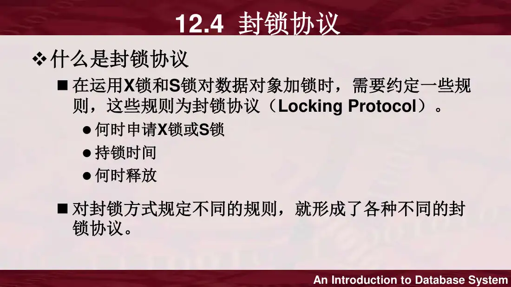

原文：

12.4 封锁协议

什么是封锁协议

■ 在运用X锁和S锁对数据对象加锁时，需要约定一些规则，这些规则为封锁协议（Locking Protocol）。

\- 何时申请X锁或S锁

\- 持锁时间

\- 何时释放

■ 对封锁方式规定不同的规则，就形成了各种不同的封锁协议。

An Introduction to Database System

### 封锁协议（续）

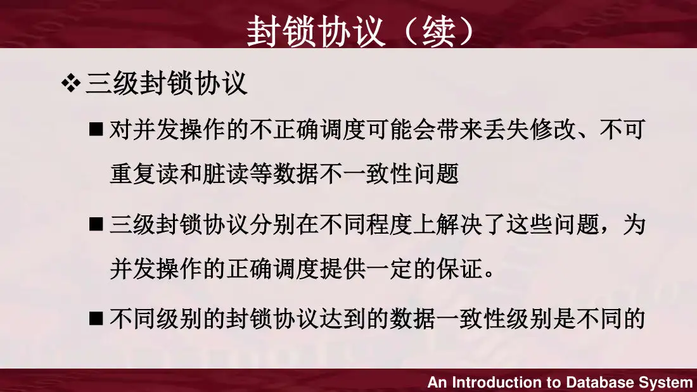

原文：

封锁协议（续）

三级封锁协议

■ 对并发操作的不正确调度可能会带来丢失修改、不可重复读和脏读等数据不一致性问题

■ 三级封锁协议分别在不同程度上解决了这些问题，为并发操作的正确调度提供一定的保证。

■ 不同级别的封锁协议达到的数据一致性级别是不同的

An Introduction to Database System

### 保持数据一致性的常用封锁协议

原文：

保持数据一致性的常用封锁协议

三级封锁协议

1. 一级封锁协议

2.二级封锁协议

3.三级封锁协议

An Introduction to Database System

### 1. 一级封锁协议

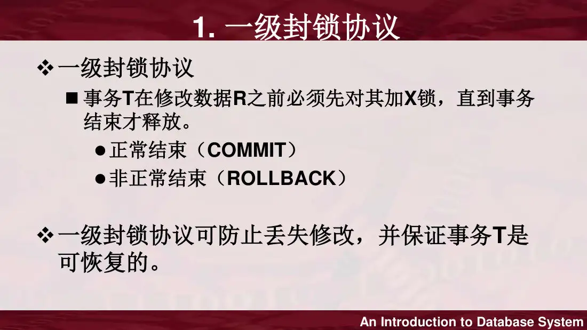

原文：

1. 一级封锁协议

◆ 一级封锁协议

■事务T在修改数据R之前必须先对其加X锁，直到事务结束才释放。

\- 正常结束（COMMIT）

\- 非正常结束（ROLLBACK）

一级封锁协议可防止丢失修改，并保证事务T是可恢复的。

An Introduction to Database System

### 使用封锁机制解决丢失修改问题

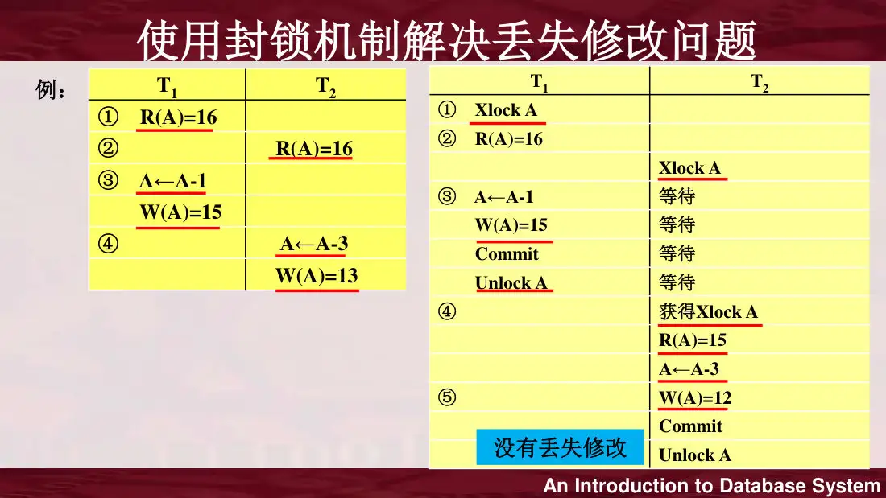

原文：

使用封锁机制解决丢失修改问题

例：

<table><tr><td>T1</td><td>T2</td></tr><tr><td>1 R(A)=16</td><td></td></tr><tr><td>2</td><td>R(A)=16</td></tr><tr><td>3 A←A-1</td><td></td></tr><tr><td>W(A)=15</td><td></td></tr><tr><td>4</td><td>A←A-3</td></tr><tr><td></td><td>W(A)=13</td></tr></table>

<table><tr><td>T1</td><td>T2</td></tr><tr><td>1 Xlock A</td><td></td></tr><tr><td>2 R(A)=16</td><td></td></tr><tr><td></td><td>Xlock A</td></tr><tr><td>3 A←A-1</td><td>等待</td></tr><tr><td>W(A)=15</td><td>等待</td></tr><tr><td>Commit</td><td>等待</td></tr><tr><td>Unlock A</td><td>等待</td></tr><tr><td>4</td><td>获得Xlock A</td></tr><tr><td></td><td>R(A)=15</td></tr><tr><td></td><td>A←A-3</td></tr><tr><td>5</td><td>W(A)=12</td></tr><tr><td></td><td>Commit</td></tr><tr><td>没有丢失修改</td><td>Unlock A</td></tr></table>

An Introduction to Database System

### 一级封锁协议（续）

原文：

一级封锁协议（续）

✿ 在一级封锁协议中，如果仅仅是读数据不对其进行修改，是不需要加锁的，所以它不能保证可重复读和不读“脏”数据。

An Introduction to Database System

### 使用一级封锁协议不能解决的问题

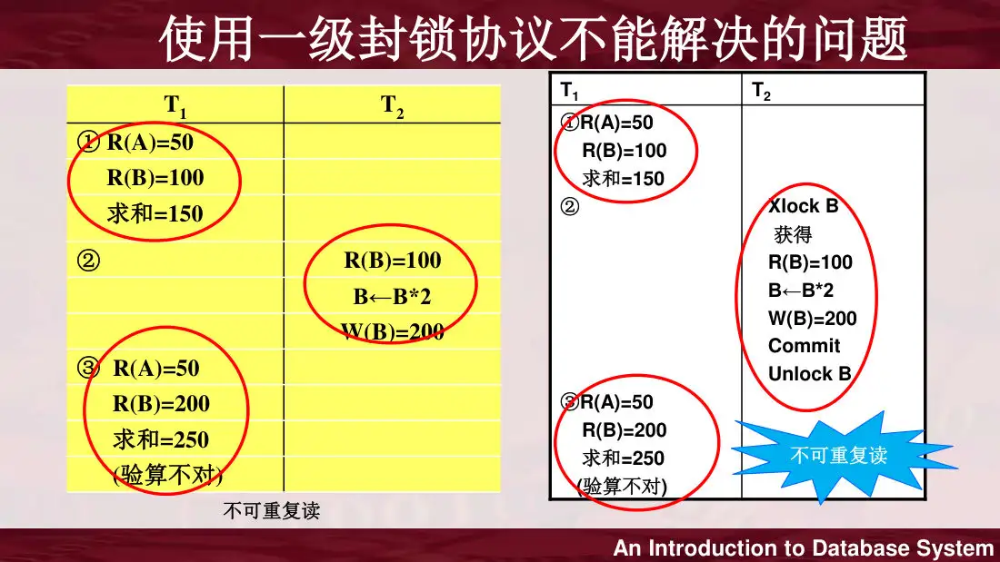

原文：

使用一级封锁协议不能解决的问题

③R(A)=50
R(B)=200
求和=250
(验算不对)

An Introduction to Database System

### 使用一级封锁协议不能解决的问题

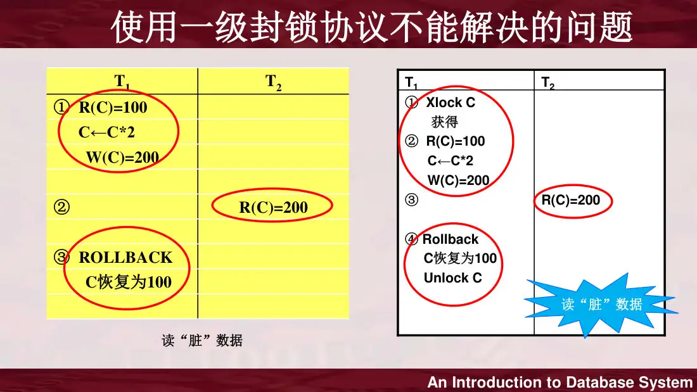

原文：

使用一级封锁协议不能解决的问题

An Introduction to Database System

### 2. 二级封锁协议

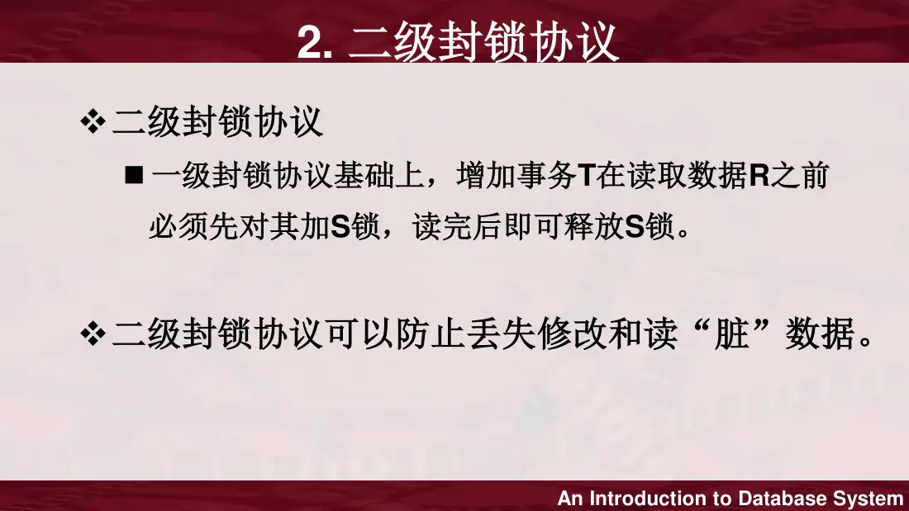

原文：

2. 二级封锁协议

◆ 二级封锁协议

■ 一级封锁协议基础上，增加事务T在读取数据R之前必须先对其加S锁，读完后即可释放S锁。

◆ 二级封锁协议可以防止丢失修改和读“脏”数据。

An Introduction to Database System

### 没有丢失修改

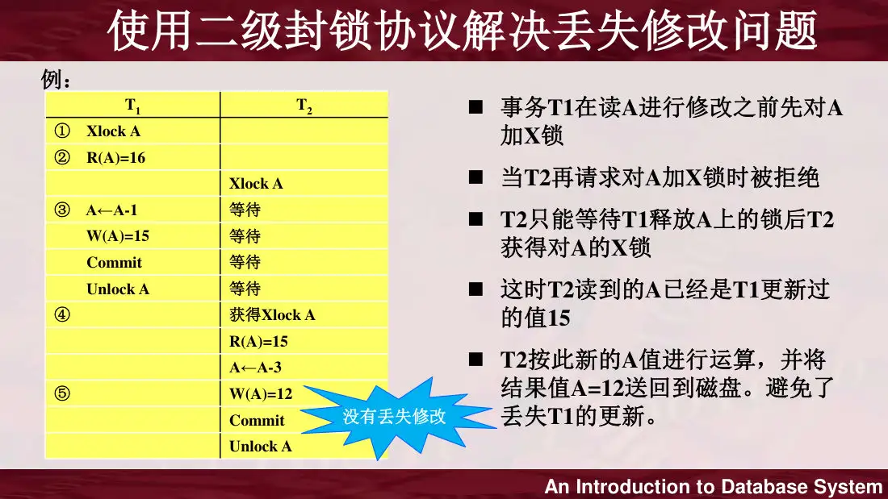

原文：

没有丢失修改

使用二级封锁协议解决丢失修改问题

例:

<table><tr><td>T1</td><td>T2</td></tr><tr><td>1 Xlock A</td><td></td></tr><tr><td>2 R(A)=16</td><td></td></tr><tr><td></td><td>Xlock A</td></tr><tr><td>3 A←A-1</td><td>等待</td></tr><tr><td>W(A)=15</td><td>等待</td></tr><tr><td>Commit</td><td>等待</td></tr><tr><td>Unlock A</td><td>等待</td></tr><tr><td>4</td><td>获得Xlock A</td></tr><tr><td></td><td>R(A)=15</td></tr><tr><td></td><td>A←A-3</td></tr><tr><td>5</td><td>W(A)=12</td></tr><tr><td></td><td>Commit 没有丢</td></tr><tr><td></td><td>Unlock A</td></tr></table>

■ 事务T1在读A进行修改之前先对A加X锁

■ 当T2再请求对A加X锁时被拒绝

■ T2只能等待T1释放A上的锁后T2获得对A的X锁

■ 这时T2读到的A已经是T1更新过的值15

■ T2按此新的A值进行运算，并将结果值A=12送回到磁盘。避免了丢失T1的更新。

An Introduction to Database System

### 未读“脏”数据

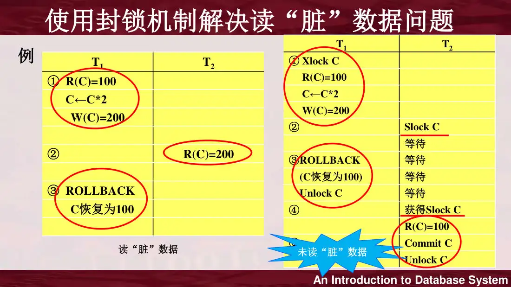

原文：

未读“脏”数据

使用封锁机制解决读“脏”数据问题

例

An Introduction to Database System

### 二级封锁协议（续）

原文：

二级封锁协议（续）

✿ 在二级封锁协议中，由于读完数据后即可释放S锁，所以它不能保证可重复读。

An Introduction to Database System

### 使用二级封锁协议不能解决的问题: 不可重复读

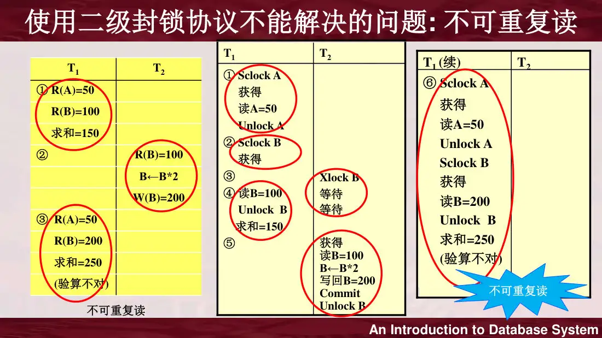

原文：

使用二级封锁协议不能解决的问题: 不可重复读

An Introduction to Database System

### 3. 三级封锁协议

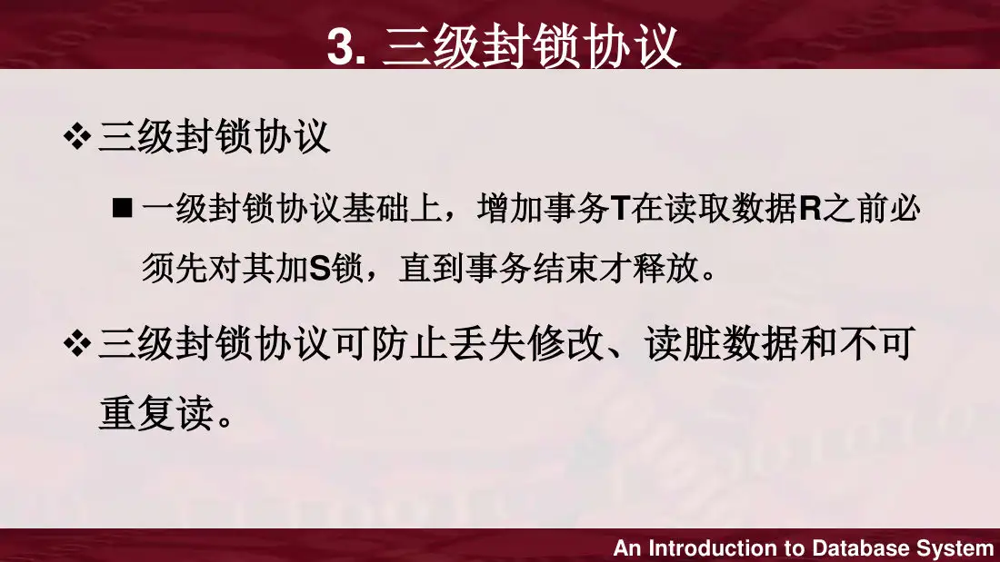

原文：

3. 三级封锁协议

三级封锁协议

■ 一级封锁协议基础上，增加事务T在读取数据R之前必须先对其加S锁，直到事务结束才释放。

三级封锁协议可防止丢失修改、读脏数据和不可重复读。

An Introduction to Database System

### 使用封锁机制解决不可重复读问题

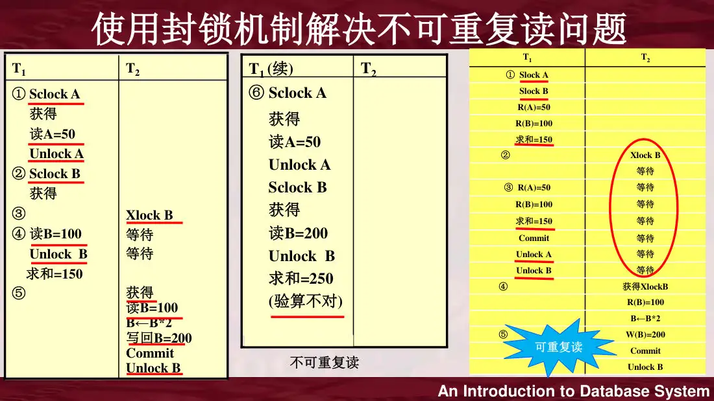

原文：

使用封锁机制解决不可重复读问题

<table><tr><td>T1</td><td>T2</td></tr><tr><td>1Sclock A获得读A=50Unlock A2Sclock B获得34读B=100Unlock B求和=1505</td><td>Xlock B等待等待获得读B=100B←B*2写回B=200CommitUnlock B</td></tr></table>

An Introduction to Database System

### 封锁协议小结

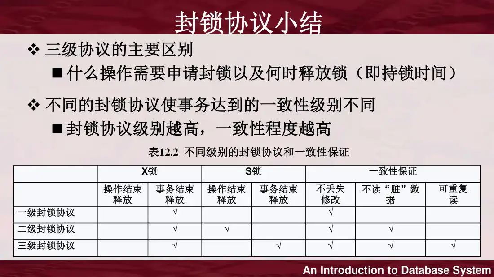

原文：

封锁协议小结

三级协议的主要区别

■ 什么操作需要申请封锁以及何时释放锁（即持锁时间）

✿ 不同的封锁协议使事务达到的一致性级别不同

■封锁协议级别越高，一致性程度越高

表12.2 不同级别的封锁协议和一致性保证
<table><tr><td></td><td colspan="2">X锁</td><td colspan="2">S锁</td><td colspan="3">一致性保证</td></tr><tr><td></td><td>操作结束释放</td><td>事务结束释放</td><td>操作结束释放</td><td>事务结束释放</td><td>不丢失修改</td><td>不读“脏”数据</td><td>可重复读</td></tr><tr><td>一级封锁协议</td><td></td><td>√</td><td></td><td></td><td>√</td><td></td><td></td></tr><tr><td>二级封锁协议</td><td></td><td>√</td><td>√</td><td></td><td>√</td><td>√</td><td></td></tr><tr><td>三级封锁协议</td><td></td><td>√</td><td></td><td>√</td><td>√</td><td>√</td><td>√</td></tr></table>

An Introduction to Database System

### 第12章 并发控制

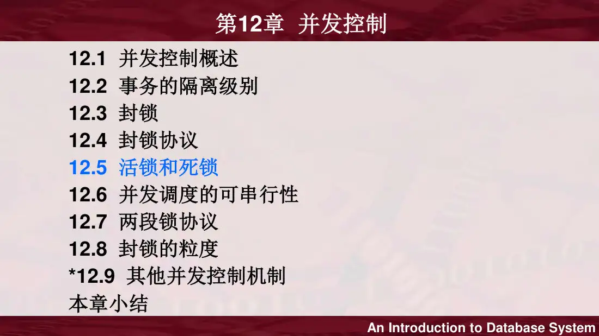

原文：

第12章 并发控制

12.1 并发控制概述
12.2 事务的隔离级别
12.3 封锁
12.4 封锁协议
12.5 活锁和死锁
12.6 并发调度的可串行性
12.7 两段锁协议
12.8 封锁的粒度
\*12.9 其他并发控制机制
本章小结

An Introduction to Database System

### 12.5 活锁和死锁

原文：

12.5 活锁和死锁

◆封锁技术可以有效地解决并行操作的一致性问题，但也带来一些新的问题

■ 死锁

■ 活锁

An Introduction to Database System

### 12.5.1 活锁

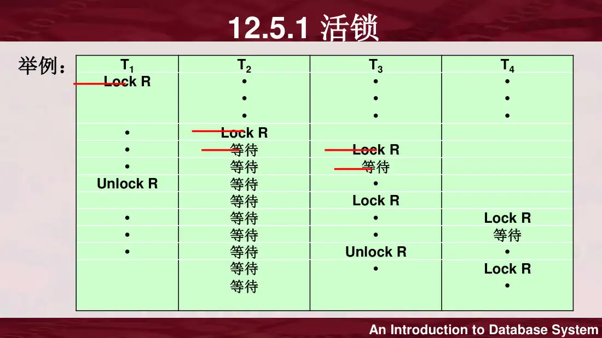

原文：

12.5.1 活锁

举例:

<table><tr><td> $T_1$ </td><td> $T_2$ </td><td> $T_3$ </td><td> $T_4$ </td></tr><tr><td rowspan="3">Lock R</td><td>•</td><td>•</td><td>•</td></tr><tr><td>•</td><td>•</td><td>•</td></tr><tr><td>•</td><td>•</td><td>•</td></tr><tr><td>•</td><td>Lock R</td><td></td><td></td></tr><tr><td>•</td><td>等待</td><td>Lock R</td><td></td></tr><tr><td>•</td><td>等待</td><td>等待</td><td></td></tr><tr><td rowspan="2">Unlock R</td><td>等待</td><td>•</td><td></td></tr><tr><td>等待</td><td>Lock R</td><td></td></tr><tr><td>•</td><td>等待</td><td>•</td><td>Lock R</td></tr><tr><td>•</td><td>等待</td><td>•</td><td>等待</td></tr><tr><td rowspan="3">•</td><td>等待</td><td>Unlock R</td><td>•</td></tr><tr><td>等待</td><td>•</td><td>Lock R</td></tr><tr><td>等待</td><td></td><td>•</td></tr></table>

An Introduction to Database System

### 12.5.1 活锁

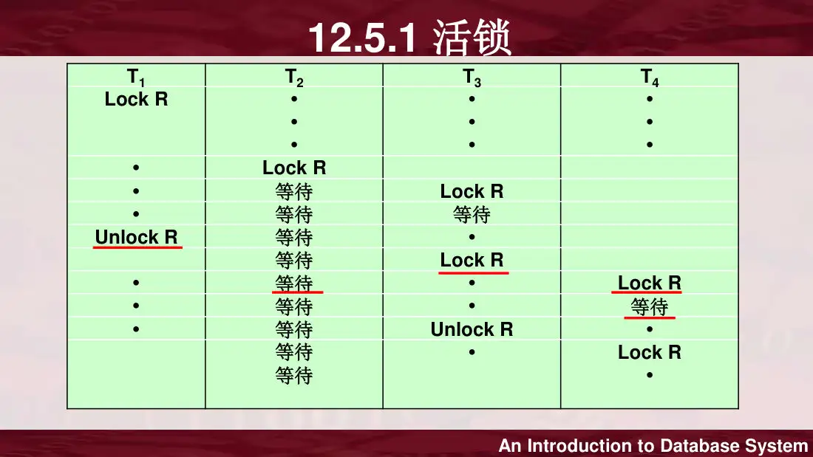

原文：

12.5.1 活锁

<table><tr><td> $T_1$ </td><td> $T_2$ </td><td> $T_3$ </td><td> $T_4$ </td></tr><tr><td rowspan="3">Lock R</td><td>•</td><td>•</td><td>•</td></tr><tr><td>•</td><td>•</td><td>•</td></tr><tr><td>•</td><td>•</td><td>•</td></tr><tr><td>•</td><td>Lock R</td><td></td><td></td></tr><tr><td>•</td><td>等待</td><td>Lock R</td><td></td></tr><tr><td>•</td><td>等待</td><td>等待</td><td></td></tr><tr><td rowspan="2">Unlock R</td><td>等待</td><td>•</td><td></td></tr><tr><td>等待</td><td>Lock R</td><td></td></tr><tr><td>•</td><td>等待</td><td>•</td><td>Lock R</td></tr><tr><td>•</td><td>等待</td><td>•</td><td>等待</td></tr><tr><td rowspan="3">•</td><td>等待</td><td>Unlock R</td><td>•</td></tr><tr><td>等待</td><td>•</td><td>Lock R</td></tr><tr><td>等待</td><td></td><td>•</td></tr></table>

An Introduction to Database System

### 12.5.1 活锁

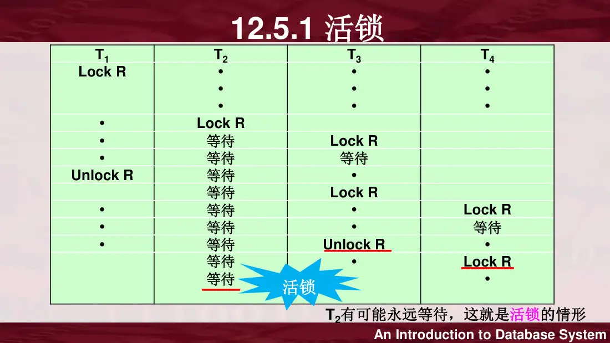

原文：

12.5.1 活锁

<table><tr><td> $T_1$ </td><td> $T_2$ </td><td> $T_3$ </td><td> $T_4$ </td></tr><tr><td rowspan="3">Lock R</td><td>•</td><td>•</td><td>•</td></tr><tr><td>•</td><td>•</td><td>•</td></tr><tr><td>•</td><td>•</td><td>•</td></tr><tr><td>•</td><td>Lock R</td><td></td><td></td></tr><tr><td>•</td><td>等待</td><td>Lock R</td><td></td></tr><tr><td>•</td><td>等待</td><td>等待</td><td></td></tr><tr><td rowspan="2">Unlock R</td><td>等待</td><td>•</td><td></td></tr><tr><td>等待</td><td>Lock R</td><td></td></tr><tr><td>•</td><td>等待</td><td>•</td><td>Lock R</td></tr><tr><td>•</td><td>等待</td><td>•</td><td>等待</td></tr><tr><td rowspan="3">•</td><td>等待</td><td>Unlock R</td><td>•</td></tr><tr><td>等待</td><td>•</td><td>Lock R</td></tr><tr><td>等待</td><td>•</td><td>•</td></tr></table>
$\mathbf{T}_{2}$ 有可能永远等待, 这就是活锁的情形

An Introduction to Database System

### 活锁（续）

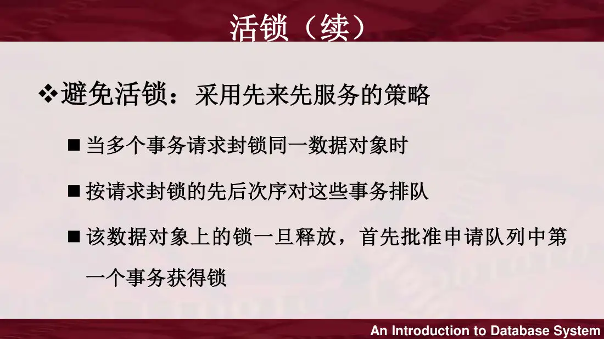

原文：

活锁（续）

避免活锁：采用先来先服务的策略

■ 当多个事务请求封锁同一数据对象时

■ 按请求封锁的先后次序对这些事务排队

■该数据对象上的锁一旦释放，首先批准申请队列中第一个事务获得锁

An Introduction to Database System

### 12.5.2 死锁

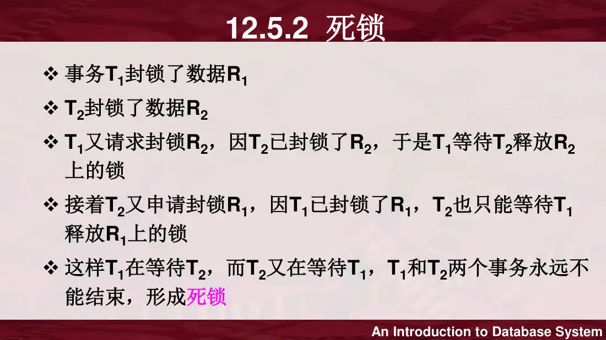

原文：

12.5.2 死锁

事务T $_{1}$ 封锁了数据R $_{1}$

◆ T₂封锁了数据R₂

✿ $T_{1}$ 又请求封锁 $R_{2}$ ，因 $T_{2}$ 已封锁了 $R_{2}$ ，于是 $T_{1}$ 等待 $T_{2}$ 释放 $R_{2}$ 上的锁

✿ 接着 $T_{2}$ 又申请封锁 $R_{1}$ ，因 $T_{1}$ 已封锁了 $R_{1}$ ， $T_{2}$ 也只能等待 $T_{1}$ 释放 $R_{1}$ 上的锁

这样 $\mathsf{T}_{1}$ 在等待 $\mathsf{T}_{2}$ , 而 $\mathsf{T}_{2}$ 又在等待 $\mathsf{T}_{1}$ , $\mathsf{T}_{1}$ 和 $\mathsf{T}_{2}$ 两个事务永远不能结束, 形成死锁

An Introduction to Database System

### 死锁（续）

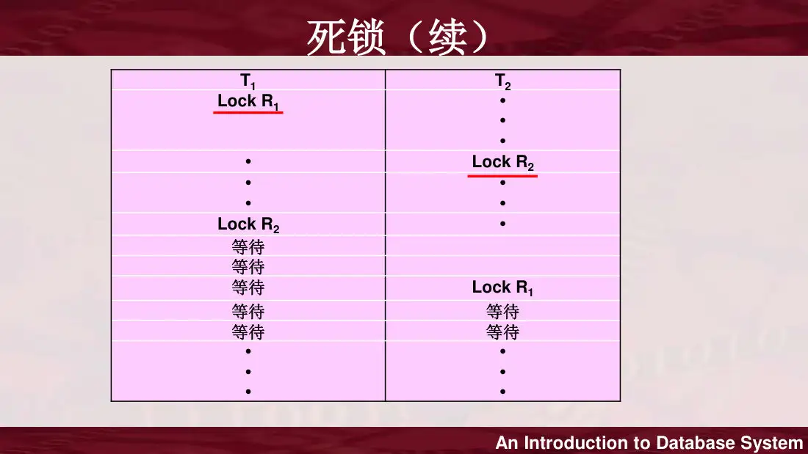

原文：

死锁（续）

<table><tr><td rowspan="4"> $T_1$ Lock  $R_1$ </td><td> $T_2$ </td></tr><tr><td>•</td></tr><tr><td>•</td></tr><tr><td>•</td></tr><tr><td>•</td><td>Lock  $R_2$ </td></tr><tr><td>•</td><td>•</td></tr><tr><td>•</td><td>•</td></tr><tr><td>Lock  $R_2$ </td><td>•</td></tr><tr><td>等待</td><td></td></tr><tr><td>等待</td><td></td></tr><tr><td>等待</td><td>Lock  $R_1$ </td></tr><tr><td>等待</td><td>等待</td></tr><tr><td>等待</td><td>等待</td></tr><tr><td>•</td><td>•</td></tr><tr><td>•</td><td>•</td></tr><tr><td>•</td><td>•</td></tr></table>

An Introduction to Database System

### 死锁（续）

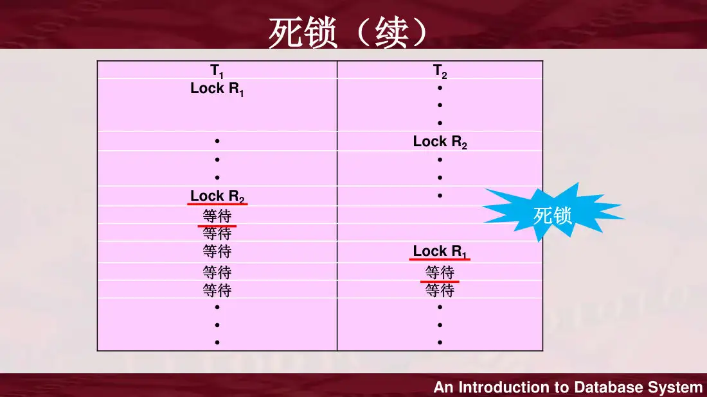

原文：

死锁（续）

<table><tr><td>T1Lock R1</td><td>T2······</td></tr><tr><td>··</td><td>Lock R2······</td></tr><tr><td>······</td><td></td></tr><tr><td>Lock R2等待</td><td>死锁</td></tr><tr><td>等待</td><td></td></tr><tr><td>等待</td><td>Lock R1等待</td></tr><tr><td>等待</td><td>等待</td></tr><tr><td>等待</td><td>等待</td></tr><tr><td>······</td><td></td></tr></table>

An Introduction to Database System

### 解决死锁的方法

原文：

解决死锁的方法

两类方法

1. 死锁的预防

2. 死锁的诊断与解除

An Introduction to Database System

### 1. 死锁的预防

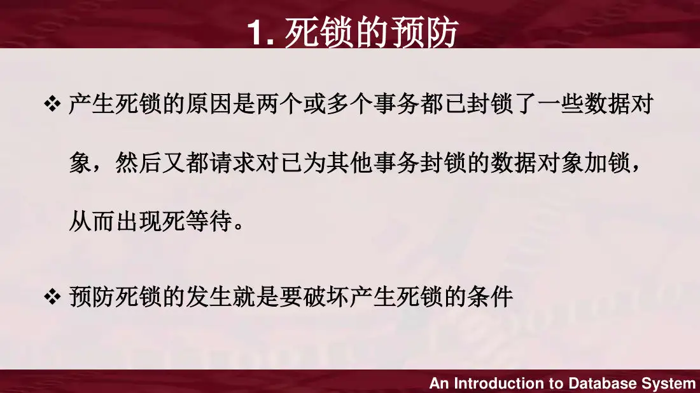

原文：

1. 死锁的预防

产生死锁的原因是两个或多个事务都已封锁了一些数据对象，然后又都请求对已为其他事务封锁的数据对象加锁，从而出现死等待。

◆ 预防死锁的发生就是要破坏产生死锁的条件

An Introduction to Database System

### 死锁的预防（续）

原文：

死锁的预防（续）

预防死锁的方法

(1) 一次封锁法

(2) 顺序封锁法

An Introduction to Database System

### (1) 一次封锁法

原文：

(1) 一次封锁法

◆要求每个事务必须一次将所有要使用的数据全部加锁，否则就不能继续执行

<table><tr><td> $T_1$ </td><td> $T_2$ </td></tr><tr><td rowspan="2">Lock  $R_1$ </td><td>•</td></tr><tr><td>•</td></tr><tr><td>•</td><td>Lock  $R_2$ </td></tr><tr><td>•</td><td>•</td></tr><tr><td>•</td><td>•</td></tr><tr><td>Lock  $R_2$ </td><td>•</td></tr><tr><td>等待</td><td></td></tr><tr><td>等待</td><td>Lock  $R_1$ </td></tr><tr><td>等待</td><td>等待</td></tr><tr><td>•</td><td>•</td></tr><tr><td>•</td><td>•</td></tr></table>

<table><tr><td> $T_1$ </td><td> $T_2$ </td></tr><tr><td>Lock  $R_1$ </td><td>•</td></tr><tr><td>Lock  $R_2$ </td><td>•</td></tr><tr><td>•</td><td>Lock  $R_2$ </td></tr><tr><td>•</td><td>等待</td></tr><tr><td>•</td><td>等待</td></tr><tr><td>ULock  $R_1$ </td><td>•</td></tr><tr><td>ULock  $R_2$ </td><td></td></tr><tr><td></td><td>Lock R2</td></tr><tr><td></td><td>Lock  $R_1$ </td></tr><tr><td></td><td>•</td></tr><tr><td></td><td>•</td></tr></table>

An Introduction to Database System

### (1) 一次封锁法

原文：

(1) 一次封锁法

◆要求每个事务必须一次将所有要使用的数据全部加锁，否则就不能继续执行

<table><tr><td> $T_1$ </td><td> $T_2$ </td></tr><tr><td rowspan="2">Lock  $R_1$ </td><td>•</td></tr><tr><td>•</td></tr><tr><td>•</td><td>Lock  $R_2$ </td></tr><tr><td>•</td><td>•</td></tr><tr><td>•</td><td>•</td></tr><tr><td>Lock  $R_2$ </td><td>•</td></tr><tr><td>等待</td><td></td></tr><tr><td>等待</td><td>Lock  $R_1$ </td></tr><tr><td>等待</td><td>等待</td></tr><tr><td>•</td><td>•</td></tr><tr><td>•</td><td>•</td></tr></table>

<table><tr><td> $T_1$ </td><td> $T_2$ </td></tr><tr><td>Lock  $R_1$ </td><td>•</td></tr><tr><td>Lock  $R_2$ </td><td>•</td></tr><tr><td>•</td><td>Lock  $R_2$ </td></tr><tr><td>•</td><td>等待</td></tr><tr><td>•</td><td>等待</td></tr><tr><td>ULock  $R_1$ </td><td>•</td></tr><tr><td>ULock  $R_2$ </td><td></td></tr><tr><td></td><td>Lock R2</td></tr><tr><td></td><td>Lock  $R_1$ </td></tr><tr><td></td><td>•</td></tr><tr><td></td><td>•</td></tr></table>

An Introduction to Database System

### 一次封锁法存在的问题

原文：

一次封锁法存在的问题

过早加锁，降低系统并发度

✿ 难于事先精确确定封锁对象

\- 数据库中数据是不断变化的，原来不要求封锁的数据，在执行过程中可能会变成封锁对象，所以很难事先精确地确定每个事务所要封锁的数据对象。

\- 可能解决方法：扩大封锁范围，如：将事务在执行过程中可能要封锁的数据对象全部加锁，这就进一步降低了并发度。

An Introduction to Database System

### (2) 顺序封锁法

原文：

(2) 顺序封锁法

◆ 顺序封锁法是预先对数据对象规定一个封锁顺序，所有事务都按这个顺序实行封锁。

◆ 顺序封锁法存在的问题

■ 维护成本

数据库系统中封锁的数据对象极多，并且随数据的插入、删除等操作而不断地变化，要维护这样的资源的封锁顺序非常困难，成本很高。

■难以实现

事务的封锁请求可以随着事务的执行而动态地决定，很难事先确定每一个事务要封锁哪些对象，因此也就很难按规定的顺序去施加封锁

An Introduction to Database System

### 死锁的预防（续）

原文：

死锁的预防（续）

结论

■ 在操作系统中广为采用的预防死锁的策略并不太适合数据库的特点

■ 数据库管理系统在解决死锁的问题上更普遍采用的是诊断并解除死锁的方法

An Introduction to Database System

### 2. 死锁的诊断与解除

原文：

2. 死锁的诊断与解除

死锁的诊断

(1) 超时法

(2) 等待图法

An Introduction to Database System

### (1) 超时法

原文：

(1) 超时法

如果一个事务的等待时间超过了规定的时限，就认为发生了死锁

优点：实现简单

缺点

■ 有可能误判死锁

■时限若设置得太长，死锁发生后不能及时发现

An Introduction to Database System

### (2) 等待图法

原文：

(2) 等待图法

✿ 用事务等待图动态反映所有事务的等待情况

■ 事务等待图是一个有向图 $G = (T, U)$

■ T为结点的集合，每个结点表示正运行的事务

■ U为边的集合，每条边表示事务等待的情况

■若 $\mathsf{T}_1$ 等待 $\mathsf{T}_2$ ，则 $\mathsf{T}_1$ ， $\mathsf{T}_2$ 之间划一条有向边，从 $\mathsf{T}_1$ 指向 $\mathsf{T}_2$

An Introduction to Database System

### 等待图法（续）

原文：

等待图法（续）

✿并发控制子系统周期性地（比如每隔数秒）生成事务等待图，检测事务。如果发现图中存在回路，则表示系统中出现了死锁。

An Introduction to Database System

### 死锁的诊断与解除（续）

原文：

死锁的诊断与解除（续）

◆解除死锁

■选择一个处理死锁代价最小的事务，将其撤消

■释放此事务持有的所有的锁，使其它事务能继续运行下去

An Introduction to Database System

### 死锁的诊断与解除（续）

原文：

死锁的诊断与解除（续）

◆解除死锁

■选择一个处理死锁代价最小的事务，将其撤消

■释放此事务持有的所有的锁，使其它事务能继续运行下去

An Introduction to Database System

### 第12章 并发控制

原文：

第12章 并发控制

12.1 并发控制概述
12.2 事务的隔离级别
12.3 封锁
12.4 封锁协议
12.5 活锁和死锁
12.6 并发调度的可串行性
12.7 两段锁协议
12.8 封锁的粒度
\*12.9 其他并发控制机制
本章小结

An Introduction to Database System

### 12.6 并发调度的可串行性

原文：

12.6 并发调度的可串行性

数据库管理系统对并发事务不同的调度可能会产生不同的结果

串行调度是正确的

执行结果等价于串行调度的调度也是正确的，称为可串行化调度

An Introduction to Database System

### 12.6 并发调度的可串行性

原文：

12.6 并发调度的可串行性

12.6.1 可串行化调度

12.6.2 冲突可串行化调度

An Introduction to Database System

### 12.6.1 可串行化调度

原文：

12.6.1 可串行化调度

✿ 可串行化(Serializable)调度

■ 多个事务的并发执行是正确的，当且仅当其结果与按某一次序串行地执行这些事务时的结果相同

✿ 可串行性(Serializability)

■ 是并发事务正确调度的准则

■一个给定的并发调度，当且仅当它是可串行化的，才认为是正确调度

An Introduction to Database System

### 可串行化调度（续）

原文：

可串行化调度（续）

[例] 现在有两个事务，分别包含下列操作：

■事务T1：读B；A=B+1；写回A

■事务T2：读A；B=A+1；写回B

现给出对这两个事务不同的调度策略

An Introduction to Database System

### 串行调度,正确的调度

原文：

串行调度,正确的调度

<table><tr><td>T1</td><td>T2</td></tr><tr><td>Slock B</td><td></td></tr><tr><td>Y=R(B)=2</td><td></td></tr><tr><td>Unlock B</td><td></td></tr><tr><td>Xlock A</td><td></td></tr><tr><td>A=Y+1=3</td><td></td></tr><tr><td>W(A)</td><td></td></tr><tr><td>Unlock A</td><td></td></tr><tr><td></td><td>Slock A</td></tr><tr><td></td><td>X=R(A)=3</td></tr><tr><td></td><td>Unlock A</td></tr><tr><td></td><td>Xlock B</td></tr><tr><td></td><td>B=X+1=4</td></tr><tr><td></td><td>W(B)</td></tr><tr><td></td><td>Unlock B</td></tr></table>

■ 假设A、B的初值均为2。

■ 按 $\mathrm{T}_{1} \rightarrow \mathrm{T}_{2}$ 次序执行结果为 $\mathrm{A} = 3, \mathrm{~B} = 4$

■ 串行调度策略，正确的调度

An Introduction to Database System

### 串行调度,正确的调度

原文：

串行调度,正确的调度

<table><tr><td>T1</td><td>T2</td></tr><tr><td></td><td>Slock A</td></tr><tr><td></td><td>X=R(A)=2</td></tr><tr><td></td><td>Unlock A</td></tr><tr><td></td><td>Xlock B</td></tr><tr><td></td><td>B=X+1=3</td></tr><tr><td></td><td>W(B)</td></tr><tr><td></td><td>Unlock B</td></tr><tr><td>Slock B</td><td></td></tr><tr><td>Y=R(B)=3</td><td></td></tr><tr><td>Unlock B</td><td></td></tr><tr><td>Xlock A</td><td></td></tr><tr><td>A=Y+1=4</td><td></td></tr><tr><td>W(A)</td><td></td></tr><tr><td>Unlock A</td><td></td></tr></table>

■ 假设A、B的初值均为2。

■ $\mathrm{T}_{2} \rightarrow \mathrm{T}_{1}$ 次序执行结果为

$$
\mathrm{B} = 3, \quad \mathrm{A} = 4
$$

■ 串行调度策略，正确的调度

An Introduction to Database System

### 不可串行化调度，错误的调度

原文：

不可串行化调度，错误的调度

<table><tr><td>T1</td><td>T2</td></tr><tr><td>Slock B</td><td></td></tr><tr><td>Y=R(B)=2</td><td></td></tr><tr><td></td><td>Slock A</td></tr><tr><td></td><td>X=R(A)=2</td></tr><tr><td>Unlock B</td><td></td></tr><tr><td></td><td>Unlock A</td></tr><tr><td>Xlock A</td><td></td></tr><tr><td>A=Y+1=3</td><td></td></tr><tr><td>W(A)</td><td></td></tr><tr><td></td><td>Xlock B</td></tr><tr><td></td><td>B=X+1=3</td></tr><tr><td></td><td>W(B)</td></tr><tr><td>Unlock A</td><td></td></tr><tr><td></td><td>Unlock B</td></tr></table>

■ 执行结果A=3，B=3，
与(a)、(b)的结果都不同

■ 是错误的调度

An Introduction to Database System

### 可串行化调度，正确的调度

原文：

可串行化调度，正确的调度

<table><tr><td>T1</td><td>T2</td></tr><tr><td>Slock B</td><td></td></tr><tr><td>Y=R(B)=2</td><td></td></tr><tr><td>Unlock B</td><td></td></tr><tr><td>Xlock A</td><td></td></tr><tr><td></td><td>Slock A</td></tr><tr><td>A=Y+1=3</td><td>等待</td></tr><tr><td>W(A)</td><td>等待</td></tr><tr><td>Unlock A</td><td>等待</td></tr><tr><td></td><td>X=R(A)=3</td></tr><tr><td></td><td>Unlock A</td></tr><tr><td></td><td>Xlock B</td></tr><tr><td></td><td>B=X+1=4</td></tr><tr><td></td><td>W(B)</td></tr><tr><td></td><td>Unlock B</td></tr></table>

■ 执行结果A=3, B=4, 与第一种串行调度的执行结果相同

■ 是正确的调度

An Introduction to Database System

### 四种调度

原文：

四种调度

<table><tr><td>T1</td><td>T2</td></tr><tr><td>Slock B</td><td></td></tr><tr><td>Y=R(B)=2</td><td></td></tr><tr><td>Unlock B</td><td></td></tr><tr><td>Xlock A</td><td></td></tr><tr><td>A=Y+1=3</td><td></td></tr><tr><td>W(A)</td><td></td></tr><tr><td>Unlock A</td><td></td></tr><tr><td></td><td>Slock A</td></tr><tr><td></td><td>X=R(A)=3</td></tr><tr><td></td><td>Unlock A</td></tr><tr><td></td><td>Xlock B</td></tr><tr><td></td><td>B=X+1=4</td></tr><tr><td></td><td>W(B)</td></tr><tr><td></td><td>Unlock B</td></tr><tr><td colspan="2">串行调度</td></tr></table>

<table><tr><td>T1</td><td>T2</td></tr><tr><td></td><td>Slock A</td></tr><tr><td></td><td>X=R(A)=2</td></tr><tr><td></td><td>Unlock A</td></tr><tr><td></td><td>Xlock B</td></tr><tr><td></td><td>B=X+1=3</td></tr><tr><td></td><td>W(B)</td></tr><tr><td></td><td>Unlock B</td></tr><tr><td>Slock B</td><td></td></tr><tr><td>Y=R(B)=3</td><td></td></tr><tr><td>Unlock B</td><td></td></tr><tr><td>Xlock A</td><td></td></tr><tr><td>A=Y+1=4</td><td></td></tr><tr><td>W(A)</td><td></td></tr><tr><td>Unlock A</td><td></td></tr><tr><td colspan="2">串行调度</td></tr></table>

<table><tr><td>T1</td><td>T2</td></tr><tr><td>Slock B</td><td></td></tr><tr><td>Y=R(B)=2</td><td></td></tr><tr><td></td><td>Slock A</td></tr><tr><td></td><td>X=R(A)=2</td></tr><tr><td>Unlock B</td><td></td></tr><tr><td></td><td>Unlock A</td></tr><tr><td>Xlock A</td><td></td></tr><tr><td>A=Y+1=3</td><td></td></tr><tr><td>W(A)</td><td></td></tr><tr><td></td><td>Xlock B</td></tr><tr><td></td><td>B=X+1=3</td></tr><tr><td></td><td>W(B)</td></tr><tr><td>Unlock A</td><td></td></tr><tr><td></td><td>Unlock B</td></tr><tr><td colspan="2">不可串行化的调度</td></tr></table>

<table><tr><td> $T_1$ </td><td> $T_2$ </td></tr><tr><td>Slock B</td><td></td></tr><tr><td>Y=R(B)=2</td><td></td></tr><tr><td>Unlock B</td><td></td></tr><tr><td>Xlock A</td><td></td></tr><tr><td></td><td>Slock A</td></tr><tr><td>A=Y+1=3</td><td>等待</td></tr><tr><td>W(A)</td><td>等待</td></tr><tr><td>Unlock A</td><td>等待</td></tr><tr><td></td><td>X=R(A)=3</td></tr><tr><td></td><td>Unlock A</td></tr><tr><td></td><td>Xlock B</td></tr><tr><td></td><td>B=X+1=4</td></tr><tr><td></td><td>W(B)</td></tr><tr><td></td><td>Unlock B</td></tr></table>
可串行化的调度

An Introduction to Database System

### 12.6 并发调度的可串行性

原文：

12.6 并发调度的可串行性

12.6.1 可串行化调度

12.6.2 冲突可串行化调度

An Introduction to Database System

### 12.6.2 冲突可串行化调度

原文：

12.6.2 冲突可串行化调度

冲突可串行化

■ 一个比可串行化更严格的条件

冲突操作：指不同的事务对同一数据的读写操作和写写操作：

$R_{i}(x)$ 与 $W_{j}(x)$ /\*事务 $T_{i}$ 读x， $T_{j}$ 写x，其中 $i\neq j^{*}/$

$W_{i}(x)$ 与 $W_{j}(x)$ /\*事务 $T_{i}$ 写x， $T_{j}$ 写x，其中 $i\neq j^{*}/$

涉及同一个数据库元素, 并且至少有一个是写操作

An Introduction to Database System

### 冲突

原文：

冲突

✿不冲突操作

■ $r_{i}(X)$ ; $r_{j}(X)$ 读

■ $r_{i}(X)$ ; $w_{j}(Y)$ , X不等于Y

■ $w_{i}(X)$ ; $r_{j}(Y)$ , X不等于Y

■ $w_{i}(X)$ ; $w_{j}(Y)$ , X不等于Y

An Introduction to Database System

### 冲突

原文：

冲突

✿不能交换（Swap）的动作:

■同一事务的两个操作

■不同事务的冲突操作

\- $R_{i}(x)$ 与 $W_{j}(x)$

\- $W_{i}(x)$ 与 $W_{j}(x)$

An Introduction to Database System

### 冲突可串行化

原文：

冲突可串行化

◆ 一个调度 $S_{c}$ 在保证冲突操作的次序不变的情况下，通过交换两个事务不冲突操作的次序得到另一个调度 $S_{c}'$ ，如果 $S_{c}'$ 是串行的，称调度 $S_{c}$ 是冲突可串行化的调度

若一个调度是冲突可串行化，则一定是可串行化的调度

✿ 可用这种方法判断一个调度是否是冲突可串行化的

An Introduction to Database System

### 冲突可串行化（续）

原文：

冲突可串行化（续）

[例12.3] 今有调度

$\mathbf{Sc}_2$ 等价于一个串行调度 $\mathsf{T}_{1}$ ， $\mathsf{T}_{2}$ ，所以 $\mathbf{Sc}_1$ 冲突可串行化的调度

An Introduction to Database System

### 冲突可串行化调度

原文：

冲突可串行化调度

冲突可串行化调度是可串行化调度的充分条件，不是必要条件。还有不满足冲突可串行化条件的可串行化调度。

[例12.4]有3个事务

$$
T _ {1} = W _ {1} (Y) W _ {1} (X), \quad T _ {2} = W _ {2} (Y) W _ {2} (X), \quad T _ {3} = W _ {3} (X)
$$

■ 调度 $L_{1}=W_{1}(Y)W_{1}(X)W_{2}(Y)W_{2}(X)W_{3}(X)$ 是一个串行调度。

■ 调度 $L_{2}=W_{1}(Y)W_{2}(Y)W_{2}(X)W_{1}(X)W_{3}(X)$ 不满足冲突可串行化。

但是调度 $L_{2}$ 是可串行化的，因为 $L_{2}$ 执行的结果与调度 $L_{1}$ 相同，Y的值都等于 $T_{2}$ 的值，X的值都等于 $T_{3}$ 的值

An Introduction to Database System

### 小结

原文：

小结

◆ 可串行化调度

冲突可串行化调度

✿ 可串行化调度与冲突可串行化调度之间的关系

An Introduction to Database System

### 第12章 并发控制

原文：

第12章 并发控制

12.1 并发控制概述
12.2 事务的隔离级别
12.3 封锁
12.4 封锁协议
12.5 活锁和死锁
12.6 并发调度的可串行性
12.7 两段锁协议
12.8 封锁的粒度
\*12.9 其他并发控制机制
本章小结

An Introduction to Database System

### 12.7 两段锁协议

原文：

12.7 两段锁协议

✿ 数据库管理系统普遍采用两段锁协议（two-phase lock，2PL）的方法实现并发调度的可串行性，从而保证调度的正确性

◆两段锁协议

指所有事务必须分两个阶段对数据项加锁和解锁

■ 在对任何数据进行读、写操作之前，事务首先要获得对该数据的封锁

■ 在释放一个封锁之后，事务不再申请和获得任何其他封锁

An Introduction to Database System

### 两段锁协议（续）

原文：

两段锁协议（续）

“两段”锁的含义

事务分为两个阶段

■ 第一阶段是获得封锁，也称为扩展阶段

● 事务可以申请获得任何数据项上的任何类型的锁，但是不能释放任何锁

■ 第二阶段是释放封锁，也称为收缩阶段

● 事务可以释放任何数据项上的任何类型的锁，但是不能再申请任何锁

An Introduction to Database System

### 两段锁协议（续）

原文：

两段锁协议（续）

例:

事务T遵守两段锁协议，其封锁序列是：

事务 $\mathsf{T}_j$ 不遵守两段锁协议，其封锁序列是：

Slock A Unlock A Slock B Xlock C Unlock C Unlock B;

An Introduction to Database System

### 两段锁协议（续）

原文：

两段锁协议（续）

<table><tr><td></td><td>事务 $T_1$ </td><td>事务 $T_2$ </td></tr><tr><td rowspan="2">扩展阶段</td><td>Slock(A)R(A)=260</td><td>Xlock(B)W(B)=300</td></tr><tr><td>Xlock(C)W(C)=160</td><td>Xlock(A)等待</td></tr><tr><td rowspan="3">收缩阶段</td><td>Unlock(A)</td><td>W(A)=250</td></tr><tr><td>Unlock(C)</td><td>Unlock(B)</td></tr><tr><td></td><td>Unlock(A)</td></tr></table>

事务T₁

事务 $\mathbf{T}_2$

■ 遵守两段锁协议，是一个可串行化调度。

■ 如何验证？

An Introduction to Database System

### 两段锁协议（续）

原文：

两段锁协议（续）

<table><tr><td>事务T1</td><td>事务T2</td></tr><tr><td>Slock(A)</td><td></td></tr><tr><td>R(A)=260</td><td>Xlock(B)W(B)=300</td></tr><tr><td>Xlock(C)</td><td></td></tr><tr><td>W(C)=160</td><td>Xlock(A)等待</td></tr><tr><td>Unlock(A)</td><td>等待W(A)=250Unlock(B)</td></tr><tr><td>Unlock(C)</td><td>Unlock(A)</td></tr></table>

An Introduction to Database System

### 两段锁协议（续）

原文：

两段锁协议（续）

事务遵守两段锁协议是可串行化调度的充分条件，而不是必要条件。

✿ 若并发事务都遵守两段锁协议，则对这些事务的任何并发调度策略都是可串行化的

✿ 若并发事务的一个调度是可串行化的，不一定所有事务都符合两段锁协议

An Introduction to Database System

### 两段锁协议（续）

原文：

两段锁协议（续）

◆两段锁协议与防止死锁的一次封锁法的异同

■一次封锁法要求每个事务必须一次将所有要使用的数据全部加锁，否则就不能继续执行，因此一次封锁法遵守两段锁协议

■ 但是两段锁协议并不要求事务必须一次将所有要使用的数据全部加锁，因此遵守两段锁协议的事务可能发生死锁

An Introduction to Database System

### 两段锁协议（续）

原文：

两段锁协议（续）

[例] 遵守两段锁协议的事务可能发生死锁

<table><tr><td>事务 $T_1$ </td><td>事务 $T_2$ </td></tr><tr><td>Slock B</td><td></td></tr><tr><td>R(B)=2</td><td></td></tr><tr><td></td><td>Slock A</td></tr><tr><td></td><td>R(A)=2</td></tr><tr><td>Xlock A</td><td></td></tr><tr><td>等待</td><td>Xlock B</td></tr><tr><td>等待</td><td>等待</td></tr></table>

An Introduction to Database System

### 第12章 并发控制

原文：

第12章 并发控制

12.1 并发控制概述
12.2 事务的隔离级别
12.3 封锁
12.4 封锁协议
12.5 活锁和死锁
12.6 并发调度的可串行性
12.7 两段锁协议
12.8 封锁的粒度
\*12.9 其他并发控制机制
本章小结

An Introduction to Database System

### 12.8 封锁粒度

原文：

12.8 封锁粒度

◆ 封锁对象的大小称为封锁粒度(Granularity)

◆ 封锁的对象:逻辑单元，物理单元

例：关系数据库中的封锁对象

■逻辑单元: 属性值、属性值的集合、元组、关系、索引项、整个索引、整个数据库等

■ 物理单元：页（数据页或索引页）、物理记录等

An Introduction to Database System

### 选择封锁粒度原则

原文：

选择封锁粒度原则

◆封锁粒度与系统的并发度和并发控制的开销密切相关。

■封锁的粒度越大，数据库所能够封锁的数据单元就越少，并发度就越小，系统开销也越小；

■封锁的粒度越小，并发度较高，但系统开销也就越大

An Introduction to Database System

### 选择封锁粒度的原则（续）

原文：

选择封锁粒度的原则（续）

例

若封锁粒度是数据页，事务 $T_{1}$ 需要修改元组 $L_{1}$ ，则 $T_{1}$ 必须对包含 $L_{1}$ 的整个数据页A加锁。如果 $T_{1}$ 对A加锁后事务 $T_{2}$ 要修改A中元组 $L_{2}$ ，则 $T_{2}$ 被迫等待，直到 $T_{1}$ 释放A

如果封锁粒度是元组，则 $T_{1}$ 和 $T_{2}$ 可以分别对 $L_{1}$ 和 $L_{2}$ 加锁，不需要互相等待，提高了系统的并行度

✿ 又如，事务T需要读取整个表，若封锁粒度是元组，T必须对表中的每一个元组加锁，开销极大

An Introduction to Database System

### 选择封锁粒度的原则（续）

原文：

选择封锁粒度的原则（续）

❖ 多粒度封锁(Multiple Granularity Locking)
在一个系统中同时支持多种封锁粒度供不同的事务选择

选择封锁粒度

同时考虑封锁开销和并发度两个因素,适当选择封锁粒度

■需要处理大量元组的用户事务：以关系为封锁单元

■ 需要处理多个关系的大量元组的用户事务：以数据库为封锁单位

■ 只处理少量元组的用户事务：以元组为封锁单位

An Introduction to Database System

### 12.8 封锁的粒度

原文：

12.8 封锁的粒度

12.8.1 多粒度封锁

12.8.2 意向锁

An Introduction to Database System

### 12.8.1 多粒度封锁

原文：

12.8.1 多粒度封锁

多粒度树

■ 以树形结构来表示多级封锁粒度

■ 根结点是整个数据库，表示最大的数据粒度

■ 叶结点表示最小的数据粒度

An Introduction to Database System

### 多粒度封锁（续）

原文：

多粒度封锁（续）

例：三级粒度树。根结点为数据库，数据库的子结点为关系，关系的子结点为元组。

三级粒度树

An Introduction to Database System

### 多粒度封锁协议

原文：

多粒度封锁协议

允许多粒度树中的每个结点被独立地加锁

✿ 对一个结点加锁意味着这个结点的所有后裔结点也被加以同样类型的锁

✿ 在多粒度封锁中一个数据对象可能以两种方

式封锁：显式封锁和隐式封锁

An Introduction to Database System

### 显式封锁和隐式封锁

原文：

显式封锁和隐式封锁

◆ 显式封锁: 直接加到数据对象上的封锁

隐式封锁:是该数据对象没有独立加锁, 是由于其上级结点加锁而使该数据对象加上了锁

◆ 显式封锁和隐式封锁的效果是一样的

An Introduction to Database System

### 显式封锁和隐式封锁（续）

原文：

显式封锁和隐式封锁（续）

系统检查封锁冲突时

■要检查显式封锁和隐式封锁

例如事务T要对关系 $R_{1}$ 加X锁

■系统必须搜索其上级结点数据库、关系 $R_{1}$

■ 还要搜索 $R_{1}$ 的下级结点，即 $R_{1}$ 中的每一个元组

■ 如果其中某一个数据对象已经加了不相容锁，则T必须等待

An Introduction to Database System

### 显式封锁和隐式封锁（续）

原文：

显式封锁和隐式封锁（续）

✿对某个数据对象加锁，系统要检查

该数据对象

\- 有无显式封锁与之冲突

所有上级结点

\- 检查本事务的显式封锁是否与该数据对象上的隐式封锁冲突: (由上级结点已加的封锁造成的)

■ 所有下级结点

\- 看上面的显式封锁是否与本事务的隐式封锁（将加到下级结点的封锁）冲突

An Introduction to Database System

### 12.8 封锁的粒度

原文：

12.8 封锁的粒度

12.8.1 多粒度封锁

12.8.2 意向锁

An Introduction to Database System

### 12.8.2 意向锁

原文：

12.8.2 意向锁

◆ 引进意向锁（intention lock）目的

■ 提高对某个数据对象加锁时系统的检查效率

如果对一个结点加意向锁，则说明该结点的下层结点正在被加锁

对任一结点加锁，必须先对它的上层结点加意向锁

■ 例如，对任一元组加锁时，必须先对它所在的数据库和关系加意向锁

An Introduction to Database System

### 常用意向锁

原文：

常用意向锁

❖意向共享型锁(intent shared lock，简称IS锁)

❖意向排它型锁(intent exclusive lock，简称IX锁)

共享意向排它型锁(shared and intention

exclusive lock，简称SIX锁)

An Introduction to Database System

### 意向锁（续）

原文：

意向锁（续）

IS锁

■ 如果对一个数据对象加IS锁，表示它的后裔结点拟（意向）加S锁。

例如：事务 $T_{1}$ 要对 $R_{1}$ 中某个元组加S锁，则要首先对关系 $R_{1}$ 和数据库加IS锁

An Introduction to Database System

### 意向锁（续）

原文：

意向锁（续）

IX锁

■ 如果对一个数据对象加IX锁，表示它的后裔结点拟（意向）加X锁。

例如：事务 $T_{1}$ 要对 $R_{1}$ 中某个元组加X锁，则要首先对关系 $R_{1}$ 和数据库加IX锁

An Introduction to Database System

### 意向锁（续）

原文：

意向锁（续）

SIX锁

■ 如果对一个数据对象加SIX锁，表示对它加S锁，再加IX锁，即 $SIX = S + IX$

例：对某个表加SIX锁，则表示该事务要读整个表（所以要对该表加S锁），同时会更新个别元组（所以要对该表加IX锁）

An Introduction to Database System

### 意向锁（续）

原文：

意向锁（续）

意向锁的相容矩阵

<table><tr><td rowspan="2"> $T_1$ </td><td colspan="6"> $T_2$ </td></tr><tr><td>S</td><td>X</td><td>IS</td><td>IX</td><td>SIX</td><td>—</td></tr><tr><td>S</td><td>Y</td><td>N</td><td>Y</td><td>N</td><td>N</td><td>Y</td></tr><tr><td>X</td><td>N</td><td>N</td><td>N</td><td>N</td><td>N</td><td>Y</td></tr><tr><td>IS</td><td>Y</td><td>N</td><td>Y</td><td>Y</td><td>Y</td><td>Y</td></tr><tr><td>IX</td><td>N</td><td>N</td><td>Y</td><td>Y</td><td>N</td><td>Y</td></tr><tr><td>SIX</td><td>N</td><td>N</td><td>Y</td><td>N</td><td>N</td><td>Y</td></tr><tr><td>—</td><td>Y</td><td>Y</td><td>Y</td><td>Y</td><td>Y</td><td>Y</td></tr></table>
注：Y=Yes，表示相容的请求；N=No，表示不相容的请求 (a) 封锁类型的相容矩阵

An Introduction to Database System

### 意向锁（续）

原文：

意向锁（续）

◆锁的强度

■锁的强度是指它对其他锁的排斥程度

■ 一个事务在申请封锁时以强锁代替弱锁是安全的，反之则不然

(b) 锁的强度的偏序关系

An Introduction to Database System

### 意向锁（续）

原文：

意向锁（续）

具有意向锁的多粒度封锁方法

■ 申请封锁时应该按自上而下的次序进行

■ 释放封锁时则应该按自下而上的次序进行例如：事务 $T_{1}$ 要对关系 $R_{1}$ 加S锁

■要首先对数据库加IS锁

■ 检查数据库是否已加了不相容的锁(X锁)

■ 然后检查 $R_{1}$ 是否已加了不相容的锁(X或IX锁)

■ 不再需要搜索和检查 $R_{1}$ 中的元组是否加了不相容的锁(X锁)

An Introduction to Database System

### 意向锁（续）

原文：

意向锁（续）

具有意向锁的多粒度封锁方法

■ 提高了系统的并发度

■减少了加锁和解锁的开销

■ 在实际的数据库管理系统产品中得到广泛应用

An Introduction to Database System

### 第12章 并发控制

原文：

第12章 并发控制

12.1 并发控制概述
12.2 事务的隔离级别
12.3 封锁
12.4 封锁协议
12.5 活锁和死锁
12.6 并发调度的可串行性
12.7 两段锁协议
12.8 封锁的粒度
\*12.9 其他并发控制机制
本章小结

An Introduction to Database System

### 本章小结

原文：

本章小结

数据库的并发控制以事务为单位

✿ 并发操作带来的数据不一致性

1.丢失修改（Lost Update）

2. 不可重复读（Non-repeatable Read）

3.读“脏”数据（Dirty Read）

An Introduction to Database System

### 本章小结（续）

原文：

本章小结（续）

数据库的并发控制通常使用封锁机制
■ 基本封锁（X锁和S锁）

◆ 活锁和死锁

■ 活锁

■ 死锁（预防，检测）

◆ 解决数据不一致的并发控制协议：三级封锁协议

An Introduction to Database System

### 本章小结（续）

原文：

本章小结（续）

✿ 并发事务调度的正确性

■ 可串行性

\- 并发操作的正确性则通常由两段锁协议来保证。

\- 两段锁协议是可串行化调度的充分条件，但不是必要条件

■ 冲突可串行性

■两段锁协议—实现并发调度的可串行性

◆封锁的粒度

An Introduction to Database System

### 本章小结（续）

原文：

本章小结（续）

本章目标

■ 了解数据库并发控制技术的必要性，掌握并发控制的相关技术。

本章重点

■ 牢固掌握并发操作可能产生数据不一致性的情况；基本封锁方法，相关的相容控制矩阵；

■举一反三：三级封锁协议与数据一致性的关系；并发调度的可串行性概念；封锁粒度与系统并发度和并发控制的开销之间的关系。

An Introduction to Database System
